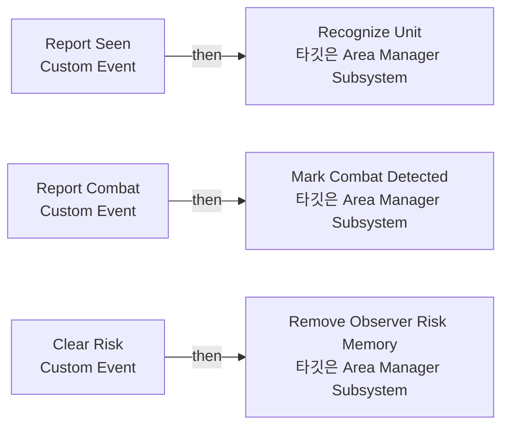

# BPC_AreaRiskComponent

에셋: `/Game/QuakeLike_1_0/AI/Area/BPC_AreaRiskComponent`

부모: `/Script/CoreUObject.Class'/Script/Engine.ActorComponent'`

수집일: 2026-10-12. MCP에서 읽은 그래프·핀 연결의 자동 전사입니다. 상속된 그래프는 부모 문서를 함께 확인합니다.

정적 루트 참조 도달: 없음. 실행 여부 또는 삭제 가능 여부의 확정이 아닙니다.

컴포넌트 목록은 이 BP가 직접 정의한 SCS만 포함합니다. 부모·네이티브 생성 컴포넌트, 인스턴스 설정은 별도입니다.

## 그래프 목록

| 그래프 | 전체 노드 수 |
|---|---|
| EventGraph | 18 |

## 그래프별 실행 연결

실선은 출력 exec 핀의 실제 연결입니다. 여러 분기는 출력 핀 이름을 표시합니다. 함수 호출·delegate·타이머의 다음 그래프 실행은 이 그림에서 자동으로 이어 붙이지 않습니다.

순수 계산 노드 및 데이터 핀은 아래 목록과 원본 JSON을 확인합니다. 연결되지 않은 이벤트도 표시되므로, 노드가 있다는 이유만으로 실행된다고 판단하면 안 됩니다.

### EventGraph

실행 핀 플로우차트

전체 노드·기본 입력 목록

| 노드 ID | 제목 | 미연결 기본 입력 / 에셋 입력 |
|---|---|---|
| `K2Node_CustomEvent_0` | Report Seen Custom Event |  |
| `K2Node_GetSubsystem_0` | Area Manager Subsystem |  |
| `K2Node_CallFunction_0` | Recognize Unit 타깃은 Area Manager Subsystem | ReturnValue=false |
| `K2Node_Knot_0` | 경유 노드 |  |
| `K2Node_Knot_1` | 경유 노드 |  |
| `K2Node_Knot_2` | 경유 노드 |  |
| `K2Node_CustomEvent_1` | Report Combat Custom Event |  |
| `K2Node_GetSubsystem_1` | Area Manager Subsystem |  |
| `K2Node_CallFunction_1` | Mark Combat Detected 타깃은 Area Manager Subsystem | ReturnValue=false |
| `K2Node_Knot_3` | 경유 노드 |  |
| `K2Node_Knot_4` | 경유 노드 |  |
| `K2Node_CustomEvent_2` | Clear Risk Custom Event |  |
| `K2Node_GetSubsystem_2` | Area Manager Subsystem |  |
| `K2Node_CallFunction_2` | Remove Observer Risk Memory 타깃은 Area Manager Subsystem |  |
| `K2Node_Knot_5` | 경유 노드 |  |
| `EdGraphNode_Comment_0` | 적을  볼 시(Perception) 위험도 증가 |  |
| `EdGraphNode_Comment_2` | 교전 상황을 볼 시 위험도 증가 |  |
| `EdGraphNode_Comment_3` | 죽었을 때 위험도 초기화 |  |

## 조회 범위의 한계

ObjectIterator로 발견했으나 MCP helper가 반환하지 않은 그래프입니다. delegate signature·컴파일된 중간 그래프·macro·애니메이션 내부 그래프가 섞일 수 있습니다.

- `Clear Risk`: Graph 'Clear Risk' not found in Blueprint.
- `ExecuteUbergraph_BPC_AreaRiskComponent`: Graph 'ExecuteUbergraph_BPC_AreaRiskComponent' not found in Blueprint.
- `Report Combat`: Graph 'Report Combat' not found in Blueprint.
- `Report Seen`: Graph 'Report Seen' not found in Blueprint.

[원본 MCP 스냅샷](../../../../Evidence/blueprints-140.json)
