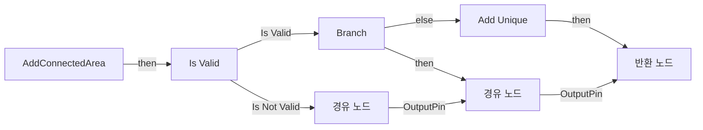
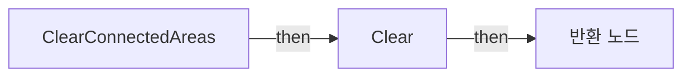
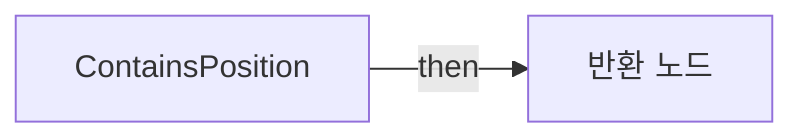
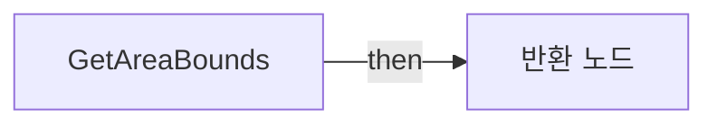
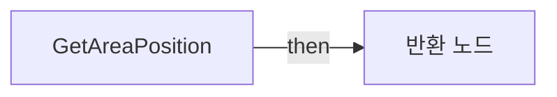
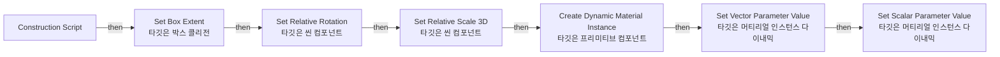

# BP_AIArea

에셋: `/Game/QuakeLike_1_0/AI/Area/BP_AIArea`

부모: `/Script/CoreUObject.Class'/Script/Engine.Actor'`

수집일: 2026-10-12. MCP에서 읽은 그래프·핀 연결의 자동 전사입니다. 상속된 그래프는 부모 문서를 함께 확인합니다.

정적 루트 참조 도달: 있음. 실행 여부 또는 삭제 가능 여부의 확정이 아닙니다.

컴포넌트 목록은 이 BP가 직접 정의한 SCS만 포함합니다. 부모·네이티브 생성 컴포넌트, 인스턴스 설정은 별도입니다.

## 직접 정의한 컴포넌트

| 이름 | 클래스 | 부모 컴포넌트 |
|---|---|---|
| `DefaultSceneRoot` | `SceneComponent` | `` |
| `Box` | `BoxComponent` | `DefaultSceneRoot` |
| `AreaaPreview` | `StaticMeshComponent` | `DefaultSceneRoot` |

## 변수와 기본값

| 이름 | 타입 | CDO 기본값 |
|---|---|---|
| `areaId` | `int` | 0 |
| `areaName` | `name` | None |
| `connectedAreas` | `BP_AIArea_C` | [] |
| `areaRiskScore` | `int` | 0 |
| `areaColor` | `LinearColor` | &lt;Struct 'LinearColor' {r: 0.064634, g: 0.084408, b: 1.000000, a: 1.000000}&gt; |
| `previewOpacity` | `real` | 0.18 |
| `showAreaPreview` | `bool` | True |
| `areaExtent` | `Vector` | &lt;Struct 'Vector' {x: 0.000000, y: 0.000000, z: 0.000000}&gt; |
| `Way Points` | `BP_WayPointLink_C` | [] |

## 그래프 목록

| 그래프 | 전체 노드 수 |
|---|---|
| AddConnectedArea | 15 |
| ClearConnectedAreas | 4 |
| ContainsPosition | 14 |
| EventGraph | 0 |
| GetAreaBounds | 4 |
| GetAreaPosition | 3 |
| UserConstructionScript | 16 |

## 그래프별 실행 연결

실선은 출력 exec 핀의 실제 연결입니다. 여러 분기는 출력 핀 이름을 표시합니다. 함수 호출·delegate·타이머의 다음 그래프 실행은 이 그림에서 자동으로 이어 붙이지 않습니다.

순수 계산 노드 및 데이터 핀은 아래 목록과 원본 JSON을 확인합니다. 연결되지 않은 이벤트도 표시되므로, 노드가 있다는 이유만으로 실행된다고 판단하면 안 됩니다.

### AddConnectedArea

실행 핀 플로우차트

전체 노드·기본 입력 목록

| 노드 ID | 제목 | 미연결 기본 입력 / 에셋 입력 |
|---|---|---|
| `K2Node_FunctionEntry_0` | AddConnectedArea |  |
| `K2Node_MacroInstance_0` | Is Valid |  |
| `K2Node_Knot_0` | 경유 노드 |  |
| `K2Node_PromotableOperator_0` | Equal (Object) |  |
| `K2Node_Self_0` | 셀프-레퍼런스 |  |
| `K2Node_IfThenElse_0` | Branch |  |
| `K2Node_FunctionResult_0` | 반환 노드 |  |
| `K2Node_Knot_2` | 경유 노드 |  |
| `K2Node_Knot_3` | 경유 노드 |  |
| `K2Node_VariableGet_1` | Get connectedAreas |  |
| `K2Node_CallArrayFunction_1` | Add Unique | ReturnValue=0 |
| `K2Node_Knot_4` | 경유 노드 |  |
| `K2Node_Knot_5` | 경유 노드 |  |
| `K2Node_Knot_6` | 경유 노드 |  |
| `K2Node_Knot_7` | 경유 노드 |  |

### ClearConnectedAreas

실행 핀 플로우차트

전체 노드·기본 입력 목록

| 노드 ID | 제목 | 미연결 기본 입력 / 에셋 입력 |
|---|---|---|
| `K2Node_FunctionEntry_0` | ClearConnectedAreas |  |
| `K2Node_VariableGet_0` | Get connectedAreas |  |
| `K2Node_CallArrayFunction_0` | Clear |  |
| `K2Node_FunctionResult_0` | 반환 노드 |  |

### ContainsPosition

실행 핀 플로우차트

전체 노드·기본 입력 목록

| 노드 ID | 제목 | 미연결 기본 입력 / 에셋 입력 |
|---|---|---|
| `K2Node_FunctionEntry_0` | ContainsPosition |  |
| `K2Node_FunctionResult_0` | 반환 노드 |  |
| `K2Node_CallFunction_0` | Get Actor Location 타깃은 액터 |  |
| `K2Node_PromotableOperator_0` | vector - vector |  |
| `K2Node_VariableGet_0` | Get Box |  |
| `K2Node_CallFunction_1` | Get Scaled Box Extent 타깃은 박스 콜리전 |  |
| `K2Node_PromotableOperator_2` | float &lt;= float |  |
| `K2Node_PromotableOperator_3` | float &lt;= float |  |
| `K2Node_PromotableOperator_1` | float &lt;= float |  |
| `K2Node_CallFunction_5` | Absolute (Float) |  |
| `K2Node_CallFunction_6` | Absolute (Float) |  |
| `K2Node_CallFunction_4` | Absolute (Float) |  |
| `K2Node_CommutativeAssociativeBinaryOperator_1` | AND Boolean |  |
| `K2Node_CommutativeAssociativeBinaryOperator_2` | AND Boolean |  |

### EventGraph

전체 노드·기본 입력 목록

| 노드 ID | 제목 | 미연결 기본 입력 / 에셋 입력 |
|---|---|---|

### GetAreaBounds

실행 핀 플로우차트

전체 노드·기본 입력 목록

| 노드 ID | 제목 | 미연결 기본 입력 / 에셋 입력 |
|---|---|---|
| `K2Node_FunctionEntry_0` | GetAreaBounds |  |
| `K2Node_FunctionResult_0` | 반환 노드 |  |
| `K2Node_VariableGet_0` | Get Box |  |
| `K2Node_CallFunction_0` | Get Scaled Box Extent 타깃은 박스 콜리전 |  |

### GetAreaPosition

실행 핀 플로우차트

전체 노드·기본 입력 목록

| 노드 ID | 제목 | 미연결 기본 입력 / 에셋 입력 |
|---|---|---|
| `K2Node_FunctionEntry_0` | GetAreaPosition |  |
| `K2Node_FunctionResult_0` | 반환 노드 |  |
| `K2Node_CallFunction_0` | Get Actor Location 타깃은 액터 |  |

### UserConstructionScript

실행 핀 플로우차트

전체 노드·기본 입력 목록

| 노드 ID | 제목 | 미연결 기본 입력 / 에셋 입력 |
|---|---|---|
| `K2Node_FunctionEntry_0` | Construction Script |  |
| `K2Node_VariableGet_0` | Get areaExtent |  |
| `K2Node_VariableGet_1` | Get Box |  |
| `K2Node_CallFunction_0` | Set Box Extent 타깃은 박스 콜리전 | bUpdateOverlaps=true |
| `K2Node_VariableGet_7` | Get AreaaPreview |  |
| `K2Node_CallFunction_1` | Set Relative Rotation 타깃은 씬 컴포넌트 | NewRotation=0, 0, 0; bSweep=false; bTeleport=false |
| `K2Node_VariableGet_8` | Get areaExtent |  |
| `K2Node_PromotableOperator_0` | vector / vector | B=50.000000 |
| `K2Node_VariableGet_9` | Get AreaaPreview |  |
| `K2Node_CallFunction_6` | Set Relative Scale 3D 타깃은 씬 컴포넌트 |  |
| `K2Node_VariableGet_10` | Get AreaaPreview |  |
| `K2Node_CallFunction_7` | Create Dynamic Material Instance 타깃은 프리미티브 컴포넌트 | ElementIndex=0; OptionalName=None |
| `K2Node_CallFunction_8` | Set Vector Parameter Value 타깃은 머티리얼 인스턴스 다이내믹 | ParameterName=areaColor |
| `K2Node_VariableGet_11` | Get areaColor |  |
| `K2Node_CallFunction_9` | Set Scalar Parameter Value 타깃은 머티리얼 인스턴스 다이내믹 | ParameterName=previewOpacity |
| `K2Node_VariableGet_12` | Get previewOpacity |  |

## 조회 범위의 한계

ObjectIterator로 발견했으나 MCP helper가 반환하지 않은 그래프입니다. delegate signature·컴파일된 중간 그래프·macro·애니메이션 내부 그래프가 섞일 수 있습니다.

- `AddConnectedArea_MERGED`: Graph 'AddConnectedArea_MERGED' not found in Blueprint.
- `ClearConnectedAreas_MERGED`: Graph 'ClearConnectedAreas_MERGED' not found in Blueprint.
- `ContainsPosition_MERGED`: Graph 'ContainsPosition_MERGED' not found in Blueprint.
- `EdGraph_0`: Graph 'EdGraph_0' not found in Blueprint.
- `ExecuteUbergraph_BP_AIArea`: Graph 'ExecuteUbergraph_BP_AIArea' not found in Blueprint.
- `GetAreaBounds_MERGED`: Graph 'GetAreaBounds_MERGED' not found in Blueprint.
- `GetAreaPosition_MERGED`: Graph 'GetAreaPosition_MERGED' not found in Blueprint.
- `UserConstructionScript_MERGED`: Graph 'UserConstructionScript_MERGED' not found in Blueprint.

[원본 MCP 스냅샷](../../../../Evidence/blueprints-140.json)
