# BP_AreaManager

에셋: `/Game/QuakeLike_1_0/AI/Area/BP_AreaManager`

부모: `/Script/CoreUObject.Class'/Script/Engine.Actor'`

수집일: 2026-10-12. MCP에서 읽은 그래프·핀 연결의 자동 전사입니다. 상속된 그래프는 부모 문서를 함께 확인합니다.

정적 루트 참조 도달: 있음. 실행 여부 또는 삭제 가능 여부의 확정이 아닙니다.

컴포넌트 목록은 이 BP가 직접 정의한 SCS만 포함합니다. 부모·네이티브 생성 컴포넌트, 인스턴스 설정은 별도입니다.

## 직접 정의한 컴포넌트

| 이름 | 클래스 | 부모 컴포넌트 |
|---|---|---|
| `DefaultSceneRoot` | `SceneComponent` | `` |

## 변수와 기본값

| 이름 | 타입 | CDO 기본값 |
|---|---|---|
| `areas` | `BP_AIArea_C` | [] |
| `areaLinks` | `BP_AreaLink_C` | [] |
| `debugMode` | `bool` | True |
| `printAreaLog` | `bool` | True |
| `riskConfig` | `PDA_AreaRisk_C` | None |
| `testOriginActor` | `Actor` | None |
| `dynamicRiskEvents` | `ST_AreaRiskEvent` | [] |
| `unitSeenLifeTime` | `real` | 1.0 |
| `attackRiskLifeTime` | `real` | 5.0 |
| `damagedRiskLifeTime` | `real` | 5.0 |
| `maxDynamicRisk` | `real` | 100.0 |
| `testRiskLocationActor` | `Actor` | None |
| `testArea` | `BP_AIArea_C` | None |
| `clearRiskEventInterval` | `real` | 1.0 |

## 그래프 목록

| 그래프 | 전체 노드 수 |
|---|---|
| CalculateDynamicRisk | 47 |
| CalculateStaticRisk | 19 |
| ClearOldRiskEvents | 25 |
| EventGraph | 79 |
| GetAreaByPosition | 24 |
| GetAreaRiskScore | 7 |
| GetLowestRiskConnectedArea | 45 |
| GetMovePositionInArea | 67 |
| GetNearestArea | 19 |
| GetRiskEventLifeTime | 8 |
| InitializeAreaLinks | 28 |
| InitializeAreas | 13 |
| ReportAttackAtLocation | 5 |
| ReportDamagedAtLocation | 5 |
| ReportUnitSeen | 7 |
| UpsertAreaRiskEvent | 53 |
| UserConstructionScript | 1 |
| ValidateAreaLinks | 16 |

## 그래프별 실행 연결

실선은 출력 exec 핀의 실제 연결입니다. 여러 분기는 출력 핀 이름을 표시합니다. 함수 호출·delegate·타이머의 다음 그래프 실행은 이 그림에서 자동으로 이어 붙이지 않습니다.

순수 계산 노드 및 데이터 핀은 아래 목록과 원본 JSON을 확인합니다. 연결되지 않은 이벤트도 표시되므로, 노드가 있다는 이유만으로 실행된다고 판단하면 안 됩니다.

### CalculateDynamicRisk

실행 핀 플로우차트

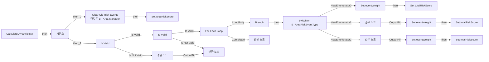

전체 노드·기본 입력 목록

| 노드 ID | 제목 | 미연결 기본 입력 / 에셋 입력 |
|---|---|---|
| `K2Node_FunctionEntry_0` | CalculateDynamicRisk |  |
| `K2Node_FunctionResult_0` | 반환 노드 | dynamicRiskScore=0 |
| `K2Node_CallFunction_0` | Clear Old Risk Events 타깃은 BP Area Manager |  |
| `K2Node_VariableSet_0` | Set totalRiskScore | totalRiskScore=0; Output_Get=0 |
| `K2Node_ExecutionSequence_0` | 시퀀스 |  |
| `K2Node_MacroInstance_0` | Is Valid |  |
| `K2Node_Knot_0` | 경유 노드 |  |
| `K2Node_VariableGet_0` | Get riskConfig |  |
| `K2Node_MacroInstance_1` | Is Valid |  |
| `K2Node_Knot_1` | 경유 노드 |  |
| `K2Node_VariableGet_1` | Get dynamicRiskEvents |  |
| `K2Node_MacroInstance_2` | For Each Loop |  |
| `K2Node_BreakStruct_0` | Break ST Area Risk Event |  |
| `K2Node_IfThenElse_0` | Branch |  |
| `K2Node_PromotableOperator_1` | Equal (Object) |  |
| `K2Node_Knot_2` | 경유 노드 |  |
| `K2Node_PromotableOperator_0` | Equal (Object) |  |
| `K2Node_CommutativeAssociativeBinaryOperator_0` | AND Boolean |  |
| `K2Node_Knot_3` | 경유 노드 |  |
| `K2Node_SwitchEnum_0` | Switch on E_AreaRiskEventType |  |
| `K2Node_VariableSet_2` | Set eventWeight |  |
| `K2Node_VariableSet_3` | Set eventWeight |  |
| `K2Node_VariableSet_1` | Set eventWeight |  |
| `K2Node_VariableGet_2` | Get riskConfig |  |
| `K2Node_Knot_4` | 경유 노드 |  |
| `K2Node_Knot_5` | 경유 노드 |  |
| `K2Node_VariableGet_3` | Get unitCountWeight |  |
| `K2Node_Knot_6` | 경유 노드 |  |
| `K2Node_VariableGet_4` | Get attackWeight |  |
| `K2Node_VariableGet_5` | Get damagedWeight |  |
| `K2Node_Knot_7` | 경유 노드 |  |
| `K2Node_Knot_8` | 경유 노드 |  |
| `K2Node_VariableGet_7` | Get totalRiskScore |  |
| `K2Node_VariableGet_8` | Get totalRiskScore |  |
| `K2Node_VariableGet_6` | Get totalRiskScore |  |
| `K2Node_PromotableOperator_4` | int + int |  |
| `K2Node_PromotableOperator_5` | int + int |  |
| `K2Node_PromotableOperator_3` | int + int |  |
| `K2Node_VariableSet_6` | Set totalRiskScore | Output_Get=0 |
| `K2Node_VariableSet_7` | Set totalRiskScore | Output_Get=0 |
| `K2Node_VariableSet_5` | Set totalRiskScore | Output_Get=0 |
| `K2Node_CallFunction_1` | Clamp (Integer) | Min=0 |
| `K2Node_VariableGet_10` | Get totalRiskScore |  |
| `K2Node_Knot_9` | 경유 노드 |  |
| `K2Node_VariableGet_11` | Get maxDynamicRisk |  |
| `K2Node_CallFunction_18` | Truncate |  |
| `K2Node_FunctionResult_1` | 반환 노드 |  |

### CalculateStaticRisk

실행 핀 플로우차트

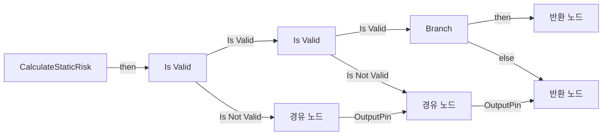

전체 노드·기본 입력 목록

| 노드 ID | 제목 | 미연결 기본 입력 / 에셋 입력 |
|---|---|---|
| `K2Node_FunctionEntry_0` | CalculateStaticRisk |  |
| `K2Node_FunctionResult_0` | 반환 노드 | staticRiskScore=0 |
| `K2Node_MacroInstance_0` | Is Valid |  |
| `K2Node_VariableGet_0` | Get riskConfig |  |
| `K2Node_MacroInstance_1` | Is Valid |  |
| `K2Node_Knot_0` | 경유 노드 |  |
| `K2Node_VariableGet_1` | Get connectedAreas |  |
| `K2Node_CallArrayFunction_0` | Length |  |
| `K2Node_IfThenElse_0` | Branch |  |
| `K2Node_PromotableOperator_0` | integer &lt;= integer | B=1 |
| `K2Node_Knot_1` | 경유 노드 |  |
| `K2Node_Knot_2` | 경유 노드 |  |
| `K2Node_VariableGet_2` | Get deadEndScore |  |
| `K2Node_FunctionResult_1` | 반환 노드 |  |
| `K2Node_Knot_3` | 경유 노드 |  |
| `K2Node_Knot_4` | 경유 노드 |  |
| `K2Node_Knot_5` | 경유 노드 |  |
| `K2Node_Knot_6` | 경유 노드 |  |
| `K2Node_Knot_7` | 경유 노드 |  |

### ClearOldRiskEvents

실행 핀 플로우차트

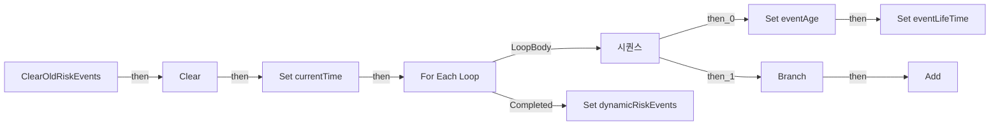

전체 노드·기본 입력 목록

| 노드 ID | 제목 | 미연결 기본 입력 / 에셋 입력 |
|---|---|---|
| `K2Node_FunctionEntry_0` | ClearOldRiskEvents |  |
| `K2Node_VariableGet_0` | Get newRiskEvents |  |
| `K2Node_CallArrayFunction_0` | Clear |  |
| `K2Node_CallFunction_0` | Get Game Time in Seconds |  |
| `K2Node_VariableSet_0` | Set currentTime | Output_Get=0.0 |
| `K2Node_VariableGet_1` | Get dynamicRiskEvents |  |
| `K2Node_MacroInstance_0` | For Each Loop |  |
| `K2Node_VariableGet_2` | Get currentTime |  |
| `K2Node_PromotableOperator_0` | float - float |  |
| `K2Node_VariableSet_1` | Set eventAge | Output_Get=0.0 |
| `K2Node_CallFunction_1` | Get Risk Event Life Time |  |
| `K2Node_Knot_0` | 경유 노드 |  |
| `K2Node_VariableSet_2` | Set eventLifeTime | Output_Get=0.0 |
| `K2Node_ExecutionSequence_0` | 시퀀스 |  |
| `K2Node_IfThenElse_0` | Branch |  |
| `K2Node_PromotableOperator_1` | float &lt;= float |  |
| `K2Node_VariableGet_3` | Get eventAge |  |
| `K2Node_VariableGet_4` | Get eventLifeTime |  |
| `K2Node_VariableGet_5` | Get newRiskEvents |  |
| `K2Node_CallArrayFunction_1` | Add | ReturnValue=0 |
| `K2Node_BreakStruct_3` | Break ST Area Risk Event |  |
| `K2Node_Knot_1` | 경유 노드 |  |
| `K2Node_Knot_2` | 경유 노드 |  |
| `K2Node_VariableSet_3` | Set dynamicRiskEvents |  |
| `K2Node_VariableGet_6` | Get newRiskEvents |  |

### EventGraph

실행 핀 플로우차트

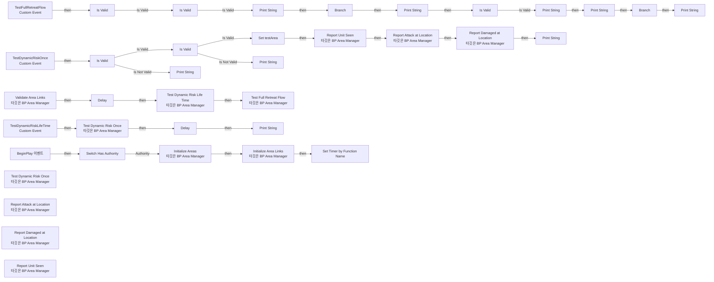

전체 노드·기본 입력 목록

| 노드 ID | 제목 | 미연결 기본 입력 / 에셋 입력 |
|---|---|---|
| `K2Node_Event_0` | BeginPlay 이벤트 |  |
| `K2Node_CallFunction_0` | Initialize Areas 타깃은 BP Area Manager |  |
| `K2Node_CallFunction_1` | Initialize Area Links 타깃은 BP Area Manager |  |
| `K2Node_CallFunction_2` | Validate Area Links 타깃은 BP Area Manager |  |
| `K2Node_MacroInstance_0` | Switch Has Authority |  |
| `K2Node_CustomEvent_0` | TestFullRetreatFlow Custom Event |  |
| `K2Node_VariableGet_6` | Get testOriginActor |  |
| `K2Node_MacroInstance_2` | Is Valid |  |
| `K2Node_CallFunction_4` | Get Actor Location 타깃은 액터 |  |
| `K2Node_CallFunction_8` | Get Area by Position |  |
| `K2Node_MacroInstance_6` | Is Valid |  |
| `K2Node_VariableGet_7` | Get areaName |  |
| `K2Node_CallFunction_17` | Print String | bPrintToScreen=true; bPrintToLog=true; TextColor=(R=0.000000,G=0.660000,B=1.000000,A=1.000000); Duration=10.000000; Key=None |
| `K2Node_CommutativeAssociativeBinaryOperator_3` | Append | A=Current Area:  |
| `K2Node_CallFunction_20` | To String (Name) |  |
| `K2Node_VariableGet_8` | Get connectedAreas |  |
| `K2Node_CallArrayFunction_1` | Length |  |
| `K2Node_PromotableOperator_2` | integer &gt; integer |  |
| `K2Node_IfThenElse_1` | Branch |  |
| `K2Node_CallFunction_21` | Print String | bPrintToScreen=true; bPrintToLog=true; TextColor=(R=0.000000,G=0.660000,B=1.000000,A=1.000000); Duration=10.000000; Key=None |
| `K2Node_CommutativeAssociativeBinaryOperator_4` | Append | A=Connected Count:  |
| `K2Node_CallFunction_22` | To String (Integer) |  |
| `K2Node_CallFunction_23` | Get Lowest Risk Connected Area |  |
| `K2Node_VariableGet_9` | Get testOriginActor |  |
| `K2Node_CallFunction_24` | Get Actor Location 타깃은 액터 |  |
| `K2Node_MacroInstance_7` | Is Valid |  |
| `K2Node_CallFunction_26` | Print String | bPrintToScreen=true; bPrintToLog=true; TextColor=(R=0.000000,G=0.660000,B=1.000000,A=1.000000); Duration=10.000000; Key=None |
| `K2Node_CommutativeAssociativeBinaryOperator_5` | Append | A=Selected Safe Area:  |
| `K2Node_VariableGet_10` | Get areaName |  |
| `K2Node_CallFunction_27` | To String (Name) |  |
| `K2Node_CallFunction_28` | Get Area Risk Score |  |
| `K2Node_CallFunction_29` | Print String | bPrintToScreen=true; bPrintToLog=true; TextColor=(R=0.000000,G=0.660000,B=1.000000,A=1.000000); Duration=10.000000; Key=None |
| `K2Node_CommutativeAssociativeBinaryOperator_6` | Append | A=Selected Risk:  |
| `K2Node_CallFunction_30` | To String (Integer) |  |
| `K2Node_CallFunction_31` | Get Move Position in Area |  |
| `K2Node_IfThenElse_2` | Branch |  |
| `K2Node_CallFunction_32` | Print String | bPrintToScreen=true; bPrintToLog=true; TextColor=(R=0.000000,G=0.660000,B=1.000000,A=1.000000); Duration=10.000000; Key=None |
| `K2Node_CommutativeAssociativeBinaryOperator_7` | Append | A=Move Position Found:  |
| `K2Node_CallFunction_33` | To String (Vector) |  |
| `K2Node_CallFunction_34` | Test Full Retreat Flow 타깃은 BP Area Manager |  |
| `K2Node_CustomEvent_1` | TestDynamicRiskOnce Custom Event |  |
| `K2Node_VariableGet_11` | Get testRiskLocationActor |  |
| `K2Node_MacroInstance_8` | Is Valid |  |
| `K2Node_CallFunction_3` | Print String | InString=TestRiskLocationActor is Not Valid; bPrintToScreen=true; bPrintToLog=true; TextColor=(R=0.000000,G=0.660000,B=1.000000,A=1.000000); Duration=10.000000; Key=None |
| `K2Node_CallFunction_36` | Get Actor Location 타깃은 액터 |  |
| `K2Node_CallFunction_37` | Get Area by Position |  |
| `K2Node_MacroInstance_9` | Is Valid |  |
| `K2Node_CallFunction_38` | Print String | InString=RIsk Area Not Found; bPrintToScreen=true; bPrintToLog=true; TextColor=(R=0.000000,G=0.660000,B=1.000000,A=1.000000); Duration=10.000000; Key=None |
| `K2Node_CallFunction_39` | Report Unit Seen 타깃은 BP Area Manager | success=false |
| `K2Node_VariableGet_13` | Get testRiskLocationActor |  |
| `K2Node_CallFunction_40` | Get Actor Location 타깃은 액터 |  |
| `K2Node_CallFunction_41` | Report Attack at Location 타깃은 BP Area Manager | success=false |
| `K2Node_CallFunction_42` | Report Damaged at Location 타깃은 BP Area Manager | success=false |
| `K2Node_CallFunction_51` | Get Area Risk Score |  |
| `K2Node_CallFunction_52` | Print String | bPrintToScreen=true; bPrintToLog=true; TextColor=(R=0.000000,G=0.660000,B=1.000000,A=1.000000); Duration=10.000000; Key=None |
| `K2Node_CommutativeAssociativeBinaryOperator_9` | Append | A=Area: ; C= / Risk:  |
| `K2Node_VariableGet_15` | Get areaName |  |
| `K2Node_CallFunction_53` | To String (Name) |  |
| `K2Node_CallFunction_54` | To String (Integer) |  |
| `K2Node_CustomEvent_2` | TestDynamicRiskLifeTime Custom Event |  |
| `K2Node_CallFunction_48` | Test Dynamic Risk Once 타깃은 BP Area Manager |  |
| `K2Node_CallFunction_49` | Delay | Duration=6.000000 |
| `K2Node_CallFunction_43` | Get Area Risk Score |  |
| `K2Node_CallFunction_44` | Print String | bPrintToScreen=true; bPrintToLog=true; TextColor=(R=0.000000,G=0.660000,B=1.000000,A=1.000000); Duration=10.000000; Key=None |
| `K2Node_CommutativeAssociativeBinaryOperator_8` | Append | A=Area: ; C= / Risk:  |
| `K2Node_VariableGet_14` | Get areaName |  |
| `K2Node_CallFunction_45` | To String (Name) |  |
| `K2Node_CallFunction_46` | To String (Integer) |  |
| `K2Node_VariableSet_0` | Set testArea |  |
| `K2Node_VariableGet_16` | Get testArea |  |
| `K2Node_CallFunction_55` | Delay | Duration=0.100000 |
| `K2Node_CallFunction_57` | Test Dynamic Risk Once 타깃은 BP Area Manager |  |
| `K2Node_CallFunction_58` | Test Dynamic Risk Life Time 타깃은 BP Area Manager |  |
| `K2Node_CallFunction_59` | Report Attack at Location 타깃은 BP Area Manager | attackLocation=0, 0, 0; success=false |
| `K2Node_CallFunction_60` | Report Damaged at Location 타깃은 BP Area Manager | damagedLocation=0, 0, 0; success=false |
| `K2Node_CallFunction_61` | Report Unit Seen 타깃은 BP Area Manager | seenLocation=0, 0, 0; success=false |
| `K2Node_CallFunction_63` | Get Area by Position | position=0, 0, 0 |
| `K2Node_CallFunction_5` | Set Timer by Function Name | FunctionName=ClearOldRiskEvents; bLooping=true; bMaxOncePerFrame=false; InitialStartDelay=0.000000; InitialStartDelayVariance=0.000000 |
| `K2Node_VariableGet_0` | Get clearRiskEventInterval |  |

### GetAreaByPosition

실행 핀 플로우차트

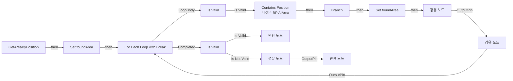

전체 노드·기본 입력 목록

| 노드 ID | 제목 | 미연결 기본 입력 / 에셋 입력 |
|---|---|---|
| `K2Node_FunctionEntry_0` | GetAreaByPosition |  |
| `K2Node_VariableSet_0` | Set foundArea |  |
| `K2Node_VariableGet_0` | Get areas |  |
| `K2Node_MacroInstance_1` | Is Valid |  |
| `K2Node_Knot_0` | 경유 노드 |  |
| `K2Node_CallFunction_0` | Contains Position 타깃은 BP AIArea |  |
| `K2Node_Knot_1` | 경유 노드 |  |
| `K2Node_Knot_2` | 경유 노드 |  |
| `K2Node_Knot_3` | 경유 노드 |  |
| `K2Node_Knot_4` | 경유 노드 |  |
| `K2Node_Knot_5` | 경유 노드 |  |
| `K2Node_Knot_6` | 경유 노드 |  |
| `K2Node_IfThenElse_0` | Branch |  |
| `K2Node_VariableSet_1` | Set foundArea |  |
| `K2Node_MacroInstance_2` | For Each Loop with Break |  |
| `K2Node_Knot_7` | 경유 노드 |  |
| `K2Node_Knot_8` | 경유 노드 |  |
| `K2Node_VariableGet_1` | Get foundArea |  |
| `K2Node_MacroInstance_3` | Is Valid |  |
| `K2Node_FunctionResult_1` | 반환 노드 |  |
| `K2Node_FunctionResult_2` | 반환 노드 |  |
| `K2Node_CallFunction_1` | Get Nearest Area |  |
| `K2Node_Knot_9` | 경유 노드 |  |
| `K2Node_Knot_10` | 경유 노드 |  |

### GetAreaRiskScore

실행 핀 플로우차트

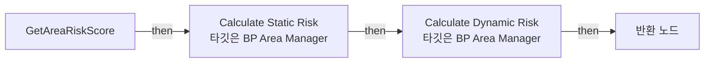

전체 노드·기본 입력 목록

| 노드 ID | 제목 | 미연결 기본 입력 / 에셋 입력 |
|---|---|---|
| `K2Node_FunctionEntry_0` | GetAreaRiskScore |  |
| `K2Node_FunctionResult_0` | 반환 노드 |  |
| `K2Node_CallFunction_0` | Calculate Static Risk 타깃은 BP Area Manager |  |
| `K2Node_CallFunction_1` | Calculate Dynamic Risk 타깃은 BP Area Manager |  |
| `K2Node_Knot_0` | 경유 노드 |  |
| `K2Node_Knot_1` | 경유 노드 |  |
| `K2Node_PromotableOperator_0` | int + int |  |

### GetLowestRiskConnectedArea

실행 핀 플로우차트

```mermaid
flowchart LR
  n0["GetLowestRiskConnectedArea"]
  n1["반환 노드"]
  n2["Set lowestRiskScore"]
  n3["Set selectedAreaLocal"]
  n4["Is Valid"]
  n5["For Each Loop"]
  n6["Is Valid"]
  n7["Set currentRiskScore"]
  n8["Branch"]
  n9["Set lowestRiskScore"]
  n10["Set selectedAreaLocal"]
  n11["반환 노드"]
  n12["Set shortestDistance"]
  n13["Set currentDistance"]
  n14["Set shortestDistance"]
  n15["Branch"]
  n16["Set selectedAreaLocal"]
  n0 -->|"then"| n4
  n2 -->|"then"| n12
  n3 -->|"then"| n5
  n4 -->|"Is Valid"| n2
  n4 -->|"Is Not Valid"| n1
  n5 -->|"LoopBody"| n6
  n5 -->|"Completed"| n11
  n6 -->|"Is Valid"| n7
  n7 -->|"then"| n13
  n8 -->|"then"| n9
  n8 -->|"else"| n15
  n9 -->|"then"| n14
  n12 -->|"then"| n3
  n13 -->|"then"| n8
  n14 -->|"then"| n10
  n15 -->|"then"| n16
```

전체 노드·기본 입력 목록

| 노드 ID | 제목 | 미연결 기본 입력 / 에셋 입력 |
|---|---|---|
| `K2Node_FunctionEntry_0` | GetLowestRiskConnectedArea |  |
| `K2Node_FunctionResult_0` | 반환 노드 |  |
| `K2Node_VariableSet_0` | Set lowestRiskScore | Output_Get=0 |
| `K2Node_VariableSet_1` | Set selectedAreaLocal |  |
| `K2Node_MacroInstance_0` | Is Valid |  |
| `K2Node_Knot_1` | 경유 노드 |  |
| `K2Node_VariableGet_1` | Get connectedAreas |  |
| `K2Node_Knot_2` | 경유 노드 |  |
| `K2Node_MacroInstance_1` | For Each Loop |  |
| `K2Node_MacroInstance_2` | Is Valid |  |
| `K2Node_CallFunction_0` | Get Area Risk Score |  |
| `K2Node_Knot_3` | 경유 노드 |  |
| `K2Node_Knot_4` | 경유 노드 |  |
| `K2Node_VariableSet_2` | Set currentRiskScore |  |
| `K2Node_IfThenElse_0` | Branch |  |
| `K2Node_PromotableOperator_0` | integer &lt; integer |  |
| `K2Node_VariableGet_2` | Get lowestRiskScore |  |
| `K2Node_VariableSet_3` | Set lowestRiskScore | Output_Get=0 |
| `K2Node_VariableGet_3` | Get currentRiskScore |  |
| `K2Node_VariableSet_4` | Set selectedAreaLocal |  |
| `K2Node_FunctionResult_1` | 반환 노드 |  |
| `K2Node_VariableGet_4` | Get selectedAreaLocal |  |
| `K2Node_VariableSet_5` | Set shortestDistance | shortestDistance=999999999.000000; Output_Get=0.0 |
| `K2Node_VariableSet_6` | Set currentDistance | Output_Get=0.0 |
| `K2Node_CallFunction_1` | Distance (Vector) |  |
| `K2Node_CallFunction_2` | Get Actor Location 타깃은 액터 |  |
| `K2Node_Knot_5` | 경유 노드 |  |
| `K2Node_VariableSet_7` | Set shortestDistance | Output_Get=0.0 |
| `K2Node_VariableGet_5` | Get currentDistance |  |
| `K2Node_IfThenElse_1` | Branch |  |
| `K2Node_CommutativeAssociativeBinaryOperator_0` | AND Boolean |  |
| `K2Node_PromotableOperator_1` | Equal (Integer) |  |
| `K2Node_VariableGet_6` | Get lowestRiskScore |  |
| `K2Node_VariableGet_7` | Get currentRiskScore |  |
| `K2Node_PromotableOperator_2` | float &lt; float |  |
| `K2Node_VariableGet_8` | Get currentDistance |  |
| `K2Node_VariableGet_9` | Get shortestDistance |  |
| `K2Node_VariableSet_9` | Set selectedAreaLocal |  |
| `K2Node_Knot_6` | 경유 노드 |  |
| `K2Node_CallFunction_3` | Get Area Risk Score |  |
| `K2Node_Knot_0` | 경유 노드 |  |
| `K2Node_VariableGet_0` | Get selectedAreaLocal |  |
| `K2Node_PromotableOperator_3` | Not Equal (Object) |  |
| `K2Node_Knot_7` | 경유 노드 |  |
| `K2Node_CommutativeAssociativeBinaryOperator_1` | AND Boolean |  |

### GetMovePositionInArea

실행 핀 플로우차트

```mermaid
flowchart LR
  n0["GetMovePositionInArea"]
  n1["Is Valid"]
  n2["반환 노드"]
  n3["Set areaCenter"]
  n4["Set areaExtent"]
  n5["설정"]
  n6["Set candidatePosition"]
  n7["For Loop with Break"]
  n8["Branch"]
  n9["Contains Position<br/>타깃은 BP AIArea"]
  n10["Branch"]
  n11["Find Path to Location Synchronously"]
  n12["Is Valid"]
  n13["Branch"]
  n14["Set successLocal"]
  n15["Set movePositionLocal"]
  n16["경유 노드"]
  n17["경유 노드"]
  n18["반환 노드"]
  n19["Set successLocal"]
  n20["Set movePositionLocal"]
  n0 -->|"then"| n19
  n1 -->|"Is Valid"| n3
  n1 -->|"Is Not Valid"| n2
  n3 -->|"then"| n4
  n4 -->|"then"| n7
  n5 -->|"then"| n6
  n6 -->|"then"| n8
  n7 -->|"LoopBody"| n5
  n7 -->|"Completed"| n18
  n8 -->|"then"| n9
  n9 -->|"then"| n10
  n10 -->|"then"| n11
  n11 -->|"then"| n12
  n12 -->|"Is Valid"| n13
  n13 -->|"else"| n14
  n14 -->|"then"| n15
  n15 -->|"then"| n16
  n16 -->|"OutputPin"| n17
  n17 -->|"OutputPin"| n7
  n19 -->|"then"| n20
  n20 -->|"then"| n1
```

전체 노드·기본 입력 목록

| 노드 ID | 제목 | 미연결 기본 입력 / 에셋 입력 |
|---|---|---|
| `K2Node_FunctionEntry_0` | GetMovePositionInArea |  |
| `K2Node_MacroInstance_0` | Is Valid |  |
| `K2Node_FunctionResult_1` | 반환 노드 | success=false |
| `K2Node_Knot_0` | 경유 노드 |  |
| `K2Node_Knot_1` | 경유 노드 |  |
| `K2Node_CallFunction_0` | Get Actor Location 타깃은 액터 |  |
| `K2Node_VariableSet_0` | Set areaCenter | Output_Get=0, 0, 0 |
| `K2Node_VariableGet_0` | Get areaExtent |  |
| `K2Node_VariableSet_1` | Set areaExtent | Output_Get=0, 0, 0 |
| `K2Node_Knot_2` | 경유 노드 |  |
| `K2Node_Knot_3` | 경유 노드 |  |
| `K2Node_Knot_4` | 경유 노드 |  |
| `K2Node_Knot_5` | 경유 노드 |  |
| `K2Node_Knot_6` | 경유 노드 |  |
| `K2Node_VariableGet_1` | Get tryCount |  |
| `K2Node_CallFunction_3` | Random Float in Range |  |
| `K2Node_VariableGet_3` | Get | areaExtent_Y=0.0; areaExtent_Z=0.0 |
| `K2Node_PromotableOperator_1` | float * float | B=-1.000000 |
| `K2Node_Knot_8` | 경유 노드 |  |
| `K2Node_CallFunction_1` | Random Float in Range |  |
| `K2Node_VariableGet_2` | Get | areaExtent_X=0.0; areaExtent_Z=0.0 |
| `K2Node_PromotableOperator_0` | float * float | B=-1.000000 |
| `K2Node_Knot_7` | 경유 노드 |  |
| `K2Node_VariableSet_2` | 설정 | randomOffset_Z=0.0; Output_Get=0, 0, 0 |
| `K2Node_Knot_10` | 경유 노드 |  |
| `K2Node_Knot_11` | 경유 노드 |  |
| `K2Node_VariableSet_3` | Set candidatePosition | Output_Get=0, 0, 0 |
| `K2Node_PromotableOperator_3` | vector + vector |  |
| `K2Node_VariableGet_5` | Get areaCenter |  |
| `K2Node_VariableGet_6` | Get randomOffset |  |
| `K2Node_MacroInstance_3` | For Loop with Break |  |
| `K2Node_CallFunction_8` | Project Point to Navigation |  |
| `K2Node_VariableGet_7` | Get candidatePosition |  |
| `K2Node_CallFunction_9` | Make Vector | X=100.000000; Y=100.000000 |
| `K2Node_VariableGet_8` | Get | areaExtent_X=0.0; areaExtent_Y=0.0 |
| `K2Node_PromotableOperator_4` | float + float | B=300.000000 |
| `K2Node_IfThenElse_0` | Branch |  |
| `K2Node_CallFunction_11` | Contains Position 타깃은 BP AIArea |  |
| `K2Node_Knot_12` | 경유 노드 |  |
| `K2Node_Knot_13` | 경유 노드 |  |
| `K2Node_Knot_14` | 경유 노드 |  |
| `K2Node_IfThenElse_1` | Branch |  |
| `EdGraphNode_Comment_1` | 구역 안인지 재확인 |  |
| `K2Node_CallFunction_12` | Find Path to Location Synchronously |  |
| `K2Node_Knot_15` | 경유 노드 |  |
| `K2Node_Knot_16` | 경유 노드 |  |
| `K2Node_Knot_17` | 경유 노드 |  |
| `K2Node_Knot_18` | 경유 노드 |  |
| `K2Node_Knot_19` | 경유 노드 |  |
| `K2Node_Knot_20` | 경유 노드 |  |
| `K2Node_MacroInstance_4` | Is Valid |  |
| `EdGraphNode_Comment_2` | 갈 수 있는 경로인지 확인 |  |
| `K2Node_CallFunction_13` | Is Partial 타깃은 내비게이션 경로 |  |
| `K2Node_IfThenElse_2` | Branch |  |
| `K2Node_Knot_21` | 경유 노드 |  |
| `K2Node_Knot_22` | 경유 노드 |  |
| `K2Node_VariableSet_4` | Set successLocal | successLocal=true; Output_Get=false |
| `K2Node_VariableSet_5` | Set movePositionLocal | Output_Get=0, 0, 0 |
| `K2Node_Knot_23` | 경유 노드 |  |
| `K2Node_Knot_24` | 경유 노드 |  |
| `K2Node_Knot_25` | 경유 노드 |  |
| `K2Node_FunctionResult_3` | 반환 노드 |  |
| `K2Node_VariableGet_9` | Get successLocal |  |
| `K2Node_VariableGet_10` | Get movePositionLocal |  |
| `K2Node_VariableSet_6` | Set successLocal | successLocal=false; Output_Get=false |
| `K2Node_VariableSet_7` | Set movePositionLocal | Output_Get=0, 0, 0 |
| `K2Node_Knot_26` | 경유 노드 |  |

### GetNearestArea

실행 핀 플로우차트

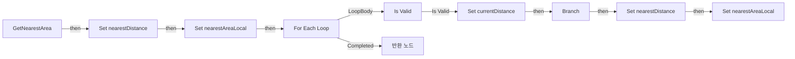

전체 노드·기본 입력 목록

| 노드 ID | 제목 | 미연결 기본 입력 / 에셋 입력 |
|---|---|---|
| `K2Node_FunctionEntry_0` | GetNearestArea |  |
| `K2Node_VariableGet_0` | Get areas |  |
| `K2Node_MacroInstance_0` | For Each Loop |  |
| `K2Node_MacroInstance_1` | Is Valid |  |
| `K2Node_Knot_0` | 경유 노드 |  |
| `K2Node_CallFunction_0` | Get Area Position 타깃은 BP AIArea |  |
| `K2Node_CallFunction_1` | Distance (Vector) |  |
| `K2Node_Knot_1` | 경유 노드 |  |
| `K2Node_VariableSet_0` | Set currentDistance |  |
| `K2Node_IfThenElse_0` | Branch |  |
| `K2Node_PromotableOperator_0` | float &lt; float |  |
| `K2Node_VariableGet_1` | Get nearestDistance |  |
| `K2Node_VariableSet_2` | Set nearestDistance | Output_Get=0.0 |
| `K2Node_VariableGet_2` | Get currentDistance |  |
| `K2Node_VariableSet_3` | Set nearestAreaLocal |  |
| `K2Node_FunctionResult_1` | 반환 노드 |  |
| `K2Node_VariableGet_3` | Get nearestAreaLocal |  |
| `K2Node_VariableSet_4` | Set nearestAreaLocal |  |
| `K2Node_VariableSet_5` | Set nearestDistance | nearestDistance=999999999.000000; Output_Get=0.0 |

### GetRiskEventLifeTime

실행 핀 플로우차트

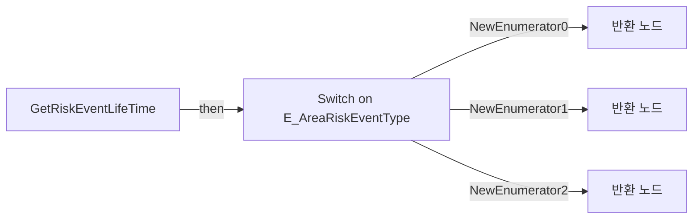

전체 노드·기본 입력 목록

| 노드 ID | 제목 | 미연결 기본 입력 / 에셋 입력 |
|---|---|---|
| `K2Node_FunctionEntry_0` | GetRiskEventLifeTime |  |
| `K2Node_FunctionResult_1` | 반환 노드 |  |
| `K2Node_SwitchEnum_0` | Switch on E_AreaRiskEventType |  |
| `K2Node_FunctionResult_2` | 반환 노드 |  |
| `K2Node_FunctionResult_0` | 반환 노드 |  |
| `K2Node_VariableGet_0` | Get unitSeenLifeTime |  |
| `K2Node_VariableGet_1` | Get attackRiskLifeTime |  |
| `K2Node_VariableGet_2` | Get damagedRiskLifeTime |  |

### InitializeAreaLinks

실행 핀 플로우차트

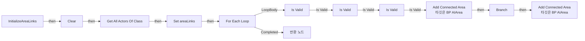

전체 노드·기본 입력 목록

| 노드 ID | 제목 | 미연결 기본 입력 / 에셋 입력 |
|---|---|---|
| `K2Node_FunctionEntry_0` | InitializeAreaLinks |  |
| `K2Node_VariableGet_0` | Get areaLinks |  |
| `K2Node_CallArrayFunction_0` | Clear |  |
| `K2Node_CallFunction_0` | Get All Actors Of Class | ActorClass=/Game/QuakeLike_1_0/AI/Area/BP_AreaLink.BP_AreaLink_C |
| `K2Node_VariableSet_0` | Set areaLinks |  |
| `K2Node_MacroInstance_0` | For Each Loop |  |
| `K2Node_MacroInstance_1` | Is Valid |  |
| `K2Node_Knot_0` | 경유 노드 |  |
| `K2Node_VariableGet_6` | Get areaA |  |
| `K2Node_CallFunction_1` | Add Connected Area 타깃은 BP AIArea |  |
| `K2Node_Knot_1` | 경유 노드 |  |
| `K2Node_Knot_2` | 경유 노드 |  |
| `K2Node_Knot_3` | 경유 노드 |  |
| `K2Node_VariableGet_7` | Get areaB |  |
| `K2Node_VariableGet_3` | Get isTwoWay |  |
| `K2Node_Knot_5` | 경유 노드 |  |
| `K2Node_IfThenElse_0` | Branch |  |
| `K2Node_VariableGet_4` | Get areaB |  |
| `K2Node_CallFunction_2` | Add Connected Area 타깃은 BP AIArea |  |
| `K2Node_Knot_6` | 경유 노드 |  |
| `K2Node_Knot_7` | 경유 노드 |  |
| `K2Node_VariableGet_5` | Get areaA |  |
| `K2Node_FunctionResult_0` | 반환 노드 |  |
| `K2Node_Knot_4` | 경유 노드 |  |
| `K2Node_VariableGet_1` | Get areaA |  |
| `K2Node_VariableGet_2` | Get areaB |  |
| `K2Node_MacroInstance_3` | Is Valid |  |
| `K2Node_MacroInstance_2` | Is Valid |  |

### InitializeAreas

실행 핀 플로우차트

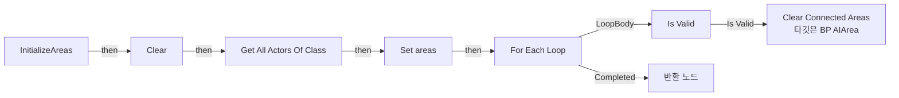

전체 노드·기본 입력 목록

| 노드 ID | 제목 | 미연결 기본 입력 / 에셋 입력 |
|---|---|---|
| `K2Node_FunctionEntry_0` | InitializeAreas |  |
| `K2Node_CallFunction_0` | Get All Actors Of Class | ActorClass=/Game/QuakeLike_1_0/AI/Area/BP_AIArea.BP_AIArea_C |
| `K2Node_VariableGet_0` | Get areas |  |
| `K2Node_CallArrayFunction_0` | Clear |  |
| `K2Node_VariableSet_0` | Set areas |  |
| `K2Node_MacroInstance_0` | For Each Loop |  |
| `K2Node_CallFunction_1` | Clear Connected Areas 타깃은 BP AIArea |  |
| `K2Node_MacroInstance_1` | Is Valid |  |
| `K2Node_Knot_0` | 경유 노드 |  |
| `K2Node_Knot_1` | 경유 노드 |  |
| `K2Node_Knot_2` | 경유 노드 |  |
| `K2Node_Knot_3` | 경유 노드 |  |
| `K2Node_FunctionResult_0` | 반환 노드 |  |

### ReportAttackAtLocation

실행 핀 플로우차트

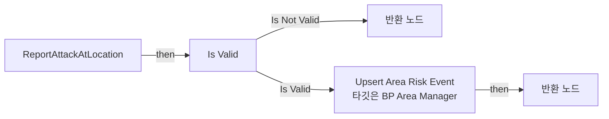

전체 노드·기본 입력 목록

| 노드 ID | 제목 | 미연결 기본 입력 / 에셋 입력 |
|---|---|---|
| `K2Node_FunctionEntry_0` | ReportAttackAtLocation |  |
| `K2Node_MacroInstance_0` | Is Valid |  |
| `K2Node_FunctionResult_1` | 반환 노드 | success=false |
| `K2Node_CallFunction_2` | Upsert Area Risk Event 타깃은 BP Area Manager | eventType=NewEnumerator1 |
| `K2Node_FunctionResult_0` | 반환 노드 |  |

### ReportDamagedAtLocation

실행 핀 플로우차트

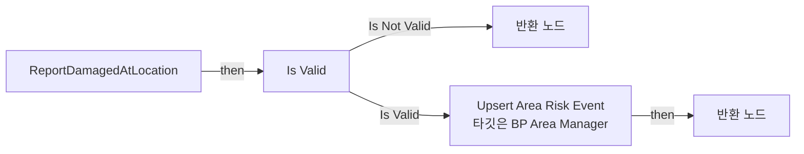

전체 노드·기본 입력 목록

| 노드 ID | 제목 | 미연결 기본 입력 / 에셋 입력 |
|---|---|---|
| `K2Node_FunctionEntry_0` | ReportDamagedAtLocation |  |
| `K2Node_MacroInstance_0` | Is Valid |  |
| `K2Node_FunctionResult_1` | 반환 노드 | success=false |
| `K2Node_CallFunction_2` | Upsert Area Risk Event 타깃은 BP Area Manager | eventType=NewEnumerator2 |
| `K2Node_FunctionResult_0` | 반환 노드 |  |

### ReportUnitSeen

실행 핀 플로우차트

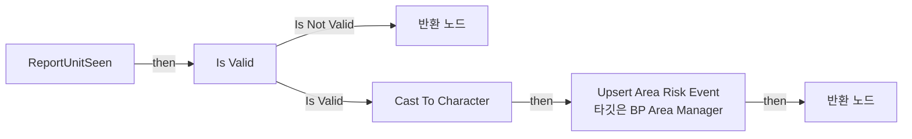

전체 노드·기본 입력 목록

| 노드 ID | 제목 | 미연결 기본 입력 / 에셋 입력 |
|---|---|---|
| `K2Node_FunctionEntry_0` | ReportUnitSeen |  |
| `K2Node_MacroInstance_0` | Is Valid |  |
| `K2Node_FunctionResult_0` | 반환 노드 | success=false |
| `K2Node_CallFunction_1` | Upsert Area Risk Event 타깃은 BP Area Manager | eventType=NewEnumerator0 |
| `K2Node_FunctionResult_1` | 반환 노드 |  |
| `K2Node_DynamicCast_0` | Cast To Character |  |
| `K2Node_Knot_0` | 경유 노드 |  |

### UpsertAreaRiskEvent

실행 핀 플로우차트

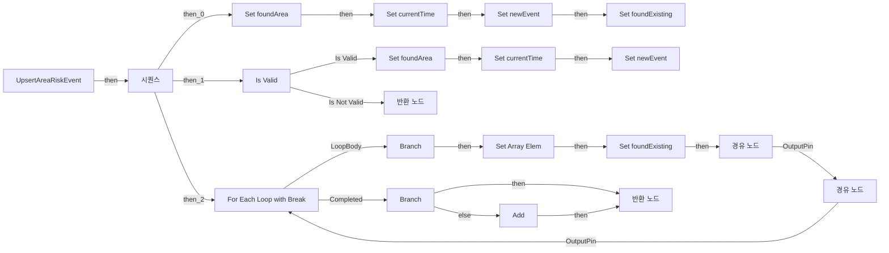

전체 노드·기본 입력 목록

| 노드 ID | 제목 | 미연결 기본 입력 / 에셋 입력 |
|---|---|---|
| `K2Node_FunctionEntry_0` | UpsertAreaRiskEvent |  |
| `K2Node_FunctionResult_0` | 반환 노드 | success=true |
| `K2Node_VariableSet_0` | Set foundArea |  |
| `K2Node_VariableSet_1` | Set currentTime | currentTime=0.0; Output_Get=0.0 |
| `K2Node_VariableSet_2` | Set newEvent |  |
| `K2Node_VariableSet_3` | Set foundExisting | foundExisting=false; Output_Get=false |
| `K2Node_ExecutionSequence_0` | 시퀀스 |  |
| `K2Node_CallFunction_0` | Get Area by Position |  |
| `K2Node_MacroInstance_0` | Is Valid |  |
| `K2Node_VariableSet_4` | Set foundArea |  |
| `K2Node_FunctionResult_1` | 반환 노드 | success=false |
| `K2Node_Knot_0` | 경유 노드 |  |
| `K2Node_CallFunction_1` | Get Game Time in Seconds |  |
| `K2Node_VariableSet_5` | Set currentTime | Output_Get=0.0 |
| `K2Node_MakeStruct_0` | Make ST Area Risk Event |  |
| `K2Node_VariableGet_0` | Get foundArea |  |
| `K2Node_VariableGet_1` | Get currentTime |  |
| `K2Node_VariableSet_6` | Set newEvent |  |
| `K2Node_Knot_1` | 경유 노드 |  |
| `K2Node_Knot_2` | 경유 노드 |  |
| `K2Node_Knot_3` | 경유 노드 |  |
| `K2Node_MacroInstance_1` | For Each Loop with Break |  |
| `K2Node_VariableGet_2` | Get dynamicRiskEvents |  |
| `K2Node_VariableGet_5` | Get |  |
| `K2Node_PromotableOperator_4` | Equal (Object) |  |
| `K2Node_PromotableOperator_0` | Equal (Object) |  |
| `K2Node_CommutativeAssociativeBinaryOperator_3` | AND Boolean |  |
| `K2Node_CommutativeAssociativeBinaryOperator_2` | AND Boolean |  |
| `K2Node_EnumEquality_0` | Equal (Enum) |  |
| `K2Node_Knot_4` | 경유 노드 |  |
| `K2Node_Knot_5` | 경유 노드 |  |
| `K2Node_Knot_6` | 경유 노드 |  |
| `K2Node_Knot_7` | 경유 노드 |  |
| `K2Node_Knot_8` | 경유 노드 |  |
| `K2Node_IfThenElse_0` | Branch |  |
| `K2Node_VariableGet_6` | Get dynamicRiskEvents |  |
| `K2Node_CallArrayFunction_0` | Set Array Elem | bSizeToFit=false |
| `K2Node_VariableGet_7` | Get newEvent |  |
| `K2Node_Knot_9` | 경유 노드 |  |
| `K2Node_VariableSet_7` | Set foundExisting | foundExisting=true; Output_Get=false |
| `K2Node_Knot_10` | 경유 노드 |  |
| `K2Node_Knot_11` | 경유 노드 |  |
| `K2Node_IfThenElse_1` | Branch |  |
| `K2Node_VariableGet_8` | Get foundExisting |  |
| `K2Node_VariableGet_9` | Get dynamicRiskEvents |  |
| `K2Node_CallArrayFunction_1` | Add | ReturnValue=0 |
| `K2Node_VariableGet_10` | Get newEvent |  |
| `K2Node_VariableGet_11` | Get foundArea |  |
| `K2Node_PromotableOperator_2` | Equal (Object) |  |
| `K2Node_CommutativeAssociativeBinaryOperator_1` | AND Boolean |  |
| `K2Node_Knot_12` | 경유 노드 |  |
| `K2Node_Knot_13` | 경유 노드 |  |
| `K2Node_Knot_14` | 경유 노드 |  |

### UserConstructionScript

실행 핀 플로우차트

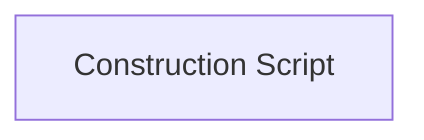

전체 노드·기본 입력 목록

| 노드 ID | 제목 | 미연결 기본 입력 / 에셋 입력 |
|---|---|---|
| `K2Node_FunctionEntry_0` | Construction Script |  |

### ValidateAreaLinks

실행 핀 플로우차트

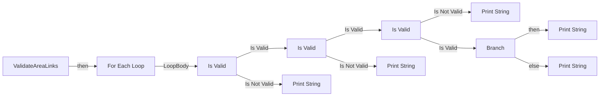

전체 노드·기본 입력 목록

| 노드 ID | 제목 | 미연결 기본 입력 / 에셋 입력 |
|---|---|---|
| `K2Node_FunctionEntry_0` | ValidateAreaLinks |  |
| `K2Node_VariableGet_0` | Get areaLinks |  |
| `K2Node_MacroInstance_0` | For Each Loop |  |
| `K2Node_MacroInstance_1` | Is Valid |  |
| `K2Node_Knot_0` | 경유 노드 |  |
| `K2Node_VariableGet_1` | Get areaA |  |
| `K2Node_MacroInstance_2` | Is Valid |  |
| `K2Node_VariableGet_2` | Get areaB |  |
| `K2Node_MacroInstance_3` | Is Valid |  |
| `K2Node_CallFunction_0` | Print String | InString=Area Link is None; bPrintToScreen=true; bPrintToLog=true; TextColor=(R=0.000000,G=0.660000,B=1.000000,A=1.000000); Duration=2.000000; Key=None |
| `K2Node_CallFunction_1` | Print String | InString=Area A is None; bPrintToScreen=true; bPrintToLog=true; TextColor=(R=0.000000,G=0.660000,B=1.000000,A=1.000000); Duration=2.000000; Key=None |
| `K2Node_CallFunction_2` | Print String | InString=Area B is None; bPrintToScreen=true; bPrintToLog=true; TextColor=(R=0.000000,G=0.660000,B=1.000000,A=1.000000); Duration=2.000000; Key=None |
| `K2Node_PromotableOperator_0` | Equal (Object) |  |
| `K2Node_IfThenElse_0` | Branch |  |
| `K2Node_CallFunction_3` | Print String | InString=Area A and Area B is same; bPrintToScreen=true; bPrintToLog=true; TextColor=(R=0.000000,G=0.660000,B=1.000000,A=1.000000); Duration=2.000000; Key=None |
| `K2Node_CallFunction_4` | Print String | InString=Done; bPrintToScreen=true; bPrintToLog=true; TextColor=(R=0.000000,G=0.660000,B=1.000000,A=1.000000); Duration=2.000000; Key=None |

## 조회 범위의 한계

ObjectIterator로 발견했으나 MCP helper가 반환하지 않은 그래프입니다. delegate signature·컴파일된 중간 그래프·macro·애니메이션 내부 그래프가 섞일 수 있습니다.

- `CalculateDynamicRisk_MERGED`: Graph 'CalculateDynamicRisk_MERGED' not found in Blueprint.
- `CalculateStaticRisk_MERGED`: Graph 'CalculateStaticRisk_MERGED' not found in Blueprint.
- `ClearOldRiskEvents_MERGED`: Graph 'ClearOldRiskEvents_MERGED' not found in Blueprint.
- `EdGraph_0`: Graph 'EdGraph_0' not found in Blueprint.
- `EdGraph_1`: Graph 'EdGraph_1' not found in Blueprint.
- `EdGraph_10`: Graph 'EdGraph_10' not found in Blueprint.
- `EdGraph_11`: Graph 'EdGraph_11' not found in Blueprint.
- `EdGraph_12`: Graph 'EdGraph_12' not found in Blueprint.
- `EdGraph_13`: Graph 'EdGraph_13' not found in Blueprint.
- `EdGraph_14`: Graph 'EdGraph_14' not found in Blueprint.
- `EdGraph_15`: Graph 'EdGraph_15' not found in Blueprint.
- `EdGraph_16`: Graph 'EdGraph_16' not found in Blueprint.
- `EdGraph_17`: Graph 'EdGraph_17' not found in Blueprint.
- `EdGraph_18`: Graph 'EdGraph_18' not found in Blueprint.
- `EdGraph_19`: Graph 'EdGraph_19' not found in Blueprint.
- `EdGraph_2`: Graph 'EdGraph_2' not found in Blueprint.
- `EdGraph_20`: Graph 'EdGraph_20' not found in Blueprint.
- `EdGraph_21`: Graph 'EdGraph_21' not found in Blueprint.
- `EdGraph_22`: Graph 'EdGraph_22' not found in Blueprint.
- `EdGraph_23`: Graph 'EdGraph_23' not found in Blueprint.
- `EdGraph_24`: Graph 'EdGraph_24' not found in Blueprint.
- `EdGraph_25`: Graph 'EdGraph_25' not found in Blueprint.
- `EdGraph_26`: Graph 'EdGraph_26' not found in Blueprint.
- `EdGraph_27`: Graph 'EdGraph_27' not found in Blueprint.
- `EdGraph_28`: Graph 'EdGraph_28' not found in Blueprint.
- `EdGraph_29`: Graph 'EdGraph_29' not found in Blueprint.
- `EdGraph_3`: Graph 'EdGraph_3' not found in Blueprint.
- `EdGraph_30`: Graph 'EdGraph_30' not found in Blueprint.
- `EdGraph_31`: Graph 'EdGraph_31' not found in Blueprint.
- `EdGraph_32`: Graph 'EdGraph_32' not found in Blueprint.
- `EdGraph_33`: Graph 'EdGraph_33' not found in Blueprint.
- `EdGraph_34`: Graph 'EdGraph_34' not found in Blueprint.
- `EdGraph_35`: Graph 'EdGraph_35' not found in Blueprint.
- `EdGraph_36`: Graph 'EdGraph_36' not found in Blueprint.
- `EdGraph_37`: Graph 'EdGraph_37' not found in Blueprint.
- `EdGraph_4`: Graph 'EdGraph_4' not found in Blueprint.
- `EdGraph_5`: Graph 'EdGraph_5' not found in Blueprint.
- `EdGraph_6`: Graph 'EdGraph_6' not found in Blueprint.
- `EdGraph_7`: Graph 'EdGraph_7' not found in Blueprint.
- `EdGraph_8`: Graph 'EdGraph_8' not found in Blueprint.
- `EdGraph_9`: Graph 'EdGraph_9' not found in Blueprint.
- `ExecuteUbergraph_BP_AreaManager`: Graph 'ExecuteUbergraph_BP_AreaManager' not found in Blueprint.
- `GetAreaByPosition_MERGED`: Graph 'GetAreaByPosition_MERGED' not found in Blueprint.
- `GetAreaRiskScore_MERGED`: Graph 'GetAreaRiskScore_MERGED' not found in Blueprint.
- `GetLowestRiskConnectedArea_MERGED`: Graph 'GetLowestRiskConnectedArea_MERGED' not found in Blueprint.
- `GetMovePositionInArea_MERGED`: Graph 'GetMovePositionInArea_MERGED' not found in Blueprint.
- `GetNearestArea_MERGED`: Graph 'GetNearestArea_MERGED' not found in Blueprint.
- `GetRiskEventLifeTime_MERGED`: Graph 'GetRiskEventLifeTime_MERGED' not found in Blueprint.
- `InitializeAreaLinks_MERGED`: Graph 'InitializeAreaLinks_MERGED' not found in Blueprint.
- `InitializeAreas_MERGED`: Graph 'InitializeAreas_MERGED' not found in Blueprint.
- `ReceiveBeginPlay`: Graph 'ReceiveBeginPlay' not found in Blueprint.
- `ReportAttackAtLocation_MERGED`: Graph 'ReportAttackAtLocation_MERGED' not found in Blueprint.
- `ReportDamagedAtLocation_MERGED`: Graph 'ReportDamagedAtLocation_MERGED' not found in Blueprint.
- `ReportUnitSeen_MERGED`: Graph 'ReportUnitSeen_MERGED' not found in Blueprint.
- `TestDynamicRiskLifeTime`: Graph 'TestDynamicRiskLifeTime' not found in Blueprint.
- `TestDynamicRiskOnce`: Graph 'TestDynamicRiskOnce' not found in Blueprint.
- `TestFullRetreatFlow`: Graph 'TestFullRetreatFlow' not found in Blueprint.
- `UpsertAreaRiskEvent_MERGED`: Graph 'UpsertAreaRiskEvent_MERGED' not found in Blueprint.
- `UserConstructionScript_MERGED`: Graph 'UserConstructionScript_MERGED' not found in Blueprint.
- `ValidateAreaLinks_MERGED`: Graph 'ValidateAreaLinks_MERGED' not found in Blueprint.

[원본 MCP 스냅샷](../../../../Evidence/blueprints-140.json)
