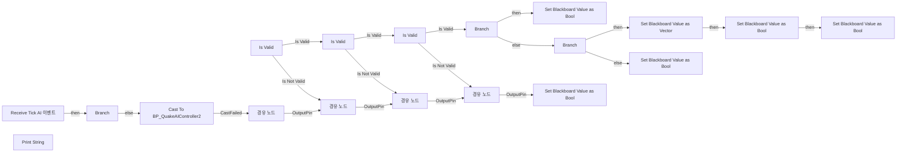

# BTS_SelectRetreatMovePosition

에셋: `/Game/QuakeLike_1_0/AI/Area/BTS_SelectRetreatMovePosition`

부모: `/Script/CoreUObject.Class'/Script/AIModule.BTService_BlueprintBase'`

수집일: 2026-10-12. MCP에서 읽은 그래프·핀 연결의 자동 전사입니다. 상속된 그래프는 부모 문서를 함께 확인합니다.

정적 루트 참조 도달: 없음. 실행 여부 또는 삭제 가능 여부의 확정이 아닙니다.

컴포넌트 목록은 이 BP가 직접 정의한 SCS만 포함합니다. 부모·네이티브 생성 컴포넌트, 인스턴스 설정은 별도입니다.

## 변수와 기본값

| 이름 | 타입 | CDO 기본값 |
|---|---|---|
| `needRetreatKey` | `BlackboardKeySelector` | &lt;Struct 'BlackboardKeySelector' {allowed_types: , selected_key_name: "", selected_key_type: None, selected_key_id: 65535, none_is_allowed_value: False}&gt; |
| `movePositionKey` | `BlackboardKeySelector` | &lt;Struct 'BlackboardKeySelector' {allowed_types: , selected_key_name: "", selected_key_type: None, selected_key_id: 65535, none_is_allowed_value: False}&gt; |
| `isRetreatingKey` | `BlackboardKeySelector` | &lt;Struct 'BlackboardKeySelector' {allowed_types: , selected_key_name: "", selected_key_type: None, selected_key_id: 65535, none_is_allowed_value: False}&gt; |

## 그래프 목록

| 그래프 | 전체 노드 수 |
|---|---|
| EventGraph | 52 |

## 그래프별 실행 연결

실선은 출력 exec 핀의 실제 연결입니다. 여러 분기는 출력 핀 이름을 표시합니다. 함수 호출·delegate·타이머의 다음 그래프 실행은 이 그림에서 자동으로 이어 붙이지 않습니다.

순수 계산 노드 및 데이터 핀은 아래 목록과 원본 JSON을 확인합니다. 연결되지 않은 이벤트도 표시되므로, 노드가 있다는 이유만으로 실행된다고 판단하면 안 됩니다.

### EventGraph

실행 핀 플로우차트

전체 노드·기본 입력 목록

| 노드 ID | 제목 | 미연결 기본 입력 / 에셋 입력 |
|---|---|---|
| `K2Node_Event_0` | Receive Tick AI 이벤트 | DeltaSeconds=0.0 |
| `K2Node_DynamicCast_0` | Cast To BP_QuakeAIController2 |  |
| `K2Node_MacroInstance_0` | Is Valid |  |
| `K2Node_CallFunction_0` | Get Actor Location 타깃은 액터 |  |
| `K2Node_Knot_0` | 경유 노드 |  |
| `K2Node_Knot_1` | 경유 노드 |  |
| `K2Node_CallFunction_1` | Get Area by Position 타깃은 BP Area Manager |  |
| `K2Node_Knot_2` | 경유 노드 |  |
| `K2Node_MacroInstance_1` | Is Valid |  |
| `K2Node_CallFunction_2` | Get Lowest Risk Connected Area 타깃은 BP Area Manager |  |
| `K2Node_Knot_3` | 경유 노드 |  |
| `K2Node_Knot_4` | 경유 노드 |  |
| `K2Node_Knot_5` | 경유 노드 |  |
| `K2Node_Knot_6` | 경유 노드 |  |
| `K2Node_Knot_7` | 경유 노드 |  |
| `K2Node_MacroInstance_2` | Is Valid |  |
| `K2Node_PromotableOperator_0` | Equal (Object) |  |
| `K2Node_Knot_8` | 경유 노드 |  |
| `K2Node_Knot_9` | 경유 노드 |  |
| `K2Node_IfThenElse_0` | Branch |  |
| `K2Node_Knot_10` | 경유 노드 |  |
| `K2Node_CallFunction_7` | Set Blackboard Value as Bool | Value=false |
| `K2Node_VariableGet_4` | Get needRetreatKey |  |
| `K2Node_CallFunction_4` | Get Move Position in Area 타깃은 BP Area Manager |  |
| `K2Node_Knot_11` | 경유 노드 |  |
| `K2Node_Knot_12` | 경유 노드 |  |
| `K2Node_Knot_13` | 경유 노드 |  |
| `K2Node_IfThenElse_1` | Branch |  |
| `K2Node_CallFunction_5` | Set Blackboard Value as Vector |  |
| `K2Node_VariableGet_2` | Get movePositionKey |  |
| `K2Node_CallFunction_11` | Set Blackboard Value as Bool | Value=true |
| `K2Node_VariableGet_3` | Get needRetreatKey |  |
| `K2Node_CallFunction_8` | Set Blackboard Value as Bool | Value=false |
| `K2Node_VariableGet_5` | Get needRetreatKey |  |
| `K2Node_CallFunction_3` | Set Blackboard Value as Bool | Value=false |
| `K2Node_VariableGet_1` | Get needRetreatKey |  |
| `K2Node_Knot_14` | 경유 노드 |  |
| `K2Node_Knot_15` | 경유 노드 |  |
| `K2Node_Knot_16` | 경유 노드 |  |
| `K2Node_Knot_17` | 경유 노드 |  |
| `K2Node_CallFunction_9` | Print String | bPrintToScreen=true; bPrintToLog=true; TextColor=(R=0.000000,G=0.660000,B=1.000000,A=1.000000); Duration=10.000000 |
| `K2Node_CommutativeAssociativeBinaryOperator_0` | Append | A=Select Area:  |
| `K2Node_VariableGet_6` | Get areaName |  |
| `K2Node_CallFunction_18` | To String (Name) |  |
| `K2Node_CallFunction_10` | Get Blackboard Value as Bool |  |
| `K2Node_VariableGet_7` | Get isRetreatingKey |  |
| `K2Node_IfThenElse_2` | Branch |  |
| `K2Node_CallFunction_6` | Set Blackboard Value as Bool | Value=true |
| `K2Node_VariableGet_8` | Get isRetreatingKey |  |
| `K2Node_CallFunction_12` | Get Display Name |  |
| `K2Node_CallFunction_19` | String To Name |  |
| `EdGraphNode_Comment_1` | Area Manager가 있었던 곳 |  |

## 조회 범위의 한계

ObjectIterator로 발견했으나 MCP helper가 반환하지 않은 그래프입니다. delegate signature·컴파일된 중간 그래프·macro·애니메이션 내부 그래프가 섞일 수 있습니다.

- `EdGraph_0`: Graph 'EdGraph_0' not found in Blueprint.
- `EdGraph_1`: Graph 'EdGraph_1' not found in Blueprint.
- `EdGraph_2`: Graph 'EdGraph_2' not found in Blueprint.
- `ExecuteUbergraph_BTS_SelectRetreatMovePosition`: Graph 'ExecuteUbergraph_BTS_SelectRetreatMovePosition' not found in Blueprint.
- `ReceiveTickAI`: Graph 'ReceiveTickAI' not found in Blueprint.

[원본 MCP 스냅샷](../../../../Evidence/blueprints-140.json)
