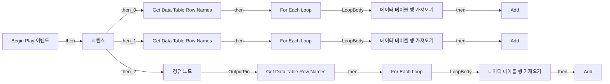
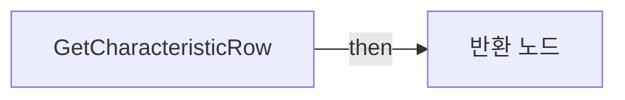
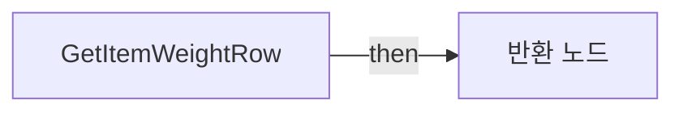
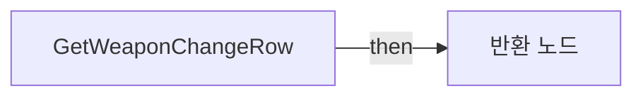

# BPC_AIDataCache

에셋: `/Game/QuakeLike_1_0/AI/BP/BPC_AIDataCache`

부모: `/Script/CoreUObject.Class'/Script/Engine.ActorComponent'`

수집일: 2026-10-12. MCP에서 읽은 그래프·핀 연결의 자동 전사입니다. 상속된 그래프는 부모 문서를 함께 확인합니다.

정적 루트 참조 도달: 있음. 실행 여부 또는 삭제 가능 여부의 확정이 아닙니다.

컴포넌트 목록은 이 BP가 직접 정의한 SCS만 포함합니다. 부모·네이티브 생성 컴포넌트, 인스턴스 설정은 별도입니다.

## 변수와 기본값

| 이름 | 타입 | CDO 기본값 |
|---|---|---|
| `CachedCharacteristicTable` | `name` | {} |
| `CachedItemWeightTable` | `name` | {} |
| `CachedWeaponChangeTable` | `name` | {} |
| `CharacteristicTableAsset` | `DataTable` | /Game/QuakeLike_1_0/Data/AI/DT_Characteristic.DT_Characteristic |
| `ItemWeightTableAsset` | `DataTable` | /Game/QuakeLike_1_0/Data/AI/DT_Item_Weight.DT_Item_Weight |
| `WeaponChangeTableAsset` | `DataTable` | /Game/QuakeLike_1_0/Data/AI/DT_WeaponChange_Weight.DT_WeaponChange_Weight |

## 그래프 목록

| 그래프 | 전체 노드 수 |
|---|---|
| EventGraph | 24 |
| GetCharacteristicRow | 5 |
| GetItemWeightRow | 5 |
| GetWeaponChangeRow | 5 |

## 그래프별 실행 연결

실선은 출력 exec 핀의 실제 연결입니다. 여러 분기는 출력 핀 이름을 표시합니다. 함수 호출·delegate·타이머의 다음 그래프 실행은 이 그림에서 자동으로 이어 붙이지 않습니다.

순수 계산 노드 및 데이터 핀은 아래 목록과 원본 JSON을 확인합니다. 연결되지 않은 이벤트도 표시되므로, 노드가 있다는 이유만으로 실행된다고 판단하면 안 됩니다.

### EventGraph

실행 핀 플로우차트

전체 노드·기본 입력 목록

| 노드 ID | 제목 | 미연결 기본 입력 / 에셋 입력 |
|---|---|---|
| `K2Node_ExecutionSequence_2` | 시퀀스 |  |
| `K2Node_CallFunction_83` | Get Data Table Row Names |  |
| `K2Node_MacroInstance_9` | For Each Loop |  |
| `K2Node_GetDataTableRow_2` | 데이터 테이블 행 가져오기 |  |
| `K2Node_VariableGet_22` | Get CachedCharacteristicTable |  |
| `K2Node_CallFunction_84` | Add |  |
| `K2Node_Knot_23` | 경유 노드 |  |
| `K2Node_CallFunction_88` | Get Data Table Row Names |  |
| `K2Node_MacroInstance_10` | For Each Loop |  |
| `K2Node_GetDataTableRow_3` | 데이터 테이블 행 가져오기 |  |
| `K2Node_Knot_24` | 경유 노드 |  |
| `K2Node_VariableGet_24` | Get CachedItemWeightTable |  |
| `K2Node_CallFunction_89` | Add |  |
| `K2Node_CallFunction_52` | Get Data Table Row Names |  |
| `K2Node_MacroInstance_1` | For Each Loop |  |
| `K2Node_GetDataTableRow_1` | 데이터 테이블 행 가져오기 |  |
| `K2Node_Knot_0` | 경유 노드 |  |
| `K2Node_VariableGet_25` | Get CachedWeaponChangeTable |  |
| `K2Node_CallFunction_90` | Add |  |
| `K2Node_VariableGet_5` | Get CharacteristicTableAsset |  |
| `K2Node_VariableGet_6` | Get ItemWeightTableAsset |  |
| `K2Node_Knot_1` | 경유 노드 |  |
| `K2Node_VariableGet_7` | Get WeaponChangeTableAsset |  |
| `K2Node_Event_4` | Begin Play 이벤트 |  |

### GetCharacteristicRow

실행 핀 플로우차트

전체 노드·기본 입력 목록

| 노드 ID | 제목 | 미연결 기본 입력 / 에셋 입력 |
|---|---|---|
| `K2Node_FunctionEntry_0` | GetCharacteristicRow |  |
| `K2Node_FunctionResult_0` | 반환 노드 |  |
| `K2Node_VariableGet_0` | Get CachedCharacteristicTable |  |
| `K2Node_CallFunction_0` | Find |  |
| `K2Node_Knot_0` | 경유 노드 |  |

### GetItemWeightRow

실행 핀 플로우차트

전체 노드·기본 입력 목록

| 노드 ID | 제목 | 미연결 기본 입력 / 에셋 입력 |
|---|---|---|
| `K2Node_FunctionEntry_0` | GetItemWeightRow |  |
| `K2Node_FunctionResult_0` | 반환 노드 |  |
| `K2Node_Knot_0` | 경유 노드 |  |
| `K2Node_VariableGet_1` | Get CachedItemWeightTable |  |
| `K2Node_CallFunction_1` | Find |  |

### GetWeaponChangeRow

실행 핀 플로우차트

전체 노드·기본 입력 목록

| 노드 ID | 제목 | 미연결 기본 입력 / 에셋 입력 |
|---|---|---|
| `K2Node_FunctionEntry_0` | GetWeaponChangeRow |  |
| `K2Node_FunctionResult_0` | 반환 노드 |  |
| `K2Node_Knot_0` | 경유 노드 |  |
| `K2Node_CallFunction_1` | Find |  |
| `K2Node_VariableGet_0` | Get CachedWeaponChangeTable |  |

## 조회 범위의 한계

ObjectIterator로 발견했으나 MCP helper가 반환하지 않은 그래프입니다. delegate signature·컴파일된 중간 그래프·macro·애니메이션 내부 그래프가 섞일 수 있습니다.

- `ReceiveBeginPlay`: Graph 'ReceiveBeginPlay' not found in Blueprint.

[원본 MCP 스냅샷](../../../../Evidence/blueprints-035.json)
