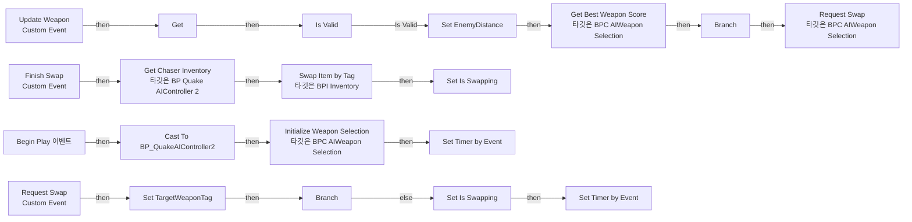
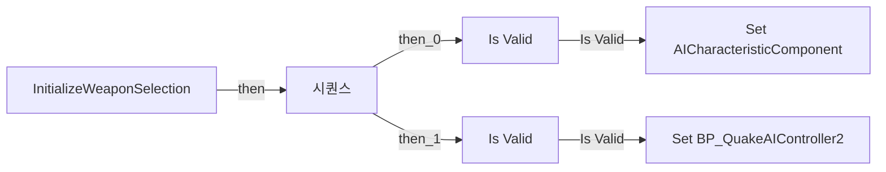

# BPC_AIWeaponSelection

에셋: `/Game/QuakeLike_1_0/AI/BP/BPC_AIWeaponSelection`

부모: `/Script/CoreUObject.Class'/Script/Engine.ActorComponent'`

수집일: 2026-10-12. MCP에서 읽은 그래프·핀 연결의 자동 전사입니다. 상속된 그래프는 부모 문서를 함께 확인합니다.

정적 루트 참조 도달: 있음. 실행 여부 또는 삭제 가능 여부의 확정이 아닙니다.

컴포넌트 목록은 이 BP가 직접 정의한 SCS만 포함합니다. 부모·네이티브 생성 컴포넌트, 인스턴스 설정은 별도입니다.

## 변수와 기본값

| 이름 | 타입 | CDO 기본값 |
|---|---|---|
| `AICharacteristicComponent` | `BPC_AIDataCache_C` | None |
| `EnemyDistance` | `real` | 0.0 |
| `BP_QuakeAIController2` | `BP_QuakeAIController2_C` | None |
| `Swap Time` | `real` | 0.0 |
| `Is Swapping` | `bool` | False |
| `TargetWeaponTag` | `GameplayTag` | &lt;Struct 'GameplayTag' {}&gt; |
| `CurrentWeaponTag` | `GameplayTag` | &lt;Struct 'GameplayTag' {}&gt; |
| `WeaponCheckInterval` | `real` | 0.1 |

## 그래프 목록

| 그래프 | 전체 노드 수 |
|---|---|
| EventGraph | 41 |
| GetBestWeaponScore | 43 |
| InitializeWeaponSelection | 6 |

## 그래프별 실행 연결

실선은 출력 exec 핀의 실제 연결입니다. 여러 분기는 출력 핀 이름을 표시합니다. 함수 호출·delegate·타이머의 다음 그래프 실행은 이 그림에서 자동으로 이어 붙이지 않습니다.

순수 계산 노드 및 데이터 핀은 아래 목록과 원본 JSON을 확인합니다. 연결되지 않은 이벤트도 표시되므로, 노드가 있다는 이유만으로 실행된다고 판단하면 안 됩니다.

### EventGraph

실행 핀 플로우차트

전체 노드·기본 입력 목록

| 노드 ID | 제목 | 미연결 기본 입력 / 에셋 입력 |
|---|---|---|
| `K2Node_Event_0` | Begin Play 이벤트 |  |
| `K2Node_CallFunction_0` | Get Owner 타깃은 액터 컴포넌트 |  |
| `K2Node_DynamicCast_0` | Cast To BP_QuakeAIController2 |  |
| `K2Node_CallFunction_1` | Get Component by Class 타깃은 액터 | ComponentClass=/Game/QuakeLike_1_0/AI/BP/BPC_AIDataCache.BPC_AIDataCache_C |
| `K2Node_CallFunction_2` | Initialize Weapon Selection 타깃은 BPC AIWeapon Selection |  |
| `K2Node_Knot_0` | 경유 노드 |  |
| `K2Node_CustomEvent_1` | Update Weapon Custom Event |  |
| `K2Node_VariableGet_0` | Get BP_QuakeAIController2 |  |
| `K2Node_VariableSet_2` | Set EnemyDistance | Output_Get=0.0 |
| `K2Node_CallFunction_4` | Get Best Weapon Score 타깃은 BPC AIWeapon Selection |  |
| `K2Node_IfThenElse_0` | Branch |  |
| `K2Node_PromotableOperator_0` | float &gt; float |  |
| `K2Node_CustomEvent_3` | Request Swap Custom Event |  |
| `K2Node_CustomEvent_0` | Finish Swap Custom Event |  |
| `K2Node_CallFunction_10` | Swap Item by Tag 타깃은 BPI Inventory | Success=false |
| `K2Node_VariableSet_9` | Set Is Swapping | Is Swapping=false; Output_Get=false |
| `K2Node_VariableGet_7` | Get BP_QuakeAIController2 |  |
| `K2Node_CallFunction_11` | Get Chaser Inventory 타깃은 BP Quake AIController 2 |  |
| `K2Node_VariableSet_8` | Set TargetWeaponTag |  |
| `K2Node_IfThenElse_2` | Branch |  |
| `K2Node_VariableGet_14` | Get Is Swapping |  |
| `K2Node_CallFunction_18` | Set Timer by Event | bLooping=false; bMaxOncePerFrame=false; InitialStartDelay=0.000000; InitialStartDelayVariance=0.000000 |
| `K2Node_VariableGet_3` | Get Swap Time |  |
| `K2Node_CallFunction_19` | Request Swap 타깃은 BPC AIWeapon Selection |  |
| `K2Node_VariableGet_17` | Get WeaponCheckInterval |  |
| `K2Node_VariableGet_8` | Get TargetWeaponTag |  |
| `K2Node_CallFunction_21` | Set Timer by Event | bLooping=true; bMaxOncePerFrame=false; InitialStartDelay=0.000000; InitialStartDelayVariance=0.000000 |
| `K2Node_Knot_3` | 경유 노드 |  |
| `K2Node_VariableSet_7` | Set Is Swapping | Is Swapping=true; Output_Get=false |
| `K2Node_VariableGet_2` | Get TargetWeaponTag |  |
| `K2Node_PromotableOperator_1` | Not Equal (GameplayTag) |  |
| `K2Node_CommutativeAssociativeBinaryOperator_0` | AND Boolean |  |
| `K2Node_VariableGet_4` | Get |  |
| `K2Node_Knot_2` | 경유 노드 |  |
| `K2Node_CallFunction_5` | Get Actor Location 타깃은 액터 |  |
| `K2Node_CallFunction_7` | Get Actor Location 타깃은 액터 |  |
| `K2Node_CallFunction_8` | Distance (Vector) |  |
| `K2Node_Knot_4` | 경유 노드 |  |
| `K2Node_VariableGet_5` | Get |  |
| `K2Node_MacroInstance_0` | Is Valid |  |
| `K2Node_Knot_5` | 경유 노드 |  |

### GetBestWeaponScore

```mermaid
flowchart LR
  n0["GetBestWeaponScore"]
  n1["반환 노드"]
  n2["For Each Loop"]
  n3["Branch"]
  n4["Branch"]
  n5["Get Usage Count<br/>타깃은 BPI Usable"]
  n6["Has Item<br/>타깃은 BPI Inventory"]
  n7["경유 노드"]
  n8["Keys"]
  n9["Branch"]
  n10["Get Weapon Change Row<br/>타깃은 BPC AIData Cache"]
  n11["Get Chaser Inventory<br/>Target is BPI Chaser Info"]
  n12["Set BestScore"]
  n13["Set WeaponTag"]
  n14["Is Valid"]
  n0 -->|"then"| n8
  n2 -->|"LoopBody"| n10
  n2 -->|"Completed"| n1
  n3 -->|"then"| n12
  n4 -->|"then"| n5
  n5 -->|"then"| n7
  n6 -->|"then"| n4
  n7 -->|"OutputPin"| n3
  n8 -->|"then"| n2
  n9 -->|"then"| n14
  n10 -->|"then"| n9
  n11 -->|"then"| n6
  n12 -->|"then"| n13
  n14 -->|"Is Valid"| n11
```

실행 핀 플로우차트

전체 노드·기본 입력 목록

| 노드 ID | 제목 | 미연결 기본 입력 / 에셋 입력 |
|---|---|---|
| `K2Node_FunctionEntry_1` | GetBestWeaponScore |  |
| `K2Node_FunctionResult_0` | 반환 노드 |  |
| `K2Node_MacroInstance_0` | For Each Loop |  |
| `K2Node_IfThenElse_0` | Branch |  |
| `K2Node_BreakStruct_4` | Break Curve |  |
| `K2Node_Knot_1` | 경유 노드 |  |
| `K2Node_CallFunction_14` | Get Runtime Float Curve Value | InDefaultValue=0.000000 |
| `K2Node_PromotableOperator_0` | float * float |  |
| `K2Node_Knot_2` | 경유 노드 |  |
| `K2Node_PromotableOperator_1` | float &gt; float |  |
| `K2Node_Knot_3` | 경유 노드 |  |
| `K2Node_IfThenElse_1` | Branch |  |
| `K2Node_CallFunction_10` | Get Usage Count 타깃은 BPI Usable |  |
| `K2Node_CallFunction_11` | Safe Divide |  |
| `K2Node_CallFunction_18` | To Float (Integer) |  |
| `K2Node_CallFunction_12` | To Float (Integer) |  |
| `K2Node_BreakStruct_1` | Break Curve |  |
| `K2Node_CallFunction_13` | Get Runtime Float Curve Value | InDefaultValue=0.000000 |
| `K2Node_Knot_4` | 경유 노드 |  |
| `K2Node_PromotableOperator_4` | float * float |  |
| `K2Node_Knot_7` | 경유 노드 |  |
| `K2Node_Knot_8` | 경유 노드 |  |
| `K2Node_Knot_10` | 경유 노드 |  |
| `K2Node_CallFunction_2` | Has Item 타깃은 BPI Inventory |  |
| `K2Node_Knot_9` | 경유 노드 |  |
| `K2Node_Knot_11` | 경유 노드 |  |
| `K2Node_CallFunction_3` | Keys |  |
| `K2Node_IfThenElse_2` | Branch |  |
| `K2Node_VariableGet_8` | Get CachedWeaponChangeTable |  |
| `K2Node_CallFunction_1` | Get Weapon Change Row 타깃은 BPC AIData Cache |  |
| `K2Node_VariableGet_16` | Get WeaponTag |  |
| `K2Node_VariableGet_17` | Get BestScore |  |
| `K2Node_VariableGet_19` | Get EnemyDistance |  |
| `K2Node_Message_0` | Get Chaser Inventory Target is BPI Chaser Info |  |
| `K2Node_VariableGet_20` | Get BestScore |  |
| `K2Node_VariableSet_4` | Set BestScore | Output_Get=0.0 |
| `K2Node_VariableSet_5` | Set WeaponTag |  |
| `K2Node_VariableGet_21` | Get AICharacteristicComponent |  |
| `K2Node_VariableGet_22` | Get AICharacteristicComponent |  |
| `K2Node_VariableGet_23` | Get BP_QuakeAIController2 |  |
| `K2Node_MacroInstance_2` | Is Valid |  |
| `K2Node_Knot_18` | 경유 노드 |  |
| `K2Node_Knot_19` | 경유 노드 |  |

### InitializeWeaponSelection

실행 핀 플로우차트

전체 노드·기본 입력 목록

| 노드 ID | 제목 | 미연결 기본 입력 / 에셋 입력 |
|---|---|---|
| `K2Node_FunctionEntry_0` | InitializeWeaponSelection |  |
| `K2Node_VariableSet_0` | Set AICharacteristicComponent |  |
| `K2Node_VariableSet_1` | Set BP_QuakeAIController2 |  |
| `K2Node_ExecutionSequence_0` | 시퀀스 |  |
| `K2Node_MacroInstance_1` | Is Valid |  |
| `K2Node_MacroInstance_0` | Is Valid |  |

## 조회 범위의 한계

ObjectIterator로 발견했으나 MCP helper가 반환하지 않은 그래프입니다. delegate signature·컴파일된 중간 그래프·macro·애니메이션 내부 그래프가 섞일 수 있습니다.

- `Finish Swap`: Graph 'Finish Swap' not found in Blueprint.
- `ReceiveBeginPlay`: Graph 'ReceiveBeginPlay' not found in Blueprint.
- `Request Swap`: Graph 'Request Swap' not found in Blueprint.
- `Update Weapon`: Graph 'Update Weapon' not found in Blueprint.

[원본 MCP 스냅샷](../../../../Evidence/blueprints-070.json)
