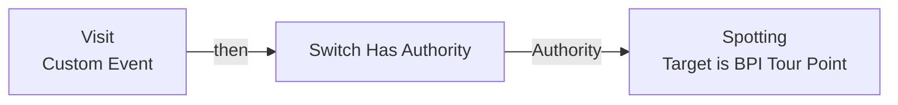
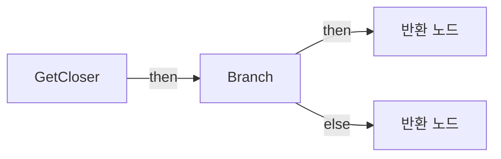
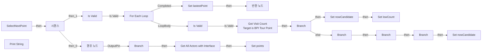

# BPC_PointsTourist

에셋: `/Game/QuakeLike_1_0/AI/BP/BPC_PointsTourist`

부모: `/Script/CoreUObject.Class'/Script/Engine.ActorComponent'`

수집일: 2026-10-12. MCP에서 읽은 그래프·핀 연결의 자동 전사입니다. 상속된 그래프는 부모 문서를 함께 확인합니다.

정적 루트 참조 도달: 있음. 실행 여부 또는 삭제 가능 여부의 확정이 아닙니다.

컴포넌트 목록은 이 BP가 직접 정의한 SCS만 포함합니다. 부모·네이티브 생성 컴포넌트, 인스턴스 설정은 별도입니다.

## 변수와 기본값

| 이름 | 타입 | CDO 기본값 |
|---|---|---|
| `points` | `Actor` | [] |
| `lastestPoint` | `Actor` | None |

## 그래프 목록

| 그래프 | 전체 노드 수 |
|---|---|
| EventGraph | 3 |
| GetCloser | 14 |
| SelectNextPoint | 47 |

## 그래프별 실행 연결

실선은 출력 exec 핀의 실제 연결입니다. 여러 분기는 출력 핀 이름을 표시합니다. 함수 호출·delegate·타이머의 다음 그래프 실행은 이 그림에서 자동으로 이어 붙이지 않습니다.

순수 계산 노드 및 데이터 핀은 아래 목록과 원본 JSON을 확인합니다. 연결되지 않은 이벤트도 표시되므로, 노드가 있다는 이유만으로 실행된다고 판단하면 안 됩니다.

### EventGraph

실행 핀 플로우차트

전체 노드·기본 입력 목록

| 노드 ID | 제목 | 미연결 기본 입력 / 에셋 입력 |
|---|---|---|
| `K2Node_CustomEvent_1` | Visit Custom Event |  |
| `K2Node_Message_0` | Spotting Target is BPI Tour Point |  |
| `K2Node_MacroInstance_0` | Switch Has Authority |  |

### GetCloser

실행 핀 플로우차트

전체 노드·기본 입력 목록

| 노드 ID | 제목 | 미연결 기본 입력 / 에셋 입력 |
|---|---|---|
| `K2Node_FunctionEntry_0` | GetCloser |  |
| `K2Node_FunctionResult_1` | 반환 노드 | end1 is Close=true |
| `K2Node_CallFunction_0` | Get Actor Location 타깃은 액터 |  |
| `K2Node_CallFunction_1` | Get Actor Location 타깃은 액터 |  |
| `K2Node_CallFunction_2` | Get Actor Location 타깃은 액터 |  |
| `K2Node_CallFunction_3` | Distance Squared (Vector) |  |
| `K2Node_CallFunction_4` | Distance Squared (Vector) |  |
| `K2Node_PromotableOperator_0` | float &lt; float |  |
| `K2Node_IfThenElse_0` | Branch |  |
| `K2Node_FunctionResult_0` | 반환 노드 | end1 is Close=false |
| `K2Node_Knot_0` | 경유 노드 |  |
| `K2Node_Knot_1` | 경유 노드 |  |
| `K2Node_Knot_2` | 경유 노드 |  |
| `K2Node_Knot_3` | 경유 노드 |  |

### SelectNextPoint

실행 핀 플로우차트

전체 노드·기본 입력 목록

| 노드 ID | 제목 | 미연결 기본 입력 / 에셋 입력 |
|---|---|---|
| `K2Node_FunctionEntry_0` | SelectNextPoint |  |
| `K2Node_FunctionResult_0` | 반환 노드 |  |
| `K2Node_VariableGet_2` | Get points |  |
| `K2Node_MacroInstance_0` | For Each Loop |  |
| `K2Node_Knot_0` | 경유 노드 |  |
| `K2Node_MacroInstance_2` | Is Valid |  |
| `K2Node_Knot_1` | 경유 노드 |  |
| `K2Node_VariableGet_9` | Get lowCount |  |
| `K2Node_Message_2` | Get Visit Count Target is BPI Tour Point |  |
| `K2Node_PromotableOperator_2` | integer &lt; integer |  |
| `K2Node_IfThenElse_2` | Branch |  |
| `K2Node_VariableSet_7` | Set nowCandidate |  |
| `K2Node_IfThenElse_3` | Branch |  |
| `K2Node_Knot_7` | 경유 노드 |  |
| `K2Node_PromotableOperator_3` | Equal (Integer) |  |
| `K2Node_Knot_8` | 경유 노드 |  |
| `K2Node_VariableSet_6` | Set lowCount | Output_Get=0 |
| `K2Node_Knot_11` | 경유 노드 |  |
| `K2Node_CallFunction_4` | Get Closer |  |
| `K2Node_Knot_12` | 경유 노드 |  |
| `K2Node_Knot_13` | 경유 노드 |  |
| `K2Node_IfThenElse_4` | Branch |  |
| `K2Node_VariableGet_10` | Get nowCandidate |  |
| `K2Node_VariableSet_5` | Set nowCandidate |  |
| `K2Node_Knot_14` | 경유 노드 |  |
| `K2Node_VariableGet_12` | Get nowCandidate |  |
| `K2Node_Knot_15` | 경유 노드 |  |
| `K2Node_MacroInstance_4` | Is Valid |  |
| `K2Node_CallFunction_0` | Print String | bPrintToScreen=true; bPrintToLog=true; TextColor=(R=0.000000,G=0.660000,B=1.000000,A=1.000000); Duration=2.000000; Key=None |
| `K2Node_CommutativeAssociativeBinaryOperator_0` | Append | B= : 방문 횟수 :  |
| `K2Node_CallFunction_9` | To String (Integer) |  |
| `K2Node_Knot_2` | 경유 노드 |  |
| `K2Node_CallFunction_10` | Get Display Name |  |
| `K2Node_VariableSet_0` | Set lastestPoint |  |
| `K2Node_VariableGet_0` | Get lastestPoint |  |
| `K2Node_PromotableOperator_0` | Not Equal (Object) |  |
| `K2Node_Knot_3` | 경유 노드 |  |
| `K2Node_IfThenElse_1` | Branch |  |
| `EdGraphNode_Comment_0` | 방문횟수 디버깅 |  |
| `K2Node_VariableGet_1` | Get points |  |
| `K2Node_CallArrayFunction_1` | Is Empty |  |
| `K2Node_IfThenElse_0` | Branch |  |
| `K2Node_CallFunction_3` | Get All Actors with Interface | Interface=/Game/QuakeLike_1_0/AI/Interface/BPI_TourPoint.BPI_TourPoint_C |
| `K2Node_VariableSet_1` | Set points |  |
| `K2Node_Knot_4` | 경유 노드 |  |
| `K2Node_ExecutionSequence_0` | 시퀀스 |  |
| `K2Node_Knot_5` | 경유 노드 |  |

## 조회 범위의 한계

ObjectIterator로 발견했으나 MCP helper가 반환하지 않은 그래프입니다. delegate signature·컴파일된 중간 그래프·macro·애니메이션 내부 그래프가 섞일 수 있습니다.

- `Visit`: Graph 'Visit' not found in Blueprint.

[원본 MCP 스냅샷](../../../../Evidence/blueprints-035.json)
