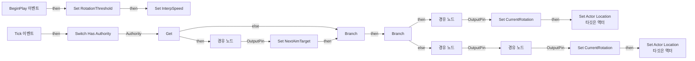
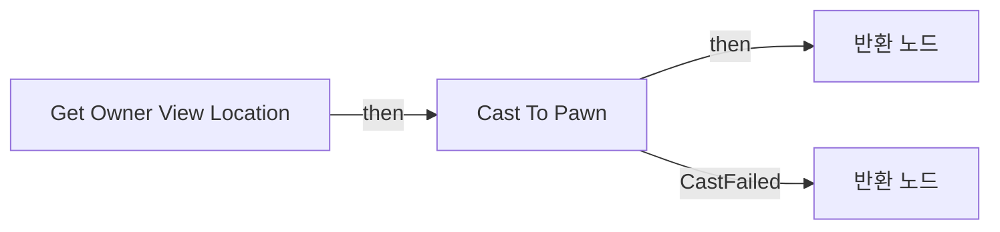
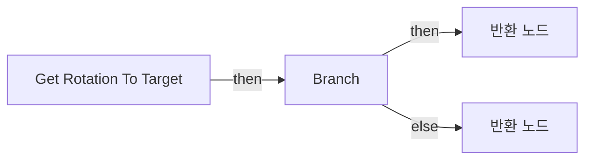
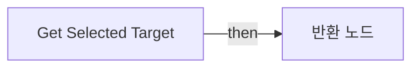
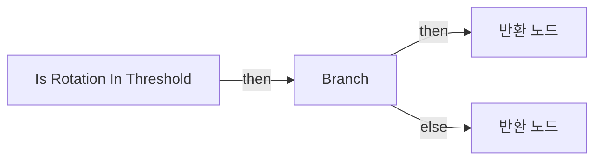
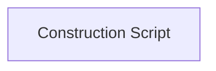

# BP_OrbitalTargetDrone

에셋: `/Game/QuakeLike_1_0/AI/BP/BP_OrbitalTargetDrone`

부모: `/Script/CoreUObject.Class'/Script/Engine.Actor'`

수집일: 2026-10-12. MCP에서 읽은 그래프·핀 연결의 자동 전사입니다. 상속된 그래프는 부모 문서를 함께 확인합니다.

정적 루트 참조 도달: 있음. 실행 여부 또는 삭제 가능 여부의 확정이 아닙니다.

컴포넌트 목록은 이 BP가 직접 정의한 SCS만 포함합니다. 부모·네이티브 생성 컴포넌트, 인스턴스 설정은 별도입니다.

## 직접 정의한 컴포넌트

| 이름 | 클래스 | 부모 컴포넌트 |
|---|---|---|
| `DefaultSceneRoot` | `SceneComponent` | `` |

## 변수와 기본값

| 이름 | 타입 | CDO 기본값 |
|---|---|---|
| `CurrentRotation` | `Rotator` | &lt;Struct 'Rotator' {pitch: 0.000000, yaw: 0.000000, roll: 0.000000}&gt; |
| `Characteristic` | `ST_Characteristic` | &lt;Struct 'ST_Characteristic' {}&gt; |
| `NextAimTarget` | `Vector` | &lt;Struct 'Vector' {x: 0.000000, y: 0.000000, z: 0.000000}&gt; |
| `RotationThreshold` | `real` | 60.0 |
| `InterpSpeed` | `real` | 0.0 |
| `InterpSpeedData` | `PDA_InterpSpeed_C` | /Game/QuakeLike_1_0/Data/AI/DA_InterpSpeed.DA_InterpSpeed |
| `LookTargetActor` | `Actor` | None |
| `AimOffset` | `Vector` | &lt;Struct 'Vector' {x: 0.000000, y: 0.000000, z: 0.000000}&gt; |

## 그래프 목록

| 그래프 | 전체 노드 수 |
|---|---|
| EventGraph | 51 |
| Get Owner View Location | 6 |
| Get Rotation To Target | 7 |
| Get Selected Target | 3 |
| Is Rotation In Threshold | 13 |
| UserConstructionScript | 1 |

## 그래프별 실행 연결

실선은 출력 exec 핀의 실제 연결입니다. 여러 분기는 출력 핀 이름을 표시합니다. 함수 호출·delegate·타이머의 다음 그래프 실행은 이 그림에서 자동으로 이어 붙이지 않습니다.

순수 계산 노드 및 데이터 핀은 아래 목록과 원본 JSON을 확인합니다. 연결되지 않은 이벤트도 표시되므로, 노드가 있다는 이유만으로 실행된다고 판단하면 안 됩니다.

### EventGraph

실행 핀 플로우차트

전체 노드·기본 입력 목록

| 노드 ID | 제목 | 미연결 기본 입력 / 에셋 입력 |
|---|---|---|
| `K2Node_Event_3` | Tick 이벤트 |  |
| `K2Node_CallFunction_14` | RInterp To | Current=0, 0, 0; Target=0, 0, 0; DeltaTime=0.0; InterpSpeed=0.0; ReturnValue=0, 0, 0 |
| `K2Node_Knot_7` | 경유 노드 |  |
| `K2Node_Knot_8` | 경유 노드 |  |
| `K2Node_VariableGet_15` | Get |  |
| `K2Node_CallFunction_19` | To Float (Integer) |  |
| `K2Node_CallFunction_13` | Get Forward Vector |  |
| `K2Node_PromotableOperator_1` | vector * vector | B=100.000000 |
| `K2Node_PromotableOperator_4` | vector + vector |  |
| `K2Node_CallFunction_17` | Set Actor Location 타깃은 액터 | bSweep=false; bTeleport=false; ReturnValue=false |
| `K2Node_MacroInstance_0` | Switch Has Authority |  |
| `K2Node_VariableSet_1` | Set CurrentRotation |  |
| `EdGraphNode_Comment_4` | Drone의 위치 이동 및 현재 각도 저장 |  |
| `K2Node_CallFunction_0` | RInterp to Constant |  |
| `K2Node_Knot_1` | 경유 노드 |  |
| `K2Node_IfThenElse_0` | Branch |  |
| `K2Node_VariableGet_1` | Get RotationThreshold |  |
| `K2Node_VariableGet_0` | Get CurrentRotation |  |
| `K2Node_Knot_14` | 경유 노드 |  |
| `K2Node_VariableSet_0` | Set CurrentRotation |  |
| `K2Node_Knot_15` | 경유 노드 |  |
| `K2Node_CallFunction_15` | Get Forward Vector |  |
| `K2Node_PromotableOperator_2` | vector * vector | B=100.000000 |
| `K2Node_PromotableOperator_3` | vector + vector |  |
| `K2Node_CallFunction_16` | Set Actor Location 타깃은 액터 | bSweep=false; bTeleport=false; ReturnValue=false |
| `EdGraphNode_Comment_1` | Drone의 위치 이동 및 현재 각도 저장 |  |
| `K2Node_Knot_24` | 경유 노드 |  |
| `K2Node_Knot_25` | 경유 노드 |  |
| `K2Node_VariableGet_4` | Get InterpSpeed |  |
| `K2Node_Event_0` | BeginPlay 이벤트 |  |
| `K2Node_VariableGet_5` | Get InterpSpeedData |  |
| `K2Node_VariableGet_6` | Get DA_RotationThreshold |  |
| `K2Node_VariableSet_3` | Set RotationThreshold | Output_Get=0.0 |
| `K2Node_VariableGet_7` | Get DA_InterpSpeed |  |
| `K2Node_VariableSet_4` | Set InterpSpeed | Output_Get=0.0 |
| `K2Node_Knot_26` | 경유 노드 |  |
| `K2Node_CallFunction_8` | Get Owner View Location | Is Valid=false |
| `K2Node_CallFunction_7` | Get Owner View Location | Is Valid=false |
| `K2Node_CallFunction_10` | Is Rotation in Threshold |  |
| `K2Node_VariableGet_2` | Get CurrentRotation |  |
| `K2Node_CallFunction_6` | Get Rotation to Target | Is Valid=false |
| `K2Node_IfThenElse_2` | Branch |  |
| `K2Node_CallFunction_11` | NOT Boolean |  |
| `K2Node_CallFunction_3` | RInterp to Constant |  |
| `K2Node_VariableGet_3` | Get |  |
| `K2Node_VariableGet_10` | Get LookTargetActor |  |
| `K2Node_VariableGet_8` | Get AimOffset |  |
| `K2Node_CallFunction_1` | Get Actor Location 타깃은 액터 |  |
| `K2Node_CallFunction_2` | vector + vector |  |
| `K2Node_VariableSet_2` | Set NextAimTarget | Output_Get=0, 0, 0 |
| `K2Node_Knot_2` | 경유 노드 |  |

### Get Owner View Location

실행 핀 플로우차트

전체 노드·기본 입력 목록

| 노드 ID | 제목 | 미연결 기본 입력 / 에셋 입력 |
|---|---|---|
| `K2Node_FunctionEntry_0` | Get Owner View Location |  |
| `K2Node_FunctionResult_1` | 반환 노드 | Is Valid=true |
| `K2Node_CallFunction_8` | Get Owner 타깃은 액터 |  |
| `K2Node_DynamicCast_0` | Cast To Pawn |  |
| `K2Node_CallFunction_1` | Get Actor Eyes View Point 타깃은 액터 | OutRotation=0, 0, 0 |
| `K2Node_FunctionResult_0` | 반환 노드 | Is Valid=false; OutLocation=0, 0, 0 |

### Get Rotation To Target

실행 핀 플로우차트

전체 노드·기본 입력 목록

| 노드 ID | 제목 | 미연결 기본 입력 / 에셋 입력 |
|---|---|---|
| `K2Node_FunctionEntry_0` | Get Rotation To Target |  |
| `K2Node_FunctionResult_1` | 반환 노드 | Is Valid=true |
| `K2Node_CallFunction_12` | Find Look at Rotation |  |
| `K2Node_CallFunction_0` | Get Selected Target |  |
| `K2Node_CallFunction_5` | Get Owner View Location |  |
| `K2Node_IfThenElse_1` | Branch |  |
| `K2Node_FunctionResult_0` | 반환 노드 | Is Valid=false; ReturnValue=0, 0, 0 |

### Get Selected Target

실행 핀 플로우차트

전체 노드·기본 입력 목록

| 노드 ID | 제목 | 미연결 기본 입력 / 에셋 입력 |
|---|---|---|
| `K2Node_FunctionEntry_0` | Get Selected Target |  |
| `K2Node_FunctionResult_0` | 반환 노드 |  |
| `K2Node_VariableGet_3` | Get NextAimTarget |  |

### Is Rotation In Threshold

실행 핀 플로우차트

전체 노드·기본 입력 목록

| 노드 ID | 제목 | 미연결 기본 입력 / 에셋 입력 |
|---|---|---|
| `K2Node_FunctionEntry_0` | Is Rotation In Threshold |  |
| `K2Node_FunctionResult_1` | 반환 노드 | Is Valid=true |
| `K2Node_VariableGet_2` | Get CurrentRotation |  |
| `K2Node_PromotableOperator_0` | float &gt; float |  |
| `K2Node_CallFunction_27` | Get Forward Vector |  |
| `K2Node_CallFunction_26` | Get Forward Vector |  |
| `K2Node_CallFunction_28` | Dot Product |  |
| `K2Node_CallFunction_29` | Acos (Degrees) |  |
| `K2Node_CallFunction_6` | Get Rotation to Target |  |
| `K2Node_IfThenElse_0` | Branch |  |
| `K2Node_Knot_2` | 경유 노드 |  |
| `K2Node_FunctionResult_0` | 반환 노드 | Is Valid=false; within Threshold=false |
| `K2Node_Knot_3` | 경유 노드 |  |

### UserConstructionScript

실행 핀 플로우차트

전체 노드·기본 입력 목록

| 노드 ID | 제목 | 미연결 기본 입력 / 에셋 입력 |
|---|---|---|
| `K2Node_FunctionEntry_0` | Construction Script |  |

## 조회 범위의 한계

ObjectIterator로 발견했으나 MCP helper가 반환하지 않은 그래프입니다. delegate signature·컴파일된 중간 그래프·macro·애니메이션 내부 그래프가 섞일 수 있습니다.

- `ReceiveBeginPlay`: Graph 'ReceiveBeginPlay' not found in Blueprint.
- `ReceiveTick`: Graph 'ReceiveTick' not found in Blueprint.

[원본 MCP 스냅샷](../../../../Evidence/blueprints-035.json)
