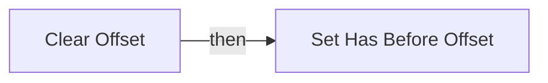
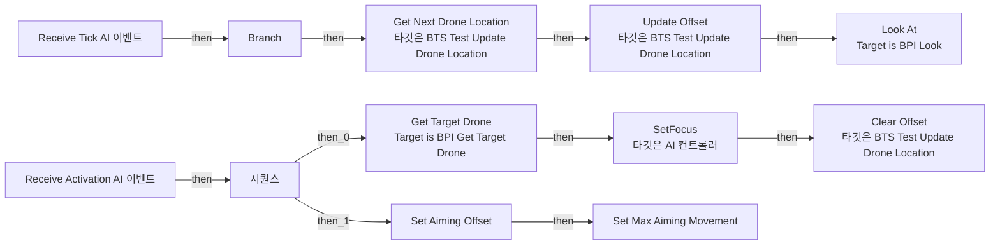
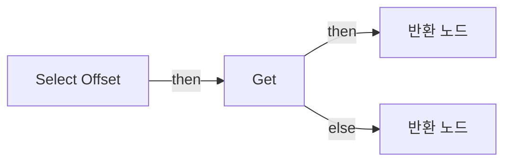
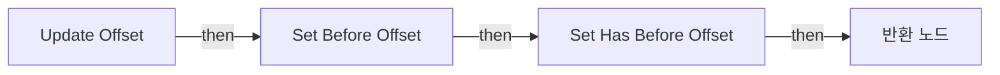

# BTS_Test_UpdateDroneLocation

에셋: `/Game/QuakeLike_1_0/AI/BTS/BTS_Test_UpdateDroneLocation`

부모: `/Script/CoreUObject.Class'/Script/AIModule.BTService_BlueprintBase'`

수집일: 2026-10-12. MCP에서 읽은 그래프·핀 연결의 자동 전사입니다. 상속된 그래프는 부모 문서를 함께 확인합니다.

정적 루트 참조 도달: 있음. 실행 여부 또는 삭제 가능 여부의 확정이 아닙니다.

컴포넌트 목록은 이 BP가 직접 정의한 SCS만 포함합니다. 부모·네이티브 생성 컴포넌트, 인스턴스 설정은 별도입니다.

## 변수와 기본값

| 이름 | 타입 | CDO 기본값 |
|---|---|---|
| `EnemyKey` | `BlackboardKeySelector` | &lt;Struct 'BlackboardKeySelector' {allowed_types: , selected_key_name: "", selected_key_type: None, selected_key_id: 65535, none_is_allowed_value: False}&gt; |
| `Aiming Offset` | `Vector` | &lt;Struct 'Vector' {x: 0.000000, y: 0.000000, z: 0.000000}&gt; |
| `Max Aiming Movement` | `real` | 100.0 |
| `Before Offset` | `Vector` | &lt;Struct 'Vector' {x: 0.000000, y: 0.000000, z: 0.000000}&gt; |
| `Has Before Offset` | `bool` | False |
| `AimBoundary` | `PDA_AIAimBoundary_C` | /Game/QuakeLike_1_0/Data/AI/DA_AIAimBoundary.DA_AIAimBoundary |

## 그래프 목록

| 그래프 | 전체 노드 수 |
|---|---|
| Clear Offset | 2 |
| EventGraph | 29 |
| Get Enemy | 4 |
| Get Next Drone Location | 161 |
| Select Offset | 21 |
| Update Offset | 5 |

## 그래프별 실행 연결

실선은 출력 exec 핀의 실제 연결입니다. 여러 분기는 출력 핀 이름을 표시합니다. 함수 호출·delegate·타이머의 다음 그래프 실행은 이 그림에서 자동으로 이어 붙이지 않습니다.

순수 계산 노드 및 데이터 핀은 아래 목록과 원본 JSON을 확인합니다. 연결되지 않은 이벤트도 표시되므로, 노드가 있다는 이유만으로 실행된다고 판단하면 안 됩니다.

### Clear Offset

실행 핀 플로우차트

전체 노드·기본 입력 목록

| 노드 ID | 제목 | 미연결 기본 입력 / 에셋 입력 |
|---|---|---|
| `K2Node_FunctionEntry_0` | Clear Offset |  |
| `K2Node_VariableSet_0` | Set Has Before Offset | Has Before Offset=false; Output_Get=false |

### EventGraph

실행 핀 플로우차트

전체 노드·기본 입력 목록

| 노드 ID | 제목 | 미연결 기본 입력 / 에셋 입력 |
|---|---|---|
| `K2Node_Event_0` | Receive Tick AI 이벤트 |  |
| `K2Node_CallFunction_4` | Get Enemy |  |
| `K2Node_CallFunction_2` | Is Valid |  |
| `K2Node_IfThenElse_0` | Branch |  |
| `K2Node_Event_1` | Receive Activation AI 이벤트 |  |
| `K2Node_CallFunction_10` | SetFocus 타깃은 AI 컨트롤러 |  |
| `K2Node_CallFunction_31` | Get Next Drone Location 타깃은 BTS Test Update Drone Location |  |
| `K2Node_Knot_11` | 경유 노드 |  |
| `K2Node_Knot_1` | 경유 노드 |  |
| `K2Node_Message_1` | Get Target Drone Target is BPI Get Target Drone |  |
| `EdGraphNode_Comment_1` | 기존에는 Focus만 되있음. |  |
| `K2Node_Message_4` | Look At Target is BPI Look |  |
| `K2Node_Knot_0` | 경유 노드 |  |
| `K2Node_Knot_2` | 경유 노드 |  |
| `K2Node_CallFunction_12` | Get Actor Location 타깃은 액터 |  |
| `K2Node_CallFunction_1` | vector - vector |  |
| `K2Node_Knot_3` | 경유 노드 |  |
| `K2Node_Knot_4` | 경유 노드 |  |
| `K2Node_Knot_5` | 경유 노드 |  |
| `K2Node_CallFunction_9` | Clear Offset 타깃은 BTS Test Update Drone Location |  |
| `K2Node_CallFunction_11` | Update Offset 타깃은 BTS Test Update Drone Location |  |
| `K2Node_VariableGet_0` | Get AimBoundary |  |
| `K2Node_ExecutionSequence_0` | 시퀀스 |  |
| `K2Node_VariableSet_0` | Set Aiming Offset | Output_Get=0, 0, 0 |
| `K2Node_VariableGet_1` | Get AimBoundary |  |
| `K2Node_VariableSet_1` | Set Max Aiming Movement | Output_Get=0.0 |
| `K2Node_Knot_6` | 경유 노드 |  |
| `K2Node_VariableGet_2` | Get ClampAimDistance |  |
| `K2Node_Knot_7` | 경유 노드 |  |

### Get Enemy

실행 핀 플로우차트

전체 노드·기본 입력 목록

| 노드 ID | 제목 | 미연결 기본 입력 / 에셋 입력 |
|---|---|---|
| `K2Node_FunctionEntry_0` | Get Enemy |  |
| `K2Node_VariableGet_0` | Get EnemyKey |  |
| `K2Node_CallFunction_0` | Get Blackboard Value as Actor |  |
| `K2Node_FunctionResult_0` | 반환 노드 |  |

### Get Next Drone Location

```mermaid
flowchart LR
  n0["Get Next Drone Location"]
  n1["Get Heart<br/>Target is BPI Body Info"]
  n2["Get Characteristic<br/>Target is BPI AI Setting"]
  n3["Branch"]
  n4["시퀀스"]
  n5["경유 노드"]
  n6["Set Aim Skill"]
  n7["Set View Max Change"]
  n8["Get Chaser Inventory<br/>Target is BPI Chaser Info"]
  n9["Get Selected Item<br/>타깃은 BPI Inventory"]
  n10["Get Weapon Data<br/>Target is BPI Weapon"]
  n11["Set Delta Time"]
  n12["경유 노드"]
  n13["Set Weapon Data"]
  n14["경유 노드"]
  n15["경유 노드"]
  n16["Branch"]
  n17["경유 노드"]
  n18["경유 노드"]
  n19["Branch"]
  n20["Get Heart<br/>Target is BPI Body Info"]
  n21["경유 노드"]
  n22["Get Chaser Location<br/>Target is BPI Chaser Info"]
  n23["Set My Location"]
  n24["경유 노드"]
  n25["Set Target Location"]
  n26["Set Target Location"]
  n27["Branch"]
  n28["Set Aim Accuracy"]
  n29["경유 노드"]
  n30["Set Aim Accuracy"]
  n31["Branch"]
  n32["경유 노드"]
  n33["Set Aim Accuracy"]
  n34["경유 노드"]
  n35["경유 노드"]
  n36["경유 노드"]
  n37["반환 노드"]
  n38["Is Valid"]
  n39["반환 노드"]
  n40["Get Heart<br/>Target is BPI Body Info"]
  n41["Is Valid"]
  n42["반환 노드"]
  n43["Branch"]
  n44["Branch"]
  n45["Line Trace By Channel"]
  n46["Branch"]
  n47["반환 노드"]
  n48["반환 노드"]
  n49["Line Trace By Channel"]
  n50["Branch"]
  n51["반환 노드"]
  n52["경유 노드"]
  n53["경유 노드"]
  n54["경유 노드"]
  n55["Set Value as Vector<br/>타깃은 블랙보드 컴포넌트"]
  n56["Set Self Controller"]
  n0 -->|"then"| n56
  n1 -->|"then"| n25
  n2 -->|"then"| n3
  n3 -->|"then"| n6
  n4 -->|"then_0"| n22
  n4 -->|"then_1"| n8
  n4 -->|"then_2"| n12
  n4 -->|"then_3"| n5
  n5 -->|"OutputPin"| n38
  n6 -->|"then"| n28
  n8 -->|"then"| n9
  n9 -->|"then"| n41
  n10 -->|"then"| n13
  n11 -->|"then"| n4
  n12 -->|"OutputPin"| n2
  n14 -->|"OutputPin"| n1
  n15 -->|"OutputPin"| n1
  n16 -->|"then"| n18
  n16 -->|"else"| n19
  n17 -->|"OutputPin"| n16
  n18 -->|"OutputPin"| n1
  n19 -->|"then"| n21
  n19 -->|"else"| n24
  n20 -->|"then"| n26
  n21 -->|"OutputPin"| n20
  n22 -->|"then"| n23
  n24 -->|"OutputPin"| n20
  n25 -->|"then"| n27
  n26 -->|"then"| n32
  n27 -->|"then"| n29
  n27 -->|"else"| n31
  n28 -->|"then"| n7
  n29 -->|"OutputPin"| n30
  n30 -->|"then"| n36
  n31 -->|"then"| n34
  n31 -->|"else"| n35
  n32 -->|"OutputPin"| n27
  n33 -->|"then"| n35
  n34 -->|"OutputPin"| n33
  n35 -->|"OutputPin"| n55
  n36 -->|"OutputPin"| n31
  n38 -->|"Is Valid"| n43
  n38 -->|"Is Not Valid"| n40
  n40 -->|"then"| n39
  n41 -->|"Is Valid"| n10
  n41 -->|"Is Not Valid"| n42
  n43 -->|"then"| n17
  n43 -->|"else"| n14
  n44 -->|"then"| n52
  n44 -->|"else"| n37
  n45 -->|"then"| n46
  n46 -->|"then"| n48
  n46 -->|"else"| n47
  n49 -->|"then"| n50
  n50 -->|"then"| n53
  n50 -->|"else"| n54
  n52 -->|"OutputPin"| n49
  n53 -->|"OutputPin"| n51
  n54 -->|"OutputPin"| n45
  n55 -->|"then"| n44
  n56 -->|"then"| n11
```

실행 핀 플로우차트

전체 노드·기본 입력 목록

| 노드 ID | 제목 | 미연결 기본 입력 / 에셋 입력 |
|---|---|---|
| `K2Node_FunctionEntry_0` | Get Next Drone Location |  |
| `K2Node_CallFunction_16` | Get Enemy |  |
| `K2Node_Message_1` | Get Heart Target is BPI Body Info |  |
| `K2Node_Message_7` | Get Characteristic Target is BPI AI Setting |  |
| `K2Node_IfThenElse_0` | Branch |  |
| `K2Node_ExecutionSequence_0` | 시퀀스 |  |
| `K2Node_Knot_2` | 경유 노드 |  |
| `K2Node_VariableSet_1` | Set Aim Skill | Output_Get=0.0 |
| `K2Node_Knot_3` | 경유 노드 |  |
| `K2Node_VariableSet_2` | Set View Max Change | Output_Get=0.0 |
| `K2Node_CallFunction_0` | To Float (Integer) |  |
| `K2Node_Message_3` | Get Chaser Inventory Target is BPI Chaser Info |  |
| `K2Node_CallFunction_47` | Get Selected Item 타깃은 BPI Inventory |  |
| `K2Node_Message_5` | Get Weapon Data Target is BPI Weapon |  |
| `K2Node_VariableSet_5` | Set Delta Time | Output_Get=0.0 |
| `K2Node_Knot_11` | 경유 노드 |  |
| `K2Node_VariableGet_3` | Get attributes |  |
| `K2Node_VariableGet_6` | Get projectileSpeed |  |
| `K2Node_Knot_0` | 경유 노드 |  |
| `K2Node_Knot_1` | 경유 노드 |  |
| `K2Node_Knot_4` | 경유 노드 |  |
| `K2Node_VariableSet_0` | Set Weapon Data |  |
| `K2Node_CallFunction_28` | Get Velocity 타깃은 액터 |  |
| `K2Node_VariableGet_4` | Get Weapon Data |  |
| `K2Node_Knot_5` | 경유 노드 |  |
| `K2Node_Knot_6` | 경유 노드 |  |
| `K2Node_VariableGet_7` | Get Aim Skill |  |
| `K2Node_IfThenElse_2` | Branch |  |
| `K2Node_Knot_7` | 경유 노드 |  |
| `K2Node_PromotableOperator_2` | float &lt;= float | B=0.400000 |
| `K2Node_Knot_9` | 경유 노드 |  |
| `K2Node_IfThenElse_3` | Branch |  |
| `K2Node_VariableGet_10` | Get Aim Skill |  |
| `K2Node_PromotableOperator_5` | float &lt;= float | B=0.800000 |
| `K2Node_VariableGet_8` | Get Weapon Data |  |
| `K2Node_CallFunction_29` | Get Enemy |  |
| `K2Node_Message_2` | Get Heart Target is BPI Body Info |  |
| `EdGraphNode_Comment_0` | 통상 로직 (대상의 정중앙을 향해서 + 서서히 변하는 값을 반환) |  |
| `K2Node_Knot_10` | 경유 노드 |  |
| `K2Node_PromotableOperator_3` | vector + vector |  |
| `K2Node_CallFunction_17` | Safe Divide |  |
| `K2Node_PromotableOperator_4` | vector * vector |  |
| `K2Node_Knot_12` | 경유 노드 |  |
| `K2Node_Knot_13` | 경유 노드 |  |
| `K2Node_Message_4` | Get Chaser Location Target is BPI Chaser Info |  |
| `K2Node_VariableSet_3` | Set My Location | Output_Get=0, 0, 0 |
| `K2Node_CallFunction_30` | Get Actor Location 타깃은 액터 |  |
| `K2Node_VariableGet_14` | Get My Location |  |
| `K2Node_CallFunction_31` | Distance (Vector) |  |
| `EdGraphNode_Comment_1` | 타겟의 중심 좌표 + (타겟의 이동 벡터 * (타겟과의 거리 / 투사체 속도) ) |  |
| `K2Node_Knot_15` | 경유 노드 |  |
| `K2Node_Knot_16` | 경유 노드 |  |
| `K2Node_Knot_17` | 경유 노드 |  |
| `K2Node_Knot_18` | 경유 노드 |  |
| `K2Node_Knot_20` | 경유 노드 |  |
| `K2Node_VariableSet_4` | Set Target Location | Output_Get=0, 0, 0 |
| `K2Node_VariableSet_6` | Set Target Location | Output_Get=0, 0, 0 |
| `K2Node_IfThenElse_4` | Branch |  |
| `K2Node_VariableGet_1` | Get Aim Skill |  |
| `K2Node_PromotableOperator_1` | float &lt; float | B=0.900000 |
| `K2Node_VariableSet_7` | Set Aim Accuracy | Output_Get=0.0 |
| `K2Node_Knot_22` | 경유 노드 |  |
| `K2Node_Knot_23` | 경유 노드 |  |
| `K2Node_VariableGet_15` | Get Aim Accuracy |  |
| `K2Node_PromotableOperator_10` | float * float | B=0.700000 |
| `K2Node_VariableSet_9` | Set Aim Accuracy | Output_Get=0.0 |
| `K2Node_IfThenElse_6` | Branch |  |
| `K2Node_VariableGet_5` | Get attributes |  |
| `K2Node_VariableGet_0` | Get Weapon Data |  |
| `K2Node_CallFunction_27` | Has Tag | Tag=(TagName="Item.Weapon.HitScan"); bExactMatch=true |
| `K2Node_CommutativeAssociativeBinaryOperator_0` | AND Boolean |  |
| `K2Node_CallFunction_36` | Get Enemy |  |
| `K2Node_CallFunction_37` | Get Actor Location 타깃은 액터 |  |
| `K2Node_VariableGet_16` | Get My Location |  |
| `K2Node_CallFunction_38` | Distance Squared (Vector) |  |
| `K2Node_PromotableOperator_8` | float &lt; float | B=22500.000000 |
| `K2Node_CallFunction_8` | Get Enemy |  |
| `K2Node_CallFunction_60` | Get Velocity 타깃은 액터 |  |
| `K2Node_CallFunction_26` | Vector Length Squared |  |
| `K2Node_PromotableOperator_6` | float &gt; float | B=1.000000 |
| `K2Node_Knot_26` | 경유 노드 |  |
| `K2Node_CommutativeAssociativeBinaryOperator_1` | AND Boolean |  |
| `K2Node_VariableGet_11` | Get Aim Accuracy |  |
| `K2Node_VariableSet_8` | Set Aim Accuracy | Output_Get=0.0 |
| `K2Node_CallFunction_20` | Get Enemy |  |
| `K2Node_CallFunction_21` | Get Actor Location 타깃은 액터 |  |
| `K2Node_VariableGet_9` | Get My Location |  |
| `K2Node_CallFunction_39` | Distance (Vector) |  |
| `K2Node_CallFunction_40` | Safe Divide | B=150.000000 |
| `K2Node_PromotableOperator_11` | float * float | B=0.400000 |
| `K2Node_PromotableOperator_12` | float + float | B=0.600000 |
| `K2Node_PromotableOperator_13` | float * float |  |
| `K2Node_Knot_27` | 경유 노드 |  |
| `K2Node_Knot_28` | 경유 노드 |  |
| `K2Node_CallFunction_41` | Random Point in Bounding Box | Center=0, 0, 0 |
| `K2Node_VariableGet_17` | Get Aiming Offset |  |
| `K2Node_VariableGet_18` | Get Aim Accuracy |  |
| `K2Node_PromotableOperator_14` | vector * vector |  |
| `K2Node_CallFunction_9` | Transform Location | T_Scale=1.000000,1.000000,1.000000 |
| `K2Node_PromotableOperator_16` | float - float | A=1.000000 |
| `K2Node_CallFunction_46` | Clamp (Float) | Min=0.0; Max=1.0 |
| `EdGraphNode_Comment_2` | 1차 정확도 판정 : 조준 숙련도 및 대상이 이동 중 |  |
| `K2Node_Knot_29` | 경유 노드 |  |
| `EdGraphNode_Comment_3` | 2차 정확도 판정 : HitScan 여부 &amp;&amp; 일정 거리 이내 여부 |  |
| `EdGraphNode_Comment_4` | Characteristic 요소 추출 |  |
| `EdGraphNode_Comment_6` | Item 정보 추출 |  |
| `EdGraphNode_Comment_7` | 최종 Box 생성 VInterp To로 부드러운 이동하여 반환 |  |
| `EdGraphNode_Comment_8` | Box 생성 |  |
| `K2Node_FunctionResult_2` | 반환 노드 |  |
| `K2Node_CallFunction_42` | Get Enemy |  |
| `K2Node_CallFunction_64` | Get Actor Rotation 타깃은 액터 |  |
| `K2Node_VariableGet_21` | Get Target Location |  |
| `K2Node_VariableGet_2` | Get Weapon Data |  |
| `K2Node_MacroInstance_0` | Is Valid |  |
| `K2Node_FunctionResult_0` | 반환 노드 |  |
| `K2Node_CallFunction_3` | Get Enemy |  |
| `K2Node_Message_6` | Get Heart Target is BPI Body Info |  |
| `K2Node_MacroInstance_3` | Is Valid |  |
| `K2Node_FunctionResult_1` | 반환 노드 | Next Location=0, 0, 0 |
| `K2Node_Knot_8` | 경유 노드 |  |
| `K2Node_VariableGet_12` | Get attributes |  |
| `K2Node_VariableGet_13` | Get Weapon Data |  |
| `K2Node_CallFunction_4` | Has Tag | Tag=(TagName="Item.Weapon.Projectile"); bExactMatch=true |
| `K2Node_IfThenElse_1` | Branch |  |
| `K2Node_CallFunction_5` | Has Tag | Tag=(TagName="Item.Weapon.explosion"); bExactMatch=true |
| `K2Node_IfThenElse_5` | Branch |  |
| `K2Node_CallFunction_6` | Line Trace By Channel | TraceChannel=TraceTypeQuery1; bTraceComplex=false; DrawDebugType=None; OutHit_bBlockingHit=false; OutHit_bInitialOverlap=false; OutHit_Time=0.0; OutHit_Distance=0.0; OutHit_ImpactPoint=0, 0, 0; OutHit_Normal=0, 0, 0; OutHit_ImpactNormal=0, 0, 0; OutHit_HitBoneName=None; OutHit_BoneName=None; OutHit_HitItem=0; OutHit_ElementIndex=0; OutHit_FaceIndex=0; OutHit_TraceStart=0, 0, 0; OutHit_TraceEnd=0, 0, 0; bIgnoreSelf=true; TraceColor=(R=1.000000,G=0.000000,B=0.000000,A=1.000000); TraceHitColor=(R=0.000000,G=1.000000,B=0.000000,A=1.000000); DrawTime=5.000000 |
| `K2Node_PromotableOperator_7` | vector - vector | B=0.000000,0.000000,1000.000000 |
| `K2Node_IfThenElse_7` | Branch |  |
| `K2Node_VariableGet_26` | Get Target Location |  |
| `K2Node_FunctionResult_4` | 반환 노드 |  |
| `K2Node_FunctionResult_5` | 반환 노드 |  |
| `K2Node_VariableGet_24` | Get Target Location |  |
| `K2Node_CallFunction_10` | Line Trace By Channel | TraceChannel=TraceTypeQuery1; bTraceComplex=false; DrawDebugType=None; bIgnoreSelf=true; TraceColor=(R=1.000000,G=0.000000,B=0.000000,A=1.000000); TraceHitColor=(R=0.000000,G=1.000000,B=0.000000,A=1.000000); DrawTime=5.000000 |
| `K2Node_VariableGet_25` | Get Target Location |  |
| `K2Node_IfThenElse_8` | Branch |  |
| `K2Node_VariableGet_22` | Get Target Location |  |
| `K2Node_FunctionResult_3` | 반환 노드 |  |
| `K2Node_VariableGet_27` | Get My Location |  |
| `K2Node_MakeArray_1` | 배열 만들기 |  |
| `K2Node_CallFunction_15` | Get Enemy |  |
| `K2Node_MakeArray_0` | 배열 만들기 |  |
| `K2Node_CallFunction_14` | Get Enemy |  |
| `K2Node_Knot_21` | 경유 노드 |  |
| `K2Node_Knot_24` | 경유 노드 |  |
| `K2Node_Knot_25` | 경유 노드 |  |
| `K2Node_PromotableOperator_17` | vector - vector | B=0.000000,0.000000,50.000000 |
| `K2Node_VariableGet_19` | Get My Location |  |
| `K2Node_VariableGet_20` | Get Target Location |  |
| `K2Node_CallFunction_7` | Distance (Vector) |  |
| `K2Node_CallFunction_11` | Map Range Clamped | InRangeA=200.000000; InRangeB=1000.000000; OutRangeA=0.0; OutRangeB=1.000000 |
| `K2Node_PromotableOperator_9` | vector * vector |  |
| `K2Node_VariableGet_23` | Get Aim Skill |  |
| `K2Node_PromotableOperator_0` | float &gt;= float | B=0.600000 |
| `K2Node_CommutativeAssociativeBinaryOperator_2` | AND Boolean |  |
| `K2Node_CallFunction_19` | Get Blackboard |  |
| `K2Node_CallFunction_13` | Set Value as Vector 타깃은 블랙보드 컴포넌트 |  |
| `K2Node_Knot_14` | 경유 노드 |  |
| `K2Node_CallFunction_18` | Make Literal Name | Value=Debug_AimBoundary |
| `K2Node_VariableSet_10` | Set Self Controller |  |
| `K2Node_VariableGet_29` | Get Self Controller |  |

### Select Offset

실행 핀 플로우차트

전체 노드·기본 입력 목록

| 노드 ID | 제목 | 미연결 기본 입력 / 에셋 입력 |
|---|---|---|
| `K2Node_FunctionEntry_0` | Select Offset |  |
| `K2Node_VariableGet_3` | Get Before Offset |  |
| `K2Node_CallFunction_3` | Distance Squared (Vector) |  |
| `K2Node_PromotableOperator_1` | float &gt; float |  |
| `K2Node_Knot_6` | 경유 노드 |  |
| `K2Node_CallFunction_5` | Select Vector |  |
| `K2Node_Knot_7` | 경유 노드 |  |
| `K2Node_Knot_8` | 경유 노드 |  |
| `K2Node_VariableGet_7` | Get Before Offset |  |
| `K2Node_CallFunction_6` | Get Unit Direction (Vector) |  |
| `K2Node_PromotableOperator_2` | vector * vector |  |
| `K2Node_VariableGet_5` | Get Max Aiming Movement |  |
| `K2Node_PromotableOperator_4` | float * float |  |
| `K2Node_VariableGet_6` | Get Max Aiming Movement |  |
| `K2Node_VariableGet_2` | Get Before Offset |  |
| `K2Node_PromotableOperator_5` | vector + vector |  |
| `K2Node_FunctionResult_2` | 반환 노드 |  |
| `K2Node_VariableGet_0` | Get | Has Before Offset=false |
| `K2Node_FunctionResult_1` | 반환 노드 |  |
| `K2Node_Knot_0` | 경유 노드 |  |
| `K2Node_Knot_1` | 경유 노드 |  |

### Update Offset

실행 핀 플로우차트

전체 노드·기본 입력 목록

| 노드 ID | 제목 | 미연결 기본 입력 / 에셋 입력 |
|---|---|---|
| `K2Node_FunctionEntry_0` | Update Offset |  |
| `K2Node_VariableSet_0` | Set Before Offset |  |
| `K2Node_VariableSet_1` | Set Has Before Offset | Has Before Offset=true; Output_Get=false |
| `K2Node_FunctionResult_0` | 반환 노드 |  |
| `K2Node_CallFunction_0` | Select Offset |  |

## 조회 범위의 한계

ObjectIterator로 발견했으나 MCP helper가 반환하지 않은 그래프입니다. delegate signature·컴파일된 중간 그래프·macro·애니메이션 내부 그래프가 섞일 수 있습니다.

- `ReceiveActivationAI`: Graph 'ReceiveActivationAI' not found in Blueprint.
- `ReceiveTickAI`: Graph 'ReceiveTickAI' not found in Blueprint.

[원본 MCP 스냅샷](../../../../Evidence/blueprints-105.json)
