# BTTask_Unstuck

에셋: `/Game/QuakeLike_1_0/AI/BTT/BTTask_Unstuck`

부모: `/Script/CoreUObject.Class'/Script/AIModule.BTTask_BlueprintBase'`

수집일: 2026-10-12. MCP에서 읽은 그래프·핀 연결의 자동 전사입니다. 상속된 그래프는 부모 문서를 함께 확인합니다.

정적 루트 참조 도달: 없음. 실행 여부 또는 삭제 가능 여부의 확정이 아닙니다.

컴포넌트 목록은 이 BP가 직접 정의한 SCS만 포함합니다. 부모·네이티브 생성 컴포넌트, 인스턴스 설정은 별도입니다.

## 변수와 기본값

| 이름 | 타입 | CDO 기본값 |
|---|---|---|
| `BlockedKey` | `BlackboardKeySelector` | &lt;Struct 'BlackboardKeySelector' {allowed_types: , selected_key_name: "", selected_key_type: None, selected_key_id: 65535, none_is_allowed_value: False}&gt; |
| `UnstuckPoint Key` | `BlackboardKeySelector` | &lt;Struct 'BlackboardKeySelector' {allowed_types: , selected_key_name: "", selected_key_type: None, selected_key_id: 65535, none_is_allowed_value: False}&gt; |
| `EscapeDistance` | `real` | 250.0 |
| `MoveDirection` | `Vector` | &lt;Struct 'Vector' {x: 0.000000, y: 0.000000, z: 0.000000}&gt; |
| `SideDirection` | `Vector` | &lt;Struct 'Vector' {x: 0.000000, y: 0.000000, z: 0.000000}&gt; |
| `PawnSelfLocation` | `Vector` | &lt;Struct 'Vector' {x: 0.000000, y: 0.000000, z: 0.000000}&gt; |

## 그래프 목록

| 그래프 | 전체 노드 수 |
|---|---|
| EventGraph | 88 |

## 그래프별 실행 연결

실선은 출력 exec 핀의 실제 연결입니다. 여러 분기는 출력 핀 이름을 표시합니다. 함수 호출·delegate·타이머의 다음 그래프 실행은 이 그림에서 자동으로 이어 붙이지 않습니다.

순수 계산 노드 및 데이터 핀은 아래 목록과 원본 JSON을 확인합니다. 연결되지 않은 이벤트도 표시되므로, 노드가 있다는 이유만으로 실행된다고 판단하면 안 됩니다.

### EventGraph

```mermaid
flowchart LR
  n0["Receive Execute AI 이벤트"]
  n1["Branch"]
  n2["Is Valid"]
  n3["Set MoveDirection"]
  n4["Set MoveDirection"]
  n5["경유 노드"]
  n6["Set SideDirection"]
  n7["경유 노드"]
  n8["경유 노드"]
  n9["경유 노드"]
  n10["경유 노드"]
  n11["Receive Abort AI 이벤트"]
  n12["Set Blackboard Value as Bool"]
  n13["Finish Abort<br/>타깃은 BT 태스크 블루프린트 베이스"]
  n14["Set PawnSelfLocation"]
  n15["Test Path Exists Sync"]
  n16["Switch on ENavPathTestResult"]
  n17["Set Blackboard Value as Vector"]
  n18["Set Blackboard Value as Vector"]
  n19["Set Blackboard Value as Vector"]
  n20["Finish Execute<br/>타깃은 BT 태스크 블루프린트 베이스"]
  n21["Finish Execute<br/>타깃은 BT 태스크 블루프린트 베이스"]
  n22["Finish Execute<br/>타깃은 BT 태스크 블루프린트 베이스"]
  n23["Set Blackboard Value as Bool"]
  n24["Set Blackboard Value as Bool"]
  n25["Set Blackboard Value as Bool"]
  n26["Find Path to Location Synchronously"]
  n27["Branch"]
  n28["Find Path to Location Synchronously"]
  n29["Branch"]
  n30["Find Path to Location Synchronously"]
  n31["Branch"]
  n32["Finish Execute<br/>타깃은 BT 태스크 블루프린트 베이스"]
  n33["Set Blackboard Value as Bool"]
  n34["Branch"]
  n35["경유 노드"]
  n0 -->|"then"| n2
  n1 -->|"then"| n3
  n1 -->|"else"| n5
  n2 -->|"Is Valid"| n14
  n3 -->|"then"| n7
  n4 -->|"then"| n8
  n5 -->|"OutputPin"| n4
  n6 -->|"then"| n26
  n7 -->|"OutputPin"| n6
  n8 -->|"OutputPin"| n6
  n9 -->|"OutputPin"| n28
  n10 -->|"OutputPin"| n34
  n11 -->|"then"| n12
  n12 -->|"then"| n13
  n14 -->|"then"| n1
  n17 -->|"then"| n23
  n18 -->|"then"| n24
  n19 -->|"then"| n25
  n23 -->|"then"| n20
  n24 -->|"then"| n21
  n25 -->|"then"| n22
  n26 -->|"then"| n27
  n27 -->|"then"| n19
  n27 -->|"else"| n9
  n28 -->|"then"| n29
  n29 -->|"then"| n18
  n29 -->|"else"| n10
  n30 -->|"then"| n31
  n31 -->|"then"| n17
  n31 -->|"else"| n33
  n33 -->|"then"| n32
  n34 -->|"then"| n30
  n34 -->|"else"| n35
  n35 -->|"OutputPin"| n33
```

실행 핀 플로우차트

전체 노드·기본 입력 목록

| 노드 ID | 제목 | 미연결 기본 입력 / 에셋 입력 |
|---|---|---|
| `K2Node_Event_0` | Receive Execute AI 이벤트 |  |
| `K2Node_CallFunction_3` | Get Actor Location 타깃은 액터 |  |
| `K2Node_CallFunction_4` | Get Velocity 타깃은 액터 |  |
| `K2Node_CallFunction_6` | Vector Length |  |
| `K2Node_PromotableOperator_4` | float &gt; float | B=10.000000 |
| `K2Node_IfThenElse_1` | Branch |  |
| `K2Node_MacroInstance_1` | Is Valid |  |
| `K2Node_CallFunction_10` | Break Vector | Z=0.0 |
| `K2Node_CallFunction_19` | Make Vector | Z=0.0 |
| `K2Node_CallFunction_24` | Normalize | Tolerance=0.000100 |
| `K2Node_VariableSet_3` | Set MoveDirection | Output_Get=0, 0, 0 |
| `K2Node_CallFunction_21` | Get Actor Forward Vector 타깃은 액터 |  |
| `K2Node_CallFunction_22` | Break Vector | Z=0.0 |
| `K2Node_CallFunction_25` | Make Vector | Z=0.0 |
| `K2Node_CallFunction_28` | Normalize | Tolerance=0.000100 |
| `K2Node_VariableSet_4` | Set MoveDirection | Output_Get=0, 0, 0 |
| `K2Node_Knot_5` | 경유 노드 |  |
| `K2Node_CallFunction_26` | Make Vector | X=0.0; Y=0.0; Z=1.000000 |
| `K2Node_VariableGet_1` | Get MoveDirection |  |
| `K2Node_CallFunction_27` | Cross Product |  |
| `K2Node_CallFunction_20` | Normalize | Tolerance=0.000100 |
| `K2Node_VariableSet_5` | Set SideDirection | Output_Get=0, 0, 0 |
| `K2Node_Knot_6` | 경유 노드 |  |
| `K2Node_Knot_7` | 경유 노드 |  |
| `K2Node_VariableGet_7` | Get SideDirection |  |
| `K2Node_VariableGet_9` | Get EscapeDistance |  |
| `K2Node_PromotableOperator_5` | vector * vector |  |
| `K2Node_PromotableOperator_6` | vector + vector |  |
| `K2Node_CallFunction_32` | Project Point to Navigation | QueryExtent=0, 0, 0; ReturnValue=false |
| `K2Node_VariableGet_10` | Get SideDirection |  |
| `K2Node_CallFunction_31` | Make Literal Float | Value=-1.000000 |
| `K2Node_PromotableOperator_7` | vector * vector |  |
| `K2Node_VariableGet_11` | Get EscapeDistance |  |
| `K2Node_PromotableOperator_9` | vector * vector |  |
| `K2Node_PromotableOperator_10` | vector + vector |  |
| `K2Node_CallFunction_37` | Project Point to Navigation | QueryExtent=0, 0, 0; ReturnValue=false |
| `K2Node_Knot_11` | 경유 노드 |  |
| `K2Node_CallFunction_33` | Random Unit Vector | ReturnValue_Z=0.0 |
| `K2Node_CallFunction_35` | Make Vector | Z=0.0 |
| `K2Node_CallFunction_36` | Normalize | Tolerance=0.000100 |
| `K2Node_VariableGet_12` | Get EscapeDistance |  |
| `K2Node_PromotableOperator_11` | vector * vector |  |
| `K2Node_CallFunction_29` | Project Point to Navigation | QueryExtent=0, 0, 0 |
| `K2Node_Knot_13` | 경유 노드 |  |
| `K2Node_Event_2` | Receive Abort AI 이벤트 |  |
| `K2Node_CallFunction_51` | Set Blackboard Value as Bool | Value=false |
| `K2Node_VariableGet_19` | Get BlockedKey |  |
| `K2Node_CallFunction_52` | Finish Abort 타깃은 BT 태스크 블루프린트 베이스 |  |
| `K2Node_PromotableOperator_12` | vector + vector |  |
| `K2Node_VariableSet_0` | Set PawnSelfLocation | Output_Get=0, 0, 0 |
| `K2Node_VariableGet_21` | Get PawnSelfLocation |  |
| `K2Node_VariableGet_24` | Get PawnSelfLocation |  |
| `K2Node_VariableGet_25` | Get PawnSelfLocation |  |
| `K2Node_VariableGet_27` | Get PawnSelfLocation |  |
| `K2Node_Knot_20` | 경유 노드 |  |
| `K2Node_VariableGet_28` | Get PawnSelfLocation |  |
| `K2Node_CallFunction_58` | Test Path Exists Sync | PathStart=0, 0, 0; PathEnd=0, 0, 0; ReturnValue=PathExists |
| `K2Node_SwitchEnum_2` | Switch on ENavPathTestResult | Selection=PathExists |
| `K2Node_VariableGet_22` | Get PawnSelfLocation |  |
| `K2Node_VariableGet_31` | Get UnstuckPoint Key |  |
| `K2Node_CallFunction_68` | Set Blackboard Value as Vector |  |
| `K2Node_VariableGet_32` | Get UnstuckPoint Key |  |
| `K2Node_CallFunction_69` | Set Blackboard Value as Vector |  |
| `K2Node_VariableGet_29` | Get UnstuckPoint Key |  |
| `K2Node_CallFunction_66` | Set Blackboard Value as Vector |  |
| `K2Node_CallFunction_85` | Finish Execute 타깃은 BT 태스크 블루프린트 베이스 | bSuccess=true |
| `K2Node_CallFunction_72` | Finish Execute 타깃은 BT 태스크 블루프린트 베이스 | bSuccess=true |
| `K2Node_CallFunction_70` | Finish Execute 타깃은 BT 태스크 블루프린트 베이스 | bSuccess=true |
| `K2Node_CallFunction_86` | Set Blackboard Value as Bool | Value=false |
| `K2Node_VariableGet_36` | Get BlockedKey |  |
| `K2Node_CallFunction_75` | Set Blackboard Value as Bool | Value=false |
| `K2Node_VariableGet_35` | Get BlockedKey |  |
| `K2Node_CallFunction_73` | Set Blackboard Value as Bool | Value=false |
| `K2Node_VariableGet_33` | Get BlockedKey |  |
| `K2Node_CallFunction_78` | Find Path to Location Synchronously |  |
| `K2Node_IfThenElse_6` | Branch |  |
| `K2Node_CallFunction_79` | Is Valid 타깃은 내비게이션 경로 |  |
| `K2Node_CallFunction_80` | Find Path to Location Synchronously |  |
| `K2Node_IfThenElse_7` | Branch |  |
| `K2Node_CallFunction_81` | Is Valid 타깃은 내비게이션 경로 |  |
| `K2Node_CallFunction_76` | Find Path to Location Synchronously |  |
| `K2Node_IfThenElse_5` | Branch |  |
| `K2Node_CallFunction_77` | Is Valid 타깃은 내비게이션 경로 |  |
| `K2Node_CallFunction_71` | Finish Execute 타깃은 BT 태스크 블루프린트 베이스 | bSuccess=false |
| `K2Node_CallFunction_74` | Set Blackboard Value as Bool | Value=true |
| `K2Node_VariableGet_34` | Get BlockedKey |  |
| `K2Node_IfThenElse_8` | Branch |  |
| `K2Node_Knot_0` | 경유 노드 |  |

## 조회 범위의 한계

ObjectIterator로 발견했으나 MCP helper가 반환하지 않은 그래프입니다. delegate signature·컴파일된 중간 그래프·macro·애니메이션 내부 그래프가 섞일 수 있습니다.

- `EdGraph_0`: Graph 'EdGraph_0' not found in Blueprint.
- `ExecuteUbergraph_BTTask_Unstuck`: Graph 'ExecuteUbergraph_BTTask_Unstuck' not found in Blueprint.
- `ReceiveAbortAI`: Graph 'ReceiveAbortAI' not found in Blueprint.
- `ReceiveExecuteAI`: Graph 'ReceiveExecuteAI' not found in Blueprint.

[원본 MCP 스냅샷](../../../../Evidence/blueprints-140.json)
