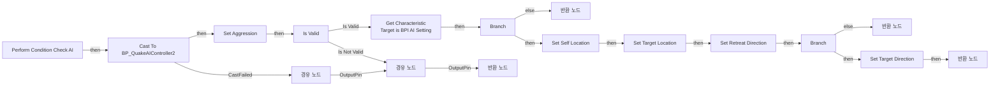

# BTD_IsTargetInRetreatDirection

에셋: `/Game/QuakeLike_1_0/AI/Refactoring_BT/BTD/BTD_IsTargetInRetreatDirection`

부모: `/Script/CoreUObject.Class'/Script/AIModule.BTDecorator_BlueprintBase'`

수집일: 2026-10-12. MCP에서 읽은 그래프·핀 연결의 자동 전사입니다. 상속된 그래프는 부모 문서를 함께 확인합니다.

정적 루트 참조 도달: 있음. 실행 여부 또는 삭제 가능 여부의 확정이 아닙니다.

컴포넌트 목록은 이 BP가 직접 정의한 SCS만 포함합니다. 부모·네이티브 생성 컴포넌트, 인스턴스 설정은 별도입니다.

## 변수와 기본값

| 이름 | 타입 | CDO 기본값 |
|---|---|---|
| `Target` | `BlackboardKeySelector` | &lt;Struct 'BlackboardKeySelector' {allowed_types: , selected_key_name: "", selected_key_type: None, selected_key_id: 65535, none_is_allowed_value: False}&gt; |

## 그래프 목록

| 그래프 | 전체 노드 수 |
|---|---|
| EventGraph | 0 |
| PerformConditionCheckAI | 49 |

## 그래프별 실행 연결

실선은 출력 exec 핀의 실제 연결입니다. 여러 분기는 출력 핀 이름을 표시합니다. 함수 호출·delegate·타이머의 다음 그래프 실행은 이 그림에서 자동으로 이어 붙이지 않습니다.

순수 계산 노드 및 데이터 핀은 아래 목록과 원본 JSON을 확인합니다. 연결되지 않은 이벤트도 표시되므로, 노드가 있다는 이유만으로 실행된다고 판단하면 안 됩니다.

### EventGraph

전체 노드·기본 입력 목록

| 노드 ID | 제목 | 미연결 기본 입력 / 에셋 입력 |
|---|---|---|

### PerformConditionCheckAI

실행 핀 플로우차트

전체 노드·기본 입력 목록

| 노드 ID | 제목 | 미연결 기본 입력 / 에셋 입력 |
|---|---|---|
| `K2Node_FunctionEntry_0` | Perform Condition Check AI |  |
| `K2Node_FunctionResult_1` | 반환 노드 |  |
| `K2Node_CallFunction_0` | Get Velocity 타깃은 액터 |  |
| `K2Node_CallFunction_2` | Normalize 2D (Vector) | Tolerance=0.000100 |
| `K2Node_IfThenElse_0` | Branch |  |
| `K2Node_CallFunction_4` | Not Equal Exactly (Vector) | B=0, 0, 0 |
| `K2Node_FunctionResult_2` | 반환 노드 | ReturnValue=false |
| `K2Node_VariableSet_0` | Set Retreat Direction |  |
| `K2Node_VariableGet_3` | Get Target |  |
| `K2Node_CallFunction_10` | Get Blackboard Value as Actor |  |
| `K2Node_Knot_1` | 경유 노드 |  |
| `K2Node_CallFunction_6` | Is Valid |  |
| `K2Node_CallFunction_7` | Is Valid |  |
| `K2Node_CommutativeAssociativeBinaryOperator_0` | AND Boolean |  |
| `K2Node_IfThenElse_1` | Branch |  |
| `K2Node_FunctionResult_0` | 반환 노드 | ReturnValue=false |
| `K2Node_Knot_2` | 경유 노드 |  |
| `K2Node_CallFunction_9` | Get Actor Location 타깃은 액터 |  |
| `K2Node_VariableGet_1` | Get Target |  |
| `K2Node_CallFunction_8` | Get Blackboard Value as Actor |  |
| `K2Node_CallFunction_11` | Get Actor Location 타깃은 액터 |  |
| `K2Node_VariableSet_1` | Set Self Location | Output_Get=0, 0, 0 |
| `K2Node_VariableSet_2` | Set Target Location | Output_Get=0, 0, 0 |
| `K2Node_VariableGet_4` | Get Self Location |  |
| `K2Node_VariableGet_5` | Get Target Location |  |
| `K2Node_PromotableOperator_1` | vector - vector |  |
| `K2Node_CallFunction_12` | Normalize 2D (Vector) | Tolerance=0.000100 |
| `K2Node_VariableSet_4` | Set Target Direction | Output_Get=0, 0, 0 |
| `K2Node_VariableGet_8` | Get Retreat Direction |  |
| `K2Node_VariableGet_9` | Get Target Direction |  |
| `K2Node_CallFunction_13` | Dot Product |  |
| `K2Node_Message_0` | Get Characteristic Target is BPI AI Setting | Valid=false |
| `K2Node_Knot_3` | 경유 노드 |  |
| `K2Node_PromotableOperator_3` | float * float |  |
| `K2Node_CallFunction_14` | Cos (Degrees) |  |
| `K2Node_PromotableOperator_4` | float &gt;= float |  |
| `K2Node_DynamicCast_0` | Cast To BP_QuakeAIController2 |  |
| `K2Node_Knot_5` | 경유 노드 |  |
| `K2Node_Knot_6` | 경유 노드 |  |
| `K2Node_Knot_7` | 경유 노드 |  |
| `K2Node_VariableGet_0` | Get DA_Aggression |  |
| `K2Node_Knot_8` | 경유 노드 |  |
| `K2Node_MacroInstance_0` | Is Valid |  |
| `K2Node_VariableSet_3` | Set Aggression |  |
| `K2Node_VariableGet_2` | Get Aggression |  |
| `K2Node_VariableGet_6` | Get ReatreatMaxAngle |  |
| `K2Node_FunctionResult_3` | 반환 노드 | ReturnValue=false |
| `K2Node_Knot_9` | 경유 노드 |  |
| `K2Node_Knot_10` | 경유 노드 |  |

[원본 MCP 스냅샷](../../../../../Evidence/blueprints-105.json)
