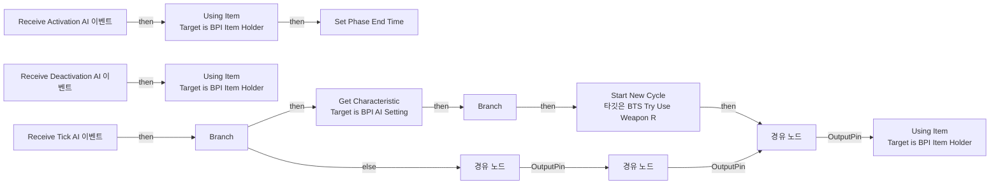
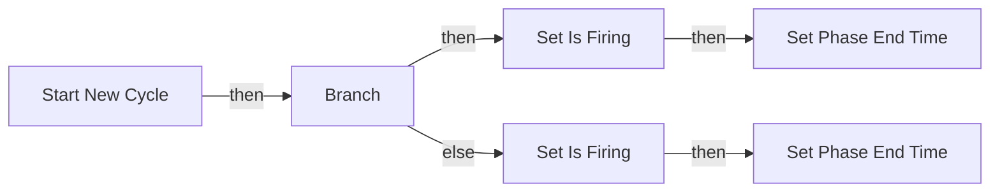

# BTS_TryUseWeapon_R

에셋: `/Game/QuakeLike_1_0/AI/Refactoring_BT/BTS/BTS_TryUseWeapon_R`

부모: `/Script/CoreUObject.Class'/Script/AIModule.BTService_BlueprintBase'`

수집일: 2026-10-12. MCP에서 읽은 그래프·핀 연결의 자동 전사입니다. 상속된 그래프는 부모 문서를 함께 확인합니다.

정적 루트 참조 도달: 있음. 실행 여부 또는 삭제 가능 여부의 확정이 아닙니다.

컴포넌트 목록은 이 BP가 직접 정의한 SCS만 포함합니다. 부모·네이티브 생성 컴포넌트, 인스턴스 설정은 별도입니다.

## 변수와 기본값

| 이름 | 타입 | CDO 기본값 |
|---|---|---|
| `Is Firing` | `bool` | False |
| `Phase End Time` | `real` | 0.0 |

## 그래프 목록

| 그래프 | 전체 노드 수 |
|---|---|
| EventGraph | 22 |
| Start New Cycle | 17 |

## 그래프별 실행 연결

실선은 출력 exec 핀의 실제 연결입니다. 여러 분기는 출력 핀 이름을 표시합니다. 함수 호출·delegate·타이머의 다음 그래프 실행은 이 그림에서 자동으로 이어 붙이지 않습니다.

순수 계산 노드 및 데이터 핀은 아래 목록과 원본 JSON을 확인합니다. 연결되지 않은 이벤트도 표시되므로, 노드가 있다는 이유만으로 실행된다고 판단하면 안 됩니다.

### EventGraph

실행 핀 플로우차트

전체 노드·기본 입력 목록

| 노드 ID | 제목 | 미연결 기본 입력 / 에셋 입력 |
|---|---|---|
| `K2Node_Event_0` | Receive Tick AI 이벤트 | DeltaSeconds=0.0 |
| `K2Node_Message_4` | Using Item Target is BPI Item Holder |  |
| `K2Node_Knot_0` | 경유 노드 |  |
| `K2Node_Message_1` | Get Characteristic Target is BPI AI Setting | Valid=false |
| `K2Node_Knot_1` | 경유 노드 |  |
| `K2Node_CallFunction_0` | Start New Cycle 타깃은 BTS Try Use Weapon R |  |
| `K2Node_Event_1` | Receive Activation AI 이벤트 |  |
| `K2Node_Message_3` | Using Item Target is BPI Item Holder | use=false |
| `K2Node_VariableSet_0` | Set Phase End Time | Phase End Time=0.0; Output_Get=0.0 |
| `K2Node_VariableGet_0` | Get Is Firing |  |
| `K2Node_Event_2` | Receive Deactivation AI 이벤트 |  |
| `K2Node_Message_2` | Using Item Target is BPI Item Holder | use=false |
| `K2Node_CallFunction_1` | Get Time Seconds |  |
| `K2Node_VariableGet_1` | Get Phase End Time |  |
| `K2Node_PromotableOperator_0` | float &gt; float |  |
| `K2Node_IfThenElse_0` | Branch |  |
| `K2Node_Knot_2` | 경유 노드 |  |
| `K2Node_Knot_3` | 경유 노드 |  |
| `K2Node_Knot_4` | 경유 노드 |  |
| `K2Node_Knot_5` | 경유 노드 |  |
| `K2Node_IfThenElse_1` | Branch |  |
| `K2Node_PromotableOperator_2` | float &gt; float |  |

### Start New Cycle

실행 핀 플로우차트

전체 노드·기본 입력 목록

| 노드 ID | 제목 | 미연결 기본 입력 / 에셋 입력 |
|---|---|---|
| `K2Node_FunctionEntry_0` | Start New Cycle |  |
| `K2Node_CallFunction_0` | Random Float |  |
| `K2Node_CallFunction_2` | Get Time Seconds |  |
| `K2Node_PromotableOperator_0` | float &lt;= float |  |
| `K2Node_IfThenElse_0` | Branch |  |
| `K2Node_VariableSet_1` | Set Is Firing | Is Firing=false; Output_Get=false |
| `K2Node_VariableSet_0` | Set Is Firing | Is Firing=true; Output_Get=false |
| `K2Node_VariableSet_3` | Set Phase End Time | Output_Get=0.0 |
| `K2Node_Knot_0` | 경유 노드 |  |
| `K2Node_Knot_2` | 경유 노드 |  |
| `K2Node_PromotableOperator_4` | float + float |  |
| `K2Node_VariableSet_2` | Set Phase End Time | Output_Get=0.0 |
| `K2Node_CallFunction_1` | Get Time Seconds |  |
| `K2Node_PromotableOperator_2` | float + float |  |
| `K2Node_Knot_3` | 경유 노드 |  |
| `K2Node_PromotableOperator_5` | float - float | A=1.000000 |
| `K2Node_Knot_4` | 경유 노드 |  |

## 조회 범위의 한계

ObjectIterator로 발견했으나 MCP helper가 반환하지 않은 그래프입니다. delegate signature·컴파일된 중간 그래프·macro·애니메이션 내부 그래프가 섞일 수 있습니다.

- `ReceiveActivationAI`: Graph 'ReceiveActivationAI' not found in Blueprint.
- `ReceiveDeactivationAI`: Graph 'ReceiveDeactivationAI' not found in Blueprint.
- `ReceiveTickAI`: Graph 'ReceiveTickAI' not found in Blueprint.

[원본 MCP 스냅샷](../../../../../Evidence/blueprints-105.json)
