# BPC_VirtualInputAIMovement

에셋: `/Game/QuakeLike_1_0/AI/VirtualInputMovement/BPC_VirtualInputAIMovement`

부모: `/Script/CoreUObject.Class'/Script/Engine.ActorComponent'`

수집일: 2026-10-12. MCP에서 읽은 그래프·핀 연결의 자동 전사입니다. 상속된 그래프는 부모 문서를 함께 확인합니다.

정적 루트 참조 도달: 있음. 실행 여부 또는 삭제 가능 여부의 확정이 아닙니다.

컴포넌트 목록은 이 BP가 직접 정의한 SCS만 포함합니다. 부모·네이티브 생성 컴포넌트, 인스턴스 설정은 별도입니다.

## 변수와 기본값

| 이름 | 타입 | CDO 기본값 |
|---|---|---|
| `Way Route Queue` | `AreaRouteStep` | [] |
| `Path Link Route` | `PathLinkRouteSegment` | [] |
| `Path Points` | `Vector` | [] |
| `Path Length` | `real` | 0.0 |
| `Path Points Index` | `int` | 1 |
| `Has Goal` | `bool` | False |
| `Final Goal` | `Actor` | None |
| `Final Goal Location` | `Vector` | &lt;Struct 'Vector' {x: 0.000000, y: 0.000000, z: 0.000000}&gt; |
| `Tether Distance` | `real` | 0.0 |
| `Possessed Character` | `Character` | None |
| `Input Direction` | `Vector` | &lt;Struct 'Vector' {x: 0.000000, y: 0.000000, z: 0.000000}&gt; |
| `Rebuild Timer Handle` | `TimerHandle` | &lt;Struct 'TimerHandle' {}&gt; |
| `OnArrived` | `mcdelegate` | &lt;Delegate 'DelegateBase' &lt;Unbound&gt;&gt; |
| `Allow Distance` | `real` | 75.0 |
| `OnPath Timer` | `TimerHandle` | &lt;Struct 'TimerHandle' {}&gt; |
| `Area Route Result` | `AreaRouteResult` | &lt;Struct 'AreaRouteResult' {success: False, failure_reason: "", route_areas: , route_steps: , total_risk: 0.000000, total_travel_distance: 0.000000}&gt; |
| `Start Point` | `Vector` | &lt;Struct 'Vector' {x: 0.000000, y: 0.000000, z: 0.000000}&gt; |
| `On Try Build` | `mcdelegate` | &lt;Delegate 'DelegateBase' &lt;Unbound&gt;&gt; |
| `Reset Input Timer` | `TimerHandle` | &lt;Struct 'TimerHandle' {}&gt; |
| `Is Stuck` | `bool` | False |
| `Stuck Timer Handle` | `TimerHandle` | &lt;Struct 'TimerHandle' {}&gt; |
| `Input Direction When Stuck` | `Vector` | &lt;Struct 'Vector' {x: 0.000000, y: 0.000000, z: 0.000000}&gt; |

## 그래프 목록

| 그래프 | 전체 노드 수 |
|---|---|
| Back To NavMesh Point | 13 |
| Bind Event To Pawn | 5 |
| Bind Rebuild On Landed | 11 |
| Build Path | 20 |
| Check Goal Actor Location | 10 |
| Check On Path | 41 |
| Check Path Point Completed | 33 |
| Clear Reset Input Timer | 3 |
| Debug Current Point | 20 |
| Debug Goal Location | 4 |
| Debug Input Direction | 16 |
| Debug Path Points | 28 |
| Debug String As Self Name | 13 |
| Disable Stuck | 3 |
| Enable Stuck | 5 |
| EventGraph | 116 |
| Find Stuck Escape Direction | 24 |
| Get Actor Location On Mesh | 14 |
| Get Before Path Point | 12 |
| Get Closest Path Point Index | 43 |
| Get Current Path Index | 9 |
| Get Current PathPoint | 22 |
| Get Middle Point From Path | 12 |
| Get Movement Mode | 6 |
| Get Possessed Pawn Location | 18 |
| Input Direction Stuck Check | 6 |
| Is Completed | 6 |
| Peek Link Route | 8 |
| Pop Link Route | 9 |
| Pop Link Route If LinkMover | 12 |
| Reset Input Direction Callback | 2 |
| Set Input Direction | 9 |
| Set PathPoints | 8 |
| Start Rebuild Timer | 7 |
| Start Reset Input Timer | 7 |
| Start Stuck Check | 7 |
| Stop Rebuild Timer | 3 |
| Stop Stuck Check | 3 |
| Stuck Trace | 19 |
| Try Rebuild NavPath | 6 |
| Unbind Event To Pawn | 5 |

## 그래프별 실행 연결

실선은 출력 exec 핀의 실제 연결입니다. 여러 분기는 출력 핀 이름을 표시합니다. 함수 호출·delegate·타이머의 다음 그래프 실행은 이 그림에서 자동으로 이어 붙이지 않습니다.

순수 계산 노드 및 데이터 핀은 아래 목록과 원본 JSON을 확인합니다. 연결되지 않은 이벤트도 표시되므로, 노드가 있다는 이유만으로 실행된다고 판단하면 안 됩니다.

### Back To NavMesh Point

<details>
<summary>실행 핀 플로우차트</summary>

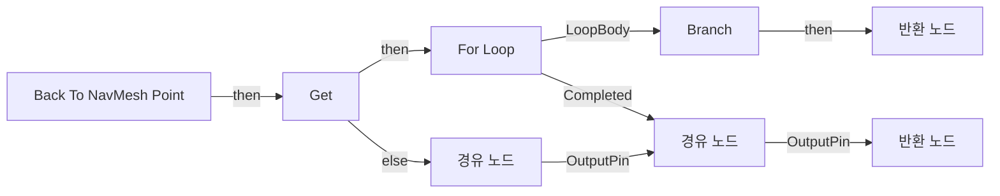

</details>

<details>
<summary>전체 노드·기본 입력 목록</summary>

| 노드 ID | 제목 | 미연결 기본 입력 / 에셋 입력 |
|---|---|---|
| `K2Node_FunctionEntry_0` | Back To NavMesh Point |  |
| `K2Node_CallFunction_0` | Project Point to Navigation | QueryExtent_Z=150.000000 |
| `K2Node_FunctionResult_1` | 반환 노드 | Is Valid=false; ProjectedLocation=0, 0, 0 |
| `K2Node_VariableGet_0` | Get |  |
| `K2Node_CallFunction_1` | Get Actor Location<br/>타깃은 액터 |  |
| `K2Node_MacroInstance_0` | For Loop | FirstIndex=1; LastIndex=5 |
| `K2Node_PromotableOperator_0` | float * float | B=100.000000 |
| `K2Node_Knot_0` | 경유 노드 |  |
| `K2Node_Knot_1` | 경유 노드 |  |
| `K2Node_IfThenElse_0` | Branch |  |
| `K2Node_FunctionResult_0` | 반환 노드 | Is Valid=true |
| `K2Node_Knot_2` | 경유 노드 |  |
| `K2Node_Knot_3` | 경유 노드 |  |

</details>

### Bind Event To Pawn

<details>
<summary>실행 핀 플로우차트</summary>

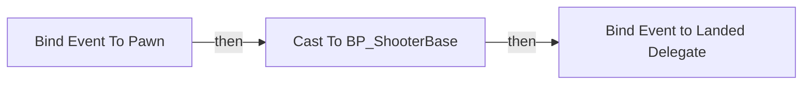

</details>

<details>
<summary>전체 노드·기본 입력 목록</summary>

| 노드 ID | 제목 | 미연결 기본 입력 / 에셋 입력 |
|---|---|---|
| `K2Node_FunctionEntry_0` | Bind Event To Pawn |  |
| `K2Node_AddDelegate_0` | Bind Event to Landed Delegate |  |
| `K2Node_CreateDelegate_1` | 이벤트 생성 |  |
| `K2Node_DynamicCast_0` | Cast To BP_ShooterBase |  |
| `K2Node_Knot_0` | 경유 노드 |  |

</details>

### Bind Rebuild On Landed

<details>
<summary>실행 핀 플로우차트</summary>

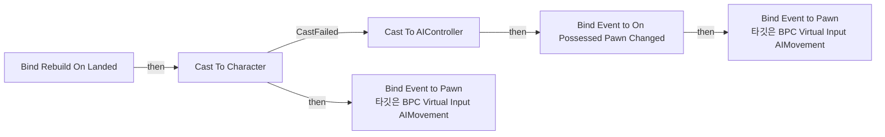

</details>

<details>
<summary>전체 노드·기본 입력 목록</summary>

| 노드 ID | 제목 | 미연결 기본 입력 / 에셋 입력 |
|---|---|---|
| `K2Node_FunctionEntry_0` | Bind Rebuild On Landed |  |
| `K2Node_CallFunction_2` | Get Owner<br/>타깃은 액터 컴포넌트 |  |
| `K2Node_DynamicCast_1` | Cast To Character |  |
| `K2Node_CallFunction_0` | Get Owner<br/>타깃은 액터 컴포넌트 |  |
| `K2Node_DynamicCast_2` | Cast To AIController |  |
| `K2Node_AddDelegate_1` | Bind Event to On Possessed Pawn Changed |  |
| `K2Node_CreateDelegate_2` | 이벤트 생성 |  |
| `K2Node_Knot_5` | 경유 노드 |  |
| `K2Node_CallFunction_6` | Get Controlled Pawn<br/>타깃은 컨트롤러 |  |
| `K2Node_CallFunction_3` | Bind Event to Pawn<br/>타깃은 BPC Virtual Input AIMovement |  |
| `K2Node_CallFunction_1` | Bind Event to Pawn<br/>타깃은 BPC Virtual Input AIMovement |  |

</details>

### Build Path

<details>
<summary>실행 핀 플로우차트</summary>

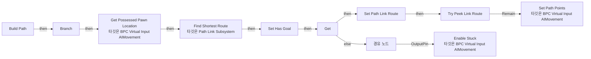

</details>

<details>
<summary>전체 노드·기본 입력 목록</summary>

| 노드 ID | 제목 | 미연결 기본 입력 / 에셋 입력 |
|---|---|---|
| `K2Node_FunctionEntry_0` | Build Path |  |
| `K2Node_VariableSet_12` | Set Has Goal | Output_Get=false |
| `K2Node_GetSubsystem_0` | Path Link Subsystem |  |
| `K2Node_CallFunction_6` | Find Shortest Route<br/>타깃은 Path Link Subsystem | ReturnValue=false |
| `K2Node_VariableSet_0` | Set Path Link Route |  |
| `K2Node_Knot_15` | 경유 노드 |  |
| `K2Node_CallFunction_5` | Get Possessed Pawn Location<br/>타깃은 BPC Virtual Input AIMovement | Is Valid=false |
| `K2Node_VariableGet_0` | Get Final Goal Location |  |
| `K2Node_VariableGet_1` | Get | Has Goal=false |
| `K2Node_MacroInstance_0` | Try Peek Link Route |  |
| `K2Node_CallFunction_0` | Set Path Points<br/>타깃은 BPC Virtual Input AIMovement |  |
| `K2Node_Knot_2` | 경유 노드 |  |
| `K2Node_CallFunction_4` | Enable Stuck<br/>타깃은 BPC Virtual Input AIMovement |  |
| `K2Node_CallFunction_1` | Get Owner<br/>타깃은 액터 컴포넌트 |  |
| `K2Node_CallFunction_2` | Get Blackboard |  |
| `K2Node_CallFunction_3` | Get Value as Bool<br/>타깃은 블랙보드 컴포넌트 |  |
| `K2Node_CallFunction_7` | Make Literal Name | Value=Debug_KillSwitch |
| `K2Node_CallFunction_8` | NOT Boolean |  |
| `K2Node_IfThenElse_0` | Branch |  |
| `EdGraphNode_Comment_3` | 임시 디버그 |  |

</details>

### Check Goal Actor Location

<details>
<summary>실행 핀 플로우차트</summary>

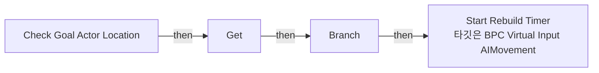

</details>

<details>
<summary>전체 노드·기본 입력 목록</summary>

| 노드 ID | 제목 | 미연결 기본 입력 / 에셋 입력 |
|---|---|---|
| `K2Node_FunctionEntry_0` | Check Goal Actor Location |  |
| `K2Node_VariableGet_0` | Get Tether Distance |  |
| `K2Node_PromotableOperator_0` | float * float |  |
| `K2Node_VariableGet_1` | Get |  |
| `K2Node_CallFunction_0` | Get Actor Location<br/>타깃은 액터 |  |
| `K2Node_VariableGet_2` | Get Final Goal Location |  |
| `K2Node_CallFunction_1` | Distance Squared (Vector) |  |
| `K2Node_PromotableOperator_1` | float &gt; float |  |
| `K2Node_IfThenElse_0` | Branch |  |
| `K2Node_CallFunction_2` | Start Rebuild Timer<br/>타깃은 BPC Virtual Input AIMovement |  |

</details>

### Check On Path

<details>
<summary>실행 핀 플로우차트</summary>

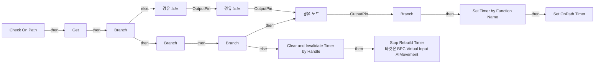

</details>

<details>
<summary>전체 노드·기본 입력 목록</summary>

| 노드 ID | 제목 | 미연결 기본 입력 / 에셋 입력 |
|---|---|---|
| `K2Node_FunctionEntry_0` | Check On Path |  |
| `K2Node_VariableGet_1` | Get |  |
| `K2Node_IfThenElse_2` | Branch |  |
| `K2Node_GetArrayItem_2` | GET |  |
| `K2Node_CallFunction_5` | Get Current Path Index |  |
| `K2Node_PromotableOperator_2` | float &gt; float |  |
| `K2Node_CallFunction_7` | Make Literal Float | Value=100.000000 |
| `K2Node_PromotableOperator_3` | float * float |  |
| `K2Node_GetArrayItem_1` | GET |  |
| `K2Node_Knot_7` | 경유 노드 |  |
| `K2Node_IfThenElse_1` | Branch |  |
| `K2Node_VariableGet_2` | Get Path Points |  |
| `K2Node_VariableGet_3` | Get Path Points |  |
| `K2Node_CallFunction_11` | Get Actor Location<br/>타깃은 액터 |  |
| `K2Node_CallFunction_1` | Find Closest Point on Segment |  |
| `K2Node_CallFunction_16` | Distance Squared (Vector) |  |
| `K2Node_Knot_5` | 경유 노드 |  |
| `K2Node_CallFunction_19` | Set Timer by Function Name | FunctionName=Try Rebuild NavPath; Time=1.000000; bLooping=true; bMaxOncePerFrame=false; InitialStartDelay=0.000000; InitialStartDelayVariance=0.000000 |
| `K2Node_VariableSet_0` | Set OnPath Timer |  |
| `K2Node_CallFunction_2` | Is Valid Timer Handle |  |
| `K2Node_IfThenElse_0` | Branch |  |
| `K2Node_CallFunction_3` | NOT Boolean |  |
| `K2Node_VariableGet_6` | Get OnPath Timer |  |
| `K2Node_VariableGet_5` | Get OnPath Timer |  |
| `K2Node_CallFunction_21` | Clear and Invalidate Timer by Handle |  |
| `K2Node_Knot_0` | 경유 노드 |  |
| `K2Node_CallArrayFunction_0` | Last Index |  |
| `K2Node_Knot_1` | 경유 노드 |  |
| `K2Node_CallFunction_4` | Clamp (Integer) | Min=0 |
| `K2Node_Knot_8` | 경유 노드 |  |
| `K2Node_Knot_9` | 경유 노드 |  |
| `K2Node_Knot_10` | 경유 노드 |  |
| `K2Node_CallFunction_0` | Stop Rebuild Timer<br/>타깃은 BPC Virtual Input AIMovement |  |
| `K2Node_CallFunction_8` | Get Current Path Point | Current Point=0, 0, 0 |
| `K2Node_IfThenElse_3` | Branch |  |
| `K2Node_Knot_2` | 경유 노드 |  |
| `K2Node_Knot_3` | 경유 노드 |  |
| `K2Node_Knot_6` | 경유 노드 |  |
| `K2Node_PromotableOperator_0` | int - int | B=1 |
| `K2Node_CallFunction_6` | NOT Boolean |  |
| `K2Node_CommutativeAssociativeBinaryOperator_0` | AND Boolean |  |

</details>

### Check Path Point Completed

<details>
<summary>실행 핀 플로우차트</summary>

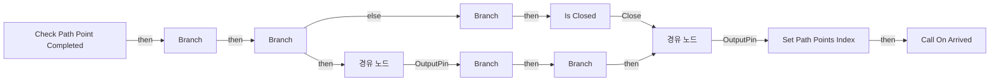

</details>

<details>
<summary>전체 노드·기본 입력 목록</summary>

| 노드 ID | 제목 | 미연결 기본 입력 / 에셋 입력 |
|---|---|---|
| `K2Node_FunctionEntry_1` | Check Path Point Completed |  |
| `K2Node_CallFunction_10` | Is Completed |  |
| `K2Node_CallDelegate_1` | Call On Arrived |  |
| `K2Node_VariableGet_1` | Get Path Points Index |  |
| `K2Node_CallFunction_1` | Clamp (Integer) | Min=0 |
| `K2Node_VariableGet_0` | Get Path Points |  |
| `K2Node_VariableSet_0` | Set Path Points Index | Output_Get=0 |
| `K2Node_PromotableOperator_0` | int + int | B=1 |
| `K2Node_CallArrayFunction_2` | Length |  |
| `K2Node_MacroInstance_0` | Is Closed |  |
| `K2Node_CallFunction_0` | Get Current Path Point |  |
| `K2Node_IfThenElse_2` | Branch |  |
| `K2Node_Knot_0` | 경유 노드 |  |
| `EdGraphNode_Comment_0` | 위치가 가까운지 체크 |  |
| `K2Node_CallFunction_2` | Get Current Path Point | Is Valid=false |
| `K2Node_IfThenElse_0` | Branch |  |
| `K2Node_CallFunction_4` | Get Middle Point from Path | Is Valid=false |
| `K2Node_CallFunction_5` | Get Before Path Point |  |
| `K2Node_Knot_1` | 경유 노드 |  |
| `K2Node_CallFunction_6` | Distance Squared (Vector) |  |
| `K2Node_PromotableOperator_1` | float &lt; float |  |
| `K2Node_IfThenElse_1` | Branch |  |
| `EdGraphNode_Comment_1` | Path 중간값 탐색 (마지막 index 아닐 때) |  |
| `EdGraphNode_Comment_2` | 완료 시 카운트 |  |
| `K2Node_CallFunction_3` | Get Current Path Index | Is Completed=false |
| `K2Node_IfThenElse_3` | Branch |  |
| `K2Node_VariableGet_2` | Get Path Points |  |
| `K2Node_CallArrayFunction_0` | Last Index |  |
| `K2Node_PromotableOperator_4` | integer &lt; integer |  |
| `K2Node_IfThenElse_4` | Branch |  |
| `K2Node_Knot_2` | 경유 노드 |  |
| `K2Node_Knot_3` | 경유 노드 |  |
| `K2Node_PromotableOperator_5` | float * float | A=20.000000; B=20.000000 |

</details>

### Clear Reset Input Timer

<details>
<summary>실행 핀 플로우차트</summary>

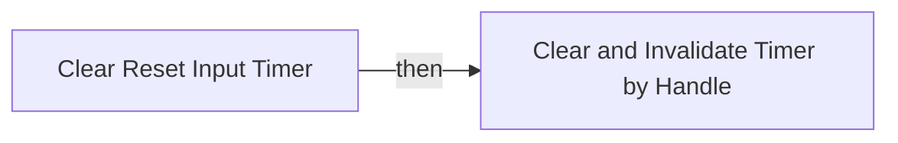

</details>

<details>
<summary>전체 노드·기본 입력 목록</summary>

| 노드 ID | 제목 | 미연결 기본 입력 / 에셋 입력 |
|---|---|---|
| `K2Node_FunctionEntry_0` | Clear Reset Input Timer |  |
| `K2Node_VariableGet_0` | Get Reset Input Timer |  |
| `K2Node_CallFunction_0` | Clear and Invalidate Timer by Handle |  |

</details>

### Debug Current Point

<details>
<summary>실행 핀 플로우차트</summary>

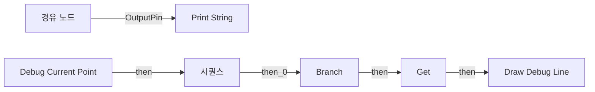

</details>

<details>
<summary>전체 노드·기본 입력 목록</summary>

| 노드 ID | 제목 | 미연결 기본 입력 / 에셋 입력 |
|---|---|---|
| `K2Node_FunctionEntry_0` | Debug Current Point |  |
| `K2Node_IfThenElse_0` | Branch |  |
| `K2Node_VariableGet_1` | Get |  |
| `K2Node_CallFunction_11` | Draw Debug Line | Duration=0.000000; Thickness=3.000000 |
| `K2Node_CallFunction_2` | Get Actor Location<br/>타깃은 액터 |  |
| `K2Node_Knot_0` | 경유 노드 |  |
| `K2Node_VariableGet_5` | Get Debug_Color |  |
| `K2Node_VariableGet_6` | Get Debug_Color |  |
| `K2Node_CallArrayFunction_0` | Length |  |
| `K2Node_CommutativeAssociativeBinaryOperator_2` | Append | A=현재 경유지 갯수: ; C=
<br/>현재 대상 인덱스:  |
| `K2Node_CallFunction_20` | To String (Integer) |  |
| `K2Node_VariableGet_8` | Get Path Points Index |  |
| `K2Node_CallFunction_21` | To String (Integer) |  |
| `K2Node_CallFunction_9` | Print String | bPrintToScreen=true; bPrintToLog=true; Duration=2.000000 |
| `K2Node_CallFunction_10` | Make Print Key | string=디버그 배열 길이 + 인덱스 |
| `K2Node_CallFunction_1` | Get Owner<br/>타깃은 액터 컴포넌트 |  |
| `K2Node_VariableGet_0` | Get Path Points |  |
| `K2Node_CallFunction_3` | Get Current Path Point |  |
| `K2Node_ExecutionSequence_1` | 시퀀스 |  |
| `K2Node_Knot_2` | 경유 노드 |  |

</details>

### Debug Goal Location

<details>
<summary>실행 핀 플로우차트</summary>


</details>

<details>
<summary>전체 노드·기본 입력 목록</summary>

| 노드 ID | 제목 | 미연결 기본 입력 / 에셋 입력 |
|---|---|---|
| `K2Node_FunctionEntry_0` | Debug Goal Location |  |
| `K2Node_CallFunction_0` | Draw Debug Sphere | Radius=50.000000; Segments=12; LineColor=(R=1.000000,G=1.000000,B=1.000000,A=1.000000); Duration=0.000000; Thickness=0.000000 |
| `K2Node_VariableGet_1` | Get |  |
| `K2Node_VariableGet_0` | Get Final Goal Location |  |

</details>

### Debug Input Direction

<details>
<summary>실행 핀 플로우차트</summary>

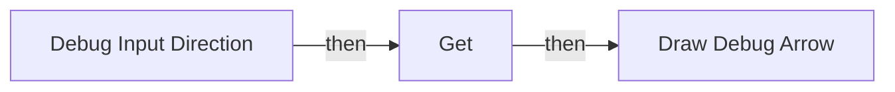

</details>

<details>
<summary>전체 노드·기본 입력 목록</summary>

| 노드 ID | 제목 | 미연결 기본 입력 / 에셋 입력 |
|---|---|---|
| `K2Node_FunctionEntry_0` | Debug Input Direction |  |
| `K2Node_VariableGet_0` | Get Input Direction |  |
| `K2Node_CallFunction_0` | Draw Debug Arrow | ArrowSize=200.000000; Thickness=3.000000 |
| `K2Node_PromotableOperator_0` | vector * vector | B=200.000000 |
| `K2Node_VariableGet_1` | Get |  |
| `K2Node_PromotableOperator_1` | vector + vector |  |
| `K2Node_CallFunction_5` | Get Actor Eyes View Point<br/>타깃은 액터 | OutRotation=0, 0, 0 |
| `K2Node_Knot_2` | 경유 노드 |  |
| `K2Node_Knot_0` | 경유 노드 |  |
| `K2Node_Knot_1` | 경유 노드 |  |
| `K2Node_CallFunction_1` | Select Vector |  |
| `K2Node_VariableGet_2` | Get Input Direction When Stuck |  |
| `K2Node_VariableGet_4` | Get Is Stuck |  |
| `K2Node_CallFunction_2` | Select Color |  |
| `K2Node_Knot_4` | 경유 노드 |  |
| `K2Node_VariableGet_3` | Get Is Stuck |  |

</details>

### Debug Path Points

<details>
<summary>실행 핀 플로우차트</summary>

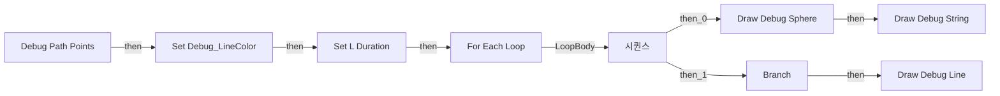

</details>

<details>
<summary>전체 노드·기본 입력 목록</summary>

| 노드 ID | 제목 | 미연결 기본 입력 / 에셋 입력 |
|---|---|---|
| `K2Node_FunctionEntry_0` | Debug Path Points |  |
| `K2Node_MacroInstance_2` | For Each Loop |  |
| `K2Node_CallFunction_0` | Draw Debug Sphere | Radius=37.500000; Segments=12; Thickness=0.000000 |
| `K2Node_PromotableOperator_1` | int - int | B=1 |
| `K2Node_CallArrayFunction_1` | Is Valid Index |  |
| `K2Node_IfThenElse_0` | Branch |  |
| `K2Node_GetArrayItem_0` | GET |  |
| `K2Node_Knot_1` | 경유 노드 |  |
| `K2Node_ExecutionSequence_1` | 시퀀스 |  |
| `K2Node_CallFunction_2` | Draw Debug Line | Thickness=3.000000 |
| `K2Node_Knot_2` | 경유 노드 |  |
| `K2Node_VariableGet_4` | Get Debug_LineColor |  |
| `K2Node_VariableGet_0` | Get Debug_LineColor |  |
| `K2Node_VariableSet_0` | Set Debug_LineColor |  |
| `K2Node_Knot_0` | 경유 노드 |  |
| `K2Node_Knot_3` | 경유 노드 |  |
| `K2Node_VariableSet_2` | Set L Duration | Output_Get=0.0 |
| `K2Node_Knot_4` | 경유 노드 |  |
| `K2Node_VariableGet_8` | Get L Duration |  |
| `K2Node_VariableGet_3` | Get L Duration |  |
| `K2Node_CallFunction_3` | Draw Debug String | TextColor=(R=1.000000,G=1.000000,B=1.000000,A=1.000000) |
| `K2Node_VariableGet_9` | Get L Duration |  |
| `K2Node_Knot_5` | 경유 노드 |  |
| `K2Node_Knot_6` | 경유 노드 |  |
| `K2Node_CallFunction_27` | To String (Integer) |  |
| `K2Node_Knot_7` | 경유 노드 |  |
| `K2Node_Knot_8` | 경유 노드 |  |
| `K2Node_Knot_9` | 경유 노드 |  |

</details>

### Debug String As Self Name

<details>
<summary>실행 핀 플로우차트</summary>

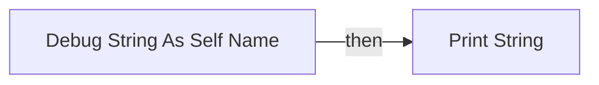

</details>

<details>
<summary>전체 노드·기본 입력 목록</summary>

| 노드 ID | 제목 | 미연결 기본 입력 / 에셋 입력 |
|---|---|---|
| `K2Node_FunctionEntry_0` | Debug String As Self Name |  |
| `K2Node_CallFunction_0` | Print String | bPrintToScreen=true; bPrintToLog=true |
| `K2Node_CallFunction_1` | Get Owner<br/>타깃은 액터 컴포넌트 |  |
| `K2Node_CallFunction_19` | Get Display Name |  |
| `K2Node_CommutativeAssociativeBinaryOperator_0` | Append | B= \|  |
| `K2Node_Knot_0` | 경유 노드 |  |
| `K2Node_CallFunction_2` | Make Print Key |  |
| `K2Node_CallFunction_3` | Get Owner<br/>타깃은 액터 컴포넌트 |  |
| `K2Node_Knot_1` | 경유 노드 |  |
| `K2Node_Knot_2` | 경유 노드 |  |
| `K2Node_Knot_3` | 경유 노드 |  |
| `K2Node_Knot_4` | 경유 노드 |  |
| `K2Node_Knot_5` | 경유 노드 |  |

</details>

### Disable Stuck

<details>
<summary>실행 핀 플로우차트</summary>

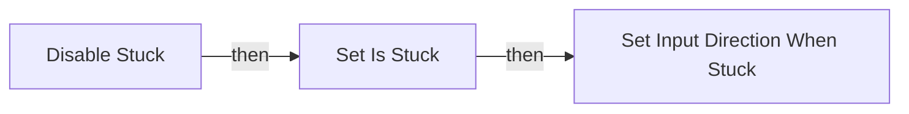

</details>

<details>
<summary>전체 노드·기본 입력 목록</summary>

| 노드 ID | 제목 | 미연결 기본 입력 / 에셋 입력 |
|---|---|---|
| `K2Node_FunctionEntry_0` | Disable Stuck |  |
| `K2Node_VariableSet_0` | Set Is Stuck | Is Stuck=false; Output_Get=false |
| `K2Node_VariableSet_1` | Set Input Direction When Stuck | Input Direction When Stuck=0, 0, 0; Output_Get=0, 0, 0 |

</details>

### Enable Stuck

<details>
<summary>실행 핀 플로우차트</summary>

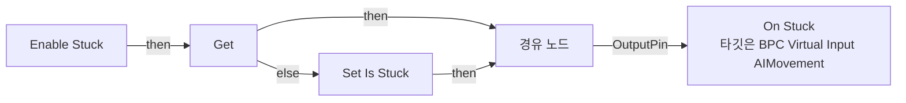

</details>

<details>
<summary>전체 노드·기본 입력 목록</summary>

| 노드 ID | 제목 | 미연결 기본 입력 / 에셋 입력 |
|---|---|---|
| `K2Node_FunctionEntry_0` | Enable Stuck |  |
| `K2Node_VariableGet_0` | Get | Is Stuck=false |
| `K2Node_VariableSet_0` | Set Is Stuck | Is Stuck=true; Output_Get=false |
| `K2Node_CallFunction_2` | On Stuck<br/>타깃은 BPC Virtual Input AIMovement |  |
| `K2Node_Knot_0` | 경유 노드 |  |

</details>

### EventGraph

<details>
<summary>실행 핀 플로우차트</summary>

```mermaid
flowchart LR
  n0["Request Build NavPath To Actor 이벤트<br/>BPI Virtual Input AIMovement에서"]
  n1["Clear NavPath 이벤트<br/>BPI Virtual Input AIMovement에서"]
  n2["Set Final Goal"]
  n3["Tick 이벤트"]
  n4["Set Final Goal"]
  n5["Set Tether Distance"]
  n6["Set Final Goal Location"]
  n7["Set MoveCharacter 이벤트<br/>BPI Virtual Input AIMovement에서"]
  n8["Set Possessed Character"]
  n9["Clear"]
  n10["Check Goal Actor Location<br/>타깃은 BPC Virtual Input AIMovement"]
  n11["Begin Play 이벤트"]
  n12["OnArrived_Event<br/>Custom Event"]
  n13["Bind Event to On Arrived"]
  n14["Check on Path<br/>타깃은 BPC Virtual Input AIMovement"]
  n15["Calc Move Direction<br/>Custom Event"]
  n16["Calc Move Direction<br/>타깃은 BPC Virtual Input AIMovement"]
  n17["Stop Rebuild Timer<br/>타깃은 BPC Virtual Input AIMovement"]
  n18["Branch"]
  n19["Get"]
  n20["Request Build NavPath To Location 이벤트<br/>BPI Virtual Input AIMovement에서"]
  n21["Set Final Goal"]
  n22["Set Final Goal Location"]
  n23["Set Tether Distance"]
  n24["Get Actor Location on Mesh<br/>타깃은 BPC Virtual Input AIMovement"]
  n25["Branch"]
  n26["Add Movement Input<br/>타깃은 폰"]
  n27["Complete Current Route 이벤트<br/>BPI Virtual Input AIMovement에서"]
  n28["Rebuild On Landed<br/>Custom Event"]
  n29["Bind To Pawn<br/>Custom Event"]
  n30["Bind Rebuild on Landed<br/>타깃은 BPC Virtual Input AIMovement"]
  n31["Get"]
  n32["Unbind Event to Pawn<br/>타깃은 BPC Virtual Input AIMovement"]
  n33["Bind Event to Pawn<br/>타깃은 BPC Virtual Input AIMovement"]
  n34["Get Closest Path Point Index<br/>타깃은 BPC Virtual Input AIMovement"]
  n35["Branch"]
  n36["Set Path Points Index"]
  n37["Check Path Point Completed<br/>타깃은 BPC Virtual Input AIMovement"]
  n38["Is Closed"]
  n39["경유 노드"]
  n40["경유 노드"]
  n41["Set Has Goal"]
  n42["Start Reset Input Timer<br/>타깃은 BPC Virtual Input AIMovement"]
  n43["Start Reset Input Timer<br/>타깃은 BPC Virtual Input AIMovement"]
  n44["Start Reset Input Timer<br/>타깃은 BPC Virtual Input AIMovement"]
  n45["Build Path<br/>타깃은 BPC Virtual Input AIMovement"]
  n46["Build Path<br/>타깃은 BPC Virtual Input AIMovement"]
  n47["Pop Link Route<br/>타깃은 BPC Virtual Input AIMovement"]
  n48["Try Peek Link Route"]
  n49["Switch on EPathLinkSegmentType"]
  n50["Switch on EPathLinkType"]
  n51["Set Path Points<br/>타깃은 BPC Virtual Input AIMovement"]
  n52["Complete Current Route<br/>타깃은 BPI Virtual Input AIMovement"]
  n53["Get"]
  n54["Jump<br/>타깃은 캐릭터"]
  n55["Clear"]
  n56["Set Input Direction<br/>타깃은 BPC Virtual Input AIMovement"]
  n57["Branch"]
  n58["Set Input Direction<br/>타깃은 BPC Virtual Input AIMovement"]
  n59["Stop Stuck Check<br/>타깃은 BPC Virtual Input AIMovement"]
  n60["Get"]
  n61["On Stuck<br/>Custom Event"]
  n62["Find Stuck Escape Direction<br/>타깃은 BPC Virtual Input AIMovement"]
  n63["Do Once"]
  n64["Delay"]
  n65["Branch"]
  n66["경유 노드"]
  n67["경유 노드"]
  n68["경유 노드"]
  n69["Set Input Direction When Stuck"]
  n70["Add Movement Input<br/>타깃은 폰"]
  n71["경유 노드"]
  n72["Pop Link Route if Link Mover<br/>타깃은 BPC Virtual Input AIMovement"]
  n73["Try Peek Link Route"]
  n74["Set Path Points<br/>타깃은 BPC Virtual Input AIMovement"]
  n75["경유 노드"]
  n76["Get"]
  n77["Set Actor Location<br/>타깃은 액터"]
  n78["Set Path Points<br/>타깃은 BPC Virtual Input AIMovement"]
  n79["경유 노드"]
  n80["경유 노드"]
  n81["Clear and Invalidate Timer by Handle"]
  n0 -->|"then"| n4
  n1 -->|"then"| n2
  n2 -->|"then"| n9
  n3 -->|"then"| n31
  n4 -->|"then"| n19
  n5 -->|"then"| n24
  n6 -->|"then"| n46
  n7 -->|"then"| n8
  n9 -->|"then"| n17
  n10 -->|"then"| n16
  n11 -->|"then"| n13
  n12 -->|"then"| n18
  n13 -->|"then"| n30
  n14 -->|"then"| n60
  n15 -->|"then"| n25
  n16 -->|"then"| n14
  n17 -->|"then"| n42
  n18 -->|"then"| n44
  n19 -->|"then"| n5
  n20 -->|"then"| n22
  n21 -->|"then"| n23
  n22 -->|"then"| n21
  n23 -->|"then"| n45
  n24 -->|"then"| n6
  n25 -->|"then"| n38
  n25 -->|"else"| n39
  n27 -->|"then"| n47
  n28 -->|"then"| n34
  n29 -->|"then"| n32
  n31 -->|"then"| n37
  n32 -->|"then"| n33
  n34 -->|"then"| n35
  n35 -->|"then"| n36
  n37 -->|"then"| n10
  n38 -->|"Close"| n40
  n38 -->|"Far"| n57
  n38 -->|"Character Not Valid"| n40
  n39 -->|"OutputPin"| n40
  n40 -->|"OutputPin"| n43
  n41 -->|"then"| n55
  n42 -->|"then"| n41
  n44 -->|"then"| n52
  n47 -->|"then"| n48
  n48 -->|"Remain"| n49
  n49 -->|"Normal"| n80
  n49 -->|"Link"| n79
  n50 -->|"Jump"| n53
  n50 -->|"Teleport"| n75
  n53 -->|"then"| n54
  n55 -->|"then"| n59
  n57 -->|"then"| n56
  n57 -->|"else"| n58
  n59 -->|"then"| n81
  n60 -->|"then"| n71
  n60 -->|"else"| n26
  n61 -->|"then"| n63
  n62 -->|"then"| n65
  n63 -->|"Completed"| n62
  n64 -->|"then"| n68
  n65 -->|"then"| n69
  n65 -->|"else"| n67
  n66 -->|"OutputPin"| n63
  n67 -->|"OutputPin"| n66
  n68 -->|"OutputPin"| n67
  n69 -->|"then"| n64
  n71 -->|"OutputPin"| n70
  n72 -->|"then"| n73
  n73 -->|"Remain"| n74
  n75 -->|"OutputPin"| n76
  n76 -->|"then"| n77
  n77 -->|"then"| n72
  n78 -->|"then"| n50
  n79 -->|"OutputPin"| n78
  n80 -->|"OutputPin"| n51
```

</details>

<details>
<summary>전체 노드·기본 입력 목록</summary>

| 노드 ID | 제목 | 미연결 기본 입력 / 에셋 입력 |
|---|---|---|
| `K2Node_Event_8` | Request Build NavPath To Actor 이벤트<br/>BPI Virtual Input AIMovement에서 |  |
| `K2Node_Knot_9` | 경유 노드 |  |
| `K2Node_Knot_16` | 경유 노드 |  |
| `K2Node_Event_5` | Clear NavPath 이벤트<br/>BPI Virtual Input AIMovement에서 |  |
| `K2Node_VariableSet_4` | Set Final Goal |  |
| `K2Node_Event_9` | Tick 이벤트 | DeltaSeconds=0.0 |
| `K2Node_VariableSet_1` | Set Final Goal |  |
| `K2Node_VariableSet_10` | Set Tether Distance | Output_Get=0.0 |
| `K2Node_VariableSet_5` | Set Final Goal Location | Output_Get=0, 0, 0 |
| `K2Node_Event_1` | Set MoveCharacter 이벤트<br/>BPI Virtual Input AIMovement에서 |  |
| `K2Node_VariableSet_19` | Set Possessed Character |  |
| `K2Node_VariableGet_0` | Get Path Points |  |
| `K2Node_CallArrayFunction_1` | Clear |  |
| `K2Node_CallFunction_36` | Check Goal Actor Location<br/>타깃은 BPC Virtual Input AIMovement |  |
| `K2Node_CallFunction_17` | Get Current Path Point |  |
| `K2Node_Event_3` | Begin Play 이벤트 |  |
| `K2Node_CustomEvent_0` | OnArrived_Event<br/>Custom Event |  |
| `K2Node_AddDelegate_1` | Bind Event to On Arrived |  |
| `K2Node_CallFunction_29` | Check on Path<br/>타깃은 BPC Virtual Input AIMovement |  |
| `K2Node_CustomEvent_1` | Calc Move Direction<br/>Custom Event |  |
| `K2Node_CallFunction_9` | Calc Move Direction<br/>타깃은 BPC Virtual Input AIMovement |  |
| `K2Node_CallFunction_10` | Stop Rebuild Timer<br/>타깃은 BPC Virtual Input AIMovement |  |
| `K2Node_IfThenElse_2` | Branch |  |
| `K2Node_VariableGet_4` | Get |  |
| `K2Node_Event_0` | Request Build NavPath To Location 이벤트<br/>BPI Virtual Input AIMovement에서 |  |
| `K2Node_VariableSet_3` | Set Final Goal |  |
| `K2Node_VariableSet_14` | Set Final Goal Location | Output_Get=0, 0, 0 |
| `K2Node_VariableSet_7` | Set Tether Distance | Tether Distance=0.0; Output_Get=0.0 |
| `K2Node_CallFunction_67` | Get Actor Location on Mesh<br/>타깃은 BPC Virtual Input AIMovement | Is Ray Hit=false |
| `K2Node_IfThenElse_0` | Branch |  |
| `K2Node_VariableGet_11` | Get Possessed Character |  |
| `K2Node_CallFunction_40` | Add Movement Input<br/>타깃은 폰 | ScaleValue=1.000000; bForce=false |
| `K2Node_VariableGet_3` | Get Input Direction |  |
| `K2Node_Event_2` | Complete Current Route 이벤트<br/>BPI Virtual Input AIMovement에서 |  |
| `K2Node_CustomEvent_2` | Rebuild On Landed<br/>Custom Event |  |
| `K2Node_CustomEvent_3` | Bind To Pawn<br/>Custom Event |  |
| `K2Node_CallFunction_15` | Bind Rebuild on Landed<br/>타깃은 BPC Virtual Input AIMovement |  |
| `K2Node_VariableGet_20` | Get |  |
| `K2Node_CallFunction_32` | Unbind Event to Pawn<br/>타깃은 BPC Virtual Input AIMovement |  |
| `K2Node_CallFunction_34` | Bind Event to Pawn<br/>타깃은 BPC Virtual Input AIMovement |  |
| `K2Node_Knot_0` | 경유 노드 |  |
| `K2Node_Knot_2` | 경유 노드 |  |
| `K2Node_CallFunction_38` | Get Closest Path Point Index<br/>타깃은 BPC Virtual Input AIMovement |  |
| `K2Node_IfThenElse_1` | Branch |  |
| `K2Node_VariableSet_18` | Set Path Points Index | Output_Get=0 |
| `K2Node_Knot_3` | 경유 노드 |  |
| `K2Node_CallFunction_43` | Check Path Point Completed<br/>타깃은 BPC Virtual Input AIMovement |  |
| `K2Node_MacroInstance_2` | Is Closed |  |
| `K2Node_Knot_4` | 경유 노드 |  |
| `K2Node_Knot_8` | 경유 노드 |  |
| `K2Node_Knot_10` | 경유 노드 |  |
| `K2Node_VariableSet_11` | Set Has Goal | Has Goal=false; Output_Get=false |
| `K2Node_CallFunction_23` | Start Reset Input Timer<br/>타깃은 BPC Virtual Input AIMovement |  |
| `K2Node_CallFunction_13` | Start Reset Input Timer<br/>타깃은 BPC Virtual Input AIMovement |  |
| `K2Node_CallFunction_3` | Start Reset Input Timer<br/>타깃은 BPC Virtual Input AIMovement |  |
| `K2Node_CallFunction_4` | Build Path<br/>타깃은 BPC Virtual Input AIMovement |  |
| `K2Node_CallFunction_1` | Build Path<br/>타깃은 BPC Virtual Input AIMovement |  |
| `K2Node_CallFunction_7` | Pop Link Route<br/>타깃은 BPC Virtual Input AIMovement | Is Valid=false |
| `K2Node_MacroInstance_3` | Try Peek Link Route |  |
| `K2Node_SwitchEnum_4` | Switch on EPathLinkSegmentType |  |
| `K2Node_Knot_1` | 경유 노드 |  |
| `K2Node_SwitchEnum_5` | Switch on EPathLinkType |  |
| `K2Node_CallFunction_6` | Set Path Points<br/>타깃은 BPC Virtual Input AIMovement |  |
| `K2Node_CallFunction_11` | Complete Current Route<br/>타깃은 BPI Virtual Input AIMovement |  |
| `K2Node_VariableGet_22` | Get |  |
| `K2Node_CallFunction_12` | Jump<br/>타깃은 캐릭터 |  |
| `K2Node_VariableGet_13` | Get Path Link Route |  |
| `K2Node_CallArrayFunction_0` | Clear |  |
| `K2Node_CallFunction_39` | Set Input Direction<br/>타깃은 BPC Virtual Input AIMovement |  |
| `K2Node_CallFunction_33` | Get Middle Point from Path | Is Valid=false |
| `K2Node_CallFunction_37` | Get Before Path Point |  |
| `K2Node_IfThenElse_7` | Branch |  |
| `K2Node_CallFunction_16` | Set Input Direction<br/>타깃은 BPC Virtual Input AIMovement |  |
| `K2Node_Knot_29` | 경유 노드 |  |
| `K2Node_Knot_30` | 경유 노드 |  |
| `EdGraphNode_Comment_1` | 현재 향해야 하는 Point |  |
| `EdGraphNode_Comment_2` | 도달 상태에 따른 Input 여부 결정 |  |
| `EdGraphNode_Comment_3` | Path Point를 직접 추종하지 않고,
<br/>간접적으로 추종 (점프 등으로 인해 순간적인 경로 이탈 시, 더 자연스러운 경로 복원을 보여줌) |  |
| `EdGraphNode_Comment_4` | Before Point가 Not Valid하다면
<br/>Path Point 직접 추종 |  |
| `EdGraphNode_Comment_5` | 즉시 정지 시 Input 가속이 너무 빠르게 멈춤 --&gt; 일시 유지 Timer |  |
| `K2Node_CallFunction_0` | Stop Stuck Check<br/>타깃은 BPC Virtual Input AIMovement |  |
| `K2Node_VariableGet_10` | Get | Is Stuck=false |
| `K2Node_CustomEvent_5` | On Stuck<br/>Custom Event |  |
| `K2Node_CallFunction_27` | Find Stuck Escape Direction<br/>타깃은 BPC Virtual Input AIMovement |  |
| `K2Node_MacroInstance_7` | Do Once |  |
| `K2Node_CallFunction_28` | Delay | Duration=0.600000 |
| `K2Node_IfThenElse_3` | Branch |  |
| `K2Node_Knot_7` | 경유 노드 |  |
| `K2Node_Knot_11` | 경유 노드 |  |
| `K2Node_Knot_12` | 경유 노드 |  |
| `K2Node_VariableSet_9` | Set Input Direction When Stuck | Output_Get=0, 0, 0 |
| `K2Node_Knot_14` | 경유 노드 |  |
| `K2Node_VariableGet_2` | Get Possessed Character |  |
| `K2Node_CallFunction_20` | Add Movement Input<br/>타깃은 폰 | ScaleValue=1.000000; bForce=false |
| `K2Node_Knot_15` | 경유 노드 |  |
| `K2Node_VariableGet_12` | Get Input Direction When Stuck |  |
| `K2Node_CallFunction_49` | Pop Link Route if Link Mover<br/>타깃은 BPC Virtual Input AIMovement | Is Valid=false |
| `K2Node_MacroInstance_10` | Try Peek Link Route |  |
| `K2Node_CallFunction_42` | Set Path Points<br/>타깃은 BPC Virtual Input AIMovement |  |
| `K2Node_Knot_27` | 경유 노드 |  |
| `K2Node_VariableGet_28` | Get |  |
| `K2Node_CallFunction_53` | Set Actor Location<br/>타깃은 액터 | bSweep=false; bTeleport=false; ReturnValue=false |
| `K2Node_CallFunction_54` | Break Vector |  |
| `K2Node_PromotableOperator_0` | float + float | B=150.000000 |
| `EdGraphNode_Comment_0` | 잠시 제거 |  |
| `K2Node_Knot_5` | 경유 노드 |  |
| `K2Node_MakeArray_0` | 배열 만들기 |  |
| `K2Node_CallFunction_5` | Set Path Points<br/>타깃은 BPC Virtual Input AIMovement |  |
| `K2Node_Knot_17` | 경유 노드 |  |
| `K2Node_Knot_18` | 경유 노드 |  |
| `K2Node_Knot_22` | 경유 노드 |  |
| `K2Node_Knot_23` | 경유 노드 |  |
| `K2Node_Knot_24` | 경유 노드 |  |
| `K2Node_Knot_25` | 경유 노드 |  |
| `K2Node_VariableGet_5` | Get OnPath Timer |  |
| `K2Node_CallFunction_21` | Clear and Invalidate Timer by Handle |  |

</details>

### Find Stuck Escape Direction

<details>
<summary>실행 핀 플로우차트</summary>

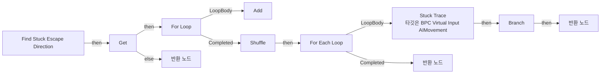

</details>

<details>
<summary>전체 노드·기본 입력 목록</summary>

| 노드 ID | 제목 | 미연결 기본 입력 / 에셋 입력 |
|---|---|---|
| `K2Node_FunctionEntry_0` | Find Stuck Escape Direction |  |
| `K2Node_VariableGet_9` | Get |  |
| `K2Node_CallFunction_18` | Get Actor Forward Vector<br/>타깃은 액터 | ReturnValue_Z=0.0 |
| `K2Node_MacroInstance_0` | For Loop | LastIndex=7 |
| `K2Node_PromotableOperator_0` | float * float | B=45.000000 |
| `K2Node_CallFunction_0` | Rotate Vector Around Axis | Axis=0.000000,0.000000,1.000000 |
| `K2Node_VariableGet_0` | Get Direction Array |  |
| `K2Node_CallArrayFunction_0` | Add | ReturnValue=0 |
| `K2Node_Knot_1` | 경유 노드 |  |
| `K2Node_CallFunction_1` | Stuck Trace<br/>타깃은 BPC Virtual Input AIMovement |  |
| `K2Node_VariableGet_1` | Get Direction Array |  |
| `K2Node_CallFunction_4` | Make Vector | Z=0.0 |
| `K2Node_CallFunction_5` | Normalize | Tolerance=0.000100 |
| `K2Node_CallArrayFunction_3` | Shuffle |  |
| `K2Node_MacroInstance_2` | For Each Loop |  |
| `K2Node_Knot_2` | 경유 노드 |  |
| `K2Node_Knot_3` | 경유 노드 |  |
| `K2Node_CallFunction_6` | NOT Boolean |  |
| `K2Node_IfThenElse_0` | Branch |  |
| `K2Node_FunctionResult_2` | 반환 노드 | Is Valid=true |
| `K2Node_Knot_4` | 경유 노드 |  |
| `K2Node_Knot_6` | 경유 노드 |  |
| `K2Node_FunctionResult_3` | 반환 노드 | Is Valid=false; Direction=0, 0, 0 |
| `K2Node_FunctionResult_1` | 반환 노드 | Is Valid=false; Direction=0, 0, 0 |

</details>

### Get Actor Location On Mesh

<details>
<summary>실행 핀 플로우차트</summary>

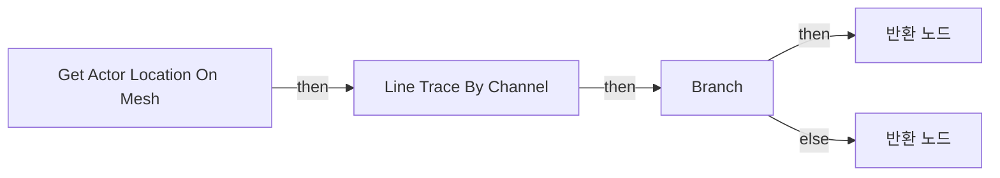

</details>

<details>
<summary>전체 노드·기본 입력 목록</summary>

| 노드 ID | 제목 | 미연결 기본 입력 / 에셋 입력 |
|---|---|---|
| `K2Node_FunctionEntry_0` | Get Actor Location On Mesh |  |
| `K2Node_CallFunction_18` | Line Trace By Channel | TraceChannel=TraceTypeQuery1; bTraceComplex=false; DrawDebugType=None; OutHit_bBlockingHit=false; OutHit_bInitialOverlap=false; OutHit_Time=0.0; OutHit_Distance=0.0; OutHit_Location=0, 0, 0; OutHit_Normal=0, 0, 0; OutHit_ImpactNormal=0, 0, 0; OutHit_HitBoneName=None; OutHit_BoneName=None; OutHit_HitItem=0; OutHit_ElementIndex=0; OutHit_FaceIndex=0; OutHit_TraceStart=0, 0, 0; OutHit_TraceEnd=0, 0, 0; bIgnoreSelf=true; TraceColor=(R=1.000000,G=0.000000,B=0.000000,A=1.000000); TraceHitColor=(R=0.000000,G=1.000000,B=0.000000,A=1.000000); DrawTime=0.000000 |
| `K2Node_PromotableOperator_1` | vector - vector | B_X=0.0; B_Y=0.0; B_Z=600.000000 |
| `K2Node_PromotableOperator_2` | vector + vector | B=0.000000,0.000000,50.000000 |
| `K2Node_Knot_10` | 경유 노드 |  |
| `K2Node_Knot_3` | 경유 노드 |  |
| `K2Node_CallFunction_2` | Get Actor Location<br/>타깃은 액터 |  |
| `K2Node_IfThenElse_0` | Branch |  |
| `K2Node_FunctionResult_2` | 반환 노드 | Is Ray Hit=false |
| `K2Node_Knot_1` | 경유 노드 |  |
| `K2Node_FunctionResult_0` | 반환 노드 | Is Ray Hit=true |
| `K2Node_VariableGet_0` | Get Possessed Character |  |
| `K2Node_VariableGet_1` | Get Final Goal |  |
| `K2Node_MakeArray_1` | 배열 만들기 |  |

</details>

### Get Before Path Point

<details>
<summary>실행 핀 플로우차트</summary>

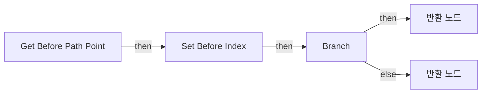

</details>

<details>
<summary>전체 노드·기본 입력 목록</summary>

| 노드 ID | 제목 | 미연결 기본 입력 / 에셋 입력 |
|---|---|---|
| `K2Node_FunctionEntry_0` | Get Before Path Point |  |
| `K2Node_VariableGet_0` | Get Path Points Index |  |
| `K2Node_PromotableOperator_0` | int - int | B=1 |
| `K2Node_VariableGet_1` | Get Path Points |  |
| `K2Node_CallArrayFunction_0` | Is Valid Index |  |
| `K2Node_VariableSet_0` | Set Before Index |  |
| `K2Node_IfThenElse_0` | Branch |  |
| `K2Node_VariableGet_2` | Get Path Points |  |
| `K2Node_GetArrayItem_0` | GET |  |
| `K2Node_VariableGet_3` | Get Before Index |  |
| `K2Node_FunctionResult_1` | 반환 노드 | Is Valid=true |
| `K2Node_FunctionResult_0` | 반환 노드 | Is Valid=false; Before Point=0, 0, 0 |

</details>

### Get Closest Path Point Index

<details>
<summary>실행 핀 플로우차트</summary>

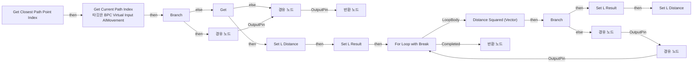

</details>

<details>
<summary>전체 노드·기본 입력 목록</summary>

| 노드 ID | 제목 | 미연결 기본 입력 / 에셋 입력 |
|---|---|---|
| `K2Node_FunctionEntry_0` | Get Closest Path Point Index |  |
| `K2Node_VariableGet_2` | Get Path Points |  |
| `K2Node_FunctionResult_0` | 반환 노드 | Is Valid=false; Closest Index=-1 |
| `K2Node_CallArrayFunction_0` | Last Index |  |
| `K2Node_CallFunction_0` | Get Current Path Index<br/>타깃은 BPC Virtual Input AIMovement |  |
| `K2Node_IfThenElse_0` | Branch |  |
| `K2Node_VariableGet_6` | Get Path Points |  |
| `K2Node_GetArrayItem_1` | GET |  |
| `K2Node_VariableGet_5` | Get Possessed Character |  |
| `K2Node_Knot_1` | 경유 노드 |  |
| `K2Node_MacroInstance_6` | For Loop with Break |  |
| `K2Node_CallFunction_3` | Get Actor Location<br/>타깃은 액터 |  |
| `K2Node_CallFunction_5` | Distance Squared (Vector) |  |
| `K2Node_VariableGet_4` | Get L Distance |  |
| `K2Node_PromotableOperator_2` | float &lt; float |  |
| `K2Node_IfThenElse_1` | Branch |  |
| `K2Node_VariableGet_3` | Get |  |
| `K2Node_CallFunction_1` | Get Actor Location<br/>타깃은 액터 |  |
| `K2Node_CallFunction_2` | Distance Squared (Vector) |  |
| `K2Node_VariableGet_0` | Get Path Points |  |
| `K2Node_GetArrayItem_0` | GET |  |
| `K2Node_Knot_3` | 경유 노드 |  |
| `K2Node_VariableSet_0` | Set L Distance | Output_Get=0.0 |
| `K2Node_VariableSet_2` | Set L Result |  |
| `K2Node_Knot_5` | 경유 노드 |  |
| `K2Node_Knot_6` | 경유 노드 |  |
| `K2Node_Knot_7` | 경유 노드 |  |
| `K2Node_PromotableOperator_3` | int + int | B=1 |
| `EdGraphNode_Comment_0` | 1차: 현재 Index까지의 거리 체크 |  |
| `K2Node_Knot_9` | 경유 노드 |  |
| `K2Node_Knot_10` | 경유 노드 |  |
| `K2Node_Knot_11` | 경유 노드 |  |
| `K2Node_Knot_12` | 경유 노드 |  |
| `K2Node_FunctionResult_1` | 반환 노드 | Is Valid=true |
| `K2Node_VariableGet_7` | Get L Result |  |
| `K2Node_Knot_13` | 경유 노드 |  |
| `K2Node_Knot_14` | 경유 노드 |  |
| `K2Node_VariableSet_3` | Set L Result | Output_Get=0 |
| `K2Node_VariableSet_4` | Set L Distance | Output_Get=0.0 |
| `K2Node_Knot_15` | 경유 노드 |  |
| `K2Node_Knot_16` | 경유 노드 |  |
| `K2Node_Knot_17` | 경유 노드 |  |
| `K2Node_CommutativeAssociativeBinaryOperator_1` | OR Boolean |  |

</details>

### Get Current Path Index

<details>
<summary>실행 핀 플로우차트</summary>

```mermaid
flowchart LR
  n0["Get Current Path Index"]
  n1["반환 노드"]
  n0 -->|"then"| n1
```

</details>

<details>
<summary>전체 노드·기본 입력 목록</summary>

| 노드 ID | 제목 | 미연결 기본 입력 / 에셋 입력 |
|---|---|---|
| `K2Node_FunctionEntry_0` | Get Current Path Index |  |
| `K2Node_FunctionResult_0` | 반환 노드 |  |
| `K2Node_CallArrayFunction_2` | Is Valid Index |  |
| `K2Node_VariableGet_12` | Get Path Points Index |  |
| `K2Node_VariableGet_2` | Get Path Points |  |
| `K2Node_CallArrayFunction_3` | Is Not Empty |  |
| `K2Node_CallFunction_1` | NOT Boolean |  |
| `K2Node_VariableGet_11` | Get Path Points Index |  |
| `K2Node_Knot_0` | 경유 노드 |  |

</details>

### Get Current PathPoint

<details>
<summary>실행 핀 플로우차트</summary>

```mermaid
flowchart LR
  n0["Get Current PathPoint"]
  n1["Branch"]
  n2["반환 노드"]
  n3["Branch"]
  n4["반환 노드"]
  n5["경유 노드"]
  n6["경유 노드"]
  n7["Branch"]
  n8["반환 노드"]
  n0 -->|"then"| n1
  n1 -->|"then"| n3
  n1 -->|"else"| n5
  n3 -->|"then"| n7
  n3 -->|"else"| n6
  n5 -->|"OutputPin"| n4
  n6 -->|"OutputPin"| n4
  n7 -->|"then"| n8
  n7 -->|"else"| n2
```

</details>

<details>
<summary>전체 노드·기본 입력 목록</summary>

| 노드 ID | 제목 | 미연결 기본 입력 / 에셋 입력 |
|---|---|---|
| `K2Node_FunctionEntry_0` | Get Current PathPoint |  |
| `K2Node_CallArrayFunction_1` | Length |  |
| `K2Node_PromotableOperator_0` | integer &gt;= integer | B=2 |
| `EdGraphNode_Comment_0` | Is Valid NavPath |  |
| `K2Node_IfThenElse_0` | Branch |  |
| `K2Node_FunctionResult_1` | 반환 노드 | Is Valid=true |
| `K2Node_GetArrayItem_1` | GET |  |
| `K2Node_CallFunction_1` | Get Current Path Index |  |
| `K2Node_IfThenElse_2` | Branch |  |
| `K2Node_FunctionResult_2` | 반환 노드 | Is Valid=false; Current Point=0, 0, 0 |
| `K2Node_Knot_1` | 경유 노드 |  |
| `K2Node_Knot_5` | 경유 노드 |  |
| `K2Node_VariableGet_2` | Get Path Points |  |
| `K2Node_VariableGet_0` | Get Path Points |  |
| `K2Node_IfThenElse_1` | Branch |  |
| `K2Node_Knot_0` | 경유 노드 |  |
| `K2Node_FunctionResult_0` | 반환 노드 | Is Valid=true |
| `K2Node_GetArrayItem_0` | GET |  |
| `K2Node_VariableGet_3` | Get Path Points |  |
| `K2Node_Knot_2` | 경유 노드 |  |
| `K2Node_CallArrayFunction_0` | Last Index |  |
| `K2Node_Knot_3` | 경유 노드 |  |

</details>

### Get Middle Point From Path

<details>
<summary>실행 핀 플로우차트</summary>

```mermaid
flowchart LR
  n0["Get Middle Point From Path"]
  n1["반환 노드"]
  n2["Branch"]
  n3["반환 노드"]
  n0 -->|"then"| n2
  n2 -->|"then"| n1
  n2 -->|"else"| n3
```

</details>

<details>
<summary>전체 노드·기본 입력 목록</summary>

| 노드 ID | 제목 | 미연결 기본 입력 / 에셋 입력 |
|---|---|---|
| `K2Node_FunctionEntry_0` | Get Middle Point From Path |  |
| `K2Node_FunctionResult_1` | 반환 노드 | Is Valid=true |
| `K2Node_CallFunction_0` | Find Closest Point on Segment |  |
| `K2Node_VariableGet_0` | Get Possessed Character |  |
| `K2Node_CallFunction_1` | Get Actor Location<br/>타깃은 액터 |  |
| `K2Node_Knot_0` | 경유 노드 |  |
| `K2Node_Knot_1` | 경유 노드 |  |
| `K2Node_CallFunction_2` | Get Current Path Point |  |
| `K2Node_IfThenElse_0` | Branch |  |
| `K2Node_FunctionResult_0` | 반환 노드 | Is Valid=false; Middle Location=0, 0, 0 |
| `K2Node_PromotableOperator_0` | vector + vector |  |
| `K2Node_PromotableOperator_1` | vector * vector | B=0.500000 |

</details>

### Get Movement Mode

<details>
<summary>실행 핀 플로우차트</summary>

```mermaid
flowchart LR
  n0["Get Movement Mode"]
  n1["Get"]
  n2["반환 노드"]
  n3["반환 노드"]
  n0 -->|"then"| n1
  n1 -->|"then"| n2
  n1 -->|"else"| n3
```

</details>

<details>
<summary>전체 노드·기본 입력 목록</summary>

| 노드 ID | 제목 | 미연결 기본 입력 / 에셋 입력 |
|---|---|---|
| `K2Node_FunctionEntry_0` | Get Movement Mode |  |
| `K2Node_VariableGet_6` | Get |  |
| `K2Node_VariableGet_13` | Get CharacterMovement |  |
| `K2Node_VariableGet_14` | Get MovementMode |  |
| `K2Node_FunctionResult_1` | 반환 노드 |  |
| `K2Node_FunctionResult_0` | 반환 노드 | 무브먼트 모드=MOVE_None |

</details>

### Get Possessed Pawn Location

<details>
<summary>실행 핀 플로우차트</summary>

```mermaid
flowchart LR
  n0["Get Possessed Pawn Location"]
  n1["Get"]
  n2["Branch"]
  n3["Get Actor Location on Mesh<br/>타깃은 BPC Virtual Input AIMovement"]
  n4["반환 노드"]
  n5["반환 노드"]
  n6["Branch"]
  n7["반환 노드"]
  n8["반환 노드"]
  n0 -->|"then"| n1
  n1 -->|"then"| n2
  n1 -->|"else"| n4
  n2 -->|"then"| n3
  n2 -->|"else"| n6
  n3 -->|"then"| n7
  n6 -->|"then"| n5
  n6 -->|"else"| n8
```

</details>

<details>
<summary>전체 노드·기본 입력 목록</summary>

| 노드 ID | 제목 | 미연결 기본 입력 / 에셋 입력 |
|---|---|---|
| `K2Node_FunctionEntry_0` | Get Possessed Pawn Location |  |
| `K2Node_VariableGet_0` | Get |  |
| `K2Node_VariableGet_1` | Get CharacterMovement |  |
| `K2Node_VariableGet_2` | Get MovementMode |  |
| `K2Node_EnumEquality_0` | Equal (Enum) | B=MOVE_Falling |
| `K2Node_IfThenElse_0` | Branch |  |
| `K2Node_CallFunction_0` | Get Actor Location on Mesh<br/>타깃은 BPC Virtual Input AIMovement | Is Ray Hit=false |
| `K2Node_FunctionResult_1` | 반환 노드 | Is Valid=false; Pawn Location=0, 0, 0 |
| `K2Node_FunctionResult_3` | 반환 노드 | Is Valid=true |
| `K2Node_VariableGet_4` | Get Possessed Character |  |
| `K2Node_CallFunction_4` | Get Actor Location<br/>타깃은 액터 |  |
| `K2Node_CallFunction_3` | Project Point to Navigation | QueryExtent=150.000000,150.000000,200.000000 |
| `K2Node_IfThenElse_1` | Branch |  |
| `K2Node_FunctionResult_0` | 반환 노드 | Is Valid=true |
| `K2Node_FunctionResult_2` | 반환 노드 | Is Valid=false |
| `K2Node_VariableGet_3` | Get Possessed Character |  |
| `K2Node_CallFunction_2` | Get Actor Location<br/>타깃은 액터 |  |
| `K2Node_VariableGet_5` | Get Possessed Character |  |

</details>

### Input Direction Stuck Check

<details>
<summary>실행 핀 플로우차트</summary>

```mermaid
flowchart LR
  n0["Input Direction Stuck Check"]
  n1["Branch"]
  n2["Stuck Trace<br/>타깃은 BPC Virtual Input AIMovement"]
  n3["Start Rebuild Timer<br/>타깃은 BPC Virtual Input AIMovement"]
  n4["Stop Rebuild Timer<br/>타깃은 BPC Virtual Input AIMovement"]
  n0 -->|"then"| n2
  n1 -->|"then"| n3
  n1 -->|"else"| n4
  n2 -->|"then"| n1
```

</details>

<details>
<summary>전체 노드·기본 입력 목록</summary>

| 노드 ID | 제목 | 미연결 기본 입력 / 에셋 입력 |
|---|---|---|
| `K2Node_FunctionEntry_0` | Input Direction Stuck Check |  |
| `K2Node_IfThenElse_0` | Branch |  |
| `K2Node_VariableGet_0` | Get Input Direction |  |
| `K2Node_CallFunction_0` | Stuck Trace<br/>타깃은 BPC Virtual Input AIMovement |  |
| `K2Node_CallFunction_1` | Start Rebuild Timer<br/>타깃은 BPC Virtual Input AIMovement |  |
| `K2Node_CallFunction_2` | Stop Rebuild Timer<br/>타깃은 BPC Virtual Input AIMovement |  |

</details>

### Is Completed

<details>
<summary>실행 핀 플로우차트</summary>

```mermaid
flowchart LR
  n0["Is Completed"]
  n1["반환 노드"]
  n0 -->|"then"| n1
```

</details>

<details>
<summary>전체 노드·기본 입력 목록</summary>

| 노드 ID | 제목 | 미연결 기본 입력 / 에셋 입력 |
|---|---|---|
| `K2Node_FunctionEntry_0` | Is Completed |  |
| `K2Node_VariableGet_1` | Get Path Points Index |  |
| `K2Node_CallArrayFunction_0` | Length |  |
| `K2Node_VariableGet_3` | Get Path Points |  |
| `K2Node_PromotableOperator_2` | integer &gt;= integer |  |
| `K2Node_FunctionResult_0` | 반환 노드 |  |

</details>

### Peek Link Route

<details>
<summary>실행 핀 플로우차트</summary>

```mermaid
flowchart LR
  n0["Peek Link Route"]
  n1["Branch"]
  n2["반환 노드"]
  n3["반환 노드"]
  n0 -->|"then"| n1
  n1 -->|"then"| n2
  n1 -->|"else"| n3
```

</details>

<details>
<summary>전체 노드·기본 입력 목록</summary>

| 노드 ID | 제목 | 미연결 기본 입력 / 에셋 입력 |
|---|---|---|
| `K2Node_FunctionEntry_0` | Peek Link Route |  |
| `K2Node_VariableGet_1` | Get Path Link Route |  |
| `K2Node_CallArrayFunction_0` | Is Not Empty |  |
| `K2Node_IfThenElse_0` | Branch |  |
| `K2Node_Knot_0` | 경유 노드 |  |
| `K2Node_GetArrayItem_0` | GET | Dimension 1=0 |
| `K2Node_FunctionResult_1` | 반환 노드 | Is Valid=true |
| `K2Node_FunctionResult_0` | 반환 노드 | Is Valid=false |

</details>

### Pop Link Route

<details>
<summary>실행 핀 플로우차트</summary>

```mermaid
flowchart LR
  n0["Pop Link Route"]
  n1["Set Current Element"]
  n2["반환 노드"]
  n3["반환 노드"]
  n4["Remove Index"]
  n5["Try Peek Link Route"]
  n0 -->|"then"| n5
  n1 -->|"then"| n4
  n4 -->|"then"| n3
  n5 -->|"Remain"| n1
  n5 -->|"Empty"| n2
```

</details>

<details>
<summary>전체 노드·기본 입력 목록</summary>

| 노드 ID | 제목 | 미연결 기본 입력 / 에셋 입력 |
|---|---|---|
| `K2Node_FunctionEntry_0` | Pop Link Route |  |
| `K2Node_VariableSet_1` | Set Current Element |  |
| `K2Node_FunctionResult_1` | 반환 노드 | Is Valid=false |
| `K2Node_FunctionResult_0` | 반환 노드 | Is Valid=true |
| `K2Node_VariableGet_0` | Get Path Link Route |  |
| `K2Node_CallArrayFunction_1` | Remove Index | IndexToRemove=0 |
| `K2Node_Knot_2` | 경유 노드 |  |
| `K2Node_Knot_3` | 경유 노드 |  |
| `K2Node_MacroInstance_0` | Try Peek Link Route |  |

</details>

### Pop Link Route If LinkMover

<details>
<summary>실행 핀 플로우차트</summary>

```mermaid
flowchart LR
  n0["Pop Link Route If LinkMover"]
  n1["Try Peek Link Route"]
  n2["Switch on EPathLinkSegmentType"]
  n3["Set Current Element"]
  n4["반환 노드"]
  n5["반환 노드"]
  n6["Remove Index"]
  n7["경유 노드"]
  n8["경유 노드"]
  n0 -->|"then"| n1
  n1 -->|"Remain"| n2
  n1 -->|"Empty"| n8
  n2 -->|"Normal"| n7
  n2 -->|"Link"| n3
  n3 -->|"then"| n6
  n6 -->|"then"| n5
  n7 -->|"OutputPin"| n4
  n8 -->|"OutputPin"| n7
```

</details>

<details>
<summary>전체 노드·기본 입력 목록</summary>

| 노드 ID | 제목 | 미연결 기본 입력 / 에셋 입력 |
|---|---|---|
| `K2Node_FunctionEntry_0` | Pop Link Route If LinkMover |  |
| `K2Node_MacroInstance_1` | Try Peek Link Route |  |
| `K2Node_SwitchEnum_0` | Switch on EPathLinkSegmentType |  |
| `K2Node_VariableSet_1` | Set Current Element |  |
| `K2Node_FunctionResult_1` | 반환 노드 | Is Valid=false |
| `K2Node_FunctionResult_0` | 반환 노드 | Is Valid=true |
| `K2Node_VariableGet_0` | Get Path Link Route |  |
| `K2Node_CallArrayFunction_1` | Remove Index | IndexToRemove=0 |
| `K2Node_Knot_2` | 경유 노드 |  |
| `K2Node_Knot_3` | 경유 노드 |  |
| `K2Node_Knot_0` | 경유 노드 |  |
| `K2Node_Knot_1` | 경유 노드 |  |

</details>

### Reset Input Direction Callback

<details>
<summary>실행 핀 플로우차트</summary>

```mermaid
flowchart LR
  n0["Reset Input Direction Callback"]
  n1["Set Input Direction"]
  n0 -->|"then"| n1
```

</details>

<details>
<summary>전체 노드·기본 입력 목록</summary>

| 노드 ID | 제목 | 미연결 기본 입력 / 에셋 입력 |
|---|---|---|
| `K2Node_FunctionEntry_0` | Reset Input Direction Callback |  |
| `K2Node_VariableSet_1` | Set Input Direction | Input Direction=0, 0, 0; Output_Get=0, 0, 0 |

</details>

### Set Input Direction

<details>
<summary>실행 핀 플로우차트</summary>

```mermaid
flowchart LR
  n0["Set Input Direction"]
  n1["Get"]
  n2["Set Input Direction"]
  n3["Start Reset Input Timer<br/>타깃은 BPC Virtual Input AIMovement"]
  n4["Clear Reset Input Timer<br/>타깃은 BPC Virtual Input AIMovement"]
  n0 -->|"then"| n1
  n1 -->|"then"| n2
  n1 -->|"else"| n3
  n2 -->|"then"| n4
```

</details>

<details>
<summary>전체 노드·기본 입력 목록</summary>

| 노드 ID | 제목 | 미연결 기본 입력 / 에셋 입력 |
|---|---|---|
| `K2Node_FunctionEntry_0` | Set Input Direction |  |
| `K2Node_CallFunction_31` | Get Actor Location<br/>타깃은 액터 | ReturnValue_Z=0.0 |
| `K2Node_CallFunction_13` | Get Unit Direction (Vector) | From_Z=0.0; To_Z=0.0 |
| `K2Node_VariableGet_16` | Get |  |
| `K2Node_VariableSet_0` | Set Input Direction | Output_Get=0, 0, 0 |
| `K2Node_CallFunction_28` | Break Vector | Z=0.0 |
| `K2Node_Knot_0` | 경유 노드 |  |
| `K2Node_CallFunction_3` | Start Reset Input Timer<br/>타깃은 BPC Virtual Input AIMovement |  |
| `K2Node_CallFunction_4` | Clear Reset Input Timer<br/>타깃은 BPC Virtual Input AIMovement |  |

</details>

### Set PathPoints

<details>
<summary>실행 핀 플로우차트</summary>

```mermaid
flowchart LR
  n0["Set PathPoints"]
  n1["Set Path Points"]
  n2["Stop Rebuild Timer<br/>타깃은 BPC Virtual Input AIMovement"]
  n3["Set Path Points Index"]
  n4["Clear and Invalidate Timer by Handle"]
  n5["Start Stuck Check<br/>타깃은 BPC Virtual Input AIMovement"]
  n6["Disable Stuck<br/>타깃은 BPC Virtual Input AIMovement"]
  n0 -->|"then"| n1
  n1 -->|"then"| n3
  n2 -->|"then"| n4
  n3 -->|"then"| n2
  n4 -->|"then"| n5
  n5 -->|"then"| n6
```

</details>

<details>
<summary>전체 노드·기본 입력 목록</summary>

| 노드 ID | 제목 | 미연결 기본 입력 / 에셋 입력 |
|---|---|---|
| `K2Node_FunctionEntry_0` | Set PathPoints |  |
| `K2Node_VariableSet_2` | Set Path Points |  |
| `K2Node_CallFunction_0` | Stop Rebuild Timer<br/>타깃은 BPC Virtual Input AIMovement |  |
| `K2Node_VariableSet_0` | Set Path Points Index | Path Points Index=1; Output_Get=0 |
| `K2Node_VariableGet_5` | Get OnPath Timer |  |
| `K2Node_CallFunction_21` | Clear and Invalidate Timer by Handle |  |
| `K2Node_CallFunction_2` | Start Stuck Check<br/>타깃은 BPC Virtual Input AIMovement |  |
| `K2Node_CallFunction_3` | Disable Stuck<br/>타깃은 BPC Virtual Input AIMovement |  |

</details>

### Start Rebuild Timer

<details>
<summary>실행 핀 플로우차트</summary>

```mermaid
flowchart LR
  n0["Start Rebuild Timer"]
  n1["Set Timer by Function Name"]
  n2["Set Rebuild Timer Handle"]
  n3["Branch"]
  n0 -->|"then"| n3
  n1 -->|"then"| n2
  n3 -->|"then"| n1
```

</details>

<details>
<summary>전체 노드·기본 입력 목록</summary>

| 노드 ID | 제목 | 미연결 기본 입력 / 에셋 입력 |
|---|---|---|
| `K2Node_FunctionEntry_0` | Start Rebuild Timer |  |
| `K2Node_CallFunction_37` | Set Timer by Function Name | FunctionName=Try Rebuild NavPath; Time=0.500000; bLooping=true; bMaxOncePerFrame=false; InitialStartDelay=0.000000; InitialStartDelayVariance=0.050000 |
| `K2Node_VariableSet_0` | Set Rebuild Timer Handle |  |
| `K2Node_VariableGet_0` | Get Rebuild Timer Handle |  |
| `K2Node_CallFunction_2` | Is Valid Timer Handle |  |
| `K2Node_IfThenElse_0` | Branch |  |
| `K2Node_CallFunction_3` | NOT Boolean |  |

</details>

### Start Reset Input Timer

<details>
<summary>실행 핀 플로우차트</summary>

```mermaid
flowchart LR
  n0["Start Reset Input Timer"]
  n1["Branch"]
  n2["Set Reset Input Timer"]
  n3["Set Timer by Function Name"]
  n0 -->|"then"| n1
  n1 -->|"then"| n3
  n3 -->|"then"| n2
```

</details>

<details>
<summary>전체 노드·기본 입력 목록</summary>

| 노드 ID | 제목 | 미연결 기본 입력 / 에셋 입력 |
|---|---|---|
| `K2Node_FunctionEntry_0` | Start Reset Input Timer |  |
| `K2Node_CallFunction_2` | Is Valid Timer Handle |  |
| `K2Node_IfThenElse_0` | Branch |  |
| `K2Node_CallFunction_3` | NOT Boolean |  |
| `K2Node_VariableGet_1` | Get Reset Input Timer |  |
| `K2Node_VariableSet_0` | Set Reset Input Timer |  |
| `K2Node_CallFunction_0` | Set Timer by Function Name | FunctionName=Reset Input Direction Callback; Time=0.100000; bLooping=false; bMaxOncePerFrame=false; InitialStartDelay=0.000000; InitialStartDelayVariance=0.000000 |

</details>

### Start Stuck Check

<details>
<summary>실행 핀 플로우차트</summary>

```mermaid
flowchart LR
  n0["Start Stuck Check"]
  n1["Set Timer by Function Name"]
  n2["Set Stuck Timer Handle"]
  n3["Branch"]
  n0 -->|"then"| n3
  n1 -->|"then"| n2
  n3 -->|"then"| n1
```

</details>

<details>
<summary>전체 노드·기본 입력 목록</summary>

| 노드 ID | 제목 | 미연결 기본 입력 / 에셋 입력 |
|---|---|---|
| `K2Node_FunctionEntry_0` | Start Stuck Check |  |
| `K2Node_CallFunction_0` | Set Timer by Function Name | FunctionName=Input Direction Stuck Check; Time=0.150000; bLooping=true; bMaxOncePerFrame=false; InitialStartDelay=0.000000; InitialStartDelayVariance=0.020000 |
| `K2Node_VariableSet_0` | Set Stuck Timer Handle |  |
| `K2Node_VariableGet_0` | Get Stuck Timer Handle |  |
| `K2Node_CallFunction_1` | Is Valid Timer Handle |  |
| `K2Node_CallFunction_2` | NOT Boolean |  |
| `K2Node_IfThenElse_0` | Branch |  |

</details>

### Stop Rebuild Timer

<details>
<summary>실행 핀 플로우차트</summary>

```mermaid
flowchart LR
  n0["Stop Rebuild Timer"]
  n1["Clear and Invalidate Timer by Handle"]
  n0 -->|"then"| n1
```

</details>

<details>
<summary>전체 노드·기본 입력 목록</summary>

| 노드 ID | 제목 | 미연결 기본 입력 / 에셋 입력 |
|---|---|---|
| `K2Node_FunctionEntry_0` | Stop Rebuild Timer |  |
| `K2Node_VariableGet_0` | Get Rebuild Timer Handle |  |
| `K2Node_CallFunction_0` | Clear and Invalidate Timer by Handle |  |

</details>

### Stop Stuck Check

<details>
<summary>실행 핀 플로우차트</summary>

```mermaid
flowchart LR
  n0["Stop Stuck Check"]
  n1["Clear and Invalidate Timer by Handle"]
  n0 -->|"then"| n1
```

</details>

<details>
<summary>전체 노드·기본 입력 목록</summary>

| 노드 ID | 제목 | 미연결 기본 입력 / 에셋 입력 |
|---|---|---|
| `K2Node_FunctionEntry_0` | Stop Stuck Check |  |
| `K2Node_VariableGet_0` | Get Stuck Timer Handle |  |
| `K2Node_CallFunction_0` | Clear and Invalidate Timer by Handle |  |

</details>

### Stuck Trace

<details>
<summary>실행 핀 플로우차트</summary>

```mermaid
flowchart LR
  n0["Stuck Trace"]
  n1["Sphere Trace By Channel"]
  n2["Get"]
  n3["반환 노드"]
  n4["반환 노드"]
  n0 -->|"then"| n2
  n1 -->|"then"| n3
  n2 -->|"then"| n1
  n2 -->|"else"| n4
```

</details>

<details>
<summary>전체 노드·기본 입력 목록</summary>

| 노드 ID | 제목 | 미연결 기본 입력 / 에셋 입력 |
|---|---|---|
| `K2Node_FunctionEntry_0` | Stuck Trace |  |
| `K2Node_CallFunction_0` | Sphere Trace By Channel | TraceChannel=TraceTypeQuery1; bTraceComplex=false; DrawDebugType=None; bIgnoreSelf=true; TraceColor=(R=1.000000,G=0.000000,B=0.000000,A=1.000000); TraceHitColor=(R=0.000000,G=1.000000,B=0.000000,A=1.000000); DrawTime=0.000000 |
| `K2Node_VariableGet_0` | Get |  |
| `K2Node_CallFunction_1` | Get Actor Location<br/>타깃은 액터 |  |
| `K2Node_Knot_0` | 경유 노드 |  |
| `K2Node_CallFunction_2` | Normalize | Tolerance=0.000100 |
| `K2Node_PromotableOperator_0` | vector * vector |  |
| `K2Node_PromotableOperator_1` | vector + vector |  |
| `K2Node_Knot_1` | 경유 노드 |  |
| `K2Node_VariableGet_2` | Get CapsuleComponent |  |
| `K2Node_VariableGet_3` | Get CapsuleRadius |  |
| `K2Node_PromotableOperator_2` | vector * vector | B=4.000000 |
| `K2Node_Knot_2` | 경유 노드 |  |
| `K2Node_VariableGet_5` | Get Possessed Character |  |
| `K2Node_MakeArray_0` | 배열 만들기 |  |
| `K2Node_Knot_3` | 경유 노드 |  |
| `K2Node_FunctionResult_1` | 반환 노드 |  |
| `K2Node_FunctionResult_0` | 반환 노드 | Hit=false |
| `K2Node_Knot_4` | 경유 노드 |  |

</details>

### Try Rebuild NavPath

<details>
<summary>실행 핀 플로우차트</summary>

```mermaid
flowchart LR
  n0["Try Rebuild NavPath"]
  n1["Get"]
  n2["Request Build Nav Path to Actor<br/>타깃은 BPC Virtual Input AIMovement"]
  n3["Request Build Nav Path to Location<br/>타깃은 BPC Virtual Input AIMovement"]
  n0 -->|"then"| n1
  n1 -->|"then"| n2
  n1 -->|"else"| n3
```

</details>

<details>
<summary>전체 노드·기본 입력 목록</summary>

| 노드 ID | 제목 | 미연결 기본 입력 / 에셋 입력 |
|---|---|---|
| `K2Node_FunctionEntry_0` | Try Rebuild NavPath |  |
| `K2Node_VariableGet_21` | Get |  |
| `K2Node_VariableGet_22` | Get Tether Distance |  |
| `K2Node_CallFunction_4` | Request Build Nav Path to Actor<br/>타깃은 BPC Virtual Input AIMovement |  |
| `K2Node_CallFunction_3` | Request Build Nav Path to Location<br/>타깃은 BPC Virtual Input AIMovement |  |
| `K2Node_VariableGet_3` | Get Final Goal Location |  |

</details>

### Unbind Event To Pawn

<details>
<summary>실행 핀 플로우차트</summary>

```mermaid
flowchart LR
  n0["Unbind Event To Pawn"]
  n1["Unbind Event from Landed Delegate"]
  n2["Cast To BP_ShooterBase"]
  n0 -->|"then"| n2
  n2 -->|"then"| n1
```

</details>

<details>
<summary>전체 노드·기본 입력 목록</summary>

| 노드 ID | 제목 | 미연결 기본 입력 / 에셋 입력 |
|---|---|---|
| `K2Node_FunctionEntry_0` | Unbind Event To Pawn |  |
| `K2Node_RemoveDelegate_1` | Unbind Event from Landed Delegate |  |
| `K2Node_CreateDelegate_2` | 이벤트 생성 |  |
| `K2Node_DynamicCast_0` | Cast To BP_ShooterBase |  |
| `K2Node_Knot_0` | 경유 노드 |  |

</details>

## 조회 범위의 한계

ObjectIterator로 발견했으나 MCP helper가 반환하지 않은 그래프입니다. delegate signature·컴파일된 중간 그래프·macro·애니메이션 내부 그래프가 섞일 수 있습니다.

- `Bind To Pawn`: Graph 'Bind To Pawn' not found in Blueprint.
- `Calc Move Direction`: Graph 'Calc Move Direction' not found in Blueprint.
- `Can Random Jump`: Graph 'Can Random Jump' not found in Blueprint.
- `Check Completed`: Graph 'Check Completed' not found in Blueprint.
- `Clear NavPath`: Graph 'Clear NavPath' not found in Blueprint.
- `Complete Current Route`: Graph 'Complete Current Route' not found in Blueprint.
- `Is Closed`: Graph 'Is Closed' not found in Blueprint.
- `Is Valid NavPath`: Graph 'Is Valid NavPath' not found in Blueprint.
- `On Stuck`: Graph 'On Stuck' not found in Blueprint.
- `On Try Build`: Graph 'On Try Build' not found in Blueprint.
- `OnArrived`: Graph 'OnArrived' not found in Blueprint.
- `OnArrived_Event`: Graph 'OnArrived_Event' not found in Blueprint.
- `Rebuild On Landed`: Graph 'Rebuild On Landed' not found in Blueprint.
- `ReceiveBeginPlay`: Graph 'ReceiveBeginPlay' not found in Blueprint.
- `ReceiveTick`: Graph 'ReceiveTick' not found in Blueprint.
- `Request Build NavPath To Actor`: Graph 'Request Build NavPath To Actor' not found in Blueprint.
- `Request Build NavPath To Location`: Graph 'Request Build NavPath To Location' not found in Blueprint.
- `Set MoveCharacter`: Graph 'Set MoveCharacter' not found in Blueprint.
- `Touch Jump Pad`: Graph 'Touch Jump Pad' not found in Blueprint.
- `Try Get Index`: Graph 'Try Get Index' not found in Blueprint.
- `Try Peek Link Route`: Graph 'Try Peek Link Route' not found in Blueprint.

[원본 MCP 스냅샷](../../../../Evidence/blueprints-070.json)
