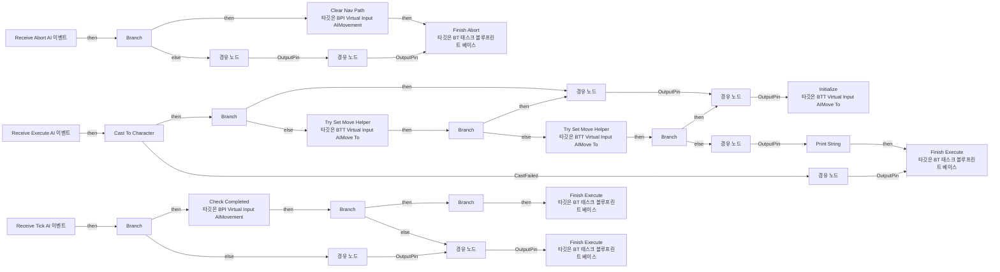
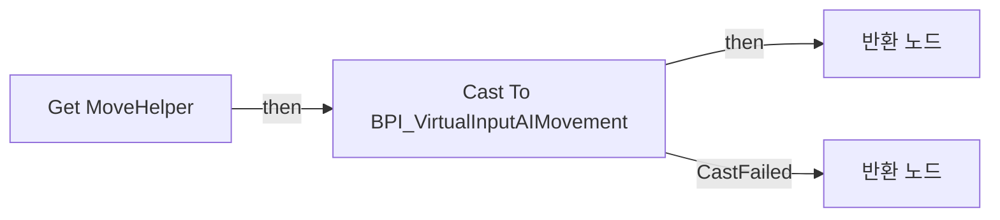
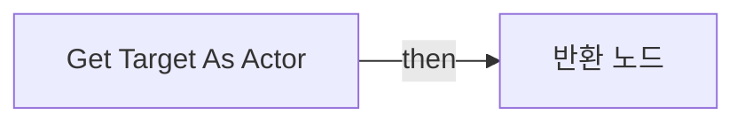
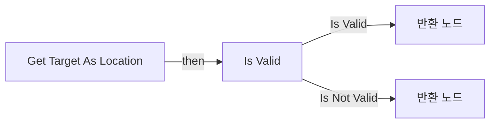
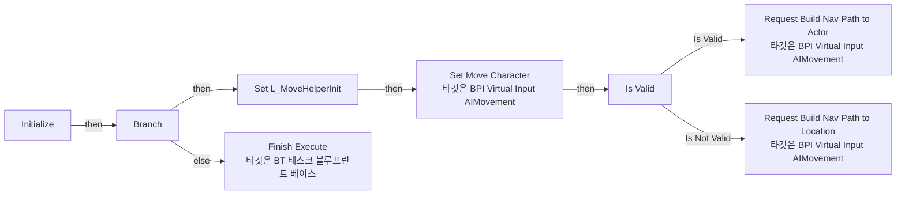
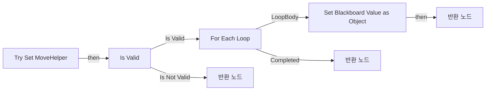

# BTT_VirtualInputAIMoveTo

에셋: `/Game/QuakeLike_1_0/AI/VirtualInputMovement/BTT_VirtualInputAIMoveTo`

부모: `/Script/CoreUObject.Class'/Script/AIModule.BTTask_BlueprintBase'`

수집일: 2026-10-12. MCP에서 읽은 그래프·핀 연결의 자동 전사입니다. 상속된 그래프는 부모 문서를 함께 확인합니다.

정적 루트 참조 도달: 있음. 실행 여부 또는 삭제 가능 여부의 확정이 아닙니다.

컴포넌트 목록은 이 BP가 직접 정의한 SCS만 포함합니다. 부모·네이티브 생성 컴포넌트, 인스턴스 설정은 별도입니다.

## 변수와 기본값

| 이름 | 타입 | CDO 기본값 |
|---|---|---|
| `Target` | `BlackboardKeySelector` | &lt;Struct 'BlackboardKeySelector' {allowed_types: , selected_key_name: "", selected_key_type: None, selected_key_id: 65535, none_is_allowed_value: False}&gt; |
| `Tether Distance` | `real` | 100.0 |
| `Cached MoveHelper` | `BlackboardKeySelector` | &lt;Struct 'BlackboardKeySelector' {allowed_types: , selected_key_name: "", selected_key_type: None, selected_key_id: 65535, none_is_allowed_value: False}&gt; |

## 그래프 목록

| 그래프 | 전체 노드 수 |
|---|---|
| EventGraph | 45 |
| Get MoveHelper | 6 |
| Get Target As Actor | 4 |
| Get Target As Location | 9 |
| Initialize | 17 |
| Try Set MoveHelper | 12 |

## 그래프별 실행 연결

실선은 출력 exec 핀의 실제 연결입니다. 여러 분기는 출력 핀 이름을 표시합니다. 함수 호출·delegate·타이머의 다음 그래프 실행은 이 그림에서 자동으로 이어 붙이지 않습니다.

순수 계산 노드 및 데이터 핀은 아래 목록과 원본 JSON을 확인합니다. 연결되지 않은 이벤트도 표시되므로, 노드가 있다는 이유만으로 실행된다고 판단하면 안 됩니다.

### EventGraph

실행 핀 플로우차트

전체 노드·기본 입력 목록

| 노드 ID | 제목 | 미연결 기본 입력 / 에셋 입력 |
|---|---|---|
| `K2Node_Event_0` | Receive Execute AI 이벤트 |  |
| `K2Node_Event_1` | Receive Tick AI 이벤트 | DeltaSeconds=0.0 |
| `K2Node_Event_3` | Receive Abort AI 이벤트 |  |
| `K2Node_CallFunction_3` | Finish Abort 타깃은 BT 태스크 블루프린트 베이스 |  |
| `K2Node_IfThenElse_2` | Branch |  |
| `K2Node_CallFunction_4` | Finish Execute 타깃은 BT 태스크 블루프린트 베이스 | bSuccess=true |
| `K2Node_DynamicCast_0` | Cast To Character |  |
| `K2Node_CallFunction_0` | Finish Execute 타깃은 BT 태스크 블루프린트 베이스 | bSuccess=false |
| `K2Node_CallFunction_5` | Initialize 타깃은 BTT Virtual Input AIMove To |  |
| `K2Node_Knot_1` | 경유 노드 |  |
| `K2Node_CallFunction_13` | Get Move Helper |  |
| `K2Node_IfThenElse_0` | Branch |  |
| `K2Node_CallFunction_12` | Try Set Move Helper 타깃은 BTT Virtual Input AIMove To |  |
| `K2Node_IfThenElse_3` | Branch |  |
| `K2Node_Knot_6` | 경유 노드 |  |
| `K2Node_Knot_12` | 경유 노드 |  |
| `K2Node_CallFunction_17` | Try Set Move Helper 타깃은 BTT Virtual Input AIMove To |  |
| `K2Node_Knot_14` | 경유 노드 |  |
| `K2Node_Knot_15` | 경유 노드 |  |
| `K2Node_IfThenElse_4` | Branch |  |
| `K2Node_Knot_16` | 경유 노드 |  |
| `K2Node_Knot_17` | 경유 노드 |  |
| `K2Node_Knot_18` | 경유 노드 |  |
| `K2Node_CallFunction_18` | Get Move Helper |  |
| `K2Node_IfThenElse_5` | Branch |  |
| `K2Node_CallFunction_19` | Finish Execute 타깃은 BT 태스크 블루프린트 베이스 | bSuccess=false |
| `K2Node_CallFunction_20` | Get Move Helper |  |
| `K2Node_IfThenElse_6` | Branch |  |
| `K2Node_CallFunction_15` | Clear Nav Path 타깃은 BPI Virtual Input AIMovement |  |
| `K2Node_Knot_19` | 경유 노드 |  |
| `K2Node_Knot_20` | 경유 노드 |  |
| `K2Node_Knot_21` | 경유 노드 |  |
| `K2Node_CallFunction_21` | Print String | bPrintToScreen=true; bPrintToLog=true; TextColor=(R=1.000000,G=0.021526,B=0.000000,A=1.000000); Duration=2.000000 |
| `K2Node_Knot_22` | 경유 노드 |  |
| `K2Node_CallFunction_22` | Make Print Key | string=MoveHelper 없음 |
| `K2Node_Knot_23` | 경유 노드 |  |
| `K2Node_CallFunction_23` | Get Display Name |  |
| `K2Node_CommutativeAssociativeBinaryOperator_0` | Append | A=Error : ; C= : Controller 또는 Pawn에 BPI_PhysicsMoveHelper가 없습니다! |
| `K2Node_CallFunction_2` | Check Completed 타깃은 BPI Virtual Input AIMovement |  |
| `K2Node_Knot_2` | 경유 노드 |  |
| `K2Node_Knot_4` | 경유 노드 |  |
| `K2Node_IfThenElse_1` | Branch |  |
| `K2Node_Knot_0` | 경유 노드 |  |
| `K2Node_Knot_3` | 경유 노드 |  |
| `K2Node_Knot_7` | 경유 노드 |  |

### Get MoveHelper

실행 핀 플로우차트

전체 노드·기본 입력 목록

| 노드 ID | 제목 | 미연결 기본 입력 / 에셋 입력 |
|---|---|---|
| `K2Node_FunctionEntry_0` | Get MoveHelper |  |
| `K2Node_VariableGet_1` | Get Cached MoveHelper |  |
| `K2Node_CallFunction_8` | Get Blackboard Value as Object |  |
| `K2Node_FunctionResult_2` | 반환 노드 | Is Valid=true |
| `K2Node_DynamicCast_1` | Cast To BPI_VirtualInputAIMovement |  |
| `K2Node_FunctionResult_1` | 반환 노드 | Is Valid=false |

### Get Target As Actor

실행 핀 플로우차트

전체 노드·기본 입력 목록

| 노드 ID | 제목 | 미연결 기본 입력 / 에셋 입력 |
|---|---|---|
| `K2Node_FunctionEntry_0` | Get Target As Actor |  |
| `K2Node_FunctionResult_0` | 반환 노드 |  |
| `K2Node_VariableGet_0` | Get Target |  |
| `K2Node_CallFunction_0` | Get Blackboard Value as Actor |  |

### Get Target As Location

실행 핀 플로우차트

전체 노드·기본 입력 목록

| 노드 ID | 제목 | 미연결 기본 입력 / 에셋 입력 |
|---|---|---|
| `K2Node_FunctionEntry_0` | Get Target As Location |  |
| `K2Node_FunctionResult_1` | 반환 노드 |  |
| `K2Node_VariableGet_0` | Get Target |  |
| `K2Node_CallFunction_0` | Get Blackboard Value as Vector |  |
| `K2Node_CallFunction_1` | Get Target as Actor |  |
| `K2Node_MacroInstance_0` | Is Valid |  |
| `K2Node_FunctionResult_0` | 반환 노드 |  |
| `K2Node_Knot_0` | 경유 노드 |  |
| `K2Node_CallFunction_2` | Get Actor Location 타깃은 액터 |  |

### Initialize

실행 핀 플로우차트

전체 노드·기본 입력 목록

| 노드 ID | 제목 | 미연결 기본 입력 / 에셋 입력 |
|---|---|---|
| `K2Node_FunctionEntry_0` | Initialize |  |
| `K2Node_CallFunction_1` | Get Target as Actor |  |
| `K2Node_VariableGet_0` | Get Tether Distance |  |
| `K2Node_VariableGet_2` | Get L_MoveHelperInit |  |
| `K2Node_CallFunction_2` | Request Build Nav Path to Actor 타깃은 BPI Virtual Input AIMovement |  |
| `K2Node_CallFunction_4` | Set Move Character 타깃은 BPI Virtual Input AIMovement |  |
| `K2Node_CallFunction_6` | Get Move Helper |  |
| `K2Node_IfThenElse_1` | Branch |  |
| `K2Node_VariableSet_3` | Set L_MoveHelperInit |  |
| `K2Node_Knot_3` | 경유 노드 |  |
| `K2Node_Knot_4` | 경유 노드 |  |
| `K2Node_CallFunction_8` | Finish Execute 타깃은 BT 태스크 블루프린트 베이스 | bSuccess=false |
| `K2Node_CallFunction_12` | Get Target as Actor |  |
| `K2Node_MacroInstance_0` | Is Valid |  |
| `K2Node_VariableGet_1` | Get L_MoveHelperInit |  |
| `K2Node_CallFunction_5` | Request Build Nav Path to Location 타깃은 BPI Virtual Input AIMovement |  |
| `K2Node_CallFunction_7` | Get Target as Location |  |

### Try Set MoveHelper

실행 핀 플로우차트

전체 노드·기본 입력 목록

| 노드 ID | 제목 | 미연결 기본 입력 / 에셋 입력 |
|---|---|---|
| `K2Node_FunctionEntry_0` | Try Set MoveHelper |  |
| `K2Node_VariableGet_0` | Get Cached MoveHelper |  |
| `K2Node_CallFunction_0` | Set Blackboard Value as Object |  |
| `K2Node_CallFunction_1` | Get Components by Interface 타깃은 액터 | Interface=/Game/QuakeLike_1_0/AI/VirtualInputMovement/BPI_VirtualInputAIMovement.BPI_VirtualInputAIMovement_C |
| `K2Node_FunctionResult_2` | 반환 노드 | Is Valid=false |
| `K2Node_MacroInstance_0` | For Each Loop |  |
| `K2Node_Knot_0` | 경유 노드 |  |
| `K2Node_FunctionResult_0` | 반환 노드 | Is Valid=true |
| `K2Node_MacroInstance_1` | Is Valid |  |
| `K2Node_Knot_1` | 경유 노드 |  |
| `K2Node_Knot_2` | 경유 노드 |  |
| `K2Node_FunctionResult_1` | 반환 노드 | Is Valid=false |

## 조회 범위의 한계

ObjectIterator로 발견했으나 MCP helper가 반환하지 않은 그래프입니다. delegate signature·컴파일된 중간 그래프·macro·애니메이션 내부 그래프가 섞일 수 있습니다.

- `ReceiveAbortAI`: Graph 'ReceiveAbortAI' not found in Blueprint.
- `ReceiveExecuteAI`: Graph 'ReceiveExecuteAI' not found in Blueprint.
- `ReceiveTickAI`: Graph 'ReceiveTickAI' not found in Blueprint.

[원본 MCP 스냅샷](../../../../Evidence/blueprints-035.json)
