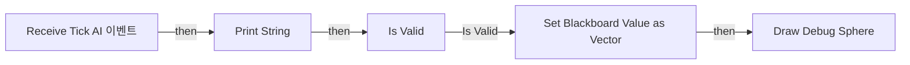

# BTS_UpdatePrediction_YJS

에셋: `/Game/QuakeLike_1_0/AITest_YJS/BTS/BTS_UpdatePrediction_YJS`

부모: `/Script/CoreUObject.Class'/Script/AIModule.BTService_BlueprintBase'`

수집일: 2026-10-12. MCP에서 읽은 그래프·핀 연결의 자동 전사입니다. 상속된 그래프는 부모 문서를 함께 확인합니다.

정적 루트 참조 도달: 없음. 실행 여부 또는 삭제 가능 여부의 확정이 아닙니다.

컴포넌트 목록은 이 BP가 직접 정의한 SCS만 포함합니다. 부모·네이티브 생성 컴포넌트, 인스턴스 설정은 별도입니다.

## 변수와 기본값

| 이름 | 타입 | CDO 기본값 |
|---|---|---|
| `Target Key` | `BlackboardKeySelector` | &lt;Struct 'BlackboardKeySelector' {allowed_types: , selected_key_name: "", selected_key_type: None, selected_key_id: 65535, none_is_allowed_value: False}&gt; |
| `ChasePosKey` | `BlackboardKeySelector` | &lt;Struct 'BlackboardKeySelector' {allowed_types: , selected_key_name: "", selected_key_type: None, selected_key_id: 65535, none_is_allowed_value: False}&gt; |
| `PredictionTime` | `real` | 0.3 |
| `PredictedPosKey` | `BlackboardKeySelector` | &lt;Struct 'BlackboardKeySelector' {allowed_types: , selected_key_name: "", selected_key_type: None, selected_key_id: 65535, none_is_allowed_value: False}&gt; |

## 그래프 목록

| 그래프 | 전체 노드 수 |
|---|---|
| EventGraph | 15 |

## 그래프별 실행 연결

실선은 출력 exec 핀의 실제 연결입니다. 여러 분기는 출력 핀 이름을 표시합니다. 함수 호출·delegate·타이머의 다음 그래프 실행은 이 그림에서 자동으로 이어 붙이지 않습니다.

순수 계산 노드 및 데이터 핀은 아래 목록과 원본 JSON을 확인합니다. 연결되지 않은 이벤트도 표시되므로, 노드가 있다는 이유만으로 실행된다고 판단하면 안 됩니다.

### EventGraph

실행 핀 플로우차트

전체 노드·기본 입력 목록

| 노드 ID | 제목 | 미연결 기본 입력 / 에셋 입력 |
|---|---|---|
| `K2Node_Event_0` | Receive Tick AI 이벤트 | DeltaSeconds=0.0 |
| `K2Node_CallFunction_8` | Get Blackboard Value as Actor |  |
| `K2Node_MacroInstance_0` | Is Valid |  |
| `K2Node_CallFunction_16` | Set Blackboard Value as Vector |  |
| `K2Node_CallFunction_1` | Get Actor Location 타깃은 액터 |  |
| `K2Node_CallFunction_2` | Get Velocity 타깃은 액터 |  |
| `K2Node_PromotableOperator_0` | vector * vector |  |
| `K2Node_VariableGet_1` | Get PredictionTime |  |
| `K2Node_PromotableOperator_1` | vector + vector |  |
| `K2Node_VariableGet_4` | Get Target Key |  |
| `K2Node_CallFunction_0` | Print String | bPrintToScreen=true; bPrintToLog=true; TextColor=(R=0.000000,G=0.660000,B=1.000000,A=1.000000); Duration=2.000000; Key=None |
| `K2Node_CallFunction_22` | Get Display Name |  |
| `K2Node_CallFunction_3` | Draw Debug Sphere | Radius=50.000000; Segments=12; LineColor=(R=1.000000,G=0.016667,B=0.000000,A=1.000000); Duration=2.000000; Thickness=0.000000 |
| `K2Node_Knot_0` | 경유 노드 |  |
| `K2Node_VariableGet_0` | Get PredictedPosKey |  |

## 조회 범위의 한계

ObjectIterator로 발견했으나 MCP helper가 반환하지 않은 그래프입니다. delegate signature·컴파일된 중간 그래프·macro·애니메이션 내부 그래프가 섞일 수 있습니다.

- `EdGraph_0`: Graph 'EdGraph_0' not found in Blueprint.
- `ExecuteUbergraph_BTS_UpdatePrediction_YJS`: Graph 'ExecuteUbergraph_BTS_UpdatePrediction_YJS' not found in Blueprint.
- `ReceiveTickAI`: Graph 'ReceiveTickAI' not found in Blueprint.

[원본 MCP 스냅샷](../../../../Evidence/blueprints-175.json)
