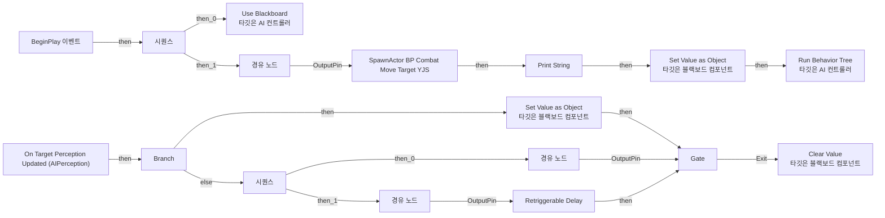
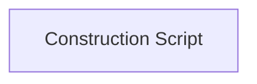

# AIC_Character_YJS

에셋: `/Game/QuakeLike_1_0/AITest_YJS/Controller/AIC_Character_YJS`

부모: `/Script/CoreUObject.Class'/Script/AIModule.AIController'`

수집일: 2026-10-12. MCP에서 읽은 그래프·핀 연결의 자동 전사입니다. 상속된 그래프는 부모 문서를 함께 확인합니다.

정적 루트 참조 도달: 없음. 실행 여부 또는 삭제 가능 여부의 확정이 아닙니다.

컴포넌트 목록은 이 BP가 직접 정의한 SCS만 포함합니다. 부모·네이티브 생성 컴포넌트, 인스턴스 설정은 별도입니다.

## 직접 정의한 컴포넌트

| 이름 | 클래스 | 부모 컴포넌트 |
|---|---|---|
| `AIPerception` | `AIPerceptionComponent` | `` |

## 그래프 목록

| 그래프 | 전체 노드 수 |
|---|---|
| EventGraph | 32 |
| UserConstructionScript | 1 |

## 그래프별 실행 연결

실선은 출력 exec 핀의 실제 연결입니다. 여러 분기는 출력 핀 이름을 표시합니다. 함수 호출·delegate·타이머의 다음 그래프 실행은 이 그림에서 자동으로 이어 붙이지 않습니다.

순수 계산 노드 및 데이터 핀은 아래 목록과 원본 JSON을 확인합니다. 연결되지 않은 이벤트도 표시되므로, 노드가 있다는 이유만으로 실행된다고 판단하면 안 됩니다.

### EventGraph

실행 핀 플로우차트

전체 노드·기본 입력 목록

| 노드 ID | 제목 | 미연결 기본 입력 / 에셋 입력 |
|---|---|---|
| `K2Node_Event_0` | BeginPlay 이벤트 |  |
| `K2Node_CallFunction_3` | Run Behavior Tree 타깃은 AI 컨트롤러 | BTAsset=/Game/QuakeLike_1_0/AITest_YJS/BT_Char_YJS.BT_Char_YJS; ReturnValue=false |
| `K2Node_ComponentBoundEvent_0` | On Target Perception Updated (AIPerception) |  |
| `K2Node_IfThenElse_0` | Branch |  |
| `K2Node_CallFunction_9` | Use Blackboard 타깃은 AI 컨트롤러 | BlackboardAsset=/Game/QuakeLike_1_0/AITest_YJS/BB_Char_YJS.BB_Char_YJS; ReturnValue=false |
| `K2Node_CallFunction_6` | Get Blackboard |  |
| `K2Node_CallFunction_4` | Set Value as Object 타깃은 블랙보드 컴포넌트 |  |
| `K2Node_CallFunction_7` | Make Literal Name | Value=BB_Target |
| `K2Node_Knot_0` | 경유 노드 |  |
| `K2Node_Knot_1` | 경유 노드 |  |
| `K2Node_CallFunction_2` | Clear Value 타깃은 블랙보드 컴포넌트 |  |
| `K2Node_CallFunction_10` | Get Blackboard |  |
| `K2Node_CallFunction_5` | Make Literal Name | Value=BB_Target |
| `K2Node_MacroInstance_0` | Gate | bStartClosed=true |
| `K2Node_ExecutionSequence_0` | 시퀀스 |  |
| `K2Node_Knot_3` | 경유 노드 |  |
| `K2Node_Knot_4` | 경유 노드 |  |
| `K2Node_CallFunction_1` | Retriggerable Delay | Duration=3.000000 |
| `K2Node_ExecutionSequence_2` | 시퀀스 |  |
| `K2Node_CallFunction_15` | Get Controlled Pawn 타깃은 컨트롤러 |  |
| `K2Node_CallFunction_16` | Get Actor Location 타깃은 액터 |  |
| `K2Node_CallFunction_17` | Make Transform | Rotation=0, 0, 0; Scale=1.000000,1.000000,1.000000 |
| `K2Node_SpawnActorFromClass_2` | SpawnActor BP Combat Move Target YJS | Class=/Game/QuakeLike_1_0/AITest_YJS/BP_CombatMoveTarget_YJS.BP_CombatMoveTarget_YJS_C; CollisionHandlingOverride=AlwaysSpawn; TransformScaleMethod=MultiplyWithRoot |
| `K2Node_CallFunction_19` | Get Blackboard |  |
| `K2Node_CallFunction_20` | Set Value as Object 타깃은 블랙보드 컴포넌트 |  |
| `K2Node_Knot_5` | 경유 노드 |  |
| `K2Node_Knot_6` | 경유 노드 |  |
| `K2Node_CallFunction_21` | Make Literal Name | Value=BB_CombatMoveActor |
| `K2Node_Knot_7` | 경유 노드 |  |
| `K2Node_CallFunction_23` | Print String | bPrintToScreen=true; bPrintToLog=true; TextColor=(R=0.000000,G=0.660000,B=1.000000,A=1.000000); Duration=2.000000; Key=None |
| `K2Node_CallFunction_24` | Get Display Name |  |
| `K2Node_CommutativeAssociativeBinaryOperator_0` | Append | A=AIC: |

### UserConstructionScript

실행 핀 플로우차트

전체 노드·기본 입력 목록

| 노드 ID | 제목 | 미연결 기본 입력 / 에셋 입력 |
|---|---|---|
| `K2Node_FunctionEntry_0` | Construction Script |  |

## 조회 범위의 한계

ObjectIterator로 발견했으나 MCP helper가 반환하지 않은 그래프입니다. delegate signature·컴파일된 중간 그래프·macro·애니메이션 내부 그래프가 섞일 수 있습니다.

- `BndEvt__AIC_Character_YJS_AIPerception_K2Node_ComponentBoundEvent_0_ActorPerceptionUpdatedDelegate__DelegateSignature`: Graph 'BndEvt__AIC_Character_YJS_AIPerception_K2Node_ComponentBoundEvent_0_ActorPerceptionUpdatedDelegate__DelegateSignature' not found in Blueprint.
- `EdGraph_0`: Graph 'EdGraph_0' not found in Blueprint.
- `ExecuteUbergraph_AIC_Character_YJS`: Graph 'ExecuteUbergraph_AIC_Character_YJS' not found in Blueprint.
- `ReceiveBeginPlay`: Graph 'ReceiveBeginPlay' not found in Blueprint.
- `UserConstructionScript_MERGED`: Graph 'UserConstructionScript_MERGED' not found in Blueprint.

[원본 MCP 스냅샷](../../../../Evidence/blueprints-175.json)
