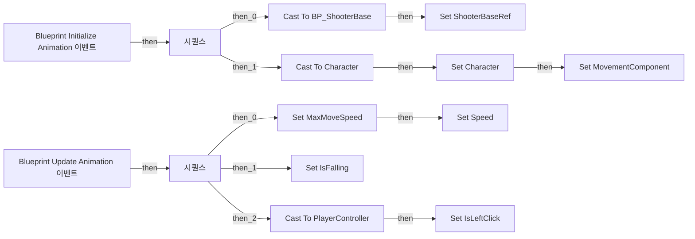

# Steel_ABP_FP_BGH_Pistol

에셋: `/Game/QuakeLike_1_0/Animation/Steel/ABP/Steel_ABP_FP_BGH_Pistol`

부모: `/Script/CoreUObject.Class'/Script/Engine.AnimInstance'`

수집일: 2026-10-12. MCP에서 읽은 그래프·핀 연결의 자동 전사입니다. 상속된 그래프는 부모 문서를 함께 확인합니다.

정적 루트 참조 도달: 있음. 실행 여부 또는 삭제 가능 여부의 확정이 아닙니다.

컴포넌트 목록은 이 BP가 직접 정의한 SCS만 포함합니다. 부모·네이티브 생성 컴포넌트, 인스턴스 설정은 별도입니다.

## 변수와 기본값

| 이름 | 타입 | CDO 기본값 |
|---|---|---|
| `Speed` | `real` | 0.0 |
| `MaxMoveSpeed` | `real` | 0.0 |
| `ShooterBaseRef` | `BP_ShooterBase_C` | None |
| `Character` | `Character` | None |
| `MovementComponent` | `CharacterMovementComponent` | None |
| `IsFalling` | `bool` | False |
| `IsLeftClick` | `bool` | False |

## 그래프 목록

| 그래프 | 전체 노드 수 |
|---|---|
| AnimGraph | 7 |
| EventGraph | 28 |

## 그래프별 실행 연결

실선은 출력 exec 핀의 실제 연결입니다. 여러 분기는 출력 핀 이름을 표시합니다. 함수 호출·delegate·타이머의 다음 그래프 실행은 이 그림에서 자동으로 이어 붙이지 않습니다.

순수 계산 노드 및 데이터 핀은 아래 목록과 원본 JSON을 확인합니다. 연결되지 않은 이벤트도 표시되므로, 노드가 있다는 이유만으로 실행된다고 판단하면 안 됩니다.

### AnimGraph

전체 노드·기본 입력 목록

| 노드 ID | 제목 | 미연결 기본 입력 / 에셋 입력 |
|---|---|---|
| `AnimGraphNode_Root_43` | 출력 포즈 AnimGraph |  |
| `AnimGraphNode_Slot_1` | Slot 'Arms' Group 'DefaultGroup' |  |
| `AnimGraphNode_SequencePlayer_1` | Steel_PistolArm 시퀀스 플레이어 |  |
| `AnimGraphNode_BlendSpacePlayer_0` | Steel_Pistol_BlendSpace1D 블렌드 스페이스 플레이어 |  |
| `K2Node_VariableGet_0` | Get MaxMoveSpeed | MaxMoveSpeed=0.0 |
| `K2Node_VariableGet_1` | Get Speed |  |
| `AnimGraphNode_StateMachine_0` | Locomotion State Machine |  |

### EventGraph

실행 핀 플로우차트

전체 노드·기본 입력 목록

| 노드 ID | 제목 | 미연결 기본 입력 / 에셋 입력 |
|---|---|---|
| `K2Node_Event_0` | Blueprint Initialize Animation 이벤트 |  |
| `K2Node_CallFunction_0` | Try Get Pawn Owner 타깃은 애님 인스턴스 |  |
| `K2Node_DynamicCast_2` | Cast To BP_ShooterBase |  |
| `K2Node_VariableSet_0` | Set ShooterBaseRef |  |
| `K2Node_Event_1` | Blueprint Update Animation 이벤트 | DeltaTimeX=0.0 |
| `K2Node_VariableGet_6` | Get ShooterBaseRef |  |
| `K2Node_VariableGet_1` | Get CharacterMovement |  |
| `K2Node_VariableSet_4` | Set MaxMoveSpeed | Output_Get=0.0 |
| `K2Node_VariableGet_5` | Get MaxWalkSpeed |  |
| `K2Node_VariableGet_0` | Get ShooterBaseRef |  |
| `K2Node_CallFunction_1` | Get Velocity 타깃은 액터 |  |
| `K2Node_CallFunction_2` | Vector Length XY |  |
| `K2Node_VariableSet_3` | Set Speed | Output_Get=0.0 |
| `K2Node_CallFunction_4` | Get Owning Actor 타깃은 애님 인스턴스 |  |
| `K2Node_DynamicCast_0` | Cast To Character |  |
| `K2Node_VariableGet_2` | Get CharacterMovement |  |
| `K2Node_VariableSet_1` | Set Character |  |
| `K2Node_VariableSet_2` | Set MovementComponent |  |
| `K2Node_ExecutionSequence_0` | 시퀀스 |  |
| `K2Node_VariableSet_6` | Set IsFalling | Output_Get=false |
| `K2Node_VariableGet_3` | Get MovementComponent |  |
| `K2Node_CallFunction_7` | Is Falling 타깃은 내비 무브먼트 컴포넌트 |  |
| `K2Node_ExecutionSequence_1` | 시퀀스 |  |
| `K2Node_CallFunction_3` | Try Get Pawn Owner 타깃은 애님 인스턴스 |  |
| `K2Node_DynamicCast_1` | Cast To PlayerController |  |
| `K2Node_CallFunction_6` | Get Controller 타깃은 폰 |  |
| `K2Node_CallFunction_8` | Is Input Key Down 타깃은 플레이어 컨트롤러 | Key=LeftMouseButton |
| `K2Node_VariableSet_5` | Set IsLeftClick | Output_Get=false |

## 조회 범위의 한계

ObjectIterator로 발견했으나 MCP helper가 반환하지 않은 그래프입니다. delegate signature·컴파일된 중간 그래프·macro·애니메이션 내부 그래프가 섞일 수 있습니다.

- `BlueprintInitializeAnimation`: Graph 'BlueprintInitializeAnimation' not found in Blueprint.
- `BlueprintUpdateAnimation`: Graph 'BlueprintUpdateAnimation' not found in Blueprint.
- `EvaluateGraphExposedInputs_ExecuteUbergraph_Steel_ABP_FP_BGH_Pistol_AnimGraphNode_SequencePlayer_EAF62FB245ED3A6DA155E1A29266DA24`: Graph 'EvaluateGraphExposedInputs_ExecuteUbergraph_Steel_ABP_FP_BGH_Pistol_AnimGraphNode_SequencePlayer_EAF62FB245ED3A6DA155E1A29266DA24' not found in Blueprint.
- `EvaluateGraphExposedInputs_ExecuteUbergraph_Steel_ABP_FP_BGH_Pistol_AnimGraphNode_TransitionResult_0CD129B9475BAC504C477F904FA046FE`: Graph 'EvaluateGraphExposedInputs_ExecuteUbergraph_Steel_ABP_FP_BGH_Pistol_AnimGraphNode_TransitionResult_0CD129B9475BAC504C477F904FA046FE' not found in Blueprint.
- `EvaluateGraphExposedInputs_ExecuteUbergraph_Steel_ABP_FP_BGH_Pistol_AnimGraphNode_TransitionResult_16DDBC68459AD0FC1D6E55AA23A64CA3`: Graph 'EvaluateGraphExposedInputs_ExecuteUbergraph_Steel_ABP_FP_BGH_Pistol_AnimGraphNode_TransitionResult_16DDBC68459AD0FC1D6E55AA23A64CA3' not found in Blueprint.
- `EvaluateGraphExposedInputs_ExecuteUbergraph_Steel_ABP_FP_BGH_Pistol_AnimGraphNode_TransitionResult_3B01F7C3490D0357298C09968F311D10`: Graph 'EvaluateGraphExposedInputs_ExecuteUbergraph_Steel_ABP_FP_BGH_Pistol_AnimGraphNode_TransitionResult_3B01F7C3490D0357298C09968F311D10' not found in Blueprint.

[원본 MCP 스냅샷](../../../../../Evidence/blueprints-140.json)
