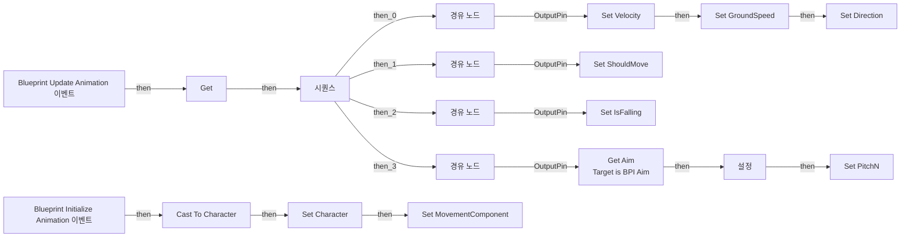

# Steel_ABP_TP_BGH_ShotGun

에셋: `/Game/QuakeLike_1_0/Animation/Steel/ABP/Steel_ABP_TP_BGH_ShotGun`

부모: `/Script/CoreUObject.Class'/Script/Engine.AnimInstance'`

수집일: 2026-10-12. MCP에서 읽은 그래프·핀 연결의 자동 전사입니다. 상속된 그래프는 부모 문서를 함께 확인합니다.

정적 루트 참조 도달: 없음. 실행 여부 또는 삭제 가능 여부의 확정이 아닙니다.

컴포넌트 목록은 이 BP가 직접 정의한 SCS만 포함합니다. 부모·네이티브 생성 컴포넌트, 인스턴스 설정은 별도입니다.

## 변수와 기본값

| 이름 | 타입 | CDO 기본값 |
|---|---|---|
| `Aim offset` | `Rotator` | &lt;Struct 'Rotator' {pitch: 0.000000, yaw: 0.000000, roll: 0.000000}&gt; |
| `PitchN` | `real` | 0.0 |
| `MovementComponent` | `CharacterMovementComponent` | None |
| `Character` | `Character` | None |
| `Velocity` | `Vector` | &lt;Struct 'Vector' {x: 0.000000, y: 0.000000, z: 0.000000}&gt; |
| `GroundSpeed` | `real` | 0.0 |
| `Direction` | `real` | 0.0 |
| `ShouldMove` | `bool` | False |
| `IsFalling` | `bool` | False |

## 그래프 목록

| 그래프 | 전체 노드 수 |
|---|---|
| AnimGraph | 12 |
| EventGraph | 49 |

## 그래프별 실행 연결

실선은 출력 exec 핀의 실제 연결입니다. 여러 분기는 출력 핀 이름을 표시합니다. 함수 호출·delegate·타이머의 다음 그래프 실행은 이 그림에서 자동으로 이어 붙이지 않습니다.

순수 계산 노드 및 데이터 핀은 아래 목록과 원본 JSON을 확인합니다. 연결되지 않은 이벤트도 표시되므로, 노드가 있다는 이유만으로 실행된다고 판단하면 안 됩니다.

### AnimGraph

전체 노드·기본 입력 목록

| 노드 ID | 제목 | 미연결 기본 입력 / 에셋 입력 |
|---|---|---|
| `AnimGraphNode_Root_0` | 출력 포즈 AnimGraph |  |
| `AnimGraphNode_StateMachine_58` | LocomotioStateMachine State Machine |  |
| `AnimGraphNode_LayeredBoneBlend_1` | 본 별로 레이어드 블렌딩 | BlendWeights_0=1.000000 |
| `AnimGraphNode_RotationOffsetBlendSpace_0` | Steel_AO_Rifle AimOffset Player | X=0.000000; Y=0.000000; BasePose=(LinkID=-1,SourceLinkID=-1); Alpha=1.000000 |
| `K2Node_VariableGet_0` | Get PitchN |  |
| `AnimGraphNode_SequencePlayer_0` | Steel_Trooper_AKRifle 시퀀스 플레이어 |  |
| `AnimGraphNode_RotationOffsetBlendSpaceGraph_0` | Sci-fi_Rifle_02_AimOffset2D 에임 오프셋 | X=40.000000; Alpha=1.000000 |
| `AnimGraphNode_RotationOffsetBlendSpaceGraph_1` | Sci-fi_Rifle_02_AimOffset2D 에임 오프셋 | X=0.000000; Y=0.000000; BasePose=(LinkID=-1,SourceLinkID=-1); Alpha=1.000000 |
| `K2Node_PromotableOperator_0` | float + float | B=50.000000 |
| `AnimGraphNode_SequencePlayer_6` | Steel_Sci-fi_Rifle_01_Idle_Stance_AnimSequence_Anim 시퀀스 플레이어 |  |
| `AnimGraphNode_SequencePlayer_3` | Steel_Sci-fi_Sniper_Idle_Stance_AnimSequence_Anim 시퀀스 플레이어 |  |
| `AnimGraphNode_SequencePlayer_7` | 시퀀스 플레이어 |  |

### EventGraph

실행 핀 플로우차트

전체 노드·기본 입력 목록

| 노드 ID | 제목 | 미연결 기본 입력 / 에셋 입력 |
|---|---|---|
| `K2Node_Comment_22` | See if Pawn Owner is valid (will not be in Persona) |  |
| `K2Node_ExecutionSequence_0` | 시퀀스 |  |
| `K2Node_Event_0` | Blueprint Update Animation 이벤트 | DeltaTimeX=0.0 |
| `K2Node_VariableSet_3` | Set Velocity |  |
| `K2Node_VariableGet_6` | Get MovementComponent |  |
| `K2Node_VariableGet_4` | Get Velocity |  |
| `K2Node_CallFunction_5` | Vector Length XY |  |
| `K2Node_VariableSet_4` | Set GroundSpeed | Output_Get=0.0 |
| `K2Node_Knot_0` | 경유 노드 |  |
| `K2Node_VariableSet_5` | Set ShouldMove | Output_Get=false |
| `K2Node_Knot_1` | 경유 노드 |  |
| `K2Node_VariableGet_5` | Get GroundSpeed |  |
| `K2Node_PromotableOperator_0` | float &gt; float | B=0.010000 |
| `K2Node_VariableSet_6` | Set IsFalling | Output_Get=false |
| `K2Node_Knot_2` | 경유 노드 |  |
| `K2Node_VariableGet_3` | Get MovementComponent |  |
| `K2Node_CallFunction_7` | Is Falling 타깃은 내비 무브먼트 컴포넌트 |  |
| `EdGraphNode_Comment_2` | Set velocity and ground speed from the movement components velocity. Ground speed is calculated from only the X and Y axis of the velocity, so moving up or down does not affect it. |  |
| `EdGraphNode_Comment_3` | Set Should Move to true only if ground speed is above a small threshold (to prevent incredibly small velocities from triggering animations) and if there is currently acceleration (input) applied. |  |
| `EdGraphNode_Comment_4` | Set Is Falling from the movement components falling state. |  |
| `K2Node_VariableSet_9` | Set Direction | Output_Get=0.0 |
| `K2Node_CallFunction_8` | Calculate Direction 타깃은 애님 인스턴스 |  |
| `K2Node_VariableGet_12` | Get Velocity |  |
| `K2Node_VariableGet_13` | Get Character |  |
| `K2Node_CallFunction_10` | Get Actor Rotation 타깃은 액터 |  |
| `K2Node_CallFunction_12` | Clamp (Float) | Min=-45.000000; Max=45.000000 |
| `EdGraphNode_Comment_6` | Calculate direction using the delta between the velocity and the actor rotation. When the character is not strafing, clamp the value between - and + 45 degrees so that backwards animations do not play when turning around, but running into wall looks better. |  |
| `K2Node_VariableGet_1` | Get MovementComponent |  |
| `K2Node_VariableGet_8` | Get bOrientRotationToMovement |  |
| `K2Node_Select_0` | 선택 |  |
| `K2Node_Event_1` | Blueprint Initialize Animation 이벤트 |  |
| `K2Node_CallFunction_4` | Get Owning Actor 타깃은 애님 인스턴스 |  |
| `K2Node_DynamicCast_0` | Cast To Character |  |
| `K2Node_VariableGet_2` | Get CharacterMovement |  |
| `K2Node_VariableSet_1` | Set Character |  |
| `K2Node_VariableSet_2` | Set MovementComponent |  |
| `EdGraphNode_Comment_0` | Set references to owning character when this blueprint initializes. |  |
| `K2Node_Knot_3` | 경유 노드 |  |
| `EdGraphNode_Comment_1` | Aim Pitch |  |
| `K2Node_VariableGet_0` | Get |  |
| `K2Node_CallFunction_20` | Dot Product | B=0.000000,0.000000,1.000000 |
| `K2Node_CallFunction_21` | Get Forward Vector |  |
| `K2Node_VariableSet_7` | Set PitchN | Output_Get=0.0 |
| `K2Node_VariableSet_8` | 설정 | Aim offset_Roll=0.0; Aim offset_Pitch=0.0; Output_Get=0, 0, 0 |
| `K2Node_CallFunction_14` | Break Rotator | Roll=0.0; Yaw=0.0 |
| `K2Node_PromotableOperator_1` | float * float | B=-1.000000 |
| `K2Node_Message_0` | Get Aim Target is BPI Aim | aimStartPosition=0, 0, 0 |
| `K2Node_CallFunction_2` | Try Get Pawn Owner 타깃은 애님 인스턴스 |  |
| `K2Node_PromotableOperator_2` | float * float | B=50.000000 |

## 조회 범위의 한계

ObjectIterator로 발견했으나 MCP helper가 반환하지 않은 그래프입니다. delegate signature·컴파일된 중간 그래프·macro·애니메이션 내부 그래프가 섞일 수 있습니다.

- `AnimGraph__AnimFunc`: Graph 'AnimGraph__AnimFunc' not found in Blueprint.
- `AnimGraph__AnimFunc_MERGED`: Graph 'AnimGraph__AnimFunc_MERGED' not found in Blueprint.
- `BlueprintInitializeAnimation`: Graph 'BlueprintInitializeAnimation' not found in Blueprint.
- `BlueprintUpdateAnimation`: Graph 'BlueprintUpdateAnimation' not found in Blueprint.
- `EvaluateGraphExposedInputs_ExecuteUbergraph_Steel_ABP_TP_BGH_ShotGun_AnimGraphNode_RotationOffsetBlendSpaceGraph_7AEC570049928739BD9AF4A54E4A54CD`: Graph 'EvaluateGraphExposedInputs_ExecuteUbergraph_Steel_ABP_TP_BGH_ShotGun_AnimGraphNode_RotationOffsetBlendSpaceGraph_7AEC570049928739BD9AF4A54E4A54CD' not found in Blueprint.
- `EvaluateGraphExposedInputs_ExecuteUbergraph_Steel_ABP_TP_BGH_ShotGun_AnimGraphNode_TransitionResult_132400674E13705324222990CFB570A0`: Graph 'EvaluateGraphExposedInputs_ExecuteUbergraph_Steel_ABP_TP_BGH_ShotGun_AnimGraphNode_TransitionResult_132400674E13705324222990CFB570A0' not found in Blueprint.
- `EvaluateGraphExposedInputs_ExecuteUbergraph_Steel_ABP_TP_BGH_ShotGun_AnimGraphNode_TransitionResult_B9C58EA342D524C4BA0EFEBEE3DFFD7D`: Graph 'EvaluateGraphExposedInputs_ExecuteUbergraph_Steel_ABP_TP_BGH_ShotGun_AnimGraphNode_TransitionResult_B9C58EA342D524C4BA0EFEBEE3DFFD7D' not found in Blueprint.
- `ExecuteUbergraph_Steel_ABP_TP_BGH_ShotGun`: Graph 'ExecuteUbergraph_Steel_ABP_TP_BGH_ShotGun' not found in Blueprint.

[원본 MCP 스냅샷](../../../../../Evidence/blueprints-175.json)
