# BP_AllAssetsPlacer

에셋: `/Game/QuakeLike_1_0/Assets/Biohazard/Blueprints/BP_AllAssetsPlacer`

부모: `/Script/CoreUObject.Class'/Script/Engine.Actor'`

수집일: 2026-10-12. MCP에서 읽은 그래프·핀 연결의 자동 전사입니다. 상속된 그래프는 부모 문서를 함께 확인합니다.

정적 루트 참조 도달: 없음. 실행 여부 또는 삭제 가능 여부의 확정이 아닙니다.

컴포넌트 목록은 이 BP가 직접 정의한 SCS만 포함합니다. 부모·네이티브 생성 컴포넌트, 인스턴스 설정은 별도입니다.

## 직접 정의한 컴포넌트

| 이름 | 클래스 | 부모 컴포넌트 |
|---|---|---|
| `DefaultSceneRoot` | `SceneComponent` | `` |

## 변수와 기본값

| 이름 | 타입 | CDO 기본값 |
|---|---|---|
| `StaticMeshes` | `StaticMesh` | [] |
| `PlacedMeshes` | `StaticMeshComponent` | [] |
| `Row` | `int` | 10 |
| `MaxRadiusLastRow` | `real` | 0.0 |
| `YPos` | `real` | 0.0 |
| `Spacing` | `real` | 1.0 |
| `MaxWidth` | `real` | 0.0 |
| `StaticMeshesSorted` | `StaticMesh` | [] |
| `SortBySize?` | `bool` | True |

## 그래프 목록

| 그래프 | 전체 노드 수 |
|---|---|
| EventGraph | 3 |
| UserConstructionScript | 82 |

## 그래프별 실행 연결

실선은 출력 exec 핀의 실제 연결입니다. 여러 분기는 출력 핀 이름을 표시합니다. 함수 호출·delegate·타이머의 다음 그래프 실행은 이 그림에서 자동으로 이어 붙이지 않습니다.

순수 계산 노드 및 데이터 핀은 아래 목록과 원본 JSON을 확인합니다. 연결되지 않은 이벤트도 표시되므로, 노드가 있다는 이유만으로 실행된다고 판단하면 안 됩니다.

### EventGraph

실행 핀 플로우차트

전체 노드·기본 입력 목록

| 노드 ID | 제목 | 미연결 기본 입력 / 에셋 입력 |
|---|---|---|
| `K2Node_Event_0` | BeginPlay 이벤트 |  |
| `K2Node_Event_1` | ActorBeginOverlap 이벤트 |  |
| `K2Node_Event_2` | Tick 이벤트 | DeltaSeconds=0.0 |

### UserConstructionScript

```mermaid
flowchart LR
  n0["Construction Script"]
  n1["For Each Loop"]
  n2["Is Valid"]
  n3["스태틱 메시 컴포넌트 추가<br/>"]
  n4["Set Static Mesh<br/>타깃은 스태틱 메시 컴포넌트"]
  n5["스태틱 메시 컴포넌트 추가<br/>"]
  n6["Set Static Mesh<br/>타깃은 스태틱 메시 컴포넌트"]
  n7["Add"]
  n8["Add"]
  n9["Branch"]
  n10["Increment Int"]
  n11["Set PlacedMeshes"]
  n12["Set MaxRadiusLastRow"]
  n13["Branch"]
  n14["Set YPos"]
  n15["Set MaxRadiusLastRow"]
  n16["For Each Loop"]
  n17["Add"]
  n18["Values"]
  n19["Keys"]
  n20["For Each Loop"]
  n21["Add"]
  n22["Remove"]
  n23["Set StaticMeshesSorted"]
  n24["Branch"]
  n0 -->|"then"| n16
  n1 -->|"LoopBody"| n2
  n2 -->|"Is Valid"| n5
  n2 -->|"Is Not Valid"| n3
  n3 -->|"then"| n4
  n4 -->|"then"| n7
  n5 -->|"then"| n6
  n6 -->|"then"| n8
  n7 -->|"then"| n13
  n8 -->|"then"| n13
  n9 -->|"then"| n10
  n10 -->|"  "| n11
  n11 -->|"then"| n14
  n12 -->|"then"| n9
  n13 -->|"then"| n12
  n13 -->|"else"| n9
  n14 -->|"then"| n15
  n16 -->|"LoopBody"| n17
  n16 -->|"Completed"| n20
  n18 -->|"then"| n19
  n19 -->|"then"| n21
  n20 -->|"LoopBody"| n18
  n20 -->|"Completed"| n24
  n21 -->|"then"| n22
  n23 -->|"then"| n1
  n24 -->|"then"| n1
  n24 -->|"else"| n23
```

실행 핀 플로우차트

전체 노드·기본 입력 목록

| 노드 ID | 제목 | 미연결 기본 입력 / 에셋 입력 |
|---|---|---|
| `K2Node_FunctionEntry_0` | Construction Script |  |
| `K2Node_VariableGet_6` | Get StaticMeshesSorted |  |
| `K2Node_MacroInstance_0` | For Each Loop |  |
| `K2Node_CallFunction_8` | Get Bounds 타깃은 스태틱 메시 |  |
| `K2Node_VariableGet_0` | Get StaticMeshesSorted |  |
| `K2Node_GetArrayItem_0` | GET |  |
| `K2Node_CallFunction_1` | int - int | B=1 |
| `K2Node_MacroInstance_1` | Is Valid |  |
| `K2Node_AddComponent_1` | 스태틱 메시 컴포넌트 추가  | bManualAttachment=false; RelativeTransform_Rotation=0, 0, 0; RelativeTransform_Scale=1.000000,1.000000,1.000000 |
| `K2Node_CallFunction_4` | Set Static Mesh 타깃은 스태틱 메시 컴포넌트 | ReturnValue=false |
| `K2Node_CommutativeAssociativeBinaryOperator_0` | float * float |  |
| `K2Node_AddComponent_0` | 스태틱 메시 컴포넌트 추가  | bManualAttachment=false; RelativeTransform_Rotation=0, 0, 0; RelativeTransform_Scale=1.000000,1.000000,1.000000 |
| `K2Node_CallFunction_3` | Set Static Mesh 타깃은 스태틱 메시 컴포넌트 | ReturnValue=false |
| `K2Node_CallArrayFunction_1` | Add | ReturnValue=0 |
| `K2Node_VariableGet_3` | Get PlacedMeshes |  |
| `K2Node_CallArrayFunction_0` | Add | ReturnValue=0 |
| `K2Node_VariableGet_4` | Get PlacedMeshes |  |
| `K2Node_VariableGet_16` | Get PlacedMeshes |  |
| `K2Node_GetArrayItem_2` | GET |  |
| `K2Node_CallArrayFunction_3` | Last Index |  |
| `K2Node_VariableGet_17` | Get RelativeLocation |  |
| `K2Node_CallFunction_14` | Break Vector | Y=0.0; Z=0.0 |
| `K2Node_CommutativeAssociativeBinaryOperator_1` | float + float |  |
| `K2Node_CallFunction_7` | Make Vector | Z=0.0 |
| `K2Node_IfThenElse_0` | Branch |  |
| `K2Node_VariableGet_8` | Get Row |  |
| `K2Node_MacroInstance_3` | Increment Int |  |
| `K2Node_VariableSet_1` | Set PlacedMeshes |  |
| `K2Node_MakeArray_0` | 배열 만들기 |  |
| `K2Node_CallFunction_9` | Make Vector | X=0.0; Z=0.0 |
| `K2Node_VariableSet_2` | Set MaxRadiusLastRow | Output_Get=0.0 |
| `K2Node_CallFunction_10` | float &gt; float |  |
| `K2Node_IfThenElse_1` | Branch |  |
| `K2Node_VariableGet_10` | Get MaxRadiusLastRow |  |
| `K2Node_VariableGet_11` | Get YPos |  |
| `K2Node_VariableSet_3` | Set YPos | Output_Get=0.0 |
| `K2Node_VariableGet_12` | Get MaxRadiusLastRow |  |
| `K2Node_CommutativeAssociativeBinaryOperator_2` | float + float |  |
| `K2Node_VariableGet_13` | Get YPos |  |
| `K2Node_CommutativeAssociativeBinaryOperator_3` | float * float | B=2.500000 |
| `K2Node_CallFunction_0` | Get Bounds 타깃은 스태틱 메시 |  |
| `K2Node_CommutativeAssociativeBinaryOperator_4` | float * float |  |
| `K2Node_CommutativeAssociativeBinaryOperator_5` | float + float |  |
| `K2Node_VariableSet_4` | Set MaxRadiusLastRow | MaxRadiusLastRow=0.0; Output_Get=0.0 |
| `K2Node_VariableGet_14` | Get YPos |  |
| `K2Node_VariableGet_15` | Get Spacing |  |
| `K2Node_VariableGet_2` | Get PlacedMeshes |  |
| `K2Node_GetArrayItem_1` | GET |  |
| `K2Node_CallArrayFunction_2` | Last Index |  |
| `K2Node_VariableGet_5` | Get RelativeLocation |  |
| `K2Node_CallFunction_6` | Break Vector | Y=0.0; Z=0.0 |
| `K2Node_CallFunction_15` | float &gt; float |  |
| `K2Node_VariableGet_18` | Get MaxWidth |  |
| `K2Node_CallFunction_21` | Break Vector | Z=0.0 |
| `K2Node_CommutativeAssociativeBinaryOperator_6` | Max (Float) |  |
| `K2Node_CallFunction_16` | Break Vector | Z=0.0 |
| `K2Node_CommutativeAssociativeBinaryOperator_7` | Max (Float) |  |
| `K2Node_VariableGet_19` | Get StaticMeshes |  |
| `K2Node_MacroInstance_4` | For Each Loop |  |
| `K2Node_CallFunction_11` | Get Bounds 타깃은 스태틱 메시 |  |
| `K2Node_CallFunction_12` | Add |  |
| `K2Node_VariableGet_9` | Get SortingMap |  |
| `K2Node_VariableGet_21` | Get SortingMap |  |
| `K2Node_CallFunction_13` | Values |  |
| `K2Node_CallFunction_18` | Max Of Float Array | MaxValue=0.0 |
| `K2Node_CallFunction_19` | Keys |  |
| `K2Node_VariableGet_1` | Get StaticMeshes |  |
| `K2Node_MacroInstance_2` | For Each Loop |  |
| `K2Node_CallArrayFunction_4` | Add | ReturnValue=0 |
| `K2Node_VariableGet_20` | Get StaticMeshesSorted |  |
| `K2Node_GetArrayItem_3` | GET |  |
| `K2Node_VariableGet_7` | Get SortingMap |  |
| `K2Node_CallFunction_20` | Remove | ReturnValue=false |
| `K2Node_CallFunction_17` | Break Vector | Z=0.0 |
| `K2Node_CommutativeAssociativeBinaryOperator_8` | Max (Float) | ReturnValue=0.0 |
| `K2Node_VariableSet_5` | Set StaticMeshesSorted |  |
| `K2Node_VariableGet_22` | Get StaticMeshes |  |
| `K2Node_IfThenElse_2` | Branch |  |
| `K2Node_VariableGet_23` | Get SortBySize? |  |
| `K2Node_CallFunction_22` | Break Box Sphere Bounds | Origin=0, 0, 0 |
| `K2Node_CallFunction_23` | Break Box Sphere Bounds | Origin=0, 0, 0; SphereRadius=0.0 |
| `K2Node_CallFunction_24` | Break Box Sphere Bounds | Origin=0, 0, 0 |

## 조회 범위의 한계

ObjectIterator로 발견했으나 MCP helper가 반환하지 않은 그래프입니다. delegate signature·컴파일된 중간 그래프·macro·애니메이션 내부 그래프가 섞일 수 있습니다.

- `EdGraph_0`: Graph 'EdGraph_0' not found in Blueprint.
- `EdGraph_1`: Graph 'EdGraph_1' not found in Blueprint.
- `EdGraph_2`: Graph 'EdGraph_2' not found in Blueprint.
- `EdGraph_3`: Graph 'EdGraph_3' not found in Blueprint.
- `EdGraph_4`: Graph 'EdGraph_4' not found in Blueprint.
- `ExecuteUbergraph_BP_AllAssetsPlacer`: Graph 'ExecuteUbergraph_BP_AllAssetsPlacer' not found in Blueprint.
- `UserConstructionScript_MERGED`: Graph 'UserConstructionScript_MERGED' not found in Blueprint.

[원본 MCP 스냅샷](../../../../../Evidence/blueprints-175.json)
