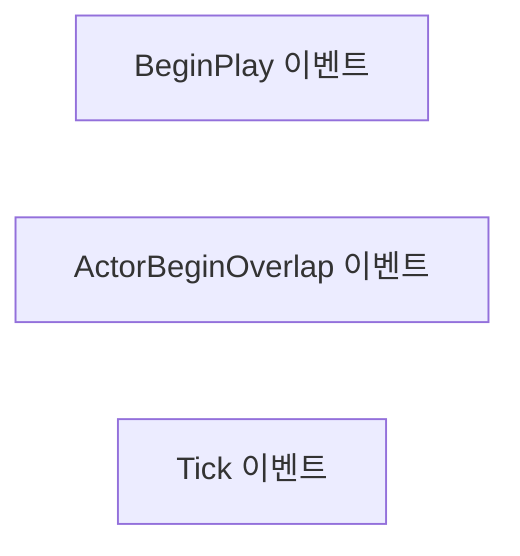

# BP_ArrayStaticMeshActor

에셋: `/Game/QuakeLike_1_0/Assets/Biohazard/Blueprints/BP_ArrayStaticMeshActor`

부모: `/Script/CoreUObject.Class'/Script/Engine.Actor'`

수집일: 2026-10-12. MCP에서 읽은 그래프·핀 연결의 자동 전사입니다. 상속된 그래프는 부모 문서를 함께 확인합니다.

정적 루트 참조 도달: 있음. 실행 여부 또는 삭제 가능 여부의 확정이 아닙니다.

컴포넌트 목록은 이 BP가 직접 정의한 SCS만 포함합니다. 부모·네이티브 생성 컴포넌트, 인스턴스 설정은 별도입니다.

## 직접 정의한 컴포넌트

| 이름 | 클래스 | 부모 컴포넌트 |
|---|---|---|
| `DefaultSceneRoot` | `SceneComponent` | `` |
| `InstancedStaticMesh` | `InstancedStaticMeshComponent` | `DefaultSceneRoot` |

## 변수와 기본값

| 이름 | 타입 | CDO 기본값 |
|---|---|---|
| `Mesh` | `StaticMesh` | /Game/QuakeLike_1_0/Assets/Biohazard/StaticMeshes/SM_Floor10.SM_Floor10 |
| `InstancesCountX` | `int` | 1 |
| `InstancesCountY` | `int` | 1 |
| `InstancesCountZ` | `int` | 1 |
| `GapX` | `real` | 0.0 |
| `GapY` | `real` | 0.0 |
| `GapZ` | `real` | 0.0 |
| `Stream` | `RandomStream` | &lt;Struct 'RandomStream' {initial_seed: 0}&gt; |
| `Seed` | `int` | 1337 |
| `RandomRotation` | `Rotator` | &lt;Struct 'Rotator' {pitch: 0.000000, yaw: 0.000000, roll: 0.000000}&gt; |
| `StartEndMesh` | `StaticMesh` | None |
| `FlipStartMesh?` | `bool` | False |
| `FlipEndMeshMesh?` | `bool` | False |

## 그래프 목록

| 그래프 | 전체 노드 수 |
|---|---|
| EventGraph | 3 |
| UserConstructionScript | 131 |

## 그래프별 실행 연결

실선은 출력 exec 핀의 실제 연결입니다. 여러 분기는 출력 핀 이름을 표시합니다. 함수 호출·delegate·타이머의 다음 그래프 실행은 이 그림에서 자동으로 이어 붙이지 않습니다.

순수 계산 노드 및 데이터 핀은 아래 목록과 원본 JSON을 확인합니다. 연결되지 않은 이벤트도 표시되므로, 노드가 있다는 이유만으로 실행된다고 판단하면 안 됩니다.

### EventGraph

실행 핀 플로우차트

전체 노드·기본 입력 목록

| 노드 ID | 제목 | 미연결 기본 입력 / 에셋 입력 |
|---|---|---|
| `K2Node_Event_0` | BeginPlay 이벤트 |  |
| `K2Node_Event_1` | ActorBeginOverlap 이벤트 |  |
| `K2Node_Event_2` | Tick 이벤트 | DeltaSeconds=0.0 |

### UserConstructionScript

```mermaid
flowchart LR
  n0["Construction Script"]
  n1["For Loop"]
  n2["Branch"]
  n3["Add Instance<br/>타깃은 인스턴스드 스태틱 메시 컴포넌트"]
  n4["Set Static Mesh<br/>타깃은 스태틱 메시 컴포넌트"]
  n5["For Loop"]
  n6["Add Instance<br/>타깃은 인스턴스드 스태틱 메시 컴포넌트"]
  n7["Branch"]
  n8["시퀀스"]
  n9["For Loop"]
  n10["Add Instance<br/>타깃은 인스턴스드 스태틱 메시 컴포넌트"]
  n11["Branch"]
  n12["시퀀스"]
  n13["Set Random Stream Seed"]
  n14["Is Valid"]
  n15["스태틱 메시 컴포넌트 추가<br/>"]
  n16["Set Static Mesh<br/>타깃은 스태틱 메시 컴포넌트"]
  n17["Is Valid"]
  n18["스태틱 메시 컴포넌트 추가<br/>"]
  n19["Set Static Mesh<br/>타깃은 스태틱 메시 컴포넌트"]
  n0 -->|"then"| n13
  n1 -->|"LoopBody"| n8
  n1 -->|"Completed"| n17
  n2 -->|"else"| n1
  n4 -->|"then"| n14
  n5 -->|"LoopBody"| n12
  n7 -->|"else"| n6
  n8 -->|"then_0"| n3
  n8 -->|"then_1"| n5
  n9 -->|"LoopBody"| n11
  n11 -->|"else"| n10
  n12 -->|"then_0"| n7
  n12 -->|"then_1"| n9
  n13 -->|"then"| n4
  n14 -->|"Is Valid"| n15
  n14 -->|"Is Not Valid"| n2
  n15 -->|"then"| n16
  n16 -->|"then"| n2
  n17 -->|"Is Valid"| n18
  n18 -->|"then"| n19
```

실행 핀 플로우차트

전체 노드·기본 입력 목록

| 노드 ID | 제목 | 미연결 기본 입력 / 에셋 입력 |
|---|---|---|
| `K2Node_FunctionEntry_0` | Construction Script |  |
| `K2Node_MacroInstance_1` | For Loop |  |
| `K2Node_VariableGet_31` | Get InstancesCountX |  |
| `K2Node_CallFunction_2` | Equal (Integer) | B=0 |
| `K2Node_IfThenElse_0` | Branch |  |
| `K2Node_VariableGet_12` | Get InstancesCountY |  |
| `K2Node_CommutativeAssociativeBinaryOperator_0` | OR Boolean |  |
| `K2Node_CallFunction_1` | Equal (Integer) | B=0 |
| `K2Node_CallFunction_16` | int - int | B=1 |
| `K2Node_CallFunction_17` | To Float (Integer) |  |
| `K2Node_CommutativeAssociativeBinaryOperator_5` | float * float |  |
| `K2Node_VariableGet_30` | Get Mesh |  |
| `K2Node_CallFunction_54` | Get Bounds 타깃은 스태틱 메시 |  |
| `K2Node_CallFunction_55` | Break Vector | Y=0.0; Z=0.0 |
| `K2Node_CallFunction_20` | Make Vector | Y=0.0; Z=0.0 |
| `K2Node_VariableGet_10` | Get InstancedStaticMesh |  |
| `K2Node_CallFunction_21` | Add Instance 타깃은 인스턴스드 스태틱 메시 컴포넌트 | bWorldSpace=false; ReturnValue=0 |
| `K2Node_CallFunction_22` | Make Transform | Scale=1.000000,1.000000,1.000000 |
| `K2Node_VariableGet_5` | Get InstancedStaticMesh |  |
| `K2Node_CallFunction_15` | Set Static Mesh 타깃은 스태틱 메시 컴포넌트 | ReturnValue=false |
| `K2Node_VariableGet_7` | Get Mesh |  |
| `K2Node_VariableGet_13` | Get GapX |  |
| `K2Node_CommutativeAssociativeBinaryOperator_13` | float + float |  |
| `K2Node_MacroInstance_2` | For Loop |  |
| `K2Node_CallFunction_24` | int - int | B=1 |
| `K2Node_CallFunction_25` | To Float (Integer) |  |
| `K2Node_CommutativeAssociativeBinaryOperator_7` | float * float |  |
| `K2Node_VariableGet_14` | Get Mesh |  |
| `K2Node_CallFunction_26` | Get Bounds 타깃은 스태틱 메시 |  |
| `K2Node_CallFunction_27` | Break Vector | X=0.0; Z=0.0 |
| `K2Node_CallFunction_28` | Make Vector | Z=0.0 |
| `K2Node_VariableGet_15` | Get InstancedStaticMesh |  |
| `K2Node_CallFunction_29` | Add Instance 타깃은 인스턴스드 스태틱 메시 컴포넌트 | bWorldSpace=false; ReturnValue=0 |
| `K2Node_CallFunction_30` | Make Transform | Scale=1.000000,1.000000,1.000000 |
| `K2Node_VariableGet_16` | Get GapY |  |
| `K2Node_CommutativeAssociativeBinaryOperator_8` | float + float |  |
| `K2Node_VariableGet_17` | Get InstancesCountY |  |
| `K2Node_CallFunction_31` | Equal (Integer) | B=0 |
| `K2Node_IfThenElse_2` | Branch |  |
| `K2Node_ExecutionSequence_0` | 시퀀스 |  |
| `K2Node_CommutativeAssociativeBinaryOperator_14` | float * float | B=2.000000 |
| `K2Node_CommutativeAssociativeBinaryOperator_9` | float * float | B=2.000000 |
| `K2Node_MacroInstance_0` | For Loop |  |
| `K2Node_CallFunction_3` | int - int | B=1 |
| `K2Node_CallFunction_10` | To Float (Integer) |  |
| `K2Node_CommutativeAssociativeBinaryOperator_1` | float * float |  |
| `K2Node_VariableGet_4` | Get Mesh |  |
| `K2Node_CallFunction_8` | Get Bounds 타깃은 스태틱 메시 |  |
| `K2Node_CallFunction_9` | Break Vector | X=0.0; Y=0.0 |
| `K2Node_CallFunction_11` | Make Vector |  |
| `K2Node_VariableGet_6` | Get InstancedStaticMesh |  |
| `K2Node_CallFunction_13` | Add Instance 타깃은 인스턴스드 스태틱 메시 컴포넌트 | bWorldSpace=false; ReturnValue=0 |
| `K2Node_CallFunction_14` | Make Transform | Scale=1.000000,1.000000,1.000000 |
| `K2Node_VariableGet_8` | Get GapZ |  |
| `K2Node_CommutativeAssociativeBinaryOperator_2` | float + float |  |
| `K2Node_VariableGet_3` | Get InstancesCountZ |  |
| `K2Node_CallFunction_23` | Equal (Integer) | B=0 |
| `K2Node_IfThenElse_1` | Branch |  |
| `K2Node_CommutativeAssociativeBinaryOperator_3` | float * float | B=2.000000 |
| `K2Node_ExecutionSequence_1` | 시퀀스 |  |
| `K2Node_VariableGet_2` | Get Stream |  |
| `K2Node_CallFunction_7` | Set Random Stream Seed |  |
| `K2Node_VariableGet_11` | Get Seed |  |
| `K2Node_MacroInstance_4` | Random Rot |  |
| `K2Node_MacroInstance_5` | Random Rot |  |
| `K2Node_MacroInstance_3` | Random Rot |  |
| `K2Node_VariableGet_32` | Get StartEndMesh |  |
| `K2Node_MacroInstance_7` | Is Valid |  |
| `K2Node_AddComponent_1` | 스태틱 메시 컴포넌트 추가  | bManualAttachment=false |
| `K2Node_VariableGet_33` | Get FlipStartMesh? |  |
| `K2Node_CallFunction_50` | Make Transform | Rotation=0, 0, 0; Scale_Y=1.0; Scale_Z=1.0 |
| `K2Node_CallFunction_64` | Select Float | A=-1.000000; B=1.000000 |
| `K2Node_CallFunction_53` | Set Static Mesh 타깃은 스태틱 메시 컴포넌트 | ReturnValue=false |
| `K2Node_VariableGet_29` | Get StartEndMesh |  |
| `K2Node_CommutativeAssociativeBinaryOperator_15` | float + float |  |
| `K2Node_VariableGet_25` | Get StartEndMesh |  |
| `K2Node_CallFunction_42` | Is Valid |  |
| `K2Node_CallFunction_43` | Get Bounds 타깃은 스태틱 메시 |  |
| `K2Node_CallFunction_44` | Break Vector | Y=0.0; Z=0.0 |
| `K2Node_CommutativeAssociativeBinaryOperator_16` | float * float | B=2.000000 |
| `K2Node_CallFunction_45` | Select Float | B=0.0 |
| `K2Node_CommutativeAssociativeBinaryOperator_17` | float + float |  |
| `K2Node_VariableGet_26` | Get StartEndMesh |  |
| `K2Node_CallFunction_46` | Is Valid |  |
| `K2Node_CallFunction_47` | Get Bounds 타깃은 스태틱 메시 |  |
| `K2Node_CallFunction_48` | Break Vector | X=0.0; Z=0.0 |
| `K2Node_CommutativeAssociativeBinaryOperator_18` | float * float | B=2.000000 |
| `K2Node_CallFunction_49` | Select Float | B=0.0 |
| `K2Node_CommutativeAssociativeBinaryOperator_4` | float + float |  |
| `K2Node_VariableGet_24` | Get StartEndMesh |  |
| `K2Node_CallFunction_38` | Is Valid |  |
| `K2Node_CallFunction_39` | Get Bounds 타깃은 스태틱 메시 |  |
| `K2Node_CallFunction_40` | Break Vector | X=0.0; Y=0.0 |
| `K2Node_CommutativeAssociativeBinaryOperator_6` | float * float | B=2.000000 |
| `K2Node_CallFunction_41` | Select Float | B=0.0 |
| `K2Node_VariableGet_21` | Get StartEndMesh |  |
| `K2Node_MacroInstance_6` | Is Valid |  |
| `K2Node_AddComponent_0` | 스태틱 메시 컴포넌트 추가  | bManualAttachment=false |
| `K2Node_CallFunction_34` | Make Transform | Location_Y=0.0; Location_Z=0.0; Rotation=0, 0, 0; Scale_Y=1.0; Scale_Z=1.0 |
| `K2Node_CallFunction_37` | Set Static Mesh 타깃은 스태틱 메시 컴포넌트 | ReturnValue=false |
| `K2Node_VariableGet_23` | Get StartEndMesh |  |
| `K2Node_VariableGet_9` | Get Mesh |  |
| `K2Node_CallFunction_18` | Get Bounds 타깃은 스태틱 메시 |  |
| `K2Node_CallFunction_19` | Break Vector | Y=0.0; Z=0.0 |
| `K2Node_VariableGet_1` | Get InstancesCountX |  |
| `K2Node_CallFunction_56` | To Float (Integer) |  |
| `K2Node_CommutativeAssociativeBinaryOperator_19` | float * float | C=2.000000 |
| `K2Node_CallFunction_60` | Make Vector | Y=0.0; Z=0.0 |
| `K2Node_VariableGet_34` | Get StartEndMesh |  |
| `K2Node_CallFunction_65` | Get Bounds 타깃은 스태틱 메시 |  |
| `K2Node_CallFunction_66` | Break Vector | Y=0.0; Z=0.0 |
| `K2Node_CommutativeAssociativeBinaryOperator_22` | float * float | B=2.000000 |
| `K2Node_CallFunction_67` | Select Float | B=0.0 |
| `K2Node_CommutativeAssociativeBinaryOperator_21` | int + int | B=1 |
| `K2Node_VariableGet_28` | Get FlipEndMeshMesh? |  |
| `K2Node_CallFunction_51` | Select Float | A=-1.000000; B=1.000000 |
| `K2Node_VariableGet_27` | Get StartEndMesh |  |
| `K2Node_CallFunction_61` | Get Bounds 타깃은 스태틱 메시 |  |
| `K2Node_CallFunction_62` | Break Vector | Y=0.0; Z=0.0 |
| `K2Node_CommutativeAssociativeBinaryOperator_20` | float * float | B=2.000000 |
| `K2Node_CallFunction_63` | Select Float | B=0.0 |
| `K2Node_CommutativeAssociativeBinaryOperator_23` | float + float |  |
| `K2Node_CallFunction_6` | Break Box Sphere Bounds | Origin=0, 0, 0; SphereRadius=0.0 |
| `K2Node_CallFunction_12` | Break Box Sphere Bounds | Origin=0, 0, 0; SphereRadius=0.0 |
| `K2Node_CallFunction_32` | Break Box Sphere Bounds | Origin=0, 0, 0; SphereRadius=0.0 |
| `K2Node_CallFunction_33` | Break Box Sphere Bounds | Origin=0, 0, 0; SphereRadius=0.0 |
| `K2Node_CallFunction_35` | Break Box Sphere Bounds | Origin=0, 0, 0; SphereRadius=0.0 |
| `K2Node_CallFunction_36` | Break Box Sphere Bounds | Origin=0, 0, 0; SphereRadius=0.0 |
| `K2Node_CallFunction_52` | Break Box Sphere Bounds | Origin=0, 0, 0; SphereRadius=0.0 |
| `K2Node_CallFunction_57` | Break Box Sphere Bounds | Origin=0, 0, 0; SphereRadius=0.0 |
| `K2Node_CallFunction_58` | Break Box Sphere Bounds | Origin=0, 0, 0; SphereRadius=0.0 |

## 조회 범위의 한계

ObjectIterator로 발견했으나 MCP helper가 반환하지 않은 그래프입니다. delegate signature·컴파일된 중간 그래프·macro·애니메이션 내부 그래프가 섞일 수 있습니다.

- `EdGraph_0`: Graph 'EdGraph_0' not found in Blueprint.
- `EdGraph_1`: Graph 'EdGraph_1' not found in Blueprint.
- `EdGraph_2`: Graph 'EdGraph_2' not found in Blueprint.
- `EdGraph_3`: Graph 'EdGraph_3' not found in Blueprint.
- `EdGraph_4`: Graph 'EdGraph_4' not found in Blueprint.
- `EdGraph_5`: Graph 'EdGraph_5' not found in Blueprint.
- `EdGraph_6`: Graph 'EdGraph_6' not found in Blueprint.
- `EdGraph_7`: Graph 'EdGraph_7' not found in Blueprint.
- `ExecuteUbergraph_BP_ArrayStaticMeshActor`: Graph 'ExecuteUbergraph_BP_ArrayStaticMeshActor' not found in Blueprint.
- `RandomRot`: Graph 'RandomRot' not found in Blueprint.
- `UserConstructionScript_MERGED`: Graph 'UserConstructionScript_MERGED' not found in Blueprint.

[원본 MCP 스냅샷](../../../../../Evidence/blueprints-175.json)
