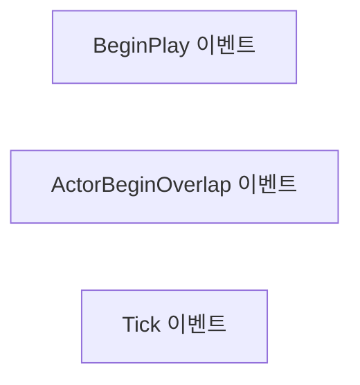
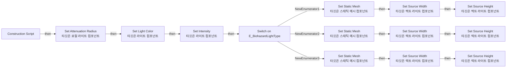

# BP_LightActor

에셋: `/Game/QuakeLike_1_0/Assets/Biohazard/Blueprints/BP_LightActor`

부모: `/Script/CoreUObject.Class'/Script/Engine.Actor'`

수집일: 2026-10-12. MCP에서 읽은 그래프·핀 연결의 자동 전사입니다. 상속된 그래프는 부모 문서를 함께 확인합니다.

정적 루트 참조 도달: 있음. 실행 여부 또는 삭제 가능 여부의 확정이 아닙니다.

컴포넌트 목록은 이 BP가 직접 정의한 SCS만 포함합니다. 부모·네이티브 생성 컴포넌트, 인스턴스 설정은 별도입니다.

## 직접 정의한 컴포넌트

| 이름 | 클래스 | 부모 컴포넌트 |
|---|---|---|
| `DefaultSceneRoot` | `SceneComponent` | `` |
| `StaticMesh` | `StaticMeshComponent` | `DefaultSceneRoot` |
| `RectLight` | `RectLightComponent` | `StaticMesh` |
| `AreaLight` | `PointLightComponent` | `StaticMesh` |
| `BubblesLoop_Cue` | `AudioComponent` | `DefaultSceneRoot` |

## 변수와 기본값

| 이름 | 타입 | CDO 기본값 |
|---|---|---|
| `Shadows?` | `bool` | False |
| `New Radius` | `real` | 1564.8109130859375 |
| `New Light Color` | `LinearColor` | &lt;Struct 'LinearColor' {r: 0.813715, g: 1.000000, b: 0.614583, a: 1.000000}&gt; |
| `Type` | `E_BiohazardLightType` | &lt;E_BiohazardLightType.STANDARD: 0&gt; |
| `New Intensity` | `real` | 300000.0 |

## 그래프 목록

| 그래프 | 전체 노드 수 |
|---|---|
| EventGraph | 3 |
| UserConstructionScript | 27 |

## 그래프별 실행 연결

실선은 출력 exec 핀의 실제 연결입니다. 여러 분기는 출력 핀 이름을 표시합니다. 함수 호출·delegate·타이머의 다음 그래프 실행은 이 그림에서 자동으로 이어 붙이지 않습니다.

순수 계산 노드 및 데이터 핀은 아래 목록과 원본 JSON을 확인합니다. 연결되지 않은 이벤트도 표시되므로, 노드가 있다는 이유만으로 실행된다고 판단하면 안 됩니다.

### EventGraph

실행 핀 플로우차트

전체 노드·기본 입력 목록

| 노드 ID | 제목 | 미연결 기본 입력 / 에셋 입력 |
|---|---|---|
| `K2Node_Event_0` | BeginPlay 이벤트 |  |
| `K2Node_Event_1` | ActorBeginOverlap 이벤트 |  |
| `K2Node_Event_2` | Tick 이벤트 | DeltaSeconds=0.0 |

### UserConstructionScript

실행 핀 플로우차트

전체 노드·기본 입력 목록

| 노드 ID | 제목 | 미연결 기본 입력 / 에셋 입력 |
|---|---|---|
| `K2Node_FunctionEntry_0` | Construction Script |  |
| `K2Node_VariableGet_2` | Get RectLight |  |
| `K2Node_CallFunction_2` | Set Attenuation Radius 타깃은 로컬 라이트 컴포넌트 |  |
| `K2Node_VariableGet_3` | Get New Radius |  |
| `K2Node_VariableGet_0` | Get RectLight |  |
| `K2Node_VariableGet_1` | Get AreaLight |  |
| `K2Node_CallFunction_0` | Set Light Color 타깃은 라이트 컴포넌트 | bSRGB=true |
| `K2Node_VariableGet_4` | Get New Light Color |  |
| `K2Node_SwitchEnum_0` | Switch on E_BiohazardLightType |  |
| `K2Node_VariableGet_6` | Get Type |  |
| `K2Node_VariableGet_8` | Get StaticMesh |  |
| `K2Node_CallFunction_7` | Set Static Mesh 타깃은 스태틱 메시 컴포넌트 | NewMesh=/Game/QuakeLike_1_0/Assets/Biohazard/StaticMeshes/SM_WallLightDouble.SM_WallLightDouble; ReturnValue=false |
| `K2Node_VariableGet_9` | Get StaticMesh |  |
| `K2Node_CallFunction_8` | Set Static Mesh 타깃은 스태틱 메시 컴포넌트 | NewMesh=/Game/QuakeLike_1_0/Assets/Biohazard/StaticMeshes/SM_WallLightBig.SM_WallLightBig; ReturnValue=false |
| `K2Node_VariableGet_7` | Get StaticMesh |  |
| `K2Node_CallFunction_6` | Set Static Mesh 타깃은 스태틱 메시 컴포넌트 | NewMesh=/Game/QuakeLike_1_0/Assets/Biohazard/StaticMeshes/SM_WallLightSmall.SM_WallLightSmall; ReturnValue=false |
| `K2Node_VariableGet_12` | Get RectLight |  |
| `K2Node_CallFunction_11` | Set Source Height 타깃은 렉트 라이트 컴포넌트 | NewValue=22.000000 |
| `K2Node_CallFunction_12` | Set Source Width 타깃은 렉트 라이트 컴포넌트 | NewValue=230.000000 |
| `K2Node_VariableGet_13` | Get RectLight |  |
| `K2Node_CallFunction_13` | Set Source Height 타깃은 렉트 라이트 컴포넌트 | NewValue=70.000000 |
| `K2Node_CallFunction_14` | Set Source Width 타깃은 렉트 라이트 컴포넌트 | NewValue=120.000000 |
| `K2Node_VariableGet_11` | Get RectLight |  |
| `K2Node_CallFunction_9` | Set Source Height 타깃은 렉트 라이트 컴포넌트 | NewValue=25.000000 |
| `K2Node_CallFunction_10` | Set Source Width 타깃은 렉트 라이트 컴포넌트 | NewValue=33.000000 |
| `K2Node_CallFunction_15` | Set Intensity 타깃은 라이트 컴포넌트 |  |
| `K2Node_VariableGet_14` | Get New Intensity |  |

## 조회 범위의 한계

ObjectIterator로 발견했으나 MCP helper가 반환하지 않은 그래프입니다. delegate signature·컴파일된 중간 그래프·macro·애니메이션 내부 그래프가 섞일 수 있습니다.

- `ExecuteUbergraph_BP_LightActor`: Graph 'ExecuteUbergraph_BP_LightActor' not found in Blueprint.
- `UserConstructionScript_MERGED`: Graph 'UserConstructionScript_MERGED' not found in Blueprint.

[원본 MCP 스냅샷](../../../../../Evidence/blueprints-175.json)
