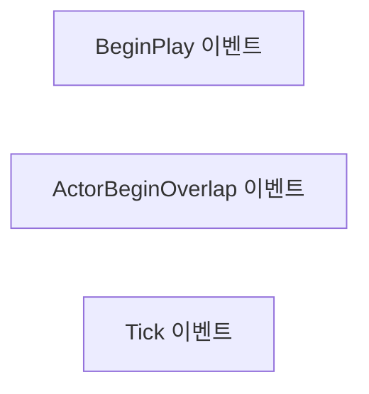
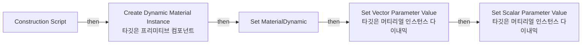

# bp_EmissiveP_01_01

에셋: `/Game/QuakeLike_1_0/Assets/IndustrialFactory/Effects/EmissivePlane_01/bp_EmissiveP_01_01`

부모: `/Script/CoreUObject.Class'/Script/Engine.Actor'`

수집일: 2026-10-12. MCP에서 읽은 그래프·핀 연결의 자동 전사입니다. 상속된 그래프는 부모 문서를 함께 확인합니다.

정적 루트 참조 도달: 있음. 실행 여부 또는 삭제 가능 여부의 확정이 아닙니다.

컴포넌트 목록은 이 BP가 직접 정의한 SCS만 포함합니다. 부모·네이티브 생성 컴포넌트, 인스턴스 설정은 별도입니다.

## 직접 정의한 컴포넌트

| 이름 | 클래스 | 부모 컴포넌트 |
|---|---|---|
| `DefaultSceneRoot` | `SceneComponent` | `` |
| `Center` | `BillboardComponent` | `DefaultSceneRoot` |
| `EmissivePlane` | `StaticMeshComponent` | `DefaultSceneRoot` |

## 변수와 기본값

| 이름 | 타입 | CDO 기본값 |
|---|---|---|
| `MaterialBase` | `MaterialInstanceConstant` | /Game/QuakeLike_1_0/Assets/IndustrialFactory/Effects/EmissivePlane_01/mi_EmissiveP_01_Inst.mi_EmissiveP_01_Inst |
| `MaterialDynamic` | `MaterialInstanceDynamic` | None |
| `Color` | `LinearColor` | &lt;Struct 'LinearColor' {r: 1.000000, g: 1.000000, b: 1.000000, a: 1.000000}&gt; |
| `Intensity` | `real` | 10.0 |

## 그래프 목록

| 그래프 | 전체 노드 수 |
|---|---|
| EventGraph | 3 |
| UserConstructionScript | 10 |

## 그래프별 실행 연결

실선은 출력 exec 핀의 실제 연결입니다. 여러 분기는 출력 핀 이름을 표시합니다. 함수 호출·delegate·타이머의 다음 그래프 실행은 이 그림에서 자동으로 이어 붙이지 않습니다.

순수 계산 노드 및 데이터 핀은 아래 목록과 원본 JSON을 확인합니다. 연결되지 않은 이벤트도 표시되므로, 노드가 있다는 이유만으로 실행된다고 판단하면 안 됩니다.

### EventGraph

실행 핀 플로우차트

전체 노드·기본 입력 목록

| 노드 ID | 제목 | 미연결 기본 입력 / 에셋 입력 |
|---|---|---|
| `K2Node_Event_0` | BeginPlay 이벤트 |  |
| `K2Node_Event_1` | ActorBeginOverlap 이벤트 |  |
| `K2Node_Event_2` | Tick 이벤트 | DeltaSeconds=0.0 |

### UserConstructionScript

실행 핀 플로우차트

전체 노드·기본 입력 목록

| 노드 ID | 제목 | 미연결 기본 입력 / 에셋 입력 |
|---|---|---|
| `K2Node_FunctionEntry_0` | Construction Script |  |
| `K2Node_CallFunction_0` | Create Dynamic Material Instance 타깃은 프리미티브 컴포넌트 | ElementIndex=0; OptionalName=None |
| `K2Node_VariableSet_47` | Set MaterialDynamic |  |
| `K2Node_VariableGet_115` | Get MaterialDynamic |  |
| `K2Node_VariableGet_2` | Get Color |  |
| `K2Node_CallFunction_17` | Set Vector Parameter Value 타깃은 머티리얼 인스턴스 다이내믹 | ParameterName=Color |
| `K2Node_VariableGet_5` | Get Intensity |  |
| `K2Node_CallFunction_3` | Set Scalar Parameter Value 타깃은 머티리얼 인스턴스 다이내믹 | ParameterName=Intensity |
| `K2Node_VariableGet_6` | Get EmissivePlane |  |
| `K2Node_VariableGet_7` | Get MaterialBase |  |

## 조회 범위의 한계

ObjectIterator로 발견했으나 MCP helper가 반환하지 않은 그래프입니다. delegate signature·컴파일된 중간 그래프·macro·애니메이션 내부 그래프가 섞일 수 있습니다.

- `ExecuteUbergraph_bp_EmissiveP_01_01`: Graph 'ExecuteUbergraph_bp_EmissiveP_01_01' not found in Blueprint.
- `UserConstructionScript_MERGED`: Graph 'UserConstructionScript_MERGED' not found in Blueprint.

[원본 MCP 스냅샷](../../../../../../Evidence/blueprints-175.json)
