# BP_SkySphere_Original

에셋: `/Game/QuakeLike_1_0/Assets/StarterBundle/ModularSci_Int/Blueprints/BP_SkySphere_Original`

부모: `/Script/CoreUObject.Class'/Script/Engine.Actor'`

수집일: 2026-10-12. MCP에서 읽은 그래프·핀 연결의 자동 전사입니다. 상속된 그래프는 부모 문서를 함께 확인합니다.

정적 루트 참조 도달: 없음. 실행 여부 또는 삭제 가능 여부의 확정이 아닙니다.

컴포넌트 목록은 이 BP가 직접 정의한 SCS만 포함합니다. 부모·네이티브 생성 컴포넌트, 인스턴스 설정은 별도입니다.

## 직접 정의한 컴포넌트

| 이름 | 클래스 | 부모 컴포넌트 |
|---|---|---|
| `Base` | `SceneComponent` | `` |
| `Sky Sphere mesh` | `StaticMeshComponent` | `Base` |

## 변수와 기본값

| 이름 | 타입 | CDO 기본값 |
|---|---|---|
| `Sky material` | `MaterialInstanceDynamic` | None |
| `Refresh material` | `bool` | False |
| `Directional light actor` | `DirectionalLight` | None |
| `Colors determined by sun position` | `bool` | True |
| `Sun height` | `real` | 0.0 |
| `Sun brightness` | `real` | 50.0 |
| `Horizon Falloff` | `real` | 3.0 |
| `Zenith Color` | `LinearColor` | &lt;Struct 'LinearColor' {r: 0.034046, g: 0.109247, b: 0.295000, a: 1.000000}&gt; |
| `Horizon color` | `LinearColor` | &lt;Struct 'LinearColor' {r: 1.979559, g: 2.586644, b: 3.000000, a: 1.000000}&gt; |
| `Cloud color` | `LinearColor` | &lt;Struct 'LinearColor' {r: 0.787316, g: 0.845498, b: 0.920000, a: 1.000000}&gt; |
| `Overall Color` | `LinearColor` | &lt;Struct 'LinearColor' {r: 1.000000, g: 1.000000, b: 1.000000, a: 1.000000}&gt; |
| `Cloud speed` | `real` | 1.0 |
| `Cloud opacity` | `real` | 0.5 |
| `Stars brightness` | `real` | 0.10000000149011612 |
| `Horizon color curve` | `CurveLinearColor` | /Engine/EngineSky/C_Sky_Horizon_Color.C_Sky_Horizon_Color |
| `Zenith color curve` | `CurveLinearColor` | /Engine/EngineSky/C_Sky_Zenith_Color.C_Sky_Zenith_Color |
| `Cloud color curve` | `CurveLinearColor` | /Engine/EngineSky/C_Sky_Cloud_Color.C_Sky_Cloud_Color |

## 그래프 목록

| 그래프 | 전체 노드 수 |
|---|---|
| EventGraph | 0 |
| UpdateSunDirection | 38 |
| UserConstructionScript | 82 |

## 그래프별 실행 연결

실선은 출력 exec 핀의 실제 연결입니다. 여러 분기는 출력 핀 이름을 표시합니다. 함수 호출·delegate·타이머의 다음 그래프 실행은 이 그림에서 자동으로 이어 붙이지 않습니다.

순수 계산 노드 및 데이터 핀은 아래 목록과 원본 JSON을 확인합니다. 연결되지 않은 이벤트도 표시되므로, 노드가 있다는 이유만으로 실행된다고 판단하면 안 됩니다.

### EventGraph

전체 노드·기본 입력 목록

| 노드 ID | 제목 | 미연결 기본 입력 / 에셋 입력 |
|---|---|---|

### UpdateSunDirection

실행 핀 플로우차트

전체 노드·기본 입력 목록

| 노드 ID | 제목 | 미연결 기본 입력 / 에셋 입력 |
|---|---|---|
| `K2Node_FunctionEntry_334` | UpdateSunDirection |  |
| `K2Node_CallFunction_102659` | Set Scalar Parameter Value 타깃은 머티리얼 인스턴스 다이내믹 | ParameterName=Horizon falloff |
| `K2Node_CallFunction_66285` | Set Vector Parameter Value 타깃은 머티리얼 인스턴스 다이내믹 | ParameterName=Horizon color |
| `K2Node_CallFunction_80963` | Set Vector Parameter Value 타깃은 머티리얼 인스턴스 다이내믹 | ParameterName=Zenith color |
| `K2Node_CallFunction_187246` | Set Vector Parameter Value 타깃은 머티리얼 인스턴스 다이내믹 | ParameterName=Cloud color |
| `K2Node_VariableGet_92` | Get Sky material |  |
| `K2Node_VariableGet_164` | Get Sun height |  |
| `K2Node_VariableGet_331` | Get Sun height |  |
| `K2Node_VariableGet_198` | Get Zenith color curve |  |
| `K2Node_CallFunction_100602` | Get Linear Color Value 타깃은 커브 선형 컬러 |  |
| `K2Node_VariableGet_200` | Get Horizon color curve |  |
| `K2Node_CallFunction_59019` | Get Linear Color Value 타깃은 커브 선형 컬러 |  |
| `K2Node_VariableGet_330` | Get Cloud color curve |  |
| `K2Node_CallFunction_58995` | Get Linear Color Value 타깃은 커브 선형 컬러 |  |
| `K2Node_VariableGet_395` | Get Sun height |  |
| `K2Node_CallFunction_105919` | Absolute (Float) |  |
| `K2Node_CallFunction_106045` | Lerp | A=3; B=8 |
| `K2Node_VariableGet_266` | Get Sky material |  |
| `K2Node_VariableGet_203` | Get Directional light actor |  |
| `K2Node_CallFunction_63136` | Get Actor Rotation 타깃은 액터 |  |
| `K2Node_CallFunction_8535` | Get Rotation X Vector |  |
| `K2Node_CallFunction_63134` | Set Vector Parameter Value 타깃은 머티리얼 인스턴스 다이내믹 | ParameterName=Light direction |
| `K2Node_CallFunction_8570` | To LinearColor (Vector) |  |
| `K2Node_VariableGet_162` | Get LightComponent |  |
| `K2Node_VariableGet_201` | Get LightColor |  |
| `K2Node_CallFunction_63135` | Set Vector Parameter Value 타깃은 머티리얼 인스턴스 다이내믹 | ParameterName=Sun color |
| `K2Node_CallFunction_36812` | To LinearColor (Color) |  |
| `K2Node_VariableGet_78` | Get Directional light actor |  |
| `K2Node_VariableSet_53` | Set Sun height | Output_Get=0.0 |
| `K2Node_CallFunction_7061` | Break Rotator | Roll=0.0; Yaw=0.0 |
| `K2Node_CallFunction_11327` | Map Range Unclamped | InRangeA=0.0; InRangeB=-90; OutRangeA=0.0; OutRangeB=1 |
| `K2Node_VariableGet_187` | Get Directional light actor |  |
| `K2Node_CallFunction_29994` | Get Actor Rotation 타깃은 액터 |  |
| `K2Node_CallFunction_162575` | Set Scalar Parameter Value 타깃은 머티리얼 인스턴스 다이내믹 | ParameterName=Sun height |
| `K2Node_CallFunction_155829` | Absolute (Float) |  |
| `K2Node_CallFunction_156205` | float &lt; float | B=0.0 |
| `K2Node_CallFunction_156280` | Select Float | B=0.0 |
| `K2Node_VariableGet_328` | Get Sun height |  |

### UserConstructionScript

```mermaid
flowchart LR
  n0["Construction Script"]
  n1["Set Vector Parameter Value<br/>타깃은 머티리얼 인스턴스 다이내믹"]
  n2["Is Valid"]
  n3["Set Vector Parameter Value<br/>타깃은 머티리얼 인스턴스 다이내믹"]
  n4["Set Scalar Parameter Value<br/>타깃은 머티리얼 인스턴스 다이내믹"]
  n5["Set Vector Parameter Value<br/>타깃은 머티리얼 인스턴스 다이내믹"]
  n6["Set Vector Parameter Value<br/>타깃은 머티리얼 인스턴스 다이내믹"]
  n7["Set Scalar Parameter Value<br/>타깃은 머티리얼 인스턴스 다이내믹"]
  n8["Set Vector Parameter Value<br/>타깃은 머티리얼 인스턴스 다이내믹"]
  n9["Set Scalar Parameter Value<br/>타깃은 머티리얼 인스턴스 다이내믹"]
  n10["Set Sun height"]
  n11["Set Vector Parameter Value<br/>타깃은 머티리얼 인스턴스 다이내믹"]
  n12["Branch"]
  n13["Set Vector Parameter Value<br/>타깃은 머티리얼 인스턴스 다이내믹"]
  n14["Set Vector Parameter Value<br/>타깃은 머티리얼 인스턴스 다이내믹"]
  n15["Set Vector Parameter Value<br/>타깃은 머티리얼 인스턴스 다이내믹"]
  n16["Set Vector Parameter Value<br/>타깃은 머티리얼 인스턴스 다이내믹"]
  n17["Set Scalar Parameter Value<br/>타깃은 머티리얼 인스턴스 다이내믹"]
  n18["Set Scalar Parameter Value<br/>타깃은 머티리얼 인스턴스 다이내믹"]
  n19["Set Scalar Parameter Value<br/>타깃은 머티리얼 인스턴스 다이내믹"]
  n20["Set Vector Parameter Value<br/>타깃은 머티리얼 인스턴스 다이내믹"]
  n21["Branch"]
  n22["Set Refresh material"]
  n23["Set Scalar Parameter Value<br/>타깃은 머티리얼 인스턴스 다이내믹"]
  n24["Set Sky material"]
  n25["Create Dynamic Material Instance<br/>타깃은 프리미티브 컴포넌트"]
  n0 -->|"then"| n25
  n1 -->|"then"| n3
  n2 -->|"Is Valid"| n1
  n2 -->|"Is Not Valid"| n16
  n3 -->|"then"| n10
  n4 -->|"then"| n17
  n5 -->|"then"| n6
  n6 -->|"then"| n8
  n7 -->|"then"| n4
  n8 -->|"then"| n20
  n9 -->|"then"| n7
  n10 -->|"then"| n12
  n11 -->|"then"| n12
  n12 -->|"then"| n13
  n12 -->|"else"| n5
  n13 -->|"then"| n14
  n14 -->|"then"| n15
  n15 -->|"then"| n9
  n16 -->|"then"| n11
  n17 -->|"then"| n19
  n18 -->|"then"| n7
  n19 -->|"then"| n23
  n20 -->|"then"| n18
  n21 -->|"then"| n22
  n21 -->|"else"| n22
  n22 -->|"then"| n2
  n24 -->|"then"| n21
  n25 -->|"then"| n24
```

실행 핀 플로우차트

전체 노드·기본 입력 목록

| 노드 ID | 제목 | 미연결 기본 입력 / 에셋 입력 |
|---|---|---|
| `K2Node_FunctionEntry_1` | Construction Script |  |
| `K2Node_VariableGet_266` | Get Sky material |  |
| `K2Node_VariableGet_203` | Get Directional light actor |  |
| `K2Node_CallFunction_63136` | Get Actor Rotation 타깃은 액터 |  |
| `K2Node_CallFunction_8535` | Get Rotation X Vector |  |
| `K2Node_CallFunction_63134` | Set Vector Parameter Value 타깃은 머티리얼 인스턴스 다이내믹 | ParameterName=Light direction |
| `K2Node_CallFunction_8570` | To LinearColor (Vector) |  |
| `K2Node_VariableGet_250` | Get Directional light actor |  |
| `K2Node_MacroInstance_228` | Is Valid |  |
| `K2Node_VariableGet_162` | Get LightComponent |  |
| `K2Node_VariableGet_201` | Get LightColor |  |
| `K2Node_CallFunction_63135` | Set Vector Parameter Value 타깃은 머티리얼 인스턴스 다이내믹 | ParameterName=Sun color |
| `K2Node_CallFunction_36812` | To LinearColor (Color) |  |
| `K2Node_CallFunction_92375` | Set Scalar Parameter Value 타깃은 머티리얼 인스턴스 다이내믹 | ParameterName=Sun brightness |
| `K2Node_VariableGet_211` | Get Sun brightness |  |
| `K2Node_CallFunction_16455` | Set Vector Parameter Value 타깃은 머티리얼 인스턴스 다이내믹 | ParameterName=Horizon color |
| `K2Node_VariableGet_124` | Get Horizon color |  |
| `K2Node_CallFunction_16456` | Set Vector Parameter Value 타깃은 머티리얼 인스턴스 다이내믹 | ParameterName=Zenith color |
| `K2Node_VariableGet_125` | Get Zenith Color |  |
| `K2Node_CallFunction_40991` | Set Scalar Parameter Value 타깃은 머티리얼 인스턴스 다이내믹 | ParameterName=Cloud speed |
| `K2Node_VariableGet_239` | Get Cloud speed |  |
| `K2Node_CallFunction_16457` | Set Vector Parameter Value 타깃은 머티리얼 인스턴스 다이내믹 | ParameterName=Overall color |
| `K2Node_VariableGet_78` | Get Directional light actor |  |
| `K2Node_VariableGet_126` | Get Overall Color |  |
| `K2Node_CallFunction_102659` | Set Scalar Parameter Value 타깃은 머티리얼 인스턴스 다이내믹 | ParameterName=Horizon falloff |
| `K2Node_CallFunction_2496` | Lerp (LinearColor) | A=(R=1.000000,G=0.221000,B=0.040000,A=1.000000); B=(R=0.954000,G=0.901000,B=0.744120,A=1.000000) |
| `K2Node_VariableSet_53` | Set Sun height | Output_Get=0.0 |
| `K2Node_CallFunction_7061` | Break Rotator | Roll=0.0; Yaw=0.0 |
| `K2Node_CallFunction_11327` | Map Range Unclamped | InRangeA=0.0; InRangeB=-90; OutRangeA=0.0; OutRangeB=1 |
| `K2Node_CallFunction_64210` | Set Vector Parameter Value 타깃은 머티리얼 인스턴스 다이내믹 | ParameterName=Sun color |
| `K2Node_VariableGet_55` | Get Sun height |  |
| `K2Node_CallFunction_13510` | Clamp (Float) | Min=0.0; Max=1.0 |
| `K2Node_IfThenElse_34` | Branch |  |
| `K2Node_VariableGet_94` | Get Colors determined by sun position |  |
| `K2Node_CallFunction_66285` | Set Vector Parameter Value 타깃은 머티리얼 인스턴스 다이내믹 | ParameterName=Horizon color |
| `K2Node_CallFunction_80963` | Set Vector Parameter Value 타깃은 머티리얼 인스턴스 다이내믹 | ParameterName=Zenith color |
| `K2Node_CallFunction_187246` | Set Vector Parameter Value 타깃은 머티리얼 인스턴스 다이내믹 | ParameterName=Cloud color |
| `K2Node_VariableGet_92` | Get Sky material |  |
| `K2Node_VariableGet_4` | Get Sun height |  |
| `K2Node_VariableGet_331` | Get Sun height |  |
| `K2Node_VariableGet_166` | Get Sky material |  |
| `K2Node_VariableGet_95` | Get Sky material |  |
| `K2Node_VariableGet_198` | Get Zenith color curve |  |
| `K2Node_CallFunction_100602` | Get Linear Color Value 타깃은 커브 선형 컬러 |  |
| `K2Node_VariableGet_5` | Get Horizon color curve |  |
| `K2Node_CallFunction_35421` | Get Linear Color Value 타깃은 커브 선형 컬러 |  |
| `K2Node_CallFunction_36810` | Set Vector Parameter Value 타깃은 머티리얼 인스턴스 다이내믹 | ParameterName=Light direction |
| `K2Node_VariableGet_187` | Get Directional light actor |  |
| `K2Node_CallFunction_29994` | Get Actor Rotation 타깃은 액터 |  |
| `K2Node_CallFunction_63550` | Make Rotator | Roll=0.0 |
| `K2Node_CallFunction_63964` | Get Actor Rotation 타깃은 액터 |  |
| `K2Node_CallFunction_64000` | Break Rotator | Roll=0.0; Pitch=0.0 |
| `K2Node_VariableGet_265` | Get Sun height |  |
| `K2Node_CallFunction_64154` | Map Range Unclamped | InRangeA=-1; InRangeB=1; OutRangeA=90; OutRangeB=-90 |
| `K2Node_CallFunction_64190` | Get Rotation X Vector |  |
| `K2Node_CallFunction_64192` | To LinearColor (Vector) |  |
| `K2Node_VariableGet_202` | Get Sky material |  |
| `K2Node_VariableGet_328` | Get Sun height |  |
| `K2Node_CallFunction_162575` | Set Scalar Parameter Value 타깃은 머티리얼 인스턴스 다이내믹 | ParameterName=Sun height |
| `K2Node_VariableGet_330` | Get Cloud color curve |  |
| `K2Node_CallFunction_58995` | Get Linear Color Value 타깃은 커브 선형 컬러 |  |
| `K2Node_VariableGet_395` | Get Sun height |  |
| `K2Node_VariableGet_2` | Get Horizon Falloff |  |
| `K2Node_CallFunction_72508` | Set Scalar Parameter Value 타깃은 머티리얼 인스턴스 다이내믹 | ParameterName=Horizon falloff |
| `K2Node_CallFunction_105919` | Absolute (Float) |  |
| `K2Node_CallFunction_106045` | Lerp | A=3; B=7 |
| `K2Node_CallFunction_155829` | Absolute (Float) |  |
| `K2Node_CallFunction_156205` | float &lt; float | B=0.0 |
| `K2Node_CallFunction_156280` | Select Float | B=0.0 |
| `K2Node_CallFunction_80790` | Set Scalar Parameter Value 타깃은 머티리얼 인스턴스 다이내믹 | ParameterName=Cloud opacity |
| `K2Node_VariableGet_408` | Get Cloud opacity |  |
| `K2Node_CallFunction_72507` | Set Vector Parameter Value 타깃은 머티리얼 인스턴스 다이내믹 | ParameterName=Cloud color |
| `K2Node_VariableGet_410` | Get Cloud color |  |
| `K2Node_IfThenElse_81` | Branch |  |
| `K2Node_VariableGet_232` | Get Refresh material |  |
| `K2Node_VariableSet_112` | Set Refresh material | Refresh material=false; Output_Get=false |
| `K2Node_CallFunction_38815` | Set Scalar Parameter Value 타깃은 머티리얼 인스턴스 다이내믹 | ParameterName=Stars brightness |
| `K2Node_VariableGet_560` | Get Stars brightness |  |
| `K2Node_VariableSet_356` | Set Sky material |  |
| `K2Node_VariableGet_983` | Get Sky Sphere mesh |  |
| `K2Node_CallFunction_40283` | Create Dynamic Material Instance 타깃은 프리미티브 컴포넌트 | ElementIndex=0; SourceMaterial=/Engine/EngineSky/M_Sky_Panning_Clouds2.M_Sky_Panning_Clouds2; OptionalName=None |
| `K2Node_CommutativeAssociativeBinaryOperator_995` | float + float | B=0.2 |

## 조회 범위의 한계

ObjectIterator로 발견했으나 MCP helper가 반환하지 않은 그래프입니다. delegate signature·컴파일된 중간 그래프·macro·애니메이션 내부 그래프가 섞일 수 있습니다.

- `EdGraph_0`: Graph 'EdGraph_0' not found in Blueprint.
- `ExecuteUbergraph_BP_SkySphere_Original`: Graph 'ExecuteUbergraph_BP_SkySphere_Original' not found in Blueprint.
- `UpdateSunDirection_MERGED`: Graph 'UpdateSunDirection_MERGED' not found in Blueprint.
- `UserConstructionScript_MERGED`: Graph 'UserConstructionScript_MERGED' not found in Blueprint.

[원본 MCP 스냅샷](../../../../../../Evidence/blueprints-175.json)
