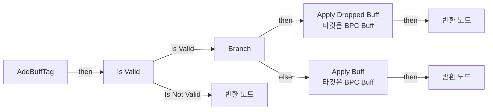
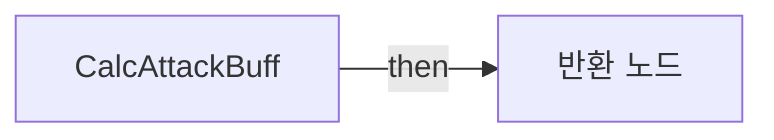
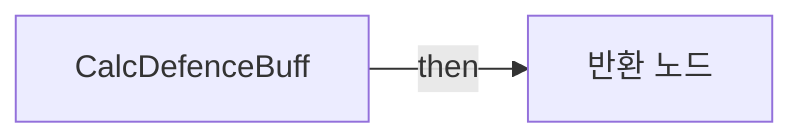
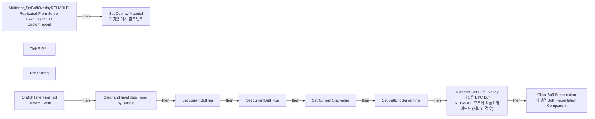
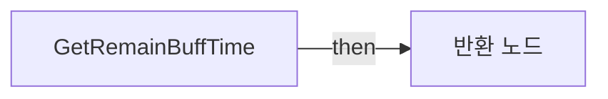

# BPC_Buff

에셋: `/Game/QuakeLike_1_0/Buff/BPC_Buff`

부모: `/Script/CoreUObject.Class'/Script/ShootingArena.BuffPresentationComponent'`

수집일: 2026-10-12. MCP에서 읽은 그래프·핀 연결의 자동 전사입니다. 상속된 그래프는 부모 문서를 함께 확인합니다.

정적 루트 참조 도달: 있음. 실행 여부 또는 삭제 가능 여부의 확정이 아닙니다.

컴포넌트 목록은 이 BP가 직접 정의한 SCS만 포함합니다. 부모·네이티브 생성 컴포넌트, 인스턴스 설정은 별도입니다.

## 변수와 기본값

| 이름 | 타입 | CDO 기본값 |
|---|---|---|
| `ActiveBuffTags` | `GameplayTagContainer` | &lt;Struct 'GameplayTagContainer' {gameplay_tags: }&gt; |
| `CurrentBuffItem` | `BP_BuffItem_C` | None |
| `BuffMap` | `GameplayTag` | {} |
| `TagsToRemove` | `GameplayTag` | [] |
| `Current Stat Value` | `real` | 0.0 |
| `currentBuffTag` | `GameplayTag` | &lt;Struct 'GameplayTag' {}&gt; |
| `buffTimerhandle` | `TimerHandle` | &lt;Struct 'TimerHandle' {}&gt; |
| `currentBuffType` | `E_BuffType` | &lt;E_BuffType.NONE: 0&gt; |
| `currentModifierType` | `E_BuffModifierType` | &lt;E_BuffModifierType.ADD: 0&gt; |
| `buffEndServerTime` | `real` | 0.0 |
| `currentBuffRowName` | `name` | None |

## 그래프 목록

| 그래프 | 전체 노드 수 |
|---|---|
| AddBuffTag | 14 |
| ApplyBuff | 32 |
| ApplyDroppedBuff | 37 |
| CalcAttackBuff | 15 |
| CalcDefenceBuff | 17 |
| EventGraph | 24 |
| GetRemainBuffTime | 7 |
| RemoveBuffTag | 3 |

## 그래프별 실행 연결

실선은 출력 exec 핀의 실제 연결입니다. 여러 분기는 출력 핀 이름을 표시합니다. 함수 호출·delegate·타이머의 다음 그래프 실행은 이 그림에서 자동으로 이어 붙이지 않습니다.

순수 계산 노드 및 데이터 핀은 아래 목록과 원본 JSON을 확인합니다. 연결되지 않은 이벤트도 표시되므로, 노드가 있다는 이유만으로 실행된다고 판단하면 안 됩니다.

### AddBuffTag

실행 핀 플로우차트

전체 노드·기본 입력 목록

| 노드 ID | 제목 | 미연결 기본 입력 / 에셋 입력 |
|---|---|---|
| `K2Node_FunctionEntry_0` | AddBuffTag |  |
| `K2Node_MacroInstance_1` | Is Valid |  |
| `K2Node_Knot_6` | 경유 노드 |  |
| `K2Node_Knot_7` | 경유 노드 |  |
| `K2Node_CallFunction_5` | Apply Buff 타깃은 BPC Buff |  |
| `K2Node_VariableGet_1` | Get |  |
| `K2Node_VariableGet_0` | Get IsDroppedBuff |  |
| `K2Node_IfThenElse_0` | Branch |  |
| `K2Node_CallFunction_0` | Apply Dropped Buff 타깃은 BPC Buff |  |
| `K2Node_Knot_1` | 경유 노드 |  |
| `K2Node_VariableGet_3` | Get EndServerTime |  |
| `K2Node_FunctionResult_0` | 반환 노드 |  |
| `K2Node_FunctionResult_1` | 반환 노드 |  |
| `K2Node_FunctionResult_2` | 반환 노드 | Success=false |

### ApplyBuff

```mermaid
flowchart LR
  n0["ApplyBuff"]
  n1["Get Data Table Row DT_BuffTable"]
  n2["Print String"]
  n3["Set Timer by Event"]
  n4["경유 노드"]
  n5["Set Current Stat Value"]
  n6["Multicast Set Buff Overlay<br/>타깃은 BPC Buff<br/>RELIABLE 모두에 리플리케이트됨 (서버인 경우)"]
  n7["Set buffTimerhandle"]
  n8["Set currentBuffTag"]
  n9["경유 노드"]
  n10["Clear and Invalidate Timer by Handle"]
  n11["Set currentBuffType"]
  n12["Set currentModifierType"]
  n13["Set buffEndServerTime"]
  n14["Set currentBuffRowName"]
  n15["반환 노드"]
  n16["반환 노드"]
  n17["Set Buff Presentation<br/>타깃은 Buff Presentation Component"]
  n0 -->|"then"| n1
  n1 -->|"then"| n14
  n1 -->|"RowNotFound"| n9
  n2 -->|"then"| n16
  n3 -->|"then"| n7
  n4 -->|"OutputPin"| n10
  n5 -->|"then"| n3
  n6 -->|"then"| n15
  n7 -->|"then"| n13
  n8 -->|"then"| n11
  n9 -->|"OutputPin"| n2
  n10 -->|"then"| n8
  n11 -->|"then"| n12
  n12 -->|"then"| n5
  n13 -->|"then"| n17
  n14 -->|"then"| n4
  n17 -->|"then"| n6
```

실행 핀 플로우차트

전체 노드·기본 입력 목록

| 노드 ID | 제목 | 미연결 기본 입력 / 에셋 입력 |
|---|---|---|
| `K2Node_FunctionEntry_0` | ApplyBuff |  |
| `K2Node_GetDataTableRow_0` | Get Data Table Row DT_BuffTable | DataTable=/Game/QuakeLike_1_0/Data/Item/DropTable/DT_BuffTable.DT_BuffTable |
| `K2Node_BreakStruct_1` | Break ST Buff Data |  |
| `K2Node_CallFunction_2` | Print String | InString=BPC Buff: Buff를 찾지못함; bPrintToScreen=true; bPrintToLog=true; TextColor=(R=0.000000,G=0.660000,B=1.000000,A=1.000000); Duration=2.000000; Key=None |
| `K2Node_CallFunction_3` | Set Timer by Event | bLooping=false; bMaxOncePerFrame=false; InitialStartDelay=0.000000; InitialStartDelayVariance=0.000000 |
| `K2Node_CreateDelegate_1` | 이벤트 생성 |  |
| `K2Node_Knot_0` | 경유 노드 |  |
| `K2Node_VariableSet_0` | Set Current Stat Value | Output_Get=0.0 |
| `K2Node_Knot_1` | 경유 노드 |  |
| `K2Node_CallFunction_9` | Multicast Set Buff Overlay 타깃은 BPC Buff RELIABLE 모두에 리플리케이트됨 (서버인 경우) | IsActive=true |
| `K2Node_VariableSet_1` | Set buffTimerhandle |  |
| `K2Node_VariableSet_2` | Set currentBuffTag |  |
| `K2Node_Knot_2` | 경유 노드 |  |
| `K2Node_Knot_3` | 경유 노드 |  |
| `K2Node_CallFunction_0` | Clear and Invalidate Timer by Handle |  |
| `K2Node_VariableGet_0` | Get buffTimerhandle |  |
| `K2Node_Knot_4` | 경유 노드 |  |
| `K2Node_Knot_5` | 경유 노드 |  |
| `K2Node_Knot_6` | 경유 노드 |  |
| `K2Node_VariableSet_3` | Set currentBuffType | Output_Get=NewEnumerator0 |
| `K2Node_Knot_7` | 경유 노드 |  |
| `K2Node_VariableSet_4` | Set currentModifierType | Output_Get=NewEnumerator0 |
| `K2Node_Knot_8` | 경유 노드 |  |
| `K2Node_VariableSet_5` | Set buffEndServerTime |  |
| `K2Node_CallFunction_4` | Get Game State |  |
| `K2Node_CallFunction_5` | Get Server World Time Seconds 타깃은 게임 스테이트 베이스 |  |
| `K2Node_PromotableOperator_0` | float + float |  |
| `K2Node_VariableSet_6` | Set currentBuffRowName | Output_Get=None |
| `K2Node_FunctionResult_0` | 반환 노드 | Success=true |
| `K2Node_FunctionResult_1` | 반환 노드 | Success=false |
| `K2Node_CallFunction_1` | Set Buff Presentation 타깃은 Buff Presentation Component |  |
| `K2Node_VariableGet_1` | Get currentBuffTag |  |

### ApplyDroppedBuff

```mermaid
flowchart LR
  n0["ApplyDroppedBuff"]
  n1["Branch"]
  n2["Get Data Table Row DT_BuffTable"]
  n3["Print String"]
  n4["Set Timer by Event"]
  n5["경유 노드"]
  n6["Set Current Stat Value"]
  n7["Multicast Set Buff Overlay<br/>타깃은 BPC Buff<br/>RELIABLE 모두에 리플리케이트됨 (서버인 경우)"]
  n8["Set buffTimerhandle"]
  n9["Set currentBuffTag"]
  n10["경유 노드"]
  n11["Clear and Invalidate Timer by Handle"]
  n12["Set currentBuffType"]
  n13["Set currentModifierType"]
  n14["Set buffEndServerTime"]
  n15["Set currentBuffRowName"]
  n16["반환 노드"]
  n17["반환 노드"]
  n18["Set Buff Presentation<br/>타깃은 Buff Presentation Component"]
  n0 -->|"then"| n1
  n1 -->|"then"| n2
  n1 -->|"else"| n17
  n2 -->|"then"| n5
  n2 -->|"RowNotFound"| n10
  n3 -->|"then"| n17
  n4 -->|"then"| n8
  n5 -->|"OutputPin"| n11
  n6 -->|"then"| n15
  n7 -->|"then"| n16
  n8 -->|"then"| n14
  n9 -->|"then"| n12
  n10 -->|"OutputPin"| n3
  n11 -->|"then"| n9
  n12 -->|"then"| n13
  n13 -->|"then"| n6
  n14 -->|"then"| n18
  n15 -->|"then"| n4
  n18 -->|"then"| n7
```

실행 핀 플로우차트

전체 노드·기본 입력 목록

| 노드 ID | 제목 | 미연결 기본 입력 / 에셋 입력 |
|---|---|---|
| `K2Node_FunctionEntry_0` | ApplyDroppedBuff |  |
| `K2Node_CallFunction_6` | Get Game State |  |
| `K2Node_CallFunction_1` | Get Server World Time Seconds 타깃은 게임 스테이트 베이스 |  |
| `K2Node_PromotableOperator_2` | float - float |  |
| `K2Node_PromotableOperator_1` | float &gt; float |  |
| `K2Node_IfThenElse_0` | Branch |  |
| `K2Node_GetDataTableRow_0` | Get Data Table Row DT_BuffTable | DataTable=/Game/QuakeLike_1_0/Data/Item/DropTable/DT_BuffTable.DT_BuffTable |
| `K2Node_BreakStruct_1` | Break ST Buff Data |  |
| `K2Node_CallFunction_2` | Print String | InString=BPC Buff: Buff를 찾지못함; bPrintToScreen=true; bPrintToLog=true; TextColor=(R=0.000000,G=0.660000,B=1.000000,A=1.000000); Duration=2.000000; Key=None |
| `K2Node_CallFunction_3` | Set Timer by Event | bLooping=false; bMaxOncePerFrame=false; InitialStartDelay=0.000000; InitialStartDelayVariance=0.000000 |
| `K2Node_CreateDelegate_1` | 이벤트 생성 |  |
| `K2Node_Knot_0` | 경유 노드 |  |
| `K2Node_VariableSet_0` | Set Current Stat Value | Output_Get=0.0 |
| `K2Node_Knot_1` | 경유 노드 |  |
| `K2Node_CallFunction_9` | Multicast Set Buff Overlay 타깃은 BPC Buff RELIABLE 모두에 리플리케이트됨 (서버인 경우) | IsActive=true |
| `K2Node_VariableSet_1` | Set buffTimerhandle |  |
| `K2Node_VariableSet_2` | Set currentBuffTag |  |
| `K2Node_Knot_2` | 경유 노드 |  |
| `K2Node_Knot_3` | 경유 노드 |  |
| `K2Node_CallFunction_0` | Clear and Invalidate Timer by Handle |  |
| `K2Node_VariableGet_0` | Get buffTimerhandle |  |
| `K2Node_Knot_4` | 경유 노드 |  |
| `K2Node_Knot_5` | 경유 노드 |  |
| `K2Node_Knot_6` | 경유 노드 |  |
| `K2Node_VariableSet_3` | Set currentBuffType | Output_Get=NewEnumerator0 |
| `K2Node_Knot_7` | 경유 노드 |  |
| `K2Node_VariableSet_4` | Set currentModifierType | Output_Get=NewEnumerator0 |
| `K2Node_Knot_8` | 경유 노드 |  |
| `K2Node_VariableSet_5` | Set buffEndServerTime |  |
| `K2Node_Knot_9` | 경유 노드 |  |
| `K2Node_Knot_10` | 경유 노드 |  |
| `K2Node_VariableSet_6` | Set currentBuffRowName | Output_Get=None |
| `K2Node_Knot_11` | 경유 노드 |  |
| `K2Node_FunctionResult_0` | 반환 노드 | Success=true |
| `K2Node_FunctionResult_1` | 반환 노드 | Success=false |
| `K2Node_CallFunction_4` | Set Buff Presentation 타깃은 Buff Presentation Component |  |
| `K2Node_VariableGet_1` | Get currentBuffTag |  |

### CalcAttackBuff

실행 핀 플로우차트

전체 노드·기본 입력 목록

| 노드 ID | 제목 | 미연결 기본 입력 / 에셋 입력 |
|---|---|---|
| `K2Node_FunctionEntry_0` | CalcAttackBuff |  |
| `K2Node_FunctionResult_0` | 반환 노드 |  |
| `K2Node_VariableGet_4` | Get currentBuffType |  |
| `K2Node_EnumEquality_0` | Equal (Enum) | B=NewEnumerator1 |
| `K2Node_CallFunction_0` | Select Float |  |
| `K2Node_Knot_1` | 경유 노드 |  |
| `K2Node_VariableGet_5` | Get currentModifierType |  |
| `K2Node_EnumEquality_1` | Equal (Enum) | B=NewEnumerator0 |
| `K2Node_CallFunction_1` | Select Float |  |
| `K2Node_PromotableOperator_4` | float + float |  |
| `K2Node_PromotableOperator_5` | float * float |  |
| `K2Node_Knot_6` | 경유 노드 |  |
| `K2Node_Knot_7` | 경유 노드 |  |
| `K2Node_VariableGet_6` | Get Current Stat Value |  |
| `K2Node_VariableGet_7` | Get Current Stat Value |  |

### CalcDefenceBuff

실행 핀 플로우차트

전체 노드·기본 입력 목록

| 노드 ID | 제목 | 미연결 기본 입력 / 에셋 입력 |
|---|---|---|
| `K2Node_FunctionEntry_0` | CalcDefenceBuff |  |
| `K2Node_CallFunction_1` | Select Float |  |
| `K2Node_FunctionResult_0` | 반환 노드 |  |
| `K2Node_VariableGet_0` | Get currentBuffType |  |
| `K2Node_EnumEquality_0` | Equal (Enum) | B=NewEnumerator2 |
| `K2Node_VariableGet_3` | Get currentModifierType |  |
| `K2Node_EnumEquality_1` | Equal (Enum) | B=NewEnumerator0 |
| `K2Node_CallFunction_0` | Select Float |  |
| `K2Node_PromotableOperator_2` | float - float |  |
| `K2Node_PromotableOperator_3` | float * float |  |
| `K2Node_Knot_0` | 경유 노드 |  |
| `K2Node_VariableGet_4` | Get Current Stat Value |  |
| `K2Node_VariableGet_5` | Get Current Stat Value |  |
| `K2Node_Knot_1` | 경유 노드 |  |
| `K2Node_Knot_7` | 경유 노드 |  |
| `K2Node_Knot_8` | 경유 노드 |  |
| `K2Node_CommutativeAssociativeBinaryOperator_0` | Max (Float) | B=0.0 |

### EventGraph

실행 핀 플로우차트

전체 노드·기본 입력 목록

| 노드 ID | 제목 | 미연결 기본 입력 / 에셋 입력 |
|---|---|---|
| `K2Node_CustomEvent_0` | OnBuffTimerFinished Custom Event |  |
| `K2Node_Event_0` | Tick 이벤트 | DeltaSeconds=0.0 |
| `K2Node_FormatText_0` | 포맷 텍스트 |  |
| `K2Node_CallFunction_9` | Print String | bPrintToScreen=true; bPrintToLog=true; TextColor=(R=1.000000,G=0.971535,B=0.000000,A=1.000000); Duration=0.100000; Key=Buff |
| `K2Node_CallFunction_90` | To String (Text) |  |
| `EdGraphNode_Comment_0` | 버프시간가져오는법 |  |
| `K2Node_CallFunction_7` | Set Overlay Material 타깃은 메시 컴포넌트 |  |
| `K2Node_CallFunction_0` | Get Owner 타깃은 액터 컴포넌트 |  |
| `K2Node_CallFunction_5` | Get Component by Class 타깃은 액터 | ComponentClass=/Script/Engine.MeshComponent |
| `K2Node_CustomEvent_1` | Multicast_SetBuffOverlayRELIABLE Replicated From Server Executes On All Custom Event |  |
| `K2Node_Select_0` | 선택 | Option 1=/Game/QuakeLike_1_0/Assets/Biomass_Bundle/Biomass_Kit/Material/M_Biomass_Kit.M_Biomass_Kit |
| `K2Node_CallFunction_10` | Clear and Invalidate Timer by Handle |  |
| `K2Node_VariableGet_6` | Get buffTimerhandle |  |
| `K2Node_VariableSet_0` | Set currentBuffTag |  |
| `K2Node_VariableSet_1` | Set Current Stat Value | Current Stat Value=0.0; Output_Get=0.0 |
| `K2Node_CallFunction_11` | Multicast Set Buff Overlay 타깃은 BPC Buff RELIABLE 모두에 리플리케이트됨 (서버인 경우) | IsActive=false |
| `K2Node_VariableSet_2` | Set currentBuffType | currentBuffType=NewEnumerator0; Output_Get=NewEnumerator0 |
| `K2Node_VariableSet_3` | Set buffEndServerTime | buffEndServerTime=0.0; Output_Get=0.0 |
| `K2Node_VariableGet_0` | Get buffEndServerTime |  |
| `K2Node_PromotableOperator_0` | float - float |  |
| `K2Node_CallFunction_1` | Get Game State |  |
| `K2Node_CallFunction_2` | Get Server World Time Seconds 타깃은 게임 스테이트 베이스 |  |
| `K2Node_CommutativeAssociativeBinaryOperator_0` | Max (Float) | B=0.0 |
| `K2Node_CallFunction_3` | Clear Buff Presentation 타깃은 Buff Presentation Component |  |

### GetRemainBuffTime

실행 핀 플로우차트

전체 노드·기본 입력 목록

| 노드 ID | 제목 | 미연결 기본 입력 / 에셋 입력 |
|---|---|---|
| `K2Node_FunctionEntry_0` | GetRemainBuffTime |  |
| `K2Node_FunctionResult_0` | 반환 노드 |  |
| `K2Node_VariableGet_0` | Get buffEndServerTime |  |
| `K2Node_PromotableOperator_0` | float - float |  |
| `K2Node_CallFunction_0` | Get Game State |  |
| `K2Node_CallFunction_1` | Get Server World Time Seconds 타깃은 게임 스테이트 베이스 |  |
| `K2Node_CommutativeAssociativeBinaryOperator_0` | Max (Float) | B=0.0 |

### RemoveBuffTag

실행 핀 플로우차트

전체 노드·기본 입력 목록

| 노드 ID | 제목 | 미연결 기본 입력 / 에셋 입력 |
|---|---|---|
| `K2Node_FunctionEntry_0` | RemoveBuffTag |  |
| `K2Node_VariableGet_0` | Get ActiveBuffTags |  |
| `K2Node_CallFunction_0` | Remove Gameplay Tag | ReturnValue=false |

## 조회 범위의 한계

ObjectIterator로 발견했으나 MCP helper가 반환하지 않은 그래프입니다. delegate signature·컴파일된 중간 그래프·macro·애니메이션 내부 그래프가 섞일 수 있습니다.

- `Multicast_SetBuffOverlay`: Graph 'Multicast_SetBuffOverlay' not found in Blueprint.
- `OnBuffTimerFinished`: Graph 'OnBuffTimerFinished' not found in Blueprint.
- `ReceiveTick`: Graph 'ReceiveTick' not found in Blueprint.

[원본 MCP 스냅샷](../../../Evidence/blueprints-070.json)
