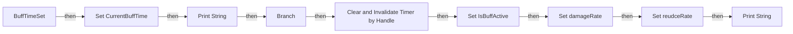
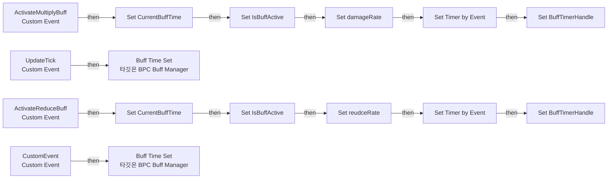

# BPC_Buff_Manager

에셋: `/Game/QuakeLike_1_0/Buff/BPC_Buff_Manager`

부모: `/Script/CoreUObject.Class'/Script/Engine.ActorComponent'`

수집일: 2026-10-12. MCP에서 읽은 그래프·핀 연결의 자동 전사입니다. 상속된 그래프는 부모 문서를 함께 확인합니다.

정적 루트 참조 도달: 없음. 실행 여부 또는 삭제 가능 여부의 확정이 아닙니다.

컴포넌트 목록은 이 BP가 직접 정의한 SCS만 포함합니다. 부모·네이티브 생성 컴포넌트, 인스턴스 설정은 별도입니다.

## 변수와 기본값

| 이름 | 타입 | CDO 기본값 |
|---|---|---|
| `damageRate` | `real` | 1.0 |
| `reudceRate` | `real` | 1.0 |
| `CurrentBuffTime` | `real` | 0.0 |
| `BuffDuration` | `real` | 0.0 |
| `DefaultBuffTime` | `real` | 20.0 |
| `BuffTimerHandle` | `TimerHandle` | &lt;Struct 'TimerHandle' {}&gt; |
| `IsBuffActive` | `bool` | False |

## 그래프 목록

| 그래프 | 전체 노드 수 |
|---|---|
| BuffTimeSet | 14 |
| EventGraph | 16 |

## 그래프별 실행 연결

실선은 출력 exec 핀의 실제 연결입니다. 여러 분기는 출력 핀 이름을 표시합니다. 함수 호출·delegate·타이머의 다음 그래프 실행은 이 그림에서 자동으로 이어 붙이지 않습니다.

순수 계산 노드 및 데이터 핀은 아래 목록과 원본 JSON을 확인합니다. 연결되지 않은 이벤트도 표시되므로, 노드가 있다는 이유만으로 실행된다고 판단하면 안 됩니다.

### BuffTimeSet

실행 핀 플로우차트

전체 노드·기본 입력 목록

| 노드 ID | 제목 | 미연결 기본 입력 / 에셋 입력 |
|---|---|---|
| `K2Node_FunctionEntry_0` | BuffTimeSet |  |
| `K2Node_VariableGet_6` | Get CurrentBuffTime |  |
| `K2Node_PromotableOperator_3` | float - float | B=1.000000 |
| `K2Node_VariableSet_12` | Set CurrentBuffTime |  |
| `K2Node_PromotableOperator_4` | float &lt;= float |  |
| `K2Node_IfThenElse_1` | Branch |  |
| `K2Node_VariableGet_7` | Get BuffTimerHandle |  |
| `K2Node_CallFunction_6` | Clear and Invalidate Timer by Handle |  |
| `K2Node_VariableSet_13` | Set IsBuffActive | IsBuffActive=false; Output_Get=false |
| `K2Node_VariableSet_14` | Set damageRate | damageRate=1.000000; Output_Get=0.0 |
| `K2Node_VariableSet_15` | Set reudceRate | reudceRate=1.000000; Output_Get=0.0 |
| `K2Node_CallFunction_0` | Print String | bPrintToScreen=true; bPrintToLog=true; TextColor=(R=0.000000,G=0.660000,B=1.000000,A=1.000000); Duration=2.000000; Key=None |
| `K2Node_CallFunction_10` | To String (Float) |  |
| `K2Node_CallFunction_1` | Print String | InString=버프 종료; bPrintToScreen=true; bPrintToLog=true; TextColor=(R=0.000000,G=0.660000,B=1.000000,A=1.000000); Duration=2.000000; Key=None |

### EventGraph

실행 핀 플로우차트

전체 노드·기본 입력 목록

| 노드 ID | 제목 | 미연결 기본 입력 / 에셋 입력 |
|---|---|---|
| `K2Node_CustomEvent_0` | ActivateMultiplyBuff Custom Event |  |
| `K2Node_VariableSet_0` | Set CurrentBuffTime | Output_Get=0.0 |
| `K2Node_VariableSet_1` | Set IsBuffActive | IsBuffActive=true; Output_Get=false |
| `K2Node_VariableSet_2` | Set damageRate | damageRate=1.500000; Output_Get=0.0 |
| `K2Node_CallFunction_1` | Set Timer by Event | Time=1.000000; bLooping=true; bMaxOncePerFrame=false; InitialStartDelay=0.000000; InitialStartDelayVariance=0.000000 |
| `K2Node_CustomEvent_2` | UpdateTick Custom Event |  |
| `K2Node_VariableSet_3` | Set BuffTimerHandle |  |
| `K2Node_CallFunction_2` | Buff Time Set 타깃은 BPC Buff Manager |  |
| `K2Node_CustomEvent_3` | ActivateReduceBuff Custom Event |  |
| `K2Node_VariableSet_8` | Set CurrentBuffTime | Output_Get=0.0 |
| `K2Node_VariableSet_9` | Set IsBuffActive | IsBuffActive=true; Output_Get=false |
| `K2Node_CallFunction_5` | Set Timer by Event | Time=1.000000; bLooping=true; bMaxOncePerFrame=false; InitialStartDelay=0.000000; InitialStartDelayVariance=0.000000 |
| `K2Node_CustomEvent_4` | CustomEvent Custom Event |  |
| `K2Node_VariableSet_11` | Set BuffTimerHandle |  |
| `K2Node_CallFunction_0` | Buff Time Set 타깃은 BPC Buff Manager |  |
| `K2Node_VariableSet_4` | Set reudceRate | reudceRate=0.500000; Output_Get=0.0 |

## 조회 범위의 한계

ObjectIterator로 발견했으나 MCP helper가 반환하지 않은 그래프입니다. delegate signature·컴파일된 중간 그래프·macro·애니메이션 내부 그래프가 섞일 수 있습니다.

- `ActivateMultiplyBuff`: Graph 'ActivateMultiplyBuff' not found in Blueprint.
- `ActivateReduceBuff`: Graph 'ActivateReduceBuff' not found in Blueprint.
- `BuffTimeSet_MERGED`: Graph 'BuffTimeSet_MERGED' not found in Blueprint.
- `CustomEvent`: Graph 'CustomEvent' not found in Blueprint.
- `ExecuteUbergraph_BPC_Buff_Manager`: Graph 'ExecuteUbergraph_BPC_Buff_Manager' not found in Blueprint.
- `MultiplyApplyDamage`: Graph 'MultiplyApplyDamage' not found in Blueprint.
- `MultiplyApplyDamage_MERGED`: Graph 'MultiplyApplyDamage_MERGED' not found in Blueprint.
- `ReduceTakenDamage`: Graph 'ReduceTakenDamage' not found in Blueprint.
- `ReduceTakenDamage_MERGED`: Graph 'ReduceTakenDamage_MERGED' not found in Blueprint.
- `UpdateTick`: Graph 'UpdateTick' not found in Blueprint.

[원본 MCP 스냅샷](../../../Evidence/blueprints-210.json)
