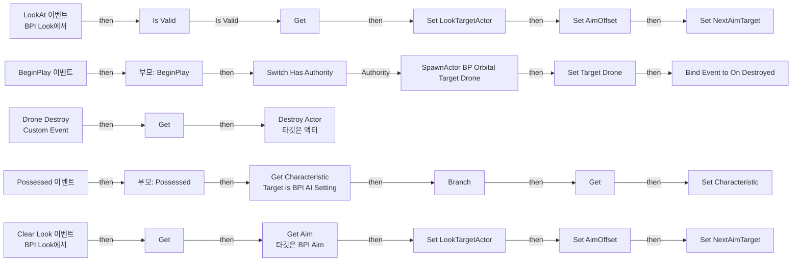
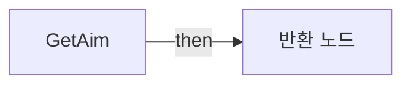
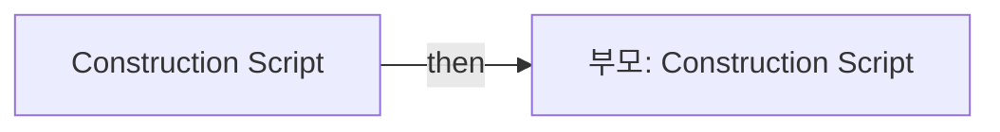

# BP_AIShooter

에셋: `/Game/QuakeLike_1_0/Character/BP_AIShooter`

부모: `/Script/Engine.BlueprintGeneratedClass'/Game/QuakeLike_1_0/Character/BP_ShooterBase.BP_ShooterBase_C'`

수집일: 2026-10-12. MCP에서 읽은 그래프·핀 연결의 자동 전사입니다. 상속된 그래프는 부모 문서를 함께 확인합니다.

정적 루트 참조 도달: 있음. 실행 여부 또는 삭제 가능 여부의 확정이 아닙니다.

컴포넌트 목록은 이 BP가 직접 정의한 SCS만 포함합니다. 부모·네이티브 생성 컴포넌트, 인스턴스 설정은 별도입니다.

## 변수와 기본값

| 이름 | 타입 | CDO 기본값 |
|---|---|---|
| `Target Drone` | `BP_OrbitalTargetDrone_C` | None |

## 그래프 목록

| 그래프 | 전체 노드 수 |
|---|---|
| EventGraph | 49 |
| GetAim | 5 |
| UserConstructionScript | 2 |

## 그래프별 실행 연결

실선은 출력 exec 핀의 실제 연결입니다. 여러 분기는 출력 핀 이름을 표시합니다. 함수 호출·delegate·타이머의 다음 그래프 실행은 이 그림에서 자동으로 이어 붙이지 않습니다.

순수 계산 노드 및 데이터 핀은 아래 목록과 원본 JSON을 확인합니다. 연결되지 않은 이벤트도 표시되므로, 노드가 있다는 이유만으로 실행된다고 판단하면 안 됩니다.

### EventGraph

실행 핀 플로우차트

전체 노드·기본 입력 목록

| 노드 ID | 제목 | 미연결 기본 입력 / 에셋 입력 |
|---|---|---|
| `K2Node_Event_0` | LookAt 이벤트 BPI Look에서 |  |
| `K2Node_Event_1` | BeginPlay 이벤트 |  |
| `K2Node_SpawnActorFromClass_0` | SpawnActor BP Orbital Target Drone | Class=/Game/QuakeLike_1_0/AI/BP/BP_OrbitalTargetDrone.BP_OrbitalTargetDrone_C; CollisionHandlingOverride=AlwaysSpawn; TransformScaleMethod=MultiplyWithRoot |
| `K2Node_VariableGet_0` | Get EyePosition |  |
| `K2Node_CallFunction_0` | Get World Transform 타깃은 씬 컴포넌트 |  |
| `K2Node_VariableSet_0` | Set Target Drone |  |
| `K2Node_VariableGet_4` | Get |  |
| `K2Node_CallParentFunction_0` | 부모: BeginPlay |  |
| `K2Node_MacroInstance_0` | Switch Has Authority |  |
| `K2Node_Self_4` | 셀프-레퍼런스 |  |
| `K2Node_AddDelegate_0` | Bind Event to On Destroyed |  |
| `K2Node_CustomEvent_0` | Drone Destroy Custom Event |  |
| `K2Node_VariableGet_5` | Get |  |
| `K2Node_CallFunction_7` | Destroy Actor 타깃은 액터 |  |
| `K2Node_Event_2` | Possessed 이벤트 |  |
| `K2Node_Message_0` | Get Characteristic Target is BPI AI Setting |  |
| `K2Node_IfThenElse_0` | Branch |  |
| `K2Node_VariableGet_2` | Get |  |
| `K2Node_VariableSet_5` | Set Characteristic |  |
| `K2Node_Knot_2` | 경유 노드 |  |
| `K2Node_Knot_3` | 경유 노드 |  |
| `K2Node_CallFunction_1` | Get Actor Rotation 타깃은 액터 |  |
| `K2Node_VariableSet_7` | Set NextAimTarget | Output_Get=0, 0, 0 |
| `K2Node_Event_3` | Clear Look 이벤트 BPI Look에서 |  |
| `K2Node_VariableGet_1` | Get |  |
| `K2Node_VariableSet_3` | Set NextAimTarget | Output_Get=0, 0, 0 |
| `K2Node_Knot_11` | 경유 노드 |  |
| `K2Node_Knot_12` | 경유 노드 |  |
| `K2Node_CallFunction_2` | Get Aim 타깃은 BPI Aim |  |
| `K2Node_PromotableOperator_1` | vector + vector | B_Z=0.0 |
| `K2Node_CallFunction_3` | Get Forward Vector |  |
| `K2Node_PromotableOperator_2` | vector * vector | B=500.000000; ReturnValue_Z=0.0 |
| `EdGraphNode_Comment_0` | 멍때리기 시 0, 0, 0 방지 |  |
| `K2Node_CallParentFunction_1` | 부모: Possessed |  |
| `K2Node_CallFunction_6` | Get Actor Location 타깃은 액터 |  |
| `K2Node_CallFunction_8` | vector + vector |  |
| `K2Node_Knot_0` | 경유 노드 |  |
| `K2Node_MacroInstance_1` | Is Valid |  |
| `K2Node_Knot_1` | 경유 노드 |  |
| `K2Node_Knot_4` | 경유 노드 |  |
| `K2Node_VariableSet_1` | Set LookTargetActor |  |
| `K2Node_VariableSet_2` | Set AimOffset | Output_Get=0, 0, 0 |
| `K2Node_VariableSet_4` | Set LookTargetActor |  |
| `K2Node_VariableSet_6` | Set AimOffset | AimOffset=0, 0, 0; Output_Get=0, 0, 0 |
| `K2Node_Knot_7` | 경유 노드 |  |
| `K2Node_Knot_10` | 경유 노드 |  |
| `K2Node_Knot_13` | 경유 노드 |  |
| `K2Node_Knot_14` | 경유 노드 |  |
| `K2Node_Knot_15` | 경유 노드 |  |

### GetAim

실행 핀 플로우차트

전체 노드·기본 입력 목록

| 노드 ID | 제목 | 미연결 기본 입력 / 에셋 입력 |
|---|---|---|
| `K2Node_FunctionEntry_0` | GetAim |  |
| `K2Node_FunctionResult_0` | 반환 노드 |  |
| `K2Node_VariableGet_0` | Get EyePosition |  |
| `K2Node_CallFunction_1` | Get World Location 타깃은 씬 컴포넌트 |  |
| `K2Node_CallFunction_0` | Get Base Aim Rotation 타깃은 폰 |  |

### UserConstructionScript

실행 핀 플로우차트

전체 노드·기본 입력 목록

| 노드 ID | 제목 | 미연결 기본 입력 / 에셋 입력 |
|---|---|---|
| `K2Node_FunctionEntry_0` | Construction Script |  |
| `K2Node_CallParentFunction_0` | 부모: Construction Script |  |

## 조회 범위의 한계

ObjectIterator로 발견했으나 MCP helper가 반환하지 않은 그래프입니다. delegate signature·컴파일된 중간 그래프·macro·애니메이션 내부 그래프가 섞일 수 있습니다.

- `Clear Look`: Graph 'Clear Look' not found in Blueprint.
- `Drone Destroy`: Graph 'Drone Destroy' not found in Blueprint.
- `GetTargetDrone`: Graph 'GetTargetDrone' not found in Blueprint.
- `LookAt`: Graph 'LookAt' not found in Blueprint.
- `ReceiveBeginPlay`: Graph 'ReceiveBeginPlay' not found in Blueprint.
- `ReceivePossessed`: Graph 'ReceivePossessed' not found in Blueprint.

[원본 MCP 스냅샷](../../../Evidence/blueprints-105.json)
