# BP_PlayerShooter

에셋: `/Game/QuakeLike_1_0/Character/BP_PlayerShooter`

부모: `/Script/Engine.BlueprintGeneratedClass'/Game/QuakeLike_1_0/Character/BP_ShooterBase.BP_ShooterBase_C'`

수집일: 2026-10-12. MCP에서 읽은 그래프·핀 연결의 자동 전사입니다. 상속된 그래프는 부모 문서를 함께 확인합니다.

정적 루트 참조 도달: 있음. 실행 여부 또는 삭제 가능 여부의 확정이 아닙니다.

컴포넌트 목록은 이 BP가 직접 정의한 SCS만 포함합니다. 부모·네이티브 생성 컴포넌트, 인스턴스 설정은 별도입니다.

## 직접 정의한 컴포넌트

| 이름 | 클래스 | 부모 컴포넌트 |
|---|---|---|
| `FP_Camera` | `CameraComponent` | `` |
| `FP_Mesh` | `SkeletalMeshComponent` | `FP_Camera` |
| `JumpPadFlight` | `JumpPadFlightComponent` | `` |
| `ProjectileFirstPersonRendering` | `ProjectileFirstPersonRenderingComponent` | `` |

## 변수와 기본값

| 이름 | 타입 | CDO 기본값 |
|---|---|---|
| `skillData` | `PDA_TeleportSkill_C` | /Game/QuakeLike_1_0/Data/DA_TeleportSkill.DA_TeleportSkill |
| `AimTargetLocation` | `Vector` | &lt;Struct 'Vector' {x: 0.000000, y: 0.000000, z: 0.000000}&gt; |
| `bIsMovementInputBlocked` | `bool` | False |
| `zoomAimSpeedMultiplier` | `real` | 1.0 |

## 그래프 목록

| 그래프 | 전체 노드 수 |
|---|---|
| Aim | 12 |
| ApplyZoom | 9 |
| Block Movement Input For Duration | 4 |
| ClearMovementInputBlock | 2 |
| EventGraph | 136 |
| GetAim | 5 |
| GetMeshes | 4 |
| Move | 11 |
| UpdateBrightness | 7 |
| UpdateCameraFOV | 10 |
| UpdateHeldItemGrip | 5 |
| UserConstructionScript | 2 |

## 그래프별 실행 연결

실선은 출력 exec 핀의 실제 연결입니다. 여러 분기는 출력 핀 이름을 표시합니다. 함수 호출·delegate·타이머의 다음 그래프 실행은 이 그림에서 자동으로 이어 붙이지 않습니다.

순수 계산 노드 및 데이터 핀은 아래 목록과 원본 JSON을 확인합니다. 연결되지 않은 이벤트도 표시되므로, 노드가 있다는 이유만으로 실행된다고 판단하면 안 됩니다.

### Aim

실행 핀 플로우차트

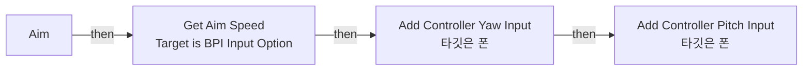

전체 노드·기본 입력 목록

| 노드 ID | 제목 | 미연결 기본 입력 / 에셋 입력 |
|---|---|---|
| `K2Node_FunctionEntry_0` | Aim |  |
| `K2Node_CallFunction_8428` | Add Controller Pitch Input 타깃은 폰 |  |
| `K2Node_CallFunction_8427` | Add Controller Yaw Input 타깃은 폰 |  |
| `K2Node_Knot_0` | 경유 노드 |  |
| `EdGraphNode_Comment_7` | Left/Right |  |
| `EdGraphNode_Comment_2` | Up/Down |  |
| `K2Node_CallFunction_3` | Get Controller 타깃은 폰 |  |
| `K2Node_Message_0` | Get Aim Speed Target is BPI Input Option |  |
| `K2Node_PromotableOperator_3` | float * float |  |
| `K2Node_PromotableOperator_2` | float * float |  |
| `K2Node_Knot_6` | 경유 노드 |  |
| `K2Node_Knot_10` | 경유 노드 |  |

### ApplyZoom

실행 핀 플로우차트

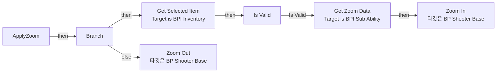

전체 노드·기본 입력 목록

| 노드 ID | 제목 | 미연결 기본 입력 / 에셋 입력 |
|---|---|---|
| `K2Node_FunctionEntry_0` | ApplyZoom |  |
| `K2Node_VariableGet_7` | Get BPC_Inventory |  |
| `K2Node_Message_12` | Get Selected Item Target is BPI Inventory |  |
| `K2Node_MacroInstance_2` | Is Valid |  |
| `K2Node_Knot_6` | 경유 노드 |  |
| `K2Node_Message_4` | Get Zoom Data Target is BPI Sub Ability |  |
| `K2Node_CallFunction_15` | Zoom In 타깃은 BP Shooter Base |  |
| `K2Node_CallFunction_0` | Zoom Out 타깃은 BP Shooter Base |  |
| `K2Node_IfThenElse_0` | Branch |  |

### Block Movement Input For Duration

실행 핀 플로우차트

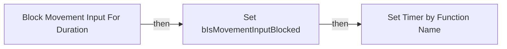

전체 노드·기본 입력 목록

| 노드 ID | 제목 | 미연결 기본 입력 / 에셋 입력 |
|---|---|---|
| `K2Node_FunctionEntry_0` | Block Movement Input For Duration |  |
| `K2Node_VariableSet_0` | Set bIsMovementInputBlocked | bIsMovementInputBlocked=true; Output_Get=false |
| `K2Node_CallFunction_0` | Set Timer by Function Name | FunctionName=ClearMovementInputBlock; bLooping=false; bMaxOncePerFrame=false; InitialStartDelay=0.000000; InitialStartDelayVariance=0.000000 |
| `K2Node_Knot_0` | 경유 노드 |  |

### ClearMovementInputBlock

실행 핀 플로우차트

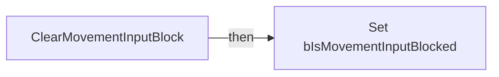

전체 노드·기본 입력 목록

| 노드 ID | 제목 | 미연결 기본 입력 / 에셋 입력 |
|---|---|---|
| `K2Node_FunctionEntry_0` | ClearMovementInputBlock |  |
| `K2Node_VariableSet_0` | Set bIsMovementInputBlocked | bIsMovementInputBlocked=false; Output_Get=false |

### EventGraph

실행 핀 플로우차트

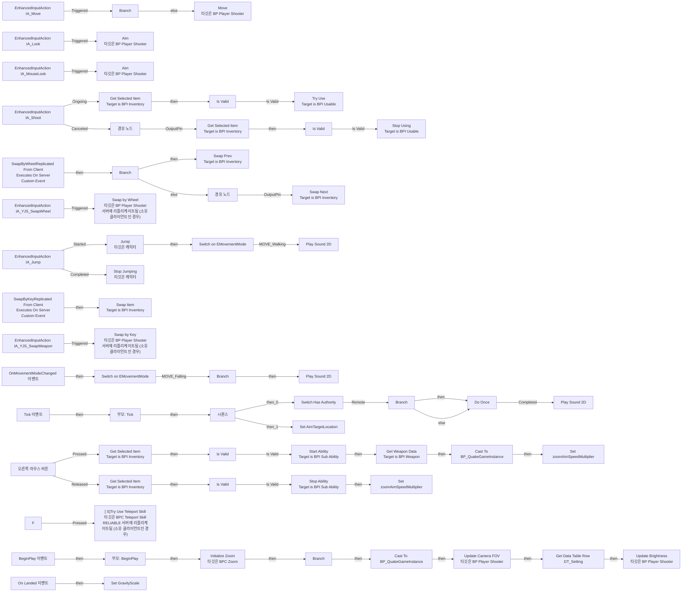

전체 노드·기본 입력 목록

| 노드 ID | 제목 | 미연결 기본 입력 / 에셋 입력 |
|---|---|---|
| `K2Node_CallFunction_1193` | Jump 타깃은 캐릭터 |  |
| `K2Node_CallFunction_9386` | Stop Jumping 타깃은 캐릭터 |  |
| `EdGraphNode_Comment_1` | Camera Input |  |
| `EdGraphNode_Comment_4` | Movement Input |  |
| `EdGraphNode_Comment_0` | Jump Input - Jump can be configured in the CharacterMovementComponent |  |
| `K2Node_EnhancedInputAction_3` | EnhancedInputAction IA_Move | InputAction=/Game/Input/Actions/IA_Move.IA_Move |
| `K2Node_EnhancedInputAction_5` | EnhancedInputAction IA_Jump | ActionValue=false; InputAction=/Game/Input/Actions/IA_Jump.IA_Jump |
| `K2Node_CallFunction_5` | Move 타깃은 BP Player Shooter |  |
| `K2Node_EnhancedInputAction_2` | EnhancedInputAction IA_Look | InputAction=/Game/Input/Actions/IA_Look.IA_Look |
| `K2Node_CallFunction_8` | Aim 타깃은 BP Player Shooter |  |
| `K2Node_EnhancedInputAction_1` | EnhancedInputAction IA_MouseLook | InputAction=/Game/Input/Actions/IA_MouseLook.IA_MouseLook |
| `K2Node_CallFunction_7` | Aim 타깃은 BP Player Shooter |  |
| `K2Node_EnhancedInputAction_6` | EnhancedInputAction IA_YJS_SwapWheel | InputAction=/Game/QuakeLike_Base/YJS/Input/IA_YJS_SwapWheel.IA_YJS_SwapWheel |
| `K2Node_CallFunction_29` | Sign (Float) |  |
| `K2Node_PromotableOperator_1` | float &gt; float |  |
| `EdGraphNode_Comment_3` | ItemSwap Input |  |
| `K2Node_EnhancedInputAction_4` | EnhancedInputAction IA_Shoot | ActionValue=false; InputAction=/Game/Variant_Shooter/Input/Actions/IA_Shoot.IA_Shoot |
| `K2Node_VariableGet_2` | Get BPC_Inventory |  |
| `K2Node_Message_5` | Get Selected Item Target is BPI Inventory |  |
| `K2Node_VariableGet_1` | Get BPC_Inventory |  |
| `K2Node_Message_3` | Get Selected Item Target is BPI Inventory |  |
| `K2Node_Knot_1` | 경유 노드 |  |
| `K2Node_EnhancedInputAction_0` | EnhancedInputAction IA_YJS_SwapWeapon | InputAction=/Game/QuakeLike_Base/YJS/Input/IA_YJS_SwapWeapon.IA_YJS_SwapWeapon |
| `K2Node_CallFunction_9` | Truncate |  |
| `EdGraphNode_Comment_5` | Shoot Input |  |
| `K2Node_CustomEvent_0` | SwapByWheelReplicated From Client Executes On Server Custom Event |  |
| `K2Node_IfThenElse_0` | Branch |  |
| `K2Node_VariableGet_10` | Get BPC_Inventory |  |
| `K2Node_VariableGet_9` | Get BPC_Inventory |  |
| `K2Node_Knot_4` | 경유 노드 |  |
| `K2Node_Message_1` | Swap Next Target is BPI Inventory |  |
| `K2Node_Message_2` | Swap Prev Target is BPI Inventory |  |
| `K2Node_CallFunction_4` | Swap by Wheel 타깃은 BP Player Shooter 서버에 리플리케이트됨 (소유 클라이언트인 경우) |  |
| `K2Node_CustomEvent_1` | SwapByKeyReplicated From Client Executes On Server Custom Event |  |
| `K2Node_VariableGet_3` | Get BPC_Inventory |  |
| `K2Node_Message_7` | Swap Item Target is BPI Inventory |  |
| `K2Node_CallFunction_6` | Swap by Key 타깃은 BP Player Shooter 서버에 리플리케이트됨 (소유 클라이언트인 경우) |  |
| `K2Node_Knot_14` | 경유 노드 |  |
| `K2Node_Message_0` | Stop Using Target is BPI Usable |  |
| `K2Node_Message_8` | Try Use Target is BPI Usable |  |
| `K2Node_Event_0` | BeginPlay 이벤트 |  |
| `K2Node_CallParentFunction_0` | 부모: BeginPlay |  |
| `K2Node_VariableGet_4` | Get FP_Camera |  |
| `K2Node_InputKey_0` | 오른쪽 마우스 버튼 |  |
| `K2Node_Knot_0` | 경유 노드 |  |
| `K2Node_MacroInstance_1` | Is Valid |  |
| `K2Node_MacroInstance_0` | Is Valid |  |
| `K2Node_Knot_2` | 경유 노드 |  |
| `K2Node_VariableGet_5` | Get BPC_Zoom |  |
| `K2Node_CallFunction_13` | Initialize Zoom 타깃은 BPC Zoom |  |
| `K2Node_VariableGet_0` | Get BPC_Inventory |  |
| `K2Node_Message_9` | Get Selected Item Target is BPI Inventory |  |
| `K2Node_MacroInstance_4` | Is Valid |  |
| `K2Node_Knot_9` | 경유 노드 |  |
| `K2Node_Message_10` | Start Ability Target is BPI Sub Ability |  |
| `K2Node_Knot_10` | 경유 노드 |  |
| `K2Node_Knot_11` | 경유 노드 |  |
| `K2Node_Knot_13` | 경유 노드 |  |
| `K2Node_VariableGet_7` | Get BPC_Inventory |  |
| `K2Node_Message_12` | Get Selected Item Target is BPI Inventory |  |
| `K2Node_MacroInstance_2` | Is Valid |  |
| `K2Node_Knot_6` | 경유 노드 |  |
| `K2Node_Knot_3` | 경유 노드 |  |
| `K2Node_Knot_7` | 경유 노드 |  |
| `K2Node_Knot_8` | 경유 노드 |  |
| `K2Node_Message_11` | Stop Ability Target is BPI Sub Ability |  |
| `K2Node_InputKey_1` | F |  |
| `K2Node_VariableGet_11` | Get BPC_TeleportSkill |  |
| `K2Node_CallFunction_3` | [ S]Try Use Teleport Skill 타깃은 BPC Teleport Skill RELIABLE 서버에 리플리케이트됨 (소유 클라이언트인 경우) |  |
| `K2Node_Event_5` | OnMovementModeChanged 이벤트 | PrevCustomMode=0; NewCustomMode=0 |
| `K2Node_SwitchEnum_0` | Switch on EMovementMode |  |
| `K2Node_IfThenElse_6` | Branch |  |
| `K2Node_Knot_17` | 경유 노드 |  |
| `K2Node_EnumEquality_4` | Equal (Enum) | B=MOVE_Walking |
| `K2Node_VariableGet_29` | Get MovementOption |  |
| `K2Node_VariableGet_31` | Get MovementOption |  |
| `K2Node_Self_4` | 셀프-레퍼런스 |  |
| `K2Node_VariableGet_38` | Get LandSound |  |
| `K2Node_VariableGet_39` | Get LandPitch |  |
| `K2Node_VariableGet_41` | Get LandVolume |  |
| `K2Node_CallFunction_19` | Play Sound 2D | StartTime=0.000000; bIsUISound=false |
| `K2Node_Self_1` | 셀프-레퍼런스 |  |
| `K2Node_VariableGet_33` | Get MovementOption |  |
| `K2Node_VariableGet_24` | Get MovementOption |  |
| `K2Node_VariableGet_30` | Get OnMaxSpeedVolume |  |
| `K2Node_VariableGet_40` | Get OnMaxSpeedPitch |  |
| `K2Node_VariableGet_43` | Get OnMaxSpeedSound |  |
| `K2Node_IfThenElse_7` | Branch |  |
| `K2Node_MacroInstance_3` | Do Once |  |
| `K2Node_VariableGet_63` | Get movingTime |  |
| `K2Node_PromotableOperator_2` | float &gt;= float | B=1.000000 |
| `K2Node_CallFunction_21` | Play Sound 2D | StartTime=0.000000; bIsUISound=false |
| `K2Node_Event_2` | Tick 이벤트 |  |
| `K2Node_CallParentFunction_2` | 부모: Tick |  |
| `K2Node_SwitchEnum_2` | Switch on EMovementMode |  |
| `K2Node_VariableGet_47` | Get MovementOption |  |
| `K2Node_VariableGet_48` | Get JumpSound |  |
| `K2Node_VariableGet_49` | Get MovementOption |  |
| `K2Node_VariableGet_50` | Get JumpVolume |  |
| `K2Node_Self_9` | 셀프-레퍼런스 |  |
| `K2Node_VariableGet_51` | Get JumpPitch |  |
| `K2Node_CallFunction_27` | Play Sound 2D | StartTime=0.000000; bIsUISound=false |
| `K2Node_VariableGet_42` | Get CharacterMovement |  |
| `K2Node_VariableGet_44` | Get MovementMode |  |
| `K2Node_Knot_15` | 경유 노드 |  |
| `K2Node_MacroInstance_8` | Switch Has Authority |  |
| `K2Node_CallFunction_10` | Get World Location 타깃은 씬 컴포넌트 |  |
| `K2Node_CallFunction_12` | Get Forward Vector 타깃은 씬 컴포넌트 |  |
| `K2Node_PromotableOperator_3` | vector * vector | B=100000.000000 |
| `K2Node_PromotableOperator_4` | vector + vector |  |
| `K2Node_VariableSet_1` | Set AimTargetLocation | Output_Get=0, 0, 0 |
| `K2Node_ExecutionSequence_0` | 시퀀스 |  |
| `K2Node_VariableGet_8` | Get FP_Camera |  |
| `K2Node_IfThenElse_1` | Branch |  |
| `K2Node_VariableGet_6` | Get bIsMovementInputBlocked |  |
| `K2Node_Event_1` | On Landed 이벤트 |  |
| `K2Node_VariableSet_0` | Set GravityScale | GravityScale=1.300000; Output_Get=0.0 |
| `K2Node_Self_0` | 셀프-레퍼런스 |  |
| `K2Node_VariableGet_12` | Get CharacterMovement |  |
| `K2Node_VariableSet_3` | Set zoomAimSpeedMultiplier | zoomAimSpeedMultiplier=1.000000; Output_Get=0.0 |
| `K2Node_Message_14` | Get Weapon Data Target is BPI Weapon |  |
| `K2Node_PromotableOperator_5` | float * float |  |
| `K2Node_PromotableOperator_0` | float * float |  |
| `K2Node_VariableGet_13` | Get zoomAimSpeedMultiplier |  |
| `K2Node_VariableSet_8` | Set zoomAimSpeedMultiplier | Output_Get=0.0 |
| `K2Node_CallFunction_11` | Is Locally Controlled 타깃은 폰 |  |
| `K2Node_IfThenElse_2` | Branch |  |
| `K2Node_CallFunction_14` | Get Game Instance |  |
| `K2Node_DynamicCast_0` | Cast To BP_QuakeGameInstance |  |
| `K2Node_VariableGet_14` | Get |  |
| `K2Node_CallFunction_15` | Update Camera FOV 타깃은 BP Player Shooter |  |
| `K2Node_GetDataTableRow_0` | Get Data Table Row DT_Setting | DataTable=/Game/QuakeLike_1_0/GameProgressFlow/DT_Setting.DT_Setting; RowName=Brightness |
| `K2Node_CallFunction_16` | Update Brightness 타깃은 BP Player Shooter |  |
| `K2Node_CallFunction_17` | Get Game Instance |  |
| `K2Node_DynamicCast_1` | Cast To BP_QuakeGameInstance |  |
| `K2Node_VariableGet_15` | Get |  |

### GetAim

실행 핀 플로우차트

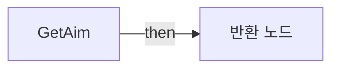

전체 노드·기본 입력 목록

| 노드 ID | 제목 | 미연결 기본 입력 / 에셋 입력 |
|---|---|---|
| `K2Node_FunctionEntry_0` | GetAim |  |
| `K2Node_FunctionResult_0` | 반환 노드 |  |
| `K2Node_VariableGet_1` | Get FP_Camera |  |
| `K2Node_CallFunction_2` | Get World Location 타깃은 씬 컴포넌트 |  |
| `K2Node_CallFunction_0` | Get Base Aim Rotation 타깃은 폰 |  |

### GetMeshes

실행 핀 플로우차트

전체 노드·기본 입력 목록

| 노드 ID | 제목 | 미연결 기본 입력 / 에셋 입력 |
|---|---|---|
| `K2Node_FunctionEntry_0` | GetMeshes |  |
| `K2Node_FunctionResult_0` | 반환 노드 |  |
| `K2Node_VariableGet_1` | Get FP_Mesh |  |
| `K2Node_VariableGet_2` | Get Mesh |  |

### Move

실행 핀 플로우차트

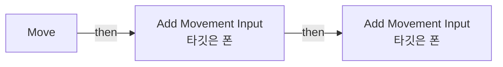

전체 노드·기본 입력 목록

| 노드 ID | 제목 | 미연결 기본 입력 / 에셋 입력 |
|---|---|---|
| `K2Node_FunctionEntry_0` | Move |  |
| `K2Node_CallFunction_7346` | Add Movement Input 타깃은 폰 | bForce=false |
| `K2Node_CallFunction_7445` | Add Movement Input 타깃은 폰 | bForce=false |
| `K2Node_Knot_1` | 경유 노드 |  |
| `K2Node_Knot_2` | 경유 노드 |  |
| `K2Node_Knot_3` | 경유 노드 |  |
| `K2Node_Knot_4` | 경유 노드 |  |
| `EdGraphNode_Comment_5` | Left/Right |  |
| `EdGraphNode_Comment_6` | Forward / Backward |  |
| `K2Node_CallFunction_8029` | Get Actor Forward Vector 타깃은 액터 |  |
| `K2Node_CallFunction_8520` | Get Actor Right Vector 타깃은 액터 |  |

### UpdateBrightness

실행 핀 플로우차트

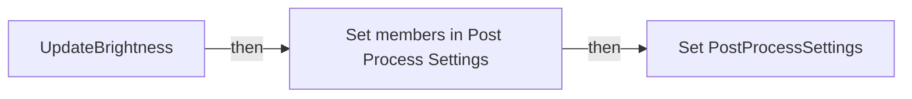

전체 노드·기본 입력 목록

| 노드 ID | 제목 | 미연결 기본 입력 / 에셋 입력 |
|---|---|---|
| `K2Node_FunctionEntry_0` | UpdateBrightness |  |
| `K2Node_VariableGet_0` | Get FP_Camera |  |
| `K2Node_CallFunction_0` | Map Range Clamped | OutRangeA=-2.000000; OutRangeB=2.000000 |
| `K2Node_VariableSet_0` | Set PostProcessSettings |  |
| `K2Node_VariableGet_1` | Get PostProcessSettings |  |
| `K2Node_SetFieldsInStruct_0` | Set members in Post Process Settings |  |
| `K2Node_Knot_0` | 경유 노드 |  |

### UpdateCameraFOV

실행 핀 플로우차트

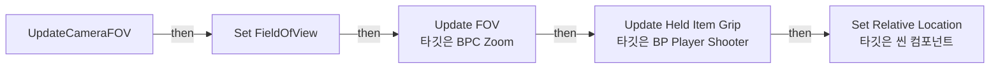

전체 노드·기본 입력 목록

| 노드 ID | 제목 | 미연결 기본 입력 / 에셋 입력 |
|---|---|---|
| `K2Node_FunctionEntry_0` | UpdateCameraFOV |  |
| `K2Node_VariableGet_0` | Get FP_Camera |  |
| `K2Node_VariableSet_0` | Set FieldOfView | Output_Get=0.0 |
| `K2Node_CallFunction_0` | Update Held Item Grip 타깃은 BP Player Shooter |  |
| `K2Node_VariableGet_1` | Get BPC_Zoom |  |
| `K2Node_CallFunction_1` | Update FOV 타깃은 BPC Zoom |  |
| `K2Node_PromotableOperator_0` | float - float | A=90.000000 |
| `K2Node_PromotableOperator_1` | float + float | B=-25.000000 |
| `K2Node_VariableGet_2` | Get FP_Mesh |  |
| `K2Node_CallFunction_2` | Set Relative Location 타깃은 씬 컴포넌트 | NewLocation_Y=0.0; NewLocation_Z=-215.000000; bSweep=false; bTeleport=false |

### UpdateHeldItemGrip

실행 핀 플로우차트

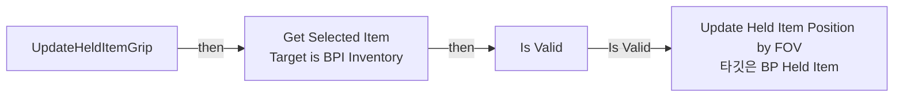

전체 노드·기본 입력 목록

| 노드 ID | 제목 | 미연결 기본 입력 / 에셋 입력 |
|---|---|---|
| `K2Node_FunctionEntry_0` | UpdateHeldItemGrip |  |
| `K2Node_VariableGet_0` | Get BPC_Inventory |  |
| `K2Node_Message_0` | Get Selected Item Target is BPI Inventory |  |
| `K2Node_MacroInstance_0` | Is Valid |  |
| `K2Node_CallFunction_0` | Update Held Item Position by FOV 타깃은 BP Held Item |  |

### UserConstructionScript

실행 핀 플로우차트

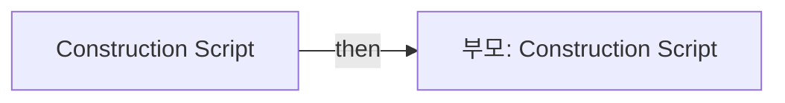

전체 노드·기본 입력 목록

| 노드 ID | 제목 | 미연결 기본 입력 / 에셋 입력 |
|---|---|---|
| `K2Node_FunctionEntry_0` | Construction Script |  |
| `K2Node_CallParentFunction_0` | 부모: Construction Script |  |

## 조회 범위의 한계

ObjectIterator로 발견했으나 MCP helper가 반환하지 않은 그래프입니다. delegate signature·컴파일된 중간 그래프·macro·애니메이션 내부 그래프가 섞일 수 있습니다.

- `GetCurrentFOV`: Graph 'GetCurrentFOV' not found in Blueprint.
- `InpActEvt_F_K2Node_InputKeyEvent_0`: Graph 'InpActEvt_F_K2Node_InputKeyEvent_0' not found in Blueprint.
- `InpActEvt_IA_Jump_K2Node_EnhancedInputActionEvent_6`: Graph 'InpActEvt_IA_Jump_K2Node_EnhancedInputActionEvent_6' not found in Blueprint.
- `InpActEvt_IA_Jump_K2Node_EnhancedInputActionEvent_7`: Graph 'InpActEvt_IA_Jump_K2Node_EnhancedInputActionEvent_7' not found in Blueprint.
- `InpActEvt_IA_Look_K2Node_EnhancedInputActionEvent_5`: Graph 'InpActEvt_IA_Look_K2Node_EnhancedInputActionEvent_5' not found in Blueprint.
- `InpActEvt_IA_MouseLook_K2Node_EnhancedInputActionEvent_4`: Graph 'InpActEvt_IA_MouseLook_K2Node_EnhancedInputActionEvent_4' not found in Blueprint.
- `InpActEvt_IA_Move_K2Node_EnhancedInputActionEvent_8`: Graph 'InpActEvt_IA_Move_K2Node_EnhancedInputActionEvent_8' not found in Blueprint.
- `InpActEvt_IA_Shoot_K2Node_EnhancedInputActionEvent_1`: Graph 'InpActEvt_IA_Shoot_K2Node_EnhancedInputActionEvent_1' not found in Blueprint.
- `InpActEvt_IA_Shoot_K2Node_EnhancedInputActionEvent_2`: Graph 'InpActEvt_IA_Shoot_K2Node_EnhancedInputActionEvent_2' not found in Blueprint.
- `InpActEvt_IA_YJS_SwapWeapon_K2Node_EnhancedInputActionEvent_0`: Graph 'InpActEvt_IA_YJS_SwapWeapon_K2Node_EnhancedInputActionEvent_0' not found in Blueprint.
- `InpActEvt_IA_YJS_SwapWheel_K2Node_EnhancedInputActionEvent_3`: Graph 'InpActEvt_IA_YJS_SwapWheel_K2Node_EnhancedInputActionEvent_3' not found in Blueprint.
- `InpActEvt_RightMouseButton_K2Node_InputKeyEvent_1`: Graph 'InpActEvt_RightMouseButton_K2Node_InputKeyEvent_1' not found in Blueprint.
- `InpActEvt_RightMouseButton_K2Node_InputKeyEvent_2`: Graph 'InpActEvt_RightMouseButton_K2Node_InputKeyEvent_2' not found in Blueprint.
- `K2_OnMovementModeChanged`: Graph 'K2_OnMovementModeChanged' not found in Blueprint.
- `OnLanded`: Graph 'OnLanded' not found in Blueprint.
- `ReceiveBeginPlay`: Graph 'ReceiveBeginPlay' not found in Blueprint.
- `ReceiveTick`: Graph 'ReceiveTick' not found in Blueprint.
- `SwapByKey`: Graph 'SwapByKey' not found in Blueprint.
- `SwapByWheel`: Graph 'SwapByWheel' not found in Blueprint.

[원본 MCP 스냅샷](../../../Evidence/blueprints-070.json)
