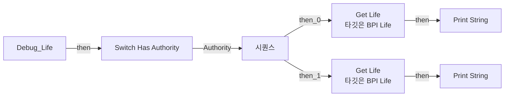
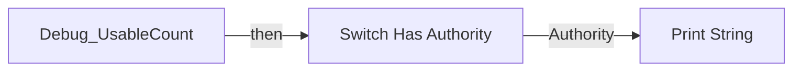
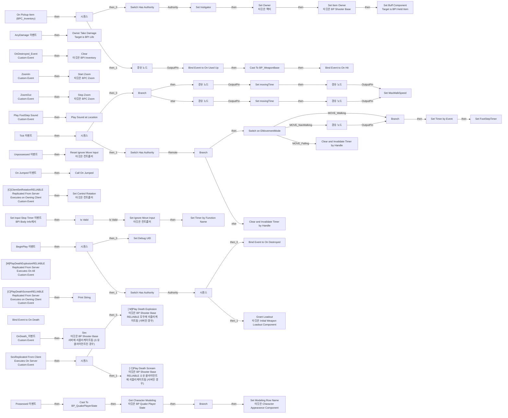
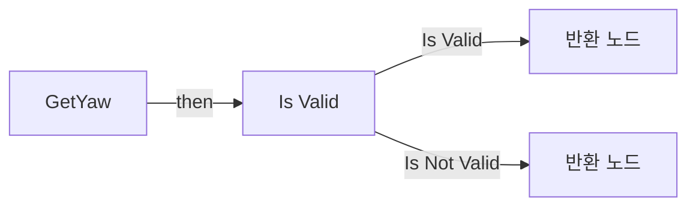
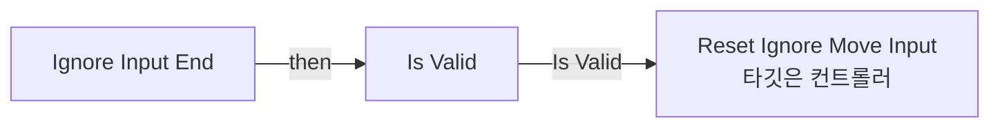
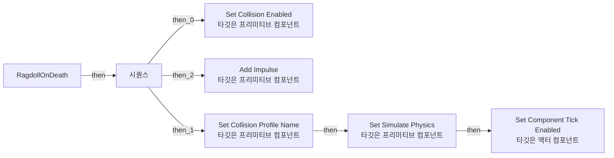
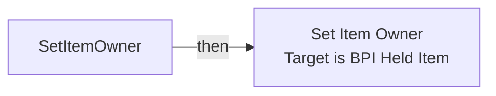
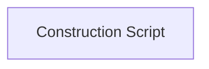

# BP_ShooterBase

에셋: `/Game/QuakeLike_1_0/Character/BP_ShooterBase`

부모: `/Script/CoreUObject.Class'/Script/Engine.Character'`

수집일: 2026-10-12. MCP에서 읽은 그래프·핀 연결의 자동 전사입니다. 상속된 그래프는 부모 문서를 함께 확인합니다.

정적 루트 참조 도달: 있음. 실행 여부 또는 삭제 가능 여부의 확정이 아닙니다.

컴포넌트 목록은 이 BP가 직접 정의한 SCS만 포함합니다. 부모·네이티브 생성 컴포넌트, 인스턴스 설정은 별도입니다.

## 직접 정의한 컴포넌트

| 이름 | 클래스 | 부모 컴포넌트 |
|---|---|---|
| `EyePosition` | `ChildActorComponent` | `` |
| `HeartPosition` | `ChildActorComponent` | `EyePosition` |
| `BPC_Life` | `BPC_Life_C` | `` |
| `BPC_Inventory` | `BPC_Inventory_C` | `` |
| `Right` | `ChildActorComponent` | `EyePosition` |
| `Left` | `ChildActorComponent` | `EyePosition` |
| `Top` | `ChildActorComponent` | `EyePosition` |
| `Bottom` | `ChildActorComponent` | `EyePosition` |
| `Forward` | `ChildActorComponent` | `EyePosition` |
| `Back` | `ChildActorComponent` | `EyePosition` |
| `BPC_HeldItemSpawner` | `BPC_HeldItemSpawner_C` | `` |
| `BPC_Zoom` | `BPC_Zoom_C` | `` |
| `BPC_Buff` | `BPC_Buff_C` | `` |
| `BPC_TeleportSkill` | `BPC_TeleportSkill_C` | `` |
| `BPC_ProjectileFire` | `BPC_ProjectileFire_C` | `` |
| `Death Meshes` | `ChildActorComponent` | `EyePosition` |
| `SKM_Leg_L1` | `SkeletalMeshComponent` | `Death Meshes` |
| `SKM_Body1` | `SkeletalMeshComponent` | `Death Meshes` |
| `SKM_Head1` | `SkeletalMeshComponent` | `Death Meshes` |
| `SkeletalMesh` | `SkeletalMeshComponent` | `Death Meshes` |
| `SKM_Leg_R1` | `SkeletalMeshComponent` | `Death Meshes` |
| `SKM_Hand_R1` | `SkeletalMeshComponent` | `Death Meshes` |
| `SKM_Hand_L1` | `SkeletalMeshComponent` | `Death Meshes` |
| `Head_IN` | `StaticMeshComponent` | `SKM_Leg_R1` |
| `Niagara` | `NiagaraComponent` | `SKM_Leg_R1` |
| `Niagara4` | `NiagaraComponent` | `SKM_Leg_L1` |
| `Head_IN1` | `StaticMeshComponent` | `SKM_Leg_L1` |
| `Head_IN2` | `StaticMeshComponent` | `SKM_Head1` |
| `Niagara1` | `NiagaraComponent` | `SKM_Head1` |
| `Niagara10` | `NiagaraComponent` | `SkeletalMesh` |
| `Head_IN5` | `StaticMeshComponent` | `SKM_Body1` |
| `Niagara5` | `NiagaraComponent` | `SKM_Body1` |
| `Niagara6` | `NiagaraComponent` | `SKM_Body1` |
| `Niagara7` | `NiagaraComponent` | `SKM_Body1` |
| `Niagara8` | `NiagaraComponent` | `SKM_Body1` |
| `Niagara9` | `NiagaraComponent` | `SKM_Body1` |
| `Head_IN4` | `StaticMeshComponent` | `SKM_Hand_R1` |
| `Niagara3` | `NiagaraComponent` | `SKM_Hand_R1` |
| `Head_IN3` | `StaticMeshComponent` | `SKM_Hand_L1` |
| `Niagara2` | `NiagaraComponent` | `SKM_Hand_L1` |
| `CharacterAppearance` | `CharacterAppearanceComponent` | `` |
| `RecentAttacker` | `RecentAttackerComponent` | `` |
| `InitialWeaponLoadout` | `InitialWeaponLoadoutComponent` | `` |
| `PointLight` | `PointLightComponent` | `` |
| `PointLight1` | `PointLightComponent` | `` |
| `PointLight2` | `PointLightComponent` | `` |
| `PointLight3` | `PointLightComponent` | `` |
| `PointLight4` | `PointLightComponent` | `` |

## 변수와 기본값

| 이름 | 타입 | CDO 기본값 |
|---|---|---|
| `movingTime` | `real` | 0.0 |
| `timeRate` | `real` | 0.5 |
| `MovementOption` | `PDA_MovementOption_C` | /Game/QuakeLike_1_0/Data/Chracter/DA_MovementOption.DA_MovementOption |
| `FootStepTimer` | `TimerHandle` | &lt;Struct 'TimerHandle' {}&gt; |
| `On Jumped` | `mcdelegate` | &lt;Delegate 'DelegateBase' &lt;Unbound&gt;&gt; |
| `ExplosionSound` | `SoundBase` | /Game/QuakeLike_Base/SDM/SoundPack_SDM/Select/Death/Dead_Sound.Dead_Sound |
| `ExplosionVolume ` | `real` | 1.0 |
| `DeathScreamSound` | `SoundBase` | /Game/QuakeLike_Base/SDM/SoundPack_SDM/Select/Death/Death_Que.Death_Que |
| `DeathScreamVolume ` | `real` | 1.0 |
| `Debug UID` | `Guid` | &lt;Struct 'Guid' {}&gt; |

## 그래프 목록

| 그래프 | 전체 노드 수 |
|---|---|
| Callbacks | 95 |
| Debug_Life | 23 |
| Debug_UsableCount | 8 |
| EventGraph | 142 |
| GetYaw | 10 |
| Ignore Input End | 6 |
| RagdollOnDeath | 14 |
| SetItemOwner | 3 |
| UserConstructionScript | 1 |

## 그래프별 실행 연결

실선은 출력 exec 핀의 실제 연결입니다. 여러 분기는 출력 핀 이름을 표시합니다. 함수 호출·delegate·타이머의 다음 그래프 실행은 이 그림에서 자동으로 이어 붙이지 않습니다.

순수 계산 노드 및 데이터 핀은 아래 목록과 원본 JSON을 확인합니다. 연결되지 않은 이벤트도 표시되므로, 노드가 있다는 이유만으로 실행된다고 판단하면 안 됩니다.

### Callbacks

```mermaid
flowchart LR
  n0["UsedUp<br/>Custom Event"]
  n1["Swap Next<br/>Target is BPI Inventory"]
  n2["Apply Damage"]
  n3["UsingItem 이벤트<br/>BPI Item Holder에서"]
  n4["Get Selected Item<br/>Target is BPI Inventory"]
  n5["Branch"]
  n6["경유 노드"]
  n7["WeaponHit<br/>Custom Event"]
  n8["For Each Loop"]
  n9["Try Use<br/>Target is BPI Usable"]
  n10["Stop Using<br/>Target is BPI Usable"]
  n11["Set Movement Mode<br/>타깃은 캐릭터 무브먼트 컴포넌트"]
  n12["Set Collision Enabled<br/>타깃은 프리미티브 컴포넌트"]
  n13["Switch Has Authority"]
  n14["Is Valid"]
  n15["Stop Ability<br/>Target is BPI Sub Ability"]
  n16["On Swap Item (BPC_Inventory)"]
  n17["On Death (BPC_Life)"]
  n18["시퀀스"]
  n19["Clear<br/>타깃은 BPI Inventory"]
  n20["Switch Has Authority"]
  n21["Delay"]
  n22["시퀀스"]
  n23["Set Visibility<br/>타깃은 씬 컴포넌트"]
  n24["Set Visibility<br/>타깃은 씬 컴포넌트"]
  n25["For Each Loop"]
  n26["Set Simulate Physics<br/>타깃은 프리미티브 컴포넌트"]
  n27["Set Collision Profile Name<br/>타깃은 프리미티브 컴포넌트"]
  n28["Add Impulse<br/>타깃은 프리미티브 컴포넌트"]
  n29["Cast To PrimitiveComponent"]
  n30["Cast To NiagaraComponent"]
  n31["Reinitialize System<br/>타깃은 나이아가라 파티클 시스템 컴포넌트"]
  n32["경유 노드"]
  n33["경유 노드"]
  n34["Switch Has Authority"]
  n35["Spawn Sound at Location"]
  n36["시퀀스"]
  n37["Play Sound 2D"]
  n38["경유 노드"]
  n39["Branch"]
  n40["Apply Death Appearance<br/>타깃은 Character Appearance Component"]
  n41["경유 노드"]
  n42["경유 노드"]
  n43["Resolve Death Credit<br/>타깃은 Recent Attacker Component"]
  n44["Play on Kill<br/>Target is BPI Quake Player State"]
  n45["Play on Death<br/>Target is BPI Quake Player State"]
  n46["Switch Has Authority"]
  n47["Switch on EKillDeathCause"]
  n48["Play on Kill<br/>Target is BPI Quake Player State"]
  n49["Play on Death<br/>Target is BPI Quake Player State"]
  n0 -->|"then"| n13
  n3 -->|"then"| n4
  n4 -->|"then"| n14
  n5 -->|"then"| n9
  n5 -->|"else"| n6
  n6 -->|"OutputPin"| n10
  n7 -->|"then"| n8
  n8 -->|"LoopBody"| n2
  n11 -->|"then"| n22
  n13 -->|"Authority"| n1
  n14 -->|"Is Valid"| n5
  n16 -->|"then"| n15
  n17 -->|"then"| n18
  n18 -->|"then_0"| n33
  n18 -->|"then_2"| n20
  n18 -->|"then_3"| n32
  n20 -->|"Authority"| n19
  n21 -->|"then"| n12
  n22 -->|"then_0"| n23
  n22 -->|"then_1"| n41
  n22 -->|"then_2"| n42
  n24 -->|"then"| n25
  n25 -->|"LoopBody"| n30
  n26 -->|"then"| n27
  n27 -->|"then"| n28
  n29 -->|"then"| n26
  n30 -->|"then"| n31
  n30 -->|"CastFailed"| n29
  n32 -->|"OutputPin"| n11
  n33 -->|"OutputPin"| n36
  n34 -->|"Remote"| n35
  n36 -->|"then_0"| n34
  n36 -->|"then_1"| n38
  n36 -->|"then_2"| n46
  n38 -->|"OutputPin"| n39
  n39 -->|"then"| n37
  n40 -->|"then"| n24
  n41 -->|"OutputPin"| n40
  n42 -->|"OutputPin"| n21
  n43 -->|"then"| n47
  n44 -->|"then"| n45
  n46 -->|"Authority"| n43
  n47 -->|"Player"| n44
  n47 -->|"Suicide"| n48
  n47 -->|"Environment"| n48
  n48 -->|"then"| n49
```

실행 핀 플로우차트

전체 노드·기본 입력 목록

| 노드 ID | 제목 | 미연결 기본 입력 / 에셋 입력 |
|---|---|---|
| `K2Node_CustomEvent_6` | UsedUp Custom Event |  |
| `K2Node_VariableGet_12` | Get BPC_Inventory |  |
| `K2Node_Message_6` | Swap Next Target is BPI Inventory |  |
| `K2Node_CallFunction_9` | Apply Damage | ReturnValue=0.0 |
| `K2Node_Self_5` | 셀프-레퍼런스 |  |
| `K2Node_CallFunction_10` | Get Controller 타깃은 폰 |  |
| `K2Node_Event_3` | UsingItem 이벤트 BPI Item Holder에서 |  |
| `K2Node_VariableGet_2` | Get BPC_Inventory |  |
| `K2Node_Message_1` | Get Selected Item Target is BPI Inventory |  |
| `K2Node_Knot_15` | 경유 노드 |  |
| `K2Node_IfThenElse_0` | Branch |  |
| `K2Node_Knot_4` | 경유 노드 |  |
| `K2Node_Knot_6` | 경유 노드 |  |
| `K2Node_Knot_7` | 경유 노드 |  |
| `K2Node_Knot_8` | 경유 노드 |  |
| `K2Node_Knot_12` | 경유 노드 |  |
| `K2Node_CustomEvent_2` | WeaponHit Custom Event |  |
| `K2Node_MacroInstance_5` | For Each Loop |  |
| `K2Node_Message_5` | Try Use Target is BPI Usable |  |
| `K2Node_Message_7` | Stop Using Target is BPI Usable |  |
| `EdGraphNode_Comment_0` | 사망 시 로직 |  |
| `K2Node_VariableGet_0` | Get CharacterMovement |  |
| `K2Node_CallFunction_5` | Set Movement Mode 타깃은 캐릭터 무브먼트 컴포넌트 | NewMovementMode=MOVE_None; NewCustomMode=0 |
| `K2Node_VariableGet_6` | Get CapsuleComponent |  |
| `K2Node_CallFunction_15` | Set Collision Enabled 타깃은 프리미티브 컴포넌트 | NewType=NoCollision |
| `K2Node_MacroInstance_2` | Switch Has Authority |  |
| `K2Node_MacroInstance_1` | Is Valid |  |
| `K2Node_Message_0` | Stop Ability Target is BPI Sub Ability |  |
| `K2Node_ComponentBoundEvent_0` | On Swap Item (BPC_Inventory) |  |
| `K2Node_ComponentBoundEvent_2` | On Death (BPC_Life) |  |
| `K2Node_ExecutionSequence_2` | 시퀀스 |  |
| `K2Node_VariableGet_9` | Get BPC_Inventory |  |
| `K2Node_CallFunction_14` | Clear 타깃은 BPI Inventory |  |
| `K2Node_MacroInstance_8` | Switch Has Authority |  |
| `K2Node_CallFunction_30` | Delay | Duration=0.100000 |
| `EdGraphNode_Comment_1` | 이전 무기에 대한 매개변수 추가 필요 |  |
| `K2Node_ExecutionSequence_0` | 시퀀스 |  |
| `K2Node_VariableGet_3` | Get Mesh |  |
| `K2Node_CallFunction_25` | Set Visibility 타깃은 씬 컴포넌트 | bNewVisibility=false; bPropagateToChildren=false |
| `K2Node_VariableGet_7` | Get Death Meshes |  |
| `K2Node_CallFunction_22` | Set Visibility 타깃은 씬 컴포넌트 | bNewVisibility=true; bPropagateToChildren=true |
| `K2Node_Knot_13` | 경유 노드 |  |
| `K2Node_CallFunction_26` | Get Children Components 타깃은 씬 컴포넌트 | bIncludeAllDescendants=true |
| `K2Node_MacroInstance_7` | For Each Loop |  |
| `K2Node_CallFunction_6` | Set Simulate Physics 타깃은 프리미티브 컴포넌트 | bSimulate=true |
| `K2Node_CallFunction_7` | Set Collision Profile Name 타깃은 프리미티브 컴포넌트 | InCollisionProfileName=Ragdoll; bUpdateOverlaps=true |
| `K2Node_CallFunction_2` | Add Impulse 타깃은 프리미티브 컴포넌트 | BoneName=None; bVelChange=false |
| `K2Node_PromotableOperator_0` | vector * vector |  |
| `K2Node_CallFunction_4` | Random Unit Vector |  |
| `K2Node_DynamicCast_0` | Cast To PrimitiveComponent |  |
| `K2Node_Knot_17` | 경유 노드 |  |
| `K2Node_Knot_18` | 경유 노드 |  |
| `K2Node_Knot_19` | 경유 노드 |  |
| `K2Node_VariableGet_8` | Get MovementOption |  |
| `K2Node_VariableGet_10` | Get Death Force |  |
| `K2Node_DynamicCast_2` | Cast To NiagaraComponent |  |
| `K2Node_CallFunction_8` | Reinitialize System 타깃은 나이아가라 파티클 시스템 컴포넌트 |  |
| `K2Node_Knot_2` | 경유 노드 |  |
| `K2Node_Knot_3` | 경유 노드 |  |
| `K2Node_MacroInstance_9` | Switch Has Authority |  |
| `K2Node_CallFunction_20` | Spawn Sound at Location | Rotation=0, 0, 0; PitchMultiplier=1.000000; StartTime=0.000000; bAutoDestroy=true |
| `K2Node_VariableGet_5` | Get ExplosionSound |  |
| `K2Node_CallFunction_21` | Get Actor Location 타깃은 액터 |  |
| `K2Node_VariableGet_29` | Get ExplosionVolume  |  |
| `K2Node_ExecutionSequence_1` | 시퀀스 |  |
| `K2Node_VariableGet_24` | Get DeathScreamSound |  |
| `K2Node_VariableGet_26` | Get DeathScreamVolume  |  |
| `K2Node_CallFunction_24` | Play Sound 2D | PitchMultiplier=1.000000; StartTime=0.000000; bIsUISound=true |
| `K2Node_Knot_14` | 경유 노드 |  |
| `K2Node_CallFunction_41` | Is Locally Controlled 타깃은 폰 |  |
| `K2Node_IfThenElse_4` | Branch |  |
| `K2Node_VariableGet_11` | Get CharacterAppearance |  |
| `K2Node_CallFunction_3` | Apply Death Appearance 타깃은 Character Appearance Component | ReturnValue=false |
| `K2Node_Knot_0` | 경유 노드 |  |
| `K2Node_Knot_1` | 경유 노드 |  |
| `K2Node_VariableGet_13` | Get RecentAttacker |  |
| `K2Node_CallFunction_12` | Resolve Death Credit 타깃은 Recent Attacker Component |  |
| `K2Node_Message_4` | Play on Kill Target is BPI Quake Player State |  |
| `K2Node_Message_8` | Play on Death Target is BPI Quake Player State |  |
| `K2Node_MacroInstance_4` | Switch Has Authority |  |
| `K2Node_Knot_16` | 경유 노드 |  |
| `K2Node_Knot_20` | 경유 노드 |  |
| `K2Node_Knot_21` | 경유 노드 |  |
| `K2Node_Knot_22` | 경유 노드 |  |
| `K2Node_SwitchEnum_0` | Switch on EKillDeathCause |  |
| `K2Node_VariableGet_15` | Get PlayerState |  |
| `K2Node_Knot_10` | 경유 노드 |  |
| `K2Node_Knot_25` | 경유 노드 |  |
| `K2Node_Message_2` | Play on Kill Target is BPI Quake Player State |  |
| `K2Node_Message_3` | Play on Death Target is BPI Quake Player State |  |
| `K2Node_VariableGet_14` | Get PlayerState |  |
| `K2Node_Knot_26` | 경유 노드 |  |
| `K2Node_Knot_27` | 경유 노드 |  |
| `K2Node_Knot_28` | 경유 노드 |  |
| `K2Node_Knot_29` | 경유 노드 |  |

### Debug_Life

실행 핀 플로우차트

전체 노드·기본 입력 목록

| 노드 ID | 제목 | 미연결 기본 입력 / 에셋 입력 |
|---|---|---|
| `K2Node_FunctionEntry_0` | Debug_Life |  |
| `K2Node_CallFunction_12` | Get Life 타깃은 BPI Life | type=NewEnumerator0 |
| `K2Node_ExecutionSequence_2` | 시퀀스 |  |
| `K2Node_CallFunction_11` | Get Life 타깃은 BPI Life | type=NewEnumerator1 |
| `K2Node_Knot_1` | 경유 노드 |  |
| `K2Node_MacroInstance_0` | Switch Has Authority |  |
| `K2Node_CallFunction_0` | To String (Float) |  |
| `K2Node_CommutativeAssociativeBinaryOperator_0` | Append | B= : Plate : ; D= /  |
| `K2Node_CallFunction_1` | To String (Float) |  |
| `K2Node_CallFunction_2` | Print String | bPrintToScreen=true; bPrintToLog=true; TextColor=(R=0.000000,G=0.660000,B=1.000000,A=1.000000); Duration=2.000000 |
| `K2Node_CallFunction_3` | Make Print Key | string=plate |
| `K2Node_Self_0` | 셀프-레퍼런스 |  |
| `K2Node_CallFunction_4` | Get Display Name |  |
| `K2Node_Self_1` | 셀프-레퍼런스 |  |
| `K2Node_VariableGet_0` | Get BPC_Life |  |
| `K2Node_CallFunction_105` | To String (Float) |  |
| `K2Node_CommutativeAssociativeBinaryOperator_4` | Append | B= : Health : ; D= /  |
| `K2Node_CallFunction_106` | To String (Float) |  |
| `K2Node_CallFunction_13` | Print String | bPrintToScreen=true; bPrintToLog=true; TextColor=(R=0.000000,G=0.660000,B=1.000000,A=1.000000); Duration=2.000000 |
| `K2Node_CallFunction_8` | Make Print Key | string=health |
| `K2Node_Self_4` | 셀프-레퍼런스 |  |
| `K2Node_CallFunction_20` | Get Display Name |  |
| `K2Node_Self_8` | 셀프-레퍼런스 |  |

### Debug_UsableCount

실행 핀 플로우차트

전체 노드·기본 입력 목록

| 노드 ID | 제목 | 미연결 기본 입력 / 에셋 입력 |
|---|---|---|
| `K2Node_FunctionEntry_0` | Debug_UsableCount |  |
| `K2Node_CommutativeAssociativeBinaryOperator_0` | Append | A=Ammo : ; C=/ |
| `K2Node_CallFunction_59` | To String (Integer) |  |
| `K2Node_CallFunction_60` | To String (Integer) |  |
| `K2Node_MacroInstance_4` | Switch Has Authority |  |
| `K2Node_CallFunction_1` | Print String | bPrintToScreen=true; bPrintToLog=true; TextColor=(R=0.000000,G=0.660000,B=1.000000,A=1.000000); Duration=2.000000 |
| `K2Node_CallFunction_18` | Make Print Key | string=count |
| `K2Node_Self_6` | 셀프-레퍼런스 |  |

### EventGraph

실행 핀 플로우차트

전체 노드·기본 입력 목록

| 노드 ID | 제목 | 미연결 기본 입력 / 에셋 입력 |
|---|---|---|
| `K2Node_Event_2` | BeginPlay 이벤트 |  |
| `K2Node_Knot_2` | 경유 노드 |  |
| `K2Node_CallFunction_6` | Set Item Owner 타깃은 BP Shooter Base |  |
| `EdGraphNode_Comment_2` | Item Bind (On Pickup) |  |
| `K2Node_Knot_11` | 경유 노드 |  |
| `K2Node_CallFunction_0` | Set Owner 타깃은 액터 |  |
| `K2Node_VariableSet_0` | Set Instigator |  |
| `K2Node_Self_12` | 셀프-레퍼런스 |  |
| `K2Node_Knot_24` | 경유 노드 |  |
| `K2Node_ExecutionSequence_3` | 시퀀스 |  |
| `K2Node_AddDelegate_8` | Bind Event to On Used Up |  |
| `K2Node_CreateDelegate_8` | 이벤트 생성 |  |
| `K2Node_DynamicCast_0` | Cast To BP_WeaponBase |  |
| `K2Node_AddDelegate_9` | Bind Event to On Hit |  |
| `K2Node_Knot_3` | 경유 노드 |  |
| `K2Node_Knot_15` | 경유 노드 |  |
| `K2Node_Knot_16` | 경유 노드 |  |
| `K2Node_Knot_20` | 경유 노드 |  |
| `K2Node_MacroInstance_2` | Switch Has Authority |  |
| `K2Node_Self_2` | 셀프-레퍼런스 |  |
| `K2Node_CreateDelegate_10` | 이벤트 생성 |  |
| `K2Node_Event_1` | AnyDamage 이벤트 |  |
| `K2Node_VariableGet_2` | Get BPC_Life |  |
| `K2Node_Message_0` | Owner Take Damage Target is BPI Life |  |
| `K2Node_Knot_0` | 경유 노드 |  |
| `K2Node_Knot_1` | 경유 노드 |  |
| `K2Node_Knot_4` | 경유 노드 |  |
| `K2Node_Knot_6` | 경유 노드 |  |
| `K2Node_Event_0` | Tick 이벤트 |  |
| `K2Node_IfThenElse_4` | Branch |  |
| `K2Node_CallFunction_31` | Lerp |  |
| `K2Node_VariableGet_18` | Get movingTime |  |
| `K2Node_PromotableOperator_9` | float + float |  |
| `K2Node_CallFunction_32` | Clamp (Float) | Min=0.0; Max=1.0 |
| `K2Node_Knot_18` | 경유 노드 |  |
| `K2Node_VariableSet_4` | Set movingTime | Output_Get=0.0 |
| `K2Node_Knot_19` | 경유 노드 |  |
| `K2Node_VariableGet_59` | Get CharacterMovement |  |
| `K2Node_VariableSet_6` | Set MaxWalkSpeed | Output_Get=0.0 |
| `K2Node_VariableGet_20` | Get movingTime |  |
| `K2Node_PromotableOperator_12` | float * float |  |
| `K2Node_Knot_21` | 경유 노드 |  |
| `K2Node_Knot_22` | 경유 노드 |  |
| `K2Node_VariableSet_5` | Set movingTime | movingTime=0.0; Output_Get=0.0 |
| `K2Node_Knot_9` | 경유 노드 |  |
| `K2Node_VariableGet_8` | Get MovementOption |  |
| `K2Node_VariableGet_10` | Get MaxSpeed |  |
| `K2Node_VariableGet_11` | Get StartSpeed |  |
| `K2Node_MacroInstance_6` | Switch Has Authority |  |
| `K2Node_VariableGet_14` | Get TimeRate |  |
| `K2Node_Knot_10` | 경유 노드 |  |
| `K2Node_Knot_13` | 경유 노드 |  |
| `K2Node_Knot_14` | 경유 노드 |  |
| `K2Node_MacroInstance_0` | Switch Has Authority |  |
| `K2Node_ComponentBoundEvent_1` | On Pickup Item (BPC_Inventory) |  |
| `K2Node_Knot_8` | 경유 노드 |  |
| `K2Node_ExecutionSequence_0` | 시퀀스 |  |
| `K2Node_AddDelegate_0` | Bind Event to On Destroyed |  |
| `K2Node_CustomEvent_0` | OnDestroyed_Event Custom Event |  |
| `K2Node_VariableGet_9` | Get BPC_Inventory |  |
| `K2Node_CallFunction_48` | Clear 타깃은 BPI Inventory |  |
| `K2Node_CustomEvent_1` | ZoomIn Custom Event |  |
| `K2Node_VariableGet_0` | Get BPC_Zoom |  |
| `K2Node_CallFunction_2` | Start Zoom 타깃은 BPC Zoom |  |
| `K2Node_CustomEvent_2` | ZoomOut Custom Event |  |
| `K2Node_VariableGet_3` | Get BPC_Zoom |  |
| `K2Node_CallFunction_3` | Stop Zoom 타깃은 BPC Zoom |  |
| `K2Node_Message_1` | Set Buff Component Target is BPI Held Item |  |
| `K2Node_VariableGet_4` | Get BPC_Buff |  |
| `K2Node_CallFunction_47` | Get Yaw |  |
| `K2Node_CallFunction_36` | Get Velocity 타깃은 액터 |  |
| `K2Node_CallFunction_37` | Vector Length |  |
| `K2Node_PromotableOperator_7` | float &gt; float | B=0.010000 |
| `K2Node_VariableSet_1` | Set FootStepTimer |  |
| `K2Node_CallFunction_10` | Set Timer by Event | bLooping=true; bMaxOncePerFrame=false; InitialStartDelay=0.000000; InitialStartDelayVariance=0.000000 |
| `K2Node_CustomEvent_3` | Play FootStep Sound Custom Event |  |
| `K2Node_IfThenElse_2` | Branch |  |
| `K2Node_VariableGet_16` | Get CharacterMovement |  |
| `K2Node_VariableGet_17` | Get MovementMode |  |
| `K2Node_SwitchEnum_1` | Switch on EMovementMode |  |
| `K2Node_VariableGet_13` | Get FootStepTimer |  |
| `K2Node_CallFunction_11` | Clear and Invalidate Timer by Handle |  |
| `K2Node_VariableGet_15` | Get FootStepTimer |  |
| `K2Node_CallFunction_12` | Clear and Invalidate Timer by Handle |  |
| `K2Node_VariableGet_22` | Get FootStepTimer |  |
| `K2Node_CallFunction_16` | Is Timer Active by Handle |  |
| `K2Node_IfThenElse_3` | Branch |  |
| `K2Node_CallFunction_17` | NOT Boolean |  |
| `K2Node_CallFunction_23` | Play Sound at Location | StartTime=0.000000 |
| `K2Node_Self_7` | 셀프-레퍼런스 |  |
| `K2Node_VariableGet_6` | Get MovementOption |  |
| `K2Node_VariableGet_12` | Get FootStepSound |  |
| `K2Node_VariableGet_21` | Get FootStepVolume |  |
| `K2Node_VariableGet_27` | Get MovementOption |  |
| `K2Node_VariableGet_28` | Get FootStepInterval |  |
| `K2Node_CallFunction_26` | Get Actor Transform 타깃은 액터 | ReturnValue_Scale=0, 0, 0 |
| `K2Node_VariableGet_23` | Get MovementOption |  |
| `K2Node_VariableGet_32` | Get FootStepPitch |  |
| `K2Node_Knot_30` | 경유 노드 |  |
| `K2Node_Event_3` | Set Input Stop Timer 이벤트 BPI Body Info에서 |  |
| `K2Node_CallFunction_9` | Get Controller 타깃은 폰 |  |
| `K2Node_MacroInstance_1` | Is Valid |  |
| `K2Node_Knot_5` | 경유 노드 |  |
| `K2Node_Knot_7` | 경유 노드 |  |
| `K2Node_CallFunction_13` | Set Ignore Move Input 타깃은 컨트롤러 | bNewMoveInput=true |
| `K2Node_CallFunction_14` | Set Timer by Function Name | FunctionName=Ignore Input End; bLooping=false; bMaxOncePerFrame=false; InitialStartDelay=0.000000; InitialStartDelayVariance=0.000000 |
| `K2Node_Knot_12` | 경유 노드 |  |
| `K2Node_Event_4` | Unpossessed 이벤트 |  |
| `K2Node_CallFunction_15` | Reset Ignore Move Input 타깃은 컨트롤러 |  |
| `K2Node_Event_5` | On Jumped 이벤트 |  |
| `K2Node_CallDelegate_0` | Call On Jumped |  |
| `K2Node_CustomEvent_4` | [C]ClientSetRotationRELIABLE Replicated From Server Executes on Owning Client Custom Event |  |
| `K2Node_CallFunction_18` | Get Controller 타깃은 폰 |  |
| `K2Node_CallFunction_19` | Set Control Rotation 타깃은 컨트롤러 |  |
| `K2Node_Knot_17` | 경유 노드 |  |
| `K2Node_Knot_23` | 경유 노드 |  |
| `K2Node_CustomEvent_5` | [M]PlayDeathExplosionRELIABLE Replicated From Server Executes On All Custom Event |  |
| `K2Node_CallFunction_28` | [ M]Play Death Explosion 타깃은 BP Shooter Base RELIABLE 모두에 리플리케이트됨 (서버인 경우) |  |
| `K2Node_VariableGet_25` | Get BPC_Life |  |
| `K2Node_CustomEvent_6` | OnDeath_이벤트 Custom Event |  |
| `K2Node_AssignDelegate_0` | Bind Event to On Death |  |
| `K2Node_ExecutionSequence_2` | 시퀀스 |  |
| `K2Node_CustomEvent_7` | [C]PlayDeathScreamRELIABLE Replicated From Server Executes on Owning Client Custom Event |  |
| `K2Node_CallFunction_30` | [ C]Play Death Scream 타깃은 BP Shooter Base RELIABLE 소유 클라이언트에 리플리케이트됨 (서버인 경우) |  |
| `K2Node_ExecutionSequence_4` | 시퀀스 |  |
| `K2Node_CallFunction_25` | Print String | InString=DeathScream Fired; bPrintToScreen=true; bPrintToLog=true; TextColor=(R=0.000000,G=0.660000,B=1.000000,A=1.000000); Duration=10.000000; Key=None |
| `K2Node_CustomEvent_8` | SexReplicated From Client Executes On Server Custom Event |  |
| `K2Node_CallFunction_27` | Sex 타깃은 BP Shooter Base 서버에 리플리케이트됨 (소유 클라이언트인 경우) |  |
| `K2Node_CallFunction_38` | New Guid |  |
| `K2Node_VariableSet_2` | Set Debug UID |  |
| `EdGraphNode_Comment_0` | 기본 무기 지급 |  |
| `K2Node_Event_6` | Possessed 이벤트 |  |
| `K2Node_VariableGet_19` | Get PlayerState |  |
| `K2Node_DynamicCast_1` | Cast To BP_QuakePlayerState |  |
| `K2Node_CallFunction_21` | Get Character Modeling 타깃은 BP Quake Player State |  |
| `K2Node_VariableGet_24` | Get CharacterAppearance |  |
| `K2Node_IfThenElse_0` | Branch |  |
| `K2Node_Knot_28` | 경유 노드 |  |
| `K2Node_CallFunction_24` | Set Modeling Row Name 타깃은 Character Appearance Component | ReturnValue=false |
| `K2Node_VariableGet_7` | Get InitialWeaponLoadout |  |
| `K2Node_CallFunction_4` | Grant Loadout 타깃은 Initial Weapon Loadout Component |  |
| `K2Node_ExecutionSequence_1` | 시퀀스 |  |

### GetYaw

실행 핀 플로우차트

전체 노드·기본 입력 목록

| 노드 ID | 제목 | 미연결 기본 입력 / 에셋 입력 |
|---|---|---|
| `K2Node_FunctionEntry_0` | GetYaw |  |
| `K2Node_FunctionResult_0` | 반환 노드 | yaw=180.000000 |
| `K2Node_MacroInstance_0` | Is Valid |  |
| `K2Node_CallFunction_0` | Get Actor Location 타깃은 액터 |  |
| `K2Node_CallFunction_1` | Get Actor Location 타깃은 액터 |  |
| `K2Node_CallFunction_2` | Find Look at Rotation |  |
| `K2Node_CallFunction_3` | Delta (Rotator) |  |
| `K2Node_CallFunction_4` | Get Control Rotation 타깃은 폰 |  |
| `K2Node_CallFunction_5` | Break Rotator | Roll=0.0; Pitch=0.0 |
| `K2Node_FunctionResult_1` | 반환 노드 |  |

### Ignore Input End

실행 핀 플로우차트

전체 노드·기본 입력 목록

| 노드 ID | 제목 | 미연결 기본 입력 / 에셋 입력 |
|---|---|---|
| `K2Node_FunctionEntry_0` | Ignore Input End |  |
| `K2Node_CallFunction_0` | Get Controller 타깃은 폰 |  |
| `K2Node_MacroInstance_0` | Is Valid |  |
| `K2Node_Knot_0` | 경유 노드 |  |
| `K2Node_Knot_1` | 경유 노드 |  |
| `K2Node_CallFunction_2` | Reset Ignore Move Input 타깃은 컨트롤러 |  |

### RagdollOnDeath

실행 핀 플로우차트

전체 노드·기본 입력 목록

| 노드 ID | 제목 | 미연결 기본 입력 / 에셋 입력 |
|---|---|---|
| `K2Node_FunctionEntry_0` | RagdollOnDeath |  |
| `K2Node_VariableGet_0` | Get CapsuleComponent |  |
| `K2Node_CallFunction_0` | Set Collision Enabled 타깃은 프리미티브 컴포넌트 | NewType=NoCollision |
| `K2Node_CallFunction_5` | Add Impulse 타깃은 프리미티브 컴포넌트 | BoneName=None; bVelChange=false |
| `K2Node_VariableGet_3` | Get Mesh |  |
| `K2Node_CallFunction_6` | Get Velocity 타깃은 액터 |  |
| `K2Node_ExecutionSequence_0` | 시퀀스 |  |
| `K2Node_VariableGet_1` | Get Mesh |  |
| `K2Node_CallFunction_2` | Set Collision Profile Name 타깃은 프리미티브 컴포넌트 | InCollisionProfileName=Ragdoll; bUpdateOverlaps=true |
| `K2Node_CallFunction_3` | Set Simulate Physics 타깃은 프리미티브 컴포넌트 | bSimulate=true |
| `K2Node_Knot_0` | 경유 노드 |  |
| `K2Node_Knot_1` | 경유 노드 |  |
| `K2Node_Knot_2` | 경유 노드 |  |
| `K2Node_CallFunction_4` | Set Component Tick Enabled 타깃은 액터 컴포넌트 | bEnabled=false |

### SetItemOwner

실행 핀 플로우차트

전체 노드·기본 입력 목록

| 노드 ID | 제목 | 미연결 기본 입력 / 에셋 입력 |
|---|---|---|
| `K2Node_FunctionEntry_0` | SetItemOwner |  |
| `K2Node_Self_4` | 셀프-레퍼런스 |  |
| `K2Node_Message_1` | Set Item Owner Target is BPI Held Item |  |

### UserConstructionScript

실행 핀 플로우차트

전체 노드·기본 입력 목록

| 노드 ID | 제목 | 미연결 기본 입력 / 에셋 입력 |
|---|---|---|
| `K2Node_FunctionEntry_0` | Construction Script |  |

## 조회 범위의 한계

ObjectIterator로 발견했으나 MCP helper가 반환하지 않은 그래프입니다. delegate signature·컴파일된 중간 그래프·macro·애니메이션 내부 그래프가 섞일 수 있습니다.

- `BndEvt__BP_ShooterBase_BPC_Inventory_K2Node_ComponentBoundEvent_0_OnSwapItem__DelegateSignature`: Graph 'BndEvt__BP_ShooterBase_BPC_Inventory_K2Node_ComponentBoundEvent_0_OnSwapItem__DelegateSignature' not found in Blueprint.
- `BndEvt__BP_ShooterBase_BPC_Inventory_K2Node_ComponentBoundEvent_1_OnPickupItem__DelegateSignature`: Graph 'BndEvt__BP_ShooterBase_BPC_Inventory_K2Node_ComponentBoundEvent_1_OnPickupItem__DelegateSignature' not found in Blueprint.
- `BndEvt__BP_ShooterBase_BPC_Life_K2Node_ComponentBoundEvent_2_OnDeath__DelegateSignature`: Graph 'BndEvt__BP_ShooterBase_BPC_Life_K2Node_ComponentBoundEvent_2_OnDeath__DelegateSignature' not found in Blueprint.
- `Get Attribute Tags`: Graph 'Get Attribute Tags' not found in Blueprint.
- `GetAim`: Graph 'GetAim' not found in Blueprint.
- `GetBounds`: Graph 'GetBounds' not found in Blueprint.
- `GetHeart`: Graph 'GetHeart' not found in Blueprint.
- `GetInventory`: Graph 'GetInventory' not found in Blueprint.
- `GetMeshes`: Graph 'GetMeshes' not found in Blueprint.
- `On Jumped`: Graph 'On Jumped' not found in Blueprint.
- `OnDeath_이벤트`: Graph 'OnDeath_이벤트' not found in Blueprint.
- `OnDestroyed_Event`: Graph 'OnDestroyed_Event' not found in Blueprint.
- `OnJumped`: Graph 'OnJumped' not found in Blueprint.
- `Play FootStep Sound`: Graph 'Play FootStep Sound' not found in Blueprint.
- `ReceiveAnyDamage`: Graph 'ReceiveAnyDamage' not found in Blueprint.
- `ReceiveBeginPlay`: Graph 'ReceiveBeginPlay' not found in Blueprint.
- `ReceivePossessed`: Graph 'ReceivePossessed' not found in Blueprint.
- `ReceiveTick`: Graph 'ReceiveTick' not found in Blueprint.
- `ReceiveUnpossessed`: Graph 'ReceiveUnpossessed' not found in Blueprint.
- `Set Input Stop Timer`: Graph 'Set Input Stop Timer' not found in Blueprint.
- `Sex`: Graph 'Sex' not found in Blueprint.
- `UsedUp`: Graph 'UsedUp' not found in Blueprint.
- `UsingItem`: Graph 'UsingItem' not found in Blueprint.
- `WeaponHit`: Graph 'WeaponHit' not found in Blueprint.
- `ZoomIn`: Graph 'ZoomIn' not found in Blueprint.
- `ZoomOut`: Graph 'ZoomOut' not found in Blueprint.
- `[C]ClientSetRotation`: Graph '[C]ClientSetRotation' not found in Blueprint.
- `[C]PlayDeathScream`: Graph '[C]PlayDeathScream' not found in Blueprint.
- `[M]PlayDeathExplosion`: Graph '[M]PlayDeathExplosion' not found in Blueprint.

[원본 MCP 스냅샷](../../../Evidence/blueprints-070.json)
