# BPC_TargetPriorityStack

에셋: `/Game/QuakeLike_1_0/Controller/BPC_TargetPriorityStack`

부모: `/Script/CoreUObject.Class'/Script/Engine.ActorComponent'`

수집일: 2026-10-12. MCP에서 읽은 그래프·핀 연결의 자동 전사입니다. 상속된 그래프는 부모 문서를 함께 확인합니다.

정적 루트 참조 도달: 없음. 실행 여부 또는 삭제 가능 여부의 확정이 아닙니다.

컴포넌트 목록은 이 BP가 직접 정의한 SCS만 포함합니다. 부모·네이티브 생성 컴포넌트, 인스턴스 설정은 별도입니다.

## 변수와 기본값

| 이름 | 타입 | CDO 기본값 |
|---|---|---|
| `targetStack` | `Actor` | [] |
| `OnTargetChanged` | `mcdelegate` | &lt;Delegate 'DelegateBase' &lt;Unbound&gt;&gt; |
| `Chaser` | `BPI_ChaserInfo_C` | None |
| `Characteristic Row` | `DataTableRowHandle` | &lt;Struct 'DataTableRowHandle' {data_table: "/Script/Engine.DataTable'/Game/QuakeLike_1_0/Data/AI/DT_Characteristic.DT_Characteristic'", row_name: "EasyDummy"}&gt; |
| `Is Aggression` | `bool` | False |
| `CachedSpawners` | `BP_ItemSpawnPoint_C` | [] |
| `LTG_Goal` | `Actor` | None |
| `NameLongTermUpdate` | `string` | LongTermUpdate |
| `TravelTime` | `PDA_AISetting_C` | None |

## 그래프 목록

| 그래프 | 전체 노드 수 |
|---|---|
| CalcFuzzyWeight | 10 |
| ClearTargetStack | 4 |
| Debug_Stack | 13 |
| EventGraph | 17 |
| Get Chaser Location | 5 |
| Get Health of Pawn | 6 |
| Get Plate of Pawn | 6 |
| Get Weight by Distance | 14 |
| GetBestTarget | 32 |
| GetCharacteristic | 6 |
| GetNowTarget | 9 |
| GetTargetWeight | 73 |
| Is Path Efficient | 24 |
| ItemMoveTimeCheck | 12 |
| KeepValidStack | 7 |
| LongTermUpdate | 20 |
| Print LTG | 12 |
| TestCharater | 21 |
| UpdateBestTarget | 13 |

## 그래프별 실행 연결

실선은 출력 exec 핀의 실제 연결입니다. 여러 분기는 출력 핀 이름을 표시합니다. 함수 호출·delegate·타이머의 다음 그래프 실행은 이 그림에서 자동으로 이어 붙이지 않습니다.

순수 계산 노드 및 데이터 핀은 아래 목록과 원본 JSON을 확인합니다. 연결되지 않은 이벤트도 표시되므로, 노드가 있다는 이유만으로 실행된다고 판단하면 안 됩니다.

### CalcFuzzyWeight

실행 핀 플로우차트

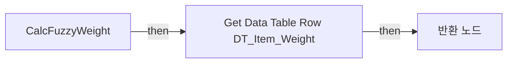

전체 노드·기본 입력 목록

| 노드 ID | 제목 | 미연결 기본 입력 / 에셋 입력 |
|---|---|---|
| `K2Node_FunctionEntry_0` | CalcFuzzyWeight |  |
| `K2Node_GetDataTableRow_0` | Get Data Table Row DT_Item_Weight | DataTable=/Game/QuakeLike_1_0/Data/AI/DT_Item_Weight.DT_Item_Weight |
| `K2Node_BreakStruct_4` | Break Curve |  |
| `K2Node_CallFunction_0` | Get Runtime Float Curve Value | InDefaultValue=1.000000 |
| `K2Node_PromotableOperator_4` | float * float |  |
| `K2Node_PromotableOperator_0` | float * float |  |
| `K2Node_FunctionResult_1` | 반환 노드 |  |
| `K2Node_Knot_1` | 경유 노드 |  |
| `K2Node_Knot_5` | 경유 노드 |  |
| `K2Node_Knot_6` | 경유 노드 |  |

### ClearTargetStack

실행 핀 플로우차트

전체 노드·기본 입력 목록

| 노드 ID | 제목 | 미연결 기본 입력 / 에셋 입력 |
|---|---|---|
| `K2Node_FunctionEntry_0` | ClearTargetStack |  |
| `K2Node_CallArrayFunction_0` | Clear |  |
| `K2Node_VariableGet_0` | Get targetStack |  |
| `K2Node_VariableSet_1` | Set LTG_Goal |  |

### Debug_Stack

실행 핀 플로우차트

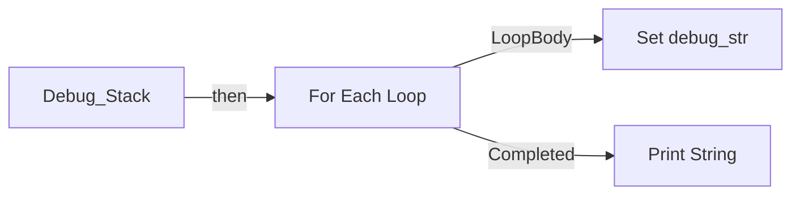

전체 노드·기본 입력 목록

| 노드 ID | 제목 | 미연결 기본 입력 / 에셋 입력 |
|---|---|---|
| `K2Node_FunctionEntry_0` | Debug_Stack |  |
| `K2Node_VariableGet_0` | Get targetStack |  |
| `K2Node_MacroInstance_0` | For Each Loop |  |
| `K2Node_CallFunction_1` | Get Display Name |  |
| `K2Node_CommutativeAssociativeBinaryOperator_0` | Append | B= \|  |
| `K2Node_VariableGet_1` | Get debug_str |  |
| `K2Node_CallFunction_0` | Print String | bPrintToScreen=true; bPrintToLog=true; TextColor=(R=0.000000,G=0.660000,B=1.000000,A=1.000000); Duration=2.000000 |
| `K2Node_VariableSet_0` | Set debug_str |  |
| `K2Node_VariableGet_2` | Get debug_str |  |
| `K2Node_CallFunction_3` | Get Owner 타깃은 액터 컴포넌트 |  |
| `K2Node_CallFunction_4` | Get Display Name |  |
| `K2Node_CommutativeAssociativeBinaryOperator_1` | Append | B=targetstack |
| `K2Node_CallFunction_9` | String To Name |  |

### EventGraph

실행 핀 플로우차트

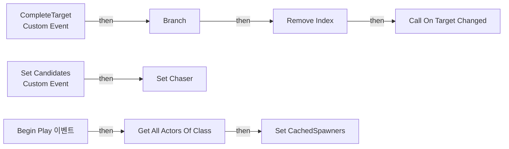

전체 노드·기본 입력 목록

| 노드 ID | 제목 | 미연결 기본 입력 / 에셋 입력 |
|---|---|---|
| `K2Node_CustomEvent_1` | Set Candidates Custom Event |  |
| `K2Node_CallDelegate_0` | Call On Target Changed |  |
| `K2Node_CallFunction_6` | Get Now Target |  |
| `K2Node_CustomEvent_2` | CompleteTarget Custom Event |  |
| `K2Node_VariableGet_1` | Get targetStack |  |
| `K2Node_IfThenElse_1` | Branch |  |
| `K2Node_VariableGet_2` | Get targetStack |  |
| `K2Node_CallArrayFunction_1` | Remove Index |  |
| `K2Node_CallArrayFunction_3` | Last Index |  |
| `K2Node_Knot_0` | 경유 노드 |  |
| `K2Node_CallArrayFunction_4` | Is Not Empty |  |
| `EdGraphNode_Comment_0` | 타겟 처치 완료 : 1순위 타겟(마지막 인덱스) 제거 후 OnTargetChanged 알리기 |  |
| `EdGraphNode_Comment_1` | 타겟 후보군 받아옴 |  |
| `K2Node_VariableSet_0` | Set Chaser |  |
| `K2Node_CallFunction_0` | Get All Actors Of Class | ActorClass=/Game/QuakeLike_1_0/Spawner/SpawnPoint/BP_ItemSpawnPoint.BP_ItemSpawnPoint_C |
| `K2Node_VariableSet_6` | Set CachedSpawners |  |
| `K2Node_Event_0` | Begin Play 이벤트 |  |

### Get Chaser Location

실행 핀 플로우차트

전체 노드·기본 입력 목록

| 노드 ID | 제목 | 미연결 기본 입력 / 에셋 입력 |
|---|---|---|
| `K2Node_FunctionEntry_0` | Get Chaser Location |  |
| `K2Node_FunctionResult_0` | 반환 노드 |  |
| `K2Node_VariableGet_9` | Get Chaser |  |
| `K2Node_Message_0` | Get Chaser Location Target is BPI Chaser Info |  |
| `K2Node_CallFunction_23` | To Object (Interface) |  |

### Get Health of Pawn

실행 핀 플로우차트

전체 노드·기본 입력 목록

| 노드 ID | 제목 | 미연결 기본 입력 / 에셋 입력 |
|---|---|---|
| `K2Node_FunctionEntry_1` | Get Health of Pawn |  |
| `K2Node_FunctionResult_0` | 반환 노드 |  |
| `EdGraphNode_Comment_1` | Pawn의 Health 정보 |  |
| `K2Node_VariableGet_0` | Get Chaser |  |
| `K2Node_CallFunction_0` | Get Chaser Life 타깃은 BPI Chaser Info |  |
| `K2Node_CallFunction_1` | Get Life 타깃은 BPI Life | type=NewEnumerator0 |

### Get Plate of Pawn

실행 핀 플로우차트

전체 노드·기본 입력 목록

| 노드 ID | 제목 | 미연결 기본 입력 / 에셋 입력 |
|---|---|---|
| `K2Node_FunctionEntry_1` | Get Plate of Pawn |  |
| `K2Node_FunctionResult_0` | 반환 노드 |  |
| `EdGraphNode_Comment_2` | Pawn의 Plate 정보 |  |
| `K2Node_CallFunction_0` | Get Chaser Life 타깃은 BPI Chaser Info |  |
| `K2Node_CallFunction_1` | Get Life 타깃은 BPI Life | type=NewEnumerator1 |
| `K2Node_VariableGet_0` | Get Chaser |  |

### Get Weight by Distance

실행 핀 플로우차트

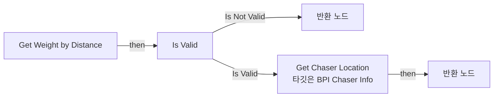

전체 노드·기본 입력 목록

| 노드 ID | 제목 | 미연결 기본 입력 / 에셋 입력 |
|---|---|---|
| `K2Node_FunctionEntry_1` | Get Weight by Distance |  |
| `K2Node_FunctionResult_0` | 반환 노드 | Result Weight=-1.000000 |
| `K2Node_MacroInstance_0` | Is Valid |  |
| `K2Node_CallFunction_1` | Distance (Vector) |  |
| `K2Node_Knot_5` | 경유 노드 |  |
| `K2Node_FunctionResult_1` | 반환 노드 |  |
| `K2Node_CallFunction_2` | Safe Divide |  |
| `K2Node_PromotableOperator_1` | float * float | B=0.010000 |
| `EdGraphNode_Comment_3` | Base Weight / Target Location 반환 |  |
| `K2Node_VariableGet_1` | Get Chaser |  |
| `K2Node_CallFunction_3` | Get Chaser Location 타깃은 BPI Chaser Info |  |
| `K2Node_CallFunction_22` | To Object (Interface) |  |
| `K2Node_VariableGet_2` | Get Chaser |  |
| `K2Node_Knot_0` | 경유 노드 |  |

### GetBestTarget

실행 핀 플로우차트

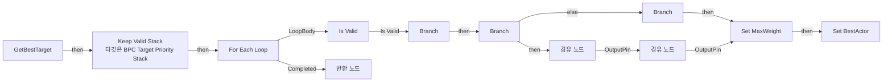

전체 노드·기본 입력 목록

| 노드 ID | 제목 | 미연결 기본 입력 / 에셋 입력 |
|---|---|---|
| `K2Node_FunctionEntry_0` | GetBestTarget |  |
| `K2Node_MacroInstance_0` | For Each Loop |  |
| `K2Node_CallFunction_1` | Get Target Weight |  |
| `K2Node_PromotableOperator_0` | float &gt; float |  |
| `K2Node_IfThenElse_0` | Branch |  |
| `K2Node_Knot_3` | 경유 노드 |  |
| `K2Node_Knot_4` | 경유 노드 |  |
| `K2Node_Knot_5` | 경유 노드 |  |
| `K2Node_Knot_6` | 경유 노드 |  |
| `K2Node_MacroInstance_2` | Is Valid |  |
| `K2Node_Knot_13` | 경유 노드 |  |
| `K2Node_CallFunction_13` | Is Path Efficient | Allow Go Through=false |
| `K2Node_CallFunction_14` | Get Actor Location 타깃은 액터 |  |
| `K2Node_Knot_15` | 경유 노드 |  |
| `K2Node_IfThenElse_2` | Branch |  |
| `K2Node_Knot_16` | 경유 노드 |  |
| `K2Node_Knot_17` | 경유 노드 |  |
| `K2Node_VariableGet_1` | Get BestActor |  |
| `K2Node_VariableGet_2` | Get MaxWeight |  |
| `K2Node_VariableSet_6` | Set MaxWeight | Output_Get=0.0 |
| `K2Node_VariableSet_8` | Set BestActor |  |
| `K2Node_VariableGet_6` | Get targetStack |  |
| `K2Node_IfThenElse_4` | Branch |  |
| `K2Node_CallArrayFunction_4` | Is Empty |  |
| `K2Node_Knot_8` | 경유 노드 |  |
| `K2Node_Knot_9` | 경유 노드 |  |
| `K2Node_CallFunction_0` | Keep Valid Stack 타깃은 BPC Target Priority Stack |  |
| `K2Node_FunctionResult_1` | 반환 노드 |  |
| `K2Node_VariableGet_0` | Get MaxWeight |  |
| `K2Node_Knot_0` | 경유 노드 |  |
| `K2Node_CallFunction_2` | Item Move Time Check |  |
| `K2Node_Knot_1` | 경유 노드 |  |

### GetCharacteristic

실행 핀 플로우차트

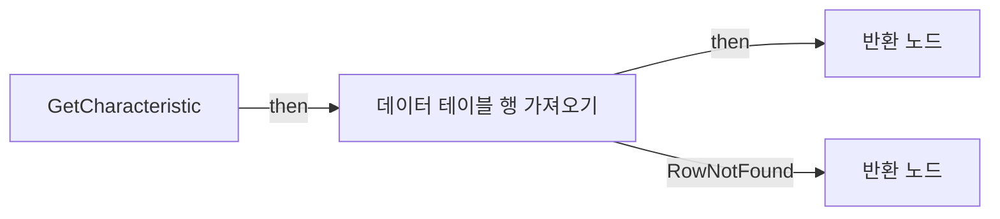

전체 노드·기본 입력 목록

| 노드 ID | 제목 | 미연결 기본 입력 / 에셋 입력 |
|---|---|---|
| `K2Node_FunctionEntry_0` | GetCharacteristic |  |
| `K2Node_FunctionResult_1` | 반환 노드 |  |
| `K2Node_VariableGet_1` | Get |  |
| `K2Node_GetDataTableRow_2` | 데이터 테이블 행 가져오기 |  |
| `K2Node_BreakStruct_3` | Break ST Characteristic |  |
| `K2Node_FunctionResult_0` | 반환 노드 | Aggression=-1.000000; Self_Preservation=-1.000000 |

### GetNowTarget

실행 핀 플로우차트

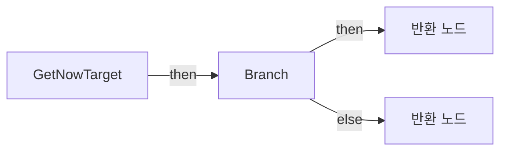

전체 노드·기본 입력 목록

| 노드 ID | 제목 | 미연결 기본 입력 / 에셋 입력 |
|---|---|---|
| `K2Node_FunctionEntry_0` | GetNowTarget |  |
| `K2Node_FunctionResult_0` | 반환 노드 |  |
| `K2Node_VariableGet_1` | Get targetStack |  |
| `K2Node_GetArrayItem_0` | GET |  |
| `K2Node_Knot_0` | 경유 노드 |  |
| `K2Node_CallArrayFunction_0` | Last Index |  |
| `K2Node_CallArrayFunction_1` | Is Not Empty |  |
| `K2Node_IfThenElse_0` | Branch |  |
| `K2Node_FunctionResult_1` | 반환 노드 |  |

### GetTargetWeight

실행 핀 플로우차트

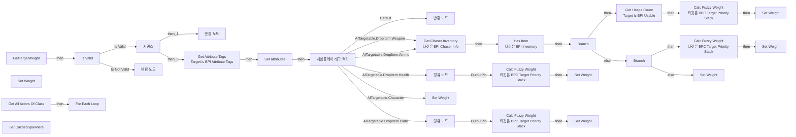

전체 노드·기본 입력 목록

| 노드 ID | 제목 | 미연결 기본 입력 / 에셋 입력 |
|---|---|---|
| `K2Node_FunctionEntry_1` | GetTargetWeight |  |
| `GameplayTagsK2Node_SwitchGameplayTag_0` | 게임플레이 태그 켜기 |  |
| `K2Node_Knot_0` | 경유 노드 |  |
| `K2Node_ExecutionSequence_0` | 시퀀스 |  |
| `K2Node_FunctionResult_3` | 반환 노드 |  |
| `EdGraphNode_Comment_6` | HP기반 가중치 |  |
| `K2Node_VariableGet_8` | Get Weight |  |
| `EdGraphNode_Comment_0` | 방어구 가중치 식 |  |
| `K2Node_FunctionResult_0` | 반환 노드 | Result Weight=-1.000000 |
| `K2Node_IfThenElse_1` | Branch |  |
| `K2Node_CallFunction_16` | Safe Divide |  |
| `K2Node_CallFunction_17` | To Float (Integer) |  |
| `K2Node_CallFunction_18` | To Float (Integer) |  |
| `K2Node_Knot_10` | 경유 노드 |  |
| `K2Node_Knot_11` | 경유 노드 |  |
| `EdGraphNode_Comment_1` | 총기 가중치 |  |
| `K2Node_Knot_4` | 경유 노드 |  |
| `K2Node_CallFunction_9` | Get Weight By Distance |  |
| `K2Node_VariableSet_4` | Set Weight | Weight=10000.000000; Output_Get=0.0 |
| `K2Node_VariableSet_2` | Set Weight | Output_Get=0.0 |
| `K2Node_VariableSet_5` | Set Weight | Output_Get=0.0 |
| `K2Node_VariableSet_9` | Set Weight | Output_Get=0.0 |
| `K2Node_VariableSet_20` | Set Weight | Weight=-1.000000; Output_Get=0.0 |
| `K2Node_VariableGet_4` | Get Chaser |  |
| `K2Node_CallFunction_19` | Get Chaser Inventory 타깃은 BPI Chaser Info |  |
| `K2Node_CallFunction_20` | Has Item 타깃은 BPI Inventory |  |
| `K2Node_Knot_15` | 경유 노드 |  |
| `K2Node_CallFunction_1` | Get Actor Location 타깃은 액터 |  |
| `K2Node_MacroInstance_0` | Is Valid |  |
| `K2Node_FunctionResult_2` | 반환 노드 | Result Weight=-1.000000 |
| `K2Node_Message_2` | Get Attribute Tags Target is BPI Attribute Tags |  |
| `K2Node_CallFunction_2` | Get Filtering Tag (First) | filter=(TagName="AITargetable"); Exact Match=false |
| `K2Node_VariableSet_0` | Set attributes |  |
| `K2Node_VariableGet_0` | Get attributes |  |
| `K2Node_CallFunction_25` | Get Filtering Tag (First) | filter=(TagName="ID"); Exact Match=false |
| `K2Node_Knot_16` | 경유 노드 |  |
| `K2Node_CallFunction_26` | Get Tag Name |  |
| `K2Node_VariableGet_5` | Get attributes |  |
| `K2Node_CallFunction_21` | Get Filtering Tag (First) | filter=(TagName="AITargetable"); Exact Match=false |
| `K2Node_CallFunction_24` | Matches Tag | TagTwo=(TagName="AITargetable.DropItem.Weapon"); bExactMatch=true |
| `K2Node_IfThenElse_2` | Branch |  |
| `K2Node_VariableGet_11` | Get Weight |  |
| `K2Node_PromotableOperator_3` | float &gt; float |  |
| `K2Node_CallFunction_29` | Select Float | B=-1.000000 |
| `K2Node_CallFunction_28` | Calc Fuzzy Weight 타깃은 BPC Target Priority Stack |  |
| `K2Node_Knot_2` | 경유 노드 |  |
| `K2Node_Knot_3` | 경유 노드 |  |
| `K2Node_CallFunction_32` | Get Characteristic | Self_Preservation=0.0 |
| `K2Node_CallFunction_30` | Calc Fuzzy Weight 타깃은 BPC Target Priority Stack |  |
| `K2Node_CallFunction_31` | Get Characteristic | Aggression=0.0 |
| `K2Node_VariableGet_6` | Get attributes |  |
| `K2Node_CallFunction_5` | Get Filtering Tag (First) | filter=(TagName="ID"); Exact Match=false |
| `K2Node_CallFunction_33` | Get Tag Name |  |
| `K2Node_CallFunction_35` | Get Health Of Pawn |  |
| `K2Node_CallFunction_4` | Calc Fuzzy Weight 타깃은 BPC Target Priority Stack |  |
| `K2Node_CallFunction_13` | Get Characteristic | Aggression=0.0 |
| `K2Node_CallFunction_22` | Get Tag Name |  |
| `K2Node_Knot_5` | 경유 노드 |  |
| `K2Node_CallFunction_37` | Get Plate Of Pawn |  |
| `K2Node_Knot_7` | 경유 노드 |  |
| `K2Node_CallFunction_39` | Safe Divide |  |
| `K2Node_CallFunction_38` | Safe Divide |  |
| `K2Node_Message_3` | Get Usage Count Target is BPI Usable |  |
| `K2Node_CallFunction_0` | Get All Actors Of Class | ActorClass=/Game/QuakeLike_1_0/Spawner/SpawnPoint/BP_ItemSpawnPoint.BP_ItemSpawnPoint_C |
| `K2Node_MacroInstance_1` | For Each Loop |  |
| `K2Node_VariableSet_6` | Set CachedSpawners |  |
| `K2Node_VariableGet_7` | Get Having Item |  |
| `K2Node_CallFunction_6` | Get Target Weight | Result Weight=0.0 |
| `K2Node_CallFunction_34` | Calc Fuzzy Weight 타깃은 BPC Target Priority Stack | Ratio=0.0 |
| `K2Node_CallFunction_36` | Get Characteristic | Self_Preservation=0.0 |
| `K2Node_Knot_1` | 경유 노드 |  |
| `K2Node_VariableSet_10` | Set Weight | Output_Get=0.0 |
| `K2Node_VariableSet_1` | Set Weight | Weight=-1.000000; Output_Get=0.0 |

### Is Path Efficient

실행 핀 플로우차트

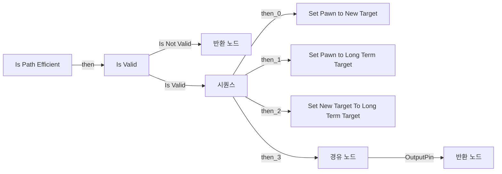

전체 노드·기본 입력 목록

| 노드 ID | 제목 | 미연결 기본 입력 / 에셋 입력 |
|---|---|---|
| `K2Node_FunctionEntry_1` | Is Path Efficient |  |
| `K2Node_FunctionResult_2` | 반환 노드 | Allow Go Through=false |
| `K2Node_FunctionResult_0` | 반환 노드 |  |
| `K2Node_GetArrayItem_1` | GET | Dimension 1=0 |
| `K2Node_CallFunction_1` | Get Actor Location 타깃은 액터 |  |
| `K2Node_CallFunction_4` | Distance (Vector) |  |
| `K2Node_VariableSet_0` | Set Pawn to New Target | Output_Get=0.0 |
| `K2Node_ExecutionSequence_0` | 시퀀스 |  |
| `K2Node_CallFunction_3` | Distance (Vector) |  |
| `K2Node_VariableSet_1` | Set Pawn to Long Term Target | Output_Get=0.0 |
| `K2Node_CallFunction_5` | Distance (Vector) |  |
| `K2Node_Knot_0` | 경유 노드 |  |
| `K2Node_Knot_1` | 경유 노드 |  |
| `K2Node_Knot_2` | 경유 노드 |  |
| `K2Node_VariableSet_2` | Set New Target To Long Term Target | Output_Get=0.0 |
| `K2Node_Knot_3` | 경유 노드 |  |
| `K2Node_MacroInstance_1` | Is Valid |  |
| `K2Node_Knot_4` | 경유 노드 |  |
| `K2Node_Knot_5` | 경유 노드 |  |
| `K2Node_VariableGet_2` | Get New Target To Long Term Target |  |
| `K2Node_VariableGet_6` | Get Pawn to Long Term Target |  |
| `K2Node_PromotableOperator_3` | float &gt; float |  |
| `K2Node_VariableGet_1` | Get targetStack |  |
| `K2Node_CallFunction_6` | Get Chaser Location |  |

### ItemMoveTimeCheck

실행 핀 플로우차트

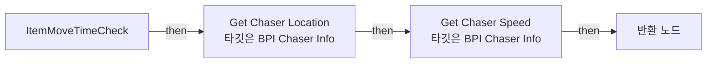

전체 노드·기본 입력 목록

| 노드 ID | 제목 | 미연결 기본 입력 / 에셋 입력 |
|---|---|---|
| `K2Node_FunctionEntry_0` | ItemMoveTimeCheck |  |
| `K2Node_VariableGet_0` | Get Chaser |  |
| `K2Node_CallFunction_0` | Get Chaser Location 타깃은 BPI Chaser Info |  |
| `K2Node_CallFunction_1` | Get Actor Location 타깃은 액터 |  |
| `K2Node_CallFunction_3` | Distance (Vector) |  |
| `K2Node_VariableGet_2` | Get TravelTime |  |
| `K2Node_PromotableOperator_0` | float &lt;= float |  |
| `K2Node_VariableGet_3` | Get TravelTimeLimit |  |
| `K2Node_CallFunction_4` | Safe Divide |  |
| `K2Node_FunctionResult_1` | 반환 노드 |  |
| `K2Node_Knot_0` | 경유 노드 |  |
| `K2Node_CallFunction_5` | Get Chaser Speed 타깃은 BPI Chaser Info |  |

### KeepValidStack

실행 핀 플로우차트

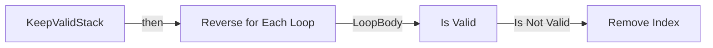

전체 노드·기본 입력 목록

| 노드 ID | 제목 | 미연결 기본 입력 / 에셋 입력 |
|---|---|---|
| `K2Node_FunctionEntry_0` | KeepValidStack |  |
| `K2Node_VariableGet_3` | Get targetStack |  |
| `K2Node_MacroInstance_1` | Reverse for Each Loop |  |
| `K2Node_MacroInstance_0` | Is Valid |  |
| `K2Node_Knot_0` | 경유 노드 |  |
| `K2Node_CallArrayFunction_0` | Remove Index |  |
| `K2Node_Knot_1` | 경유 노드 |  |

### LongTermUpdate

실행 핀 플로우차트

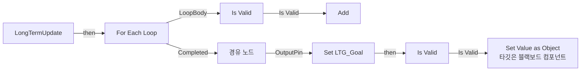

전체 노드·기본 입력 목록

| 노드 ID | 제목 | 미연결 기본 입력 / 에셋 입력 |
|---|---|---|
| `K2Node_FunctionEntry_0` | LongTermUpdate |  |
| `K2Node_MacroInstance_1` | For Each Loop |  |
| `K2Node_VariableGet_7` | Get Having Item |  |
| `K2Node_Knot_3` | 경유 노드 |  |
| `K2Node_VariableGet_3` | Get CachedSpawners |  |
| `K2Node_CallFunction_1` | Get Best Target | Result Weight=0.0 |
| `K2Node_VariableGet_4` | Get AllSpawnedItems |  |
| `K2Node_CallArrayFunction_0` | Add | ReturnValue=0 |
| `K2Node_MacroInstance_2` | Is Valid |  |
| `K2Node_Knot_5` | 경유 노드 |  |
| `K2Node_VariableGet_5` | Get AllSpawnedItems |  |
| `K2Node_VariableSet_5` | Set LTG_Goal |  |
| `K2Node_CallFunction_16` | Get Blackboard |  |
| `K2Node_CallFunction_17` | Set Value as Object 타깃은 블랙보드 컴포넌트 |  |
| `K2Node_VariableGet_8` | Get LTG_Goal |  |
| `K2Node_CallFunction_19` | Make Literal Name | Value=LongTermTarget |
| `K2Node_CallFunction_20` | Get Owner 타깃은 액터 컴포넌트 |  |
| `K2Node_Knot_0` | 경유 노드 |  |
| `K2Node_MacroInstance_0` | Is Valid |  |
| `K2Node_Knot_1` | 경유 노드 |  |

### Print LTG

실행 핀 플로우차트

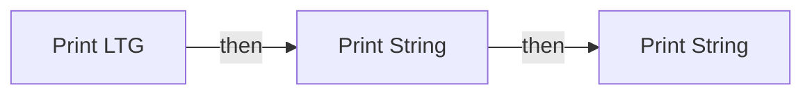

전체 노드·기본 입력 목록

| 노드 ID | 제목 | 미연결 기본 입력 / 에셋 입력 |
|---|---|---|
| `K2Node_FunctionEntry_0` | Print LTG |  |
| `K2Node_CallFunction_7` | Print String | bPrintToScreen=true; bPrintToLog=true; TextColor=(R=0.000000,G=0.660000,B=1.000000,A=1.000000); Duration=2.000000 |
| `K2Node_CommutativeAssociativeBinaryOperator_0` | Append | B=: |
| `K2Node_CallFunction_9` | Get Display Name |  |
| `K2Node_CallFunction_11` | To String (Float) |  |
| `K2Node_VariableGet_6` | Get CachedSpawners |  |
| `K2Node_CallFunction_5` | Get All Names |  |
| `K2Node_CallFunction_2` | Print String | bPrintToScreen=true; bPrintToLog=true; TextColor=(R=0.000000,G=0.660000,B=1.000000,A=1.000000); Duration=2.000000 |
| `K2Node_CallFunction_14` | Make Print Key | string=최고 |
| `K2Node_CallFunction_15` | Get Owner 타깃은 액터 컴포넌트 |  |
| `K2Node_CallFunction_12` | Make Print Key | string=다른 놈들 |
| `K2Node_CallFunction_13` | Get Owner 타깃은 액터 컴포넌트 |  |

### TestCharater

실행 핀 플로우차트

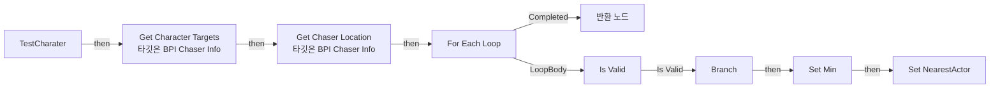

전체 노드·기본 입력 목록

| 노드 ID | 제목 | 미연결 기본 입력 / 에셋 입력 |
|---|---|---|
| `K2Node_FunctionEntry_0` | TestCharater |  |
| `K2Node_VariableGet_0` | Get Chaser |  |
| `K2Node_CallFunction_0` | Get Character Targets 타깃은 BPI Chaser Info |  |
| `K2Node_MacroInstance_0` | For Each Loop |  |
| `K2Node_CallFunction_1` | Get Chaser Location 타깃은 BPI Chaser Info |  |
| `K2Node_CallFunction_2` | Get Actor Location 타깃은 액터 |  |
| `K2Node_IfThenElse_0` | Branch |  |
| `K2Node_PromotableOperator_0` | float &lt; float |  |
| `K2Node_VariableGet_1` | Get Min |  |
| `K2Node_VariableSet_0` | Set Min | Output_Get=0.0 |
| `K2Node_VariableSet_1` | Set NearestActor |  |
| `K2Node_Knot_0` | 경유 노드 |  |
| `K2Node_Knot_1` | 경유 노드 |  |
| `K2Node_Knot_2` | 경유 노드 |  |
| `K2Node_FunctionResult_0` | 반환 노드 |  |
| `K2Node_VariableGet_2` | Get NearestActor |  |
| `K2Node_CallFunction_4` | Distance Squared (Vector) |  |
| `K2Node_Knot_3` | 경유 노드 |  |
| `K2Node_Knot_4` | 경유 노드 |  |
| `K2Node_MacroInstance_1` | Is Valid |  |
| `K2Node_Knot_5` | 경유 노드 |  |

### UpdateBestTarget

실행 핀 플로우차트

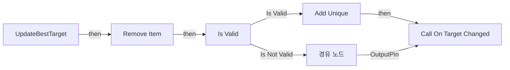

전체 노드·기본 입력 목록

| 노드 ID | 제목 | 미연결 기본 입력 / 에셋 입력 |
|---|---|---|
| `K2Node_FunctionEntry_0` | UpdateBestTarget |  |
| `K2Node_CallFunction_1` | Get Best Target | Result Weight=0.0 |
| `K2Node_CallArrayFunction_1` | Add Unique | ReturnValue=0 |
| `K2Node_MacroInstance_2` | Is Valid |  |
| `K2Node_VariableGet_5` | Get targetStack |  |
| `K2Node_Knot_0` | 경유 노드 |  |
| `K2Node_Knot_2` | 경유 노드 |  |
| `K2Node_CallDelegate_0` | Call On Target Changed |  |
| `K2Node_CallFunction_2` | Get Now Target |  |
| `K2Node_Knot_1` | 경유 노드 |  |
| `K2Node_CallArrayFunction_0` | Remove Item | ReturnValue=false |
| `K2Node_VariableGet_0` | Get LTG_Goal |  |
| `K2Node_Knot_3` | 경유 노드 |  |

## 조회 범위의 한계

ObjectIterator로 발견했으나 MCP helper가 반환하지 않은 그래프입니다. delegate signature·컴파일된 중간 그래프·macro·애니메이션 내부 그래프가 섞일 수 있습니다.

- `CalcFuzzyWeight_MERGED`: Graph 'CalcFuzzyWeight_MERGED' not found in Blueprint.
- `ClearTargetStack_MERGED`: Graph 'ClearTargetStack_MERGED' not found in Blueprint.
- `CompleteTarget`: Graph 'CompleteTarget' not found in Blueprint.
- `Debug_Stack_MERGED`: Graph 'Debug_Stack_MERGED' not found in Blueprint.
- `EdGraph_0`: Graph 'EdGraph_0' not found in Blueprint.
- `EdGraph_1`: Graph 'EdGraph_1' not found in Blueprint.
- `EdGraph_10`: Graph 'EdGraph_10' not found in Blueprint.
- `EdGraph_11`: Graph 'EdGraph_11' not found in Blueprint.
- `EdGraph_12`: Graph 'EdGraph_12' not found in Blueprint.
- `EdGraph_13`: Graph 'EdGraph_13' not found in Blueprint.
- `EdGraph_14`: Graph 'EdGraph_14' not found in Blueprint.
- `EdGraph_2`: Graph 'EdGraph_2' not found in Blueprint.
- `EdGraph_3`: Graph 'EdGraph_3' not found in Blueprint.
- `EdGraph_4`: Graph 'EdGraph_4' not found in Blueprint.
- `EdGraph_5`: Graph 'EdGraph_5' not found in Blueprint.
- `EdGraph_6`: Graph 'EdGraph_6' not found in Blueprint.
- `EdGraph_7`: Graph 'EdGraph_7' not found in Blueprint.
- `EdGraph_8`: Graph 'EdGraph_8' not found in Blueprint.
- `EdGraph_9`: Graph 'EdGraph_9' not found in Blueprint.
- `ExecuteUbergraph_BPC_TargetPriorityStack`: Graph 'ExecuteUbergraph_BPC_TargetPriorityStack' not found in Blueprint.
- `Get Chaser Location_MERGED`: Graph 'Get Chaser Location_MERGED' not found in Blueprint.
- `Get Health of Pawn_MERGED`: Graph 'Get Health of Pawn_MERGED' not found in Blueprint.
- `Get Plate of Pawn_MERGED`: Graph 'Get Plate of Pawn_MERGED' not found in Blueprint.
- `Get Weight by Distance_MERGED`: Graph 'Get Weight by Distance_MERGED' not found in Blueprint.
- `GetBestTarget_MERGED`: Graph 'GetBestTarget_MERGED' not found in Blueprint.
- `GetCharacteristic_MERGED`: Graph 'GetCharacteristic_MERGED' not found in Blueprint.
- `GetNowTarget_MERGED`: Graph 'GetNowTarget_MERGED' not found in Blueprint.
- `GetTargetWeight_MERGED`: Graph 'GetTargetWeight_MERGED' not found in Blueprint.
- `Is Path Efficient_MERGED`: Graph 'Is Path Efficient_MERGED' not found in Blueprint.
- `ItemMoveTimeCheck_MERGED`: Graph 'ItemMoveTimeCheck_MERGED' not found in Blueprint.
- `KeepValidStack_MERGED`: Graph 'KeepValidStack_MERGED' not found in Blueprint.
- `LongTermUpdate_MERGED`: Graph 'LongTermUpdate_MERGED' not found in Blueprint.
- `OnTargetChanged`: Graph 'OnTargetChanged' not found in Blueprint.
- `OnTargetChanged_MERGED`: Graph 'OnTargetChanged_MERGED' not found in Blueprint.
- `Print LTG_MERGED`: Graph 'Print LTG_MERGED' not found in Blueprint.
- `ReceiveBeginPlay`: Graph 'ReceiveBeginPlay' not found in Blueprint.
- `Set Candidates`: Graph 'Set Candidates' not found in Blueprint.
- `TestCharater_MERGED`: Graph 'TestCharater_MERGED' not found in Blueprint.
- `UpdateBestTarget_MERGED`: Graph 'UpdateBestTarget_MERGED' not found in Blueprint.

[원본 MCP 스냅샷](../../../Evidence/blueprints-210.json)
