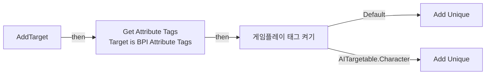
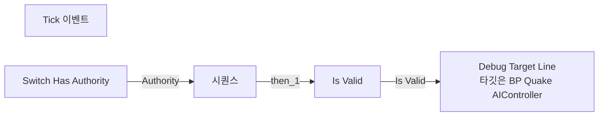
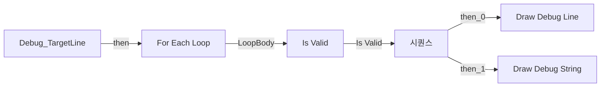
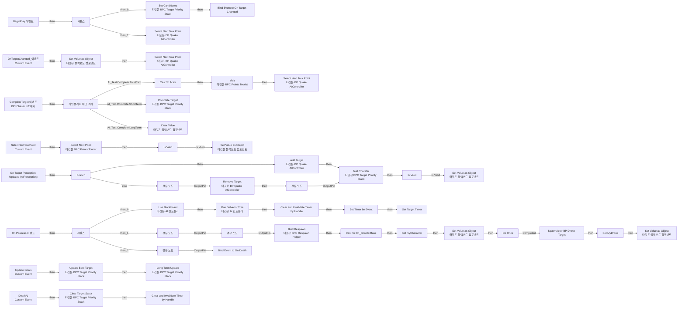
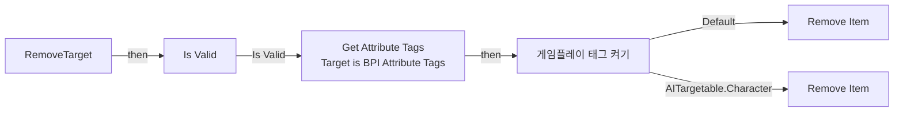
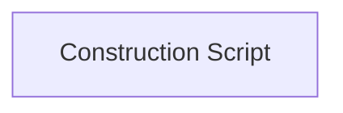

# BP_QuakeAIController

에셋: `/Game/QuakeLike_1_0/Controller/BP_QuakeAIController`

부모: `/Script/CoreUObject.Class'/Script/ShootingArena.MyAIController'`

수집일: 2026-10-12. MCP에서 읽은 그래프·핀 연결의 자동 전사입니다. 상속된 그래프는 부모 문서를 함께 확인합니다.

정적 루트 참조 도달: 없음. 실행 여부 또는 삭제 가능 여부의 확정이 아닙니다.

컴포넌트 목록은 이 BP가 직접 정의한 SCS만 포함합니다. 부모·네이티브 생성 컴포넌트, 인스턴스 설정은 별도입니다.

## 직접 정의한 컴포넌트

| 이름 | 클래스 | 부모 컴포넌트 |
|---|---|---|
| `AIPerception` | `AIPerceptionComponent` | `` |
| `BPC_TargetPriorityStack` | `BPC_TargetPriorityStack_C` | `` |
| `BPC_PointsTourist` | `BPC_PointsTourist_C` | `` |
| `BPC_RespawnHelper` | `BPC_RespawnHelper_C` | `` |

## 변수와 기본값

| 이름 | 타입 | CDO 기본값 |
|---|---|---|
| `myCharacter` | `BP_ShooterBase_C` | None |
| `Location` | `BPI_ChaserInfo_C` | None |
| `MyDrone` | `Actor` | None |
| `CharacterTargets` | `Actor` | [] |
| `ItemTargets` | `Actor` | [] |
| `Target Timer` | `TimerHandle` | &lt;Struct 'TimerHandle' {}&gt; |

## 그래프 목록

| 그래프 | 전체 노드 수 |
|---|---|
| AddTarget | 9 |
| Debug | 7 |
| Debug_TargetLine | 21 |
| EventGraph | 103 |
| RemoveTarget | 11 |
| UserConstructionScript | 1 |

## 그래프별 실행 연결

실선은 출력 exec 핀의 실제 연결입니다. 여러 분기는 출력 핀 이름을 표시합니다. 함수 호출·delegate·타이머의 다음 그래프 실행은 이 그림에서 자동으로 이어 붙이지 않습니다.

순수 계산 노드 및 데이터 핀은 아래 목록과 원본 JSON을 확인합니다. 연결되지 않은 이벤트도 표시되므로, 노드가 있다는 이유만으로 실행된다고 판단하면 안 됩니다.

### AddTarget

실행 핀 플로우차트

전체 노드·기본 입력 목록

| 노드 ID | 제목 | 미연결 기본 입력 / 에셋 입력 |
|---|---|---|
| `K2Node_FunctionEntry_0` | AddTarget |  |
| `K2Node_Message_0` | Get Attribute Tags Target is BPI Attribute Tags |  |
| `K2Node_CallFunction_0` | Get Filtering Tag (First) | filter=(TagName="AITargetable"); Exact Match=false |
| `GameplayTagsK2Node_SwitchGameplayTag_0` | 게임플레이 태그 켜기 |  |
| `K2Node_CallArrayFunction_0` | Add Unique | ReturnValue=0 |
| `K2Node_VariableGet_2` | Get CharacterTargets |  |
| `K2Node_VariableGet_3` | Get ItemTargets |  |
| `K2Node_CallArrayFunction_1` | Add Unique | ReturnValue=0 |
| `K2Node_Knot_0` | 경유 노드 |  |

### Debug

실행 핀 플로우차트

전체 노드·기본 입력 목록

| 노드 ID | 제목 | 미연결 기본 입력 / 에셋 입력 |
|---|---|---|
| `K2Node_Event_0` | Tick 이벤트 | DeltaSeconds=0.0 |
| `K2Node_VariableGet_1` | Get myCharacter |  |
| `K2Node_MacroInstance_1` | Is Valid |  |
| `K2Node_MacroInstance_2` | Switch Has Authority |  |
| `K2Node_ExecutionSequence_1` | 시퀀스 |  |
| `K2Node_VariableGet_5` | Get ItemTargets |  |
| `K2Node_CallFunction_8` | Debug Target Line 타깃은 BP Quake AIController |  |

### Debug_TargetLine

실행 핀 플로우차트

전체 노드·기본 입력 목록

| 노드 ID | 제목 | 미연결 기본 입력 / 에셋 입력 |
|---|---|---|
| `K2Node_FunctionEntry_0` | Debug_TargetLine |  |
| `K2Node_CallFunction_0` | Draw Debug Line | Duration=0.000000; Thickness=0.000000 |
| `K2Node_MacroInstance_0` | For Each Loop |  |
| `K2Node_VariableGet_4` | Get myCharacter |  |
| `K2Node_CallFunction_6` | Get Actor Location 타깃은 액터 |  |
| `K2Node_CallFunction_7` | Get Actor Location 타깃은 액터 |  |
| `K2Node_Knot_0` | 경유 노드 |  |
| `K2Node_Knot_4` | 경유 노드 |  |
| `K2Node_MacroInstance_3` | Is Valid |  |
| `K2Node_ExecutionSequence_0` | 시퀀스 |  |
| `K2Node_VariableGet_2` | Get myCharacter |  |
| `K2Node_CallFunction_2` | Get Actor Location 타깃은 액터 |  |
| `K2Node_CallFunction_3` | Get Actor Location 타깃은 액터 |  |
| `K2Node_PromotableOperator_0` | vector + vector |  |
| `K2Node_PromotableOperator_1` | vector / vector | B=2.000000 |
| `K2Node_CallFunction_1` | Draw Debug String | TextColor=(R=1.000000,G=1.000000,B=1.000000,A=1.000000); Duration=0.000000 |
| `K2Node_VariableGet_3` | Get BPC_TargetPriorityStack |  |
| `K2Node_CallFunction_4` | Get Target Weight 타깃은 BPC Target Priority Stack |  |
| `K2Node_CallFunction_5` | To Text (Float) | RoundingMode=HalfToEven; bAlwaysSign=false; bUseGrouping=true; MinimumIntegralDigits=1; MaximumIntegralDigits=324; MinimumFractionalDigits=0; MaximumFractionalDigits=1 |
| `K2Node_CallFunction_13` | To String (Text) |  |
| `K2Node_Knot_9` | 경유 노드 |  |

### EventGraph

실행 핀 플로우차트

전체 노드·기본 입력 목록

| 노드 ID | 제목 | 미연결 기본 입력 / 에셋 입력 |
|---|---|---|
| `K2Node_Event_0` | BeginPlay 이벤트 |  |
| `K2Node_Event_1` | On Possess 이벤트 |  |
| `K2Node_DynamicCast_2` | Cast To BP_ShooterBase |  |
| `K2Node_VariableSet_0` | Set myCharacter |  |
| `K2Node_CallFunction_7` | Get Blackboard |  |
| `K2Node_CallFunction_5` | Set Value as Object 타깃은 블랙보드 컴포넌트 |  |
| `K2Node_CallFunction_6` | Make Literal Name | Value=SelfActor |
| `K2Node_CallFunction_23` | Set Value as Object 타깃은 블랙보드 컴포넌트 |  |
| `K2Node_CallFunction_24` | Make Literal Name | Value=ItemTarget |
| `K2Node_CallFunction_25` | Get Blackboard |  |
| `K2Node_Knot_13` | 경유 노드 |  |
| `K2Node_Knot_17` | 경유 노드 |  |
| `K2Node_CustomEvent_2` | OnTargetChanged_이벤트 Custom Event |  |
| `K2Node_AssignDelegate_0` | Bind Event to On Target Changed |  |
| `K2Node_CallFunction_38` | Set Candidates 타깃은 BPC Target Priority Stack |  |
| `K2Node_Self_1` | 셀프-레퍼런스 |  |
| `K2Node_VariableGet_7` | Get BPC_TargetPriorityStack |  |
| `K2Node_Knot_11` | 경유 노드 |  |
| `K2Node_ComponentBoundEvent_1` | On Target Perception Updated (AIPerception) |  |
| `K2Node_IfThenElse_3` | Branch |  |
| `K2Node_Knot_8` | 경유 노드 |  |
| `K2Node_CreateDelegate_0` | 이벤트 생성 |  |
| `K2Node_Knot_3` | 경유 노드 |  |
| `K2Node_CallFunction_31` | Run Behavior Tree 타깃은 AI 컨트롤러 | BTAsset=/Game/QuakeLike_1_0/AITest_YJS/Trash/BT_AIaction.BT_AIaction; ReturnValue=false |
| `K2Node_CallFunction_39` | Use Blackboard 타깃은 AI 컨트롤러 | BlackboardAsset=/Game/QuakeLike_1_0/Controller/BB_AIBoard.BB_AIBoard; ReturnValue=false |
| `K2Node_ExecutionSequence_1` | 시퀀스 |  |
| `K2Node_Knot_4` | 경유 노드 |  |
| `K2Node_Event_3` | CompleteTarget 이벤트 BPI Chaser Info에서 |  |
| `K2Node_VariableGet_3` | Get BPC_TargetPriorityStack |  |
| `K2Node_CallFunction_9` | Complete Target 타깃은 BPC Target Priority Stack |  |
| `GameplayTagsK2Node_SwitchGameplayTag_0` | 게임플레이 태그 켜기 |  |
| `K2Node_Knot_5` | 경유 노드 |  |
| `K2Node_ExecutionSequence_0` | 시퀀스 |  |
| `K2Node_Knot_12` | 경유 노드 |  |
| `K2Node_CustomEvent_1` | SelectNextTourPoint Custom Event |  |
| `K2Node_CallFunction_16` | Set Value as Object 타깃은 블랙보드 컴포넌트 |  |
| `K2Node_CallFunction_40` | Make Literal Name | Value=TourPoint |
| `K2Node_CallFunction_47` | Get Blackboard |  |
| `K2Node_Knot_6` | 경유 노드 |  |
| `K2Node_VariableGet_10` | Get BPC_PointsTourist |  |
| `K2Node_CallFunction_26` | Select Next Point 타깃은 BPC Points Tourist |  |
| `K2Node_VariableGet_11` | Get myCharacter |  |
| `K2Node_Knot_14` | 경유 노드 |  |
| `K2Node_CallFunction_12` | Select Next Tour Point 타깃은 BP Quake AIController |  |
| `K2Node_VariableGet_12` | Get BPC_PointsTourist |  |
| `K2Node_CallFunction_30` | Visit 타깃은 BPC Points Tourist |  |
| `K2Node_CallFunction_43` | Get Blackboard |  |
| `K2Node_CallFunction_15` | Make Literal Name | Value=TourPoint |
| `K2Node_CallFunction_34` | Get Value as Object 타깃은 블랙보드 컴포넌트 |  |
| `K2Node_DynamicCast_3` | Cast To Actor |  |
| `K2Node_VariableGet_13` | Get myCharacter |  |
| `K2Node_CallFunction_28` | Select Next Tour Point 타깃은 BP Quake AIController |  |
| `K2Node_CallFunction_13` | Select Next Tour Point 타깃은 BP Quake AIController |  |
| `K2Node_MacroInstance_2` | Is Valid |  |
| `K2Node_Knot_15` | 경유 노드 |  |
| `K2Node_CallFunction_20` | Get Blackboard |  |
| `K2Node_CallFunction_21` | Set Value as Object 타깃은 블랙보드 컴포넌트 |  |
| `K2Node_CallFunction_22` | Make Literal Name | Value=AimDrone |
| `K2Node_SpawnActorFromClass_0` | SpawnActor BP Drone Target | Class=/Game/QuakeLike_1_0/AI/BP/BP_DroneTarget.BP_DroneTarget_C; SpawnTransform_Location=0, 0, 0; SpawnTransform_Rotation=0, 0, 0; SpawnTransform_Scale=1.000000,1.000000,1.000000; CollisionHandlingOverride=AlwaysSpawn; TransformScaleMethod=MultiplyWithRoot |
| `K2Node_VariableSet_3` | Set MyDrone |  |
| `K2Node_MacroInstance_1` | Do Once |  |
| `K2Node_Knot_21` | 경유 노드 |  |
| `K2Node_CallFunction_41` | Add Target 타깃은 BP Quake AIController |  |
| `K2Node_Knot_23` | 경유 노드 |  |
| `K2Node_CallFunction_42` | Remove Target 타깃은 BP Quake AIController |  |
| `K2Node_CallFunction_14` | Test Charater 타깃은 BPC Target Priority Stack |  |
| `K2Node_VariableGet_8` | Get BPC_TargetPriorityStack |  |
| `EdGraphNode_Comment_0` | 임시 타겟 갱신 |  |
| `K2Node_CallFunction_19` | Set Value as Object 타깃은 블랙보드 컴포넌트 |  |
| `K2Node_CallFunction_27` | Make Literal Name | Value=ChraterTarget |
| `K2Node_CallFunction_29` | Get Blackboard |  |
| `K2Node_Knot_7` | 경유 노드 |  |
| `K2Node_MacroInstance_3` | Is Valid |  |
| `K2Node_Knot_9` | 경유 노드 |  |
| `K2Node_CallFunction_10` | Get Blackboard |  |
| `K2Node_CallFunction_11` | Clear Value 타깃은 블랙보드 컴포넌트 |  |
| `K2Node_CallFunction_44` | Make Literal Name | Value=LongTermTarget |
| `K2Node_CallFunction_35` | Get Component by Class 타깃은 액터 | ComponentClass=/Game/QuakeLike_1_0/Life/BPC_Life.BPC_Life_C |
| `K2Node_AddDelegate_0` | Bind Event to On Death |  |
| `K2Node_Knot_16` | 경유 노드 |  |
| `K2Node_VariableGet_0` | Get BPC_TargetPriorityStack |  |
| `K2Node_VariableGet_14` | Get ItemTargets |  |
| `K2Node_CallFunction_32` | Update Best Target 타깃은 BPC Target Priority Stack |  |
| `K2Node_CallFunction_8` | Long Term Update 타깃은 BPC Target Priority Stack |  |
| `K2Node_Knot_0` | 경유 노드 |  |
| `K2Node_Knot_1` | 경유 노드 |  |
| `K2Node_CustomEvent_3` | Update Goals Custom Event |  |
| `K2Node_CallFunction_45` | Set Timer by Event | Time=0.200000; bLooping=true; bMaxOncePerFrame=false; InitialStartDelay=0.000000; InitialStartDelayVariance=0.000000 |
| `K2Node_CreateDelegate_1` | 이벤트 생성 |  |
| `K2Node_VariableSet_2` | Set Target Timer |  |
| `K2Node_VariableGet_6` | Get Target Timer |  |
| `K2Node_CallFunction_33` | Clear and Invalidate Timer by Handle |  |
| `K2Node_CreateDelegate_2` | 이벤트 생성 |  |
| `K2Node_CustomEvent_0` | DeathAI Custom Event |  |
| `K2Node_CallFunction_37` | Clear Target Stack 타깃은 BPC Target Priority Stack |  |
| `K2Node_VariableGet_5` | Get BPC_TargetPriorityStack |  |
| `K2Node_VariableGet_9` | Get Target Timer |  |
| `K2Node_CallFunction_46` | Clear and Invalidate Timer by Handle |  |
| `K2Node_VariableGet_15` | Get BPC_RespawnHelper |  |
| `K2Node_CallFunction_49` | Bind Respawn 타깃은 BPC Respawn Helper | Respawn Time=5.000000 |
| `K2Node_Self_2` | 셀프-레퍼런스 |  |
| `K2Node_Knot_2` | 경유 노드 |  |
| `K2Node_Knot_10` | 경유 노드 |  |

### RemoveTarget

실행 핀 플로우차트

전체 노드·기본 입력 목록

| 노드 ID | 제목 | 미연결 기본 입력 / 에셋 입력 |
|---|---|---|
| `K2Node_FunctionEntry_0` | RemoveTarget |  |
| `K2Node_Message_0` | Get Attribute Tags Target is BPI Attribute Tags |  |
| `K2Node_CallFunction_0` | Get Filtering Tag (First) | filter=(TagName="AITargetable"); Exact Match=false |
| `GameplayTagsK2Node_SwitchGameplayTag_0` | 게임플레이 태그 켜기 |  |
| `K2Node_CallArrayFunction_4` | Remove Item | ReturnValue=false |
| `K2Node_VariableGet_1` | Get CharacterTargets |  |
| `K2Node_CallArrayFunction_3` | Remove Item | ReturnValue=false |
| `K2Node_VariableGet_4` | Get ItemTargets |  |
| `K2Node_MacroInstance_0` | Is Valid |  |
| `K2Node_Knot_1` | 경유 노드 |  |
| `K2Node_Knot_2` | 경유 노드 |  |

### UserConstructionScript

실행 핀 플로우차트

전체 노드·기본 입력 목록

| 노드 ID | 제목 | 미연결 기본 입력 / 에셋 입력 |
|---|---|---|
| `K2Node_FunctionEntry_0` | Construction Script |  |

## 조회 범위의 한계

ObjectIterator로 발견했으나 MCP helper가 반환하지 않은 그래프입니다. delegate signature·컴파일된 중간 그래프·macro·애니메이션 내부 그래프가 섞일 수 있습니다.

- `AddTarget_MERGED`: Graph 'AddTarget_MERGED' not found in Blueprint.
- `BndEvt__BP_AIController_AIPerception_K2Node_ComponentBoundEvent_1_ActorPerceptionUpdatedDelegate__DelegateSignature`: Graph 'BndEvt__BP_AIController_AIPerception_K2Node_ComponentBoundEvent_1_ActorPerceptionUpdatedDelegate__DelegateSignature' not found in Blueprint.
- `CompleteTarget`: Graph 'CompleteTarget' not found in Blueprint.
- `DeathAI`: Graph 'DeathAI' not found in Blueprint.
- `Debug_TargetLine_MERGED`: Graph 'Debug_TargetLine_MERGED' not found in Blueprint.
- `EdGraph_0`: Graph 'EdGraph_0' not found in Blueprint.
- `EdGraph_1`: Graph 'EdGraph_1' not found in Blueprint.
- `EdGraph_2`: Graph 'EdGraph_2' not found in Blueprint.
- `EdGraph_3`: Graph 'EdGraph_3' not found in Blueprint.
- `EdGraph_4`: Graph 'EdGraph_4' not found in Blueprint.
- `EdGraph_5`: Graph 'EdGraph_5' not found in Blueprint.
- `EdGraph_6`: Graph 'EdGraph_6' not found in Blueprint.
- `EdGraph_7`: Graph 'EdGraph_7' not found in Blueprint.
- `EdGraph_8`: Graph 'EdGraph_8' not found in Blueprint.
- `ExecuteUbergraph_BP_QuakeAIController`: Graph 'ExecuteUbergraph_BP_QuakeAIController' not found in Blueprint.
- `GetCharacterTargets`: Graph 'GetCharacterTargets' not found in Blueprint.
- `GetCharacterTargets_MERGED`: Graph 'GetCharacterTargets_MERGED' not found in Blueprint.
- `GetChaserInventory`: Graph 'GetChaserInventory' not found in Blueprint.
- `GetChaserInventory_MERGED`: Graph 'GetChaserInventory_MERGED' not found in Blueprint.
- `GetChaserLife`: Graph 'GetChaserLife' not found in Blueprint.
- `GetChaserLife_MERGED`: Graph 'GetChaserLife_MERGED' not found in Blueprint.
- `GetChaserLocation`: Graph 'GetChaserLocation' not found in Blueprint.
- `GetChaserLocation_MERGED`: Graph 'GetChaserLocation_MERGED' not found in Blueprint.
- `GetChaserSpeed`: Graph 'GetChaserSpeed' not found in Blueprint.
- `GetChaserSpeed_MERGED`: Graph 'GetChaserSpeed_MERGED' not found in Blueprint.
- `GetCurrentTargetInfo`: Graph 'GetCurrentTargetInfo' not found in Blueprint.
- `GetCurrentTargetInfo_MERGED`: Graph 'GetCurrentTargetInfo_MERGED' not found in Blueprint.
- `OnTargetChanged_이벤트`: Graph 'OnTargetChanged_이벤트' not found in Blueprint.
- `ReceiveBeginPlay`: Graph 'ReceiveBeginPlay' not found in Blueprint.
- `ReceivePossess`: Graph 'ReceivePossess' not found in Blueprint.
- `ReceiveTick`: Graph 'ReceiveTick' not found in Blueprint.
- `RemoveTarget_MERGED`: Graph 'RemoveTarget_MERGED' not found in Blueprint.
- `SelectNextTourPoint`: Graph 'SelectNextTourPoint' not found in Blueprint.
- `Update Goals`: Graph 'Update Goals' not found in Blueprint.
- `UserConstructionScript_MERGED`: Graph 'UserConstructionScript_MERGED' not found in Blueprint.

[원본 MCP 스냅샷](../../../Evidence/blueprints-210.json)
