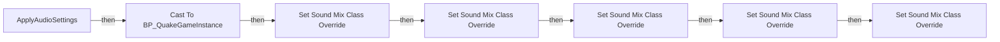
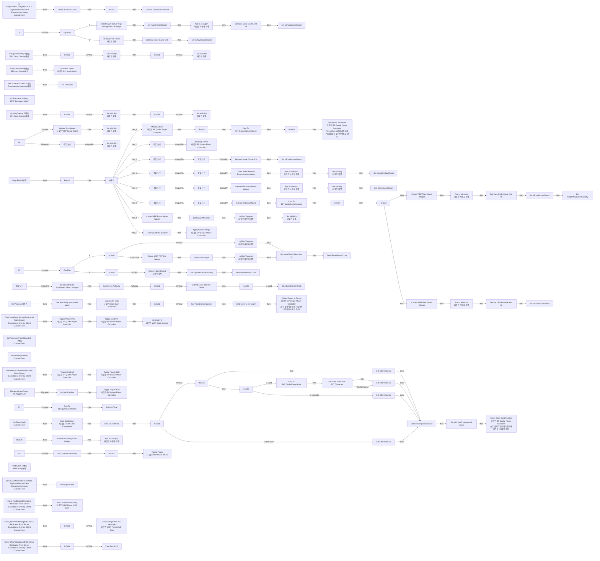
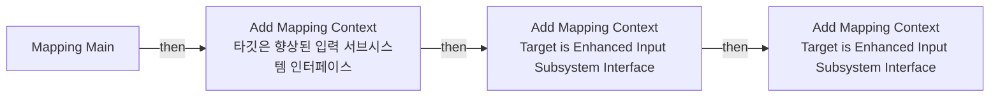
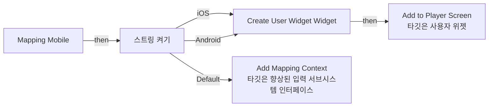
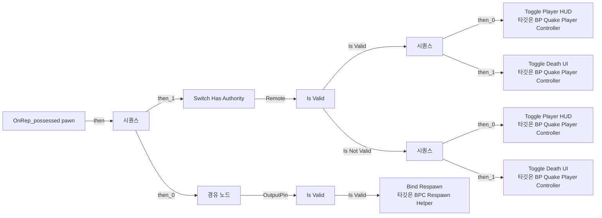
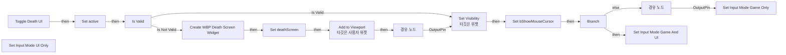
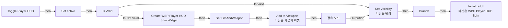
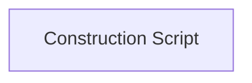

# BP_QuakePlayerController

에셋: `/Game/QuakeLike_1_0/Controller/BP_QuakePlayerController`

부모: `/Script/CoreUObject.Class'/Script/ShootingArena.MyPlayerController'`

수집일: 2026-10-12. MCP에서 읽은 그래프·핀 연결의 자동 전사입니다. 상속된 그래프는 부모 문서를 함께 확인합니다.

정적 루트 참조 도달: 있음. 실행 여부 또는 삭제 가능 여부의 확정이 아닙니다.

컴포넌트 목록은 이 BP가 직접 정의한 SCS만 포함합니다. 부모·네이티브 생성 컴포넌트, 인스턴스 설정은 별도입니다.

## 직접 정의한 컴포넌트

| 이름 | 클래스 | 부모 컴포넌트 |
|---|---|---|
| `BPC_RespawnHelper` | `BPC_RespawnHelper_C` | `` |
| `DeathCam` | `DeathCamComponent` | `` |
| `BPC_DeathCountTracker` | `BPC_DeathCountTracker_C` | `` |
| `BPC_DebugAI_AttachToPlayerController` | `BPC_DebugAI_AttachToPlayerController_C` | `` |
| `BPC_ThirdPersonViewCamera` | `BPC_ThirdPersonViewCamera_C` | `` |
| `BPC_PauseManager` | `BPC_PauseManager_C` | `` |

## 변수와 기본값

| 이름 | 타입 | CDO 기본값 |
|---|---|---|
| `Touch Controls Widget Class` | `UserWidget` | None |
| `mapChangeWidget` | `WBP_ServerMapChangeTestUI_C` | None |
| `PawnLifeComponent` | `BPC_Life_C` | None |
| `deathScreen` | `WBP_DeathScreen_C` | None |
| `LifeAndWeapon` | `WBP_PlayerHUD_sdm_C` | None |
| `possessed pawn` | `Pawn` | None |
| `UIDToken` | `string` |  |
| `crosshairWidget` | `WBP_Crosshair_C` | None |
| `zoomOverlayWidget` | `WBP_RailGunZoomOverlay_C` | None |
| `ScoreboardWidget` | `WBP_ScoreBoard_C` | None |
| `fovTestWidget` | `WBP_FOVTest_C` | None |
| `testFOV` | `real` | 90.0 |
| `LastDeathInfo ` | `S_DamageInfo` | &lt;Struct 'S_DamageInfo' {}&gt; |
| `LastRespawnDuration` | `real` | 0.0 |
| `GameSettings` | `DA_GameSettings_C` | /Game/QuakeLike_Base/SDM/UI/Combat_UI/DA_GameSettings_Default.DA_GameSettings_Default |
| `KillerNameStr` | `string` |  |
| `bHUDVisible` | `bool` | False |
| `Pause Menu Ref` | `WBP_PauseMenu_C` | None |
| `MasterVolume` | `real` | 100.0 |
| `BGMVolume` | `real` | 100.0 |
| `SFXVolume` | `real` | 100.0 |
| `UIVolume` | `real` | 100.0 |
| `CharacterVolume` | `real` | 100.0 |

## 그래프 목록

| 그래프 | 전체 노드 수 |
|---|---|
| ApplyAudioSettings | 16 |
| EventGraph | 262 |
| Mapping Main | 10 |
| Mapping Mobile | 11 |
| OnRep_possessed pawn | 20 |
| Toggle Death UI | 23 |
| Toggle Player HUD | 22 |
| UserConstructionScript | 1 |

## 그래프별 실행 연결

실선은 출력 exec 핀의 실제 연결입니다. 여러 분기는 출력 핀 이름을 표시합니다. 함수 호출·delegate·타이머의 다음 그래프 실행은 이 그림에서 자동으로 이어 붙이지 않습니다.

순수 계산 노드 및 데이터 핀은 아래 목록과 원본 JSON을 확인합니다. 연결되지 않은 이벤트도 표시되므로, 노드가 있다는 이유만으로 실행된다고 판단하면 안 됩니다.

### ApplyAudioSettings

실행 핀 플로우차트

전체 노드·기본 입력 목록

| 노드 ID | 제목 | 미연결 기본 입력 / 에셋 입력 |
|---|---|---|
| `K2Node_FunctionEntry_0` | ApplyAudioSettings |  |
| `K2Node_PromotableOperator_0` | float / float | B=100.000000 |
| `K2Node_CallFunction_0` | Set Sound Mix Class Override | InSoundMixModifier=/Game/QuakeLike_1_0/GameProgressFlow/Sound_Class/MIX_Settings.MIX_Settings; InSoundClass=/Game/QuakeLike_1_0/GameProgressFlow/Sound_Class/Master.Master; Pitch=1.000000; FadeInTime=1.000000; bApplyToChildren=true |
| `K2Node_PromotableOperator_1` | float / float | B=100.000000 |
| `K2Node_CallFunction_1` | Set Sound Mix Class Override | InSoundMixModifier=/Game/QuakeLike_1_0/GameProgressFlow/Sound_Class/MIX_Settings.MIX_Settings; InSoundClass=/Game/QuakeLike_1_0/GameProgressFlow/Sound_Class/SC_BGM.SC_BGM; Pitch=1.000000; FadeInTime=1.000000; bApplyToChildren=true |
| `K2Node_PromotableOperator_2` | float / float | B=100.000000 |
| `K2Node_CallFunction_2` | Set Sound Mix Class Override | InSoundMixModifier=/Game/QuakeLike_1_0/GameProgressFlow/Sound_Class/MIX_Settings.MIX_Settings; InSoundClass=/Game/QuakeLike_1_0/GameProgressFlow/Sound_Class/SC_Character.SC_Character; Pitch=1.000000; FadeInTime=1.000000; bApplyToChildren=true |
| `K2Node_PromotableOperator_3` | float / float | B=100.000000 |
| `K2Node_CallFunction_3` | Set Sound Mix Class Override | InSoundMixModifier=/Game/QuakeLike_1_0/GameProgressFlow/Sound_Class/MIX_Settings.MIX_Settings; InSoundClass=/Game/QuakeLike_1_0/GameProgressFlow/Sound_Class/SC_SFX.SC_SFX; Pitch=1.000000; FadeInTime=1.000000; bApplyToChildren=true |
| `K2Node_PromotableOperator_11` | float / float | B=100.000000 |
| `K2Node_CallFunction_78` | Set Sound Mix Class Override | InSoundMixModifier=/Game/QuakeLike_1_0/GameProgressFlow/Sound_Class/MIX_Settings.MIX_Settings; InSoundClass=/Game/QuakeLike_1_0/GameProgressFlow/Sound_Class/SC_UI.SC_UI; Pitch=1.000000; FadeInTime=1.000000; bApplyToChildren=true |
| `K2Node_CallFunction_4` | Get Game Instance |  |
| `K2Node_DynamicCast_0` | Cast To BP_QuakeGameInstance |  |
| `K2Node_VariableGet_0` | Get |  |
| `K2Node_Knot_0` | 경유 노드 |  |
| `K2Node_Knot_1` | 경유 노드 |  |

### EventGraph

실행 핀 플로우차트

전체 노드·기본 입력 목록

| 노드 ID | 제목 | 미연결 기본 입력 / 에셋 입력 |
|---|---|---|
| `K2Node_Event_0` | BeginPlay 이벤트 |  |
| `K2Node_IfThenElse_0` | Branch |  |
| `K2Node_CallFunction_17` | Is Local Player Controller 타깃은 컨트롤러 |  |
| `K2Node_ExecutionSequence_0` | 시퀀스 |  |
| `EdGraphNode_Comment_1` | 입력 매핑 및 로컬 플레이어에서만 UI를 로컬 플레이어에만 누릅니다. |  |
| `EdGraphNode_Comment_5` | 플레이어 입력 |  |
| `K2Node_CustomEvent_0` | [S] RequestMapChangeRELIABLE Replicated From Client Executes On Server Custom Event |  |
| `K2Node_CommutativeAssociativeBinaryOperator_0` | Append | A=ServerTravel  |
| `K2Node_CallFunction_10` | Execute Console Command |  |
| `K2Node_Self_1` | 셀프-레퍼런스 |  |
| `K2Node_CreateWidget_3` | Create WBP Server Map Change Test UI Widget | Class=/Game/QuakeLike_1_0/UI/ServerUI/WBP_ServerMapChangeTestUI.WBP_ServerMapChangeTestUI_C |
| `K2Node_Self_11` | 셀프-레퍼런스 |  |
| `K2Node_VariableSet_4` | Set bShowMouseCursor | bShowMouseCursor=true; Output_Get=false |
| `K2Node_Knot_18` | 경유 노드 |  |
| `K2Node_CallFunction_39` | Add to Viewport 타깃은 사용자 위젯 | ZOrder=0 |
| `K2Node_Knot_7` | 경유 노드 |  |
| `K2Node_Knot_10` | 경유 노드 |  |
| `K2Node_CallFunction_11` | Set Input Mode Game Only | bFlushInput=true |
| `K2Node_Self_5` | 셀프-레퍼런스 |  |
| `K2Node_VariableSet_2` | Set bShowMouseCursor | bShowMouseCursor=false; Output_Get=false |
| `K2Node_InputKey_0` | M |  |
| `K2Node_VariableSet_8` | Set mapChangeWidget |  |
| `K2Node_CallFunction_8` | Set Input Mode Game And UI | InMouseLockMode=DoNotLock; bHideCursorDuringCapture=false; bFlushInput=true |
| `K2Node_CallFunction_16` | Set Input Mode Game Only | bFlushInput=true |
| `K2Node_Self_3` | 셀프-레퍼런스 |  |
| `K2Node_VariableSet_7` | Set bShowMouseCursor | bShowMouseCursor=false; Output_Get=false |
| `K2Node_MacroInstance_1` | Flip Flop |  |
| `K2Node_VariableGet_2` | Get mapChangeWidget |  |
| `K2Node_CallFunction_13` | Remove from Parent 타깃은 위젯 |  |
| `EdGraphNode_Comment_0` | 서버상 맵 전환 테스트용 |  |
| `K2Node_Event_2` | On Possess 이벤트 |  |
| `K2Node_CallFunction_21` | Get Component by Class 타깃은 액터 | ComponentClass=/Game/QuakeLike_1_0/Life/BPC_Life.BPC_Life_C |
| `K2Node_VariableSet_6` | Set PawnLifeComponent |  |
| `K2Node_Knot_15` | 경유 노드 |  |
| `K2Node_MacroInstance_4` | Is Valid |  |
| `K2Node_Self_13` | 셀프-레퍼런스 |  |
| `K2Node_VariableSet_15` | Set with Notify possessed pawn |  |
| `K2Node_AddDelegate_0` | Bind Event to On Death |  |
| `K2Node_CreateDelegate_0` | 이벤트 생성 |  |
| `K2Node_CustomEvent_7` | OnPawnDeath Custom Event |  |
| `K2Node_VariableSet_18` | Set with Notify possessed pawn |  |
| `K2Node_Knot_5` | 경유 노드 |  |
| `K2Node_ComponentBoundEvent_1` | On Respawn Waiting (BPC_RespawnHelper) | Remain Time=0.0 |
| `K2Node_Event_1` | SaveAimSpeed 이벤트 BPI Input Option에서 |  |
| `K2Node_CallFunction_7` | Save Aim Speed 타깃은 BPI Input Option |  |
| `K2Node_Knot_2` | 경유 노드 |  |
| `K2Node_Knot_6` | 경유 노드 |  |
| `K2Node_Event_3` | SetConnectionToken 이벤트 Reconnection Interface에서 |  |
| `K2Node_VariableSet_0` | Set UIDToken |  |
| `K2Node_CallFunction_12` | Mapping Main 타깃은 BP Quake Player Controller |  |
| `K2Node_CallFunction_14` | Mapping Mobile 타깃은 BP Quake Player Controller |  |
| `K2Node_Knot_13` | 경유 노드 |  |
| `K2Node_Knot_14` | 경유 노드 |  |
| `K2Node_CreateWidget_1` | Create WBP Rail Gun Zoom Overlay Widget | Class=/Game/QuakeLike_1_0/UI/WBP_RailGunZoomOverlay.WBP_RailGunZoomOverlay_C |
| `K2Node_Knot_4` | 경유 노드 |  |
| `K2Node_Knot_9` | 경유 노드 |  |
| `K2Node_CallFunction_63` | Add to Viewport 타깃은 사용자 위젯 | ZOrder=0 |
| `K2Node_Knot_11` | 경유 노드 |  |
| `K2Node_CallFunction_47` | Set Visibility 타깃은 위젯 | InVisibility=Collapsed |
| `K2Node_VariableSet_3` | Set zoomOverlayWidget |  |
| `K2Node_Knot_17` | 경유 노드 |  |
| `K2Node_Knot_19` | 경유 노드 |  |
| `K2Node_Knot_20` | 경유 노드 |  |
| `K2Node_Knot_21` | 경유 노드 |  |
| `K2Node_Knot_22` | 경유 노드 |  |
| `K2Node_Knot_23` | 경유 노드 |  |
| `K2Node_Event_4` | VisibilityOverlay 이벤트 BPI Zoom Overlay에서 |  |
| `K2Node_Event_5` | CollapsedOverlay 이벤트 BPI Zoom Overlay에서 |  |
| `K2Node_VariableGet_7` | Get crosshairWidget |  |
| `K2Node_VariableGet_6` | Get zoomOverlayWidget |  |
| `K2Node_CallFunction_61` | Set Visibility 타깃은 위젯 | InVisibility=Visible |
| `K2Node_CallFunction_64` | Set Visibility 타깃은 위젯 | InVisibility=Visible |
| `K2Node_CallFunction_4` | Set Visibility 타깃은 위젯 | InVisibility=Collapsed |
| `K2Node_CallFunction_57` | Set Visibility 타깃은 위젯 | InVisibility=Collapsed |
| `K2Node_VariableGet_1` | Get zoomOverlayWidget |  |
| `K2Node_VariableGet_0` | Get crosshairWidget |  |
| `K2Node_MacroInstance_0` | Is Valid |  |
| `K2Node_MacroInstance_2` | Is Valid |  |
| `K2Node_MacroInstance_3` | Is Valid |  |
| `K2Node_MacroInstance_5` | Is Valid |  |
| `K2Node_CustomEvent_1` | Client_AddKillLogRELIABLE Replicated From Server Executes on Owning Client Custom Event |  |
| `K2Node_VariableGet_8` | Get LifeAndWeapon |  |
| `K2Node_Knot_24` | 경유 노드 |  |
| `K2Node_CreateWidget_6` | Create WBP Score Board Widget | Class=/Game/QuakeLike_Base/SDM/UI/Combat_UI/WBP_ScoreBoard.WBP_ScoreBoard_C |
| `K2Node_Knot_25` | 경유 노드 |  |
| `K2Node_CallFunction_52` | Add to Viewport 타깃은 사용자 위젯 | ZOrder=0 |
| `K2Node_CallFunction_53` | Set Visibility 타깃은 위젯 | InVisibility=Collapsed |
| `K2Node_Knot_37` | 경유 노드 |  |
| `K2Node_Knot_38` | 경유 노드 |  |
| `K2Node_VariableSet_23` | Set ScoreboardWidget |  |
| `K2Node_Knot_40` | 경유 노드 |  |
| `K2Node_Knot_41` | 경유 노드 |  |
| `K2Node_Knot_39` | 경유 노드 |  |
| `K2Node_InputKey_2` | Tab |  |
| `K2Node_VariableGet_10` | Get ScoreboardWidget |  |
| `K2Node_CallFunction_22` | Update Scoreboard 타깃은 WBP Score Board |  |
| `K2Node_CallFunction_24` | Set Visibility 타깃은 위젯 | InVisibility=HitTestInvisible |
| `K2Node_Knot_26` | 경유 노드 |  |
| `K2Node_CallFunction_23` | Set Visibility 타깃은 위젯 | InVisibility=Collapsed |
| `EdGraphNode_Comment_11` | tab누르면 스코어보드 뜸 |  |
| `EdGraphNode_Comment_12` | 죽였을 때 KillLog 보임 |  |
| `K2Node_Knot_29` | 경유 노드 |  |
| `K2Node_VariableGet_11` | Get DeathCam |  |
| `K2Node_CallFunction_25` | Start Death Cam 타깃은 Death Cam Component |  |
| `K2Node_VariableGet_12` | Get possessed pawn |  |
| `K2Node_VariableGet_13` | Get DeathCam |  |
| `K2Node_CallFunction_26` | Stop Death Cam 타깃은 Death Cam Component |  |
| `K2Node_MacroInstance_6` | Flip Flop |  |
| `K2Node_VariableGet_14` | Get fovTestWidget |  |
| `K2Node_MacroInstance_7` | Is Valid |  |
| `K2Node_CreateWidget_4` | Create WBP FOVTest Widget | Class=/Game/QuakeLike_1_0/Camera/WBP_FOVTest.WBP_FOVTest_C |
| `K2Node_Self_0` | 셀프-레퍼런스 |  |
| `K2Node_VariableSet_9` | Set fovTestWidget |  |
| `K2Node_CallFunction_27` | Add to Viewport 타깃은 사용자 위젯 | ZOrder=0 |
| `K2Node_VariableGet_15` | Get fovTestWidget |  |
| `K2Node_CallFunction_28` | Add to Viewport 타깃은 사용자 위젯 | ZOrder=0 |
| `K2Node_CallFunction_29` | Set Input Mode Game And UI | InMouseLockMode=DoNotLock; bHideCursorDuringCapture=false; bFlushInput=false |
| `K2Node_Self_6` | 셀프-레퍼런스 |  |
| `K2Node_VariableGet_16` | Get fovTestWidget |  |
| `K2Node_VariableSet_10` | Set bShowMouseCursor | bShowMouseCursor=true; Output_Get=false |
| `K2Node_VariableGet_17` | Get fovTestWidget |  |
| `K2Node_MacroInstance_8` | Is Valid |  |
| `K2Node_CallFunction_30` | Remove from Parent 타깃은 위젯 |  |
| `K2Node_CallFunction_31` | Set Input Mode Game Only | bFlushInput=false |
| `K2Node_Self_7` | 셀프-레퍼런스 |  |
| `K2Node_VariableSet_11` | Set bShowMouseCursor | bShowMouseCursor=false; Output_Get=false |
| `K2Node_InputKey_4` | F7 |  |
| `EdGraphNode_Comment_2` | FOV Setting UI |  |
| `K2Node_CustomEvent_2` | OnPossessedPawnChanged_이벤트 Custom Event |  |
| `K2Node_AssignDelegate_0` | Bind Event to On Possessed Pawn Changed |  |
| `K2Node_MacroInstance_10` | Switch Has Authority |  |
| `K2Node_MacroInstance_11` | Is Valid |  |
| `K2Node_Knot_33` | 경유 노드 |  |
| `K2Node_CallFunction_32` | Get Component by Class 타깃은 액터 | ComponentClass=/Game/QuakeLike_1_0/Life/BPC_Life.BPC_Life_C |
| `K2Node_CallFunction_33` | Get Component by Class 타깃은 액터 | ComponentClass=/Game/QuakeLike_1_0/Life/BPC_Life.BPC_Life_C |
| `K2Node_RemoveDelegate_1` | Unbind Event from On Death |  |
| `K2Node_MacroInstance_12` | Is Valid |  |
| `K2Node_AddDelegate_2` | Bind Event to On Death |  |
| `K2Node_CustomEvent_3` | HandlePlayerDeath Custom Event |  |
| `K2Node_Knot_34` | 경유 노드 |  |
| `K2Node_CallFunction_34` | Get Component by Class 타깃은 액터 | ComponentClass=/Game/QuakeLike_1_0/Life/BPC_Life.BPC_Life_C |
| `K2Node_VariableGet_18` | Get LifeInfo |  |
| `K2Node_VariableSet_12` | Set LastDeathInfo  |  |
| `K2Node_VariableGet_19` | Get GameSettings |  |
| `K2Node_VariableSet_13` | Set LastRespawnDuration |  |
| `K2Node_VariableGet_20` | Get RespawnDuration |  |
| `K2Node_CustomEvent_4` | ClientShowDeathScreenReplicated From Server Executes on Owning Client Custom Event |  |
| `K2Node_CallFunction_35` | Toggle Player HUD 타깃은 BP Quake Player Controller | Activate=false |
| `K2Node_CallFunction_36` | Toggle Death UI 타깃은 BP Quake Player Controller | Activate=true |
| `K2Node_VariableGet_21` | Get deathScreen |  |
| `K2Node_CallFunction_38` | Client Show Death Screen 타깃은 BP Quake Player Controller 소유 클라이언트에 리플리케이트됨 (서버인 경우) |  |
| `EdGraphNode_Comment_3` | 추가해봄 |  |
| `K2Node_CustomEvent_5` | ClientReturnToGameReplicated From Server Executes on Owning Client Custom Event |  |
| `K2Node_CallFunction_42` | Toggle Death UI 타깃은 BP Quake Player Controller | Activate=false |
| `K2Node_CallFunction_43` | Toggle Player HUD 타깃은 BP Quake Player Controller | Activate=true |
| `K2Node_CallFunction_44` | Client Return to Game 타깃은 BP Quake Player Controller 소유 클라이언트에 리플리케이트됨 (서버인 경우) |  |
| `K2Node_MacroInstance_9` | Is Valid |  |
| `K2Node_VariableSet_19` | Set KillerNameStr | KillerNameStr=함정 |
| `K2Node_IfThenElse_5` | Branch |  |
| `K2Node_VariableSet_16` | Set KillerNameStr | KillerNameStr=자폭임? |
| `K2Node_VariableGet_23` | Get PlayerState |  |
| `K2Node_MacroInstance_13` | Is Valid |  |
| `K2Node_VariableSet_17` | Set KillerNameStr |  |
| `K2Node_VariableSet_14` | Set KillerNameStr | KillerNameStr=적 |
| `K2Node_CallFunction_46` | Init Death UI 타깃은 WBP Death Screen |  |
| `K2Node_VariableGet_24` | Get KillerNameStr |  |
| `K2Node_PromotableOperator_6` | Equal (Object) |  |
| `K2Node_Self_9` | 셀프-레퍼런스 |  |
| `K2Node_EnhancedInputAction_1` | EnhancedInputAction IA_ToggleHUD | ActionValue=false; InputAction=/Game/QuakeLike_Base/SDM/UI/IA_ToggleHUD.IA_ToggleHUD |
| `K2Node_VariableSet_20` | Set bHUDVisible |  |
| `K2Node_CallFunction_37` | NOT Boolean |  |
| `K2Node_CallFunction_40` | Toggle Player HUD 타깃은 BP Quake Player Controller |  |
| `K2Node_VariableGet_22` | Get bHUDVisible |  |
| `K2Node_InputKey_3` | F1 |  |
| `K2Node_CallFunction_41` | Get Game State |  |
| `K2Node_DynamicCast_0` | Cast To BP_QuakeGameState |  |
| `K2Node_CallFunction_45` | Get Server World Time Seconds 타깃은 게임 스테이트 베이스 |  |
| `K2Node_VariableSet_22` | Set StartTime | Output_Get=0.0 |
| `K2Node_CallFunction_49` | Is Local Controller 타깃은 컨트롤러 |  |
| `K2Node_IfThenElse_2` | Branch |  |
| `K2Node_Knot_35` | 경유 노드 |  |
| `K2Node_Knot_36` | 경유 노드 |  |
| `K2Node_CreateWidget_7` | Create WBP Map Select Widget | Class=/Game/QuakeLike_1_0/GameFlow/UI/WBP_MapSelect.WBP_MapSelect_C |
| `K2Node_CallFunction_59` | Add to Viewport 타깃은 사용자 위젯 | ZOrder=0 |
| `K2Node_VariableSet_5` | Set bShowMouseCursor | bShowMouseCursor=true; Output_Get=false |
| `K2Node_Self_8` | 셀프-레퍼런스 |  |
| `K2Node_Self_14` | 셀프-레퍼런스 |  |
| `K2Node_CallFunction_60` | Set Input Mode Game And UI | InMouseLockMode=DoNotLock; bHideCursorDuringCapture=true; bFlushInput=false |
| `K2Node_CommutativeAssociativeBinaryOperator_1` | AND Boolean |  |
| `K2Node_CallFunction_6` | Get Game Instance |  |
| `K2Node_DynamicCast_1` | Cast To BP_QuakeGameInstance |  |
| `K2Node_VariableGet_25` | Get bIsInMenuFlow |  |
| `K2Node_CreateWidget_2` | Create WBP Pause Menu Widget | Class=/Game/QuakeLike_1_0/GameProgressFlow/WBP_PauseMenu.WBP_PauseMenu_C |
| `K2Node_CallFunction_50` | Add to Viewport 타깃은 사용자 위젯 | ZOrder=0 |
| `K2Node_CallFunction_51` | Set Visibility 타깃은 위젯 | InVisibility=Collapsed |
| `K2Node_CallFunction_54` | Toggle Pause 타깃은 WBP Pause Menu |  |
| `K2Node_VariableSet_24` | Set Pause Menu Ref |  |
| `K2Node_Knot_42` | 경유 노드 |  |
| `K2Node_CallFunction_20` | Get Current Level Name | bRemovePrefixString=true |
| `K2Node_PromotableOperator_0` | Not Equal (Name) | B=MainMenu_Level |
| `K2Node_IfThenElse_3` | Branch |  |
| `K2Node_InputKey_8` | F10 |  |
| `K2Node_CallFunction_55` | Get Current Level Name | bRemovePrefixString=true |
| `K2Node_CallFunction_56` | Equal Exactly (String) | B=MainMenu_Level |
| `K2Node_CreateWidget_5` | Create WBP Main Menu Widget | Class=/Game/QuakeLike_1_0/GameFlow/UI/WBP_MainMenu.WBP_MainMenu_C |
| `K2Node_CallFunction_5` | Add to Viewport 타깃은 사용자 위젯 | ZOrder=0 |
| `K2Node_VariableSet_21` | Set bShowMouseCursor | bShowMouseCursor=true; Output_Get=false |
| `K2Node_Self_10` | 셀프-레퍼런스 |  |
| `K2Node_Self_12` | 셀프-레퍼런스 |  |
| `K2Node_CallFunction_58` | Set Input Mode Game And UI | InMouseLockMode=DoNotLock; bHideCursorDuringCapture=true; bFlushInput=false |
| `K2Node_VariableGet_26` | Get bOpenMapSelectDirectly |  |
| `K2Node_IfThenElse_4` | Branch |  |
| `K2Node_VariableSet_25` | Set bOpenMapSelectDirectly | bOpenMapSelectDirectly=false; Output_Get=false |
| `K2Node_Event_6` | Print Kill UI 이벤트 BPI Kill Log에서 |  |
| `K2Node_CallFunction_0` | Is Local Player Controller 타깃은 컨트롤러 |  |
| `K2Node_IfThenElse_1` | Branch |  |
| `K2Node_CreateWidget_0` | Create WBP Player KIll Widget | Class=/Game/QuakeLike_Base/SDM/UI/Combat_UI/WBP_PlayerKIll.WBP_PlayerKIll_C |
| `K2Node_CallFunction_3` | Add to Viewport 타깃은 사용자 위젯 | ZOrder=0 |
| `K2Node_Knot_27` | 경유 노드 |  |
| `K2Node_Knot_28` | 경유 노드 |  |
| `K2Node_CallFunction_1` | Get All Actors Of Class | ActorClass=/Game/QuakeLike_1_0/Controller/BP_QuakePlayerController.BP_QuakePlayerController_C |
| `K2Node_CallArrayFunction_0` | Length |  |
| `K2Node_PromotableOperator_1` | integer &lt;= integer | B=1 |
| `K2Node_IfThenElse_7` | Branch |  |
| `EdGraphNode_Comment_4` | 재시작 막기위한 발악 인원수 체크 |  |
| `K2Node_Knot_30` | 경유 노드 |  |
| `K2Node_Knot_31` | 경유 노드 |  |
| `K2Node_CustomEvent_6` | Server_SetNicknameRELIABLE Replicated From Client Executes On Server Custom Event |  |
| `K2Node_CallFunction_2` | Set Player Name |  |
| `K2Node_Self_15` | 셀프-레퍼런스 |  |
| `K2Node_Knot_8` | 경유 노드 |  |
| `K2Node_CallFunction_19` | Is Local Player Controller 타깃은 컨트롤러 |  |
| `K2Node_IfThenElse_6` | Branch |  |
| `K2Node_CallFunction_65` | Get Game Instance |  |
| `K2Node_DynamicCast_2` | Cast To BP_QuakeGameInstance |  |
| `K2Node_VariableGet_27` | Get PlayerNickname |  |
| `K2Node_CallFunction_66` | Is Empty |  |
| `K2Node_CallFunction_67` | NOT Boolean |  |
| `K2Node_IfThenElse_8` | Branch |  |
| `K2Node_CallFunction_68` | Server Set Nickname 타깃은 BP Quake Player Controller RELIABLE 서버에 리플리케이트됨 (소유 클라이언트인 경우) |  |
| `K2Node_CallFunction_69` | Get Player Name 타깃은 플레이어 스테이트 |  |
| `K2Node_VariableGet_28` | Get CampaignName |  |
| `K2Node_CallFunction_70` | Is Empty |  |
| `K2Node_CallFunction_71` | Select String |  |
| `K2Node_DynamicCast_3` | Cast To BP_QuakePlayerState |  |
| `K2Node_CallFunction_48` | Add Competitive Kill Log 타깃은 WBP Player HUD Sdm | DisplayTime=3.000000 |
| `K2Node_CustomEvent_8` | Client_ShowKillMessageRELIABLE Replicated From Server Executes on Owning Client Custom Event |  |
| `K2Node_VariableGet_9` | Get LifeAndWeapon |  |
| `K2Node_MacroInstance_14` | Is Valid |  |
| `K2Node_CallFunction_18` | Show Competitive Kill Message 타깃은 WBP Player HUD Sdm |  |
| `K2Node_Knot_16` | 경유 노드 |  |
| `EdGraphNode_Comment_6` | 내 화면 중앙에 뜨는 killmsg |  |
| `K2Node_CallFunction_72` | String To Name |  |
| `K2Node_GetDataTableRow_0` | Get Data Table Row DT_Character | DataTable=/Game/QuakeLike_1_0/GameFlow/Table/DT/DT_Character.DT_Character |
| `K2Node_CallFunction_73` | To String (Name) |  |
| `K2Node_CallFunction_74` | Push Sound Mix Modifier | InSoundMixModifier=/Game/QuakeLike_1_0/GameProgressFlow/Sound_Class/MIX_Settings.MIX_Settings |
| `K2Node_CallFunction_75` | Apply Audio Settings 타깃은 BP Quake Player Controller |  |
| `K2Node_CustomEvent_10` | Client_PlayPickupSoundRELIABLE Replicated From Server Executes on Owning Client Custom Event |  |
| `K2Node_MacroInstance_15` | Is Valid |  |
| `K2Node_CallFunction_76` | Play Sound 2D | PitchMultiplier=1.000000; StartTime=0.000000; bIsUISound=true |
| `K2Node_Knot_32` | 경유 노드 |  |
| `K2Node_Knot_43` | 경유 노드 |  |

### Mapping Main

실행 핀 플로우차트

전체 노드·기본 입력 목록

| 노드 ID | 제목 | 미연결 기본 입력 / 에셋 입력 |
|---|---|---|
| `K2Node_FunctionEntry_0` | Mapping Main |  |
| `EdGraphNode_Comment_2` | 정규 입력 매핑 추가 |  |
| `K2Node_CallFunction_6` | Add Mapping Context 타깃은 향상된 입력 서브시스템 인터페이스 | MappingContext=/Game/Input/IMC_Default.IMC_Default; Priority=0; Options=(bIgnoreAllPressedKeysUntilRelease=True,bForceImmediately=False,bNotifyUserSettings=False) |
| `K2Node_GetSubsystem_1` | 향상된 입력 로컬 플레이어 서브시스템 |  |
| `K2Node_Message_0` | Add Mapping Context Target is Enhanced Input Subsystem Interface | MappingContext=/Game/Variant_Shooter/Input/IMC_Weapons.IMC_Weapons; Priority=0; Options=(bIgnoreAllPressedKeysUntilRelease=True,bForceImmediately=False,bNotifyUserSettings=False) |
| `K2Node_Message_1` | Add Mapping Context Target is Enhanced Input Subsystem Interface | MappingContext=/Game/QuakeLike_Base/YJS/Input/IMC_YJS_Weapons.IMC_YJS_Weapons; Priority=0; Options=(bIgnoreAllPressedKeysUntilRelease=True,bForceImmediately=False,bNotifyUserSettings=False) |
| `K2Node_Knot_3` | 경유 노드 |  |
| `K2Node_Knot_4` | 경유 노드 |  |
| `K2Node_Knot_0` | 경유 노드 |  |
| `K2Node_Knot_1` | 경유 노드 |  |

### Mapping Mobile

실행 핀 플로우차트

전체 노드·기본 입력 목록

| 노드 ID | 제목 | 미연결 기본 입력 / 에셋 입력 |
|---|---|---|
| `K2Node_FunctionEntry_0` | Mapping Mobile |  |
| `K2Node_SwitchString_0` | 스트링 켜기 |  |
| `K2Node_CallFunction_14` | Get Platform Name |  |
| `K2Node_VariableGet_0` | Get Touch Controls Widget Class |  |
| `K2Node_CreateWidget_2` | Create User Widget Widget |  |
| `K2Node_Self_6` | 셀프-레퍼런스 |  |
| `K2Node_CallFunction_5` | Add to Player Screen 타깃은 사용자 위젯 | ZOrder=0; ReturnValue=false |
| `EdGraphNode_Comment_4` | 위젯을 통해 터치 입력 컨트롤 추가 |  |
| `K2Node_CallFunction_7` | Add Mapping Context 타깃은 향상된 입력 서브시스템 인터페이스 | MappingContext=/Game/Input/IMC_MouseLook.IMC_MouseLook; Priority=0; Options=(bIgnoreAllPressedKeysUntilRelease=True,bForceImmediately=False,bNotifyUserSettings=False) |
| `EdGraphNode_Comment_3` | 마우스를 서로 간섭하지 않기 때문에 모바일 컨트롤을 건너뜀 |  |
| `K2Node_GetSubsystem_0` | 향상된 입력 로컬 플레이어 서브시스템 |  |

### OnRep_possessed pawn

실행 핀 플로우차트

전체 노드·기본 입력 목록

| 노드 ID | 제목 | 미연결 기본 입력 / 에셋 입력 |
|---|---|---|
| `K2Node_FunctionEntry_0` | OnRep_possessed pawn |  |
| `K2Node_VariableGet_1` | Get possessed pawn |  |
| `K2Node_MacroInstance_0` | Switch Has Authority |  |
| `K2Node_MacroInstance_6` | Is Valid |  |
| `K2Node_ExecutionSequence_0` | 시퀀스 |  |
| `K2Node_ExecutionSequence_1` | 시퀀스 |  |
| `EdGraphNode_Comment_0` | Spawn 및 Possess 시 |  |
| `EdGraphNode_Comment_1` | Death 시 |  |
| `K2Node_VariableGet_15` | Get BPC_RespawnHelper |  |
| `K2Node_CallFunction_4` | Bind Respawn 타깃은 BPC Respawn Helper | Respawn Time=5.000000 |
| `K2Node_Self_5` | 셀프-레퍼런스 |  |
| `K2Node_VariableGet_13` | Get possessed pawn |  |
| `K2Node_ExecutionSequence_2` | 시퀀스 |  |
| `K2Node_VariableGet_16` | Get possessed pawn |  |
| `K2Node_MacroInstance_1` | Is Valid |  |
| `K2Node_Knot_0` | 경유 노드 |  |
| `K2Node_CallFunction_2` | Toggle Player HUD 타깃은 BP Quake Player Controller | Activate=true |
| `K2Node_CallFunction_0` | Toggle Player HUD 타깃은 BP Quake Player Controller | Activate=false |
| `K2Node_CallFunction_5` | Toggle Death UI 타깃은 BP Quake Player Controller | Activate=false |
| `K2Node_CallFunction_6` | Toggle Death UI 타깃은 BP Quake Player Controller | Activate=true |

### Toggle Death UI

실행 핀 플로우차트

전체 노드·기본 입력 목록

| 노드 ID | 제목 | 미연결 기본 입력 / 에셋 입력 |
|---|---|---|
| `K2Node_FunctionEntry_0` | Toggle Death UI |  |
| `K2Node_Self_6` | 셀프-레퍼런스 |  |
| `K2Node_CallFunction_12` | Add to Viewport 타깃은 사용자 위젯 | ZOrder=0 |
| `K2Node_MacroInstance_2` | Is Valid |  |
| `K2Node_CallFunction_4` | Set Visibility 타깃은 위젯 |  |
| `K2Node_Knot_3` | 경유 노드 |  |
| `K2Node_Select_1` | 선택 | Option 0=Hidden; Option 1=HitTestInvisible |
| `K2Node_VariableSet_6` | Set active | Output_Get=false |
| `K2Node_VariableGet_8` | Get active |  |
| `K2Node_VariableGet_4` | Get deathScreen |  |
| `K2Node_VariableSet_7` | Set deathScreen |  |
| `K2Node_VariableGet_6` | Get deathScreen |  |
| `K2Node_CallFunction_38` | Set Input Mode UI Only | InMouseLockMode=DoNotLock; bFlushInput=true |
| `K2Node_Self_12` | 셀프-레퍼런스 |  |
| `K2Node_VariableGet_3` | Get active |  |
| `K2Node_IfThenElse_0` | Branch |  |
| `K2Node_VariableGet_9` | Get deathScreen |  |
| `K2Node_Self_4` | 셀프-레퍼런스 |  |
| `K2Node_CallFunction_19` | Set Input Mode Game Only | bFlushInput=true |
| `K2Node_Knot_6` | 경유 노드 |  |
| `K2Node_VariableSet_10` | Set bShowMouseCursor |  |
| `K2Node_CallFunction_0` | Set Input Mode Game And UI | InMouseLockMode=DoNotLock; bHideCursorDuringCapture=true; bFlushInput=false |
| `K2Node_CreateWidget_0` | Create WBP Death Screen Widget | Class=/Game/QuakeLike_1_0/UI/DeathUI/WBP_DeathScreen.WBP_DeathScreen_C |

### Toggle Player HUD

실행 핀 플로우차트

전체 노드·기본 입력 목록

| 노드 ID | 제목 | 미연결 기본 입력 / 에셋 입력 |
|---|---|---|
| `K2Node_FunctionEntry_0` | Toggle Player HUD |  |
| `K2Node_Self_6` | 셀프-레퍼런스 |  |
| `K2Node_CallFunction_12` | Add to Viewport 타깃은 사용자 위젯 | ZOrder=0 |
| `K2Node_VariableSet_3` | Set LifeAndWeapon |  |
| `K2Node_CreateWidget_5` | Create WBP Player HUD Sdm Widget | Class=/Game/QuakeLike_Base/SDM/UI/Combat_UI/WBP_PlayerHUD_sdm.WBP_PlayerHUD_sdm_C |
| `K2Node_MacroInstance_2` | Is Valid |  |
| `K2Node_VariableGet_14` | Get LifeAndWeapon |  |
| `K2Node_VariableSet_4` | Set active | Output_Get=false |
| `K2Node_VariableGet_10` | Get LifeAndWeapon |  |
| `K2Node_CallFunction_4` | Set Visibility 타깃은 위젯 |  |
| `K2Node_Knot_3` | 경유 노드 |  |
| `K2Node_VariableGet_11` | Get active |  |
| `K2Node_Select_1` | 선택 | Option 0=Hidden; Option 1=HitTestInvisible |
| `K2Node_VariableGet_0` | Get LifeAndWeapon |  |
| `K2Node_VariableGet_15` | Get possessed pawn |  |
| `K2Node_CallFunction_6` | Is Valid |  |
| `K2Node_VariableGet_18` | Get active |  |
| `K2Node_CommutativeAssociativeBinaryOperator_0` | AND Boolean |  |
| `K2Node_IfThenElse_3` | Branch |  |
| `K2Node_Knot_7` | 경유 노드 |  |
| `K2Node_Knot_8` | 경유 노드 |  |
| `K2Node_CallFunction_0` | Initialize UI 타깃은 WBP Player HUD Sdm |  |

### UserConstructionScript

실행 핀 플로우차트

전체 노드·기본 입력 목록

| 노드 ID | 제목 | 미연결 기본 입력 / 에셋 입력 |
|---|---|---|
| `K2Node_FunctionEntry_0` | Construction Script |  |

## 조회 범위의 한계

ObjectIterator로 발견했으나 MCP helper가 반환하지 않은 그래프입니다. delegate signature·컴파일된 중간 그래프·macro·애니메이션 내부 그래프가 섞일 수 있습니다.

- `BndEvt__BP_QuakePlayerController_BPC_RespawnHelper_K2Node_ComponentBoundEvent_1_OnRespawnWaiting__DelegateSignature`: Graph 'BndEvt__BP_QuakePlayerController_BPC_RespawnHelper_K2Node_ComponentBoundEvent_1_OnRespawnWaiting__DelegateSignature' not found in Blueprint.
- `ClientReturnToGame`: Graph 'ClientReturnToGame' not found in Blueprint.
- `ClientShowDeathScreen`: Graph 'ClientShowDeathScreen' not found in Blueprint.
- `Client_AddKillLog`: Graph 'Client_AddKillLog' not found in Blueprint.
- `Client_PlayPickupSound`: Graph 'Client_PlayPickupSound' not found in Blueprint.
- `Client_ShowKillMessage`: Graph 'Client_ShowKillMessage' not found in Blueprint.
- `CollapsedOverlay`: Graph 'CollapsedOverlay' not found in Blueprint.
- `GetAimSpeed`: Graph 'GetAimSpeed' not found in Blueprint.
- `GetConnectionToken`: Graph 'GetConnectionToken' not found in Blueprint.
- `HandlePlayerDeath`: Graph 'HandlePlayerDeath' not found in Blueprint.
- `InpActEvt_F10_K2Node_InputKeyEvent_0`: Graph 'InpActEvt_F10_K2Node_InputKeyEvent_0' not found in Blueprint.
- `InpActEvt_F1_K2Node_InputKeyEvent_1`: Graph 'InpActEvt_F1_K2Node_InputKeyEvent_1' not found in Blueprint.
- `InpActEvt_F7_K2Node_InputKeyEvent_2`: Graph 'InpActEvt_F7_K2Node_InputKeyEvent_2' not found in Blueprint.
- `InpActEvt_IA_ToggleHUD_K2Node_EnhancedInputActionEvent_0`: Graph 'InpActEvt_IA_ToggleHUD_K2Node_EnhancedInputActionEvent_0' not found in Blueprint.
- `InpActEvt_M_K2Node_InputKeyEvent_5`: Graph 'InpActEvt_M_K2Node_InputKeyEvent_5' not found in Blueprint.
- `InpActEvt_Tab_K2Node_InputKeyEvent_3`: Graph 'InpActEvt_Tab_K2Node_InputKeyEvent_3' not found in Blueprint.
- `InpActEvt_Tab_K2Node_InputKeyEvent_4`: Graph 'InpActEvt_Tab_K2Node_InputKeyEvent_4' not found in Blueprint.
- `OnPawnDeath`: Graph 'OnPawnDeath' not found in Blueprint.
- `OnPossessedPawnChanged_이벤트`: Graph 'OnPossessedPawnChanged_이벤트' not found in Blueprint.
- `Print Kill UI`: Graph 'Print Kill UI' not found in Blueprint.
- `ReceiveBeginPlay`: Graph 'ReceiveBeginPlay' not found in Blueprint.
- `ReceivePossess`: Graph 'ReceivePossess' not found in Blueprint.
- `SaveAimSpeed`: Graph 'SaveAimSpeed' not found in Blueprint.
- `Server_SetNickname`: Graph 'Server_SetNickname' not found in Blueprint.
- `SetConnectionToken`: Graph 'SetConnectionToken' not found in Blueprint.
- `VisibilityOverlay`: Graph 'VisibilityOverlay' not found in Blueprint.
- `[S] RequestMapChange`: Graph '[S] RequestMapChange' not found in Blueprint.

[원본 MCP 스냅샷](../../../Evidence/blueprints-035.json)
