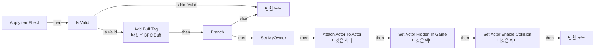
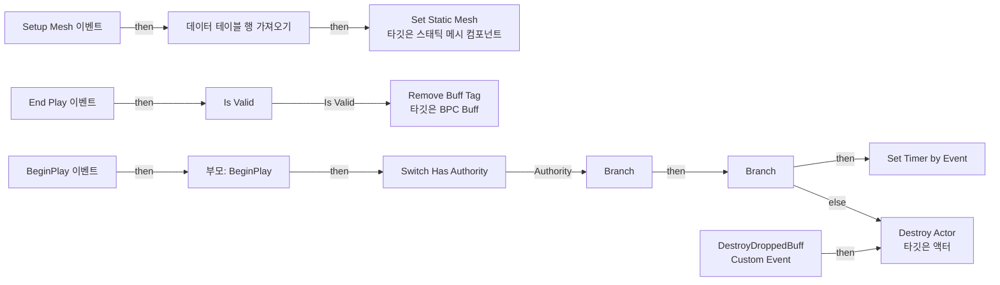
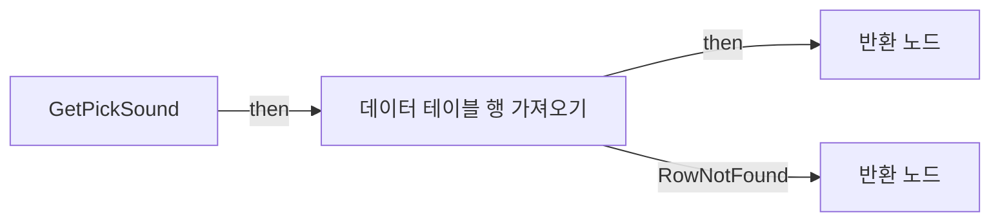
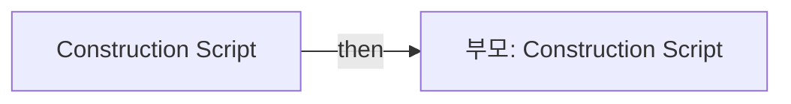

# BP_BuffItem

에셋: `/Game/QuakeLike_1_0/DropItem/BP_BuffItem`

부모: `/Script/Engine.BlueprintGeneratedClass'/Game/QuakeLike_1_0/DropItem/BP_DropItem.BP_DropItem_C'`

수집일: 2026-10-12. MCP에서 읽은 그래프·핀 연결의 자동 전사입니다. 상속된 그래프는 부모 문서를 함께 확인합니다.

정적 루트 참조 도달: 있음. 실행 여부 또는 삭제 가능 여부의 확정이 아닙니다.

컴포넌트 목록은 이 BP가 직접 정의한 SCS만 포함합니다. 부모·네이티브 생성 컴포넌트, 인스턴스 설정은 별도입니다.

## 변수와 기본값

| 이름 | 타입 | CDO 기본값 |
|---|---|---|
| `CurrentDuration` | `real` | 0.0 |
| `MaxDuration` | `real` | 30.0 |
| `MyOwner` | `Actor` | None |
| `EndServerTime` | `real` | 0.0 |
| `IsDroppedBuff` | `bool` | False |

## 그래프 목록

| 그래프 | 전체 노드 수 |
|---|---|
| ApplyItemEffect | 15 |
| EventGraph | 27 |
| GetPickSound | 7 |
| UserConstructionScript | 2 |

## 그래프별 실행 연결

실선은 출력 exec 핀의 실제 연결입니다. 여러 분기는 출력 핀 이름을 표시합니다. 함수 호출·delegate·타이머의 다음 그래프 실행은 이 그림에서 자동으로 이어 붙이지 않습니다.

순수 계산 노드 및 데이터 핀은 아래 목록과 원본 JSON을 확인합니다. 연결되지 않은 이벤트도 표시되므로, 노드가 있다는 이유만으로 실행된다고 판단하면 안 됩니다.

### ApplyItemEffect

실행 핀 플로우차트

전체 노드·기본 입력 목록

| 노드 ID | 제목 | 미연결 기본 입력 / 에셋 입력 |
|---|---|---|
| `K2Node_FunctionEntry_0` | ApplyItemEffect |  |
| `K2Node_FunctionResult_1` | 반환 노드 | Succees=true |
| `K2Node_CallFunction_0` | Get Component by Class 타깃은 액터 | ComponentClass=/Game/QuakeLike_1_0/Buff/BPC_Buff.BPC_Buff_C |
| `K2Node_MacroInstance_0` | Is Valid |  |
| `K2Node_CallFunction_1` | Add Buff Tag 타깃은 BPC Buff |  |
| `K2Node_Knot_0` | 경유 노드 |  |
| `K2Node_FunctionResult_0` | 반환 노드 | Succees=false |
| `K2Node_CallFunction_2` | Attach Actor To Actor 타깃은 액터 | SocketName=None; LocationRule=SnapToTarget; RotationRule=SnapToTarget; ScaleRule=SnapToTarget; bWeldSimulatedBodies=TRUE; ReturnValue=false |
| `K2Node_Knot_1` | 경유 노드 |  |
| `K2Node_Knot_2` | 경유 노드 |  |
| `K2Node_CallFunction_4` | Set Actor Hidden In Game 타깃은 액터 | bNewHidden=true |
| `K2Node_CallFunction_5` | Set Actor Enable Collision 타깃은 액터 | bNewActorEnableCollision=false |
| `K2Node_Self_0` | 셀프-레퍼런스 |  |
| `K2Node_VariableSet_0` | Set MyOwner |  |
| `K2Node_IfThenElse_0` | Branch |  |

### EventGraph

실행 핀 플로우차트

전체 노드·기본 입력 목록

| 노드 ID | 제목 | 미연결 기본 입력 / 에셋 입력 |
|---|---|---|
| `K2Node_Event_3` | Setup Mesh 이벤트 |  |
| `K2Node_BreakStruct_0` | Break Data Table Row Handle |  |
| `K2Node_GetDataTableRow_0` | 데이터 테이블 행 가져오기 |  |
| `K2Node_VariableGet_1` | Get DataTable Handle |  |
| `K2Node_BreakStruct_1` | Break ST Buff Data |  |
| `K2Node_CallFunction_0` | Set Static Mesh 타깃은 스태틱 메시 컴포넌트 | ReturnValue=false |
| `K2Node_VariableGet_0` | Get StaticMesh |  |
| `K2Node_Event_0` | End Play 이벤트 | EndPlayReason=Destroyed |
| `K2Node_VariableGet_4` | Get MyOwner |  |
| `K2Node_MacroInstance_0` | Is Valid |  |
| `K2Node_CallFunction_3` | Get Component by Class 타깃은 액터 | ComponentClass=/Game/QuakeLike_1_0/Buff/BPC_Buff.BPC_Buff_C |
| `K2Node_CallFunction_4` | Remove Buff Tag 타깃은 BPC Buff |  |
| `K2Node_Event_1` | BeginPlay 이벤트 |  |
| `K2Node_MacroInstance_1` | Switch Has Authority |  |
| `K2Node_CallFunction_1` | Get Game State |  |
| `K2Node_CallFunction_2` | Get Server World Time Seconds 타깃은 게임 스테이트 베이스 |  |
| `K2Node_VariableGet_2` | Get EndServerTime |  |
| `K2Node_PromotableOperator_0` | float - float |  |
| `K2Node_PromotableOperator_1` | float &gt; float |  |
| `K2Node_IfThenElse_0` | Branch |  |
| `K2Node_CallFunction_5` | Set Timer by Event | bLooping=false; bMaxOncePerFrame=false; InitialStartDelay=0.000000; InitialStartDelayVariance=0.000000 |
| `K2Node_CustomEvent_0` | DestroyDroppedBuff Custom Event |  |
| `K2Node_CallFunction_6` | Destroy Actor 타깃은 액터 |  |
| `K2Node_IfThenElse_1` | Branch |  |
| `K2Node_VariableGet_3` | Get IsDroppedBuff |  |
| `K2Node_CallParentFunction_0` | 부모: BeginPlay |  |
| `K2Node_VariableGet_5` | Get currentBuffTag |  |

### GetPickSound

실행 핀 플로우차트

전체 노드·기본 입력 목록

| 노드 ID | 제목 | 미연결 기본 입력 / 에셋 입력 |
|---|---|---|
| `K2Node_FunctionEntry_0` | GetPickSound |  |
| `K2Node_FunctionResult_1` | 반환 노드 |  |
| `K2Node_GetDataTableRow_0` | 데이터 테이블 행 가져오기 |  |
| `K2Node_VariableGet_0` | Get DataTable Handle |  |
| `K2Node_BreakStruct_0` | Break Data Table Row Handle |  |
| `K2Node_FunctionResult_0` | 반환 노드 | pickupVolume=0.0 |
| `K2Node_BreakStruct_2` | Break ST Buff Data |  |

### UserConstructionScript

실행 핀 플로우차트

전체 노드·기본 입력 목록

| 노드 ID | 제목 | 미연결 기본 입력 / 에셋 입력 |
|---|---|---|
| `K2Node_FunctionEntry_0` | Construction Script |  |
| `K2Node_CallParentFunction_0` | 부모: Construction Script |  |

## 조회 범위의 한계

ObjectIterator로 발견했으나 MCP helper가 반환하지 않은 그래프입니다. delegate signature·컴파일된 중간 그래프·macro·애니메이션 내부 그래프가 섞일 수 있습니다.

- `DestroyDroppedBuff`: Graph 'DestroyDroppedBuff' not found in Blueprint.
- `ReceiveBeginPlay`: Graph 'ReceiveBeginPlay' not found in Blueprint.
- `ReceiveEndPlay`: Graph 'ReceiveEndPlay' not found in Blueprint.
- `Setup Mesh`: Graph 'Setup Mesh' not found in Blueprint.

[원본 MCP 스냅샷](../../../Evidence/blueprints-070.json)
