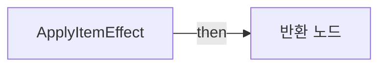
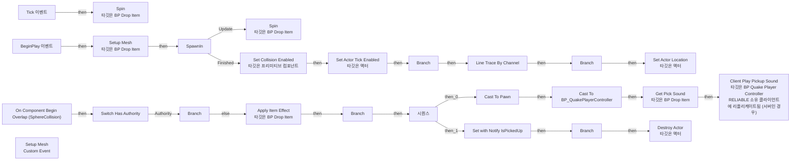
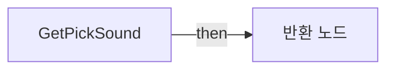
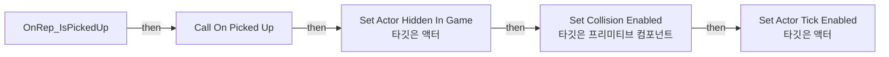
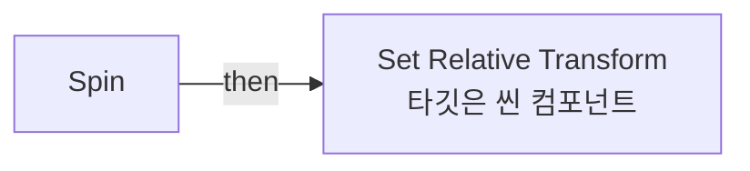
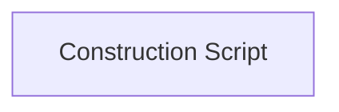

# BP_DropItem

에셋: `/Game/QuakeLike_1_0/DropItem/BP_DropItem`

부모: `/Script/CoreUObject.Class'/Script/Engine.Actor'`

수집일: 2026-10-12. MCP에서 읽은 그래프·핀 연결의 자동 전사입니다. 상속된 그래프는 부모 문서를 함께 확인합니다.

정적 루트 참조 도달: 있음. 실행 여부 또는 삭제 가능 여부의 확정이 아닙니다.

컴포넌트 목록은 이 BP가 직접 정의한 SCS만 포함합니다. 부모·네이티브 생성 컴포넌트, 인스턴스 설정은 별도입니다.

## 직접 정의한 컴포넌트

| 이름 | 클래스 | 부모 컴포넌트 |
|---|---|---|
| `DefaultSceneRoot` | `SceneComponent` | `` |
| `SphereCollision` | `SphereComponent` | `DefaultSceneRoot` |
| `StaticMesh` | `StaticMeshComponent` | `SphereCollision` |
| `AIPerceptionStimuliSource` | `AIPerceptionStimuliSourceComponent` | `` |

## 변수와 기본값

| 이름 | 타입 | CDO 기본값 |
|---|---|---|
| `OnPickedUp` | `mcdelegate` | &lt;Delegate 'DelegateBase' &lt;Unbound&gt;&gt; |
| `IsPickedUp` | `bool` | False |
| `DataTable Handle` | `DataTableRowHandle` | &lt;Struct 'DataTableRowHandle' {data_table: None, row_name: ""}&gt; |
| `bDestroyOnPickup` | `bool` | True |
| `IsSnapToGround` | `bool` | False |

## 그래프 목록

| 그래프 | 전체 노드 수 |
|---|---|
| ApplyItemEffect | 2 |
| EventGraph | 40 |
| GetPickSound | 2 |
| OnRep_IsPickedUp | 6 |
| Spin | 8 |
| UserConstructionScript | 1 |

## 그래프별 실행 연결

실선은 출력 exec 핀의 실제 연결입니다. 여러 분기는 출력 핀 이름을 표시합니다. 함수 호출·delegate·타이머의 다음 그래프 실행은 이 그림에서 자동으로 이어 붙이지 않습니다.

순수 계산 노드 및 데이터 핀은 아래 목록과 원본 JSON을 확인합니다. 연결되지 않은 이벤트도 표시되므로, 노드가 있다는 이유만으로 실행된다고 판단하면 안 됩니다.

### ApplyItemEffect

실행 핀 플로우차트

전체 노드·기본 입력 목록

| 노드 ID | 제목 | 미연결 기본 입력 / 에셋 입력 |
|---|---|---|
| `K2Node_FunctionEntry_0` | ApplyItemEffect |  |
| `K2Node_FunctionResult_0` | 반환 노드 | Succees=true |

### EventGraph

실행 핀 플로우차트

전체 노드·기본 입력 목록

| 노드 ID | 제목 | 미연결 기본 입력 / 에셋 입력 |
|---|---|---|
| `K2Node_ComponentBoundEvent_0` | On Component Begin Overlap (SphereCollision) | OtherBodyIndex=0; bFromSweep=false |
| `K2Node_CallFunction_1` | Spin 타깃은 BP Drop Item | NewTransformScale=1.000000,1.000000,1.000000 |
| `EdGraphNode_Comment_0` | 회전하는 애니메이션 |  |
| `EdGraphNode_Comment_1` | 충돌 시 호출부분 |  |
| `K2Node_Event_4` | Tick 이벤트 | DeltaSeconds=0.0 |
| `K2Node_CallFunction_0` | Apply Item Effect 타깃은 BP Drop Item |  |
| `K2Node_IfThenElse_0` | Branch |  |
| `K2Node_VariableSet_0` | Set with Notify IsPickedUp | IsPickedUp=true; Output_Get=false |
| `K2Node_MacroInstance_1` | Switch Has Authority |  |
| `K2Node_Timeline_0` | SpawnIn | NewTime=0.0 |
| `K2Node_CallFunction_22` | Set Collision Enabled 타깃은 프리미티브 컴포넌트 | NewType=QueryOnly |
| `K2Node_CallFunction_18` | To Vector (Float) |  |
| `K2Node_CallFunction_21` | Set Actor Tick Enabled 타깃은 액터 | bEnabled=true |
| `K2Node_VariableGet_2` | Get SphereCollision |  |
| `K2Node_CallFunction_2` | Spin 타깃은 BP Drop Item |  |
| `K2Node_Event_0` | BeginPlay 이벤트 |  |
| `K2Node_CustomEvent_0` | Setup Mesh Custom Event |  |
| `K2Node_CallFunction_3` | Setup Mesh 타깃은 BP Drop Item |  |
| `K2Node_CallFunction_4` | Destroy Actor 타깃은 액터 |  |
| `K2Node_IfThenElse_1` | Branch |  |
| `K2Node_VariableGet_0` | Get bDestroyOnPickup |  |
| `K2Node_IfThenElse_2` | Branch |  |
| `K2Node_VariableGet_1` | Get IsSnapToGround |  |
| `K2Node_CallFunction_5` | Set Actor Location 타깃은 액터 | bSweep=false; bTeleport=false; ReturnValue=false |
| `K2Node_CallFunction_6` | Line Trace By Channel | TraceChannel=TraceTypeQuery1; bTraceComplex=false; DrawDebugType=None; OutHit_bBlockingHit=false; OutHit_bInitialOverlap=false; OutHit_Time=0.0; OutHit_Distance=0.0; OutHit_Location=0, 0, 0; OutHit_Normal=0, 0, 0; OutHit_ImpactNormal=0, 0, 0; OutHit_HitBoneName=None; OutHit_BoneName=None; OutHit_HitItem=0; OutHit_ElementIndex=0; OutHit_FaceIndex=0; OutHit_TraceStart=0, 0, 0; OutHit_TraceEnd=0, 0, 0; bIgnoreSelf=true; TraceColor=(R=1.000000,G=0.000000,B=0.000000,A=1.000000); TraceHitColor=(R=0.000000,G=1.000000,B=0.000000,A=1.000000); DrawTime=5.000000 |
| `K2Node_CallFunction_7` | Get Actor Location 타깃은 액터 |  |
| `K2Node_PromotableOperator_0` | vector - vector | B=0.000000,0.000000,2000.000000 |
| `K2Node_PromotableOperator_1` | vector + vector | B=0.000000,0.000000,20.000000 |
| `K2Node_DynamicCast_0` | Cast To Pawn |  |
| `K2Node_Knot_0` | 경유 노드 |  |
| `K2Node_Knot_1` | 경유 노드 |  |
| `K2Node_CallFunction_9` | Get Controller 타깃은 폰 |  |
| `K2Node_DynamicCast_1` | Cast To BP_QuakePlayerController |  |
| `K2Node_CallFunction_10` | Client Play Pickup Sound 타깃은 BP Quake Player Controller RELIABLE 소유 클라이언트에 리플리케이트됨 (서버인 경우) |  |
| `K2Node_CallFunction_11` | Get Pick Sound 타깃은 BP Drop Item |  |
| `K2Node_Knot_2` | 경유 노드 |  |
| `K2Node_ExecutionSequence_0` | 시퀀스 |  |
| `K2Node_IfThenElse_3` | Branch |  |
| `K2Node_VariableGet_3` | Get IsPickedUp |  |
| `K2Node_IfThenElse_4` | Branch |  |

### GetPickSound

실행 핀 플로우차트

전체 노드·기본 입력 목록

| 노드 ID | 제목 | 미연결 기본 입력 / 에셋 입력 |
|---|---|---|
| `K2Node_FunctionEntry_0` | GetPickSound |  |
| `K2Node_FunctionResult_0` | 반환 노드 | pickupVolume=0.0 |

### OnRep_IsPickedUp

실행 핀 플로우차트

전체 노드·기본 입력 목록

| 노드 ID | 제목 | 미연결 기본 입력 / 에셋 입력 |
|---|---|---|
| `K2Node_FunctionEntry_0` | OnRep_IsPickedUp |  |
| `K2Node_CallDelegate_0` | Call On Picked Up |  |
| `K2Node_CallFunction_0` | Set Actor Hidden In Game 타깃은 액터 | bNewHidden=true |
| `K2Node_CallFunction_2` | Set Collision Enabled 타깃은 프리미티브 컴포넌트 | NewType=NoCollision |
| `K2Node_VariableGet_1` | Get SphereCollision |  |
| `K2Node_CallFunction_3` | Set Actor Tick Enabled 타깃은 액터 | bEnabled=false |

### Spin

실행 핀 플로우차트

전체 노드·기본 입력 목록

| 노드 ID | 제목 | 미연결 기본 입력 / 에셋 입력 |
|---|---|---|
| `K2Node_FunctionEntry_1` | Spin |  |
| `K2Node_CallFunction_2` | Set Relative Transform 타깃은 씬 컴포넌트 | NewTransform_Location_X=0.0; NewTransform_Location_Y=0.0; NewTransform_Rotation_Roll=0.0; NewTransform_Rotation_Pitch=0.0; bSweep=false; bTeleport=false |
| `K2Node_CallFunction_6` | Sin (Radians) |  |
| `K2Node_CallFunction_10` | Get Game Time in Seconds |  |
| `K2Node_PromotableOperator_1` | float * float | B=15.000000 |
| `K2Node_PromotableOperator_2` | float * float | B=100.000000 |
| `K2Node_PromotableOperator_0` | float * float | B=3.000000 |
| `K2Node_VariableGet_1` | Get StaticMesh |  |

### UserConstructionScript

실행 핀 플로우차트

전체 노드·기본 입력 목록

| 노드 ID | 제목 | 미연결 기본 입력 / 에셋 입력 |
|---|---|---|
| `K2Node_FunctionEntry_0` | Construction Script |  |

## 조회 범위의 한계

ObjectIterator로 발견했으나 MCP helper가 반환하지 않은 그래프입니다. delegate signature·컴파일된 중간 그래프·macro·애니메이션 내부 그래프가 섞일 수 있습니다.

- `BndEvt__BP_DropItem_SphereCollision_K2Node_ComponentBoundEvent_0_ComponentBeginOverlapSignature__DelegateSignature`: Graph 'BndEvt__BP_DropItem_SphereCollision_K2Node_ComponentBoundEvent_0_ComponentBeginOverlapSignature__DelegateSignature' not found in Blueprint.
- `Get Attribute Tags`: Graph 'Get Attribute Tags' not found in Blueprint.
- `OnPickedUp`: Graph 'OnPickedUp' not found in Blueprint.
- `ReceiveBeginPlay`: Graph 'ReceiveBeginPlay' not found in Blueprint.
- `ReceiveTick`: Graph 'ReceiveTick' not found in Blueprint.
- `Setup Mesh`: Graph 'Setup Mesh' not found in Blueprint.
- `SpawnIn__FinishedFunc`: Graph 'SpawnIn__FinishedFunc' not found in Blueprint.
- `SpawnIn__UpdateFunc`: Graph 'SpawnIn__UpdateFunc' not found in Blueprint.

[원본 MCP 스냅샷](../../../Evidence/blueprints-070.json)
