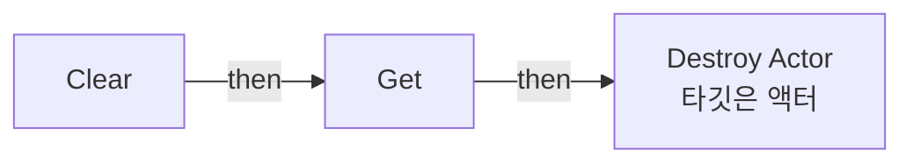
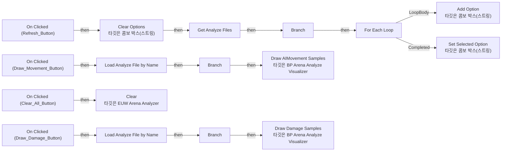
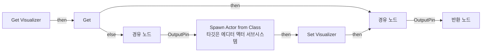

# EUW_ArenaAnalyzer

에셋: `/Game/QuakeLike_1_0/EUW_ArenaAnalyzer`

부모: `/Script/CoreUObject.Class'/Script/Blutility.EditorUtilityWidget'`

수집일: 2026-10-12. MCP에서 읽은 그래프·핀 연결의 자동 전사입니다. 상속된 그래프는 부모 문서를 함께 확인합니다.

정적 루트 참조 도달: 없음. 실행 여부 또는 삭제 가능 여부의 확정이 아닙니다.

컴포넌트 목록은 이 BP가 직접 정의한 SCS만 포함합니다. 부모·네이티브 생성 컴포넌트, 인스턴스 설정은 별도입니다.

## 변수와 기본값

| 이름 | 타입 | CDO 기본값 |
|---|---|---|
| `Visualizer` | `BP_ArenaAnalyzeVisualizer_C` | None |

## 그래프 목록

| 그래프 | 전체 노드 수 |
|---|---|
| Clear | 3 |
| EventGraph | 32 |
| Get Visualizer | 9 |

## 그래프별 실행 연결

실선은 출력 exec 핀의 실제 연결입니다. 여러 분기는 출력 핀 이름을 표시합니다. 함수 호출·delegate·타이머의 다음 그래프 실행은 이 그림에서 자동으로 이어 붙이지 않습니다.

순수 계산 노드 및 데이터 핀은 아래 목록과 원본 JSON을 확인합니다. 연결되지 않은 이벤트도 표시되므로, 노드가 있다는 이유만으로 실행된다고 판단하면 안 됩니다.

### Clear

실행 핀 플로우차트

전체 노드·기본 입력 목록

| 노드 ID | 제목 | 미연결 기본 입력 / 에셋 입력 |
|---|---|---|
| `K2Node_FunctionEntry_0` | Clear |  |
| `K2Node_VariableGet_0` | Get |  |
| `K2Node_CallFunction_1` | Destroy Actor 타깃은 액터 |  |

### EventGraph

실행 핀 플로우차트

전체 노드·기본 입력 목록

| 노드 ID | 제목 | 미연결 기본 입력 / 에셋 입력 |
|---|---|---|
| `K2Node_VariableGet_2` | Get Files |  |
| `K2Node_CallFunction_3` | Clear Options 타깃은 콤보 박스(스트링) |  |
| `K2Node_ComponentBoundEvent_1` | On Clicked (Refresh_Button) |  |
| `K2Node_CallFunction_4` | Get Analyze Files |  |
| `K2Node_MacroInstance_0` | For Each Loop |  |
| `K2Node_VariableGet_7` | Get Files |  |
| `K2Node_CallFunction_5` | Add Option 타깃은 콤보 박스(스트링) |  |
| `K2Node_Knot_0` | 경유 노드 |  |
| `K2Node_VariableGet_0` | Get Files |  |
| `K2Node_CallFunction_10` | Get Selected Option 타깃은 콤보 박스(스트링) |  |
| `K2Node_CallFunction_11` | Load Analyze File by Name |  |
| `K2Node_IfThenElse_1` | Branch |  |
| `K2Node_Knot_1` | 경유 노드 |  |
| `K2Node_CallArrayFunction_0` | Is Not Empty |  |
| `K2Node_IfThenElse_2` | Branch |  |
| `K2Node_Knot_2` | 경유 노드 |  |
| `K2Node_GetArrayItem_0` | GET | Dimension 1=0 |
| `K2Node_VariableGet_6` | Get Files |  |
| `K2Node_CallFunction_9` | Set Selected Option 타깃은 콤보 박스(스트링) |  |
| `K2Node_Knot_4` | 경유 노드 |  |
| `K2Node_ComponentBoundEvent_0` | On Clicked (Clear_All_Button) |  |
| `K2Node_CallFunction_2` | Clear 타깃은 EUW Arena Analyzer |  |
| `K2Node_ComponentBoundEvent_5` | On Clicked (Draw_Movement_Button) |  |
| `K2Node_CallFunction_12` | Get Visualizer |  |
| `K2Node_CallFunction_13` | Draw AIMovement Samples 타깃은 BP Arena Analyze Visualizer |  |
| `K2Node_ComponentBoundEvent_4` | On Clicked (Draw_Damage_Button) |  |
| `K2Node_VariableGet_5` | Get Files |  |
| `K2Node_CallFunction_6` | Get Selected Option 타깃은 콤보 박스(스트링) |  |
| `K2Node_CallFunction_8` | Load Analyze File by Name |  |
| `K2Node_IfThenElse_0` | Branch |  |
| `K2Node_CallFunction_0` | Get Visualizer |  |
| `K2Node_CallFunction_14` | Draw Damage Samples 타깃은 BP Arena Analyze Visualizer |  |

### Get Visualizer

실행 핀 플로우차트

전체 노드·기본 입력 목록

| 노드 ID | 제목 | 미연결 기본 입력 / 에셋 입력 |
|---|---|---|
| `K2Node_FunctionEntry_0` | Get Visualizer |  |
| `K2Node_VariableGet_0` | Get |  |
| `K2Node_GetEditorSubsystem_2` | 에디터 액터 서브시스템 |  |
| `K2Node_CallFunction_0` | Spawn Actor from Class 타깃은 에디터 액터 서브시스템 | ActorClass=/Game/QuakeLike_1_0/Test/AnalyzeVisualizer/BP_ArenaAnalyzeVisualizer.BP_ArenaAnalyzeVisualizer_C; Location=0, 0, 0; Rotation=0, 0, 0; bTransient=true |
| `K2Node_VariableSet_2` | Set Visualizer |  |
| `K2Node_Knot_0` | 경유 노드 |  |
| `K2Node_Knot_5` | 경유 노드 |  |
| `K2Node_FunctionResult_0` | 반환 노드 |  |
| `K2Node_VariableGet_5` | Get Visualizer |  |

## 조회 범위의 한계

ObjectIterator로 발견했으나 MCP helper가 반환하지 않은 그래프입니다. delegate signature·컴파일된 중간 그래프·macro·애니메이션 내부 그래프가 섞일 수 있습니다.

- `BndEvt__EUW_ArenaAnalyzer_Clear_Button_K2Node_ComponentBoundEvent_0_OnButtonClickedEvent__DelegateSignature`: Graph 'BndEvt__EUW_ArenaAnalyzer_Clear_Button_K2Node_ComponentBoundEvent_0_OnButtonClickedEvent__DelegateSignature' not found in Blueprint.
- `BndEvt__EUW_ArenaAnalyzer_Draw_Damage_Button_K2Node_ComponentBoundEvent_4_OnButtonClickedEvent__DelegateSignature`: Graph 'BndEvt__EUW_ArenaAnalyzer_Draw_Damage_Button_K2Node_ComponentBoundEvent_4_OnButtonClickedEvent__DelegateSignature' not found in Blueprint.
- `BndEvt__EUW_ArenaAnalyzer_Draw_Movement_Button_K2Node_ComponentBoundEvent_3_OnButtonClickedEvent__DelegateSignature`: Graph 'BndEvt__EUW_ArenaAnalyzer_Draw_Movement_Button_K2Node_ComponentBoundEvent_3_OnButtonClickedEvent__DelegateSignature' not found in Blueprint.
- `BndEvt__EUW_ArenaAnalyzer_Refresh_Button_K2Node_ComponentBoundEvent_1_OnButtonClickedEvent__DelegateSignature`: Graph 'BndEvt__EUW_ArenaAnalyzer_Refresh_Button_K2Node_ComponentBoundEvent_1_OnButtonClickedEvent__DelegateSignature' not found in Blueprint.
- `Clear_MERGED`: Graph 'Clear_MERGED' not found in Blueprint.
- `EdGraph_0`: Graph 'EdGraph_0' not found in Blueprint.
- `ExecuteUbergraph_EUW_ArenaAnalyzer`: Graph 'ExecuteUbergraph_EUW_ArenaAnalyzer' not found in Blueprint.
- `Get Visualizer_MERGED`: Graph 'Get Visualizer_MERGED' not found in Blueprint.

[원본 MCP 스냅샷](../../Evidence/blueprints-140.json)
