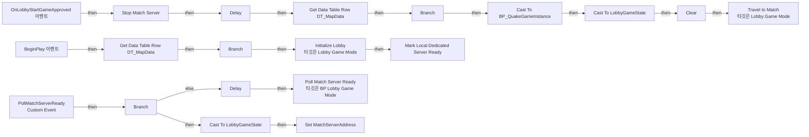
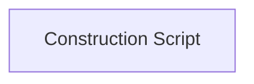

# BP_LobbyGameMode

에셋: `/Game/QuakeLike_1_0/GameFlow/Lobby/BP_LobbyGameMode`

부모: `/Script/CoreUObject.Class'/Script/ShootingArena.LobbyGameMode'`

수집일: 2026-10-12. MCP에서 읽은 그래프·핀 연결의 자동 전사입니다. 상속된 그래프는 부모 문서를 함께 확인합니다.

정적 루트 참조 도달: 있음. 실행 여부 또는 삭제 가능 여부의 확정이 아닙니다.

컴포넌트 목록은 이 BP가 직접 정의한 SCS만 포함합니다. 부모·네이티브 생성 컴포넌트, 인스턴스 설정은 별도입니다.

## 직접 정의한 컴포넌트

| 이름 | 클래스 | 부모 컴포넌트 |
|---|---|---|
| `DefaultSceneRoot` | `SceneComponent` | `` |

## 변수와 기본값

| 이름 | 타입 | CDO 기본값 |
|---|---|---|
| `MatchCountEasy` | `int` | 0 |
| `MatchCountNormal` | `int` | 0 |
| `MatchCountHard` | `int` | 0 |

## 그래프 목록

| 그래프 | 전체 노드 수 |
|---|---|
| EventGraph | 39 |
| UserConstructionScript | 1 |

## 그래프별 실행 연결

실선은 출력 exec 핀의 실제 연결입니다. 여러 분기는 출력 핀 이름을 표시합니다. 함수 호출·delegate·타이머의 다음 그래프 실행은 이 그림에서 자동으로 이어 붙이지 않습니다.

순수 계산 노드 및 데이터 핀은 아래 목록과 원본 JSON을 확인합니다. 연결되지 않은 이벤트도 표시되므로, 노드가 있다는 이유만으로 실행된다고 판단하면 안 됩니다.

### EventGraph

실행 핀 플로우차트

전체 노드·기본 입력 목록

| 노드 ID | 제목 | 미연결 기본 입력 / 에셋 입력 |
|---|---|---|
| `K2Node_Event_0` | BeginPlay 이벤트 |  |
| `K2Node_GetDataTableRow_0` | Get Data Table Row DT_MapData | DataTable=/Game/QuakeLike_1_0/GameFlow/Table/DT/DT_MapData.DT_MapData; RowName=LobbyMap |
| `K2Node_IfThenElse_0` | Branch | Condition=true |
| `K2Node_CallFunction_0` | Initialize Lobby 타깃은 Lobby Game Mode |  |
| `K2Node_Event_2` | OnLobbyStartGameApproved 이벤트 |  |
| `K2Node_GetDataTableRow_1` | Get Data Table Row DT_MapData | DataTable=/Game/QuakeLike_1_0/GameFlow/Table/DT/DT_MapData.DT_MapData |
| `K2Node_CallFunction_38` | String To Name |  |
| `K2Node_IfThenElse_1` | Branch | Condition=true |
| `K2Node_Knot_0` | 경유 노드 |  |
| `K2Node_CallFunction_32` | To String (Name) |  |
| `K2Node_CallFunction_2` | Get Game Instance |  |
| `K2Node_DynamicCast_0` | Cast To BP_QuakeGameInstance |  |
| `K2Node_VariableGet_0` | Get PendingAIDifficulties |  |
| `K2Node_CallArrayFunction_0` | Clear |  |
| `K2Node_DynamicCast_2` | Cast To LobbyGameState |  |
| `K2Node_CallFunction_7` | Get Game State |  |
| `K2Node_CommutativeAssociativeBinaryOperator_0` | Append | A=?Game=/Game/QuakeLike_1_0/GameMode/BP_MultiplayerAIGameMode.BP_MultiplayerAIGameMode_C; B=?AIEasy=; D=?AINormal=; F=?AIHard= |
| `K2Node_CallFunction_4` | To String (Integer) |  |
| `K2Node_CallFunction_33` | To String (Integer) |  |
| `K2Node_CallFunction_34` | To String (Integer) |  |
| `K2Node_CustomEvent_0` | PollMatchServerReady Custom Event |  |
| `K2Node_CallFunction_6` | Is Match Server Ready |  |
| `K2Node_IfThenElse_3` | Branch |  |
| `K2Node_DynamicCast_1` | Cast To LobbyGameState |  |
| `K2Node_CallFunction_3` | Get Game State |  |
| `K2Node_CallFunction_8` | Delay | Duration=0.500000 |
| `K2Node_CallFunction_9` | Poll Match Server Ready 타깃은 BP Lobby Game Mode |  |
| `K2Node_VariableSet_3` | Set MatchServerAddress | MatchServerAddress=7778 |
| `K2Node_CommutativeAssociativeBinaryOperator_5` | Append |  |
| `K2Node_CallFunction_10` | Stop Match Server |  |
| `K2Node_Knot_1` | 경유 노드 |  |
| `K2Node_CallFunction_11` | Delay | Duration=1.000000 |
| `K2Node_CallFunction_12` | Mark Local Dedicated Server Ready | ReturnValue=false |
| `K2Node_CommutativeAssociativeBinaryOperator_1` | Append | B=?ExpectedHumanPlayers= |
| `K2Node_CallFunction_14` | Get Connected Human Player Count |  |
| `K2Node_CallFunction_15` | To String (Integer) |  |
| `K2Node_CallFunction_13` | Count AISlots by Difficulty 타깃은 Lobby Game State |  |
| `K2Node_CallFunction_1` | Travel to Match 타깃은 Lobby Game Mode |  |
| `K2Node_Knot_2` | 경유 노드 |  |

### UserConstructionScript

실행 핀 플로우차트

전체 노드·기본 입력 목록

| 노드 ID | 제목 | 미연결 기본 입력 / 에셋 입력 |
|---|---|---|
| `K2Node_FunctionEntry_0` | Construction Script |  |

## 조회 범위의 한계

ObjectIterator로 발견했으나 MCP helper가 반환하지 않은 그래프입니다. delegate signature·컴파일된 중간 그래프·macro·애니메이션 내부 그래프가 섞일 수 있습니다.

- `ExecuteUbergraph_BP_LobbyGameMode`: Graph 'ExecuteUbergraph_BP_LobbyGameMode' not found in Blueprint.
- `OnLobbyStartGameApproved`: Graph 'OnLobbyStartGameApproved' not found in Blueprint.
- `PollMatchServerReady`: Graph 'PollMatchServerReady' not found in Blueprint.
- `ReceiveBeginPlay`: Graph 'ReceiveBeginPlay' not found in Blueprint.
- `UserConstructionScript_MERGED`: Graph 'UserConstructionScript_MERGED' not found in Blueprint.

[원본 MCP 스냅샷](../../../../Evidence/blueprints-210.json)
