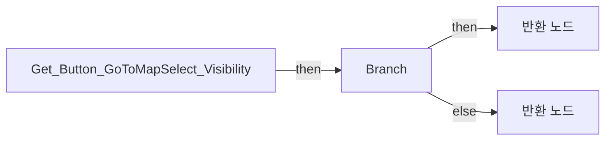
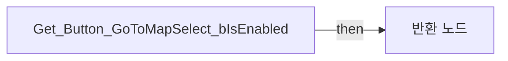
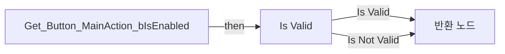

# WBP_Lobby

에셋: `/Game/QuakeLike_1_0/GameFlow/Lobby/WBP_Lobby`

부모: `/Script/CoreUObject.Class'/Script/UMG.UserWidget'`

수집일: 2026-10-12. MCP에서 읽은 그래프·핀 연결의 자동 전사입니다. 상속된 그래프는 부모 문서를 함께 확인합니다.

정적 루트 참조 도달: 있음. 실행 여부 또는 삭제 가능 여부의 확정이 아닙니다.

컴포넌트 목록은 이 BP가 직접 정의한 SCS만 포함합니다. 부모·네이티브 생성 컴포넌트, 인스턴스 설정은 별도입니다.

## 변수와 기본값

| 이름 | 타입 | CDO 기본값 |
|---|---|---|
| `CachedGameState` | `BP_LobbyGameState_C` | None |
| `bIsHost` | `bool` | False |
| `b Lobby State Bound` | `bool` | False |

## 그래프 목록

| 그래프 | 전체 노드 수 |
|---|---|
| EventGraph | 133 |
| Get_Button_GoToMapSelect_Visibility | 5 |
| Get_Button_GoToMapSelect_bIsEnabled | 3 |
| Get_Button_MainAction_bIsEnabled | 12 |

## 그래프별 실행 연결

실선은 출력 exec 핀의 실제 연결입니다. 여러 분기는 출력 핀 이름을 표시합니다. 함수 호출·delegate·타이머의 다음 그래프 실행은 이 그림에서 자동으로 이어 붙이지 않습니다.

순수 계산 노드 및 데이터 핀은 아래 목록과 원본 JSON을 확인합니다. 연결되지 않은 이벤트도 표시되므로, 노드가 있다는 이유만으로 실행된다고 판단하면 안 됩니다.

### EventGraph

```mermaid
flowchart LR
  n0["Construct 이벤트"]
  n1["RefreshLobbyUI<br/>Custom Event"]
  n2["Is Valid"]
  n3["Clear Children<br/>타깃은 패널 위젯"]
  n4["For Each Loop"]
  n5["Init<br/>타깃은 WBP Lobby Slot Row"]
  n6["Add Child<br/>타깃은 패널 위젯"]
  n7["Set Text"]
  n8["Set Text"]
  n9["Set bIsHost"]
  n10["Branch"]
  n11["Set Text"]
  n12["경유 노드"]
  n13["Set Text"]
  n14["경유 노드"]
  n15["On Clicked (Button_MainAction)"]
  n16["Cast To BP_LobbyPlayerController"]
  n17["Branch"]
  n18["Server Start Game<br/>타깃은 Lobby Player Controller<br/>RELIABLE 서버에 리플리케이트됨 (소유 클라이언트인 경우)"]
  n19["Branch"]
  n20["Set Text"]
  n21["경유 노드"]
  n22["Set Text"]
  n23["On Clicked (Button_Back)"]
  n24["Cast To BP_QuakeGameInstance"]
  n25["Set bIntentionalDisconnect"]
  n26["Create WBP Lobby Slot Row Widget"]
  n27["Cast To BP_LobbyPlayerController"]
  n28["OnTextCommitted (Editable Text) (EditableText_174)"]
  n29["Server Set Player Name<br/>타깃은 Lobby Player Controller<br/>RELIABLE 서버에 리플리케이트됨 (소유 클라이언트인 경우)"]
  n30["Is Valid"]
  n31["경유 노드"]
  n32["Set bIsHost"]
  n33["Is Valid"]
  n34["경유 노드"]
  n35["경유 노드"]
  n36["On Clicked (Button_GoToMapSelect)"]
  n37["Create WBP Lobby Map Select Widget"]
  n38["Add to Viewport<br/>타깃은 사용자 위젯"]
  n39["Cast To BP_LobbyPlayerController"]
  n40["Branch"]
  n41["Server Cleanup Match Server<br/>타깃은 Lobby Player Controller<br/>RELIABLE 서버에 리플리케이트됨 (소유 클라이언트인 경우)"]
  n42["Delay"]
  n43["Begin Loading Screen"]
  n44["Begin Loading and Leave Match to Main Menu"]
  n45["Cast To BP_QuakeGameInstance"]
  n46["Set PlayerNickname"]
  n47["Branch"]
  n48["Cast To BP_LobbyGameState"]
  n49["Server Toggle Ready<br/>타깃은 Lobby Player Controller<br/>RELIABLE 서버에 리플리케이트됨 (소유 클라이언트인 경우)"]
  n50["Try Bind Lobby<br/>Custom Event"]
  n51["Try Bind Lobby<br/>타깃은 WBP Lobby"]
  n52["Cast To BP_LobbyGameState"]
  n53["Delay"]
  n54["Try Bind Lobby<br/>타깃은 WBP Lobby"]
  n55["Set CachedGameState"]
  n56["Branch"]
  n57["Bind Event to On Lobby Updated"]
  n58["Refresh Lobby UI<br/>타깃은 WBP Lobby"]
  n59["Set b Lobby State Bound"]
  n60["Refresh Lobby UI<br/>타깃은 WBP Lobby"]
  n61["Set bIsHost"]
  n62["Branch"]
  n63["Get Data Table Row DT_MapData"]
  n0 -->|"then"| n51
  n1 -->|"then"| n61
  n2 -->|"Is Valid"| n3
  n3 -->|"then"| n4
  n4 -->|"LoopBody"| n26
  n4 -->|"Completed"| n7
  n5 -->|"then"| n6
  n7 -->|"then"| n63
  n8 -->|"then"| n14
  n9 -->|"then"| n10
  n10 -->|"then"| n12
  n10 -->|"else"| n13
  n12 -->|"OutputPin"| n11
  n13 -->|"then"| n62
  n14 -->|"OutputPin"| n30
  n15 -->|"then"| n16
  n16 -->|"then"| n48
  n17 -->|"then"| n47
  n17 -->|"else"| n49
  n19 -->|"then"| n21
  n19 -->|"else"| n22
  n21 -->|"OutputPin"| n20
  n23 -->|"then"| n39
  n24 -->|"then"| n25
  n25 -->|"then"| n44
  n26 -->|"then"| n5
  n27 -->|"then"| n45
  n28 -->|"then"| n27
  n30 -->|"Is Valid"| n31
  n30 -->|"Is Not Valid"| n32
  n31 -->|"OutputPin"| n9
  n32 -->|"then"| n10
  n33 -->|"Is Valid"| n19
  n33 -->|"Is Not Valid"| n34
  n34 -->|"OutputPin"| n35
  n35 -->|"OutputPin"| n22
  n36 -->|"then"| n37
  n37 -->|"then"| n38
  n39 -->|"then"| n40
  n39 -->|"CastFailed"| n24
  n40 -->|"then"| n41
  n40 -->|"else"| n24
  n41 -->|"then"| n42
  n42 -->|"then"| n24
  n43 -->|"then"| n18
  n45 -->|"then"| n46
  n46 -->|"then"| n29
  n47 -->|"then"| n43
  n48 -->|"then"| n17
  n50 -->|"then"| n52
  n52 -->|"then"| n55
  n52 -->|"CastFailed"| n53
  n53 -->|"then"| n54
  n55 -->|"then"| n56
  n56 -->|"then"| n57
  n56 -->|"else"| n58
  n57 -->|"then"| n59
  n59 -->|"then"| n60
  n61 -->|"then"| n2
  n62 -->|"then"| n33
  n63 -->|"then"| n8
```

실행 핀 플로우차트

전체 노드·기본 입력 목록

| 노드 ID | 제목 | 미연결 기본 입력 / 에셋 입력 |
|---|---|---|
| `K2Node_Event_1` | Construct 이벤트 |  |
| `K2Node_CustomEvent_0` | RefreshLobbyUI Custom Event |  |
| `K2Node_MacroInstance_0` | Is Valid |  |
| `K2Node_VariableGet_0` | Get CachedGameState |  |
| `K2Node_CallFunction_2` | Clear Children 타깃은 패널 위젯 |  |
| `K2Node_VariableGet_2` | Get CachedGameState |  |
| `K2Node_VariableGet_3` | Get Slots |  |
| `K2Node_MacroInstance_1` | For Each Loop |  |
| `K2Node_CallFunction_3` | Init 타깃은 WBP Lobby Slot Row |  |
| `K2Node_CallFunction_4` | Add Child 타깃은 패널 위젯 |  |
| `K2Node_Knot_0` | 경유 노드 |  |
| `K2Node_Knot_1` | 경유 노드 |  |
| `K2Node_VariableGet_5` | Get Text_PlayerCount |  |
| `K2Node_VariableSet_1` | Set Text |  |
| `K2Node_VariableGet_6` | Get CachedGameState |  |
| `K2Node_CallFunction_5` | Get Filled Slot Count 타깃은 Lobby Game State |  |
| `K2Node_VariableGet_7` | Get Slots |  |
| `K2Node_CallArrayFunction_0` | Length |  |
| `K2Node_FormatText_0` | 포맷 텍스트 |  |
| `K2Node_Knot_2` | 경유 노드 |  |
| `K2Node_CallFunction_6` | Get Owning Player 타깃은 위젯 |  |
| `K2Node_VariableGet_9` | Get CachedGameState |  |
| `K2Node_VariableGet_10` | Get SelectedMapID |  |
| `K2Node_VariableGet_11` | Get Text_MapName |  |
| `K2Node_VariableSet_2` | Set Text |  |
| `K2Node_CallFunction_36` | To Text (String) |  |
| `K2Node_CallFunction_7` | Get Owning Player 타깃은 위젯 |  |
| `K2Node_VariableGet_12` | Get PlayerState |  |
| `K2Node_VariableGet_13` | Get CachedGameState |  |
| `K2Node_VariableGet_14` | Get HostPlayerState |  |
| `K2Node_PromotableOperator_0` | Equal (Object) |  |
| `K2Node_VariableSet_6` | Set bIsHost |  |
| `K2Node_IfThenElse_1` | Branch |  |
| `K2Node_VariableGet_16` | Get Text_MainAction |  |
| `K2Node_VariableSet_5` | Set Text |  |
| `K2Node_Knot_4` | 경유 노드 |  |
| `K2Node_VariableGet_28` | Get Text_MainAction |  |
| `K2Node_VariableSet_7` | Set Text |  |
| `K2Node_Knot_5` | 경유 노드 |  |
| `K2Node_ComponentBoundEvent_0` | On Clicked (Button_MainAction) |  |
| `K2Node_CallFunction_8` | Get Owning Player 타깃은 위젯 |  |
| `K2Node_DynamicCast_1` | Cast To BP_LobbyPlayerController |  |
| `K2Node_IfThenElse_2` | Branch |  |
| `K2Node_CallFunction_9` | Server Start Game 타깃은 Lobby Player Controller RELIABLE 서버에 리플리케이트됨 (소유 클라이언트인 경우) |  |
| `K2Node_Knot_7` | 경유 노드 |  |
| `K2Node_VariableGet_21` | Get CachedGameState |  |
| `K2Node_CallFunction_14` | Get Owning Player 타깃은 위젯 |  |
| `K2Node_VariableGet_23` | Get PlayerState |  |
| `K2Node_VariableGet_24` | Get CachedGameState |  |
| `K2Node_CallFunction_15` | Find Slot Index for Player 타깃은 Lobby Game State |  |
| `K2Node_VariableGet_25` | Get Slots |  |
| `K2Node_GetArrayItem_1` | GET |  |
| `K2Node_IfThenElse_3` | Branch |  |
| `K2Node_VariableGet_29` | Get Text_MainAction |  |
| `K2Node_VariableSet_8` | Set Text |  |
| `K2Node_Knot_9` | 경유 노드 |  |
| `K2Node_VariableGet_15` | Get Text_MainAction |  |
| `K2Node_VariableSet_4` | Set Text |  |
| `K2Node_ComponentBoundEvent_1` | On Clicked (Button_Back) |  |
| `K2Node_DynamicCast_2` | Cast To BP_QuakeGameInstance |  |
| `K2Node_CallFunction_18` | Get Game Instance 타깃은 위젯 |  |
| `K2Node_VariableSet_9` | Set bIntentionalDisconnect | bIntentionalDisconnect=true; Output_Get=false |
| `K2Node_VariableGet_8` | Get ScrollBox_Slots |  |
| `K2Node_VariableGet_17` | Get ScrollBox_Slots |  |
| `K2Node_CreateWidget_0` | Create WBP Lobby Slot Row Widget | Class=/Game/QuakeLike_1_0/GameFlow/Lobby/WBP_LobbySlotRow.WBP_LobbySlotRow_C |
| `K2Node_CallFunction_21` | Get Owning Player 타깃은 위젯 |  |
| `K2Node_DynamicCast_3` | Cast To BP_LobbyPlayerController |  |
| `K2Node_ComponentBoundEvent_3` | OnTextCommitted (Editable Text) (EditableText_174) | CommitMethod=Default |
| `K2Node_CallFunction_33` | To String (Text) |  |
| `K2Node_CallFunction_26` | Server Set Player Name 타깃은 Lobby Player Controller RELIABLE 서버에 리플리케이트됨 (소유 클라이언트인 경우) |  |
| `K2Node_Knot_8` | 경유 노드 |  |
| `K2Node_CommutativeAssociativeBinaryOperator_0` | AND Boolean |  |
| `K2Node_CallFunction_22` | Is Valid |  |
| `K2Node_MacroInstance_4` | Is Valid |  |
| `K2Node_Knot_12` | 경유 노드 |  |
| `K2Node_VariableSet_3` | Set bIsHost | bIsHost=false; Output_Get=false |
| `K2Node_MacroInstance_5` | Is Valid |  |
| `K2Node_Knot_13` | 경유 노드 |  |
| `K2Node_Knot_14` | 경유 노드 |  |
| `K2Node_Knot_15` | 경유 노드 |  |
| `K2Node_Knot_16` | 경유 노드 |  |
| `K2Node_Knot_18` | 경유 노드 |  |
| `K2Node_ComponentBoundEvent_2` | On Clicked (Button_GoToMapSelect) |  |
| `K2Node_CreateWidget_1` | Create WBP Lobby Map Select Widget | Class=/Game/QuakeLike_1_0/GameFlow/Lobby/WBP_LobbyMapSelect.WBP_LobbyMapSelect_C |
| `K2Node_CallFunction_24` | Get Owning Player 타깃은 위젯 |  |
| `K2Node_CallFunction_25` | Add to Viewport 타깃은 사용자 위젯 | ZOrder=0 |
| `K2Node_CallFunction_20` | Get Owning Player 타깃은 위젯 |  |
| `K2Node_DynamicCast_4` | Cast To BP_LobbyPlayerController |  |
| `K2Node_IfThenElse_0` | Branch |  |
| `K2Node_VariableGet_26` | Get bIsHost |  |
| `K2Node_CallFunction_27` | Server Cleanup Match Server 타깃은 Lobby Player Controller RELIABLE 서버에 리플리케이트됨 (소유 클라이언트인 경우) |  |
| `K2Node_CallFunction_28` | Delay | Duration=0.300000 |
| `K2Node_Knot_10` | 경유 노드 |  |
| `K2Node_CallFunction_29` | Begin Loading Screen | StatusText=매치 서버를 준비하는 중... |
| `K2Node_CallFunction_31` | Begin Loading and Leave Match to Main Menu | StatusText=메인 메뉴로 이동하는 중... |
| `K2Node_DynamicCast_5` | Cast To BP_QuakeGameInstance |  |
| `K2Node_CallFunction_16` | Get Game Instance 타깃은 위젯 |  |
| `K2Node_VariableSet_10` | Set PlayerNickname |  |
| `K2Node_IfThenElse_4` | Branch |  |
| `K2Node_CallFunction_23` | Are All Non Host Players Ready 타깃은 Lobby Game State |  |
| `K2Node_CommutativeAssociativeBinaryOperator_1` | AND Boolean |  |
| `K2Node_VariableGet_1` | Get SelectedMapID |  |
| `K2Node_CallFunction_30` | Not Equal Exactly (String) | B=LobbyMap |
| `K2Node_CallFunction_19` | Get Game State |  |
| `K2Node_DynamicCast_6` | Cast To BP_LobbyGameState |  |
| `K2Node_VariableGet_4` | Get HostPlayerState |  |
| `K2Node_PromotableOperator_2` | Equal (Object) |  |
| `K2Node_VariableGet_27` | Get PlayerState |  |
| `K2Node_CallFunction_32` | Server Toggle Ready 타깃은 Lobby Player Controller RELIABLE 서버에 리플리케이트됨 (소유 클라이언트인 경우) |  |
| `K2Node_CustomEvent_1` | Try Bind Lobby Custom Event |  |
| `K2Node_CallFunction_34` | Try Bind Lobby 타깃은 WBP Lobby |  |
| `K2Node_CallFunction_35` | Get Game State |  |
| `K2Node_DynamicCast_7` | Cast To BP_LobbyGameState |  |
| `K2Node_CallFunction_37` | Delay | Duration=0.100000 |
| `K2Node_CallFunction_38` | Try Bind Lobby 타깃은 WBP Lobby |  |
| `K2Node_VariableSet_11` | Set CachedGameState |  |
| `K2Node_IfThenElse_6` | Branch |  |
| `K2Node_VariableGet_30` | Get b Lobby State Bound |  |
| `K2Node_CallFunction_39` | NOT Boolean |  |
| `K2Node_AddDelegate_1` | Bind Event to On Lobby Updated |  |
| `K2Node_CallFunction_40` | Refresh Lobby UI 타깃은 WBP Lobby |  |
| `K2Node_Knot_3` | 경유 노드 |  |
| `K2Node_VariableSet_12` | Set b Lobby State Bound | b Lobby State Bound=true; Output_Get=false |
| `K2Node_CallFunction_41` | Refresh Lobby UI 타깃은 WBP Lobby |  |
| `K2Node_VariableSet_13` | Set bIsHost | Output_Get=false |
| `K2Node_VariableGet_31` | Get CachedGameState |  |
| `K2Node_VariableGet_32` | Get HostPlayerState |  |
| `K2Node_PromotableOperator_3` | Equal (Object) |  |
| `K2Node_CallFunction_42` | Get Owning Player 타깃은 위젯 |  |
| `K2Node_PromotableOperator_4` | integer &gt;= integer |  |
| `K2Node_IfThenElse_7` | Branch |  |
| `K2Node_GetDataTableRow_0` | Get Data Table Row DT_MapData | DataTable=/Game/QuakeLike_1_0/GameFlow/Table/DT/DT_MapData.DT_MapData |
| `K2Node_CallFunction_0` | String To Name |  |

### Get_Button_GoToMapSelect_Visibility

실행 핀 플로우차트

전체 노드·기본 입력 목록

| 노드 ID | 제목 | 미연결 기본 입력 / 에셋 입력 |
|---|---|---|
| `K2Node_FunctionEntry_1` | Get_Button_GoToMapSelect_Visibility |  |
| `K2Node_FunctionResult_2` | 반환 노드 | ReturnValue=Collapsed |
| `K2Node_VariableGet_0` | Get bIsHost |  |
| `K2Node_IfThenElse_0` | Branch |  |
| `K2Node_FunctionResult_0` | 반환 노드 | ReturnValue=Visible |

### Get_Button_GoToMapSelect_bIsEnabled

실행 핀 플로우차트

전체 노드·기본 입력 목록

| 노드 ID | 제목 | 미연결 기본 입력 / 에셋 입력 |
|---|---|---|
| `K2Node_FunctionEntry_0` | Get_Button_GoToMapSelect_bIsEnabled |  |
| `K2Node_FunctionResult_0` | 반환 노드 |  |
| `K2Node_VariableGet_0` | Get bIsHost |  |

### Get_Button_MainAction_bIsEnabled

실행 핀 플로우차트

전체 노드·기본 입력 목록

| 노드 ID | 제목 | 미연결 기본 입력 / 에셋 입력 |
|---|---|---|
| `K2Node_FunctionEntry_0` | Get_Button_MainAction_bIsEnabled |  |
| `K2Node_FunctionResult_1` | 반환 노드 |  |
| `K2Node_MacroInstance_0` | Is Valid |  |
| `K2Node_VariableGet_0` | Get CachedGameState |  |
| `K2Node_VariableGet_1` | Get bIsHost |  |
| `K2Node_CallFunction_1` | Are All Non Host Players Ready 타깃은 Lobby Game State |  |
| `K2Node_Select_0` | 선택 | Option 0=true |
| `K2Node_VariableGet_2` | Get SelectedMapID |  |
| `K2Node_CallFunction_2` | Not Equal Exactly (String) | B=LobbyMap |
| `K2Node_Knot_0` | 경유 노드 |  |
| `K2Node_CommutativeAssociativeBinaryOperator_0` | AND Boolean |  |
| `K2Node_Knot_1` | 경유 노드 |  |

## 조회 범위의 한계

ObjectIterator로 발견했으나 MCP helper가 반환하지 않은 그래프입니다. delegate signature·컴파일된 중간 그래프·macro·애니메이션 내부 그래프가 섞일 수 있습니다.

- `BndEvt__WBP_Lobby_Button_Back_K2Node_ComponentBoundEvent_1_OnButtonClickedEvent__DelegateSignature`: Graph 'BndEvt__WBP_Lobby_Button_Back_K2Node_ComponentBoundEvent_1_OnButtonClickedEvent__DelegateSignature' not found in Blueprint.
- `BndEvt__WBP_Lobby_Button_GoToMapSelect_K2Node_ComponentBoundEvent_2_OnButtonClickedEvent__DelegateSignature`: Graph 'BndEvt__WBP_Lobby_Button_GoToMapSelect_K2Node_ComponentBoundEvent_2_OnButtonClickedEvent__DelegateSignature' not found in Blueprint.
- `BndEvt__WBP_Lobby_Button_MainAction_K2Node_ComponentBoundEvent_0_OnButtonClickedEvent__DelegateSignature`: Graph 'BndEvt__WBP_Lobby_Button_MainAction_K2Node_ComponentBoundEvent_0_OnButtonClickedEvent__DelegateSignature' not found in Blueprint.
- `BndEvt__WBP_Lobby_EditableText_174_K2Node_ComponentBoundEvent_3_OnEditableTextCommittedEvent__DelegateSignature`: Graph 'BndEvt__WBP_Lobby_EditableText_174_K2Node_ComponentBoundEvent_3_OnEditableTextCommittedEvent__DelegateSignature' not found in Blueprint.
- `Construct`: Graph 'Construct' not found in Blueprint.
- `EdGraph_0`: Graph 'EdGraph_0' not found in Blueprint.
- `EdGraph_1`: Graph 'EdGraph_1' not found in Blueprint.
- `EdGraph_2`: Graph 'EdGraph_2' not found in Blueprint.
- `EdGraph_3`: Graph 'EdGraph_3' not found in Blueprint.
- `EdGraph_4`: Graph 'EdGraph_4' not found in Blueprint.
- `ExecuteUbergraph_WBP_Lobby`: Graph 'ExecuteUbergraph_WBP_Lobby' not found in Blueprint.
- `Get_Button_GoToMapSelect_Visibility_MERGED`: Graph 'Get_Button_GoToMapSelect_Visibility_MERGED' not found in Blueprint.
- `Get_Button_GoToMapSelect_bIsEnabled_MERGED`: Graph 'Get_Button_GoToMapSelect_bIsEnabled_MERGED' not found in Blueprint.
- `Get_Button_MainAction_bIsEnabled_MERGED`: Graph 'Get_Button_MainAction_bIsEnabled_MERGED' not found in Blueprint.
- `RefreshLobbyUI`: Graph 'RefreshLobbyUI' not found in Blueprint.
- `Try Bind Lobby`: Graph 'Try Bind Lobby' not found in Blueprint.

[원본 MCP 스냅샷](../../../../Evidence/blueprints-210.json)
