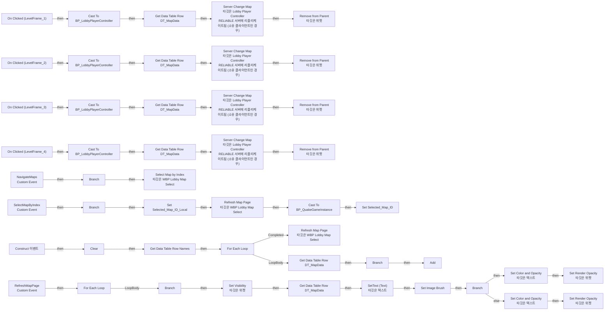
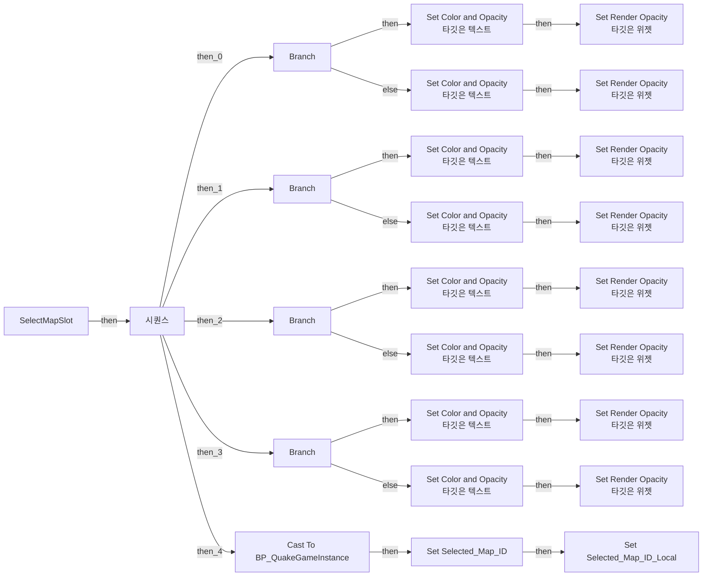

# WBP_LobbyMapSelect

에셋: `/Game/QuakeLike_1_0/GameFlow/Lobby/WBP_LobbyMapSelect`

부모: `/Script/CoreUObject.Class'/Script/UMG.UserWidget'`

수집일: 2026-10-12. MCP에서 읽은 그래프·핀 연결의 자동 전사입니다. 상속된 그래프는 부모 문서를 함께 확인합니다.

정적 루트 참조 도달: 있음. 실행 여부 또는 삭제 가능 여부의 확정이 아닙니다.

컴포넌트 목록은 이 BP가 직접 정의한 SCS만 포함합니다. 부모·네이티브 생성 컴포넌트, 인스턴스 설정은 별도입니다.

## 변수와 기본값

| 이름 | 타입 | CDO 기본값 |
|---|---|---|
| `Selected_Map_ID_Local` | `name` | None |
| `MapRowNames` | `name` | [] |
| `PageStart` | `int` | 0 |

## 그래프 목록

| 그래프 | 전체 노드 수 |
|---|---|
| EventGraph | 132 |
| SelectMapSlot | 50 |

## 그래프별 실행 연결

실선은 출력 exec 핀의 실제 연결입니다. 여러 분기는 출력 핀 이름을 표시합니다. 함수 호출·delegate·타이머의 다음 그래프 실행은 이 그림에서 자동으로 이어 붙이지 않습니다.

순수 계산 노드 및 데이터 핀은 아래 목록과 원본 JSON을 확인합니다. 연결되지 않은 이벤트도 표시되므로, 노드가 있다는 이유만으로 실행된다고 판단하면 안 됩니다.

### EventGraph

실행 핀 플로우차트

전체 노드·기본 입력 목록

| 노드 ID | 제목 | 미연결 기본 입력 / 에셋 입력 |
|---|---|---|
| `K2Node_CallFunction_15` | Get Owning Player 타깃은 위젯 |  |
| `K2Node_DynamicCast_2` | Cast To BP_LobbyPlayerController |  |
| `K2Node_GetDataTableRow_1` | Get Data Table Row DT_MapData | DataTable=/Game/QuakeLike_1_0/GameFlow/Table/DT/DT_MapData.DT_MapData |
| `K2Node_CallFunction_16` | Server Change Map 타깃은 Lobby Player Controller RELIABLE 서버에 리플리케이트됨 (소유 클라이언트인 경우) |  |
| `K2Node_Knot_6` | 경유 노드 |  |
| `K2Node_CallFunction_21` | Remove from Parent 타깃은 위젯 |  |
| `K2Node_CallFunction_17` | Get Owning Player 타깃은 위젯 |  |
| `K2Node_DynamicCast_5` | Cast To BP_LobbyPlayerController |  |
| `K2Node_GetDataTableRow_2` | Get Data Table Row DT_MapData | DataTable=/Game/QuakeLike_1_0/GameFlow/Table/DT/DT_MapData.DT_MapData |
| `K2Node_CallFunction_18` | Server Change Map 타깃은 Lobby Player Controller RELIABLE 서버에 리플리케이트됨 (소유 클라이언트인 경우) |  |
| `K2Node_Knot_10` | 경유 노드 |  |
| `K2Node_CallFunction_4` | Get Owning Player 타깃은 위젯 |  |
| `K2Node_DynamicCast_0` | Cast To BP_LobbyPlayerController |  |
| `K2Node_GetDataTableRow_3` | Get Data Table Row DT_MapData | DataTable=/Game/QuakeLike_1_0/GameFlow/Table/DT/DT_MapData.DT_MapData |
| `K2Node_CallFunction_0` | Server Change Map 타깃은 Lobby Player Controller RELIABLE 서버에 리플리케이트됨 (소유 클라이언트인 경우) |  |
| `K2Node_Knot_5` | 경유 노드 |  |
| `K2Node_CallFunction_22` | Remove from Parent 타깃은 위젯 |  |
| `K2Node_CallFunction_3` | Remove from Parent 타깃은 위젯 |  |
| `K2Node_DynamicCast_1` | Cast To BP_LobbyPlayerController |  |
| `K2Node_GetDataTableRow_0` | Get Data Table Row DT_MapData | DataTable=/Game/QuakeLike_1_0/GameFlow/Table/DT/DT_MapData.DT_MapData |
| `K2Node_CallFunction_8` | Server Change Map 타깃은 Lobby Player Controller RELIABLE 서버에 리플리케이트됨 (소유 클라이언트인 경우) |  |
| `K2Node_Knot_3` | 경유 노드 |  |
| `K2Node_CallFunction_13` | Remove from Parent 타깃은 위젯 |  |
| `K2Node_CallFunction_7` | Get Owning Player 타깃은 위젯 |  |
| `K2Node_CallFunction_32` | To String (Name) |  |
| `K2Node_CallFunction_33` | To String (Name) |  |
| `K2Node_CallFunction_34` | To String (Name) |  |
| `K2Node_CallFunction_35` | To String (Name) |  |
| `K2Node_CustomEvent_0` | NavigateMaps Custom Event |  |
| `K2Node_VariableGet_0` | Get MapRowNames |  |
| `K2Node_CallArrayFunction_0` | Length |  |
| `K2Node_CallFunction_1` | integer &gt; integer | B=0 |
| `K2Node_IfThenElse_0` | Branch |  |
| `K2Node_VariableGet_1` | Get MapRowNames |  |
| `K2Node_VariableGet_2` | Get Selected_Map_ID_Local |  |
| `K2Node_CallArrayFunction_1` | Find Item |  |
| `K2Node_CallFunction_2` | int + int |  |
| `K2Node_CallFunction_5` | int + int |  |
| `K2Node_CallFunction_6` | % (Integer) |  |
| `K2Node_CallFunction_9` | Select Map by Index 타깃은 WBP Lobby Map Select |  |
| `K2Node_SelectMapByIndex` | SelectMapByIndex Custom Event |  |
| `K2Node_Get_MapRowNames_26` | Get MapRowNames |  |
| `K2Node_ValidateSelectedIndex` | Is Valid Index |  |
| `K2Node_HasSelectedMap` | Branch |  |
| `K2Node_GetSelectedRow` | Get |  |
| `K2Node_StoreSelectedRow` | Set Selected_Map_ID_Local |  |
| `K2Node_RefreshMapPage_32` | Refresh Map Page 타깃은 WBP Lobby Map Select |  |
| `K2Node_SelectionGameInstance` | Get Game Instance 타깃은 위젯 |  |
| `K2Node_SelectionCast` | Cast To BP_QuakeGameInstance |  |
| `K2Node_StoreGameInstanceMap` | Set Selected_Map_ID | Output_Get=None |
| `K2Node_Knot_4` | 경유 노드 |  |
| `K2Node_CustomEvent_1` | RefreshMapPage Custom Event |  |
| `K2Node_VariableGet_5` | Get PageStart |  |
| `K2Node_PromotableOperator_1` | int + int |  |
| `K2Node_VariableGet_6` | Get MapRowNames |  |
| `K2Node_GetArrayItem_1` | GET |  |
| `K2Node_VariableGet_7` | Get PageStart |  |
| `K2Node_PromotableOperator_2` | int + int | B=1 |
| `K2Node_VariableGet_8` | Get MapRowNames |  |
| `K2Node_GetArrayItem_2` | GET |  |
| `K2Node_VariableGet_9` | Get PageStart |  |
| `K2Node_PromotableOperator_3` | int + int | B=2 |
| `K2Node_VariableGet_23` | Get MapRowNames |  |
| `K2Node_GetArrayItem_3` | GET |  |
| `K2Node_VariableGet_3` | Get PageStart |  |
| `K2Node_PromotableOperator_0` | int + int | B=3 |
| `K2Node_VariableGet_4` | Get MapRowNames |  |
| `K2Node_GetArrayItem_0` | GET |  |
| `K2Node_Construct` | Construct 이벤트 |  |
| `K2Node_ClearMapRows` | Clear |  |
| `K2Node_Get_MapRowNames_15` | Get MapRowNames |  |
| `K2Node_ReadMapTable` | Get Data Table Row Names | Table=/Game/QuakeLike_1_0/GameFlow/Table/DT/DT_MapData.DT_MapData |
| `K2Node_ForEachMapRow` | For Each Loop |  |
| `K2Node_FilterPlayableMaps` | Branch |  |
| `K2Node_AddMapRow` | Add | ReturnValue=0 |
| `K2Node_RefreshMapPage_23` | Refresh Map Page 타깃은 WBP Lobby Map Select |  |
| `K2Node_ReadCandidateMap` | Get Data Table Row DT_MapData | DataTable=/Game/QuakeLike_1_0/GameFlow/Table/DT/DT_MapData.DT_MapData |
| `K2Node_HasMapImage` | Is Valid |  |
| `K2Node_Knot_0` | 경유 노드 |  |
| `K2Node_Knot_1` | 경유 노드 |  |
| `K2Node_Knot_2` | 경유 노드 |  |
| `K2Node_VariableGet_16` | Get Lvl_Image_2 |  |
| `K2Node_VariableGet_17` | Get Lvl_Image_3 |  |
| `K2Node_VariableGet_10` | Get Lvl_Image_4 |  |
| `K2Node_MakeArray_1` | 배열 만들기 |  |
| `K2Node_MacroInstance_1` | For Each Loop |  |
| `K2Node_Get_MapRowNames_80` | Get MapRowNames |  |
| `K2Node_Get_Selected_Map_ID_Local_81` | Get Selected_Map_ID_Local |  |
| `K2Node_SelectedIndex_82` | Find Item |  |
| `K2Node_Page_83` | int / int | B=4 |
| `K2Node_PageStart_84` | int * int | B=4 |
| `K2Node_DisplayedRowIndex` | int + int | B=1 |
| `K2Node_ValidVisibleRow` | Is Valid Index |  |
| `K2Node_Get_MapRowNames_102` | Get MapRowNames |  |
| `K2Node_SlotHasMap` | Branch |  |
| `K2Node_ShowMapImage` | Set Visibility 타깃은 위젯 | InVisibility=Visible |
| `K2Node_ReadDisplayedMap` | Get Data Table Row DT_MapData | DataTable=/Game/QuakeLike_1_0/GameFlow/Table/DT/DT_MapData.DT_MapData |
| `K2Node_MapDisplayName` | To Text (String) |  |
| `K2Node_SetMapName` | SetText (Text) 타깃은 텍스트 |  |
| `K2Node_Get_Selected_Map_ID_Local_118` | Get Selected_Map_ID_Local |  |
| `K2Node_ThisMapIsSelected` | Equal (Name) |  |
| `K2Node_HighlightSelectedMap` | Branch |  |
| `K2Node_MapNameColor_true` | Set Color and Opacity 타깃은 텍스트 | InColorAndOpacity_SpecifiedColor=(R=1.000000,G=1.000000,B=1.000000,A=0.500000); InColorAndOpacity_ColorUseRule=UseColor_Specified |
| `K2Node_MapImageOpacity_true` | Set Render Opacity 타깃은 위젯 | InOpacity=0.500000 |
| `K2Node_MapNameColor_false` | Set Color and Opacity 타깃은 텍스트 | InColorAndOpacity_SpecifiedColor=(R=1.000000,G=1.000000,B=1.000000,A=1.000000); InColorAndOpacity_ColorUseRule=UseColor_Specified |
| `K2Node_MapImageOpacity_false` | Set Render Opacity 타깃은 위젯 | InOpacity=1.000000 |
| `K2Node_Knot_9` | 경유 노드 |  |
| `K2Node_DisplayedRowName` | Get |  |
| `K2Node_Knot_20` | 경유 노드 |  |
| `K2Node_Knot_21` | 경유 노드 |  |
| `K2Node_Array_MapTT_` | 배열 만들기 |  |
| `K2Node_Get_MapTT_1_91` | Get MapTT_1 |  |
| `K2Node_Get_MapTT_2_92` | Get MapTT_2 |  |
| `K2Node_Get_MapTT_3_93` | Get MapTT_3 |  |
| `K2Node_Get_MapTT_4_94` | Get MapTT_4 |  |
| `K2Node_SlotText` | Get |  |
| `K2Node_Knot_22` | 경유 노드 |  |
| `K2Node_Knot_24` | 경유 노드 |  |
| `K2Node_Knot_25` | 경유 노드 |  |
| `K2Node_Knot_26` | 경유 노드 |  |
| `K2Node_Knot_27` | 경유 노드 |  |
| `K2Node_Knot_32` | 경유 노드 |  |
| `K2Node_Knot_33` | 경유 노드 |  |
| `K2Node_Knot_34` | 경유 노드 |  |
| `K2Node_Knot_35` | 경유 노드 |  |
| `K2Node_MacroInstance_2` | Set Image Brush |  |
| `K2Node_Knot_7` | 경유 노드 |  |
| `K2Node_VariableGet_33` | Get Lvl_Image_1 |  |
| `K2Node_ComponentBoundEvent_10` | On Clicked (LevelFrame_1) |  |
| `K2Node_ComponentBoundEvent_11` | On Clicked (LevelFrame_2) |  |
| `K2Node_ComponentBoundEvent_12` | On Clicked (LevelFrame_3) |  |
| `K2Node_ComponentBoundEvent_13` | On Clicked (LevelFrame_4) |  |

### SelectMapSlot

실행 핀 플로우차트

전체 노드·기본 입력 목록

| 노드 ID | 제목 | 미연결 기본 입력 / 에셋 입력 |
|---|---|---|
| `K2Node_FunctionEntry_1` | SelectMapSlot |  |
| `K2Node_PromotableOperator_1` | Equal (Integer) | B=1 |
| `K2Node_PromotableOperator_2` | Equal (Integer) | B=2 |
| `K2Node_PromotableOperator_3` | Equal (Integer) | B=3 |
| `K2Node_PromotableOperator_0` | Equal (Integer) | B=4 |
| `K2Node_IfThenElse_2` | Branch |  |
| `K2Node_CallFunction_3` | Set Color and Opacity 타깃은 텍스트 | InColorAndOpacity_SpecifiedColor=(R=1.000000,G=0.168269,B=0.000000,A=0.500000); InColorAndOpacity_ColorUseRule=UseColor_Specified |
| `K2Node_CallFunction_4` | Set Color and Opacity 타깃은 텍스트 | InColorAndOpacity_SpecifiedColor=(R=1.000000,G=0.168269,B=0.000000,A=1.000000); InColorAndOpacity_ColorUseRule=UseColor_Specified |
| `K2Node_IfThenElse_3` | Branch |  |
| `K2Node_CallFunction_5` | Set Color and Opacity 타깃은 텍스트 | InColorAndOpacity_SpecifiedColor=(R=1.000000,G=0.168269,B=0.000000,A=0.500000); InColorAndOpacity_ColorUseRule=UseColor_Specified |
| `K2Node_CallFunction_6` | Set Color and Opacity 타깃은 텍스트 | InColorAndOpacity_SpecifiedColor=(R=1.000000,G=0.168269,B=0.000000,A=1.000000); InColorAndOpacity_ColorUseRule=UseColor_Specified |
| `K2Node_IfThenElse_4` | Branch |  |
| `K2Node_CallFunction_7` | Set Color and Opacity 타깃은 텍스트 | InColorAndOpacity_SpecifiedColor=(R=1.000000,G=0.168269,B=0.000000,A=0.500000); InColorAndOpacity_ColorUseRule=UseColor_Specified |
| `K2Node_CallFunction_8` | Set Color and Opacity 타깃은 텍스트 | InColorAndOpacity_SpecifiedColor=(R=1.000000,G=0.168269,B=0.000000,A=1.000000); InColorAndOpacity_ColorUseRule=UseColor_Specified |
| `K2Node_IfThenElse_1` | Branch |  |
| `K2Node_CallFunction_2` | Set Color and Opacity 타깃은 텍스트 | InColorAndOpacity_SpecifiedColor=(R=1.000000,G=0.168269,B=0.000000,A=0.500000); InColorAndOpacity_ColorUseRule=UseColor_Specified |
| `K2Node_CallFunction_39` | Set Color and Opacity 타깃은 텍스트 | InColorAndOpacity_SpecifiedColor=(R=1.000000,G=0.168269,B=0.000000,A=1.000000); InColorAndOpacity_ColorUseRule=UseColor_Specified |
| `K2Node_ExecutionSequence_0` | 시퀀스 |  |
| `K2Node_CommutativeAssociativeBinaryOperator_0` | Append | A=Map_0 |
| `K2Node_CallFunction_27` | To String (Integer) |  |
| `K2Node_CallFunction_9` | Get Game Instance 타깃은 위젯 |  |
| `K2Node_DynamicCast_0` | Cast To BP_QuakeGameInstance |  |
| `K2Node_VariableSet_1` | Set Selected_Map_ID |  |
| `K2Node_VariableSet_2` | Set Selected_Map_ID_Local | Output_Get=None |
| `K2Node_CallFunction_28` | String To Name |  |
| `K2Node_Knot_ImageSelectionIndex` | 경유 노드 |  |
| `K2Node_CallFunction_MapImageOpacity_1_0` | Set Render Opacity 타깃은 위젯 | InOpacity=0.500000 |
| `K2Node_CallFunction_MapImageOpacity_1_1` | Set Render Opacity 타깃은 위젯 | InOpacity=1.000000 |
| `K2Node_CallFunction_MapImageOpacity_2_0` | Set Render Opacity 타깃은 위젯 | InOpacity=0.500000 |
| `K2Node_CallFunction_MapImageOpacity_2_1` | Set Render Opacity 타깃은 위젯 | InOpacity=1.000000 |
| `K2Node_CallFunction_MapImageOpacity_3_0` | Set Render Opacity 타깃은 위젯 | InOpacity=0.500000 |
| `K2Node_CallFunction_MapImageOpacity_3_1` | Set Render Opacity 타깃은 위젯 | InOpacity=1.000000 |
| `K2Node_CallFunction_MapImageOpacity_4_0` | Set Render Opacity 타깃은 위젯 | InOpacity=0.500000 |
| `K2Node_CallFunction_MapImageOpacity_4_1` | Set Render Opacity 타깃은 위젯 | InOpacity=1.000000 |
| `K2Node_VariableGet_1` | Get MapTT_1 |  |
| `K2Node_VariableGet_4` | Get MapTT_1 |  |
| `K2Node_VariableGet_5` | Get MapTT_1 |  |
| `K2Node_VariableGet_0` | Get MapTT_1 |  |
| `K2Node_VariableGet_9` | Get MapTT_2 |  |
| `K2Node_VariableGet_14` | Get MapTT_2 |  |
| `K2Node_VariableGet_15` | Get MapTT_2 |  |
| `K2Node_VariableGet_8` | Get MapTT_2 |  |
| `K2Node_VariableGet_17` | Get MapTT_3 |  |
| `K2Node_VariableGet_18` | Get MapTT_3 |  |
| `K2Node_VariableGet_19` | Get MapTT_3 |  |
| `K2Node_VariableGet_16` | Get MapTT_3 |  |
| `K2Node_VariableGet_21` | Get MapTT_4 |  |
| `K2Node_VariableGet_22` | Get MapTT_4 |  |
| `K2Node_VariableGet_23` | Get MapTT_4 |  |
| `K2Node_VariableGet_20` | Get MapTT_4 |  |

## 조회 범위의 한계

ObjectIterator로 발견했으나 MCP helper가 반환하지 않은 그래프입니다. delegate signature·컴파일된 중간 그래프·macro·애니메이션 내부 그래프가 섞일 수 있습니다.

- `BndEvt__WBP_LobbyMapSelect_LevelFrame_1_K2Node_ComponentBoundEvent_10_OnButtonClickedEvent__DelegateSignature`: Graph 'BndEvt__WBP_LobbyMapSelect_LevelFrame_1_K2Node_ComponentBoundEvent_10_OnButtonClickedEvent__DelegateSignature' not found in Blueprint.
- `BndEvt__WBP_LobbyMapSelect_LevelFrame_2_K2Node_ComponentBoundEvent_11_OnButtonClickedEvent__DelegateSignature`: Graph 'BndEvt__WBP_LobbyMapSelect_LevelFrame_2_K2Node_ComponentBoundEvent_11_OnButtonClickedEvent__DelegateSignature' not found in Blueprint.
- `BndEvt__WBP_LobbyMapSelect_LevelFrame_3_K2Node_ComponentBoundEvent_12_OnButtonClickedEvent__DelegateSignature`: Graph 'BndEvt__WBP_LobbyMapSelect_LevelFrame_3_K2Node_ComponentBoundEvent_12_OnButtonClickedEvent__DelegateSignature' not found in Blueprint.
- `BndEvt__WBP_LobbyMapSelect_LevelFrame_4_K2Node_ComponentBoundEvent_13_OnButtonClickedEvent__DelegateSignature`: Graph 'BndEvt__WBP_LobbyMapSelect_LevelFrame_4_K2Node_ComponentBoundEvent_13_OnButtonClickedEvent__DelegateSignature' not found in Blueprint.
- `Construct`: Graph 'Construct' not found in Blueprint.
- `EdGraph_0`: Graph 'EdGraph_0' not found in Blueprint.
- `EdGraph_1`: Graph 'EdGraph_1' not found in Blueprint.
- `EdGraph_2`: Graph 'EdGraph_2' not found in Blueprint.
- `ExecuteUbergraph_WBP_LobbyMapSelect`: Graph 'ExecuteUbergraph_WBP_LobbyMapSelect' not found in Blueprint.
- `NavigateMaps`: Graph 'NavigateMaps' not found in Blueprint.
- `RefreshMapPage`: Graph 'RefreshMapPage' not found in Blueprint.
- `SelectMapByIndex`: Graph 'SelectMapByIndex' not found in Blueprint.
- `SelectMapSlot_MERGED`: Graph 'SelectMapSlot_MERGED' not found in Blueprint.

[원본 MCP 스냅샷](../../../../Evidence/blueprints-210.json)
