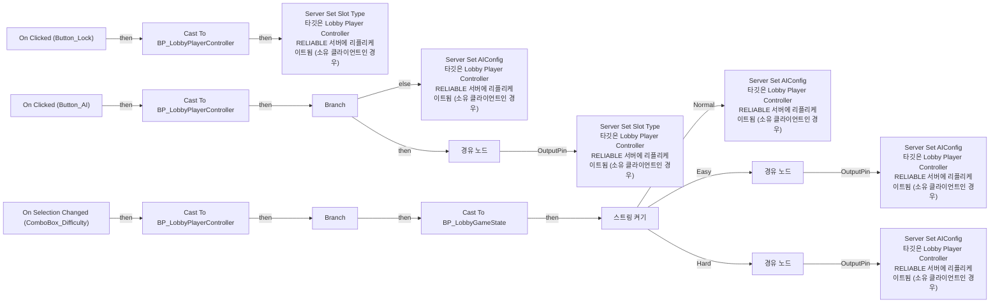
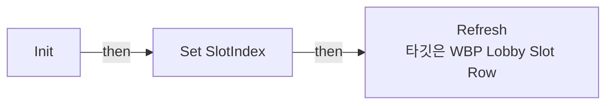

# WBP_LobbySlotRow

에셋: `/Game/QuakeLike_1_0/GameFlow/Lobby/WBP_LobbySlotRow`

부모: `/Script/CoreUObject.Class'/Script/UMG.UserWidget'`

수집일: 2026-10-12. MCP에서 읽은 그래프·핀 연결의 자동 전사입니다. 상속된 그래프는 부모 문서를 함께 확인합니다.

정적 루트 참조 도달: 있음. 실행 여부 또는 삭제 가능 여부의 확정이 아닙니다.

컴포넌트 목록은 이 BP가 직접 정의한 SCS만 포함합니다. 부모·네이티브 생성 컴포넌트, 인스턴스 설정은 별도입니다.

## 변수와 기본값

| 이름 | 타입 | CDO 기본값 |
|---|---|---|
| `SlotIndex` | `int` | 0 |
| `CachedSlotType` | `ELobbySlotType` | &lt;LobbySlotType.OPEN: 0&gt; |
| `bIsLocalHost` | `bool` | False |

## 그래프 목록

| 그래프 | 전체 노드 수 |
|---|---|
| EventGraph | 46 |
| Init | 3 |
| Refresh | 83 |

## 그래프별 실행 연결

실선은 출력 exec 핀의 실제 연결입니다. 여러 분기는 출력 핀 이름을 표시합니다. 함수 호출·delegate·타이머의 다음 그래프 실행은 이 그림에서 자동으로 이어 붙이지 않습니다.

순수 계산 노드 및 데이터 핀은 아래 목록과 원본 JSON을 확인합니다. 연결되지 않은 이벤트도 표시되므로, 노드가 있다는 이유만으로 실행된다고 판단하면 안 됩니다.

### EventGraph

실행 핀 플로우차트

전체 노드·기본 입력 목록

| 노드 ID | 제목 | 미연결 기본 입력 / 에셋 입력 |
|---|---|---|
| `K2Node_ComponentBoundEvent_0` | On Clicked (Button_AI) |  |
| `K2Node_ComponentBoundEvent_1` | On Clicked (Button_Lock) |  |
| `K2Node_CallFunction_3` | Get Owning Player 타깃은 위젯 |  |
| `K2Node_DynamicCast_1` | Cast To BP_LobbyPlayerController |  |
| `K2Node_CallFunction_9` | Server Set AIConfig 타깃은 Lobby Player Controller RELIABLE 서버에 리플리케이트됨 (소유 클라이언트인 경우) | Difficulty=Easy |
| `K2Node_VariableGet_5` | Get SlotIndex |  |
| `K2Node_CommutativeAssociativeBinaryOperator_1` | Append | A=AI_ |
| `K2Node_VariableGet_4` | Get SlotIndex |  |
| `K2Node_CallFunction_7` | To String (Integer) |  |
| `K2Node_CallFunction_1` | Get Owning Player 타깃은 위젯 |  |
| `K2Node_DynamicCast_4` | Cast To BP_LobbyPlayerController |  |
| `K2Node_CallFunction_5` | Server Set Slot Type 타깃은 Lobby Player Controller RELIABLE 서버에 리플리케이트됨 (소유 클라이언트인 경우) |  |
| `K2Node_VariableGet_6` | Get SlotIndex |  |
| `K2Node_Knot_1` | 경유 노드 |  |
| `K2Node_VariableGet_7` | Get CachedSlotType |  |
| `K2Node_Select_0` | 선택 | Open=Locked; Locked=Open; Player=Player; AI=AI |
| `K2Node_IfThenElse_0` | Branch |  |
| `K2Node_VariableGet_0` | Get CachedSlotType |  |
| `K2Node_EnumEquality_0` | Equal (Enum) | B=AI |
| `K2Node_CallFunction_10` | Server Set Slot Type 타깃은 Lobby Player Controller RELIABLE 서버에 리플리케이트됨 (소유 클라이언트인 경우) | NewType=Open |
| `K2Node_Knot_7` | 경유 노드 |  |
| `K2Node_VariableGet_2` | Get SlotIndex |  |
| `K2Node_Knot_8` | 경유 노드 |  |
| `K2Node_ComponentBoundEvent_2` | On Selection Changed (ComboBox_Difficulty) |  |
| `K2Node_CallFunction_11` | Get Owning Player 타깃은 위젯 |  |
| `K2Node_DynamicCast_2` | Cast To BP_LobbyPlayerController |  |
| `K2Node_Knot_9` | 경유 노드 |  |
| `K2Node_IfThenElse_1` | Branch |  |
| `K2Node_EnumInequality_0` | 같지 않음(열거형) | B=Direct |
| `K2Node_SwitchString_0` | 스트링 켜기 |  |
| `K2Node_CallFunction_13` | Server Set AIConfig 타깃은 Lobby Player Controller RELIABLE 서버에 리플리케이트됨 (소유 클라이언트인 경우) | Difficulty=Easy |
| `K2Node_CallFunction_14` | Server Set AIConfig 타깃은 Lobby Player Controller RELIABLE 서버에 리플리케이트됨 (소유 클라이언트인 경우) | Difficulty=Normal |
| `K2Node_CallFunction_12` | Server Set AIConfig 타깃은 Lobby Player Controller RELIABLE 서버에 리플리케이트됨 (소유 클라이언트인 경우) | Difficulty=Hard |
| `K2Node_Knot_10` | 경유 노드 |  |
| `K2Node_Knot_11` | 경유 노드 |  |
| `K2Node_VariableGet_15` | Get SlotIndex |  |
| `K2Node_VariableGet_12` | Get SlotIndex |  |
| `K2Node_VariableGet_10` | Get SlotIndex |  |
| `K2Node_Knot_12` | 경유 노드 |  |
| `K2Node_Knot_13` | 경유 노드 |  |
| `K2Node_Knot_14` | 경유 노드 |  |
| `K2Node_CallFunction_15` | Get Game State |  |
| `K2Node_DynamicCast_0` | Cast To BP_LobbyGameState |  |
| `K2Node_VariableGet_16` | Get Slots |  |
| `K2Node_GetArrayItem_1` | GET |  |
| `K2Node_VariableGet_17` | Get SlotIndex |  |

### Init

실행 핀 플로우차트

전체 노드·기본 입력 목록

| 노드 ID | 제목 | 미연결 기본 입력 / 에셋 입력 |
|---|---|---|
| `K2Node_FunctionEntry_0` | Init |  |
| `K2Node_VariableSet_0` | Set SlotIndex | Output_Get=0 |
| `K2Node_CallFunction_0` | Refresh 타깃은 WBP Lobby Slot Row |  |

### Refresh

```mermaid
flowchart LR
  n0["Refresh"]
  n1["Cast To BP_LobbyGameState"]
  n2["Switch on ELobbySlotType"]
  n3["Set Text"]
  n4["경유 노드"]
  n5["Set Visibility"]
  n6["Set Text"]
  n7["경유 노드"]
  n8["Set Visibility"]
  n9["Set Text"]
  n10["Set Visibility"]
  n11["Set Text"]
  n12["경유 노드"]
  n13["Set Visibility"]
  n14["Switch on ELobbyDifficulty"]
  n15["Branch"]
  n16["Set Selected Option<br/>타깃은 콤보 박스(스트링)"]
  n17["경유 노드"]
  n18["Set Selected Option<br/>타깃은 콤보 박스(스트링)"]
  n19["Set Selected Option<br/>타깃은 콤보 박스(스트링)"]
  n20["경유 노드"]
  n21["Set ColorAndOpacity"]
  n22["Set ColorAndOpacity"]
  n23["경유 노드"]
  n24["경유 노드"]
  n25["Set CachedSlotType"]
  n26["Set bIsLocalHost"]
  n27["Branch"]
  n28["시퀀스"]
  n29["경유 노드"]
  n30["Set Visibility"]
  n31["Set Visibility"]
  n32["Set Visibility"]
  n33["Set Visibility"]
  n34["경유 노드"]
  n35["Set Text"]
  n36["Set Text"]
  n37["Set Text"]
  n38["Is Valid"]
  n39["Set bIsLocalHost"]
  n0 -->|"then"| n1
  n1 -->|"then"| n28
  n2 -->|"Open"| n4
  n2 -->|"Locked"| n7
  n2 -->|"Player"| n9
  n2 -->|"AI"| n12
  n3 -->|"then"| n35
  n4 -->|"OutputPin"| n3
  n6 -->|"then"| n36
  n7 -->|"OutputPin"| n6
  n9 -->|"then"| n10
  n11 -->|"then"| n37
  n12 -->|"OutputPin"| n11
  n13 -->|"then"| n14
  n14 -->|"Easy"| n17
  n14 -->|"Normal"| n18
  n14 -->|"Hard"| n20
  n15 -->|"then"| n23
  n15 -->|"else"| n24
  n17 -->|"OutputPin"| n16
  n20 -->|"OutputPin"| n19
  n21 -->|"then"| n2
  n22 -->|"then"| n2
  n23 -->|"OutputPin"| n21
  n24 -->|"OutputPin"| n22
  n25 -->|"then"| n38
  n26 -->|"then"| n27
  n27 -->|"then"| n34
  n27 -->|"else"| n32
  n28 -->|"then_0"| n25
  n28 -->|"then_1"| n29
  n29 -->|"OutputPin"| n15
  n30 -->|"then"| n31
  n32 -->|"then"| n33
  n34 -->|"OutputPin"| n30
  n35 -->|"then"| n5
  n36 -->|"then"| n8
  n37 -->|"then"| n13
  n38 -->|"Is Valid"| n26
  n38 -->|"Is Not Valid"| n39
  n39 -->|"then"| n27
```

실행 핀 플로우차트

전체 노드·기본 입력 목록

| 노드 ID | 제목 | 미연결 기본 입력 / 에셋 입력 |
|---|---|---|
| `K2Node_FunctionEntry_1` | Refresh |  |
| `K2Node_CallFunction_0` | Get Game State |  |
| `K2Node_DynamicCast_0` | Cast To BP_LobbyGameState |  |
| `K2Node_VariableGet_0` | Get Slots |  |
| `K2Node_GetArrayItem_0` | GET |  |
| `K2Node_VariableGet_1` | Get SlotIndex |  |
| `K2Node_SwitchEnum_0` | Switch on ELobbySlotType |  |
| `K2Node_VariableSet_2` | Set Text |  |
| `K2Node_Knot_2` | 경유 노드 |  |
| `K2Node_VariableSet_3` | Set Visibility | Visibility=Collapsed; Output_Get=Visible |
| `K2Node_VariableSet_4` | Set Text |  |
| `K2Node_Knot_3` | 경유 노드 |  |
| `K2Node_VariableSet_5` | Set Visibility | Visibility=Collapsed; Output_Get=Visible |
| `K2Node_VariableSet_6` | Set Text |  |
| `K2Node_VariableSet_7` | Set Visibility | Visibility=Collapsed; Output_Get=Visible |
| `K2Node_VariableSet_0` | Set Text |  |
| `K2Node_Knot_4` | 경유 노드 |  |
| `K2Node_VariableSet_1` | Set Visibility | Visibility=Visible; Output_Get=Visible |
| `K2Node_SwitchEnum_3` | Switch on ELobbyDifficulty |  |
| `K2Node_Knot_5` | 경유 노드 |  |
| `K2Node_CallFunction_32` | To Text (String) |  |
| `K2Node_CallFunction_33` | To Text (String) |  |
| `K2Node_IfThenElse_0` | Branch |  |
| `K2Node_Knot_6` | 경유 노드 |  |
| `K2Node_CallFunction_6` | Set Selected Option 타깃은 콤보 박스(스트링) | Option=Easy |
| `K2Node_Knot_9` | 경유 노드 |  |
| `K2Node_CallFunction_3` | Set Selected Option 타깃은 콤보 박스(스트링) | Option=Normal |
| `K2Node_CallFunction_5` | Set Selected Option 타깃은 콤보 박스(스트링) | Option=Hard |
| `K2Node_Knot_7` | 경유 노드 |  |
| `K2Node_VariableSet_12` | Set ColorAndOpacity | ColorAndOpacity=(R=0.064658,G=1.000000,B=0.043650,A=1.000000) |
| `K2Node_VariableSet_11` | Set ColorAndOpacity | ColorAndOpacity=(R=0.229167,G=0.229167,B=0.229167,A=1.000000) |
| `K2Node_Knot_10` | 경유 노드 |  |
| `K2Node_Knot_11` | 경유 노드 |  |
| `K2Node_VariableSet_13` | Set CachedSlotType |  |
| `K2Node_Knot_12` | 경유 노드 |  |
| `K2Node_CallFunction_8` | Get Owning Player 타깃은 위젯 |  |
| `K2Node_VariableGet_20` | Get PlayerState |  |
| `K2Node_PromotableOperator_0` | Equal (Object) |  |
| `K2Node_VariableGet_21` | Get HostPlayerState |  |
| `K2Node_Knot_13` | 경유 노드 |  |
| `K2Node_VariableSet_15` | Set bIsLocalHost |  |
| `K2Node_IfThenElse_1` | Branch |  |
| `K2Node_CommutativeAssociativeBinaryOperator_0` | AND Boolean |  |
| `K2Node_CommutativeAssociativeBinaryOperator_1` | OR Boolean |  |
| `K2Node_EnumEquality_0` | Equal (Enum) | B=Open |
| `K2Node_EnumEquality_2` | Equal (Enum) | B=Locked |
| `K2Node_Knot_16` | 경유 노드 |  |
| `K2Node_Knot_17` | 경유 노드 |  |
| `K2Node_ExecutionSequence_0` | 시퀀스 |  |
| `K2Node_Knot_20` | 경유 노드 |  |
| `K2Node_VariableSet_19` | Set Visibility | Visibility=Visible; Output_Get=Visible |
| `K2Node_VariableSet_20` | Set Visibility | Visibility=Visible; Output_Get=Visible |
| `K2Node_VariableSet_17` | Set Visibility | Visibility=Collapsed; Output_Get=Visible |
| `K2Node_VariableSet_18` | Set Visibility | Visibility=Collapsed; Output_Get=Visible |
| `K2Node_Knot_21` | 경유 노드 |  |
| `K2Node_VariableGet_11` | Get Image_ReadyState |  |
| `K2Node_VariableGet_10` | Get Image_ReadyState |  |
| `K2Node_VariableGet_14` | Get Text_Name |  |
| `K2Node_VariableGet_17` | Get Text_Name |  |
| `K2Node_VariableGet_26` | Get Text_Name |  |
| `K2Node_VariableGet_13` | Get Text_Name |  |
| `K2Node_VariableGet_28` | Get ComboBox_Difficulty |  |
| `K2Node_VariableGet_29` | Get ComboBox_Difficulty |  |
| `K2Node_VariableGet_27` | Get ComboBox_Difficulty |  |
| `K2Node_VariableGet_4` | Get Button_AI |  |
| `K2Node_VariableGet_5` | Get Button_Lock |  |
| `K2Node_VariableGet_2` | Get Button_AI |  |
| `K2Node_VariableGet_3` | Get Button_Lock |  |
| `K2Node_VariableGet_8` | Get ComboBox_Difficulty |  |
| `K2Node_VariableGet_9` | Get ComboBox_Difficulty |  |
| `K2Node_VariableGet_12` | Get ComboBox_Difficulty |  |
| `K2Node_VariableGet_7` | Get ComboBox_Difficulty |  |
| `K2Node_VariableGet_16` | Get Text_Lock |  |
| `K2Node_VariableSet_9` | Set Text |  |
| `K2Node_VariableGet_15` | Get Text_Lock |  |
| `K2Node_VariableSet_10` | Set Text |  |
| `K2Node_EnumEquality_1` | Equal (Enum) | B=AI |
| `K2Node_VariableSet_8` | Set Text |  |
| `K2Node_VariableGet_18` | Get Text_AI |  |
| `K2Node_MacroInstance_0` | Is Valid |  |
| `K2Node_Knot_0` | 경유 노드 |  |
| `K2Node_Knot_1` | 경유 노드 |  |
| `K2Node_VariableSet_14` | Set bIsLocalHost | bIsLocalHost=false; Output_Get=false |

## 조회 범위의 한계

ObjectIterator로 발견했으나 MCP helper가 반환하지 않은 그래프입니다. delegate signature·컴파일된 중간 그래프·macro·애니메이션 내부 그래프가 섞일 수 있습니다.

- `BndEvt__WBP_LobbySlotRow_Button_AI_K2Node_ComponentBoundEvent_0_OnButtonClickedEvent__DelegateSignature`: Graph 'BndEvt__WBP_LobbySlotRow_Button_AI_K2Node_ComponentBoundEvent_0_OnButtonClickedEvent__DelegateSignature' not found in Blueprint.
- `BndEvt__WBP_LobbySlotRow_Button_Lock_K2Node_ComponentBoundEvent_1_OnButtonClickedEvent__DelegateSignature`: Graph 'BndEvt__WBP_LobbySlotRow_Button_Lock_K2Node_ComponentBoundEvent_1_OnButtonClickedEvent__DelegateSignature' not found in Blueprint.
- `BndEvt__WBP_LobbySlotRow_ComboBox_Difficulty_K2Node_ComponentBoundEvent_2_OnSelectionChangedEvent__DelegateSignature`: Graph 'BndEvt__WBP_LobbySlotRow_ComboBox_Difficulty_K2Node_ComponentBoundEvent_2_OnSelectionChangedEvent__DelegateSignature' not found in Blueprint.
- `EdGraph_0`: Graph 'EdGraph_0' not found in Blueprint.
- `ExecuteUbergraph_WBP_LobbySlotRow`: Graph 'ExecuteUbergraph_WBP_LobbySlotRow' not found in Blueprint.
- `Init_MERGED`: Graph 'Init_MERGED' not found in Blueprint.
- `Refresh_MERGED`: Graph 'Refresh_MERGED' not found in Blueprint.

[원본 MCP 스냅샷](../../../../Evidence/blueprints-210.json)
