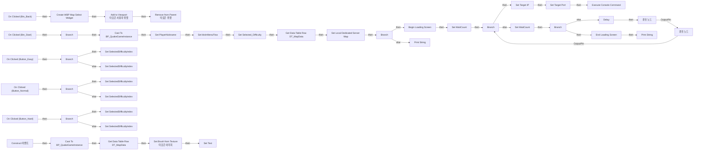

# WBP_DifficultySelect

에셋: `/Game/QuakeLike_1_0/GameFlow/UI/WBP_DifficultySelect`

부모: `/Script/CoreUObject.Class'/Script/UMG.UserWidget'`

수집일: 2026-10-12. MCP에서 읽은 그래프·핀 연결의 자동 전사입니다. 상속된 그래프는 부모 문서를 함께 확인합니다.

정적 루트 참조 도달: 있음. 실행 여부 또는 삭제 가능 여부의 확정이 아닙니다.

컴포넌트 목록은 이 BP가 직접 정의한 SCS만 포함합니다. 부모·네이티브 생성 컴포넌트, 인스턴스 설정은 별도입니다.

## 변수와 기본값

| 이름 | 타입 | CDO 기본값 |
|---|---|---|
| `SelectedDifficultyIndex` | `int` | -1 |
| `WaitCount` | `int` | 0 |

## 그래프 목록

| 그래프 | 전체 노드 수 |
|---|---|
| EventGraph | 81 |

## 그래프별 실행 연결

실선은 출력 exec 핀의 실제 연결입니다. 여러 분기는 출력 핀 이름을 표시합니다. 함수 호출·delegate·타이머의 다음 그래프 실행은 이 그림에서 자동으로 이어 붙이지 않습니다.

순수 계산 노드 및 데이터 핀은 아래 목록과 원본 JSON을 확인합니다. 연결되지 않은 이벤트도 표시되므로, 노드가 있다는 이유만으로 실행된다고 판단하면 안 됩니다.

### EventGraph

실행 핀 플로우차트

전체 노드·기본 입력 목록

| 노드 ID | 제목 | 미연결 기본 입력 / 에셋 입력 |
|---|---|---|
| `K2Node_ComponentBoundEvent_1` | On Clicked (Btn_Back) |  |
| `K2Node_CreateWidget_0` | Create WBP Map Select Widget | Class=/Game/QuakeLike_1_0/GameFlow/UI/WBP_MapSelect.WBP_MapSelect_C |
| `K2Node_CallFunction_1` | Add to Viewport 타깃은 사용자 위젯 | ZOrder=0 |
| `K2Node_CallFunction_0` | Get Owning Player 타깃은 위젯 |  |
| `K2Node_CallFunction_2` | Remove from Parent 타깃은 위젯 |  |
| `K2Node_ComponentBoundEvent_3` | On Clicked (Button_Easy) |  |
| `K2Node_ComponentBoundEvent_4` | On Clicked (Button_Normal) |  |
| `K2Node_ComponentBoundEvent_5` | On Clicked (Button_Hard) |  |
| `K2Node_CallFunction_4` | Get Game Instance 타깃은 위젯 |  |
| `K2Node_DynamicCast_1` | Cast To BP_QuakeGameInstance |  |
| `K2Node_ComponentBoundEvent_0` | On Clicked (Btn_Start) |  |
| `K2Node_IfThenElse_1` | Branch |  |
| `K2Node_VariableGet_6` | Get SelectedDifficultyIndex |  |
| `K2Node_PromotableOperator_1` | Equal (Integer) |  |
| `K2Node_VariableGet_7` | Get SelectedDifficultyIndex |  |
| `K2Node_PromotableOperator_2` | Equal (Integer) | B=1 |
| `K2Node_IfThenElse_2` | Branch |  |
| `K2Node_VariableGet_5` | Get SelectedDifficultyIndex |  |
| `K2Node_PromotableOperator_0` | Equal (Integer) | B=2 |
| `K2Node_IfThenElse_0` | Branch |  |
| `K2Node_VariableSet_14` | Set SelectedDifficultyIndex | SelectedDifficultyIndex=-1; Output_Get=0 |
| `K2Node_VariableSet_15` | Set SelectedDifficultyIndex | SelectedDifficultyIndex=0; Output_Get=0 |
| `K2Node_VariableSet_16` | Set SelectedDifficultyIndex | SelectedDifficultyIndex=-1; Output_Get=0 |
| `K2Node_VariableSet_0` | Set SelectedDifficultyIndex | SelectedDifficultyIndex=1; Output_Get=0 |
| `K2Node_VariableSet_13` | Set SelectedDifficultyIndex | SelectedDifficultyIndex=-1; Output_Get=0 |
| `K2Node_VariableSet_11` | Set SelectedDifficultyIndex | SelectedDifficultyIndex=2; Output_Get=0 |
| `K2Node_VariableGet_20` | Get SelectedDifficultyIndex |  |
| `K2Node_Select_0` | 선택 | Option 0=NewEnumerator0; Option 1=NewEnumerator1; Option 2=NewEnumerator2 |
| `K2Node_VariableSet_5` | Set Selected_Difficulty | Output_Get=NewEnumerator0 |
| `K2Node_GetDataTableRow_0` | Get Data Table Row DT_MapData | DataTable=/Game/QuakeLike_1_0/GameFlow/Table/DT/DT_MapData.DT_MapData |
| `K2Node_VariableSet_6` | Set bIsInMenuFlow | bIsInMenuFlow=false; Output_Get=false |
| `K2Node_VariableGet_1` | Get Selected_Map_ID |  |
| `K2Node_VariableGet_4` | Get SelectedDifficultyIndex |  |
| `K2Node_PromotableOperator_3` | Not Equal (Integer) | B=-1 |
| `K2Node_IfThenElse_3` | Branch |  |
| `K2Node_VariableSet_2` | Set Target IP | Target IP=127.0.0.1 |
| `K2Node_Knot_1` | 경유 노드 |  |
| `K2Node_Knot_2` | 경유 노드 |  |
| `K2Node_VariableSet_3` | Set Target Port | Target Port=7779 |
| `K2Node_Knot_3` | 경유 노드 |  |
| `K2Node_CallFunction_9` | Get Login Command |  |
| `K2Node_CallFunction_10` | Execute Console Command |  |
| `K2Node_Knot_4` | 경유 노드 |  |
| `K2Node_CallFunction_11` | Delay | Duration=0.2 |
| `K2Node_CallFunction_12` | Is Local Dedicated Server Ready |  |
| `K2Node_IfThenElse_4` | Branch |  |
| `K2Node_Knot_0` | 경유 노드 |  |
| `K2Node_Knot_5` | 경유 노드 |  |
| `EdGraphNode_Comment_0` | 임시 테스트: 이후 TimeOut 추가할 것 |  |
| `K2Node_CommutativeAssociativeBinaryOperator_1` | Append | B=?Difficulty= |
| `K2Node_CallFunction_13` | To String (Integer) |  |
| `K2Node_VariableGet_9` | Get SelectedDifficultyIndex |  |
| `K2Node_VariableSet_1` | Set PlayerNickname |  |
| `K2Node_VariableGet_8` | Get Player_Name_Editorble |  |
| `K2Node_VariableGet_12` | Get Text |  |
| `K2Node_CallFunction_41` | To String (Text) |  |
| `K2Node_CallFunction_5` | Begin Loading Screen | StatusText=서버를 준비하는 중... |
| `K2Node_CallFunction_6` | To String (SoftObjectReference) |  |
| `K2Node_CallFunction_7` | Split | InStr=.; SearchCase=IgnoreCase; SearchDir=FromStart; ReturnValue=false |
| `K2Node_CallFunction_8` | Set Local Dedicated Server Map |  |
| `K2Node_IfThenElse_5` | Branch |  |
| `K2Node_CallFunction_14` | Print String | InString=로컬 서버가 실행 중이 아닙니다; bPrintToScreen=true; bPrintToLog=true; TextColor=(R=0.000000,G=0.660000,B=1.000000,A=1.000000); Duration=2.000000; Key=None |
| `K2Node_VariableSet_7` | Set WaitCount | WaitCount=0; Output_Get=0 |
| `K2Node_VariableGet_11` | Get WaitCount |  |
| `K2Node_PromotableOperator_4` | int + int | B=1 |
| `K2Node_VariableSet_4` | Set WaitCount |  |
| `K2Node_IfThenElse_6` | Branch |  |
| `K2Node_CallFunction_3` | End Loading Screen |  |
| `K2Node_CallFunction_15` | Print String | InString=서버 준비 시간 초과; bPrintToScreen=true; bPrintToLog=true; TextColor=(R=0.000000,G=0.660000,B=1.000000,A=1.000000); Duration=2.000000; Key=None |
| `K2Node_PromotableOperator_5` | integer &gt; integer | B=150 |
| `K2Node_Event_0` | Construct 이벤트 |  |
| `K2Node_CallFunction_16` | Get Game Instance 타깃은 위젯 |  |
| `K2Node_DynamicCast_0` | Cast To BP_QuakeGameInstance |  |
| `K2Node_VariableGet_16` | Get Selected_Map_ID |  |
| `K2Node_GetDataTableRow_1` | Get Data Table Row DT_MapData | DataTable=/Game/QuakeLike_1_0/GameFlow/Table/DT/DT_MapData.DT_MapData |
| `K2Node_VariableGet_17` | Get Lvl_Image |  |
| `K2Node_CallFunction_17` | Set Brush from Texture 타깃은 이미지 | bMatchSize=false |
| `K2Node_Knot_6` | 경유 노드 |  |
| `K2Node_VariableGet_18` | Get MapTT_1 |  |
| `K2Node_VariableSet_8` | Set Text |  |
| `K2Node_CallFunction_23` | To Text (String) |  |

## 조회 범위의 한계

ObjectIterator로 발견했으나 MCP helper가 반환하지 않은 그래프입니다. delegate signature·컴파일된 중간 그래프·macro·애니메이션 내부 그래프가 섞일 수 있습니다.

- `BndEvt__WBP_DifficultySelect_Btn_Back_K2Node_ComponentBoundEvent_0_OnButtonClickedEvent__DelegateSignature`: Graph 'BndEvt__WBP_DifficultySelect_Btn_Back_K2Node_ComponentBoundEvent_0_OnButtonClickedEvent__DelegateSignature' not found in Blueprint.
- `BndEvt__WBP_DifficultySelect_Btn_Start_K2Node_ComponentBoundEvent_0_OnButtonClickedEvent__DelegateSignature`: Graph 'BndEvt__WBP_DifficultySelect_Btn_Start_K2Node_ComponentBoundEvent_0_OnButtonClickedEvent__DelegateSignature' not found in Blueprint.
- `BndEvt__WBP_DifficultySelect_Button_Easy_K2Node_ComponentBoundEvent_3_OnButtonClickedEvent__DelegateSignature`: Graph 'BndEvt__WBP_DifficultySelect_Button_Easy_K2Node_ComponentBoundEvent_3_OnButtonClickedEvent__DelegateSignature' not found in Blueprint.
- `BndEvt__WBP_DifficultySelect_Button_Hard_K2Node_ComponentBoundEvent_5_OnButtonClickedEvent__DelegateSignature`: Graph 'BndEvt__WBP_DifficultySelect_Button_Hard_K2Node_ComponentBoundEvent_5_OnButtonClickedEvent__DelegateSignature' not found in Blueprint.
- `BndEvt__WBP_DifficultySelect_Button_Normal_K2Node_ComponentBoundEvent_4_OnButtonClickedEvent__DelegateSignature`: Graph 'BndEvt__WBP_DifficultySelect_Button_Normal_K2Node_ComponentBoundEvent_4_OnButtonClickedEvent__DelegateSignature' not found in Blueprint.
- `Construct`: Graph 'Construct' not found in Blueprint.

[원본 MCP 스냅샷](../../../../Evidence/blueprints-105.json)
