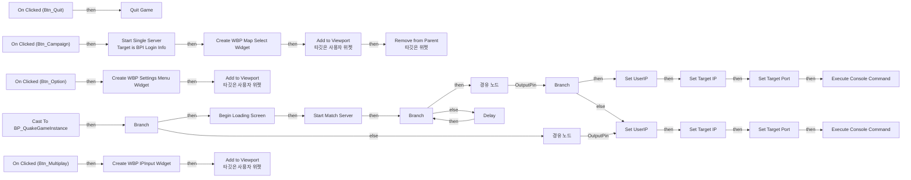

# WBP_MainMenu

에셋: `/Game/QuakeLike_1_0/GameFlow/UI/WBP_MainMenu`

부모: `/Script/CoreUObject.Class'/Script/UMG.UserWidget'`

수집일: 2026-10-12. MCP에서 읽은 그래프·핀 연결의 자동 전사입니다. 상속된 그래프는 부모 문서를 함께 확인합니다.

정적 루트 참조 도달: 있음. 실행 여부 또는 삭제 가능 여부의 확정이 아닙니다.

컴포넌트 목록은 이 BP가 직접 정의한 SCS만 포함합니다. 부모·네이티브 생성 컴포넌트, 인스턴스 설정은 별도입니다.

## 변수와 기본값

| 이름 | 타입 | CDO 기본값 |
|---|---|---|
| `UserIP` | `string` |  |

## 그래프 목록

| 그래프 | 전체 노드 수 |
|---|---|
| EventGraph | 54 |

## 그래프별 실행 연결

실선은 출력 exec 핀의 실제 연결입니다. 여러 분기는 출력 핀 이름을 표시합니다. 함수 호출·delegate·타이머의 다음 그래프 실행은 이 그림에서 자동으로 이어 붙이지 않습니다.

순수 계산 노드 및 데이터 핀은 아래 목록과 원본 JSON을 확인합니다. 연결되지 않은 이벤트도 표시되므로, 노드가 있다는 이유만으로 실행된다고 판단하면 안 됩니다.

### EventGraph

실행 핀 플로우차트

전체 노드·기본 입력 목록

| 노드 ID | 제목 | 미연결 기본 입력 / 에셋 입력 |
|---|---|---|
| `K2Node_ComponentBoundEvent_0` | On Clicked (Btn_Quit) |  |
| `K2Node_CallFunction_3` | Quit Game | QuitPreference=Quit; bIgnorePlatformRestrictions=false |
| `K2Node_ComponentBoundEvent_1` | On Clicked (Btn_Campaign) |  |
| `K2Node_ComponentBoundEvent_2` | On Clicked (Btn_Multiplay) |  |
| `K2Node_ComponentBoundEvent_3` | On Clicked (Btn_Option) |  |
| `K2Node_CreateWidget_0` | Create WBP Map Select Widget | Class=/Game/QuakeLike_1_0/GameFlow/UI/WBP_MapSelect.WBP_MapSelect_C |
| `K2Node_CallFunction_1` | Add to Viewport 타깃은 사용자 위젯 | ZOrder=0 |
| `K2Node_CallFunction_2` | Remove from Parent 타깃은 위젯 |  |
| `K2Node_CallFunction_0` | Get Owning Player 타깃은 위젯 |  |
| `K2Node_CallFunction_4` | Get Game Instance 타깃은 위젯 |  |
| `K2Node_DynamicCast_0` | Cast To BP_QuakeGameInstance |  |
| `K2Node_VariableSet_2` | Set Target IP |  |
| `K2Node_VariableSet_4` | Set Target Port | Target Port=7777 |
| `K2Node_CallFunction_13` | Get Login Command |  |
| `K2Node_CallFunction_14` | Execute Console Command |  |
| `K2Node_CallFunction_7` | Start Match Server | MapName=Lobby_Level; Port=7777; ReturnValue=false |
| `K2Node_IfThenElse_0` | Branch |  |
| `K2Node_CallFunction_8` | Is Match Server Ready |  |
| `K2Node_Knot_4` | 경유 노드 |  |
| `K2Node_CallFunction_9` | Delay | Duration=0.2 |
| `K2Node_Knot_1` | 경유 노드 |  |
| `K2Node_Knot_2` | 경유 노드 |  |
| `K2Node_Knot_7` | 경유 노드 |  |
| `K2Node_VariableGet_0` | Get IPSet |  |
| `K2Node_Knot_0` | 경유 노드 |  |
| `K2Node_VariableSet_5` | Set UserIP |  |
| `K2Node_CallFunction_15` | To String (Text) |  |
| `K2Node_VariableGet_3` | Get Text |  |
| `K2Node_IfThenElse_1` | Branch |  |
| `K2Node_VariableSet_0` | Set Target IP |  |
| `K2Node_VariableSet_1` | Set Target Port | Target Port=7777 |
| `K2Node_CallFunction_5` | Get Login Command |  |
| `K2Node_CallFunction_10` | Execute Console Command |  |
| `K2Node_Knot_5` | 경유 노드 |  |
| `K2Node_VariableSet_3` | Set UserIP |  |
| `K2Node_IfThenElse_2` | Branch |  |
| `K2Node_VariableGet_1` | Get IPSet |  |
| `K2Node_CallFunction_32` | To String (Text) |  |
| `K2Node_VariableGet_2` | Get Text |  |
| `K2Node_Knot_8` | 경유 노드 |  |
| `K2Node_CallFunction_6` | Is Local IPAddress |  |
| `K2Node_Knot_3` | 경유 노드 |  |
| `K2Node_Knot_6` | 경유 노드 |  |
| `K2Node_Knot_9` | 경유 노드 |  |
| `K2Node_Knot_10` | 경유 노드 |  |
| `K2Node_CallFunction_16` | Is Empty |  |
| `K2Node_CallFunction_11` | Begin Loading Screen | StatusText=멀티 플레이로 이동하는 중... |
| `K2Node_CreateWidget_1` | Create WBP Settings Menu Widget | Class=/Game/QuakeLike_1_0/GameProgressFlow/WBP_SettingsMenu.WBP_SettingsMenu_C |
| `K2Node_CallFunction_12` | Add to Viewport 타깃은 사용자 위젯 | ZOrder=0 |
| `K2Node_CreateWidget_2` | Create WBP IPInput Widget | Class=/Game/QuakeLike_1_0/GameFlow/UI/WBP_IPInput.WBP_IPInput_C |
| `K2Node_CallFunction_17` | Get Owning Player 타깃은 위젯 |  |
| `K2Node_CallFunction_18` | Add to Viewport 타깃은 사용자 위젯 | ZOrder=0 |
| `K2Node_CallFunction_19` | Get Game Instance 타깃은 위젯 |  |
| `K2Node_Message_0` | Start Single Server Target is BPI Login Info | Initial Map Name=MainMenu_Level; Port=7779 |

## 조회 범위의 한계

ObjectIterator로 발견했으나 MCP helper가 반환하지 않은 그래프입니다. delegate signature·컴파일된 중간 그래프·macro·애니메이션 내부 그래프가 섞일 수 있습니다.

- `BndEvt__WBP_MainMenu_Btn_Campaign_K2Node_ComponentBoundEvent_1_OnButtonClickedEvent__DelegateSignature`: Graph 'BndEvt__WBP_MainMenu_Btn_Campaign_K2Node_ComponentBoundEvent_1_OnButtonClickedEvent__DelegateSignature' not found in Blueprint.
- `BndEvt__WBP_MainMenu_Btn_Multiplay_K2Node_ComponentBoundEvent_2_OnButtonClickedEvent__DelegateSignature`: Graph 'BndEvt__WBP_MainMenu_Btn_Multiplay_K2Node_ComponentBoundEvent_2_OnButtonClickedEvent__DelegateSignature' not found in Blueprint.
- `BndEvt__WBP_MainMenu_Btn_Option_K2Node_ComponentBoundEvent_3_OnButtonClickedEvent__DelegateSignature`: Graph 'BndEvt__WBP_MainMenu_Btn_Option_K2Node_ComponentBoundEvent_3_OnButtonClickedEvent__DelegateSignature' not found in Blueprint.
- `BndEvt__WBP_MainMenu_Btn_Quit_K2Node_ComponentBoundEvent_0_OnButtonClickedEvent__DelegateSignature`: Graph 'BndEvt__WBP_MainMenu_Btn_Quit_K2Node_ComponentBoundEvent_0_OnButtonClickedEvent__DelegateSignature' not found in Blueprint.

[원본 MCP 스냅샷](../../../../Evidence/blueprints-070.json)
