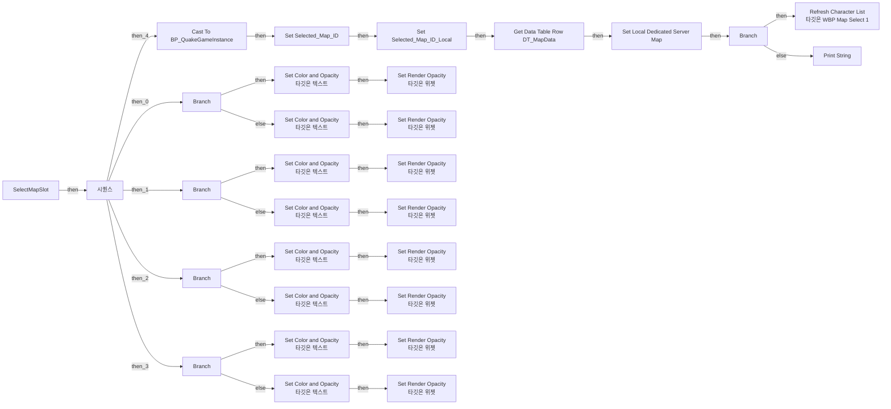
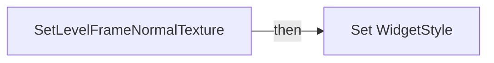

# WBP_MapSelect1

에셋: `/Game/QuakeLike_1_0/GameFlow/UI/WBP_MapSelect1`

부모: `/Script/CoreUObject.Class'/Script/UMG.UserWidget'`

수집일: 2026-10-12. MCP에서 읽은 그래프·핀 연결의 자동 전사입니다. 상속된 그래프는 부모 문서를 함께 확인합니다.

정적 루트 참조 도달: 없음. 실행 여부 또는 삭제 가능 여부의 확정이 아닙니다.

컴포넌트 목록은 이 BP가 직접 정의한 SCS만 포함합니다. 부모·네이티브 생성 컴포넌트, 인스턴스 설정은 별도입니다.

## 변수와 기본값

| 이름 | 타입 | CDO 기본값 |
|---|---|---|
| `Selected_Map_ID_Local` | `name` | None |
| `MapRowNames` | `name` | [] |
| `SelectedDifficultyIndex` | `int` | -1 |

## 그래프 목록

| 그래프 | 전체 노드 수 |
|---|---|
| EventGraph | 283 |
| RefreshCharacterList | 21 |
| SelectMapSlot | 51 |
| SetLevelFrameNormalTexture | 7 |

## 그래프별 실행 연결

실선은 출력 exec 핀의 실제 연결입니다. 여러 분기는 출력 핀 이름을 표시합니다. 함수 호출·delegate·타이머의 다음 그래프 실행은 이 그림에서 자동으로 이어 붙이지 않습니다.

순수 계산 노드 및 데이터 핀은 아래 목록과 원본 JSON을 확인합니다. 연결되지 않은 이벤트도 표시되므로, 노드가 있다는 이유만으로 실행된다고 판단하면 안 됩니다.

### EventGraph

```mermaid
flowchart LR
  n0["On Clicked (Btn_Back)"]
  n1["Create WBP Main Menu Widget"]
  n2["Add to Viewport<br/>타깃은 사용자 위젯"]
  n3["Remove from Parent<br/>타깃은 위젯"]
  n4["On Clicked (Btn_Next)"]
  n5["Branch"]
  n6["Construct 이벤트"]
  n7["Clear"]
  n8["Get Data Table Row Names"]
  n9["For Each Loop"]
  n10["Branch"]
  n11["Add"]
  n12["Select Map by Index<br/>타깃은 WBP Map Select 1"]
  n13["Refresh Map Page<br/>타깃은 WBP Map Select 1"]
  n14["SelectMapByIndex<br/>Custom Event"]
  n15["Branch"]
  n16["Set Selected_Map_ID_Local"]
  n17["Refresh Character List<br/>타깃은 WBP Map Select 1"]
  n18["Refresh Map Page<br/>타깃은 WBP Map Select 1"]
  n19["Cast To BP_QuakeGameInstance"]
  n20["Set Selected_Map_ID"]
  n21["SelectVisibleMapSlot<br/>Custom Event"]
  n22["Select Map by Index<br/>타깃은 WBP Map Select 1"]
  n23["On Clicked (LevelFrame)"]
  n24["Select Visible Map Slot<br/>타깃은 WBP Map Select 1"]
  n25["Select Visible Map Slot<br/>타깃은 WBP Map Select 1"]
  n26["Select Visible Map Slot<br/>타깃은 WBP Map Select 1"]
  n27["Select Visible Map Slot<br/>타깃은 WBP Map Select 1"]
  n28["RefreshMapPage<br/>Custom Event"]
  n29["Get Data Table Row DT_MapData"]
  n30["On Clicked (LevelFrame_2)"]
  n31["On Clicked (LevelFrame_3)"]
  n32["On Clicked (LevelFrame_4)"]
  n33["For Each Loop"]
  n34["Branch"]
  n35["Set Visibility<br/>타깃은 위젯"]
  n36["Get Data Table Row DT_MapData"]
  n37["SetText (Text)<br/>타깃은 텍스트"]
  n38["Branch"]
  n39["Set Color and Opacity<br/>타깃은 텍스트"]
  n40["Set Render Opacity<br/>타깃은 위젯"]
  n41["Set Color and Opacity<br/>타깃은 텍스트"]
  n42["Set Render Opacity<br/>타깃은 위젯"]
  n43["Set Is Enabled<br/>타깃은 위젯"]
  n44["경유 노드"]
  n45["Set Image Brush"]
  n46["On Clicked (Button_Easy)"]
  n47["On Clicked (Button_Normal)"]
  n48["On Clicked (Button_Hard)"]
  n49["Branch"]
  n50["Branch"]
  n51["Branch"]
  n52["Set SelectedDifficultyIndex"]
  n53["Set SelectedDifficultyIndex"]
  n54["Set SelectedDifficultyIndex"]
  n55["Set SelectedDifficultyIndex"]
  n56["Set SelectedDifficultyIndex"]
  n57["Set SelectedDifficultyIndex"]
  n58["Cast To BP_QuakeGameInstance"]
  n59["Set Selected_Difficulty"]
  n60["Get Data Table Row DT_MapData"]
  n61["Set bIsInMenuFlow"]
  n62["Branch"]
  n63["Set Target IP"]
  n64["Set Target Port"]
  n65["Execute Console Command"]
  n66["Delay"]
  n67["Branch"]
  n68["경유 노드"]
  n69["경유 노드"]
  n70["Set PlayerNickname"]
  n71["Begin Loading Screen"]
  n72["ShowExplain<br/>Custom Event"]
  n73["Get Data Table Row DT_MapData"]
  n74["Set Text"]
  n75["Set Text"]
  n76["Show Explain<br/>타깃은 WBP Map Select 1"]
  n77["Show Explain<br/>타깃은 WBP Map Select 1"]
  n78["Show Explain<br/>타깃은 WBP Map Select 1"]
  n79["Show Explain<br/>타깃은 WBP Map Select 1"]
  n80["Show Explain<br/>타깃은 WBP Map Select 1"]
  n81["Set BackgroundColor"]
  n82["Set BackgroundColor"]
  n83["Set BackgroundColor"]
  n84["Set BackgroundColor"]
  n85["Set BackgroundColor"]
  n86["Set BackgroundColor"]
  n87["Set BackgroundColor"]
  n88["Set BackgroundColor"]
  n89["Set BackgroundColor"]
  n90["Set BackgroundColor"]
  n91["Set BackgroundColor"]
  n92["Set BackgroundColor"]
  n93["Branch"]
  n94["시퀀스"]
  n95["Set Visibility"]
  n96["경유 노드"]
  n97["Set Text"]
  n98["Set Image Brush"]
  n99["Set Visibility"]
  n100["Set Visibility"]
  n101["Set Visibility"]
  n102["Branch"]
  n103["Set Visibility"]
  n104["경유 노드"]
  n105["Set Text"]
  n106["Set Image Brush"]
  n107["Set Visibility"]
  n108["Set Visibility"]
  n109["Set Visibility"]
  n110["Branch"]
  n111["Set Visibility"]
  n112["경유 노드"]
  n113["Set Text"]
  n114["Set Image Brush"]
  n115["Set Visibility"]
  n116["Set Visibility"]
  n117["Set Visibility"]
  n118["For Each Loop"]
  n119["Set Level Frame Normal Texture<br/>타깃은 WBP Map Select 1"]
  n120["Start Single Server<br/>Target is BPI Login Info"]
  n121["Stop Single Server<br/>Target is BPI Login Info"]
  n122["Get Data Table Row DT_MapData"]
  n123["Set Local Dedicated Server Map"]
  n0 -->|"then"| n121
  n1 -->|"then"| n2
  n2 -->|"then"| n3
  n4 -->|"then"| n5
  n5 -->|"then"| n62
  n6 -->|"then"| n7
  n7 -->|"then"| n8
  n8 -->|"then"| n9
  n9 -->|"LoopBody"| n29
  n9 -->|"Completed"| n120
  n10 -->|"then"| n11
  n12 -->|"then"| n13
  n13 -->|"then"| n80
  n14 -->|"then"| n15
  n15 -->|"then"| n16
  n16 -->|"then"| n122
  n17 -->|"then"| n18
  n18 -->|"then"| n19
  n19 -->|"then"| n20
  n21 -->|"then"| n118
  n23 -->|"then"| n24
  n24 -->|"then"| n76
  n25 -->|"then"| n77
  n26 -->|"then"| n78
  n27 -->|"then"| n79
  n28 -->|"then"| n33
  n29 -->|"then"| n10
  n30 -->|"then"| n25
  n31 -->|"then"| n26
  n32 -->|"then"| n27
  n33 -->|"LoopBody"| n34
  n33 -->|"Completed"| n44
  n34 -->|"then"| n35
  n35 -->|"then"| n36
  n36 -->|"then"| n37
  n37 -->|"then"| n45
  n38 -->|"then"| n39
  n38 -->|"else"| n41
  n39 -->|"then"| n40
  n41 -->|"then"| n42
  n44 -->|"OutputPin"| n43
  n45 -->|"then"| n38
  n46 -->|"then"| n49
  n47 -->|"then"| n50
  n48 -->|"then"| n51
  n49 -->|"then"| n52
  n49 -->|"else"| n53
  n50 -->|"then"| n54
  n50 -->|"else"| n55
  n51 -->|"then"| n56
  n51 -->|"else"| n57
  n52 -->|"then"| n91
  n53 -->|"then"| n81
  n54 -->|"then"| n90
  n55 -->|"then"| n84
  n56 -->|"then"| n92
  n57 -->|"then"| n87
  n58 -->|"then"| n70
  n59 -->|"then"| n60
  n60 -->|"then"| n123
  n61 -->|"then"| n59
  n62 -->|"then"| n58
  n63 -->|"then"| n64
  n64 -->|"then"| n65
  n66 -->|"then"| n69
  n67 -->|"then"| n63
  n67 -->|"else"| n66
  n68 -->|"OutputPin"| n67
  n69 -->|"OutputPin"| n68
  n70 -->|"then"| n61
  n71 -->|"then"| n67
  n72 -->|"then"| n73
  n73 -->|"then"| n74
  n74 -->|"then"| n75
  n75 -->|"then"| n94
  n81 -->|"then"| n82
  n82 -->|"then"| n83
  n84 -->|"then"| n85
  n85 -->|"then"| n86
  n87 -->|"then"| n88
  n88 -->|"then"| n89
  n93 -->|"then"| n96
  n93 -->|"else"| n99
  n94 -->|"then_0"| n93
  n94 -->|"then_1"| n102
  n94 -->|"then_2"| n110
  n95 -->|"then"| n97
  n96 -->|"OutputPin"| n95
  n97 -->|"then"| n101
  n99 -->|"then"| n100
  n101 -->|"then"| n98
  n102 -->|"then"| n104
  n102 -->|"else"| n107
  n103 -->|"then"| n105
  n104 -->|"OutputPin"| n103
  n105 -->|"then"| n109
  n107 -->|"then"| n108
  n109 -->|"then"| n106
  n110 -->|"then"| n112
  n110 -->|"else"| n115
  n111 -->|"then"| n113
  n112 -->|"OutputPin"| n111
  n113 -->|"then"| n117
  n115 -->|"then"| n116
  n117 -->|"then"| n114
  n118 -->|"LoopBody"| n119
  n119 -->|"then"| n22
  n120 -->|"then"| n12
  n121 -->|"then"| n1
  n122 -->|"then"| n17
  n123 -->|"then"| n71
```

실행 핀 플로우차트

전체 노드·기본 입력 목록

| 노드 ID | 제목 | 미연결 기본 입력 / 에셋 입력 |
|---|---|---|
| `K2Node_Keep_K2Node_ComponentBoundEvent_0` | On Clicked (Btn_Back) |  |
| `K2Node_Keep_K2Node_CreateWidget_1` | Create WBP Main Menu Widget | Class=/Game/QuakeLike_1_0/GameFlow/UI/WBP_MainMenu.WBP_MainMenu_C |
| `K2Node_Keep_K2Node_CallFunction_3` | Add to Viewport 타깃은 사용자 위젯 | ZOrder=0 |
| `K2Node_Keep_K2Node_CallFunction_5` | Get Owning Player 타깃은 위젯 |  |
| `K2Node_Keep_K2Node_CallFunction_6` | Remove from Parent 타깃은 위젯 |  |
| `K2Node_Keep_K2Node_ComponentBoundEvent_1` | On Clicked (Btn_Next) |  |
| `K2Node_Keep_K2Node_VariableGet_22` | Get Selected_Map_ID_Local |  |
| `K2Node_Keep_K2Node_IfThenElse_3` | Branch |  |
| `K2Node_Keep_K2Node_PromotableOperator_3` | Not Equal (Name) |  |
| `K2Node_Construct` | Construct 이벤트 |  |
| `K2Node_ClearMapRows` | Clear |  |
| `K2Node_Get_MapRowNames_15` | Get MapRowNames |  |
| `K2Node_ReadMapTable` | Get Data Table Row Names | Table=/Game/QuakeLike_1_0/GameFlow/Table/DT/DT_MapData.DT_MapData |
| `K2Node_ForEachMapRow` | For Each Loop |  |
| `K2Node_FilterPlayableMaps` | Branch |  |
| `K2Node_AddMapRow` | Add | ReturnValue=0 |
| `K2Node_SelectMapByIndex_22` | Select Map by Index 타깃은 WBP Map Select 1 | Index=0 |
| `K2Node_RefreshMapPage_23` | Refresh Map Page 타깃은 WBP Map Select 1 |  |
| `K2Node_SelectMapByIndex` | SelectMapByIndex Custom Event |  |
| `K2Node_Get_MapRowNames_26` | Get MapRowNames |  |
| `K2Node_ValidateSelectedIndex` | Is Valid Index |  |
| `K2Node_HasSelectedMap` | Branch |  |
| `K2Node_GetSelectedRow` | Get |  |
| `K2Node_StoreSelectedRow` | Set Selected_Map_ID_Local |  |
| `K2Node_RefreshSelectedCharacters` | Refresh Character List 타깃은 WBP Map Select 1 |  |
| `K2Node_RefreshMapPage_32` | Refresh Map Page 타깃은 WBP Map Select 1 |  |
| `K2Node_SelectionGameInstance` | Get Game Instance 타깃은 위젯 |  |
| `K2Node_SelectionCast` | Cast To BP_QuakeGameInstance |  |
| `K2Node_StoreGameInstanceMap` | Set Selected_Map_ID | Output_Get=None |
| `K2Node_SelectVisibleMapSlot` | SelectVisibleMapSlot Custom Event |  |
| `K2Node_Get_MapRowNames_55` | Get MapRowNames |  |
| `K2Node_Get_Selected_Map_ID_Local_56` | Get Selected_Map_ID_Local |  |
| `K2Node_SelectedIndex_57` | Find Item |  |
| `K2Node_Page_58` | int / int | B=4 |
| `K2Node_PageStart_59` | int * int | B=4 |
| `K2Node_VisibleSlotToMapIndex` | int + int |  |
| `K2Node_SelectMapByIndex_61` | Select Map by Index 타깃은 WBP Map Select 1 |  |
| `K2Node_Lvl_Image_1` | On Clicked (LevelFrame) |  |
| `K2Node_SelectVisibleMapSlot_65` | Select Visible Map Slot 타깃은 WBP Map Select 1 | SlotIndex=0 |
| `K2Node_SelectVisibleMapSlot_69` | Select Visible Map Slot 타깃은 WBP Map Select 1 | SlotIndex=1 |
| `K2Node_SelectVisibleMapSlot_73` | Select Visible Map Slot 타깃은 WBP Map Select 1 | SlotIndex=2 |
| `K2Node_SelectVisibleMapSlot_77` | Select Visible Map Slot 타깃은 WBP Map Select 1 | SlotIndex=3 |
| `K2Node_RefreshMapPage` | RefreshMapPage Custom Event |  |
| `K2Node_ReadCandidateMap` | Get Data Table Row DT_MapData | DataTable=/Game/QuakeLike_1_0/GameFlow/Table/DT/DT_MapData.DT_MapData |
| `K2Node_HasMapImage` | Is Valid |  |
| `K2Node_Knot_11` | 경유 노드 |  |
| `K2Node_Knot_12` | 경유 노드 |  |
| `K2Node_Knot_6` | 경유 노드 |  |
| `K2Node_Knot_10` | 경유 노드 |  |
| `K2Node_Knot_14` | 경유 노드 |  |
| `K2Node_ComponentBoundEvent_6` | On Clicked (LevelFrame_2) |  |
| `K2Node_ComponentBoundEvent_1` | On Clicked (LevelFrame_3) |  |
| `K2Node_ComponentBoundEvent_2` | On Clicked (LevelFrame_4) |  |
| `K2Node_VariableGet_11` | Get Lvl_Image |  |
| `K2Node_VariableGet_16` | Get Lvl_Image_2 |  |
| `K2Node_VariableGet_17` | Get Lvl_Image_3 |  |
| `K2Node_VariableGet_10` | Get Lvl_Image_4 |  |
| `K2Node_MakeArray_1` | 배열 만들기 |  |
| `K2Node_MacroInstance_1` | For Each Loop |  |
| `K2Node_Get_MapRowNames_80` | Get MapRowNames |  |
| `K2Node_Get_Selected_Map_ID_Local_81` | Get Selected_Map_ID_Local |  |
| `K2Node_SelectedIndex_82` | Find Item |  |
| `K2Node_Page_83` | int / int | B=4 |
| `K2Node_PageStart_84` | int * int | B=4 |
| `K2Node_DisplayedRowIndex` | int + int | B=1 |
| `K2Node_ValidVisibleRow` | Is Valid Index |  |
| `K2Node_Get_MapRowNames_102` | Get MapRowNames |  |
| `K2Node_SlotHasMap` | Branch |  |
| `K2Node_ShowMapImage` | Set Visibility 타깃은 위젯 | InVisibility=Visible |
| `K2Node_ReadDisplayedMap` | Get Data Table Row DT_MapData | DataTable=/Game/QuakeLike_1_0/GameFlow/Table/DT/DT_MapData.DT_MapData |
| `K2Node_MapDisplayName` | To Text (String) |  |
| `K2Node_SetMapName` | SetText (Text) 타깃은 텍스트 |  |
| `K2Node_Get_Selected_Map_ID_Local_118` | Get Selected_Map_ID_Local |  |
| `K2Node_ThisMapIsSelected` | Equal (Name) |  |
| `K2Node_HighlightSelectedMap` | Branch |  |
| `K2Node_MapNameColor_true` | Set Color and Opacity 타깃은 텍스트 | InColorAndOpacity_SpecifiedColor=(R=1.000000,G=1.000000,B=1.000000,A=0.500000); InColorAndOpacity_ColorUseRule=UseColor_Specified |
| `K2Node_MapImageOpacity_true` | Set Render Opacity 타깃은 위젯 | InOpacity=0.500000 |
| `K2Node_MapNameColor_false` | Set Color and Opacity 타깃은 텍스트 | InColorAndOpacity_SpecifiedColor=(R=1.000000,G=1.000000,B=1.000000,A=1.000000); InColorAndOpacity_ColorUseRule=UseColor_Specified |
| `K2Node_MapImageOpacity_false` | Set Render Opacity 타깃은 위젯 | InOpacity=1.000000 |
| `K2Node_Knot_9` | 경유 노드 |  |
| `K2Node_DisplayedRowName` | Get |  |
| `K2Node_Knot_20` | 경유 노드 |  |
| `K2Node_Knot_21` | 경유 노드 |  |
| `K2Node_Array_MapTT_` | 배열 만들기 |  |
| `K2Node_Get_MapTT_1_91` | Get MapTT_1 |  |
| `K2Node_Get_MapTT_2_92` | Get MapTT_2 |  |
| `K2Node_Get_MapTT_3_93` | Get MapTT_3 |  |
| `K2Node_Get_MapTT_4_94` | Get MapTT_4 |  |
| `K2Node_SlotText` | Get |  |
| `K2Node_Knot_22` | 경유 노드 |  |
| `K2Node_Get_MapRowNames_125` | Get MapRowNames |  |
| `K2Node_TotalMaps` | Length |  |
| `K2Node_Enable_Btn_Next` | integer &gt; integer | B=0 |
| `K2Node_Get_Btn_Next_128` | Get Btn_Next |  |
| `K2Node_SetEnabled_Btn_Next` | Set Is Enabled 타깃은 위젯 |  |
| `K2Node_Knot_8` | 경유 노드 |  |
| `K2Node_Knot_24` | 경유 노드 |  |
| `K2Node_Knot_25` | 경유 노드 |  |
| `K2Node_Knot_26` | 경유 노드 |  |
| `K2Node_Knot_27` | 경유 노드 |  |
| `K2Node_Knot_32` | 경유 노드 |  |
| `K2Node_Knot_33` | 경유 노드 |  |
| `K2Node_Knot_34` | 경유 노드 |  |
| `K2Node_Knot_35` | 경유 노드 |  |
| `K2Node_MacroInstance_2` | Set Image Brush |  |
| `K2Node_Knot_7` | 경유 노드 |  |
| `K2Node_ComponentBoundEvent_3` | On Clicked (Button_Easy) |  |
| `K2Node_ComponentBoundEvent_4` | On Clicked (Button_Normal) |  |
| `K2Node_ComponentBoundEvent_5` | On Clicked (Button_Hard) |  |
| `K2Node_IfThenElse_1` | Branch |  |
| `K2Node_VariableGet_6` | Get SelectedDifficultyIndex |  |
| `K2Node_PromotableOperator_1` | Equal (Integer) |  |
| `K2Node_VariableGet_7` | Get SelectedDifficultyIndex |  |
| `K2Node_PromotableOperator_2` | Equal (Integer) | B=1 |
| `K2Node_IfThenElse_2` | Branch |  |
| `K2Node_VariableGet_5` | Get SelectedDifficultyIndex |  |
| `K2Node_PromotableOperator_0` | Equal (Integer) | B=2 |
| `K2Node_IfThenElse_0` | Branch |  |
| `K2Node_VariableSet_14` | Set SelectedDifficultyIndex | SelectedDifficultyIndex=-1; Output_Get=0 |
| `K2Node_VariableSet_15` | Set SelectedDifficultyIndex | SelectedDifficultyIndex=0; Output_Get=0 |
| `K2Node_VariableSet_16` | Set SelectedDifficultyIndex | SelectedDifficultyIndex=-1; Output_Get=0 |
| `K2Node_VariableSet_0` | Set SelectedDifficultyIndex | SelectedDifficultyIndex=1; Output_Get=0 |
| `K2Node_VariableSet_13` | Set SelectedDifficultyIndex | SelectedDifficultyIndex=-1; Output_Get=0 |
| `K2Node_VariableSet_11` | Set SelectedDifficultyIndex | SelectedDifficultyIndex=2; Output_Get=0 |
| `K2Node_CallFunction_4` | Get Game Instance 타깃은 위젯 |  |
| `K2Node_DynamicCast_1` | Cast To BP_QuakeGameInstance |  |
| `K2Node_VariableGet_20` | Get SelectedDifficultyIndex |  |
| `K2Node_Select_0` | 선택 | Option 0=NewEnumerator0; Option 1=NewEnumerator1; Option 2=NewEnumerator2 |
| `K2Node_VariableSet_5` | Set Selected_Difficulty | Output_Get=NewEnumerator0 |
| `K2Node_GetDataTableRow_0` | Get Data Table Row DT_MapData | DataTable=/Game/QuakeLike_1_0/GameFlow/Table/DT/DT_MapData.DT_MapData |
| `K2Node_VariableSet_6` | Set bIsInMenuFlow | bIsInMenuFlow=false; Output_Get=false |
| `K2Node_VariableGet_1` | Get Selected_Map_ID |  |
| `K2Node_VariableGet_4` | Get SelectedDifficultyIndex |  |
| `K2Node_PromotableOperator_3` | Not Equal (Integer) | B=-1 |
| `K2Node_IfThenElse_3` | Branch |  |
| `K2Node_VariableSet_2` | Set Target IP | Target IP=127.0.0.1 |
| `K2Node_Knot_1` | 경유 노드 |  |
| `K2Node_Knot_2` | 경유 노드 |  |
| `K2Node_VariableSet_3` | Set Target Port | Target Port=7779 |
| `K2Node_Knot_3` | 경유 노드 |  |
| `K2Node_CallFunction_9` | Get Login Command |  |
| `K2Node_CallFunction_10` | Execute Console Command |  |
| `K2Node_Knot_4` | 경유 노드 |  |
| `K2Node_CallFunction_3` | Get Game Instance 타깃은 위젯 |  |
| `K2Node_CallFunction_11` | Delay | Duration=0.2 |
| `K2Node_CallFunction_12` | Is Local Dedicated Server Ready |  |
| `K2Node_IfThenElse_4` | Branch |  |
| `K2Node_Knot_0` | 경유 노드 |  |
| `K2Node_Knot_5` | 경유 노드 |  |
| `EdGraphNode_Comment_0` | 임시 테스트: 이후 TimeOut 추가할 것 |  |
| `K2Node_CommutativeAssociativeBinaryOperator_1` | Append | B=?Difficulty= |
| `K2Node_CallFunction_13` | To String (Integer) |  |
| `K2Node_VariableGet_9` | Get SelectedDifficultyIndex |  |
| `K2Node_VariableSet_1` | Set PlayerNickname |  |
| `K2Node_VariableGet_8` | Get Player_Name_Editorble |  |
| `K2Node_VariableGet_12` | Get Text |  |
| `K2Node_CallFunction_41` | To String (Text) |  |
| `K2Node_CallFunction_5` | Begin Loading Screen | StatusText=서버를 준비하는 중... |
| `K2Node_CallFunction_6` | To String (SoftObjectReference) |  |
| `K2Node_CallFunction_7` | Split | InStr=.; SearchCase=IgnoreCase; SearchDir=FromStart; ReturnValue=false |
| `K2Node_Knot_13` | 경유 노드 |  |
| `K2Node_CustomEvent_0` | ShowExplain Custom Event |  |
| `K2Node_GetDataTableRow_1` | Get Data Table Row DT_MapData | DataTable=/Game/QuakeLike_1_0/GameFlow/Table/DT/DT_MapData.DT_MapData |
| `K2Node_VariableGet_19` | Get Selected_Map_ID_Local |  |
| `K2Node_VariableGet_21` | Get Explain_LvlName |  |
| `K2Node_VariableGet_18` | Get Explain_LvlExplain |  |
| `K2Node_VariableSet_7` | Set Text |  |
| `K2Node_VariableSet_8` | Set Text |  |
| `K2Node_CallFunction_23` | To Text (String) |  |
| `K2Node_Knot_15` | 경유 노드 |  |
| `K2Node_Knot_16` | 경유 노드 |  |
| `K2Node_CallFunction_2` | Show Explain 타깃은 WBP Map Select 1 |  |
| `K2Node_CallFunction_8` | Show Explain 타깃은 WBP Map Select 1 |  |
| `K2Node_CallFunction_14` | Show Explain 타깃은 WBP Map Select 1 |  |
| `K2Node_CallFunction_1` | Show Explain 타깃은 WBP Map Select 1 |  |
| `K2Node_CallFunction_15` | Show Explain 타깃은 WBP Map Select 1 |  |
| `K2Node_VariableGet_0` | Get Button_Easy |  |
| `K2Node_VariableGet_24` | Get Button_Normal |  |
| `K2Node_VariableGet_25` | Get Button_Hard |  |
| `K2Node_VariableGet_2` | Get Button_Normal |  |
| `K2Node_VariableGet_3` | Get Button_Hard |  |
| `K2Node_VariableSet_20` | Set BackgroundColor | BackgroundColor=(R=1.000000,G=0.000000,B=0.000000,A=1.000000) |
| `K2Node_VariableSet_21` | Set BackgroundColor | BackgroundColor=(R=1.000000,G=1.000000,B=1.000000,A=1.000000) |
| `K2Node_VariableSet_22` | Set BackgroundColor | BackgroundColor=(R=1.000000,G=1.000000,B=1.000000,A=1.000000) |
| `K2Node_VariableGet_30` | Get Button_Normal |  |
| `K2Node_VariableGet_31` | Get Button_Hard |  |
| `K2Node_VariableSet_26` | Set BackgroundColor | BackgroundColor=(R=1.000000,G=0.000000,B=0.000000,A=1.000000) |
| `K2Node_VariableSet_29` | Set BackgroundColor | BackgroundColor=(R=1.000000,G=1.000000,B=1.000000,A=1.000000) |
| `K2Node_VariableSet_28` | Set BackgroundColor | BackgroundColor=(R=1.000000,G=1.000000,B=1.000000,A=1.000000) |
| `K2Node_VariableGet_32` | Get Button_Easy |  |
| `K2Node_VariableGet_14` | Get Button_Normal |  |
| `K2Node_VariableGet_15` | Get Button_Hard |  |
| `K2Node_VariableSet_10` | Set BackgroundColor | BackgroundColor=(R=1.000000,G=0.000000,B=0.000000,A=1.000000) |
| `K2Node_VariableSet_12` | Set BackgroundColor | BackgroundColor=(R=1.000000,G=1.000000,B=1.000000,A=1.000000) |
| `K2Node_VariableSet_9` | Set BackgroundColor | BackgroundColor=(R=1.000000,G=1.000000,B=1.000000,A=1.000000) |
| `K2Node_VariableGet_13` | Get Button_Easy |  |
| `K2Node_VariableSet_30` | Set BackgroundColor | BackgroundColor=(R=1.000000,G=1.000000,B=1.000000,A=1.000000) |
| `K2Node_VariableSet_31` | Set BackgroundColor | BackgroundColor=(R=1.000000,G=1.000000,B=1.000000,A=1.000000) |
| `K2Node_VariableSet_27` | Set BackgroundColor | BackgroundColor=(R=1.000000,G=1.000000,B=1.000000,A=1.000000) |
| `K2Node_VariableGet_26` | Get Button_Easy |  |
| `K2Node_CallFunction_0` | Wrap Text by Char Count | MaxCharsPerLine=10; bBreakAtWordBoundary=true |
| `K2Node_CallFunction_24` | To String (Text) |  |
| `K2Node_CallArrayFunction_3` | Is Valid Index | IndexToTest=0 |
| `K2Node_IfThenElse_6` | Branch |  |
| `K2Node_ExecutionSequence_0` | 시퀀스 |  |
| `K2Node_Knot_28` | 경유 노드 |  |
| `K2Node_VariableGet_41` | Get Lvl_Feature |  |
| `K2Node_VariableSet_34` | Set Visibility | Visibility=Visible; Output_Get=Visible |
| `K2Node_Knot_39` | 경유 노드 |  |
| `K2Node_Knot_30` | 경유 노드 |  |
| `K2Node_VariableGet_42` | Get Lvl_Feature |  |
| `K2Node_VariableSet_35` | Set Text |  |
| `K2Node_GetArrayItem_9` | GET | Dimension 1=0 |
| `K2Node_Knot_31` | 경유 노드 |  |
| `K2Node_Knot_36` | 경유 노드 |  |
| `K2Node_VariableGet_43` | Get Feature_Icon1 |  |
| `K2Node_GetArrayItem_10` | GET | Dimension 1=0 |
| `K2Node_MacroInstance_10` | Set Image Brush |  |
| `K2Node_Knot_37` | 경유 노드 |  |
| `K2Node_Knot_38` | 경유 노드 |  |
| `K2Node_VariableGet_44` | Get Lvl_Feature |  |
| `K2Node_VariableSet_36` | Set Visibility | Visibility=Collapsed; Output_Get=Visible |
| `K2Node_VariableGet_45` | Get Feature_Icon1 |  |
| `K2Node_VariableSet_37` | Set Visibility | Visibility=Collapsed; Output_Get=Visible |
| `K2Node_VariableSet_38` | Set Visibility | Visibility=Visible; Output_Get=Visible |
| `K2Node_VariableGet_46` | Get Feature_Icon1 |  |
| `K2Node_IfThenElse_7` | Branch |  |
| `K2Node_VariableSet_39` | Set Visibility | Visibility=Visible; Output_Get=Visible |
| `K2Node_Knot_46` | 경유 노드 |  |
| `K2Node_VariableSet_40` | Set Text |  |
| `K2Node_GetArrayItem_11` | GET | Dimension 1=1 |
| `K2Node_GetArrayItem_12` | GET | Dimension 1=1 |
| `K2Node_MacroInstance_11` | Set Image Brush |  |
| `K2Node_VariableSet_41` | Set Visibility | Visibility=Collapsed; Output_Get=Visible |
| `K2Node_VariableSet_42` | Set Visibility | Visibility=Collapsed; Output_Get=Visible |
| `K2Node_VariableSet_43` | Set Visibility | Visibility=Visible; Output_Get=Visible |
| `K2Node_Knot_42` | 경유 노드 |  |
| `K2Node_Knot_43` | 경유 노드 |  |
| `K2Node_VariableGet_51` | Get Feature_Icon2 |  |
| `K2Node_Knot_47` | 경유 노드 |  |
| `K2Node_VariableGet_52` | Get Lvl_Feature_1 |  |
| `K2Node_Knot_48` | 경유 노드 |  |
| `K2Node_VariableGet_53` | Get Lvl_Feature_1 |  |
| `K2Node_VariableGet_54` | Get Feature_Icon2 |  |
| `K2Node_IfThenElse_5` | Branch |  |
| `K2Node_VariableSet_33` | Set Visibility | Visibility=Visible; Output_Get=Visible |
| `K2Node_Knot_29` | 경유 노드 |  |
| `K2Node_VariableSet_24` | Set Text |  |
| `K2Node_GetArrayItem_7` | GET | Dimension 1=2 |
| `K2Node_GetArrayItem_8` | GET | Dimension 1=2 |
| `K2Node_MacroInstance_9` | Set Image Brush |  |
| `K2Node_VariableSet_32` | Set Visibility | Visibility=Collapsed; Output_Get=Visible |
| `K2Node_VariableSet_23` | Set Visibility | Visibility=Collapsed; Output_Get=Visible |
| `K2Node_VariableSet_25` | Set Visibility | Visibility=Visible; Output_Get=Visible |
| `K2Node_Knot_44` | 경유 노드 |  |
| `K2Node_Knot_45` | 경유 노드 |  |
| `K2Node_VariableGet_55` | Get Lvl_Feature_2 |  |
| `K2Node_VariableGet_59` | Get Feature_Icon3 |  |
| `K2Node_VariableGet_58` | Get Lvl_Feature_2 |  |
| `K2Node_Knot_49` | 경유 노드 |  |
| `K2Node_Knot_50` | 경유 노드 |  |
| `K2Node_CallArrayFunction_4` | Is Valid Index | IndexToTest=1 |
| `K2Node_CallArrayFunction_0` | Is Valid Index | IndexToTest=2 |
| `K2Node_VariableGet_57` | Get Feature_Icon3 |  |
| `K2Node_VariableGet_27` | Get LevelFrame |  |
| `K2Node_MakeArray_0` | 배열 만들기 |  |
| `K2Node_VariableGet_28` | Get LevelFrame_2 |  |
| `K2Node_VariableGet_29` | Get LevelFrame_3 |  |
| `K2Node_VariableGet_33` | Get LevelFrame_4 |  |
| `K2Node_MacroInstance_0` | For Each Loop |  |
| `K2Node_PromotableOperator_5` | Equal (Integer) |  |
| `K2Node_Knot_17` | 경유 노드 |  |
| `K2Node_Select_1` | 선택 | Option 0=/Game/QuakeLike_1_0/GameFlow/UI/UI_Image/FrameLevel.FrameLevel; Option 1=/Game/QuakeLike_1_0/GameFlow/UI/UI_Image/UI_Asset_0922/UI_Asset_0922/FrameLevel_Push.FrameLevel_Push |
| `K2Node_Knot_18` | 경유 노드 |  |
| `K2Node_CallFunction_17` | Set Level Frame Normal Texture 타깃은 WBP Map Select 1 |  |
| `K2Node_Knot_19` | 경유 노드 |  |
| `K2Node_CallFunction_16` | Get Game Instance 타깃은 위젯 |  |
| `K2Node_Message_3` | Start Single Server Target is BPI Login Info | Initial Map Name=MainMenu_Level; Port=7779 |
| `K2Node_CallFunction_18` | Get Game Instance 타깃은 위젯 |  |
| `K2Node_Message_4` | Stop Single Server Target is BPI Login Info |  |
| `K2Node_Knot_23` | 경유 노드 |  |
| `K2Node_GetDataTableRow_3` | Get Data Table Row DT_MapData | DataTable=/Game/QuakeLike_1_0/GameFlow/Table/DT/DT_MapData.DT_MapData |
| `K2Node_CallFunction_22` | Set Local Dedicated Server Map | ReturnValue=false |

### RefreshCharacterList

```mermaid
flowchart LR
  n0["RefreshCharacterList"]
  n1["Set Names"]
  n2["Get Data Table Row DT_MapData"]
  n3["For Each Loop"]
  n4["Get Data Table Row DT_Character"]
  n5["Clear Children<br/>타깃은 패널 위젯"]
  n6["Create WBP Character Portrait Widget"]
  n7["Set Brush from Texture<br/>타깃은 이미지"]
  n8["Set Text"]
  n9["Add Child<br/>타깃은 패널 위젯"]
  n10["Cast To HorizontalBoxSlot"]
  n11["Set Padding<br/>타깃은 가로 박스 슬롯"]
  n0 -->|"then"| n1
  n1 -->|"then"| n5
  n2 -->|"then"| n3
  n3 -->|"LoopBody"| n4
  n4 -->|"then"| n6
  n5 -->|"then"| n2
  n6 -->|"then"| n7
  n7 -->|"then"| n8
  n8 -->|"then"| n9
  n9 -->|"then"| n10
  n10 -->|"then"| n11
```

실행 핀 플로우차트

전체 노드·기본 입력 목록

| 노드 ID | 제목 | 미연결 기본 입력 / 에셋 입력 |
|---|---|---|
| `K2Node_FunctionEntry_0` | RefreshCharacterList |  |
| `K2Node_VariableSet_1` | Set Names |  |
| `K2Node_GetDataTableRow_0` | Get Data Table Row DT_MapData | DataTable=/Game/QuakeLike_1_0/GameFlow/Table/DT/DT_MapData.DT_MapData |
| `K2Node_Knot_0` | 경유 노드 |  |
| `K2Node_MacroInstance_0` | For Each Loop |  |
| `K2Node_CallFunction_13` | To String (Name) |  |
| `K2Node_GetDataTableRow_1` | Get Data Table Row DT_Character | DataTable=/Game/QuakeLike_1_0/GameFlow/Table/DT/DT_Character.DT_Character |
| `K2Node_VariableGet_0` | Get HBox_CharacterPortraits |  |
| `K2Node_CallFunction_0` | Clear Children 타깃은 패널 위젯 |  |
| `K2Node_CreateWidget_0` | Create WBP Character Portrait Widget | Class=/Game/QuakeLike_1_0/GameFlow/UI/WBP_CharacterPortrait.WBP_CharacterPortrait_C |
| `K2Node_CallFunction_1` | Get Owning Player 타깃은 위젯 |  |
| `K2Node_CallFunction_5` | Set Brush from Texture 타깃은 이미지 | bMatchSize=false |
| `K2Node_VariableGet_1` | Get Character_Image |  |
| `K2Node_Knot_2` | 경유 노드 |  |
| `K2Node_VariableGet_5` | Get Character_Text |  |
| `K2Node_VariableSet_5` | Set Text |  |
| `K2Node_VariableGet_6` | Get HBox_CharacterPortraits |  |
| `K2Node_CallFunction_10` | Add Child 타깃은 패널 위젯 |  |
| `K2Node_CallFunction_11` | To Text (String) |  |
| `K2Node_DynamicCast_0` | Cast To HorizontalBoxSlot |  |
| `K2Node_CallFunction_6` | Set Padding 타깃은 가로 박스 슬롯 | InPadding_Left=0.000000; InPadding_Top=0.000000; InPadding_Right=15.000000; InPadding_Bottom=0.000000 |

### SelectMapSlot

실행 핀 플로우차트

전체 노드·기본 입력 목록

| 노드 ID | 제목 | 미연결 기본 입력 / 에셋 입력 |
|---|---|---|
| `K2Node_FunctionEntry_0` | SelectMapSlot |  |
| `K2Node_PromotableOperator_1` | Equal (Integer) | B=1 |
| `K2Node_PromotableOperator_2` | Equal (Integer) | B=2 |
| `K2Node_PromotableOperator_3` | Equal (Integer) | B=3 |
| `K2Node_PromotableOperator_0` | Equal (Integer) | B=4 |
| `K2Node_IfThenElse_2` | Branch |  |
| `K2Node_VariableGet_2` | Get MapTT_1 |  |
| `K2Node_CallFunction_3` | Set Color and Opacity 타깃은 텍스트 | InColorAndOpacity_SpecifiedColor=(R=1.000000,G=0.168269,B=0.000000,A=0.500000); InColorAndOpacity_ColorUseRule=UseColor_Specified |
| `K2Node_VariableGet_3` | Get MapTT_1 |  |
| `K2Node_CallFunction_4` | Set Color and Opacity 타깃은 텍스트 | InColorAndOpacity_SpecifiedColor=(R=1.000000,G=0.168269,B=0.000000,A=1.000000); InColorAndOpacity_ColorUseRule=UseColor_Specified |
| `K2Node_IfThenElse_3` | Branch |  |
| `K2Node_CallFunction_5` | Set Color and Opacity 타깃은 텍스트 | InColorAndOpacity_SpecifiedColor=(R=1.000000,G=0.168269,B=0.000000,A=0.500000); InColorAndOpacity_ColorUseRule=UseColor_Specified |
| `K2Node_CallFunction_6` | Set Color and Opacity 타깃은 텍스트 | InColorAndOpacity_SpecifiedColor=(R=1.000000,G=0.168269,B=0.000000,A=1.000000); InColorAndOpacity_ColorUseRule=UseColor_Specified |
| `K2Node_VariableGet_6` | Get MapTT_2 |  |
| `K2Node_VariableGet_7` | Get MapTT_2 |  |
| `K2Node_IfThenElse_4` | Branch |  |
| `K2Node_CallFunction_7` | Set Color and Opacity 타깃은 텍스트 | InColorAndOpacity_SpecifiedColor=(R=1.000000,G=0.168269,B=0.000000,A=0.500000); InColorAndOpacity_ColorUseRule=UseColor_Specified |
| `K2Node_CallFunction_8` | Set Color and Opacity 타깃은 텍스트 | InColorAndOpacity_SpecifiedColor=(R=1.000000,G=0.168269,B=0.000000,A=1.000000); InColorAndOpacity_ColorUseRule=UseColor_Specified |
| `K2Node_VariableGet_10` | Get MapTT_3 |  |
| `K2Node_VariableGet_11` | Get MapTT_3 |  |
| `K2Node_IfThenElse_1` | Branch |  |
| `K2Node_CallFunction_2` | Set Color and Opacity 타깃은 텍스트 | InColorAndOpacity_SpecifiedColor=(R=1.000000,G=0.168269,B=0.000000,A=0.500000); InColorAndOpacity_ColorUseRule=UseColor_Specified |
| `K2Node_CallFunction_39` | Set Color and Opacity 타깃은 텍스트 | InColorAndOpacity_SpecifiedColor=(R=1.000000,G=0.168269,B=0.000000,A=1.000000); InColorAndOpacity_ColorUseRule=UseColor_Specified |
| `K2Node_VariableGet_13` | Get MapTT_4 |  |
| `K2Node_VariableGet_12` | Get MapTT_4 |  |
| `K2Node_ExecutionSequence_0` | 시퀀스 |  |
| `K2Node_CommutativeAssociativeBinaryOperator_0` | Append | A=Map_0 |
| `K2Node_CallFunction_27` | To String (Integer) |  |
| `K2Node_CallFunction_9` | Get Game Instance 타깃은 위젯 |  |
| `K2Node_DynamicCast_0` | Cast To BP_QuakeGameInstance |  |
| `K2Node_VariableSet_1` | Set Selected_Map_ID |  |
| `K2Node_VariableSet_2` | Set Selected_Map_ID_Local |  |
| `K2Node_CallFunction_10` | Refresh Character List 타깃은 WBP Map Select 1 |  |
| `K2Node_CallFunction_28` | String To Name |  |
| `K2Node_Knot_ImageSelectionIndex` | 경유 노드 |  |
| `K2Node_CallFunction_MapImageOpacity_1_0` | Set Render Opacity 타깃은 위젯 | InOpacity=0.500000 |
| `K2Node_CallFunction_MapImageOpacity_1_1` | Set Render Opacity 타깃은 위젯 | InOpacity=1.000000 |
| `K2Node_CallFunction_MapImageOpacity_2_0` | Set Render Opacity 타깃은 위젯 | InOpacity=0.500000 |
| `K2Node_CallFunction_MapImageOpacity_2_1` | Set Render Opacity 타깃은 위젯 | InOpacity=1.000000 |
| `K2Node_CallFunction_MapImageOpacity_3_0` | Set Render Opacity 타깃은 위젯 | InOpacity=0.500000 |
| `K2Node_CallFunction_MapImageOpacity_3_1` | Set Render Opacity 타깃은 위젯 | InOpacity=1.000000 |
| `K2Node_CallFunction_MapImageOpacity_4_0` | Set Render Opacity 타깃은 위젯 | InOpacity=0.500000 |
| `K2Node_CallFunction_MapImageOpacity_4_1` | Set Render Opacity 타깃은 위젯 | InOpacity=1.000000 |
| `K2Node_VariableGet_0` | Get Lvl_Image |  |
| `K2Node_VariableGet_1` | Get Lvl_Image_2 |  |
| `K2Node_VariableGet_4` | Get Lvl_Image_3 |  |
| `K2Node_VariableGet_5` | Get Lvl_Image_4 |  |
| `K2Node_GetDataTableRow_0` | Get Data Table Row DT_MapData | DataTable=/Game/QuakeLike_1_0/GameFlow/Table/DT/DT_MapData.DT_MapData |
| `K2Node_CallFunction_0` | Set Local Dedicated Server Map |  |
| `K2Node_IfThenElse_0` | Branch |  |
| `K2Node_CallFunction_1` | Print String | InString=서버 맵 변경 실패; bPrintToScreen=true; bPrintToLog=true; TextColor=(R=0.000000,G=0.660000,B=1.000000,A=1.000000); Duration=2.000000; Key=None |

### SetLevelFrameNormalTexture

실행 핀 플로우차트

전체 노드·기본 입력 목록

| 노드 ID | 제목 | 미연결 기본 입력 / 에셋 입력 |
|---|---|---|
| `K2Node_FunctionEntry_0` | SetLevelFrameNormalTexture |  |
| `K2Node_VariableGet_0` | Get |  |
| `K2Node_BreakStruct_1` | Break Slate Brush |  |
| `K2Node_MakeStruct_0` | Make Slate Brush |  |
| `K2Node_Knot_0` | 경유 노드 |  |
| `K2Node_MakeStruct_1` | Make Button Style |  |
| `K2Node_VariableSet_0` | Set WidgetStyle |  |

## 조회 범위의 한계

ObjectIterator로 발견했으나 MCP helper가 반환하지 않은 그래프입니다. delegate signature·컴파일된 중간 그래프·macro·애니메이션 내부 그래프가 섞일 수 있습니다.

- `BndEvt__WBP_DifficultySelect_Button_Easy_K2Node_ComponentBoundEvent_3_OnButtonClickedEvent__DelegateSignature`: Graph 'BndEvt__WBP_DifficultySelect_Button_Easy_K2Node_ComponentBoundEvent_3_OnButtonClickedEvent__DelegateSignature' not found in Blueprint.
- `BndEvt__WBP_DifficultySelect_Button_Hard_K2Node_ComponentBoundEvent_5_OnButtonClickedEvent__DelegateSignature`: Graph 'BndEvt__WBP_DifficultySelect_Button_Hard_K2Node_ComponentBoundEvent_5_OnButtonClickedEvent__DelegateSignature' not found in Blueprint.
- `BndEvt__WBP_DifficultySelect_Button_Normal_K2Node_ComponentBoundEvent_4_OnButtonClickedEvent__DelegateSignature`: Graph 'BndEvt__WBP_DifficultySelect_Button_Normal_K2Node_ComponentBoundEvent_4_OnButtonClickedEvent__DelegateSignature' not found in Blueprint.
- `BndEvt__WBP_MapSelect_Btn_Back_K2Node_ComponentBoundEvent_0_OnButtonClickedEvent__DelegateSignature`: Graph 'BndEvt__WBP_MapSelect_Btn_Back_K2Node_ComponentBoundEvent_0_OnButtonClickedEvent__DelegateSignature' not found in Blueprint.
- `BndEvt__WBP_MapSelect_Btn_Next_K2Node_ComponentBoundEvent_1_OnButtonClickedEvent__DelegateSignature`: Graph 'BndEvt__WBP_MapSelect_Btn_Next_K2Node_ComponentBoundEvent_1_OnButtonClickedEvent__DelegateSignature' not found in Blueprint.
- `BndEvt__WBP_MapSelect_LevelFrame_2_K2Node_ComponentBoundEvent_0_OnButtonClickedEvent__DelegateSignature`: Graph 'BndEvt__WBP_MapSelect_LevelFrame_2_K2Node_ComponentBoundEvent_0_OnButtonClickedEvent__DelegateSignature' not found in Blueprint.
- `BndEvt__WBP_MapSelect_LevelFrame_3_K2Node_ComponentBoundEvent_1_OnButtonClickedEvent__DelegateSignature`: Graph 'BndEvt__WBP_MapSelect_LevelFrame_3_K2Node_ComponentBoundEvent_1_OnButtonClickedEvent__DelegateSignature' not found in Blueprint.
- `BndEvt__WBP_MapSelect_LevelFrame_4_K2Node_ComponentBoundEvent_2_OnButtonClickedEvent__DelegateSignature`: Graph 'BndEvt__WBP_MapSelect_LevelFrame_4_K2Node_ComponentBoundEvent_2_OnButtonClickedEvent__DelegateSignature' not found in Blueprint.
- `BndEvt__WBP_MapSelect_Lvl_Image_1_K2Node_ComponentBoundEvent_2_OnButtonClickedEvent__DelegateSignature`: Graph 'BndEvt__WBP_MapSelect_Lvl_Image_1_K2Node_ComponentBoundEvent_2_OnButtonClickedEvent__DelegateSignature' not found in Blueprint.
- `Construct`: Graph 'Construct' not found in Blueprint.
- `EdGraph_0`: Graph 'EdGraph_0' not found in Blueprint.
- `EdGraph_1`: Graph 'EdGraph_1' not found in Blueprint.
- `EdGraph_2`: Graph 'EdGraph_2' not found in Blueprint.
- `EdGraph_3`: Graph 'EdGraph_3' not found in Blueprint.
- `EdGraph_4`: Graph 'EdGraph_4' not found in Blueprint.
- `EdGraph_5`: Graph 'EdGraph_5' not found in Blueprint.
- `EdGraph_6`: Graph 'EdGraph_6' not found in Blueprint.
- `EdGraph_7`: Graph 'EdGraph_7' not found in Blueprint.
- `ExecuteUbergraph_WBP_MapSelect1`: Graph 'ExecuteUbergraph_WBP_MapSelect1' not found in Blueprint.
- `RefreshCharacterList_MERGED`: Graph 'RefreshCharacterList_MERGED' not found in Blueprint.
- `RefreshMapPage`: Graph 'RefreshMapPage' not found in Blueprint.
- `SelectMapByIndex`: Graph 'SelectMapByIndex' not found in Blueprint.
- `SelectMapSlot_MERGED`: Graph 'SelectMapSlot_MERGED' not found in Blueprint.
- `SelectVisibleMapSlot`: Graph 'SelectVisibleMapSlot' not found in Blueprint.
- `SetLevelFrameNormalTexture_MERGED`: Graph 'SetLevelFrameNormalTexture_MERGED' not found in Blueprint.
- `ShowExplain`: Graph 'ShowExplain' not found in Blueprint.

[원본 MCP 스냅샷](../../../../Evidence/blueprints-210.json)
