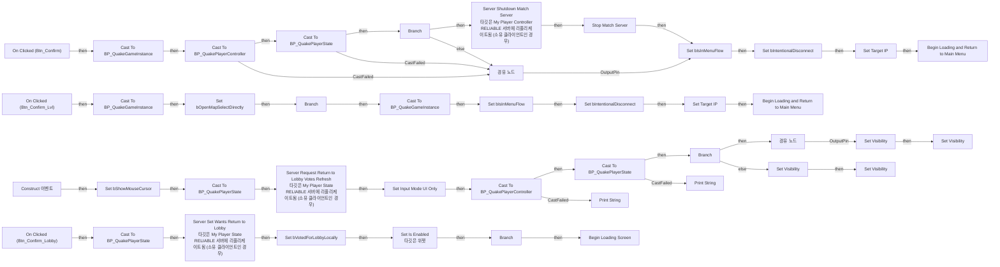
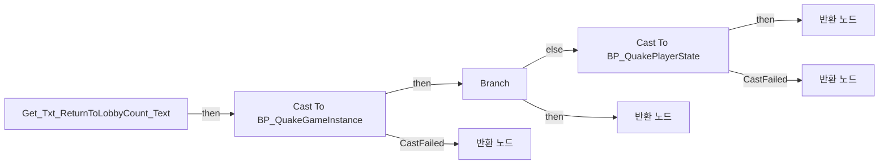
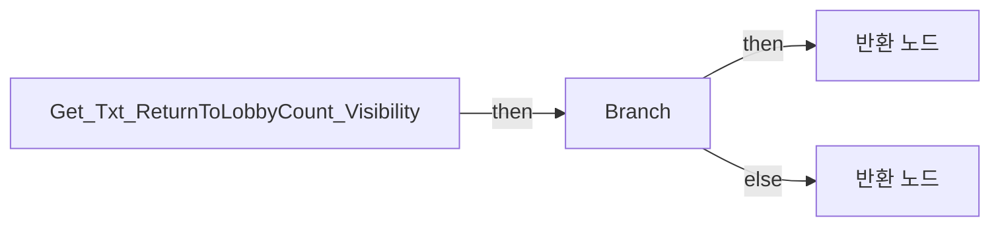
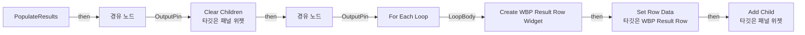

# WBP_Result

에셋: `/Game/QuakeLike_1_0/GameFlow/UI/WBP_Result`

부모: `/Script/CoreUObject.Class'/Script/UMG.UserWidget'`

수집일: 2026-10-12. MCP에서 읽은 그래프·핀 연결의 자동 전사입니다. 상속된 그래프는 부모 문서를 함께 확인합니다.

정적 루트 참조 도달: 있음. 실행 여부 또는 삭제 가능 여부의 확정이 아닙니다.

컴포넌트 목록은 이 BP가 직접 정의한 SCS만 포함합니다. 부모·네이티브 생성 컴포넌트, 인스턴스 설정은 별도입니다.

## 변수와 기본값

| 이름 | 타입 | CDO 기본값 |
|---|---|---|
| `bVotedForLobbyLocally` | `bool` | False |

## 그래프 목록

| 그래프 | 전체 노드 수 |
|---|---|
| EventGraph | 75 |
| Get_Txt_ReturnToLobbyCount_Text | 24 |
| Get_Txt_ReturnToLobbyCount_Visibility | 5 |
| PopulateResults | 15 |

## 그래프별 실행 연결

실선은 출력 exec 핀의 실제 연결입니다. 여러 분기는 출력 핀 이름을 표시합니다. 함수 호출·delegate·타이머의 다음 그래프 실행은 이 그림에서 자동으로 이어 붙이지 않습니다.

순수 계산 노드 및 데이터 핀은 아래 목록과 원본 JSON을 확인합니다. 연결되지 않은 이벤트도 표시되므로, 노드가 있다는 이유만으로 실행된다고 판단하면 안 됩니다.

### EventGraph

실행 핀 플로우차트

전체 노드·기본 입력 목록

| 노드 ID | 제목 | 미연결 기본 입력 / 에셋 입력 |
|---|---|---|
| `K2Node_ComponentBoundEvent_0` | On Clicked (Btn_Confirm) |  |
| `K2Node_CallFunction_1` | Get Game Instance 타깃은 위젯 |  |
| `K2Node_Event_3` | Construct 이벤트 |  |
| `K2Node_CallFunction_2` | Get Owning Player 타깃은 위젯 |  |
| `K2Node_VariableSet_1` | Set bShowMouseCursor | bShowMouseCursor=true; Output_Get=false |
| `K2Node_CallFunction_3` | Set Input Mode UI Only | InMouseLockMode=DoNotLock; bFlushInput=false |
| `K2Node_Knot_1` | 경유 노드 |  |
| `K2Node_Self_0` | 셀프-레퍼런스 |  |
| `K2Node_DynamicCast_5` | Cast To BP_QuakeGameInstance |  |
| `K2Node_VariableSet_4` | Set bIsInMenuFlow | bIsInMenuFlow=true; Output_Get=false |
| `K2Node_Knot_4` | 경유 노드 |  |
| `K2Node_ComponentBoundEvent_1` | On Clicked (Btn_Confirm_Lvl) |  |
| `K2Node_DynamicCast_1` | Cast To BP_QuakeGameInstance |  |
| `K2Node_CallFunction_0` | Get Game Instance 타깃은 위젯 |  |
| `K2Node_VariableSet_0` | Set bOpenMapSelectDirectly | bOpenMapSelectDirectly=true |
| `K2Node_IfThenElse_0` | Branch |  |
| `K2Node_DynamicCast_2` | Cast To BP_QuakeGameInstance |  |
| `K2Node_VariableSet_2` | Set bIsInMenuFlow | bIsInMenuFlow=true; Output_Get=false |
| `K2Node_Knot_2` | 경유 노드 |  |
| `K2Node_VariableSet_3` | Set Target IP |  |
| `K2Node_VariableSet_6` | Set Target IP |  |
| `K2Node_VariableSet_5` | Set bIntentionalDisconnect | bIntentionalDisconnect=true; Output_Get=false |
| `K2Node_VariableSet_7` | Set bIntentionalDisconnect | bIntentionalDisconnect=true; Output_Get=false |
| `K2Node_ComponentBoundEvent_2` | On Clicked (Btn_Confirm_Lobby) |  |
| `K2Node_DynamicCast_8` | Cast To BP_QuakePlayerController |  |
| `K2Node_Knot_0` | 경유 노드 |  |
| `K2Node_Knot_3` | 경유 노드 |  |
| `K2Node_IfThenElse_1` | Branch |  |
| `K2Node_VariableGet_3` | Get Btn_Confirm_Lvl |  |
| `K2Node_VariableSet_12` | Set Visibility | Visibility=Visible; Output_Get=Visible |
| `K2Node_Knot_5` | 경유 노드 |  |
| `K2Node_VariableGet_2` | Get Btn_Confirm_Lvl |  |
| `K2Node_VariableSet_10` | Set Visibility | Visibility=Collapsed; Output_Get=Visible |
| `K2Node_VariableGet_5` | Get Btn_Confirm_Lobby |  |
| `K2Node_VariableSet_13` | Set Visibility | Visibility=Collapsed; Output_Get=Visible |
| `K2Node_VariableGet_4` | Get Btn_Confirm_Lobby |  |
| `K2Node_VariableSet_11` | Set Visibility | Visibility=Visible; Output_Get=Visible |
| `K2Node_VariableGet_1` | Get PlayerState |  |
| `K2Node_DynamicCast_9` | Cast To BP_QuakePlayerState |  |
| `K2Node_CallFunction_4` | Get Owning Player 타깃은 위젯 |  |
| `K2Node_DynamicCast_0` | Cast To BP_QuakePlayerController |  |
| `K2Node_VariableGet_8` | Get PlayerState |  |
| `K2Node_DynamicCast_4` | Cast To BP_QuakePlayerState |  |
| `K2Node_IfThenElse_2` | Branch |  |
| `K2Node_CallFunction_6` | Server Shutdown Match Server 타깃은 My Player Controller RELIABLE 서버에 리플리케이트됨 (소유 클라이언트인 경우) |  |
| `K2Node_Knot_8` | 경유 노드 |  |
| `K2Node_Knot_9` | 경유 노드 |  |
| `K2Node_Knot_10` | 경유 노드 |  |
| `K2Node_Knot_11` | 경유 노드 |  |
| `K2Node_CallFunction_18` | Stop Match Server |  |
| `K2Node_CallFunction_19` | Print String | InString=PlayerController Fail; bPrintToScreen=true; bPrintToLog=true; TextColor=(R=0.000000,G=0.660000,B=1.000000,A=1.000000); Duration=2.000000; Key=None |
| `K2Node_CallFunction_20` | Print String | InString=PlayerState Fail; bPrintToScreen=true; bPrintToLog=true; TextColor=(R=0.000000,G=0.660000,B=1.000000,A=1.000000); Duration=2.000000; Key=None |
| `K2Node_VariableGet_10` | Get bIsCampaignSession |  |
| `K2Node_VariableGet_11` | Get bIsCampaignSession |  |
| `K2Node_CallFunction_21` | NOT Boolean |  |
| `K2Node_CallFunction_5` | Begin Loading and Return to Main Menu | StatusText=레벨 선택으로 이동하는 중... |
| `K2Node_CallFunction_7` | Begin Loading Screen | StatusText=로비로 이동하는 중... |
| `K2Node_CallFunction_16` | Begin Loading and Return to Main Menu | StatusText=메인 메뉴로 이동하는 중... |
| `K2Node_Knot_6` | 경유 노드 |  |
| `K2Node_CallFunction_11` | Get Owning Player 타깃은 위젯 |  |
| `K2Node_DynamicCast_3` | Cast To BP_QuakePlayerState |  |
| `K2Node_CallFunction_13` | Server Set Wants Return to Lobby 타깃은 My Player State RELIABLE 서버에 리플리케이트됨 (소유 클라이언트인 경우) | bWants=true |
| `K2Node_Knot_7` | 경유 노드 |  |
| `K2Node_CallFunction_17` | Set Is Enabled 타깃은 위젯 | bInIsEnabled=false |
| `K2Node_VariableGet_0` | Get Btn_Confirm_Lobby |  |
| `K2Node_VariableGet_6` | Get PlayerState |  |
| `K2Node_IfThenElse_3` | Branch |  |
| `K2Node_CallFunction_8` | Get Return to Lobby Vote Counts 타깃은 My Player State |  |
| `K2Node_Knot_12` | 경유 노드 |  |
| `K2Node_PromotableOperator_0` | int + int | B=1 |
| `K2Node_PromotableOperator_1` | integer &gt;= integer |  |
| `K2Node_VariableSet_8` | Set bVotedForLobbyLocally | bVotedForLobbyLocally=true; Output_Get=false |
| `K2Node_VariableGet_7` | Get PlayerState |  |
| `K2Node_DynamicCast_6` | Cast To BP_QuakePlayerState |  |
| `K2Node_CallFunction_9` | Server Request Return to Lobby Votes Refresh 타깃은 My Player State RELIABLE 서버에 리플리케이트됨 (소유 클라이언트인 경우) |  |

### Get_Txt_ReturnToLobbyCount_Text

실행 핀 플로우차트

전체 노드·기본 입력 목록

| 노드 ID | 제목 | 미연결 기본 입력 / 에셋 입력 |
|---|---|---|
| `K2Node_FunctionEntry_0` | Get_Txt_ReturnToLobbyCount_Text |  |
| `K2Node_FunctionResult_1` | 반환 노드 |  |
| `K2Node_CallFunction_0` | Get Owning Player 타깃은 위젯 |  |
| `K2Node_VariableGet_0` | Get PlayerState |  |
| `K2Node_DynamicCast_0` | Cast To BP_QuakePlayerState |  |
| `K2Node_CallFunction_2` | Get Return to Lobby Vote Counts 타깃은 My Player State |  |
| `K2Node_CallFunction_3` | To Text (String) |  |
| `K2Node_CommutativeAssociativeBinaryOperator_0` | Append | B= /  |
| `K2Node_FunctionResult_2` | 반환 노드 |  |
| `K2Node_CommutativeAssociativeBinaryOperator_1` | Max (Integer) | B=1 |
| `K2Node_Select_1` | 선택 |  |
| `K2Node_VariableGet_1` | Get bVotedForLobbyLocally |  |
| `K2Node_Knot_0` | 경유 노드 |  |
| `K2Node_CallFunction_4` | To String (Integer) |  |
| `K2Node_CallFunction_34` | To String (Integer) |  |
| `K2Node_Knot_1` | 경유 노드 |  |
| `K2Node_Knot_2` | 경유 노드 |  |
| `K2Node_IfThenElse_0` | Branch |  |
| `K2Node_CallFunction_1` | Get Game Instance 타깃은 위젯 |  |
| `K2Node_DynamicCast_1` | Cast To BP_QuakeGameInstance |  |
| `K2Node_VariableGet_2` | Get Target Port |  |
| `K2Node_CallFunction_5` | Equal Exactly (String) | B=7779 |
| `K2Node_FunctionResult_3` | 반환 노드 |  |
| `K2Node_FunctionResult_0` | 반환 노드 |  |

### Get_Txt_ReturnToLobbyCount_Visibility

실행 핀 플로우차트

전체 노드·기본 입력 목록

| 노드 ID | 제목 | 미연결 기본 입력 / 에셋 입력 |
|---|---|---|
| `K2Node_FunctionEntry_0` | Get_Txt_ReturnToLobbyCount_Visibility |  |
| `K2Node_FunctionResult_1` | 반환 노드 | ReturnValue=Collapsed |
| `K2Node_CallFunction_0` | Is Standalone |  |
| `K2Node_IfThenElse_0` | Branch |  |
| `K2Node_FunctionResult_0` | 반환 노드 | ReturnValue=Visible |

### PopulateResults

실행 핀 플로우차트

전체 노드·기본 입력 목록

| 노드 ID | 제목 | 미연결 기본 입력 / 에셋 입력 |
|---|---|---|
| `K2Node_FunctionEntry_0` | PopulateResults |  |
| `K2Node_VariableGet_0` | Get ScrollBox_Results |  |
| `K2Node_CallFunction_0` | Clear Children 타깃은 패널 위젯 |  |
| `K2Node_MacroInstance_0` | For Each Loop |  |
| `K2Node_Knot_0` | 경유 노드 |  |
| `K2Node_Knot_1` | 경유 노드 |  |
| `K2Node_CreateWidget_0` | Create WBP Result Row Widget | Class=/Game/QuakeLike_1_0/GameFlow/UI/WBP_ResultRow.WBP_ResultRow_C |
| `K2Node_CallFunction_1` | Set Row Data 타깃은 WBP Result Row |  |
| `K2Node_Knot_2` | 경유 노드 |  |
| `K2Node_Knot_3` | 경유 노드 |  |
| `K2Node_Knot_4` | 경유 노드 |  |
| `K2Node_Knot_5` | 경유 노드 |  |
| `K2Node_VariableGet_1` | Get ScrollBox_Results |  |
| `K2Node_CallFunction_2` | Add Child 타깃은 패널 위젯 |  |
| `K2Node_Knot_6` | 경유 노드 |  |

## 조회 범위의 한계

ObjectIterator로 발견했으나 MCP helper가 반환하지 않은 그래프입니다. delegate signature·컴파일된 중간 그래프·macro·애니메이션 내부 그래프가 섞일 수 있습니다.

- `BndEvt__WBP_Result_Btn_Confirm_K2Node_ComponentBoundEvent_0_OnButtonClickedEvent__DelegateSignature`: Graph 'BndEvt__WBP_Result_Btn_Confirm_K2Node_ComponentBoundEvent_0_OnButtonClickedEvent__DelegateSignature' not found in Blueprint.
- `BndEvt__WBP_Result_Btn_Confirm_Lobby_K2Node_ComponentBoundEvent_2_OnButtonClickedEvent__DelegateSignature`: Graph 'BndEvt__WBP_Result_Btn_Confirm_Lobby_K2Node_ComponentBoundEvent_2_OnButtonClickedEvent__DelegateSignature' not found in Blueprint.
- `BndEvt__WBP_Result_Btn_Confirm_Lvl_K2Node_ComponentBoundEvent_1_OnButtonClickedEvent__DelegateSignature`: Graph 'BndEvt__WBP_Result_Btn_Confirm_Lvl_K2Node_ComponentBoundEvent_1_OnButtonClickedEvent__DelegateSignature' not found in Blueprint.
- `Construct`: Graph 'Construct' not found in Blueprint.

[원본 MCP 스냅샷](../../../../Evidence/blueprints-035.json)
