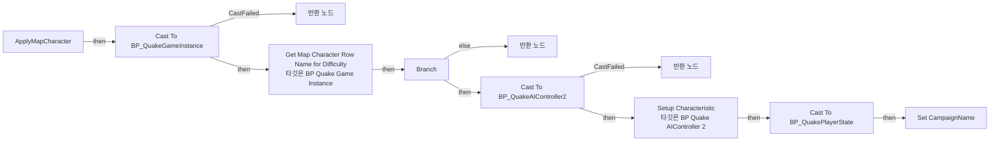
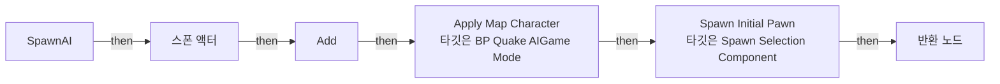
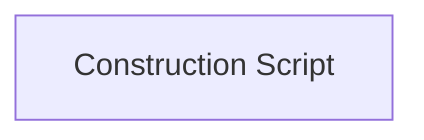

# BP_QuakeAIGameMode

에셋: `/Game/QuakeLike_1_0/GameMode/BP_QuakeAIGameMode`

부모: `/Script/Engine.BlueprintGeneratedClass'/Game/QuakeLike_1_0/GameMode/BP_QuakeGameMode.BP_QuakeGameMode_C'`

수집일: 2026-10-12. MCP에서 읽은 그래프·핀 연결의 자동 전사입니다. 상속된 그래프는 부모 문서를 함께 확인합니다.

정적 루트 참조 도달: 있음. 실행 여부 또는 삭제 가능 여부의 확정이 아닙니다.

컴포넌트 목록은 이 BP가 직접 정의한 SCS만 포함합니다. 부모·네이티브 생성 컴포넌트, 인스턴스 설정은 별도입니다.

## 변수와 기본값

| 이름 | 타입 | CDO 기본값 |
|---|---|---|
| `AIs` | `AIController` | [] |
| `initializeCharacterCount` | `int` | 0 |
| `SpawnedAICount` | `int` | 0 |
| `CampaignAIPawnClass` | `Pawn` | /Game/QuakeLike_1_0/Character/BP_AIShooter.BP_AIShooter_C |
| `CampaignAIControllerClass` | `AIController` | /Game/QuakeLike_1_0/AI/AIC/BP_QuakeAIController2.BP_QuakeAIController2_C |
| `CampaignCharacterList` | `name` | [] |
| `CampaignSpawnCount` | `int` | 0 |

## 그래프 목록

| 그래프 | 전체 노드 수 |
|---|---|
| ApplyMapCharacter | 19 |
| EventGraph | 53 |
| SpawnAI | 17 |
| UserConstructionScript | 1 |

## 그래프별 실행 연결

실선은 출력 exec 핀의 실제 연결입니다. 여러 분기는 출력 핀 이름을 표시합니다. 함수 호출·delegate·타이머의 다음 그래프 실행은 이 그림에서 자동으로 이어 붙이지 않습니다.

순수 계산 노드 및 데이터 핀은 아래 목록과 원본 JSON을 확인합니다. 연결되지 않은 이벤트도 표시되므로, 노드가 있다는 이유만으로 실행된다고 판단하면 안 됩니다.

### ApplyMapCharacter

실행 핀 플로우차트

전체 노드·기본 입력 목록

| 노드 ID | 제목 | 미연결 기본 입력 / 에셋 입력 |
|---|---|---|
| `K2Node_FunctionEntry_0` | ApplyMapCharacter |  |
| `K2Node_CallFunction_0` | Get Game Instance |  |
| `K2Node_DynamicCast_0` | Cast To BP_QuakeGameInstance |  |
| `K2Node_FunctionResult_1` | 반환 노드 |  |
| `K2Node_IfThenElse_0` | Branch |  |
| `K2Node_FunctionResult_2` | 반환 노드 |  |
| `K2Node_DynamicCast_1` | Cast To BP_QuakeAIController2 |  |
| `K2Node_Knot_0` | 경유 노드 |  |
| `K2Node_FunctionResult_0` | 반환 노드 |  |
| `K2Node_CallFunction_3` | Setup Characteristic 타깃은 BP Quake AIController 2 |  |
| `K2Node_Knot_4` | 경유 노드 |  |
| `K2Node_CallFunction_6` | Get Player State |  |
| `K2Node_Knot_1` | 경유 노드 |  |
| `K2Node_DynamicCast_2` | Cast To BP_QuakePlayerState |  |
| `K2Node_Knot_2` | 경유 노드 |  |
| `K2Node_VariableSet_0` | Set CampaignName |  |
| `K2Node_CallFunction_33` | To String (Name) |  |
| `K2Node_CallFunction_2` | Get Map Character Row Name for Difficulty 타깃은 BP Quake Game Instance |  |
| `K2Node_VariableGet_0` | Get Selected_Difficulty |  |

### EventGraph

```mermaid
flowchart LR
  n0["BeginPlay 이벤트"]
  n1["부모: BeginPlay"]
  n2["Init Respawners<br/>타깃은 BPC Spawner Manager"]
  n3["Prepare Initial Spawn<br/>타깃은 Spawn Selection Component"]
  n4["Branch"]
  n5["Spawn AI<br/>타깃은 BP Quake AIGame Mode"]
  n6["Get Current Level Name"]
  n7["Get Data Table Row Names"]
  n8["For Each Loop"]
  n9["Get Data Table Row DT_MapData"]
  n10["Branch"]
  n11["Cast To BP_QuakeGameInstance"]
  n12["Set Selected_Map_ID"]
  n13["Set Selected_Difficulty"]
  n14["Mark Server World Ready"]
  n15["Set CampaignCharacterList"]
  n16["Set initializeCharacterCount"]
  n17["경유 노드"]
  n18["For Loop"]
  n19["Print String"]
  n20["Print String"]
  n21["Set CampaignSpawnCount"]
  n22["OnPostLogin 이벤트"]
  n23["부모: OnPostLogin"]
  n24["Cast To BP_QuakePlayerState"]
  n25["Set bIsCampaignSession"]
  n0 -->|"then"| n6
  n1 -->|"then"| n18
  n2 -->|"then"| n16
  n3 -->|"then"| n4
  n4 -->|"then"| n1
  n6 -->|"then"| n7
  n7 -->|"then"| n8
  n8 -->|"LoopBody"| n9
  n9 -->|"then"| n10
  n10 -->|"then"| n11
  n11 -->|"then"| n12
  n12 -->|"then"| n13
  n13 -->|"then"| n15
  n15 -->|"then"| n21
  n16 -->|"then"| n17
  n17 -->|"OutputPin"| n3
  n18 -->|"LoopBody"| n5
  n18 -->|"Completed"| n14
  n19 -->|"then"| n2
  n20 -->|"then"| n5
  n21 -->|"then"| n2
  n22 -->|"then"| n23
  n23 -->|"then"| n24
  n24 -->|"then"| n25
```

실행 핀 플로우차트

전체 노드·기본 입력 목록

| 노드 ID | 제목 | 미연결 기본 입력 / 에셋 입력 |
|---|---|---|
| `K2Node_Event_1` | BeginPlay 이벤트 |  |
| `K2Node_CallParentFunction_0` | 부모: BeginPlay |  |
| `K2Node_VariableGet_1` | Get BPC_SpawnerManager |  |
| `K2Node_CallFunction_0` | Init Respawners 타깃은 BPC Spawner Manager |  |
| `K2Node_VariableGet_2` | Get Waiting Players |  |
| `K2Node_CallArrayFunction_0` | Length |  |
| `K2Node_VariableGet_6` | Get SpawnSelection |  |
| `K2Node_CallFunction_2` | Prepare Initial Spawn 타깃은 Spawn Selection Component |  |
| `K2Node_VariableGet_7` | Get initializeCharacterCount |  |
| `K2Node_IfThenElse_0` | Branch |  |
| `K2Node_CallFunction_4` | Spawn AI 타깃은 BP Quake AIGame Mode |  |
| `K2Node_CallFunction_1` | Get Current Level Name | bRemovePrefixString=true |
| `K2Node_CallFunction_8` | Get Data Table Row Names | Table=/Game/QuakeLike_1_0/GameFlow/Table/DT/DT_MapData.DT_MapData |
| `K2Node_MacroInstance_3` | For Each Loop |  |
| `K2Node_GetDataTableRow_0` | Get Data Table Row DT_MapData | DataTable=/Game/QuakeLike_1_0/GameFlow/Table/DT/DT_MapData.DT_MapData |
| `K2Node_CallFunction_9` | Equal Exactly (String) |  |
| `K2Node_Knot_1` | 경유 노드 |  |
| `K2Node_IfThenElse_1` | Branch |  |
| `K2Node_CallFunction_10` | Get Game Instance |  |
| `K2Node_DynamicCast_0` | Cast To BP_QuakeGameInstance |  |
| `K2Node_VariableSet_4` | Set Selected_Map_ID | Output_Get=None |
| `K2Node_CallFunction_11` | Get Game Mode |  |
| `K2Node_VariableGet_12` | Get OptionsString |  |
| `K2Node_CallFunction_12` | Parse Option | Key=Difficulty |
| `K2Node_VariableSet_5` | Set Selected_Difficulty | Output_Get=NewEnumerator0 |
| `K2Node_CallFunction_15` | String To Integer |  |
| `K2Node_Select_1` | 선택 | Option 0=NewEnumerator0; Option 1=NewEnumerator1; Option 2=NewEnumerator2 |
| `K2Node_CallFunction_5` | Mark Server World Ready |  |
| `K2Node_VariableSet_6` | Set CampaignCharacterList |  |
| `K2Node_Knot_5` | 경유 노드 |  |
| `K2Node_VariableSet_7` | Set initializeCharacterCount | Output_Get=0 |
| `K2Node_PromotableOperator_2` | int + int |  |
| `K2Node_Knot_7` | 경유 노드 |  |
| `K2Node_MacroInstance_5` | For Loop |  |
| `K2Node_PromotableOperator_3` | int - int | B=1 |
| `K2Node_VariableGet_15` | Get CampaignAIControllerClass |  |
| `K2Node_VariableGet_16` | Get CampaignAIPawnClass |  |
| `K2Node_Knot_8` | 경유 노드 |  |
| `K2Node_CallFunction_6` | Print String | bPrintToScreen=true; bPrintToLog=true; TextColor=(R=0.000000,G=0.660000,B=1.000000,A=1.000000); Duration=2.000000; Key=None |
| `K2Node_CommutativeAssociativeBinaryOperator_0` | Append | A=CharListLen= |
| `K2Node_CallArrayFunction_3` | Length |  |
| `K2Node_CallFunction_32` | To String (Integer) |  |
| `K2Node_CallFunction_7` | Print String | bPrintToScreen=true; bPrintToLog=true; TextColor=(R=0.000000,G=0.660000,B=1.000000,A=1.000000); Duration=2.000000; Key=None |
| `K2Node_CommutativeAssociativeBinaryOperator_1` | Append | A=SpawnIdx= |
| `K2Node_CallFunction_33` | To String (Integer) |  |
| `K2Node_VariableSet_1` | Set CampaignSpawnCount | Output_Get=0 |
| `K2Node_VariableGet_0` | Get CampaignSpawnCount |  |
| `K2Node_VariableGet_3` | Get CampaignSpawnCount |  |
| `K2Node_Event_0` | OnPostLogin 이벤트 |  |
| `K2Node_CallParentFunction_1` | 부모: OnPostLogin |  |
| `K2Node_VariableGet_4` | Get PlayerState |  |
| `K2Node_DynamicCast_1` | Cast To BP_QuakePlayerState |  |
| `K2Node_VariableSet_0` | Set bIsCampaignSession | bIsCampaignSession=true; Output_Get=false |

### SpawnAI

실행 핀 플로우차트

전체 노드·기본 입력 목록

| 노드 ID | 제목 | 미연결 기본 입력 / 에셋 입력 |
|---|---|---|
| `K2Node_FunctionEntry_0` | SpawnAI |  |
| `K2Node_SpawnActorFromClass_0` | 스폰 액터 | SpawnTransform_Location=0, 0, 0; SpawnTransform_Rotation=0, 0, 0; SpawnTransform_Scale=1.000000,1.000000,1.000000; CollisionHandlingOverride=Undefined; TransformScaleMethod=MultiplyWithRoot |
| `K2Node_Knot_2` | 경유 노드 |  |
| `K2Node_CallArrayFunction_0` | Add | ReturnValue=0 |
| `K2Node_Knot_5` | 경유 노드 |  |
| `K2Node_VariableGet_0` | Get AIs |  |
| `K2Node_Knot_3` | 경유 노드 |  |
| `K2Node_VariableGet_1` | Get SpawnSelection |  |
| `K2Node_CallFunction_1` | Spawn Initial Pawn 타깃은 Spawn Selection Component | OutSpawnPointIndex=0; ReturnValue=false |
| `K2Node_Knot_4` | 경유 노드 |  |
| `K2Node_FunctionResult_0` | 반환 노드 |  |
| `K2Node_Knot_0` | 경유 노드 |  |
| `K2Node_Knot_1` | 경유 노드 |  |
| `K2Node_CallFunction_2` | Apply Map Character 타깃은 BP Quake AIGame Mode |  |
| `K2Node_Knot_6` | 경유 노드 |  |
| `K2Node_Knot_7` | 경유 노드 |  |
| `K2Node_Knot_10` | 경유 노드 |  |

### UserConstructionScript

실행 핀 플로우차트

전체 노드·기본 입력 목록

| 노드 ID | 제목 | 미연결 기본 입력 / 에셋 입력 |
|---|---|---|
| `K2Node_FunctionEntry_0` | Construction Script |  |

## 조회 범위의 한계

ObjectIterator로 발견했으나 MCP helper가 반환하지 않은 그래프입니다. delegate signature·컴파일된 중간 그래프·macro·애니메이션 내부 그래프가 섞일 수 있습니다.

- `ApplyMapCharacter_MERGED`: Graph 'ApplyMapCharacter_MERGED' not found in Blueprint.
- `EdGraph_0`: Graph 'EdGraph_0' not found in Blueprint.
- `EdGraph_1`: Graph 'EdGraph_1' not found in Blueprint.
- `ExecuteUbergraph_BP_QuakeAIGameMode`: Graph 'ExecuteUbergraph_BP_QuakeAIGameMode' not found in Blueprint.
- `K2_PostLogin`: Graph 'K2_PostLogin' not found in Blueprint.
- `ReceiveBeginPlay`: Graph 'ReceiveBeginPlay' not found in Blueprint.
- `SpawnAI_MERGED`: Graph 'SpawnAI_MERGED' not found in Blueprint.
- `UserConstructionScript_MERGED`: Graph 'UserConstructionScript_MERGED' not found in Blueprint.

[원본 MCP 스냅샷](../../../Evidence/blueprints-210.json)
