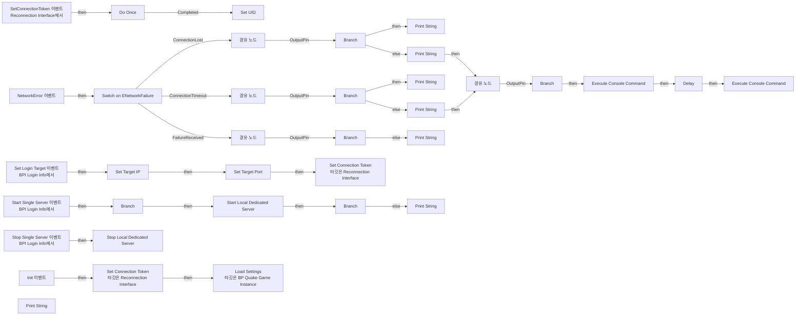
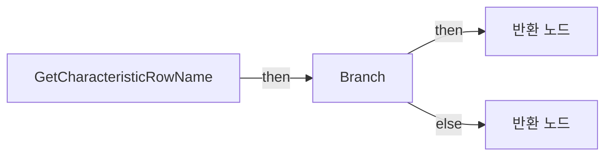
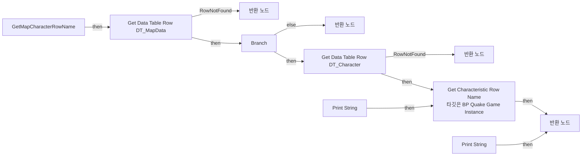
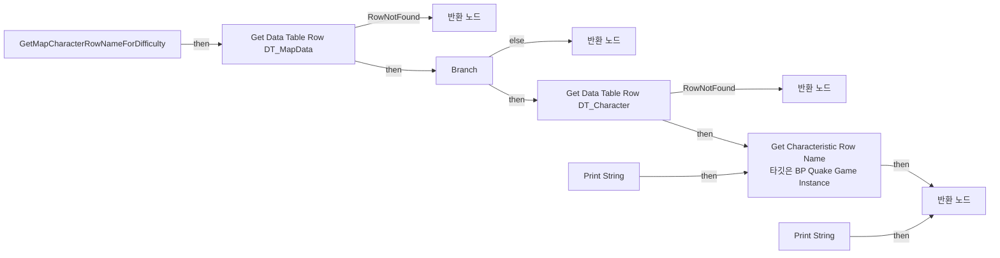
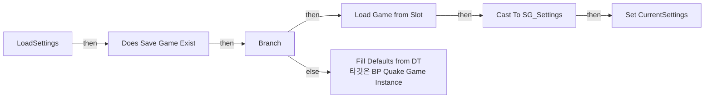
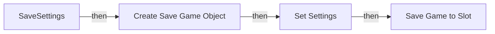

# BP_QuakeGameInstance

에셋: `/Game/QuakeLike_1_0/GameMode/BP_QuakeGameInstance`

부모: `/Script/CoreUObject.Class'/Script/ShootingArena.ShootingArenaGameInstance'`

수집일: 2026-10-12. MCP에서 읽은 그래프·핀 연결의 자동 전사입니다. 상속된 그래프는 부모 문서를 함께 확인합니다.

정적 루트 참조 도달: 있음. 실행 여부 또는 삭제 가능 여부의 확정이 아닙니다.

컴포넌트 목록은 이 BP가 직접 정의한 SCS만 포함합니다. 부모·네이티브 생성 컴포넌트, 인스턴스 설정은 별도입니다.

## 변수와 기본값

| 이름 | 타입 | CDO 기본값 |
|---|---|---|
| `UID` | `string` |  |
| `Target IP` | `string` |  |
| `Target Port` | `string` |  |
| `Characteristic_Map` | `string` | {} |
| `External_Characteristic_Loaded` | `bool` | False |
| `Selected_Map_ID` | `name` | None |
| `Selected_Difficulty` | `Enum_Selected_Difficulty` | &lt;Enum_Selected_Difficulty.EASY: 0&gt; |
| `bIsInMenuFlow` | `bool` | True |
| `bAutoOpenMapSelect` | `bool` | False |
| `bOpenMapSelectDirectly` | `bool` | False |
| `bIntentionalDisconnect` | `bool` | False |
| `PlayerNickname` | `string` |  |
| `CurrentSettings` | `ST_PlayerSettings` | &lt;Struct 'ST_PlayerSettings' {}&gt; |
| `SlotName` | `string` | PlayerSettings |

## 그래프 목록

| 그래프 | 전체 노드 수 |
|---|---|
| EventGraph | 52 |
| FillDefaultsFromDT | 12 |
| GetCharacteristicRowName | 11 |
| GetMapCharacterRowName | 24 |
| GetMapCharacterRowNameForDifficulty | 25 |
| LoadSettings | 9 |
| SaveSettings | 6 |

## 그래프별 실행 연결

실선은 출력 exec 핀의 실제 연결입니다. 여러 분기는 출력 핀 이름을 표시합니다. 함수 호출·delegate·타이머의 다음 그래프 실행은 이 그림에서 자동으로 이어 붙이지 않습니다.

순수 계산 노드 및 데이터 핀은 아래 목록과 원본 JSON을 확인합니다. 연결되지 않은 이벤트도 표시되므로, 노드가 있다는 이유만으로 실행된다고 판단하면 안 됩니다.

### EventGraph

실행 핀 플로우차트

전체 노드·기본 입력 목록

| 노드 ID | 제목 | 미연결 기본 입력 / 에셋 입력 |
|---|---|---|
| `K2Node_Event_0` | NetworkError 이벤트 |  |
| `K2Node_SwitchEnum_0` | Switch on ENetworkFailure |  |
| `K2Node_IfThenElse_1` | Branch |  |
| `K2Node_IfThenElse_0` | Branch |  |
| `K2Node_Knot_0` | 경유 노드 |  |
| `K2Node_Knot_2` | 경유 노드 |  |
| `K2Node_Event_1` | Init 이벤트 |  |
| `K2Node_CallFunction_1` | New Guid |  |
| `K2Node_CallFunction_2` | To String (Guid) |  |
| `K2Node_Event_2` | SetConnectionToken 이벤트 Reconnection Interface에서 |  |
| `K2Node_VariableSet_3` | Set UID |  |
| `K2Node_MacroInstance_0` | Do Once |  |
| `K2Node_Event_3` | Set Login Target 이벤트 BPI Login Info에서 |  |
| `K2Node_VariableSet_1` | Set Target IP |  |
| `K2Node_VariableSet_2` | Set Target Port |  |
| `K2Node_Knot_3` | 경유 노드 |  |
| `K2Node_CallFunction_0` | Set Connection Token 타깃은 Reconnection Interface |  |
| `K2Node_Knot_4` | 경유 노드 |  |
| `K2Node_CallFunction_3` | Set Connection Token 타깃은 Reconnection Interface |  |
| `K2Node_CallFunction_6` | Execute Console Command |  |
| `K2Node_CallFunction_5` | Get Login Command |  |
| `K2Node_VariableGet_0` | Get Target IP |  |
| `K2Node_VariableGet_1` | Get Target Port |  |
| `K2Node_VariableGet_2` | Get UID |  |
| `K2Node_CallFunction_8` | Print String | InString=[클라] 서버와 연결 유실 (재접속 시도 가능); bPrintToScreen=true; bPrintToLog=true; TextColor=(R=0.000000,G=0.660000,B=1.000000,A=1.000000); Duration=15.000000; Key=None |
| `K2Node_CallFunction_10` | Print String | InString=[서버] 특정 클라이언트 접속 유실 감지; bPrintToScreen=true; bPrintToLog=true; TextColor=(R=0.000000,G=0.660000,B=1.000000,A=1.000000); Duration=15.000000; Key=None |
| `K2Node_Knot_9` | 경유 노드 |  |
| `K2Node_IfThenElse_2` | Branch |  |
| `K2Node_Knot_10` | 경유 노드 |  |
| `K2Node_Knot_11` | 경유 노드 |  |
| `K2Node_Knot_12` | 경유 노드 |  |
| `K2Node_CallFunction_13` | Print String | InString=[클라] 응답 시간 초과로 단절 (재접속 필요); bPrintToScreen=true; bPrintToLog=true; TextColor=(R=0.000000,G=0.660000,B=1.000000,A=1.000000); Duration=15.000000; Key=None |
| `K2Node_CallFunction_12` | Print String | InString=[서버] 클라이언트 타임아웃 정리 (Logout 가동); bPrintToScreen=true; bPrintToLog=true; TextColor=(R=0.000000,G=0.660000,B=1.000000,A=1.000000); Duration=15.000000; Key=None |
| `K2Node_CallFunction_14` | Print String | InString=[클라] 서버로부터 거부됨 (인증실패/추방/서버포화); bPrintToScreen=true; bPrintToLog=true; TextColor=(R=0.000000,G=0.660000,B=1.000000,A=1.000000); Duration=15.000000; Key=None |
| `K2Node_Knot_22` | 경유 노드 |  |
| `K2Node_CallFunction_26` | Get Player Controller | PlayerIndex=0 |
| `K2Node_CallFunction_27` | Delay | Duration=1.000000 |
| `K2Node_CallFunction_28` | Execute Console Command | Command=NetEmulation.PktLoss 0 |
| `K2Node_IfThenElse_3` | Branch |  |
| `K2Node_VariableGet_3` | Get bIntentionalDisconnect |  |
| `K2Node_CallFunction_4` | NOT Boolean |  |
| `K2Node_Event_4` | Stop Single Server 이벤트 BPI Login Info에서 |  |
| `K2Node_Event_5` | Start Single Server 이벤트 BPI Login Info에서 |  |
| `K2Node_CallFunction_7` | Start Local Dedicated Server |  |
| `K2Node_CallFunction_9` | Stop Local Dedicated Server |  |
| `K2Node_CallFunction_16` | Is Dedicated Server |  |
| `K2Node_IfThenElse_5` | Branch |  |
| `K2Node_CallFunction_17` | NOT Boolean |  |
| `K2Node_IfThenElse_4` | Branch |  |
| `K2Node_CallFunction_18` | Print String | InString=로컬 서버 오픈 성공; bPrintToScreen=true; bPrintToLog=true; TextColor=(R=0.000000,G=0.660000,B=1.000000,A=1.000000); Duration=2.000000; Key=None |
| `K2Node_CallFunction_15` | Print String | InString=로컬 서버 오픈 실패; bPrintToScreen=true; bPrintToLog=true; TextColor=(R=0.000000,G=0.660000,B=1.000000,A=1.000000); Duration=2.000000; Key=None |
| `K2Node_CallFunction_11` | Load Settings 타깃은 BP Quake Game Instance |  |

### FillDefaultsFromDT

```mermaid
flowchart LR
  n0["FillDefaultsFromDT"]
  n1["Get Data Table Row DT_Setting"]
  n2["Get Data Table Row DT_Setting"]
  n3["Get Data Table Row DT_Setting"]
  n4["Get Data Table Row DT_Setting"]
  n5["Get Data Table Row DT_Setting"]
  n6["Get Data Table Row DT_Setting"]
  n7["Get Data Table Row DT_Setting"]
  n8["Get Data Table Row DT_Setting"]
  n9["Get Data Table Row DT_Setting"]
  n10["Get Data Table Row DT_Setting"]
  n11["설정"]
  n0 -->|"then"| n1
  n1 -->|"then"| n2
  n2 -->|"then"| n3
  n3 -->|"then"| n4
  n4 -->|"then"| n5
  n5 -->|"then"| n6
  n6 -->|"then"| n7
  n7 -->|"then"| n8
  n8 -->|"then"| n9
  n9 -->|"then"| n10
  n10 -->|"then"| n11
```

실행 핀 플로우차트

전체 노드·기본 입력 목록

| 노드 ID | 제목 | 미연결 기본 입력 / 에셋 입력 |
|---|---|---|
| `K2Node_FunctionEntry_0` | FillDefaultsFromDT |  |
| `K2Node_GetDataTableRow_1` | Get Data Table Row DT_Setting | DataTable=/Game/QuakeLike_1_0/GameProgressFlow/DT_Setting.DT_Setting; RowName=H_Sens |
| `K2Node_GetDataTableRow_2` | Get Data Table Row DT_Setting | DataTable=/Game/QuakeLike_1_0/GameProgressFlow/DT_Setting.DT_Setting; RowName=V_Sens |
| `K2Node_GetDataTableRow_3` | Get Data Table Row DT_Setting | DataTable=/Game/QuakeLike_1_0/GameProgressFlow/DT_Setting.DT_Setting; RowName=Zoom_Sens |
| `K2Node_GetDataTableRow_4` | Get Data Table Row DT_Setting | DataTable=/Game/QuakeLike_1_0/GameProgressFlow/DT_Setting.DT_Setting; RowName=FOV |
| `K2Node_GetDataTableRow_5` | Get Data Table Row DT_Setting | DataTable=/Game/QuakeLike_1_0/GameProgressFlow/DT_Setting.DT_Setting; RowName=Brightness |
| `K2Node_GetDataTableRow_6` | Get Data Table Row DT_Setting | DataTable=/Game/QuakeLike_1_0/GameProgressFlow/DT_Setting.DT_Setting; RowName=MasterVolume |
| `K2Node_GetDataTableRow_7` | Get Data Table Row DT_Setting | DataTable=/Game/QuakeLike_1_0/GameProgressFlow/DT_Setting.DT_Setting; RowName=BGMVolume |
| `K2Node_GetDataTableRow_8` | Get Data Table Row DT_Setting | DataTable=/Game/QuakeLike_1_0/GameProgressFlow/DT_Setting.DT_Setting; RowName=SFXVolume |
| `K2Node_GetDataTableRow_9` | Get Data Table Row DT_Setting | DataTable=/Game/QuakeLike_1_0/GameProgressFlow/DT_Setting.DT_Setting; RowName=UIVolume |
| `K2Node_GetDataTableRow_0` | Get Data Table Row DT_Setting | DataTable=/Game/QuakeLike_1_0/GameProgressFlow/DT_Setting.DT_Setting; RowName=CharacterVolume |
| `K2Node_VariableSet_0` | 설정 | CurrentSettings_bMotionBlur_23_85EB14F54C6B641C039BF1B40C6A4FE1=False |

### GetCharacteristicRowName

실행 핀 플로우차트

전체 노드·기본 입력 목록

| 노드 ID | 제목 | 미연결 기본 입력 / 에셋 입력 |
|---|---|---|
| `K2Node_FunctionEntry_0` | GetCharacteristicRowName |  |
| `K2Node_FunctionResult_0` | 반환 노드 | RowName=Dummy_Normal |
| `K2Node_CallArrayFunction_0` | Length |  |
| `K2Node_IfThenElse_0` | Branch |  |
| `K2Node_PromotableOperator_0` | Equal (Integer) |  |
| `K2Node_FunctionResult_1` | 반환 노드 |  |
| `K2Node_CallFunction_1` | To Integer (Byte) |  |
| `K2Node_PromotableOperator_1` | int - int | B=1 |
| `K2Node_GetArrayItem_0` | GET |  |
| `K2Node_CommutativeAssociativeBinaryOperator_0` | Min (Integer) |  |
| `K2Node_Knot_0` | 경유 노드 |  |

### GetMapCharacterRowName

실행 핀 플로우차트

전체 노드·기본 입력 목록

| 노드 ID | 제목 | 미연결 기본 입력 / 에셋 입력 |
|---|---|---|
| `K2Node_FunctionEntry_0` | GetMapCharacterRowName |  |
| `K2Node_FunctionResult_1` | 반환 노드 | RowName=None; Valid=false; CharacterName=None |
| `K2Node_GetDataTableRow_0` | Get Data Table Row DT_MapData | DataTable=/Game/QuakeLike_1_0/GameFlow/Table/DT/DT_MapData.DT_MapData |
| `K2Node_VariableGet_1` | Get Selected_Map_ID |  |
| `K2Node_CallArrayFunction_0` | Length |  |
| `K2Node_IfThenElse_0` | Branch |  |
| `K2Node_Knot_0` | 경유 노드 |  |
| `K2Node_FunctionResult_0` | 반환 노드 | RowName=None; Valid=false; CharacterName=None |
| `K2Node_GetDataTableRow_1` | Get Data Table Row DT_Character | DataTable=/Game/QuakeLike_1_0/GameFlow/Table/DT/DT_Character.DT_Character |
| `K2Node_GetArrayItem_0` | GET |  |
| `K2Node_CallFunction_0` | Get Characteristic Row Name 타깃은 BP Quake Game Instance |  |
| `K2Node_VariableGet_0` | Get Selected_Difficulty |  |
| `K2Node_FunctionResult_3` | 반환 노드 | Valid=true |
| `K2Node_FunctionResult_2` | 반환 노드 | RowName=None; Valid=false |
| `K2Node_CallFunction_6` | Print String | bPrintToScreen=true; bPrintToLog=true; TextColor=(R=0.000000,G=0.660000,B=1.000000,A=1.000000); Duration=2.000000; Key=None |
| `K2Node_PromotableOperator_2` | integer &gt; integer |  |
| `K2Node_Knot_4` | 경유 노드 |  |
| `K2Node_CallFunction_1` | % (Integer) |  |
| `K2Node_CallFunction_2` | Print String | bPrintToScreen=true; bPrintToLog=true; TextColor=(R=0.000000,G=0.660000,B=1.000000,A=1.000000); Duration=2.000000; Key=None |
| `K2Node_CommutativeAssociativeBinaryOperator_0` | Append | A=GCRN got:  |
| `K2Node_CallFunction_32` | To String (Name) |  |
| `K2Node_CommutativeAssociativeBinaryOperator_1` | Append | A=DTChar Found:  |
| `K2Node_CallFunction_34` | To String (Name) |  |
| `K2Node_Knot_1` | 경유 노드 |  |

### GetMapCharacterRowNameForDifficulty

실행 핀 플로우차트

전체 노드·기본 입력 목록

| 노드 ID | 제목 | 미연결 기본 입력 / 에셋 입력 |
|---|---|---|
| `K2Node_FunctionEntry_0` | GetMapCharacterRowNameForDifficulty |  |
| `K2Node_FunctionResult_1` | 반환 노드 | RowName=None; Valid=false; CharacterName=None |
| `K2Node_GetDataTableRow_0` | Get Data Table Row DT_MapData | DataTable=/Game/QuakeLike_1_0/GameFlow/Table/DT/DT_MapData.DT_MapData |
| `K2Node_VariableGet_1` | Get Selected_Map_ID |  |
| `K2Node_CallArrayFunction_0` | Length |  |
| `K2Node_IfThenElse_0` | Branch |  |
| `K2Node_Knot_0` | 경유 노드 |  |
| `K2Node_FunctionResult_0` | 반환 노드 | RowName=None; Valid=false; CharacterName=None |
| `K2Node_GetDataTableRow_1` | Get Data Table Row DT_Character | DataTable=/Game/QuakeLike_1_0/GameFlow/Table/DT/DT_Character.DT_Character |
| `K2Node_GetArrayItem_0` | GET |  |
| `K2Node_CallFunction_0` | Get Characteristic Row Name 타깃은 BP Quake Game Instance |  |
| `K2Node_FunctionResult_3` | 반환 노드 | Valid=true |
| `K2Node_FunctionResult_2` | 반환 노드 | RowName=None; Valid=false |
| `K2Node_CallFunction_6` | Print String | bPrintToScreen=true; bPrintToLog=true; TextColor=(R=0.000000,G=0.660000,B=1.000000,A=1.000000); Duration=2.000000; Key=None |
| `K2Node_PromotableOperator_2` | integer &gt; integer |  |
| `K2Node_Knot_4` | 경유 노드 |  |
| `K2Node_CallFunction_1` | % (Integer) |  |
| `K2Node_CallFunction_2` | Print String | bPrintToScreen=true; bPrintToLog=true; TextColor=(R=0.000000,G=0.660000,B=1.000000,A=1.000000); Duration=2.000000; Key=None |
| `K2Node_CommutativeAssociativeBinaryOperator_0` | Append | A=GCRN got:  |
| `K2Node_CallFunction_32` | To String (Name) |  |
| `K2Node_CommutativeAssociativeBinaryOperator_1` | Append | A=DTChar Found:  |
| `K2Node_CallFunction_34` | To String (Name) |  |
| `K2Node_Knot_1` | 경유 노드 |  |
| `K2Node_Knot_2` | 경유 노드 |  |
| `K2Node_Knot_3` | 경유 노드 |  |

### LoadSettings

실행 핀 플로우차트

전체 노드·기본 입력 목록

| 노드 ID | 제목 | 미연결 기본 입력 / 에셋 입력 |
|---|---|---|
| `K2Node_FunctionEntry_0` | LoadSettings |  |
| `K2Node_CallFunction_0` | Does Save Game Exist | UserIndex=0 |
| `K2Node_VariableGet_0` | Get SlotName |  |
| `K2Node_IfThenElse_0` | Branch |  |
| `K2Node_CallFunction_1` | Load Game from Slot | UserIndex=0 |
| `K2Node_DynamicCast_0` | Cast To SG_Settings |  |
| `K2Node_VariableGet_1` | Get Settings |  |
| `K2Node_VariableSet_0` | Set CurrentSettings |  |
| `K2Node_CallFunction_2` | Fill Defaults from DT 타깃은 BP Quake Game Instance |  |

### SaveSettings

실행 핀 플로우차트

전체 노드·기본 입력 목록

| 노드 ID | 제목 | 미연결 기본 입력 / 에셋 입력 |
|---|---|---|
| `K2Node_FunctionEntry_0` | SaveSettings |  |
| `K2Node_CallFunction_0` | Create Save Game Object | SaveGameClass=/Game/QuakeLike_1_0/GameProgressFlow/SG_Settings.SG_Settings_C |
| `K2Node_VariableSet_0` | Set Settings |  |
| `K2Node_CallFunction_1` | Save Game to Slot | UserIndex=0; ReturnValue=false |
| `K2Node_VariableGet_0` | Get CurrentSettings |  |
| `K2Node_VariableGet_1` | Get SlotName |  |

## 조회 범위의 한계

ObjectIterator로 발견했으나 MCP helper가 반환하지 않은 그래프입니다. delegate signature·컴파일된 중간 그래프·macro·애니메이션 내부 그래프가 섞일 수 있습니다.

- `Get Login Target`: Graph 'Get Login Target' not found in Blueprint.
- `GetConnectionToken`: Graph 'GetConnectionToken' not found in Blueprint.
- `HandleNetworkError`: Graph 'HandleNetworkError' not found in Blueprint.
- `ReceiveInit`: Graph 'ReceiveInit' not found in Blueprint.
- `Set Login Target`: Graph 'Set Login Target' not found in Blueprint.
- `SetConnectionToken`: Graph 'SetConnectionToken' not found in Blueprint.
- `Start Single Server`: Graph 'Start Single Server' not found in Blueprint.
- `Stop Single Server`: Graph 'Stop Single Server' not found in Blueprint.

[원본 MCP 스냅샷](../../../Evidence/blueprints-000.json)
