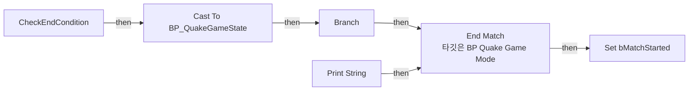
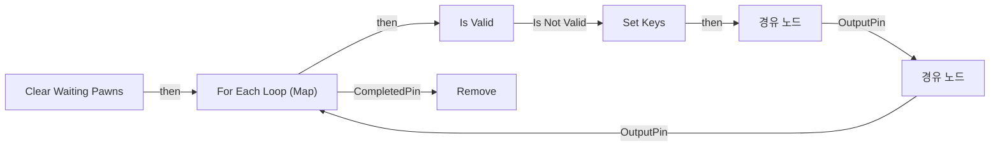
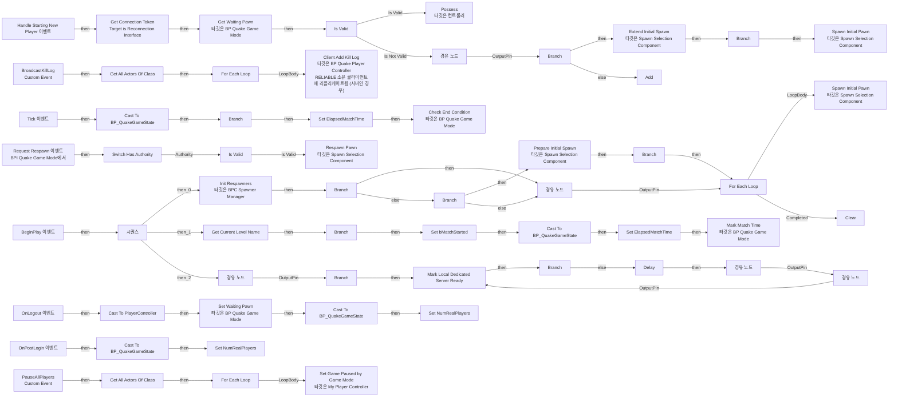
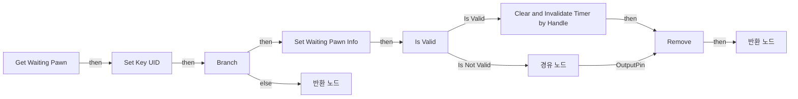
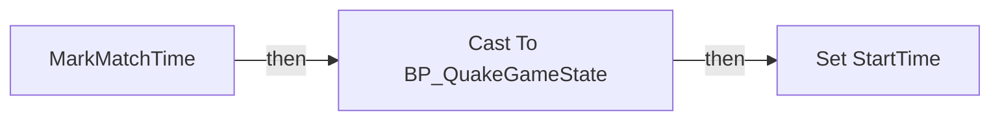
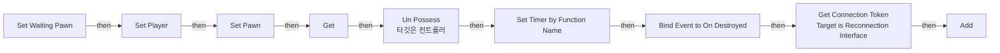
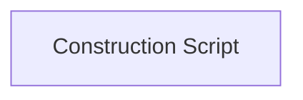

# BP_QuakeGameMode

에셋: `/Game/QuakeLike_1_0/GameMode/BP_QuakeGameMode`

부모: `/Script/CoreUObject.Class'/Script/ShootingArena.MyReconnectionGameMode'`

수집일: 2026-10-12. MCP에서 읽은 그래프·핀 연결의 자동 전사입니다. 상속된 그래프는 부모 문서를 함께 확인합니다.

정적 루트 참조 도달: 있음. 실행 여부 또는 삭제 가능 여부의 확정이 아닙니다.

컴포넌트 목록은 이 BP가 직접 정의한 SCS만 포함합니다. 부모·네이티브 생성 컴포넌트, 인스턴스 설정은 별도입니다.

## 직접 정의한 컴포넌트

| 이름 | 클래스 | 부모 컴포넌트 |
|---|---|---|
| `DefaultSceneRoot` | `SceneComponent` | `` |
| `BPC_SpawnerManager` | `BPC_SpawnerManager_C` | `` |
| `SpawnSelection` | `SpawnSelectionComponent` | `` |

## 변수와 기본값

| 이름 | 타입 | CDO 기본값 |
|---|---|---|
| `Waiting Pawns` | `string` | {} |
| `Waiting Players` | `PlayerController` | [] |
| `RedTeamScore` | `int` | 0 |
| `BlueTeamScore` | `int` | 0 |
| `bMatchStarted` | `bool` | False |
| `AllPlayers` | `BP_QuakePlayerState_C` | [] |
| `Rank` | `int` | 0 |
| `spawnTransform` | `Transform` | &lt;Struct 'Transform' {rotation: {x: 0.000000, y: 0.000000, z: 0.000000, w: 1.000000}, translation: {x: 0.000000, y: 0.000000, z: 0.000000}, scale3d: {x: 1.000000, y: 1.000000, z: 1.000000}}&gt; |
| `FirstBlood` | `bool` | True |

## 그래프 목록

| 그래프 | 전체 노드 수 |
|---|---|
| CheckEndCondition | 11 |
| Clear Waiting Pawns | 11 |
| EndMatch | 108 |
| EventGraph | 110 |
| Get Waiting Pawn | 18 |
| MarkMatchTime | 5 |
| Set Waiting Pawn | 20 |
| UserConstructionScript | 1 |

## 그래프별 실행 연결

실선은 출력 exec 핀의 실제 연결입니다. 여러 분기는 출력 핀 이름을 표시합니다. 함수 호출·delegate·타이머의 다음 그래프 실행은 이 그림에서 자동으로 이어 붙이지 않습니다.

순수 계산 노드 및 데이터 핀은 아래 목록과 원본 JSON을 확인합니다. 연결되지 않은 이벤트도 표시되므로, 노드가 있다는 이유만으로 실행된다고 판단하면 안 됩니다.

### CheckEndCondition

실행 핀 플로우차트

전체 노드·기본 입력 목록

| 노드 ID | 제목 | 미연결 기본 입력 / 에셋 입력 |
|---|---|---|
| `K2Node_FunctionEntry_0` | CheckEndCondition |  |
| `K2Node_CallFunction_0` | Get Game State |  |
| `K2Node_DynamicCast_0` | Cast To BP_QuakeGameState |  |
| `K2Node_VariableGet_3` | Get ElapsedMatchTime |  |
| `K2Node_VariableGet_4` | Get GameConfig |  |
| `K2Node_VariableGet_5` | Get MatchDuration |  |
| `K2Node_PromotableOperator_2` | float &gt;= float |  |
| `K2Node_IfThenElse_1` | Branch |  |
| `K2Node_CallFunction_4` | Print String | InString=Match End; bPrintToScreen=true; bPrintToLog=true; TextColor=(R=0.000000,G=0.660000,B=1.000000,A=1.000000); Duration=2.000000; Key=None |
| `K2Node_VariableSet_0` | Set bMatchStarted | bMatchStarted=false; Output_Get=false |
| `K2Node_CallFunction_5` | End Match 타깃은 BP Quake Game Mode |  |

### Clear Waiting Pawns

실행 핀 플로우차트

전체 노드·기본 입력 목록

| 노드 ID | 제목 | 미연결 기본 입력 / 에셋 입력 |
|---|---|---|
| `K2Node_FunctionEntry_0` | Clear Waiting Pawns |  |
| `K2Node_VariableGet_0` | Get Waiting Pawns |  |
| `K2Node_MapForEach_1` | For Each Loop (Map) |  |
| `K2Node_MacroInstance_0` | Is Valid |  |
| `K2Node_Knot_0` | 경유 노드 |  |
| `K2Node_CallFunction_0` | Remove | ReturnValue=false |
| `K2Node_VariableSet_0` | Set Keys |  |
| `K2Node_Knot_2` | 경유 노드 |  |
| `K2Node_Knot_3` | 경유 노드 |  |
| `K2Node_VariableGet_6` | Get Waiting Pawns |  |
| `K2Node_VariableGet_7` | Get Keys |  |

### EndMatch

```mermaid
flowchart LR
  n0["EndMatch"]
  n1["Get All Actors Of Class"]
  n2["Set AllPlayers"]
  n3["For Loop"]
  n4["For Loop"]
  n5["Branch"]
  n6["Set TempPlayer"]
  n7["Set Array Elem"]
  n8["Set Array Elem"]
  n9["For Loop"]
  n10["Branch"]
  n11["Set Rank"]
  n12["Branch"]
  n13["Set Rank"]
  n14["Set Rank"]
  n15["Set PreviousRank"]
  n16["경유 노드"]
  n17["경유 노드"]
  n18["경유 노드"]
  n19["Cast To BP_QuakeGameState"]
  n20["Set GS"]
  n21["Add"]
  n22["경유 노드"]
  n23["Set with Notify bIsMatchEnded"]
  n24["For Each Loop"]
  n25["Print String"]
  n26["Print String"]
  n27["Print String"]
  n28["Print String"]
  n29["시퀀스"]
  n30["Set Timer by Function Name"]
  n0 -->|"then"| n1
  n1 -->|"then"| n2
  n2 -->|"then"| n3
  n3 -->|"LoopBody"| n4
  n3 -->|"Completed"| n19
  n4 -->|"LoopBody"| n5
  n5 -->|"then"| n6
  n6 -->|"then"| n7
  n7 -->|"then"| n8
  n9 -->|"LoopBody"| n10
  n9 -->|"Completed"| n23
  n10 -->|"then"| n11
  n10 -->|"else"| n12
  n11 -->|"then"| n16
  n12 -->|"then"| n13
  n12 -->|"else"| n14
  n13 -->|"then"| n18
  n14 -->|"then"| n17
  n15 -->|"then"| n22
  n16 -->|"OutputPin"| n15
  n17 -->|"OutputPin"| n15
  n18 -->|"OutputPin"| n15
  n19 -->|"then"| n20
  n20 -->|"then"| n9
  n22 -->|"OutputPin"| n21
  n23 -->|"then"| n29
  n24 -->|"LoopBody"| n25
  n25 -->|"then"| n27
  n26 -->|"then"| n28
  n27 -->|"then"| n26
  n29 -->|"then_1"| n30
```

실행 핀 플로우차트

전체 노드·기본 입력 목록

| 노드 ID | 제목 | 미연결 기본 입력 / 에셋 입력 |
|---|---|---|
| `K2Node_FunctionEntry_0` | EndMatch |  |
| `K2Node_CallFunction_0` | Get All Actors Of Class | ActorClass=/Game/QuakeLike_1_0/GameMode/BP_QuakePlayerState.BP_QuakePlayerState_C |
| `K2Node_VariableSet_0` | Set AllPlayers |  |
| `K2Node_MacroInstance_0` | For Loop |  |
| `K2Node_VariableGet_12` | Get AllPlayers |  |
| `K2Node_CallArrayFunction_3` | Length |  |
| `K2Node_PromotableOperator_7` | int - int | B=1 |
| `K2Node_MacroInstance_2` | For Loop |  |
| `K2Node_PromotableOperator_2` | int + int | B=1 |
| `K2Node_Knot_0` | 경유 노드 |  |
| `K2Node_GetArrayItem_3` | GET |  |
| `K2Node_VariableGet_2` | Get AllPlayers |  |
| `K2Node_GetArrayItem_0` | GET |  |
| `K2Node_VariableGet_1` | Get AllPlayers |  |
| `K2Node_VariableGet_3` | Get KillCount |  |
| `K2Node_VariableGet_4` | Get KillCount |  |
| `K2Node_VariableGet_5` | Get DeathCount |  |
| `K2Node_VariableGet_6` | Get DeathCount |  |
| `K2Node_PromotableOperator_4` | integer &lt; integer |  |
| `K2Node_CommutativeAssociativeBinaryOperator_0` | AND Boolean |  |
| `K2Node_PromotableOperator_5` | Equal (Integer) |  |
| `K2Node_Knot_1` | 경유 노드 |  |
| `K2Node_CommutativeAssociativeBinaryOperator_1` | OR Boolean |  |
| `K2Node_IfThenElse_0` | Branch |  |
| `K2Node_VariableSet_1` | Set TempPlayer |  |
| `K2Node_CallArrayFunction_1` | Set Array Elem | bSizeToFit=false |
| `K2Node_VariableGet_9` | Get AllPlayers |  |
| `K2Node_Knot_2` | 경유 노드 |  |
| `K2Node_PromotableOperator_6` | integer &gt; integer |  |
| `K2Node_Knot_3` | 경유 노드 |  |
| `K2Node_Knot_4` | 경유 노드 |  |
| `K2Node_Knot_5` | 경유 노드 |  |
| `K2Node_Knot_6` | 경유 노드 |  |
| `K2Node_Knot_7` | 경유 노드 |  |
| `K2Node_CallArrayFunction_2` | Set Array Elem | bSizeToFit=false |
| `K2Node_VariableGet_7` | Get AllPlayers |  |
| `K2Node_Knot_8` | 경유 노드 |  |
| `K2Node_Knot_9` | 경유 노드 |  |
| `K2Node_VariableGet_10` | Get TempPlayer |  |
| `K2Node_MacroInstance_1` | For Loop |  |
| `K2Node_GetArrayItem_6` | GET |  |
| `K2Node_IfThenElse_1` | Branch |  |
| `K2Node_VariableGet_13` | Get AllPlayers |  |
| `K2Node_VariableGet_0` | Get AllPlayers |  |
| `K2Node_CallArrayFunction_0` | Length |  |
| `K2Node_PromotableOperator_0` | int - int | B=1 |
| `K2Node_VariableSet_2` | Set Rank | Rank=1; Output_Get=0 |
| `K2Node_Knot_10` | 경유 노드 |  |
| `K2Node_PromotableOperator_8` | Equal (Integer) |  |
| `K2Node_Knot_11` | 경유 노드 |  |
| `K2Node_Knot_12` | 경유 노드 |  |
| `K2Node_GetArrayItem_4` | GET |  |
| `K2Node_VariableGet_11` | Get AllPlayers |  |
| `K2Node_PromotableOperator_10` | int - int | B=1 |
| `K2Node_VariableGet_14` | Get KillCount |  |
| `K2Node_VariableGet_15` | Get KillCount |  |
| `K2Node_PromotableOperator_11` | Equal (Integer) |  |
| `K2Node_VariableGet_16` | Get DeathCount |  |
| `K2Node_VariableGet_17` | Get DeathCount |  |
| `K2Node_PromotableOperator_12` | Equal (Integer) |  |
| `K2Node_CommutativeAssociativeBinaryOperator_2` | AND Boolean |  |
| `K2Node_IfThenElse_2` | Branch |  |
| `K2Node_VariableSet_4` | Set Rank | Output_Get=0 |
| `K2Node_VariableGet_18` | Get PreviousRank |  |
| `K2Node_VariableSet_3` | Set Rank | Output_Get=0 |
| `K2Node_PromotableOperator_13` | int + int | B=1 |
| `K2Node_Knot_13` | 경유 노드 |  |
| `K2Node_VariableSet_5` | Set PreviousRank | Output_Get=0 |
| `K2Node_VariableGet_19` | Get Rank |  |
| `K2Node_Knot_14` | 경유 노드 |  |
| `K2Node_Knot_15` | 경유 노드 |  |
| `K2Node_Knot_16` | 경유 노드 |  |
| `K2Node_CallFunction_1` | Get Game State |  |
| `K2Node_DynamicCast_0` | Cast To BP_QuakeGameState |  |
| `K2Node_VariableSet_6` | Set GS |  |
| `K2Node_VariableGet_20` | Get Rank |  |
| `K2Node_CallFunction_2` | Get Player Name 타깃은 플레이어 스테이트 |  |
| `K2Node_VariableGet_21` | Get KillCount |  |
| `K2Node_VariableGet_22` | Get DeathCount |  |
| `K2Node_VariableGet_23` | Get GS |  |
| `K2Node_VariableGet_24` | Get FinalRankingList |  |
| `K2Node_CallArrayFunction_4` | Add | ReturnValue=0 |
| `K2Node_MakeStruct_0` | Make ST Ranking Entry |  |
| `K2Node_Knot_18` | 경유 노드 |  |
| `K2Node_Knot_19` | 경유 노드 |  |
| `K2Node_Knot_20` | 경유 노드 |  |
| `K2Node_VariableGet_25` | Get GS |  |
| `K2Node_VariableSet_8` | Set with Notify bIsMatchEnded | bIsMatchEnded=true; Output_Get=false |
| `K2Node_MacroInstance_3` | For Each Loop |  |
| `K2Node_VariableGet_26` | Get GS |  |
| `K2Node_VariableGet_27` | Get FinalRankingList |  |
| `K2Node_CallFunction_6` | Print String | bPrintToScreen=true; bPrintToLog=true; TextColor=(R=0.000000,G=0.660000,B=1.000000,A=1.000000); Duration=2.000000; Key=None |
| `K2Node_CommutativeAssociativeBinaryOperator_4` | Append | A=Rank: |
| `K2Node_CallFunction_35` | To String (Integer) |  |
| `K2Node_CallFunction_8` | Print String | bPrintToScreen=true; bPrintToLog=true; TextColor=(R=0.000000,G=0.660000,B=1.000000,A=1.000000); Duration=2.000000; Key=None |
| `K2Node_CommutativeAssociativeBinaryOperator_6` | Append | A=Kill Count: |
| `K2Node_CallFunction_5` | Print String | bPrintToScreen=true; bPrintToLog=true; TextColor=(R=0.000000,G=0.660000,B=1.000000,A=1.000000); Duration=2.000000; Key=None |
| `K2Node_CommutativeAssociativeBinaryOperator_3` | Append | A=Name: |
| `K2Node_CallFunction_9` | To String (Integer) |  |
| `K2Node_CallFunction_10` | Print String | bPrintToScreen=true; bPrintToLog=true; TextColor=(R=0.000000,G=0.660000,B=1.000000,A=1.000000); Duration=2.000000; Key=None |
| `K2Node_CommutativeAssociativeBinaryOperator_7` | Append | A=Death Count: |
| `K2Node_CallFunction_11` | To String (Integer) |  |
| `K2Node_VariableGet_8` | Get CampaignName |  |
| `K2Node_CallFunction_3` | Is Empty |  |
| `K2Node_CallFunction_4` | Select String |  |
| `K2Node_Knot_21` | 경유 노드 |  |
| `K2Node_ExecutionSequence_0` | 시퀀스 |  |
| `K2Node_CallFunction_17` | Set Timer by Function Name | FunctionName=PauseAllPlayers; Time=0.600000; bLooping=false; bMaxOncePerFrame=false; InitialStartDelay=0.000000; InitialStartDelayVariance=0.000000 |

### EventGraph

실행 핀 플로우차트

전체 노드·기본 입력 목록

| 노드 ID | 제목 | 미연결 기본 입력 / 에셋 입력 |
|---|---|---|
| `K2Node_MacroInstance_0` | Is Valid |  |
| `K2Node_MacroInstance_1` | Switch Has Authority |  |
| `K2Node_Knot_4` | 경유 노드 |  |
| `K2Node_Message_1` | Get Connection Token Target is Reconnection Interface |  |
| `K2Node_Event_2` | OnLogout 이벤트 |  |
| `K2Node_CallFunction_3` | Get Waiting Pawn 타깃은 BP Quake Game Mode |  |
| `K2Node_MacroInstance_2` | Is Valid |  |
| `K2Node_Knot_2` | 경유 노드 |  |
| `K2Node_Knot_3` | 경유 노드 |  |
| `K2Node_Knot_5` | 경유 노드 |  |
| `K2Node_CallFunction_4` | Possess 타깃은 컨트롤러 |  |
| `K2Node_Knot_7` | 경유 노드 |  |
| `K2Node_Knot_8` | 경유 노드 |  |
| `K2Node_CallFunction_9` | Set Waiting Pawn 타깃은 BP Quake Game Mode | Waiting Time=15.000000 |
| `K2Node_DynamicCast_1` | Cast To PlayerController |  |
| `K2Node_Event_0` | Handle Starting New Player 이벤트 |  |
| `K2Node_Event_4` | BeginPlay 이벤트 |  |
| `K2Node_VariableGet_0` | Get BPC_SpawnerManager |  |
| `K2Node_CallFunction_5` | Init Respawners 타깃은 BPC Spawner Manager |  |
| `K2Node_VariableGet_1` | Get Waiting Players |  |
| `K2Node_CallArrayFunction_0` | Add | ReturnValue=0 |
| `K2Node_VariableGet_2` | Get Waiting Players |  |
| `K2Node_MacroInstance_3` | For Each Loop |  |
| `K2Node_VariableGet_4` | Get Waiting Players |  |
| `K2Node_CallArrayFunction_1` | Clear |  |
| `K2Node_VariableGet_5` | Get BPC_SpawnerManager |  |
| `K2Node_CallFunction_1` | Is Spawner Initialized 타깃은 BPC Spawner Manager |  |
| `K2Node_IfThenElse_0` | Branch |  |
| `K2Node_Knot_0` | 경유 노드 |  |
| `K2Node_Knot_9` | 경유 노드 |  |
| `K2Node_Knot_10` | 경유 노드 |  |
| `K2Node_Event_1` | Request Respawn 이벤트 BPI Quake Game Mode에서 |  |
| `K2Node_CustomEvent_0` | BroadcastKillLog Custom Event |  |
| `K2Node_CallFunction_10` | Get All Actors Of Class | ActorClass=/Game/QuakeLike_1_0/Controller/BP_QuakePlayerController.BP_QuakePlayerController_C |
| `K2Node_MacroInstance_5` | For Each Loop |  |
| `K2Node_CallFunction_11` | Client Add Kill Log 타깃은 BP Quake Player Controller RELIABLE 소유 클라이언트에 리플리케이트됨 (서버인 경우) |  |
| `K2Node_Knot_13` | 경유 노드 |  |
| `K2Node_Knot_16` | 경유 노드 |  |
| `K2Node_Knot_17` | 경유 노드 |  |
| `K2Node_Knot_18` | 경유 노드 |  |
| `K2Node_Event_6` | Tick 이벤트 |  |
| `K2Node_CallFunction_17` | Get Game State |  |
| `K2Node_DynamicCast_3` | Cast To BP_QuakeGameState |  |
| `K2Node_VariableSet_1` | Set ElapsedMatchTime | Output_Get=0.0 |
| `K2Node_VariableGet_3` | Get ElapsedMatchTime |  |
| `K2Node_PromotableOperator_0` | float + float |  |
| `K2Node_Knot_19` | 경유 노드 |  |
| `K2Node_CallFunction_18` | Check End Condition 타깃은 BP Quake Game Mode |  |
| `K2Node_IfThenElse_2` | Branch |  |
| `K2Node_VariableGet_6` | Get bMatchStarted |  |
| `K2Node_VariableGet_10` | Get SpawnSelection |  |
| `K2Node_CallFunction_2` | Respawn Pawn 타깃은 Spawn Selection Component | OutSpawnPointIndex=0; ReturnValue=false |
| `K2Node_Knot_26` | 경유 노드 |  |
| `K2Node_Knot_27` | 경유 노드 |  |
| `K2Node_Knot_28` | 경유 노드 |  |
| `K2Node_VariableGet_11` | Get SpawnSelection |  |
| `K2Node_CallFunction_21` | Is Initial Spawn Prepared 타깃은 Spawn Selection Component |  |
| `K2Node_IfThenElse_4` | Branch |  |
| `K2Node_VariableGet_12` | Get Waiting Players |  |
| `K2Node_CallArrayFunction_2` | Length |  |
| `K2Node_PromotableOperator_1` | integer &gt; integer |  |
| `K2Node_IfThenElse_5` | Branch |  |
| `K2Node_VariableGet_13` | Get SpawnSelection |  |
| `K2Node_CallFunction_13` | Prepare Initial Spawn 타깃은 Spawn Selection Component |  |
| `K2Node_Knot_29` | 경유 노드 |  |
| `K2Node_IfThenElse_6` | Branch |  |
| `K2Node_Knot_30` | 경유 노드 |  |
| `K2Node_VariableGet_14` | Get SpawnSelection |  |
| `K2Node_CallFunction_14` | Spawn Initial Pawn 타깃은 Spawn Selection Component | PawnClass=/Game/QuakeLike_1_0/Character/BP_PlayerShooter.BP_PlayerShooter_C; OutSpawnPointIndex=0; ReturnValue=false |
| `K2Node_Knot_31` | 경유 노드 |  |
| `K2Node_VariableGet_15` | Get SpawnSelection |  |
| `K2Node_CallFunction_15` | Extend Initial Spawn 타깃은 Spawn Selection Component | AdditionalCharacterCount=1 |
| `K2Node_IfThenElse_7` | Branch |  |
| `K2Node_CallFunction_24` | Spawn Initial Pawn 타깃은 Spawn Selection Component | PawnClass=/Game/QuakeLike_1_0/Character/BP_PlayerShooter.BP_PlayerShooter_C; OutSpawnPointIndex=0; ReturnValue=false |
| `K2Node_Knot_32` | 경유 노드 |  |
| `K2Node_CallFunction_6` | Get Game State |  |
| `K2Node_DynamicCast_0` | Cast To BP_QuakeGameState |  |
| `K2Node_VariableSet_0` | Set ElapsedMatchTime | ElapsedMatchTime=0.0; Output_Get=0.0 |
| `K2Node_ExecutionSequence_0` | 시퀀스 |  |
| `K2Node_VariableSet_3` | Set bMatchStarted | bMatchStarted=true; Output_Get=false |
| `K2Node_IfThenElse_1` | Branch |  |
| `K2Node_CallFunction_0` | Get Current Level Name | bRemovePrefixString=true |
| `K2Node_CallFunction_25` | Not Equal Exactly (String) | B=MainMenu_Level |
| `K2Node_CallFunction_8` | Mark Match Time 타깃은 BP Quake Game Mode |  |
| `K2Node_CallFunction_19` | Mark Local Dedicated Server Ready |  |
| `K2Node_IfThenElse_8` | Branch |  |
| `K2Node_Knot_1` | 경유 노드 |  |
| `K2Node_CallFunction_20` | Delay | Duration=0.2 |
| `K2Node_Knot_6` | 경유 노드 |  |
| `EdGraphNode_Comment_0` | 임시 테스트 |  |
| `K2Node_Knot_14` | 경유 노드 |  |
| `K2Node_CallFunction_16` | Is Dedicated Server |  |
| `K2Node_IfThenElse_3` | Branch |  |
| `K2Node_Event_3` | OnPostLogin 이벤트 |  |
| `K2Node_VariableSet_4` | Set NumRealPlayers | Output_Get=0 |
| `K2Node_VariableGet_8` | Get NumRealPlayers |  |
| `K2Node_CallFunction_23` | Get Game State |  |
| `K2Node_DynamicCast_4` | Cast To BP_QuakeGameState |  |
| `K2Node_PromotableOperator_3` | int + int | B=1 |
| `K2Node_VariableSet_2` | Set NumRealPlayers | Output_Get=0 |
| `K2Node_VariableGet_7` | Get NumRealPlayers |  |
| `K2Node_CallFunction_22` | Get Game State |  |
| `K2Node_DynamicCast_2` | Cast To BP_QuakeGameState |  |
| `K2Node_PromotableOperator_4` | int - int | B=1 |
| `K2Node_CustomEvent_1` | PauseAllPlayers Custom Event |  |
| `K2Node_CallFunction_7` | Get All Actors Of Class | ActorClass=/Game/QuakeLike_1_0/Controller/BP_QuakePlayerController.BP_QuakePlayerController_C |
| `K2Node_MacroInstance_4` | For Each Loop |  |
| `K2Node_CallFunction_12` | Set Game Paused by Game Mode 타깃은 My Player Controller | bShouldPause=true |
| `K2Node_Knot_11` | 경유 노드 |  |
| `K2Node_Knot_12` | 경유 노드 |  |

### Get Waiting Pawn

실행 핀 플로우차트

전체 노드·기본 입력 목록

| 노드 ID | 제목 | 미연결 기본 입력 / 에셋 입력 |
|---|---|---|
| `K2Node_FunctionEntry_0` | Get Waiting Pawn |  |
| `K2Node_VariableGet_0` | Get Waiting Pawns |  |
| `K2Node_CallFunction_0` | Find |  |
| `K2Node_Knot_0` | 경유 노드 |  |
| `K2Node_MacroInstance_0` | Is Valid |  |
| `K2Node_VariableSet_2` | Set Key UID |  |
| `K2Node_VariableGet_1` | Get Key UID |  |
| `K2Node_VariableGet_2` | Get Waiting Pawns |  |
| `K2Node_CallFunction_1` | Remove | ReturnValue=false |
| `K2Node_VariableSet_3` | Set Waiting Pawn Info |  |
| `K2Node_CallFunction_2` | Clear and Invalidate Timer by Handle |  |
| `K2Node_FunctionResult_1` | 반환 노드 |  |
| `K2Node_VariableGet_5` | Get |  |
| `K2Node_Knot_8` | 경유 노드 |  |
| `K2Node_IfThenElse_1` | Branch |  |
| `K2Node_Knot_9` | 경유 노드 |  |
| `K2Node_FunctionResult_2` | 반환 노드 |  |
| `K2Node_Knot_10` | 경유 노드 |  |

### MarkMatchTime

실행 핀 플로우차트

전체 노드·기본 입력 목록

| 노드 ID | 제목 | 미연결 기본 입력 / 에셋 입력 |
|---|---|---|
| `K2Node_FunctionEntry_0` | MarkMatchTime |  |
| `K2Node_CallFunction_6` | Get Game State |  |
| `K2Node_DynamicCast_0` | Cast To BP_QuakeGameState |  |
| `K2Node_VariableSet_0` | Set StartTime | Output_Get=0.0 |
| `K2Node_CallFunction_7` | Get Server World Time Seconds 타깃은 게임 스테이트 베이스 |  |

### Set Waiting Pawn

실행 핀 플로우차트

전체 노드·기본 입력 목록

| 노드 ID | 제목 | 미연결 기본 입력 / 에셋 입력 |
|---|---|---|
| `K2Node_FunctionEntry_0` | Set Waiting Pawn |  |
| `K2Node_Message_0` | Get Connection Token Target is Reconnection Interface |  |
| `K2Node_CallFunction_5` | Get Controlled Pawn 타깃은 컨트롤러 |  |
| `K2Node_VariableGet_2` | Get Waiting Pawns |  |
| `K2Node_CallFunction_6` | Add |  |
| `K2Node_Knot_13` | 경유 노드 |  |
| `K2Node_CallFunction_7` | Set Timer by Function Name | FunctionName=K2_DestroyActor; bLooping=false; bMaxOncePerFrame=false; InitialStartDelay=0.000000; InitialStartDelayVariance=0.000000 |
| `K2Node_Knot_16` | 경유 노드 |  |
| `K2Node_VariableSet_0` | Set Pawn |  |
| `K2Node_VariableGet_3` | Get |  |
| `K2Node_VariableGet_4` | Get Pawn |  |
| `K2Node_CallFunction_8` | Un Possess 타깃은 컨트롤러 |  |
| `K2Node_Knot_0` | 경유 노드 |  |
| `K2Node_VariableSet_2` | Set Player |  |
| `K2Node_VariableGet_6` | Get Player |  |
| `K2Node_VariableGet_7` | Get Player |  |
| `K2Node_Knot_1` | 경유 노드 |  |
| `K2Node_VariableGet_9` | Get Pawn |  |
| `K2Node_AddDelegate_2` | Bind Event to On Destroyed |  |
| `K2Node_CreateDelegate_1` | 이벤트 생성 |  |

### UserConstructionScript

실행 핀 플로우차트

전체 노드·기본 입력 목록

| 노드 ID | 제목 | 미연결 기본 입력 / 에셋 입력 |
|---|---|---|
| `K2Node_FunctionEntry_0` | Construction Script |  |

## 조회 범위의 한계

ObjectIterator로 발견했으나 MCP helper가 반환하지 않은 그래프입니다. delegate signature·컴파일된 중간 그래프·macro·애니메이션 내부 그래프가 섞일 수 있습니다.

- `BroadcastKillLog`: Graph 'BroadcastKillLog' not found in Blueprint.
- `HandleStartingNewPlayer`: Graph 'HandleStartingNewPlayer' not found in Blueprint.
- `Is First Blood`: Graph 'Is First Blood' not found in Blueprint.
- `K2_OnLogout`: Graph 'K2_OnLogout' not found in Blueprint.
- `K2_PostLogin`: Graph 'K2_PostLogin' not found in Blueprint.
- `PauseAllPlayers`: Graph 'PauseAllPlayers' not found in Blueprint.
- `ReceiveBeginPlay`: Graph 'ReceiveBeginPlay' not found in Blueprint.
- `ReceiveTick`: Graph 'ReceiveTick' not found in Blueprint.
- `Request Respawn`: Graph 'Request Respawn' not found in Blueprint.

[원본 MCP 스냅샷](../../../Evidence/blueprints-070.json)
