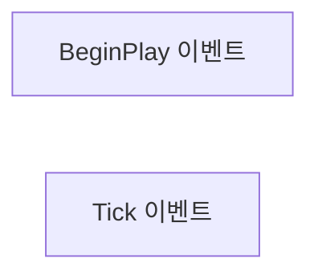
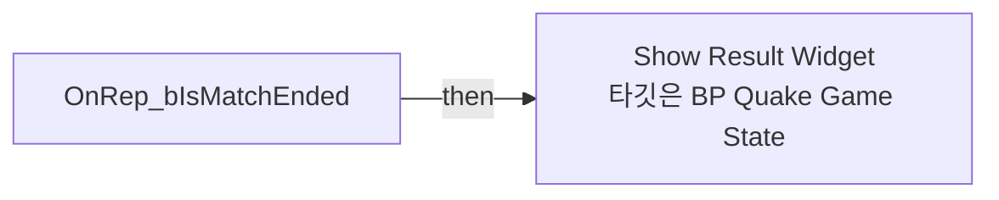
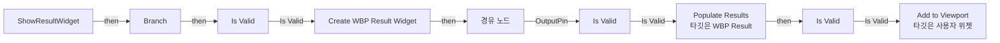
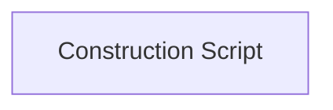

# BP_QuakeGameState

에셋: `/Game/QuakeLike_1_0/GameMode/BP_QuakeGameState`

부모: `/Script/CoreUObject.Class'/Script/Engine.GameStateBase'`

수집일: 2026-10-12. MCP에서 읽은 그래프·핀 연결의 자동 전사입니다. 상속된 그래프는 부모 문서를 함께 확인합니다.

정적 루트 참조 도달: 있음. 실행 여부 또는 삭제 가능 여부의 확정이 아닙니다.

컴포넌트 목록은 이 BP가 직접 정의한 SCS만 포함합니다. 부모·네이티브 생성 컴포넌트, 인스턴스 설정은 별도입니다.

## 직접 정의한 컴포넌트

| 이름 | 클래스 | 부모 컴포넌트 |
|---|---|---|
| `DefaultSceneRoot` | `SceneComponent` | `` |

## 변수와 기본값

| 이름 | 타입 | CDO 기본값 |
|---|---|---|
| `StartTime` | `real` | 0.0 |
| `EndKillPoint` | `int` | 0 |
| `IsSuddenDeath` | `bool` | False |
| `OnAnyPlayerScoreChanged` | `mcdelegate` | &lt;Delegate 'DelegateBase' &lt;Unbound&gt;&gt; |
| `GameConfig` | `PDA_GameConfig_C` | /Game/QuakeLike_1_0/Data/GameMode/DA_MatchSetting.DA_MatchSetting |
| `ElapsedMatchTime` | `real` | 0.0 |
| `FinalRankingList` | `ST_RankingEntry` | [] |
| `bIsMatchEnded` | `bool` | False |
| `NumRealPlayers` | `int` | 0 |

## 그래프 목록

| 그래프 | 전체 노드 수 |
|---|---|
| EventGraph | 2 |
| OnRep_bIsMatchEnded | 2 |
| ShowResultWidget | 14 |
| UserConstructionScript | 1 |

## 그래프별 실행 연결

실선은 출력 exec 핀의 실제 연결입니다. 여러 분기는 출력 핀 이름을 표시합니다. 함수 호출·delegate·타이머의 다음 그래프 실행은 이 그림에서 자동으로 이어 붙이지 않습니다.

순수 계산 노드 및 데이터 핀은 아래 목록과 원본 JSON을 확인합니다. 연결되지 않은 이벤트도 표시되므로, 노드가 있다는 이유만으로 실행된다고 판단하면 안 됩니다.

### EventGraph

실행 핀 플로우차트

전체 노드·기본 입력 목록

| 노드 ID | 제목 | 미연결 기본 입력 / 에셋 입력 |
|---|---|---|
| `K2Node_Event_0` | BeginPlay 이벤트 |  |
| `K2Node_Event_1` | Tick 이벤트 | DeltaSeconds=0.0 |

### OnRep_bIsMatchEnded

실행 핀 플로우차트

전체 노드·기본 입력 목록

| 노드 ID | 제목 | 미연결 기본 입력 / 에셋 입력 |
|---|---|---|
| `K2Node_FunctionEntry_0` | OnRep_bIsMatchEnded |  |
| `K2Node_CallFunction_0` | Show Result Widget 타깃은 BP Quake Game State |  |

### ShowResultWidget

실행 핀 플로우차트

전체 노드·기본 입력 목록

| 노드 ID | 제목 | 미연결 기본 입력 / 에셋 입력 |
|---|---|---|
| `K2Node_FunctionEntry_0` | ShowResultWidget |  |
| `K2Node_IfThenElse_0` | Branch |  |
| `K2Node_CreateWidget_0` | Create WBP Result Widget | Class=/Game/QuakeLike_1_0/GameFlow/UI/WBP_Result.WBP_Result_C |
| `K2Node_VariableGet_0` | Get bIsMatchEnded |  |
| `K2Node_CallFunction_2` | Populate Results 타깃은 WBP Result |  |
| `K2Node_VariableGet_1` | Get FinalRankingList |  |
| `K2Node_CallFunction_3` | Add to Viewport 타깃은 사용자 위젯 | ZOrder=0 |
| `K2Node_Knot_0` | 경유 노드 |  |
| `K2Node_CallFunction_4` | Get Player Controller | PlayerIndex=0 |
| `K2Node_MacroInstance_0` | Is Valid |  |
| `K2Node_Knot_2` | 경유 노드 |  |
| `K2Node_Knot_3` | 경유 노드 |  |
| `K2Node_MacroInstance_1` | Is Valid |  |
| `K2Node_MacroInstance_3` | Is Valid |  |

### UserConstructionScript

실행 핀 플로우차트

전체 노드·기본 입력 목록

| 노드 ID | 제목 | 미연결 기본 입력 / 에셋 입력 |
|---|---|---|
| `K2Node_FunctionEntry_0` | Construction Script |  |

## 조회 범위의 한계

ObjectIterator로 발견했으나 MCP helper가 반환하지 않은 그래프입니다. delegate signature·컴파일된 중간 그래프·macro·애니메이션 내부 그래프가 섞일 수 있습니다.

- `OnAnyPlayerScoreChanged`: Graph 'OnAnyPlayerScoreChanged' not found in Blueprint.

[원본 MCP 스냅샷](../../../Evidence/blueprints-035.json)
