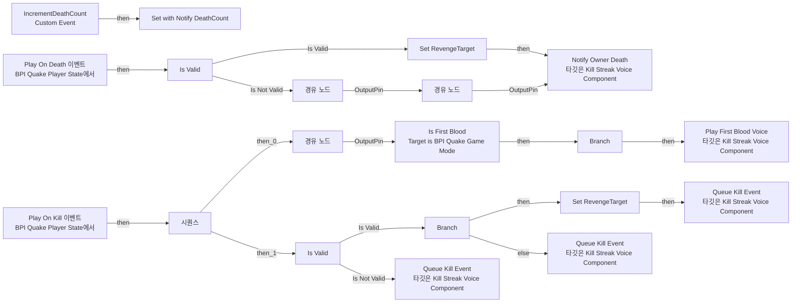
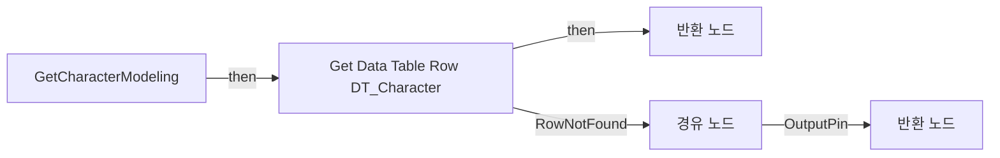
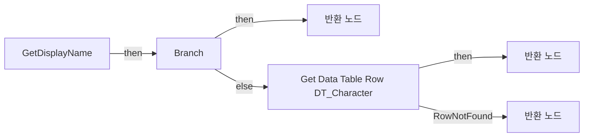
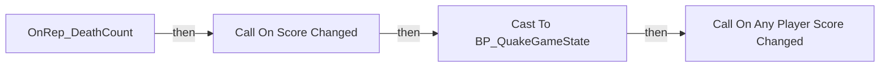
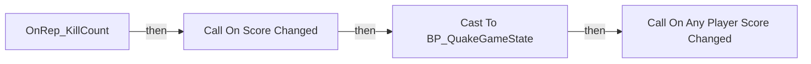
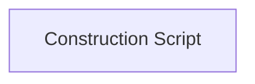

# BP_QuakePlayerState

에셋: `/Game/QuakeLike_1_0/GameMode/BP_QuakePlayerState`

부모: `/Script/CoreUObject.Class'/Script/ShootingArena.MyPlayerState'`

수집일: 2026-10-12. MCP에서 읽은 그래프·핀 연결의 자동 전사입니다. 상속된 그래프는 부모 문서를 함께 확인합니다.

정적 루트 참조 도달: 있음. 실행 여부 또는 삭제 가능 여부의 확정이 아닙니다.

컴포넌트 목록은 이 BP가 직접 정의한 SCS만 포함합니다. 부모·네이티브 생성 컴포넌트, 인스턴스 설정은 별도입니다.

## 직접 정의한 컴포넌트

| 이름 | 클래스 | 부모 컴포넌트 |
|---|---|---|
| `DefaultSceneRoot` | `SceneComponent` | `` |
| `KillStreakVoice` | `KillStreakVoiceComponent` | `` |

## 변수와 기본값

| 이름 | 타입 | CDO 기본값 |
|---|---|---|
| `Team` | `E_Team` | &lt;E_Team.RED: 0&gt; |
| `KillCount` | `int` | 0 |
| `DeathCount` | `int` | 0 |
| `OnScoreChanged` | `mcdelegate` | &lt;Delegate 'DelegateBase' &lt;Unbound&gt;&gt; |
| `CampaignName` | `string` |  |
| `bIsCampaignSession` | `bool` | False |
| `RevengeTarget` | `PlayerState` | None |

## 그래프 목록

| 그래프 | 전체 노드 수 |
|---|---|
| EventGraph | 34 |
| GetCharacterModeling | 8 |
| GetDisplayName | 13 |
| OnRep_DeathCount | 5 |
| OnRep_KillCount | 6 |
| UserConstructionScript | 1 |

## 그래프별 실행 연결

실선은 출력 exec 핀의 실제 연결입니다. 여러 분기는 출력 핀 이름을 표시합니다. 함수 호출·delegate·타이머의 다음 그래프 실행은 이 그림에서 자동으로 이어 붙이지 않습니다.

순수 계산 노드 및 데이터 핀은 아래 목록과 원본 JSON을 확인합니다. 연결되지 않은 이벤트도 표시되므로, 노드가 있다는 이유만으로 실행된다고 판단하면 안 됩니다.

### EventGraph

실행 핀 플로우차트

전체 노드·기본 입력 목록

| 노드 ID | 제목 | 미연결 기본 입력 / 에셋 입력 |
|---|---|---|
| `K2Node_CustomEvent_0` | IncrementDeathCount Custom Event |  |
| `K2Node_VariableGet_0` | Get DeathCount |  |
| `K2Node_PromotableOperator_0` | int + int | B=1 |
| `K2Node_VariableSet_0` | Set with Notify DeathCount | Output_Get=0 |
| `K2Node_VariableGet_4` | Get KillStreakVoice |  |
| `K2Node_CallFunction_2` | Notify Owner Death 타깃은 Kill Streak Voice Component |  |
| `K2Node_CallFunction_3` | Queue Kill Event 타깃은 Kill Streak Voice Component | bIsRevenge=false |
| `K2Node_Event_1` | Play On Death 이벤트 BPI Quake Player State에서 |  |
| `K2Node_Event_2` | Play On Kill 이벤트 BPI Quake Player State에서 |  |
| `K2Node_VariableGet_3` | Get KillStreakVoice |  |
| `K2Node_VariableSet_1` | Set RevengeTarget |  |
| `K2Node_VariableGet_1` | Get RevengeTarget |  |
| `K2Node_CallFunction_4` | Equal (Object) |  |
| `K2Node_IfThenElse_1` | Branch |  |
| `K2Node_VariableSet_2` | Set RevengeTarget |  |
| `K2Node_CallFunction_5` | Queue Kill Event 타깃은 Kill Streak Voice Component | bIsRevenge=true |
| `K2Node_CallFunction_6` | Queue Kill Event 타깃은 Kill Streak Voice Component | bIsRevenge=false |
| `K2Node_Knot_0` | 경유 노드 |  |
| `K2Node_MacroInstance_0` | Is Valid |  |
| `K2Node_Knot_1` | 경유 노드 |  |
| `K2Node_Knot_2` | 경유 노드 |  |
| `K2Node_Knot_3` | 경유 노드 |  |
| `K2Node_MacroInstance_1` | Is Valid |  |
| `K2Node_Knot_4` | 경유 노드 |  |
| `K2Node_Knot_5` | 경유 노드 |  |
| `K2Node_VariableGet_5` | Get KillStreakVoice |  |
| `K2Node_VariableGet_2` | Get KillStreakVoice |  |
| `K2Node_CallFunction_1` | Get Game Mode |  |
| `K2Node_Message_0` | Is First Blood Target is BPI Quake Game Mode |  |
| `K2Node_VariableGet_7` | Get KillStreakVoice |  |
| `K2Node_CallFunction_7` | Play First Blood Voice 타깃은 Kill Streak Voice Component |  |
| `K2Node_IfThenElse_0` | Branch |  |
| `K2Node_ExecutionSequence_0` | 시퀀스 |  |
| `K2Node_Knot_6` | 경유 노드 |  |

### GetCharacterModeling

실행 핀 플로우차트

전체 노드·기본 입력 목록

| 노드 ID | 제목 | 미연결 기본 입력 / 에셋 입력 |
|---|---|---|
| `K2Node_FunctionEntry_0` | GetCharacterModeling |  |
| `K2Node_FunctionResult_1` | 반환 노드 | valid=true |
| `K2Node_VariableGet_0` | Get CampaignName |  |
| `K2Node_CallFunction_0` | String To Name |  |
| `K2Node_GetDataTableRow_0` | Get Data Table Row DT_Character | DataTable=/Game/QuakeLike_1_0/GameFlow/Table/DT/DT_Character.DT_Character |
| `K2Node_FunctionResult_0` | 반환 노드 | characterModeling=None; valid=false |
| `K2Node_Knot_1` | 경유 노드 |  |
| `K2Node_Knot_2` | 경유 노드 |  |

### GetDisplayName

실행 핀 플로우차트

전체 노드·기본 입력 목록

| 노드 ID | 제목 | 미연결 기본 입력 / 에셋 입력 |
|---|---|---|
| `K2Node_FunctionEntry_0` | GetDisplayName |  |
| `K2Node_FunctionResult_2` | 반환 노드 |  |
| `K2Node_VariableGet_0` | Get CampaignName |  |
| `K2Node_CallFunction_0` | Is Empty |  |
| `K2Node_IfThenElse_0` | Branch |  |
| `K2Node_CallFunction_5` | Get Player Name 타깃은 플레이어 스테이트 |  |
| `K2Node_VariableGet_1` | Get CampaignName |  |
| `K2Node_CallFunction_4` | String To Name |  |
| `K2Node_GetDataTableRow_0` | Get Data Table Row DT_Character | DataTable=/Game/QuakeLike_1_0/GameFlow/Table/DT/DT_Character.DT_Character |
| `K2Node_FunctionResult_0` | 반환 노드 |  |
| `K2Node_CallFunction_32` | To String (Name) |  |
| `K2Node_FunctionResult_1` | 반환 노드 |  |
| `K2Node_CallFunction_3` | Get Player Name 타깃은 플레이어 스테이트 |  |

### OnRep_DeathCount

실행 핀 플로우차트

전체 노드·기본 입력 목록

| 노드 ID | 제목 | 미연결 기본 입력 / 에셋 입력 |
|---|---|---|
| `K2Node_FunctionEntry_0` | OnRep_DeathCount |  |
| `K2Node_CallDelegate_0` | Call On Score Changed |  |
| `K2Node_CallFunction_0` | Get Game State |  |
| `K2Node_DynamicCast_1` | Cast To BP_QuakeGameState |  |
| `K2Node_CallDelegate_1` | Call On Any Player Score Changed |  |

### OnRep_KillCount

실행 핀 플로우차트

전체 노드·기본 입력 목록

| 노드 ID | 제목 | 미연결 기본 입력 / 에셋 입력 |
|---|---|---|
| `K2Node_FunctionEntry_0` | OnRep_KillCount |  |
| `K2Node_CallDelegate_0` | Call On Score Changed |  |
| `K2Node_CallFunction_0` | Get Game State |  |
| `K2Node_DynamicCast_0` | Cast To BP_QuakeGameState |  |
| `K2Node_CallDelegate_1` | Call On Any Player Score Changed |  |
| `K2Node_CallFunction_4` | Get Display Name |  |

### UserConstructionScript

실행 핀 플로우차트

전체 노드·기본 입력 목록

| 노드 ID | 제목 | 미연결 기본 입력 / 에셋 입력 |
|---|---|---|
| `K2Node_FunctionEntry_0` | Construction Script |  |

## 조회 범위의 한계

ObjectIterator로 발견했으나 MCP helper가 반환하지 않은 그래프입니다. delegate signature·컴파일된 중간 그래프·macro·애니메이션 내부 그래프가 섞일 수 있습니다.

- `IncrementDeathCount`: Graph 'IncrementDeathCount' not found in Blueprint.
- `OnScoreChanged`: Graph 'OnScoreChanged' not found in Blueprint.
- `Play On Death`: Graph 'Play On Death' not found in Blueprint.
- `Play On Kill`: Graph 'Play On Kill' not found in Blueprint.

[원본 MCP 스냅샷](../../../Evidence/blueprints-070.json)
