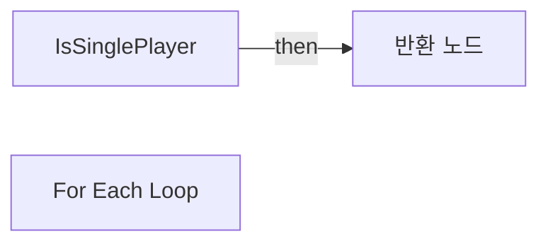

# WBP_PauseMenu

에셋: `/Game/QuakeLike_1_0/GameProgressFlow/WBP_PauseMenu`

부모: `/Script/CoreUObject.Class'/Script/UMG.UserWidget'`

수집일: 2026-10-12. MCP에서 읽은 그래프·핀 연결의 자동 전사입니다. 상속된 그래프는 부모 문서를 함께 확인합니다.

정적 루트 참조 도달: 있음. 실행 여부 또는 삭제 가능 여부의 확정이 아닙니다.

컴포넌트 목록은 이 BP가 직접 정의한 SCS만 포함합니다. 부모·네이티브 생성 컴포넌트, 인스턴스 설정은 별도입니다.

## 변수와 기본값

| 이름 | 타입 | CDO 기본값 |
|---|---|---|
| `Is_Paused` | `bool` | False |

## 그래프 목록

| 그래프 | 전체 노드 수 |
|---|---|
| EventGraph | 81 |
| IsSinglePlayer | 6 |

## 그래프별 실행 연결

실선은 출력 exec 핀의 실제 연결입니다. 여러 분기는 출력 핀 이름을 표시합니다. 함수 호출·delegate·타이머의 다음 그래프 실행은 이 그림에서 자동으로 이어 붙이지 않습니다.

순수 계산 노드 및 데이터 핀은 아래 목록과 원본 JSON을 확인합니다. 연결되지 않은 이벤트도 표시되므로, 노드가 있다는 이유만으로 실행된다고 판단하면 안 됩니다.

### EventGraph

```mermaid
flowchart LR
  n0["TogglePause<br/>Custom Event"]
  n1["On Clicked (Btn_Restart)"]
  n2["Branch"]
  n3["Set Visibility<br/>타깃은 위젯"]
  n4["Set bShowMouseCursor"]
  n5["Set Is_Paused"]
  n6["Set Visibility<br/>타깃은 위젯"]
  n7["Set Input Mode Game Only"]
  n8["On Clicked (Btn_Resume)"]
  n9["Set bShowMouseCursor"]
  n10["Set Is_Paused"]
  n11["Toggle Pause<br/>타깃은 WBP Pause Menu"]
  n12["Cast To BP_QuakePlayerController"]
  n13["Cast To BP_QuakePlayerController"]
  n14["On Clicked (Btn_QuitGame)"]
  n15["Cast To BP_QuakeGameInstance"]
  n16["Set bIsInMenuFlow"]
  n17["On Clicked (Btn_MapSelect)"]
  n18["Cast To BP_QuakePlayerController"]
  n19["[ S] Request Map Change<br/>타깃은 BP Quake Player Controller<br/>RELIABLE 서버에 리플리케이트됨 (소유 클라이언트인 경우)"]
  n20["Get Current Level Name"]
  n21["Set Input Mode UI Only"]
  n22["Server Set Game Paused<br/>타깃은 My Player Controller<br/>RELIABLE 서버에 리플리케이트됨 (소유 클라이언트인 경우)"]
  n23["Server Set Game Paused<br/>타깃은 My Player Controller<br/>RELIABLE 서버에 리플리케이트됨 (소유 클라이언트인 경우)"]
  n24["Cast To BP_QuakeGameInstance"]
  n25["Set bOpenMapSelectDirectly"]
  n26["Branch"]
  n27["Cast To BP_QuakeGameInstance"]
  n28["Set bIsInMenuFlow"]
  n29["Set Target IP"]
  n30["Set Target IP"]
  n31["Set bIntentionalDisconnect"]
  n32["Set bIntentionalDisconnect"]
  n33["Stop Single Server<br/>Target is BPI Login Info"]
  n34["Stop Single Server<br/>Target is BPI Login Info"]
  n35["Cast To BP_QuakeGameState"]
  n36["Branch"]
  n37["Set Is Enabled<br/>타깃은 위젯"]
  n38["Set Is Enabled<br/>타깃은 위젯"]
  n39["Set Is Enabled<br/>타깃은 위젯"]
  n40["Set Is Enabled<br/>타깃은 위젯"]
  n41["Begin Loading and Return to Main Menu"]
  n42["Begin Loading and Return to Main Menu"]
  n43["On Clicked (Btn_Settings)"]
  n44["Create WBP Settings Menu Widget"]
  n45["Add to Viewport<br/>타깃은 사용자 위젯"]
  n46["Execute Console Command"]
  n47["Execute Console Command"]
  n48["Cast To BP_QuakeGameInstance"]
  n49["Branch"]
  n50["Execute Console Command"]
  n51["Remove Crosshair<br/>타깃은 I Shooter Hud Manager"]
  n52["Get All Widgets Of Class"]
  n53["Refresh Competitive Combat HUD<br/>타깃은 WBP Player HUD Sdm"]
  n0 -->|"then"| n2
  n1 -->|"then"| n18
  n2 -->|"then"| n13
  n2 -->|"else"| n47
  n3 -->|"then"| n35
  n4 -->|"then"| n5
  n6 -->|"then"| n7
  n7 -->|"then"| n9
  n8 -->|"then"| n11
  n9 -->|"then"| n10
  n10 -->|"then"| n48
  n12 -->|"then"| n23
  n13 -->|"then"| n22
  n14 -->|"then"| n15
  n15 -->|"then"| n16
  n16 -->|"then"| n31
  n17 -->|"then"| n24
  n18 -->|"then"| n20
  n20 -->|"then"| n19
  n21 -->|"then"| n4
  n22 -->|"then"| n52
  n23 -->|"then"| n51
  n24 -->|"then"| n25
  n25 -->|"then"| n26
  n26 -->|"then"| n27
  n27 -->|"then"| n28
  n28 -->|"then"| n32
  n29 -->|"then"| n41
  n30 -->|"then"| n42
  n31 -->|"then"| n29
  n32 -->|"then"| n30
  n35 -->|"then"| n36
  n36 -->|"then"| n37
  n36 -->|"else"| n38
  n37 -->|"then"| n39
  n38 -->|"then"| n40
  n39 -->|"then"| n21
  n40 -->|"then"| n21
  n41 -->|"then"| n34
  n42 -->|"then"| n33
  n43 -->|"then"| n44
  n44 -->|"then"| n45
  n47 -->|"then"| n12
  n48 -->|"then"| n49
  n49 -->|"then"| n46
  n49 -->|"else"| n50
  n51 -->|"then"| n3
  n52 -->|"then"| n53
  n53 -->|"then"| n6
```

실행 핀 플로우차트

전체 노드·기본 입력 목록

| 노드 ID | 제목 | 미연결 기본 입력 / 에셋 입력 |
|---|---|---|
| `K2Node_CustomEvent_0` | TogglePause Custom Event |  |
| `K2Node_ComponentBoundEvent_0` | On Clicked (Btn_Restart) |  |
| `EdGraphNode_Comment_0` | 재시작 |  |
| `K2Node_IfThenElse_4` | Branch |  |
| `K2Node_VariableGet_2` | Get Is_Paused |  |
| `K2Node_CallFunction_20` | Set Visibility 타깃은 위젯 | InVisibility=Visible |
| `K2Node_CallFunction_13` | Get Owning Player 타깃은 위젯 |  |
| `K2Node_VariableSet_4` | Set bShowMouseCursor | bShowMouseCursor=true |
| `K2Node_VariableSet_5` | Set Is_Paused | Output_Get=false |
| `K2Node_CallFunction_16` | Set Visibility 타깃은 위젯 | InVisibility=Collapsed |
| `K2Node_CallFunction_21` | Set Input Mode Game Only | bFlushInput=false |
| `K2Node_ComponentBoundEvent_6` | On Clicked (Btn_Resume) |  |
| `K2Node_VariableSet_1` | Set bShowMouseCursor | bShowMouseCursor=false |
| `K2Node_VariableSet_7` | Set Is_Paused | Output_Get=false |
| `K2Node_CallFunction_22` | Toggle Pause 타깃은 WBP Pause Menu |  |
| `K2Node_DynamicCast_3` | Cast To BP_QuakePlayerController |  |
| `K2Node_DynamicCast_4` | Cast To BP_QuakePlayerController |  |
| `K2Node_CallFunction_18` | Get Owning Player 타깃은 위젯 |  |
| `K2Node_ComponentBoundEvent_2` | On Clicked (Btn_QuitGame) |  |
| `EdGraphNode_Comment_1` |  일시정지 풀기 |  |
| `EdGraphNode_Comment_2` | 게임종료 |  |
| `EdGraphNode_Comment_3` | 일시정지 |  |
| `K2Node_CallFunction_19` | Get Game Instance 타깃은 위젯 |  |
| `K2Node_DynamicCast_5` | Cast To BP_QuakeGameInstance |  |
| `K2Node_VariableSet_3` | Set bIsInMenuFlow | bIsInMenuFlow=true; Output_Get=false |
| `K2Node_ComponentBoundEvent_3` | On Clicked (Btn_MapSelect) |  |
| `K2Node_CallFunction_33` | Get Owning Player 타깃은 위젯 |  |
| `K2Node_DynamicCast_7` | Cast To BP_QuakePlayerController |  |
| `K2Node_CallFunction_31` | [ S] Request Map Change 타깃은 BP Quake Player Controller RELIABLE 서버에 리플리케이트됨 (소유 클라이언트인 경우) |  |
| `K2Node_CallFunction_1` | Get Current Level Name | bRemovePrefixString=true |
| `K2Node_CallFunction_10` | Set Input Mode UI Only | InMouseLockMode=DoNotLock; bFlushInput=false |
| `K2Node_CallFunction_4` | Get Owning Player 타깃은 위젯 |  |
| `K2Node_Self_0` | 셀프-레퍼런스 |  |
| `K2Node_CallFunction_14` | Server Set Game Paused 타깃은 My Player Controller RELIABLE 서버에 리플리케이트됨 (소유 클라이언트인 경우) | bShouldPause=false |
| `K2Node_CallFunction_2` | Server Set Game Paused 타깃은 My Player Controller RELIABLE 서버에 리플리케이트됨 (소유 클라이언트인 경우) | bShouldPause=true |
| `K2Node_DynamicCast_1` | Cast To BP_QuakeGameInstance |  |
| `K2Node_CallFunction_17` | Get Game Instance 타깃은 위젯 |  |
| `K2Node_VariableSet_0` | Set bOpenMapSelectDirectly | bOpenMapSelectDirectly=true |
| `K2Node_IfThenElse_0` | Branch |  |
| `K2Node_DynamicCast_2` | Cast To BP_QuakeGameInstance |  |
| `K2Node_VariableSet_2` | Set bIsInMenuFlow | bIsInMenuFlow=true; Output_Get=false |
| `K2Node_Knot_2` | 경유 노드 |  |
| `K2Node_VariableSet_8` | Set Target IP |  |
| `K2Node_VariableSet_6` | Set Target IP |  |
| `K2Node_VariableSet_9` | Set bIntentionalDisconnect | bIntentionalDisconnect=true; Output_Get=false |
| `K2Node_VariableSet_10` | Set bIntentionalDisconnect | bIntentionalDisconnect=true; Output_Get=false |
| `K2Node_CallFunction_6` | Get Game Instance 타깃은 위젯 |  |
| `K2Node_Message_1` | Stop Single Server Target is BPI Login Info |  |
| `K2Node_CallFunction_5` | Get Game Instance 타깃은 위젯 |  |
| `K2Node_Message_0` | Stop Single Server Target is BPI Login Info |  |
| `EdGraphNode_Comment_4` | 맵선택 |  |
| `K2Node_CallFunction_8` | Get Game State |  |
| `K2Node_DynamicCast_0` | Cast To BP_QuakeGameState |  |
| `K2Node_VariableGet_4` | Get NumRealPlayers |  |
| `K2Node_PromotableOperator_1` | integer &lt;= integer | B=1 |
| `K2Node_IfThenElse_2` | Branch |  |
| `K2Node_CallFunction_11` | Set Is Enabled 타깃은 위젯 | bInIsEnabled=true |
| `K2Node_CallFunction_15` | Set Is Enabled 타깃은 위젯 | bInIsEnabled=false |
| `K2Node_VariableGet_5` | Get Btn_MapSelect |  |
| `K2Node_VariableGet_6` | Get Btn_MapSelect |  |
| `K2Node_CallFunction_7` | Set Is Enabled 타깃은 위젯 | bInIsEnabled=true |
| `K2Node_CallFunction_9` | Set Is Enabled 타깃은 위젯 | bInIsEnabled=false |
| `K2Node_VariableGet_7` | Get Btn_Restart |  |
| `K2Node_VariableGet_8` | Get Btn_Restart |  |
| `K2Node_CallFunction_28` | Begin Loading and Return to Main Menu | StatusText=메인 메뉴로 돌아가는 중... |
| `K2Node_CallFunction_27` | Begin Loading and Return to Main Menu | StatusText=레벨 선택으로 돌아가는 중... |
| `K2Node_ComponentBoundEvent_1` | On Clicked (Btn_Settings) |  |
| `K2Node_CreateWidget_1` | Create WBP Settings Menu Widget | Class=/Game/QuakeLike_1_0/GameProgressFlow/WBP_SettingsMenu.WBP_SettingsMenu_C |
| `K2Node_CallFunction_12` | Add to Viewport 타깃은 사용자 위젯 | ZOrder=0 |
| `K2Node_CallFunction_3` | Execute Console Command | Command=r.MotionBlurQuality 4 |
| `K2Node_CallFunction_26` | Execute Console Command | Command=r.MotionBlurQuality 0 |
| `K2Node_CallFunction_24` | Get Game Instance 타깃은 위젯 |  |
| `K2Node_DynamicCast_8` | Cast To BP_QuakeGameInstance |  |
| `K2Node_VariableGet_1` | Get |  |
| `K2Node_IfThenElse_1` | Branch |  |
| `K2Node_CallFunction_0` | Execute Console Command | Command=r.MotionBlurQuality 0 |
| `K2Node_CallFunction_23` | Get Shooter Hud Manager |  |
| `K2Node_CallFunction_25` | Remove Crosshair 타깃은 I Shooter Hud Manager |  |
| `K2Node_CallFunction_29` | Get All Widgets Of Class | WidgetClass=/Game/QuakeLike_Base/SDM/UI/Combat_UI/WBP_PlayerHUD_sdm.WBP_PlayerHUD_sdm_C; TopLevelOnly=true |
| `K2Node_GetArrayItem_0` | GET | Dimension 1=0 |
| `K2Node_CallFunction_30` | Refresh Competitive Combat HUD 타깃은 WBP Player HUD Sdm |  |

### IsSinglePlayer

실행 핀 플로우차트

전체 노드·기본 입력 목록

| 노드 ID | 제목 | 미연결 기본 입력 / 에셋 입력 |
|---|---|---|
| `K2Node_FunctionEntry_0` | IsSinglePlayer |  |
| `K2Node_FunctionResult_0` | 반환 노드 |  |
| `K2Node_CallFunction_0` | Get Game State |  |
| `K2Node_VariableGet_0` | Get PlayerArray |  |
| `K2Node_PromotableOperator_0` | integer &lt;= integer | B=1 |
| `K2Node_MacroInstance_0` | For Each Loop |  |

## 조회 범위의 한계

ObjectIterator로 발견했으나 MCP helper가 반환하지 않은 그래프입니다. delegate signature·컴파일된 중간 그래프·macro·애니메이션 내부 그래프가 섞일 수 있습니다.

- `BndEvt__WBP_PauseMenu_Btn_MapSelect_K2Node_ComponentBoundEvent_3_OnButtonClickedEvent__DelegateSignature`: Graph 'BndEvt__WBP_PauseMenu_Btn_MapSelect_K2Node_ComponentBoundEvent_3_OnButtonClickedEvent__DelegateSignature' not found in Blueprint.
- `BndEvt__WBP_PauseMenu_Btn_QuitGame_K2Node_ComponentBoundEvent_2_OnButtonClickedEvent__DelegateSignature`: Graph 'BndEvt__WBP_PauseMenu_Btn_QuitGame_K2Node_ComponentBoundEvent_2_OnButtonClickedEvent__DelegateSignature' not found in Blueprint.
- `BndEvt__WBP_PauseMenu_Btn_Restart_K2Node_ComponentBoundEvent_0_OnButtonClickedEvent__DelegateSignature`: Graph 'BndEvt__WBP_PauseMenu_Btn_Restart_K2Node_ComponentBoundEvent_0_OnButtonClickedEvent__DelegateSignature' not found in Blueprint.
- `BndEvt__WBP_PauseMenu_Btn_Resume_K2Node_ComponentBoundEvent_1_OnButtonClickedEvent__DelegateSignature`: Graph 'BndEvt__WBP_PauseMenu_Btn_Resume_K2Node_ComponentBoundEvent_1_OnButtonClickedEvent__DelegateSignature' not found in Blueprint.
- `BndEvt__WBP_PauseMenu_Btn_Settings_K2Node_ComponentBoundEvent_1_OnButtonClickedEvent__DelegateSignature`: Graph 'BndEvt__WBP_PauseMenu_Btn_Settings_K2Node_ComponentBoundEvent_1_OnButtonClickedEvent__DelegateSignature' not found in Blueprint.
- `TogglePause`: Graph 'TogglePause' not found in Blueprint.

[원본 MCP 스냅샷](../../../Evidence/blueprints-105.json)
