# WBP_SettingsMenu

에셋: `/Game/QuakeLike_1_0/GameProgressFlow/WBP_SettingsMenu`

부모: `/Script/CoreUObject.Class'/Script/UMG.UserWidget'`

수집일: 2026-10-12. MCP에서 읽은 그래프·핀 연결의 자동 전사입니다. 상속된 그래프는 부모 문서를 함께 확인합니다.

정적 루트 참조 도달: 있음. 실행 여부 또는 삭제 가능 여부의 확정이 아닙니다.

컴포넌트 목록은 이 BP가 직접 정의한 SCS만 포함합니다. 부모·네이티브 생성 컴포넌트, 인스턴스 설정은 별도입니다.

## 변수와 기본값

| 이름 | 타입 | CDO 기본값 |
|---|---|---|
| `TabButtons` | `Button` | [] |
| `SelectedTabIndex` | `int` | 0 |
| `ActiveTabColor` | `LinearColor` | &lt;Struct 'LinearColor' {r: 1.000000, g: 0.951883, b: 0.203400, a: 1.000000}&gt; |
| `InactiveTabColor` | `LinearColor` | &lt;Struct 'LinearColor' {r: 0.182292, g: 0.158540, b: 0.141275, a: 1.000000}&gt; |
| `ChoiceIndex` | `int` | 0 |
| `ChoiceOptions` | `text` | [] |
| `Row Name` | `name` | H_Sens |
| `bInitializing` | `bool` | False |

## 그래프 목록

| 그래프 | 전체 노드 수 |
|---|---|
| ApplyBGMVolume | 14 |
| ApplyBrightness | 16 |
| ApplyCharacterVolume | 14 |
| ApplyFOV | 14 |
| ApplyHSens | 8 |
| ApplyMasterVolume | 13 |
| ApplySFXVolume | 14 |
| ApplyUIVolume | 15 |
| ApplyVSens | 8 |
| ApplyZoomSens	 | 8 |
| EventGraph | 219 |
| InitSlider | 14 |
| OnMouseWheel | 23 |
| ResetSlider | 4 |
| SelectTab | 133 |
| SetDescription | 3 |
| UpdateChoiceVisual | 6 |
| UpdateToggleVisual | 17 |

## 그래프별 실행 연결

실선은 출력 exec 핀의 실제 연결입니다. 여러 분기는 출력 핀 이름을 표시합니다. 함수 호출·delegate·타이머의 다음 그래프 실행은 이 그림에서 자동으로 이어 붙이지 않습니다.

순수 계산 노드 및 데이터 핀은 아래 목록과 원본 JSON을 확인합니다. 연결되지 않은 이벤트도 표시되므로, 노드가 있다는 이유만으로 실행된다고 판단하면 안 됩니다.

### ApplyBGMVolume

실행 핀 플로우차트

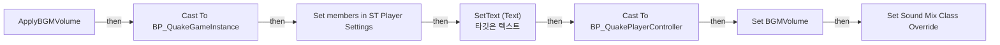

전체 노드·기본 입력 목록

| 노드 ID | 제목 | 미연결 기본 입력 / 에셋 입력 |
|---|---|---|
| `K2Node_FunctionEntry_0` | ApplyBGMVolume |  |
| `K2Node_DynamicCast_11` | Cast To BP_QuakePlayerController |  |
| `K2Node_CallFunction_82` | Set Sound Mix Class Override | InSoundMixModifier=/Game/QuakeLike_1_0/GameProgressFlow/Sound_Class/MIX_Settings.MIX_Settings; InSoundClass=/Game/QuakeLike_1_0/GameProgressFlow/Sound_Class/SC_BGM.SC_BGM; Pitch=1.000000; FadeInTime=1.000000; bApplyToChildren=true |
| `K2Node_CallFunction_84` | SetText (Text) 타깃은 텍스트 |  |
| `K2Node_CallFunction_85` | To Text (Float) | RoundingMode=HalfToEven; bAlwaysSign=false; bUseGrouping=true; MinimumIntegralDigits=1; MaximumIntegralDigits=324; MinimumFractionalDigits=0; MaximumFractionalDigits=0 |
| `K2Node_Knot_14` | 경유 노드 |  |
| `K2Node_VariableGet_46` | Get TB_BGM |  |
| `K2Node_VariableSet_20` | Set BGMVolume | Output_Get=0.0 |
| `K2Node_PromotableOperator_12` | float / float | B=100.000000 |
| `K2Node_CallFunction_83` | Get Owning Player 타깃은 위젯 |  |
| `K2Node_DynamicCast_1` | Cast To BP_QuakeGameInstance |  |
| `K2Node_VariableGet_1` | Get CurrentSettings |  |
| `K2Node_SetFieldsInStruct_0` | Set members in ST Player Settings |  |
| `K2Node_CallFunction_0` | Get Game Instance 타깃은 위젯 |  |

### ApplyBrightness

실행 핀 플로우차트

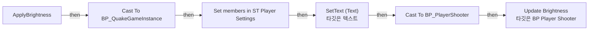

전체 노드·기본 입력 목록

| 노드 ID | 제목 | 미연결 기본 입력 / 에셋 입력 |
|---|---|---|
| `K2Node_FunctionEntry_0` | ApplyBrightness |  |
| `K2Node_CallFunction_65` | Get Controlled Pawn 타깃은 컨트롤러 |  |
| `K2Node_DynamicCast_2` | Cast To BP_PlayerShooter |  |
| `K2Node_VariableGet_21` | Get Slider_Bright |  |
| `K2Node_VariableGet_22` | Get MinValue |  |
| `K2Node_VariableGet_23` | Get MaxValue |  |
| `K2Node_CallFunction_66` | Update Brightness 타깃은 BP Player Shooter |  |
| `K2Node_CallFunction_76` | SetText (Text) 타깃은 텍스트 |  |
| `K2Node_CallFunction_89` | To Text (Float) | RoundingMode=HalfToEven; bAlwaysSign=false; bUseGrouping=true; MinimumIntegralDigits=1; MaximumIntegralDigits=324; MinimumFractionalDigits=0; MaximumFractionalDigits=0 |
| `K2Node_VariableGet_24` | Get TB_SliderValue_4 |  |
| `K2Node_Knot_5` | 경유 노드 |  |
| `K2Node_CallFunction_75` | Get Owning Player 타깃은 위젯 |  |
| `K2Node_DynamicCast_1` | Cast To BP_QuakeGameInstance |  |
| `K2Node_VariableGet_1` | Get CurrentSettings |  |
| `K2Node_SetFieldsInStruct_0` | Set members in ST Player Settings |  |
| `K2Node_CallFunction_0` | Get Game Instance 타깃은 위젯 |  |

### ApplyCharacterVolume

실행 핀 플로우차트

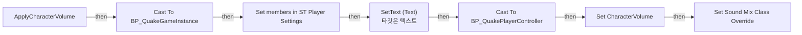

전체 노드·기본 입력 목록

| 노드 ID | 제목 | 미연결 기본 입력 / 에셋 입력 |
|---|---|---|
| `K2Node_FunctionEntry_0` | ApplyCharacterVolume |  |
| `K2Node_DynamicCast_9` | Cast To BP_QuakePlayerController |  |
| `K2Node_CallFunction_74` | Set Sound Mix Class Override | InSoundMixModifier=/Game/QuakeLike_1_0/GameProgressFlow/Sound_Class/MIX_Settings.MIX_Settings; InSoundClass=/Game/QuakeLike_1_0/GameProgressFlow/Sound_Class/SC_Character.SC_Character; Pitch=1.000000; FadeInTime=1.000000; bApplyToChildren=true |
| `K2Node_CallFunction_2` | SetText (Text) 타깃은 텍스트 |  |
| `K2Node_CallFunction_77` | To Text (Float) | RoundingMode=HalfToEven; bAlwaysSign=false; bUseGrouping=true; MinimumIntegralDigits=1; MaximumIntegralDigits=324; MinimumFractionalDigits=0; MaximumFractionalDigits=0 |
| `K2Node_Knot_11` | 경유 노드 |  |
| `K2Node_VariableGet_53` | Get TB_CharacterV |  |
| `K2Node_VariableSet_23` | Set CharacterVolume | Output_Get=0.0 |
| `K2Node_PromotableOperator_7` | float / float | B=100.000000 |
| `K2Node_CallFunction_47` | Get Owning Player 타깃은 위젯 |  |
| `K2Node_DynamicCast_1` | Cast To BP_QuakeGameInstance |  |
| `K2Node_VariableGet_1` | Get CurrentSettings |  |
| `K2Node_SetFieldsInStruct_0` | Set members in ST Player Settings |  |
| `K2Node_CallFunction_0` | Get Game Instance 타깃은 위젯 |  |

### ApplyFOV

실행 핀 플로우차트

```mermaid
flowchart LR
  n0["ApplyFOV"]
  n1["Cast To BP_QuakePlayerController"]
  n2["Set testFOV"]
  n3["Cast To BP_PlayerShooter"]
  n4["Update Camera FOV<br/>타깃은 BP Player Shooter"]
  n5["SetText (Text)<br/>타깃은 텍스트"]
  n6["Cast To BP_QuakeGameInstance"]
  n7["Set members in ST Player Settings"]
  n0 -->|"then"| n6
  n1 -->|"then"| n2
  n2 -->|"then"| n3
  n3 -->|"then"| n4
  n5 -->|"then"| n1
  n6 -->|"then"| n7
  n7 -->|"then"| n5
```

전체 노드·기본 입력 목록

| 노드 ID | 제목 | 미연결 기본 입력 / 에셋 입력 |
|---|---|---|
| `K2Node_FunctionEntry_0` | ApplyFOV |  |
| `K2Node_CallFunction_64` | Get Owning Player 타깃은 위젯 |  |
| `K2Node_DynamicCast_0` | Cast To BP_QuakePlayerController |  |
| `K2Node_VariableSet_9` | Set testFOV | Output_Get=0.0 |
| `K2Node_CallFunction_49` | Get Controlled Pawn 타깃은 컨트롤러 |  |
| `K2Node_DynamicCast_3` | Cast To BP_PlayerShooter |  |
| `K2Node_CallFunction_50` | Update Camera FOV 타깃은 BP Player Shooter |  |
| `K2Node_CallFunction_67` | SetText (Text) 타깃은 텍스트 |  |
| `K2Node_VariableGet_18` | Get TB_SliderValue_3 |  |
| `K2Node_CallFunction_53` | To Text (Float) | RoundingMode=HalfToEven; bAlwaysSign=false; bUseGrouping=true; MinimumIntegralDigits=1; MaximumIntegralDigits=324; MinimumFractionalDigits=0; MaximumFractionalDigits=0 |
| `K2Node_CallFunction_0` | Get Game Instance 타깃은 위젯 |  |
| `K2Node_DynamicCast_1` | Cast To BP_QuakeGameInstance |  |
| `K2Node_VariableGet_1` | Get CurrentSettings |  |
| `K2Node_SetFieldsInStruct_0` | Set members in ST Player Settings |  |

### ApplyHSens

실행 핀 플로우차트

전체 노드·기본 입력 목록

| 노드 ID | 제목 | 미연결 기본 입력 / 에셋 입력 |
|---|---|---|
| `K2Node_FunctionEntry_0` | ApplyHSens |  |
| `K2Node_VariableGet_4` | Get TB_SliderValue |  |
| `K2Node_CallFunction_22` | SetText (Text) 타깃은 텍스트 |  |
| `K2Node_CallFunction_35` | To Text (Float) | RoundingMode=HalfToEven; bAlwaysSign=false; bUseGrouping=true; MinimumIntegralDigits=1; MaximumIntegralDigits=324; MinimumFractionalDigits=0; MaximumFractionalDigits=2 |
| `K2Node_CallFunction_0` | Get Game Instance 타깃은 위젯 |  |
| `K2Node_DynamicCast_1` | Cast To BP_QuakeGameInstance |  |
| `K2Node_VariableGet_1` | Get CurrentSettings |  |
| `K2Node_SetFieldsInStruct_0` | Set members in ST Player Settings |  |

### ApplyMasterVolume

실행 핀 플로우차트

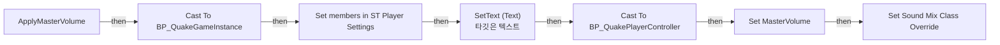

전체 노드·기본 입력 목록

| 노드 ID | 제목 | 미연결 기본 입력 / 에셋 입력 |
|---|---|---|
| `K2Node_FunctionEntry_0` | ApplyMasterVolume |  |
| `K2Node_DynamicCast_10` | Cast To BP_QuakePlayerController |  |
| `K2Node_VariableSet_14` | Set MasterVolume | Output_Get=0.0 |
| `K2Node_CallFunction_78` | Set Sound Mix Class Override | InSoundMixModifier=/Game/QuakeLike_1_0/GameProgressFlow/Sound_Class/MIX_Settings.MIX_Settings; InSoundClass=/Game/QuakeLike_1_0/GameProgressFlow/Sound_Class/Master.Master; Pitch=1.000000; FadeInTime=1.000000; bApplyToChildren=true |
| `K2Node_CallFunction_80` | SetText (Text) 타깃은 텍스트 |  |
| `K2Node_VariableGet_45` | Get TB_Master |  |
| `K2Node_CallFunction_81` | To Text (Float) | RoundingMode=HalfToEven; bAlwaysSign=false; bUseGrouping=true; MinimumIntegralDigits=1; MaximumIntegralDigits=324; MinimumFractionalDigits=0; MaximumFractionalDigits=0 |
| `K2Node_PromotableOperator_11` | float / float | B=100.000000 |
| `K2Node_CallFunction_79` | Get Owning Player 타깃은 위젯 |  |
| `K2Node_DynamicCast_1` | Cast To BP_QuakeGameInstance |  |
| `K2Node_VariableGet_1` | Get CurrentSettings |  |
| `K2Node_SetFieldsInStruct_0` | Set members in ST Player Settings |  |
| `K2Node_CallFunction_0` | Get Game Instance 타깃은 위젯 |  |

### ApplySFXVolume

실행 핀 플로우차트

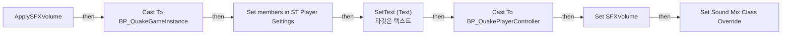

전체 노드·기본 입력 목록

| 노드 ID | 제목 | 미연결 기본 입력 / 에셋 입력 |
|---|---|---|
| `K2Node_FunctionEntry_0` | ApplySFXVolume |  |
| `K2Node_DynamicCast_12` | Cast To BP_QuakePlayerController |  |
| `K2Node_CallFunction_86` | Set Sound Mix Class Override | InSoundMixModifier=/Game/QuakeLike_1_0/GameProgressFlow/Sound_Class/MIX_Settings.MIX_Settings; InSoundClass=/Game/QuakeLike_1_0/GameProgressFlow/Sound_Class/SC_SFX.SC_SFX; Pitch=1.000000; FadeInTime=1.000000; bApplyToChildren=true |
| `K2Node_CallFunction_88` | SetText (Text) 타깃은 텍스트 |  |
| `K2Node_CallFunction_90` | To Text (Float) | RoundingMode=HalfToEven; bAlwaysSign=false; bUseGrouping=true; MinimumIntegralDigits=1; MaximumIntegralDigits=324; MinimumFractionalDigits=0; MaximumFractionalDigits=0 |
| `K2Node_Knot_16` | 경유 노드 |  |
| `K2Node_VariableGet_48` | Get TB_SFX |  |
| `K2Node_VariableSet_21` | Set SFXVolume | Output_Get=0.0 |
| `K2Node_PromotableOperator_13` | float / float | B=100.000000 |
| `K2Node_CallFunction_87` | Get Owning Player 타깃은 위젯 |  |
| `K2Node_DynamicCast_1` | Cast To BP_QuakeGameInstance |  |
| `K2Node_VariableGet_1` | Get CurrentSettings |  |
| `K2Node_SetFieldsInStruct_0` | Set members in ST Player Settings |  |
| `K2Node_CallFunction_0` | Get Game Instance 타깃은 위젯 |  |

### ApplyUIVolume

실행 핀 플로우차트

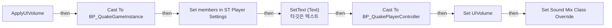

전체 노드·기본 입력 목록

| 노드 ID | 제목 | 미연결 기본 입력 / 에셋 입력 |
|---|---|---|
| `K2Node_FunctionEntry_0` | ApplyUIVolume |  |
| `K2Node_DynamicCast_14` | Cast To BP_QuakePlayerController |  |
| `K2Node_CallFunction_95` | Set Sound Mix Class Override | InSoundMixModifier=/Game/QuakeLike_1_0/GameProgressFlow/Sound_Class/MIX_Settings.MIX_Settings; InSoundClass=/Game/QuakeLike_1_0/GameProgressFlow/Sound_Class/SC_UI.SC_UI; Pitch=1.000000; FadeInTime=1.000000; bApplyToChildren=true |
| `K2Node_CallFunction_97` | SetText (Text) 타깃은 텍스트 |  |
| `K2Node_CallFunction_98` | To Text (Float) | RoundingMode=HalfToEven; bAlwaysSign=false; bUseGrouping=true; MinimumIntegralDigits=1; MaximumIntegralDigits=324; MinimumFractionalDigits=0; MaximumFractionalDigits=0 |
| `K2Node_Knot_19` | 경유 노드 |  |
| `K2Node_Knot_20` | 경유 노드 |  |
| `K2Node_VariableGet_52` | Get TB_UIV |  |
| `K2Node_VariableSet_22` | Set UIVolume | Output_Get=0.0 |
| `K2Node_PromotableOperator_14` | float / float | B=100.000000 |
| `K2Node_CallFunction_96` | Get Owning Player 타깃은 위젯 |  |
| `K2Node_DynamicCast_1` | Cast To BP_QuakeGameInstance |  |
| `K2Node_VariableGet_1` | Get CurrentSettings |  |
| `K2Node_SetFieldsInStruct_0` | Set members in ST Player Settings |  |
| `K2Node_CallFunction_0` | Get Game Instance 타깃은 위젯 |  |

### ApplyVSens

실행 핀 플로우차트

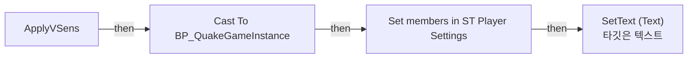

전체 노드·기본 입력 목록

| 노드 ID | 제목 | 미연결 기본 입력 / 에셋 입력 |
|---|---|---|
| `K2Node_FunctionEntry_0` | ApplyVSens |  |
| `K2Node_VariableGet_17` | Get TB_SliderValue_1 |  |
| `K2Node_CallFunction_58` | SetText (Text) 타깃은 텍스트 |  |
| `K2Node_CallFunction_59` | To Text (Float) | RoundingMode=HalfToEven; bAlwaysSign=false; bUseGrouping=true; MinimumIntegralDigits=1; MaximumIntegralDigits=324; MinimumFractionalDigits=0; MaximumFractionalDigits=2 |
| `K2Node_CallFunction_0` | Get Game Instance 타깃은 위젯 |  |
| `K2Node_DynamicCast_1` | Cast To BP_QuakeGameInstance |  |
| `K2Node_VariableGet_1` | Get CurrentSettings |  |
| `K2Node_SetFieldsInStruct_0` | Set members in ST Player Settings |  |

### ApplyZoomSens	

실행 핀 플로우차트

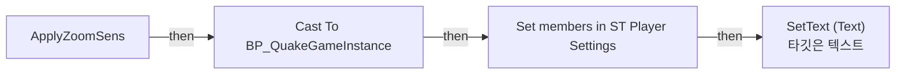

전체 노드·기본 입력 목록

| 노드 ID | 제목 | 미연결 기본 입력 / 에셋 입력 |
|---|---|---|
| `K2Node_FunctionEntry_0` | ApplyZoomSens	 |  |
| `K2Node_CallFunction_32` | To Text (Float) | RoundingMode=HalfToEven; bAlwaysSign=false; bUseGrouping=true; MinimumIntegralDigits=1; MaximumIntegralDigits=324; MinimumFractionalDigits=0; MaximumFractionalDigits=2 |
| `K2Node_VariableGet_33` | Get TB_SliderValue_2 |  |
| `K2Node_CallFunction_51` | SetText (Text) 타깃은 텍스트 |  |
| `K2Node_CallFunction_0` | Get Game Instance 타깃은 위젯 |  |
| `K2Node_DynamicCast_1` | Cast To BP_QuakeGameInstance |  |
| `K2Node_VariableGet_1` | Get CurrentSettings |  |
| `K2Node_SetFieldsInStruct_0` | Set members in ST Player Settings |  |

### EventGraph

실행 핀 플로우차트

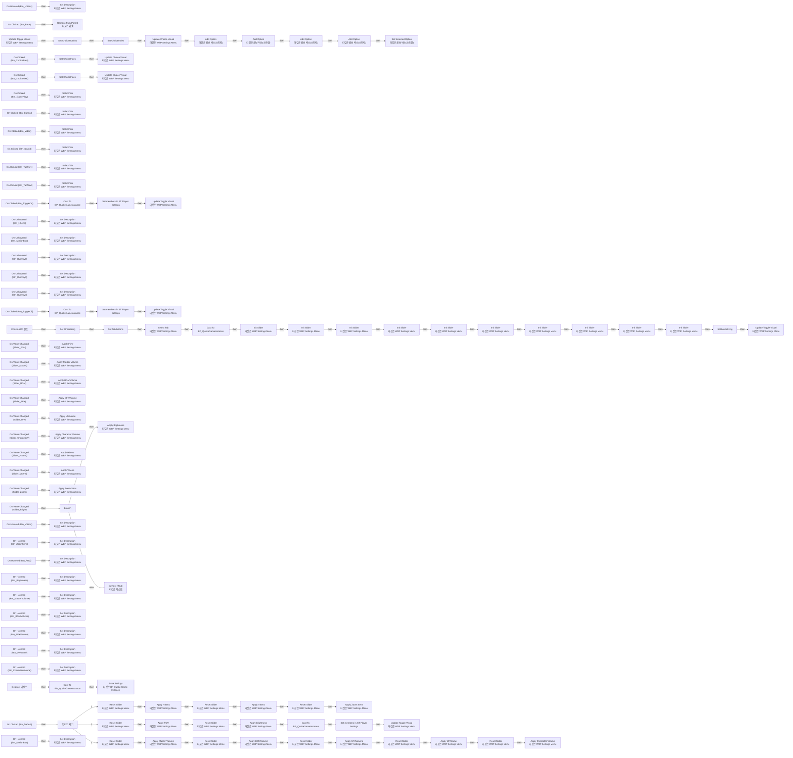

전체 노드·기본 입력 목록

| 노드 ID | 제목 | 미연결 기본 입력 / 에셋 입력 |
|---|---|---|
| `K2Node_ComponentBoundEvent_0` | On Hovered (Btn_HSens) |  |
| `K2Node_CallFunction_54` | Set Description 타깃은 WBP Settings Menu |  |
| `K2Node_ComponentBoundEvent_5` | On Clicked (Btn_Back) |  |
| `K2Node_CallFunction_5` | Remove from Parent 타깃은 위젯 |  |
| `K2Node_Event_3` | Construct 이벤트 |  |
| `K2Node_VariableGet_0` | Get Btn_GamePlay |  |
| `K2Node_VariableGet_1` | Get Btn_Control |  |
| `K2Node_MakeArray_2` | 배열 만들기 |  |
| `K2Node_VariableGet_2` | Get Btn_Video |  |
| `K2Node_VariableGet_3` | Get Btn_Sound |  |
| `K2Node_VariableSet_0` | Set TabButtons |  |
| `K2Node_CallFunction_6` | Select Tab 타깃은 WBP Settings Menu | Index=0 |
| `K2Node_ComponentBoundEvent_6` | On Value Changed (Slider_HSens) |  |
| `K2Node_ComponentBoundEvent_7` | On Clicked (Btn_ToggleOn) |  |
| `K2Node_CallFunction_13` | Update Toggle Visual 타깃은 WBP Settings Menu |  |
| `K2Node_ComponentBoundEvent_8` | On Clicked (Btn_ToggleOff) |  |
| `K2Node_CallFunction_12` | Update Toggle Visual 타깃은 WBP Settings Menu |  |
| `K2Node_ComponentBoundEvent_9` | On Clicked (Btn_ChoicePrev) |  |
| `K2Node_VariableGet_15` | Get ChoiceIndex |  |
| `K2Node_PromotableOperator_0` | int - int | B=1 |
| `K2Node_PromotableOperator_1` | int + int | B=3 |
| `K2Node_VariableSet_5` | Set ChoiceIndex | Output_Get=0 |
| `K2Node_ComponentBoundEvent_10` | On Clicked (Btn_ChoiceNext) |  |
| `K2Node_VariableGet_16` | Get ChoiceIndex |  |
| `K2Node_PromotableOperator_3` | int + int | B=1 |
| `K2Node_VariableSet_6` | Set ChoiceIndex | Output_Get=0 |
| `K2Node_CallFunction_14` | Update Choice Visual 타깃은 WBP Settings Menu |  |
| `K2Node_CallFunction_15` | Update Choice Visual 타깃은 WBP Settings Menu |  |
| `K2Node_CallFunction_17` | % (Integer) | B=3 |
| `K2Node_CallFunction_16` | % (Integer) | B=3 |
| `K2Node_CallFunction_18` | Update Toggle Visual 타깃은 WBP Settings Menu |  |
| `K2Node_MakeArray_3` | 배열 만들기 |  |
| `K2Node_VariableSet_7` | Set ChoiceOptions |  |
| `K2Node_VariableSet_8` | Set ChoiceIndex | ChoiceIndex=1; Output_Get=0 |
| `K2Node_CallFunction_19` | Update Choice Visual 타깃은 WBP Settings Menu |  |
| `K2Node_VariableGet_5` | Get Combo_Brightness |  |
| `K2Node_CallFunction_9` | Add Option 타깃은 콤보 박스(스트링) | Option=어둡게 |
| `K2Node_CallFunction_10` | Add Option 타깃은 콤보 박스(스트링) | Option=기본 |
| `K2Node_CallFunction_11` | Add Option 타깃은 콤보 박스(스트링) | Option=밝게 |
| `K2Node_CallFunction_8` | Add Option 타깃은 콤보 박스(스트링) | Option=매우 밝게 |
| `K2Node_CallFunction_20` | Set Selected Option 타깃은 콤보 박스(스트링) | Option=기본 |
| `K2Node_ComponentBoundEvent_12` | On Clicked (Btn_GamePlay) |  |
| `K2Node_CallFunction_23` | Select Tab 타깃은 WBP Settings Menu | Index=0 |
| `K2Node_ComponentBoundEvent_13` | On Clicked (Btn_Control) |  |
| `K2Node_CallFunction_24` | Select Tab 타깃은 WBP Settings Menu | Index=1 |
| `K2Node_ComponentBoundEvent_14` | On Clicked (Btn_Video) |  |
| `K2Node_CallFunction_25` | Select Tab 타깃은 WBP Settings Menu | Index=2 |
| `K2Node_ComponentBoundEvent_15` | On Clicked (Btn_Sound) |  |
| `K2Node_CallFunction_21` | Select Tab 타깃은 WBP Settings Menu | Index=3 |
| `K2Node_ComponentBoundEvent_16` | On Clicked (Btn_TabPrev) |  |
| `K2Node_CallFunction_28` | Select Tab 타깃은 WBP Settings Menu |  |
| `K2Node_VariableGet_7` | Get SelectedTabIndex |  |
| `K2Node_PromotableOperator_6` | int - int | B=1 |
| `K2Node_PromotableOperator_5` | int + int | B=4 |
| `K2Node_CallFunction_29` | % (Integer) | B=4 |
| `K2Node_ComponentBoundEvent_17` | On Clicked (Btn_TabNext) |  |
| `K2Node_CallFunction_26` | Select Tab 타깃은 WBP Settings Menu |  |
| `K2Node_VariableGet_8` | Get SelectedTabIndex |  |
| `K2Node_CallFunction_27` | % (Integer) | B=4 |
| `K2Node_ComponentBoundEvent_18` | On Clicked (Btn_Default) |  |
| `K2Node_SwitchInteger_0` | 인티저 켜기 |  |
| `K2Node_VariableGet_9` | Get SelectedTabIndex |  |
| `K2Node_ComponentBoundEvent_19` | On Unhovered (Btn_MotionBlur) |  |
| `K2Node_ComponentBoundEvent_20` | On Unhovered (Btn_HSens) |  |
| `K2Node_ComponentBoundEvent_21` | On Unhovered (Btn_Dummy3) |  |
| `K2Node_ComponentBoundEvent_22` | On Unhovered (Btn_Dummy4) |  |
| `K2Node_ComponentBoundEvent_23` | On Unhovered (Btn_Dummy5) |  |
| `K2Node_CallFunction_41` | Set Description 타깃은 WBP Settings Menu |  |
| `K2Node_CallFunction_42` | Set Description 타깃은 WBP Settings Menu |  |
| `K2Node_CallFunction_43` | Set Description 타깃은 WBP Settings Menu |  |
| `K2Node_CallFunction_44` | Set Description 타깃은 WBP Settings Menu |  |
| `K2Node_CallFunction_40` | Set Description 타깃은 WBP Settings Menu |  |
| `K2Node_ComponentBoundEvent_25` | On Value Changed (Slider_VSens) |  |
| `EdGraphNode_Comment_0` | 수직 감도 |  |
| `EdGraphNode_Comment_2` | 수평 감도 |  |
| `K2Node_CallFunction_55` | Init Slider 타깃은 WBP Settings Menu | RowName=H_Sens |
| `K2Node_VariableGet_30` | Get Slider_HSens |  |
| `K2Node_CallFunction_63` | Init Slider 타깃은 WBP Settings Menu | RowName=V_Sens |
| `K2Node_VariableGet_32` | Get Slider_VSens |  |
| `K2Node_ComponentBoundEvent_27` | On Value Changed (Slider_Zoom) |  |
| `EdGraphNode_Comment_3` | 총기 줌 감도 |  |
| `EdGraphNode_Comment_5` | 설정창 열릴 때 저장값을 슬라이더에 반영 |  |
| `EdGraphNode_Comment_6` | 찌꺼기 |  |
| `K2Node_CallFunction_52` | Init Slider 타깃은 WBP Settings Menu | RowName=Zoom_Sens |
| `K2Node_VariableGet_34` | Get Slider_Zoom |  |
| `K2Node_ComponentBoundEvent_24` | On Value Changed (Slider_FOV) |  |
| `EdGraphNode_Comment_1` | 시야각 |  |
| `K2Node_CallFunction_68` | Init Slider 타깃은 WBP Settings Menu | RowName=FOV |
| `K2Node_VariableGet_20` | Get Slider_FOV |  |
| `K2Node_ComponentBoundEvent_26` | On Value Changed (Slider_Bright) |  |
| `EdGraphNode_Comment_4` | 밝기 |  |
| `K2Node_CallFunction_62` | Init Slider 타깃은 WBP Settings Menu | RowName=Brightness |
| `K2Node_VariableGet_26` | Get Slider_Bright |  |
| `K2Node_CallFunction_69` | Init Slider 타깃은 WBP Settings Menu | RowName=MasterVolume |
| `K2Node_CallFunction_70` | Init Slider 타깃은 WBP Settings Menu | RowName=BGMVolume |
| `K2Node_CallFunction_71` | Init Slider 타깃은 WBP Settings Menu | RowName=SFXVolume |
| `K2Node_CallFunction_72` | Init Slider 타깃은 WBP Settings Menu | RowName=UIVolume |
| `K2Node_CallFunction_73` | Init Slider 타깃은 WBP Settings Menu | RowName=CharacterVolume |
| `K2Node_VariableGet_27` | Get Slider_Master |  |
| `K2Node_VariableGet_28` | Get Slider_BGM |  |
| `K2Node_VariableGet_36` | Get Slider_SFX |  |
| `K2Node_VariableGet_37` | Get Slider_CharacterV |  |
| `K2Node_VariableGet_38` | Get Slider_UIV |  |
| `K2Node_ComponentBoundEvent_33` | On Value Changed (Slider_Master) |  |
| `K2Node_ComponentBoundEvent_29` | On Value Changed (Slider_BGM) |  |
| `K2Node_ComponentBoundEvent_30` | On Value Changed (Slider_SFX) |  |
| `K2Node_ComponentBoundEvent_38` | On Value Changed (Slider_UIV) |  |
| `K2Node_ComponentBoundEvent_32` | On Value Changed (Slider_CharacterV) |  |
| `EdGraphNode_Comment_7` | 전체 볼륨 |  |
| `EdGraphNode_Comment_8` | BGM |  |
| `EdGraphNode_Comment_9` | SFX |  |
| `EdGraphNode_Comment_11` | UIV |  |
| `EdGraphNode_Comment_12` | CharaterV |  |
| `K2Node_VariableSet_13` | Set bInitializing | bInitializing=true; Output_Get=false |
| `K2Node_VariableSet_15` | Set bInitializing | bInitializing=false; Output_Get=false |
| `K2Node_IfThenElse_0` | Branch |  |
| `K2Node_VariableGet_44` | Get bInitializing |  |
| `K2Node_PromotableOperator_4` | Not Equal (Boolean) | B=true |
| `K2Node_CallFunction_91` | Apply FOV 타깃은 WBP Settings Menu |  |
| `K2Node_CallFunction_92` | Apply Brightness 타깃은 WBP Settings Menu |  |
| `K2Node_CallFunction_93` | Apply Master Volume 타깃은 WBP Settings Menu |  |
| `K2Node_CallFunction_94` | Apply BGMVolume 타깃은 WBP Settings Menu |  |
| `K2Node_CallFunction_99` | Apply SFXVolume 타깃은 WBP Settings Menu |  |
| `K2Node_CallFunction_100` | Apply UIVolume 타깃은 WBP Settings Menu |  |
| `K2Node_CallFunction_101` | Apply Character Volume 타깃은 WBP Settings Menu |  |
| `K2Node_CallFunction_2` | Apply HSens 타깃은 WBP Settings Menu |  |
| `K2Node_CallFunction_22` | Apply VSens 타깃은 WBP Settings Menu |  |
| `K2Node_CallFunction_33` | Apply Zoom Sens	 타깃은 WBP Settings Menu |  |
| `K2Node_CallFunction_48` | Reset Slider 타깃은 WBP Settings Menu | RowName=H_Sens |
| `K2Node_VariableGet_4` | Get Slider_HSens |  |
| `K2Node_CallFunction_47` | Apply HSens 타깃은 WBP Settings Menu |  |
| `K2Node_CallFunction_35` | Reset Slider 타깃은 WBP Settings Menu | RowName=V_Sens |
| `K2Node_VariableGet_17` | Get Slider_VSens |  |
| `K2Node_CallFunction_49` | Apply VSens 타깃은 WBP Settings Menu |  |
| `K2Node_VariableGet_18` | Get Slider_Zoom |  |
| `K2Node_CallFunction_50` | Reset Slider 타깃은 WBP Settings Menu | RowName=Zoom_Sens |
| `K2Node_CallFunction_51` | Apply Zoom Sens	 타깃은 WBP Settings Menu |  |
| `K2Node_VariableGet_21` | Get Slider_FOV |  |
| `K2Node_CallFunction_53` | Reset Slider 타깃은 WBP Settings Menu | RowName=FOV |
| `K2Node_CallFunction_56` | Apply FOV 타깃은 WBP Settings Menu |  |
| `K2Node_VariableGet_22` | Get Slider_Bright |  |
| `K2Node_CallFunction_57` | Reset Slider 타깃은 WBP Settings Menu | RowName=Brightness |
| `K2Node_CallFunction_58` | Apply Brightness 타깃은 WBP Settings Menu |  |
| `K2Node_VariableGet_23` | Get Slider_Master |  |
| `K2Node_CallFunction_30` | Reset Slider 타깃은 WBP Settings Menu | RowName=MasterVolume |
| `K2Node_CallFunction_64` | Apply Master Volume 타깃은 WBP Settings Menu |  |
| `K2Node_VariableGet_24` | Get Slider_BGM |  |
| `K2Node_CallFunction_31` | Reset Slider 타깃은 WBP Settings Menu | RowName=BGMVolume |
| `K2Node_CallFunction_32` | Reset Slider 타깃은 WBP Settings Menu | RowName=UIVolume |
| `K2Node_CallFunction_34` | Reset Slider 타깃은 WBP Settings Menu | RowName=SFXVolume |
| `K2Node_CallFunction_59` | Reset Slider 타깃은 WBP Settings Menu | RowName=CharacterVolume |
| `K2Node_CallFunction_36` | Apply BGMVolume 타깃은 WBP Settings Menu |  |
| `K2Node_VariableGet_10` | Get Slider_SFX |  |
| `K2Node_CallFunction_37` | Apply SFXVolume 타깃은 WBP Settings Menu |  |
| `K2Node_VariableGet_11` | Get Slider_UIV |  |
| `K2Node_CallFunction_38` | Apply UIVolume 타깃은 WBP Settings Menu |  |
| `K2Node_VariableGet_12` | Get Slider_CharacterV |  |
| `K2Node_CallFunction_39` | Apply Character Volume 타깃은 WBP Settings Menu |  |
| `EdGraphNode_Comment_10` | 기본값으로 돌아가기 |  |
| `K2Node_CallFunction_65` | Get Game Instance 타깃은 위젯 |  |
| `K2Node_DynamicCast_2` | Cast To BP_QuakeGameInstance |  |
| `K2Node_VariableGet_13` | Get |  |
| `K2Node_Knot_0` | 경유 노드 |  |
| `K2Node_Knot_5` | 경유 노드 |  |
| `K2Node_Knot_10` | 경유 노드 |  |
| `K2Node_Knot_11` | 경유 노드 |  |
| `K2Node_Knot_12` | 경유 노드 |  |
| `K2Node_Knot_13` | 경유 노드 |  |
| `K2Node_Knot_14` | 경유 노드 |  |
| `K2Node_Knot_15` | 경유 노드 |  |
| `K2Node_Knot_16` | 경유 노드 |  |
| `K2Node_CallFunction_66` | Get Game Instance 타깃은 위젯 |  |
| `K2Node_DynamicCast_1` | Cast To BP_QuakeGameInstance |  |
| `K2Node_CallFunction_67` | Save Settings 타깃은 BP Quake Game Instance |  |
| `K2Node_Event_0` | Destruct 이벤트 |  |
| `EdGraphNode_Comment_13` | 설정창 닫힐 때 설정값을 파일에 저장 |  |
| `K2Node_ComponentBoundEvent_28` | On Hovered (Btn_VSens) |  |
| `K2Node_CallFunction_60` | Set Description 타깃은 WBP Settings Menu |  |
| `K2Node_ComponentBoundEvent_34` | On Hovered (Btn_ZoomSens) |  |
| `K2Node_CallFunction_61` | Set Description 타깃은 WBP Settings Menu |  |
| `K2Node_ComponentBoundEvent_35` | On Hovered (Btn_FOV) |  |
| `K2Node_CallFunction_74` | Set Description 타깃은 WBP Settings Menu |  |
| `K2Node_ComponentBoundEvent_36` | On Hovered (Btn_Brightness) |  |
| `K2Node_CallFunction_75` | Set Description 타깃은 WBP Settings Menu |  |
| `K2Node_ComponentBoundEvent_37` | On Hovered (Btn_MasterVolume) |  |
| `K2Node_CallFunction_76` | Set Description 타깃은 WBP Settings Menu |  |
| `K2Node_ComponentBoundEvent_39` | On Hovered (Btn_BGMVolume) |  |
| `K2Node_CallFunction_77` | Set Description 타깃은 WBP Settings Menu |  |
| `K2Node_ComponentBoundEvent_40` | On Hovered (Btn_SFXVolume) |  |
| `K2Node_CallFunction_78` | Set Description 타깃은 WBP Settings Menu |  |
| `K2Node_ComponentBoundEvent_41` | On Hovered (Btn_UIVolume) |  |
| `K2Node_CallFunction_79` | Set Description 타깃은 WBP Settings Menu |  |
| `K2Node_ComponentBoundEvent_42` | On Hovered (Btn_CharacterVolume) |  |
| `K2Node_CallFunction_46` | Set Description 타깃은 WBP Settings Menu |  |
| `EdGraphNode_Comment_14` | 설명란 텍스트 정리 |  |
| `EdGraphNode_Comment_15` | 뒤로가기 |  |
| `EdGraphNode_Comment_16` | 토글 |  |
| `EdGraphNode_Comment_17` | 초이스 |  |
| `EdGraphNode_Comment_18` | 탭 화살표 |  |
| `K2Node_PromotableOperator_7` | int + int | B=1 |
| `K2Node_CallFunction_3` | Get Game Instance 타깃은 위젯 |  |
| `K2Node_DynamicCast_3` | Cast To BP_QuakeGameInstance |  |
| `K2Node_VariableGet_14` | Get CurrentSettings |  |
| `K2Node_SetFieldsInStruct_3` | Set members in ST Player Settings | bMotionBlur_23_85EB14F54C6B641C039BF1B40C6A4FE1=true |
| `K2Node_CallFunction_0` | Get Game Instance 타깃은 위젯 |  |
| `K2Node_DynamicCast_0` | Cast To BP_QuakeGameInstance |  |
| `K2Node_VariableGet_6` | Get CurrentSettings |  |
| `K2Node_SetFieldsInStruct_0` | Set members in ST Player Settings | bMotionBlur_23_85EB14F54C6B641C039BF1B40C6A4FE1=False |
| `K2Node_CallFunction_4` | Update Toggle Visual 타깃은 WBP Settings Menu |  |
| `K2Node_CallFunction_7` | Get Game Instance 타깃은 위젯 |  |
| `K2Node_DynamicCast_4` | Cast To BP_QuakeGameInstance |  |
| `K2Node_VariableGet_19` | Get CurrentSettings |  |
| `K2Node_SetFieldsInStruct_1` | Set members in ST Player Settings | bMotionBlur_23_85EB14F54C6B641C039BF1B40C6A4FE1=true |
| `K2Node_CallFunction_45` | Update Toggle Visual 타깃은 WBP Settings Menu |  |
| `K2Node_CallFunction_1` | Set Description 타깃은 WBP Settings Menu |  |
| `K2Node_ComponentBoundEvent_2` | On Hovered (Btn_MotionBlur) |  |
| `K2Node_VariableGet_25` | Get TB_SliderValue_4 |  |
| `K2Node_CallFunction_81` | To Text (Float) | RoundingMode=HalfToEven; bAlwaysSign=false; bUseGrouping=true; MinimumIntegralDigits=1; MaximumIntegralDigits=324; MinimumFractionalDigits=0; MaximumFractionalDigits=3 |
| `K2Node_CallFunction_82` | SetText (Text) 타깃은 텍스트 |  |

### InitSlider

실행 핀 플로우차트

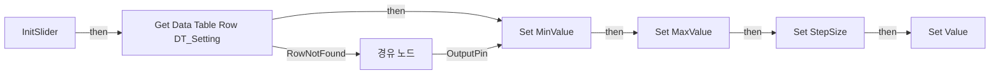

전체 노드·기본 입력 목록

| 노드 ID | 제목 | 미연결 기본 입력 / 에셋 입력 |
|---|---|---|
| `K2Node_FunctionEntry_0` | InitSlider |  |
| `K2Node_GetDataTableRow_0` | Get Data Table Row DT_Setting | DataTable=/Game/QuakeLike_1_0/GameProgressFlow/DT_Setting.DT_Setting |
| `K2Node_VariableSet_13` | Set MinValue | Output_Get=0.0 |
| `K2Node_VariableSet_14` | Set MaxValue | Output_Get=0.0 |
| `K2Node_VariableSet_15` | Set StepSize | Output_Get=0.0 |
| `K2Node_Knot_0` | 경유 노드 |  |
| `K2Node_Knot_1` | 경유 노드 |  |
| `K2Node_Knot_2` | 경유 노드 |  |
| `K2Node_Knot_3` | 경유 노드 |  |
| `K2Node_VariableSet_17` | Set Value | Output_Get=0.0 |
| `K2Node_Knot_4` | 경유 노드 |  |
| `K2Node_Knot_5` | 경유 노드 |  |
| `K2Node_Knot_6` | 경유 노드 |  |
| `K2Node_Knot_7` | 경유 노드 |  |

### OnMouseWheel

실행 핀 플로우차트

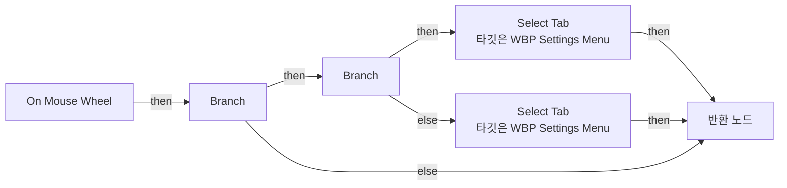

전체 노드·기본 입력 목록

| 노드 ID | 제목 | 미연결 기본 입력 / 에셋 입력 |
|---|---|---|
| `K2Node_FunctionEntry_0` | On Mouse Wheel |  |
| `K2Node_FunctionResult_0` | 반환 노드 |  |
| `K2Node_CallFunction_3` | Get Wheel Delta |  |
| `K2Node_IfThenElse_1` | Branch |  |
| `K2Node_PromotableOperator_1` | float &gt; float |  |
| `K2Node_CallFunction_28` | Select Tab 타깃은 WBP Settings Menu |  |
| `K2Node_VariableGet_7` | Get SelectedTabIndex |  |
| `K2Node_PromotableOperator_6` | int - int | B=1 |
| `K2Node_PromotableOperator_5` | int + int | B=4 |
| `K2Node_CallFunction_29` | % (Integer) | B=4 |
| `K2Node_CallFunction_26` | Select Tab 타깃은 WBP Settings Menu |  |
| `K2Node_VariableGet_8` | Get SelectedTabIndex |  |
| `K2Node_CallFunction_27` | % (Integer) | B=4 |
| `K2Node_PromotableOperator_7` | int + int | B=1 |
| `K2Node_CallFunction_2` | Handled |  |
| `K2Node_VariableGet_6` | Get HB_Tabs |  |
| `K2Node_CallFunction_0` | Get Cached Geometry 타깃은 위젯 |  |
| `K2Node_CallFunction_4` | Get Screen Space Position |  |
| `K2Node_CallFunction_5` | Is Under Location |  |
| `K2Node_IfThenElse_2` | Branch |  |
| `K2Node_CallFunction_6` | Unhandled |  |
| `K2Node_Select_1` | 선택 |  |
| `EdGraphNode_Comment_1` | 코멘트 |  |

### ResetSlider

실행 핀 플로우차트

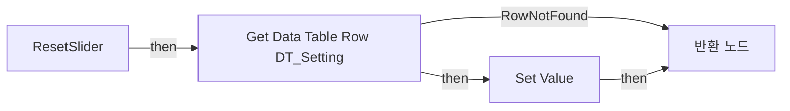

전체 노드·기본 입력 목록

| 노드 ID | 제목 | 미연결 기본 입력 / 에셋 입력 |
|---|---|---|
| `K2Node_FunctionEntry_0` | ResetSlider |  |
| `K2Node_FunctionResult_0` | 반환 노드 |  |
| `K2Node_GetDataTableRow_0` | Get Data Table Row DT_Setting | DataTable=/Game/QuakeLike_1_0/GameProgressFlow/DT_Setting.DT_Setting |
| `K2Node_VariableSet_0` | Set Value |  |

### SelectTab

실행 핀 플로우차트

```mermaid
flowchart LR
  n0["SelectTab"]
  n1["For Each Loop"]
  n2["Branch"]
  n3["Set Background Color<br/>타깃은 버튼"]
  n4["Set Background Color<br/>타깃은 버튼"]
  n5["Set SelectedTabIndex"]
  n6["인티저 켜기"]
  n7["Set Visibility<br/>타깃은 위젯"]
  n8["Set Visibility<br/>타깃은 위젯"]
  n9["Set Visibility<br/>타깃은 위젯"]
  n10["Set Visibility<br/>타깃은 위젯"]
  n11["Set Visibility<br/>타깃은 위젯"]
  n12["Set Visibility<br/>타깃은 위젯"]
  n13["Set Visibility<br/>타깃은 위젯"]
  n14["Set Visibility<br/>타깃은 위젯"]
  n15["Set Visibility<br/>타깃은 위젯"]
  n16["Set Visibility<br/>타깃은 위젯"]
  n17["Set Visibility<br/>타깃은 위젯"]
  n18["Set Visibility<br/>타깃은 위젯"]
  n19["Set Visibility<br/>타깃은 위젯"]
  n20["Set Visibility<br/>타깃은 위젯"]
  n21["Set Visibility<br/>타깃은 위젯"]
  n22["Set Visibility<br/>타깃은 위젯"]
  n23["Set Visibility<br/>타깃은 위젯"]
  n24["Set Visibility<br/>타깃은 위젯"]
  n25["Set Visibility<br/>타깃은 위젯"]
  n26["Set Visibility<br/>타깃은 위젯"]
  n27["Set Visibility<br/>타깃은 위젯"]
  n28["Set Visibility<br/>타깃은 위젯"]
  n29["Set Visibility<br/>타깃은 위젯"]
  n30["Set Visibility<br/>타깃은 위젯"]
  n31["Set Visibility<br/>타깃은 위젯"]
  n32["Set Visibility<br/>타깃은 위젯"]
  n33["Set Visibility<br/>타깃은 위젯"]
  n34["Set Visibility<br/>타깃은 위젯"]
  n35["Set Visibility<br/>타깃은 위젯"]
  n36["Set Visibility<br/>타깃은 위젯"]
  n37["Set Visibility<br/>타깃은 위젯"]
  n38["Set Visibility<br/>타깃은 위젯"]
  n39["Set Visibility<br/>타깃은 위젯"]
  n40["Set Visibility<br/>타깃은 위젯"]
  n41["Set Visibility<br/>타깃은 위젯"]
  n42["Set Visibility<br/>타깃은 위젯"]
  n43["Set Visibility<br/>타깃은 위젯"]
  n44["Set Visibility<br/>타깃은 위젯"]
  n45["Set Visibility<br/>타깃은 위젯"]
  n46["Set Visibility<br/>타깃은 위젯"]
  n47["Set Visibility<br/>타깃은 위젯"]
  n48["Set Visibility<br/>타깃은 위젯"]
  n49["Set Visibility<br/>타깃은 위젯"]
  n50["Set Visibility<br/>타깃은 위젯"]
  n51["Set Visibility<br/>타깃은 위젯"]
  n52["Set Visibility<br/>타깃은 위젯"]
  n53["Set Visibility<br/>타깃은 위젯"]
  n54["Set Visibility<br/>타깃은 위젯"]
  n55["Set Visibility<br/>타깃은 위젯"]
  n56["Set Visibility<br/>타깃은 위젯"]
  n57["Set Visibility<br/>타깃은 위젯"]
  n58["Set Visibility<br/>타깃은 위젯"]
  n59["Set Visibility<br/>타깃은 위젯"]
  n60["Set Visibility<br/>타깃은 위젯"]
  n61["Set Visibility<br/>타깃은 위젯"]
  n62["Set Visibility<br/>타깃은 위젯"]
  n63["Set Visibility<br/>타깃은 위젯"]
  n64["Set Visibility<br/>타깃은 위젯"]
  n65["Set Visibility<br/>타깃은 위젯"]
  n66["Set Visibility<br/>타깃은 위젯"]
  n0 -->|"then"| n1
  n1 -->|"LoopBody"| n2
  n1 -->|"Completed"| n5
  n2 -->|"then"| n3
  n2 -->|"else"| n4
  n5 -->|"then"| n6
  n6 -->|"0"| n7
  n6 -->|"1"| n12
  n6 -->|"2"| n17
  n6 -->|"3"| n22
  n7 -->|"then"| n28
  n8 -->|"then"| n10
  n9 -->|"then"| n11
  n10 -->|"then"| n32
  n11 -->|"then"| n8
  n12 -->|"then"| n27
  n13 -->|"then"| n15
  n14 -->|"then"| n16
  n15 -->|"then"| n31
  n16 -->|"then"| n13
  n17 -->|"then"| n29
  n18 -->|"then"| n20
  n19 -->|"then"| n21
  n20 -->|"then"| n33
  n21 -->|"then"| n18
  n22 -->|"then"| n30
  n23 -->|"then"| n25
  n24 -->|"then"| n26
  n25 -->|"then"| n34
  n26 -->|"then"| n23
  n27 -->|"then"| n14
  n28 -->|"then"| n9
  n29 -->|"then"| n19
  n30 -->|"then"| n24
  n31 -->|"then"| n37
  n32 -->|"then"| n36
  n33 -->|"then"| n35
  n34 -->|"then"| n38
  n35 -->|"then"| n39
  n36 -->|"then"| n41
  n37 -->|"then"| n40
  n38 -->|"then"| n42
  n39 -->|"then"| n45
  n40 -->|"then"| n55
  n41 -->|"then"| n50
  n42 -->|"then"| n60
  n43 -->|"then"| n44
  n44 -->|"then"| n46
  n45 -->|"then"| n43
  n46 -->|"then"| n47
  n47 -->|"then"| n63
  n48 -->|"then"| n49
  n49 -->|"then"| n51
  n50 -->|"then"| n48
  n51 -->|"then"| n52
  n52 -->|"then"| n64
  n53 -->|"then"| n54
  n54 -->|"then"| n56
  n55 -->|"then"| n53
  n56 -->|"then"| n57
  n57 -->|"then"| n65
  n58 -->|"then"| n59
  n59 -->|"then"| n61
  n60 -->|"then"| n58
  n61 -->|"then"| n62
  n62 -->|"then"| n66
```

전체 노드·기본 입력 목록

| 노드 ID | 제목 | 미연결 기본 입력 / 에셋 입력 |
|---|---|---|
| `K2Node_FunctionEntry_0` | SelectTab |  |
| `K2Node_VariableGet_0` | Get TabButtons |  |
| `K2Node_MacroInstance_0` | For Each Loop |  |
| `K2Node_PromotableOperator_0` | Equal (Integer) |  |
| `K2Node_IfThenElse_0` | Branch |  |
| `K2Node_CallFunction_4` | Set Background Color 타깃은 버튼 |  |
| `K2Node_VariableGet_1` | Get ActiveTabColor |  |
| `K2Node_CallFunction_3` | Set Background Color 타깃은 버튼 |  |
| `K2Node_VariableGet_2` | Get InactiveTabColor |  |
| `K2Node_Knot_0` | 경유 노드 |  |
| `K2Node_VariableSet_1` | Set SelectedTabIndex |  |
| `K2Node_SwitchInteger_0` | 인티저 켜기 |  |
| `K2Node_Knot_1` | 경유 노드 |  |
| `K2Node_CallFunction_17` | Set Visibility 타깃은 위젯 | InVisibility=Collapsed |
| `K2Node_VariableGet_11` | Get Btn_HSens |  |
| `K2Node_CallFunction_18` | Set Visibility 타깃은 위젯 | InVisibility=Collapsed |
| `K2Node_VariableGet_12` | Get Btn_Dummy4 |  |
| `K2Node_CallFunction_19` | Set Visibility 타깃은 위젯 | InVisibility=Collapsed |
| `K2Node_VariableGet_13` | Get Btn_MotionBlur |  |
| `K2Node_CallFunction_0` | Set Visibility 타깃은 위젯 | InVisibility=Collapsed |
| `K2Node_VariableGet_14` | Get Btn_Dummy5 |  |
| `K2Node_CallFunction_21` | Set Visibility 타깃은 위젯 | InVisibility=Collapsed |
| `K2Node_VariableGet_15` | Get Btn_Dummy3 |  |
| `K2Node_CallFunction_38` | Set Visibility 타깃은 위젯 | InVisibility=Visible |
| `K2Node_VariableGet_32` | Get Btn_HSens |  |
| `K2Node_CallFunction_39` | Set Visibility 타깃은 위젯 | InVisibility=Collapsed |
| `K2Node_VariableGet_33` | Get Btn_Dummy4 |  |
| `K2Node_CallFunction_40` | Set Visibility 타깃은 위젯 | InVisibility=Collapsed |
| `K2Node_VariableGet_34` | Get Btn_MotionBlur |  |
| `K2Node_CallFunction_10` | Set Visibility 타깃은 위젯 | InVisibility=Collapsed |
| `K2Node_VariableGet_35` | Get Btn_Dummy5 |  |
| `K2Node_CallFunction_42` | Set Visibility 타깃은 위젯 | InVisibility=Collapsed |
| `K2Node_VariableGet_36` | Get Btn_Dummy3 |  |
| `K2Node_CallFunction_43` | Set Visibility 타깃은 위젯 | InVisibility=Collapsed |
| `K2Node_VariableGet_37` | Get Btn_HSens |  |
| `K2Node_CallFunction_44` | Set Visibility 타깃은 위젯 | InVisibility=Collapsed |
| `K2Node_VariableGet_38` | Get Btn_Dummy4 |  |
| `K2Node_CallFunction_45` | Set Visibility 타깃은 위젯 | InVisibility=Collapsed |
| `K2Node_VariableGet_39` | Get Btn_MotionBlur |  |
| `K2Node_CallFunction_46` | Set Visibility 타깃은 위젯 | InVisibility=Collapsed |
| `K2Node_VariableGet_40` | Get Btn_Dummy5 |  |
| `K2Node_CallFunction_47` | Set Visibility 타깃은 위젯 | InVisibility=Collapsed |
| `K2Node_VariableGet_41` | Get Btn_Dummy3 |  |
| `K2Node_CallFunction_7` | Set Visibility 타깃은 위젯 | InVisibility=Collapsed |
| `K2Node_VariableGet_3` | Get Btn_HSens |  |
| `K2Node_CallFunction_15` | Set Visibility 타깃은 위젯 | InVisibility=Collapsed |
| `K2Node_VariableGet_8` | Get Btn_Dummy4 |  |
| `K2Node_CallFunction_8` | Set Visibility 타깃은 위젯 | InVisibility=Collapsed |
| `K2Node_VariableGet_4` | Get Btn_MotionBlur |  |
| `K2Node_CallFunction_6` | Set Visibility 타깃은 위젯 | InVisibility=Collapsed |
| `K2Node_VariableGet_9` | Get Btn_Dummy5 |  |
| `K2Node_CallFunction_9` | Set Visibility 타깃은 위젯 | InVisibility=Collapsed |
| `K2Node_VariableGet_5` | Get Btn_Dummy3 |  |
| `K2Node_VariableGet_10` | Get Btn_VSens |  |
| `K2Node_CallFunction_2` | Set Visibility 타깃은 위젯 | InVisibility=Visible |
| `K2Node_VariableGet_6` | Get Btn_VSens |  |
| `K2Node_CallFunction_20` | Set Visibility 타깃은 위젯 | InVisibility=Collapsed |
| `K2Node_VariableGet_16` | Get Btn_VSens |  |
| `K2Node_CallFunction_5` | Set Visibility 타깃은 위젯 | InVisibility=Collapsed |
| `K2Node_VariableGet_7` | Get Btn_VSens |  |
| `K2Node_CallFunction_1` | Set Visibility 타깃은 위젯 | InVisibility=Collapsed |
| `K2Node_CallFunction_14` | Set Visibility 타깃은 위젯 | InVisibility=Visible |
| `K2Node_VariableGet_21` | Get Btn_ZoomSens |  |
| `K2Node_CallFunction_12` | Set Visibility 타깃은 위젯 | InVisibility=Collapsed |
| `K2Node_VariableGet_19` | Get Btn_ZoomSens |  |
| `K2Node_CallFunction_13` | Set Visibility 타깃은 위젯 | InVisibility=Collapsed |
| `K2Node_VariableGet_20` | Get Btn_ZoomSens |  |
| `K2Node_CallFunction_41` | Set Visibility 타깃은 위젯 | InVisibility=Collapsed |
| `K2Node_VariableGet_17` | Get Btn_ZoomSens |  |
| `K2Node_CallFunction_24` | Set Visibility 타깃은 위젯 | InVisibility=Visible |
| `K2Node_CallFunction_22` | Set Visibility 타깃은 위젯 | InVisibility=Collapsed |
| `K2Node_CallFunction_23` | Set Visibility 타깃은 위젯 | InVisibility=Collapsed |
| `K2Node_CallFunction_11` | Set Visibility 타깃은 위젯 | InVisibility=Collapsed |
| `K2Node_VariableGet_27` | Get Btn_FOV |  |
| `K2Node_VariableGet_26` | Get Btn_FOV |  |
| `K2Node_VariableGet_28` | Get Btn_FOV |  |
| `K2Node_VariableGet_29` | Get Btn_FOV |  |
| `K2Node_CallFunction_25` | Set Visibility 타깃은 위젯 | InVisibility=Visible |
| `K2Node_VariableGet_31` | Get Btn_Brightness |  |
| `K2Node_CallFunction_26` | Set Visibility 타깃은 위젯 | InVisibility=Collapsed |
| `K2Node_VariableGet_42` | Get Btn_Brightness |  |
| `K2Node_CallFunction_28` | Set Visibility 타깃은 위젯 | InVisibility=Collapsed |
| `K2Node_VariableGet_43` | Get Btn_Brightness |  |
| `K2Node_CallFunction_16` | Set Visibility 타깃은 위젯 | InVisibility=Collapsed |
| `K2Node_VariableGet_30` | Get Btn_Brightness |  |
| `K2Node_CallFunction_33` | Set Visibility 타깃은 위젯 | InVisibility=Collapsed |
| `K2Node_VariableGet_44` | Get Btn_UIVolume |  |
| `K2Node_CallFunction_34` | Set Visibility 타깃은 위젯 | InVisibility=Collapsed |
| `K2Node_VariableGet_45` | Get Btn_SFXVolume |  |
| `K2Node_CallFunction_35` | Set Visibility 타깃은 위젯 | InVisibility=Collapsed |
| `K2Node_VariableGet_46` | Get Btn_MasterVolume |  |
| `K2Node_VariableGet_47` | Get Btn_BGMVolume |  |
| `K2Node_CallFunction_36` | Set Visibility 타깃은 위젯 | InVisibility=Collapsed |
| `K2Node_VariableGet_48` | Get Btn_CharacterVolume |  |
| `K2Node_CallFunction_58` | Set Visibility 타깃은 위젯 | InVisibility=Collapsed |
| `K2Node_CallFunction_48` | Set Visibility 타깃은 위젯 | InVisibility=Collapsed |
| `K2Node_VariableGet_49` | Get Btn_UIVolume |  |
| `K2Node_CallFunction_49` | Set Visibility 타깃은 위젯 | InVisibility=Collapsed |
| `K2Node_VariableGet_50` | Get Btn_SFXVolume |  |
| `K2Node_CallFunction_50` | Set Visibility 타깃은 위젯 | InVisibility=Collapsed |
| `K2Node_VariableGet_51` | Get Btn_MasterVolume |  |
| `K2Node_VariableGet_52` | Get Btn_BGMVolume |  |
| `K2Node_CallFunction_51` | Set Visibility 타깃은 위젯 | InVisibility=Collapsed |
| `K2Node_VariableGet_53` | Get Btn_CharacterVolume |  |
| `K2Node_CallFunction_52` | Set Visibility 타깃은 위젯 | InVisibility=Collapsed |
| `K2Node_CallFunction_53` | Set Visibility 타깃은 위젯 | InVisibility=Collapsed |
| `K2Node_VariableGet_54` | Get Btn_UIVolume |  |
| `K2Node_CallFunction_54` | Set Visibility 타깃은 위젯 | InVisibility=Collapsed |
| `K2Node_VariableGet_55` | Get Btn_SFXVolume |  |
| `K2Node_CallFunction_55` | Set Visibility 타깃은 위젯 | InVisibility=Collapsed |
| `K2Node_VariableGet_56` | Get Btn_MasterVolume |  |
| `K2Node_VariableGet_57` | Get Btn_BGMVolume |  |
| `K2Node_CallFunction_56` | Set Visibility 타깃은 위젯 | InVisibility=Collapsed |
| `K2Node_VariableGet_58` | Get Btn_CharacterVolume |  |
| `K2Node_CallFunction_57` | Set Visibility 타깃은 위젯 | InVisibility=Collapsed |
| `K2Node_CallFunction_29` | Set Visibility 타깃은 위젯 | InVisibility=Visible |
| `K2Node_VariableGet_18` | Get Btn_UIVolume |  |
| `K2Node_CallFunction_31` | Set Visibility 타깃은 위젯 | InVisibility=Visible |
| `K2Node_VariableGet_22` | Get Btn_SFXVolume |  |
| `K2Node_CallFunction_27` | Set Visibility 타깃은 위젯 | InVisibility=Visible |
| `K2Node_VariableGet_23` | Get Btn_MasterVolume |  |
| `K2Node_VariableGet_24` | Get Btn_BGMVolume |  |
| `K2Node_CallFunction_32` | Set Visibility 타깃은 위젯 | InVisibility=Visible |
| `K2Node_VariableGet_25` | Get Btn_CharacterVolume |  |
| `K2Node_CallFunction_30` | Set Visibility 타깃은 위젯 | InVisibility=Visible |
| `K2Node_CallFunction_59` | Set Visibility 타깃은 위젯 | InVisibility=Visible |
| `K2Node_VariableGet_60` | Get Btn_MotionBlur |  |
| `K2Node_CallFunction_60` | Set Visibility 타깃은 위젯 | InVisibility=Collapsed |
| `K2Node_VariableGet_61` | Get Btn_MotionBlur |  |
| `K2Node_CallFunction_61` | Set Visibility 타깃은 위젯 | InVisibility=Collapsed |
| `K2Node_VariableGet_62` | Get Btn_MotionBlur |  |
| `K2Node_CallFunction_37` | Set Visibility 타깃은 위젯 | InVisibility=Collapsed |
| `K2Node_VariableGet_59` | Get Btn_MotionBlur |  |

### SetDescription

실행 핀 플로우차트

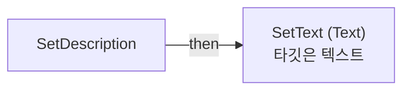

전체 노드·기본 입력 목록

| 노드 ID | 제목 | 미연결 기본 입력 / 에셋 입력 |
|---|---|---|
| `K2Node_FunctionEntry_0` | SetDescription |  |
| `K2Node_VariableGet_1` | Get TB_Description |  |
| `K2Node_CallFunction_2` | SetText (Text) 타깃은 텍스트 |  |

### UpdateChoiceVisual

실행 핀 플로우차트

전체 노드·기본 입력 목록

| 노드 ID | 제목 | 미연결 기본 입력 / 에셋 입력 |
|---|---|---|
| `K2Node_FunctionEntry_0` | UpdateChoiceVisual |  |
| `K2Node_VariableGet_4` | Get ChoiceIndex |  |
| `K2Node_VariableGet_1` | Get TB_ChoiceValue |  |
| `K2Node_CallFunction_2` | SetText (Text) 타깃은 텍스트 |  |
| `K2Node_VariableGet_2` | Get ChoiceOptions |  |
| `K2Node_GetArrayItem_1` | GET |  |

### UpdateToggleVisual

실행 핀 플로우차트

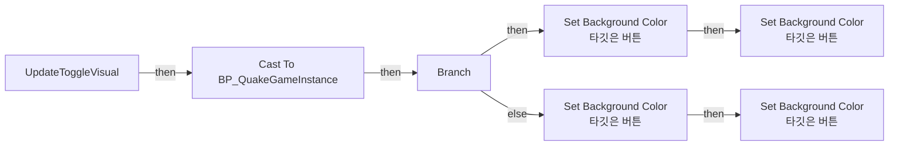

전체 노드·기본 입력 목록

| 노드 ID | 제목 | 미연결 기본 입력 / 에셋 입력 |
|---|---|---|
| `K2Node_FunctionEntry_0` | UpdateToggleVisual |  |
| `K2Node_IfThenElse_0` | Branch |  |
| `K2Node_VariableGet_12` | Get Btn_ToggleOn |  |
| `K2Node_VariableGet_10` | Get Btn_ToggleOff |  |
| `K2Node_CallFunction_11` | Set Background Color 타깃은 버튼 |  |
| `K2Node_CallFunction_10` | Set Background Color 타깃은 버튼 |  |
| `K2Node_VariableGet_13` | Get ActiveTabColor |  |
| `K2Node_VariableGet_11` | Get InactiveTabColor |  |
| `K2Node_VariableGet_7` | Get Btn_ToggleOff |  |
| `K2Node_CallFunction_9` | Set Background Color 타깃은 버튼 |  |
| `K2Node_VariableGet_9` | Get InactiveTabColor |  |
| `K2Node_VariableGet_6` | Get Btn_ToggleOn |  |
| `K2Node_CallFunction_8` | Set Background Color 타깃은 버튼 |  |
| `K2Node_VariableGet_8` | Get ActiveTabColor |  |
| `K2Node_CallFunction_0` | Get Game Instance 타깃은 위젯 |  |
| `K2Node_DynamicCast_0` | Cast To BP_QuakeGameInstance |  |
| `K2Node_VariableGet_0` | Get |  |

## 조회 범위의 한계

ObjectIterator로 발견했으나 MCP helper가 반환하지 않은 그래프입니다. delegate signature·컴파일된 중간 그래프·macro·애니메이션 내부 그래프가 섞일 수 있습니다.

- `BndEvt__WBP_SettingsMenu_Btn_BGMVolume_K2Node_ComponentBoundEvent_39_OnButtonHoverEvent__DelegateSignature`: Graph 'BndEvt__WBP_SettingsMenu_Btn_BGMVolume_K2Node_ComponentBoundEvent_39_OnButtonHoverEvent__DelegateSignature' not found in Blueprint.
- `BndEvt__WBP_SettingsMenu_Btn_Back_K2Node_ComponentBoundEvent_5_OnButtonClickedEvent__DelegateSignature`: Graph 'BndEvt__WBP_SettingsMenu_Btn_Back_K2Node_ComponentBoundEvent_5_OnButtonClickedEvent__DelegateSignature' not found in Blueprint.
- `BndEvt__WBP_SettingsMenu_Btn_Brightness_K2Node_ComponentBoundEvent_36_OnButtonHoverEvent__DelegateSignature`: Graph 'BndEvt__WBP_SettingsMenu_Btn_Brightness_K2Node_ComponentBoundEvent_36_OnButtonHoverEvent__DelegateSignature' not found in Blueprint.
- `BndEvt__WBP_SettingsMenu_Btn_CharacterVolume_K2Node_ComponentBoundEvent_42_OnButtonHoverEvent__DelegateSignature`: Graph 'BndEvt__WBP_SettingsMenu_Btn_CharacterVolume_K2Node_ComponentBoundEvent_42_OnButtonHoverEvent__DelegateSignature' not found in Blueprint.
- `BndEvt__WBP_SettingsMenu_Btn_ChoiceNext_K2Node_ComponentBoundEvent_10_OnButtonClickedEvent__DelegateSignature`: Graph 'BndEvt__WBP_SettingsMenu_Btn_ChoiceNext_K2Node_ComponentBoundEvent_10_OnButtonClickedEvent__DelegateSignature' not found in Blueprint.
- `BndEvt__WBP_SettingsMenu_Btn_ChoicePrev_K2Node_ComponentBoundEvent_9_OnButtonClickedEvent__DelegateSignature`: Graph 'BndEvt__WBP_SettingsMenu_Btn_ChoicePrev_K2Node_ComponentBoundEvent_9_OnButtonClickedEvent__DelegateSignature' not found in Blueprint.
- `BndEvt__WBP_SettingsMenu_Btn_Control_K2Node_ComponentBoundEvent_13_OnButtonClickedEvent__DelegateSignature`: Graph 'BndEvt__WBP_SettingsMenu_Btn_Control_K2Node_ComponentBoundEvent_13_OnButtonClickedEvent__DelegateSignature' not found in Blueprint.
- `BndEvt__WBP_SettingsMenu_Btn_Default_K2Node_ComponentBoundEvent_18_OnButtonClickedEvent__DelegateSignature`: Graph 'BndEvt__WBP_SettingsMenu_Btn_Default_K2Node_ComponentBoundEvent_18_OnButtonClickedEvent__DelegateSignature' not found in Blueprint.
- `BndEvt__WBP_SettingsMenu_Btn_Dummy1_K2Node_ComponentBoundEvent_0_OnButtonHoverEvent__DelegateSignature`: Graph 'BndEvt__WBP_SettingsMenu_Btn_Dummy1_K2Node_ComponentBoundEvent_0_OnButtonHoverEvent__DelegateSignature' not found in Blueprint.
- `BndEvt__WBP_SettingsMenu_Btn_Dummy1_K2Node_ComponentBoundEvent_20_OnButtonHoverEvent__DelegateSignature`: Graph 'BndEvt__WBP_SettingsMenu_Btn_Dummy1_K2Node_ComponentBoundEvent_20_OnButtonHoverEvent__DelegateSignature' not found in Blueprint.
- `BndEvt__WBP_SettingsMenu_Btn_Dummy2_K2Node_ComponentBoundEvent_19_OnButtonHoverEvent__DelegateSignature`: Graph 'BndEvt__WBP_SettingsMenu_Btn_Dummy2_K2Node_ComponentBoundEvent_19_OnButtonHoverEvent__DelegateSignature' not found in Blueprint.
- `BndEvt__WBP_SettingsMenu_Btn_Dummy3_K2Node_ComponentBoundEvent_21_OnButtonHoverEvent__DelegateSignature`: Graph 'BndEvt__WBP_SettingsMenu_Btn_Dummy3_K2Node_ComponentBoundEvent_21_OnButtonHoverEvent__DelegateSignature' not found in Blueprint.
- `BndEvt__WBP_SettingsMenu_Btn_Dummy4_K2Node_ComponentBoundEvent_22_OnButtonHoverEvent__DelegateSignature`: Graph 'BndEvt__WBP_SettingsMenu_Btn_Dummy4_K2Node_ComponentBoundEvent_22_OnButtonHoverEvent__DelegateSignature' not found in Blueprint.
- `BndEvt__WBP_SettingsMenu_Btn_Dummy5_K2Node_ComponentBoundEvent_23_OnButtonHoverEvent__DelegateSignature`: Graph 'BndEvt__WBP_SettingsMenu_Btn_Dummy5_K2Node_ComponentBoundEvent_23_OnButtonHoverEvent__DelegateSignature' not found in Blueprint.
- `BndEvt__WBP_SettingsMenu_Btn_FOV_K2Node_ComponentBoundEvent_35_OnButtonHoverEvent__DelegateSignature`: Graph 'BndEvt__WBP_SettingsMenu_Btn_FOV_K2Node_ComponentBoundEvent_35_OnButtonHoverEvent__DelegateSignature' not found in Blueprint.
- `BndEvt__WBP_SettingsMenu_Btn_GamePlay_K2Node_ComponentBoundEvent_12_OnButtonClickedEvent__DelegateSignature`: Graph 'BndEvt__WBP_SettingsMenu_Btn_GamePlay_K2Node_ComponentBoundEvent_12_OnButtonClickedEvent__DelegateSignature' not found in Blueprint.
- `BndEvt__WBP_SettingsMenu_Btn_MasterVolume_K2Node_ComponentBoundEvent_37_OnButtonHoverEvent__DelegateSignature`: Graph 'BndEvt__WBP_SettingsMenu_Btn_MasterVolume_K2Node_ComponentBoundEvent_37_OnButtonHoverEvent__DelegateSignature' not found in Blueprint.
- `BndEvt__WBP_SettingsMenu_Btn_MotionBlur_K2Node_ComponentBoundEvent_2_OnButtonHoverEvent__DelegateSignature`: Graph 'BndEvt__WBP_SettingsMenu_Btn_MotionBlur_K2Node_ComponentBoundEvent_2_OnButtonHoverEvent__DelegateSignature' not found in Blueprint.
- `BndEvt__WBP_SettingsMenu_Btn_SFXVolume_K2Node_ComponentBoundEvent_40_OnButtonHoverEvent__DelegateSignature`: Graph 'BndEvt__WBP_SettingsMenu_Btn_SFXVolume_K2Node_ComponentBoundEvent_40_OnButtonHoverEvent__DelegateSignature' not found in Blueprint.
- `BndEvt__WBP_SettingsMenu_Btn_Sound_K2Node_ComponentBoundEvent_15_OnButtonClickedEvent__DelegateSignature`: Graph 'BndEvt__WBP_SettingsMenu_Btn_Sound_K2Node_ComponentBoundEvent_15_OnButtonClickedEvent__DelegateSignature' not found in Blueprint.
- `BndEvt__WBP_SettingsMenu_Btn_TabNext_K2Node_ComponentBoundEvent_17_OnButtonClickedEvent__DelegateSignature`: Graph 'BndEvt__WBP_SettingsMenu_Btn_TabNext_K2Node_ComponentBoundEvent_17_OnButtonClickedEvent__DelegateSignature' not found in Blueprint.
- `BndEvt__WBP_SettingsMenu_Btn_TabPrev_K2Node_ComponentBoundEvent_16_OnButtonClickedEvent__DelegateSignature`: Graph 'BndEvt__WBP_SettingsMenu_Btn_TabPrev_K2Node_ComponentBoundEvent_16_OnButtonClickedEvent__DelegateSignature' not found in Blueprint.
- `BndEvt__WBP_SettingsMenu_Btn_ToggleOff_K2Node_ComponentBoundEvent_8_OnButtonClickedEvent__DelegateSignature`: Graph 'BndEvt__WBP_SettingsMenu_Btn_ToggleOff_K2Node_ComponentBoundEvent_8_OnButtonClickedEvent__DelegateSignature' not found in Blueprint.
- `BndEvt__WBP_SettingsMenu_Btn_ToggleOn_K2Node_ComponentBoundEvent_7_OnButtonClickedEvent__DelegateSignature`: Graph 'BndEvt__WBP_SettingsMenu_Btn_ToggleOn_K2Node_ComponentBoundEvent_7_OnButtonClickedEvent__DelegateSignature' not found in Blueprint.
- `BndEvt__WBP_SettingsMenu_Btn_UIVolume_K2Node_ComponentBoundEvent_41_OnButtonHoverEvent__DelegateSignature`: Graph 'BndEvt__WBP_SettingsMenu_Btn_UIVolume_K2Node_ComponentBoundEvent_41_OnButtonHoverEvent__DelegateSignature' not found in Blueprint.
- `BndEvt__WBP_SettingsMenu_Btn_VSens_K2Node_ComponentBoundEvent_28_OnButtonHoverEvent__DelegateSignature`: Graph 'BndEvt__WBP_SettingsMenu_Btn_VSens_K2Node_ComponentBoundEvent_28_OnButtonHoverEvent__DelegateSignature' not found in Blueprint.
- `BndEvt__WBP_SettingsMenu_Btn_Video_K2Node_ComponentBoundEvent_14_OnButtonClickedEvent__DelegateSignature`: Graph 'BndEvt__WBP_SettingsMenu_Btn_Video_K2Node_ComponentBoundEvent_14_OnButtonClickedEvent__DelegateSignature' not found in Blueprint.
- `BndEvt__WBP_SettingsMenu_Btn_ZoomSens_K2Node_ComponentBoundEvent_34_OnButtonHoverEvent__DelegateSignature`: Graph 'BndEvt__WBP_SettingsMenu_Btn_ZoomSens_K2Node_ComponentBoundEvent_34_OnButtonHoverEvent__DelegateSignature' not found in Blueprint.
- `BndEvt__WBP_SettingsMenu_Slider_BGM_K2Node_ComponentBoundEvent_29_OnFloatValueChangedEvent__DelegateSignature`: Graph 'BndEvt__WBP_SettingsMenu_Slider_BGM_K2Node_ComponentBoundEvent_29_OnFloatValueChangedEvent__DelegateSignature' not found in Blueprint.
- `BndEvt__WBP_SettingsMenu_Slider_CharacterV_K2Node_ComponentBoundEvent_32_OnFloatValueChangedEvent__DelegateSignature`: Graph 'BndEvt__WBP_SettingsMenu_Slider_CharacterV_K2Node_ComponentBoundEvent_32_OnFloatValueChangedEvent__DelegateSignature' not found in Blueprint.
- `BndEvt__WBP_SettingsMenu_Slider_Master_K2Node_ComponentBoundEvent_28_OnFloatValueChangedEvent__DelegateSignature`: Graph 'BndEvt__WBP_SettingsMenu_Slider_Master_K2Node_ComponentBoundEvent_28_OnFloatValueChangedEvent__DelegateSignature' not found in Blueprint.
- `BndEvt__WBP_SettingsMenu_Slider_SFX_K2Node_ComponentBoundEvent_30_OnFloatValueChangedEvent__DelegateSignature`: Graph 'BndEvt__WBP_SettingsMenu_Slider_SFX_K2Node_ComponentBoundEvent_30_OnFloatValueChangedEvent__DelegateSignature' not found in Blueprint.
- `BndEvt__WBP_SettingsMenu_Slider_Sensitivity_1_K2Node_ComponentBoundEvent_24_OnFloatValueChangedEvent__DelegateSignature`: Graph 'BndEvt__WBP_SettingsMenu_Slider_Sensitivity_1_K2Node_ComponentBoundEvent_24_OnFloatValueChangedEvent__DelegateSignature' not found in Blueprint.
- `BndEvt__WBP_SettingsMenu_Slider_Sensitivity_2_K2Node_ComponentBoundEvent_27_OnFloatValueChangedEvent__DelegateSignature`: Graph 'BndEvt__WBP_SettingsMenu_Slider_Sensitivity_2_K2Node_ComponentBoundEvent_27_OnFloatValueChangedEvent__DelegateSignature' not found in Blueprint.
- `BndEvt__WBP_SettingsMenu_Slider_Sensitivity_3_K2Node_ComponentBoundEvent_24_OnFloatValueChangedEvent__DelegateSignature`: Graph 'BndEvt__WBP_SettingsMenu_Slider_Sensitivity_3_K2Node_ComponentBoundEvent_24_OnFloatValueChangedEvent__DelegateSignature' not found in Blueprint.
- `BndEvt__WBP_SettingsMenu_Slider_Sensitivity_4_K2Node_ComponentBoundEvent_26_OnFloatValueChangedEvent__DelegateSignature`: Graph 'BndEvt__WBP_SettingsMenu_Slider_Sensitivity_4_K2Node_ComponentBoundEvent_26_OnFloatValueChangedEvent__DelegateSignature' not found in Blueprint.
- `BndEvt__WBP_SettingsMenu_Slider_Sensitivity_K2Node_ComponentBoundEvent_6_OnFloatValueChangedEvent__DelegateSignature`: Graph 'BndEvt__WBP_SettingsMenu_Slider_Sensitivity_K2Node_ComponentBoundEvent_6_OnFloatValueChangedEvent__DelegateSignature' not found in Blueprint.
- `BndEvt__WBP_SettingsMenu_Slider_UIV_K2Node_ComponentBoundEvent_31_OnFloatValueChangedEvent__DelegateSignature`: Graph 'BndEvt__WBP_SettingsMenu_Slider_UIV_K2Node_ComponentBoundEvent_31_OnFloatValueChangedEvent__DelegateSignature' not found in Blueprint.
- `Construct`: Graph 'Construct' not found in Blueprint.
- `Destruct`: Graph 'Destruct' not found in Blueprint.

[원본 MCP 스냅샷](../../../Evidence/blueprints-105.json)
