# BP_HeldItem

에셋: `/Game/QuakeLike_1_0/HeldItem/BP_HeldItem`

부모: `/Script/CoreUObject.Class'/Script/Engine.Actor'`

수집일: 2026-10-12. MCP에서 읽은 그래프·핀 연결의 자동 전사입니다. 상속된 그래프는 부모 문서를 함께 확인합니다.

정적 루트 참조 도달: 있음. 실행 여부 또는 삭제 가능 여부의 확정이 아닙니다.

컴포넌트 목록은 이 BP가 직접 정의한 SCS만 포함합니다. 부모·네이티브 생성 컴포넌트, 인스턴스 설정은 별도입니다.

## 직접 정의한 컴포넌트

| 이름 | 클래스 | 부모 컴포넌트 |
|---|---|---|
| `DefaultSceneRoot` | `SceneComponent` | `` |
| `FP_Mesh` | `SkeletalMeshComponent` | `DefaultSceneRoot` |
| `TP_Mesh` | `SkeletalMeshComponent` | `DefaultSceneRoot` |

## 변수와 기본값

| 이름 | 타입 | CDO 기본값 |
|---|---|---|
| `currentUsageCount` | `ST_CurrentUsageCount` | &lt;Struct 'ST_CurrentUsageCount' {}&gt; |
| `OnUsableCountChanged ` | `mcdelegate` | &lt;Delegate 'DelegateBase' &lt;Unbound&gt;&gt; |
| `OnUsedUp` | `mcdelegate` | &lt;Delegate 'DelegateBase' &lt;Unbound&gt;&gt; |
| `beforeData` | `PDA_HeldItem_C` | None |
| `beforeActor` | `Actor` | None |
| `itemInfo` | `ST_ItemInfoPacket` | &lt;Struct 'ST_ItemInfoPacket' {}&gt; |
| `equipPlayTIme` | `real` | 0.0 |
| `buffComponent` | `BPC_Buff_C` | None |
| `OnUsableConsum` | `mcdelegate` | &lt;Delegate 'DelegateBase' &lt;Unbound&gt;&gt; |
| `OnUsableRecover` | `mcdelegate` | &lt;Delegate 'DelegateBase' &lt;Unbound&gt;&gt; |
| `bIsConsum` | `bool` | False |
| `baseFPRelativeLocation` | `Vector` | &lt;Struct 'Vector' {x: 0.000000, y: 0.000000, z: 0.000000}&gt; |
| `bPendingUsageCountNotify` | `bool` | False |
| `bSuppressEquipSoundForPickup` | `bool` | False |

## 그래프 목록

| 그래프 | 전체 노드 수 |
|---|---|
| AttachMesh | 25 |
| CanUse | 4 |
| ChangeAnim | 57 |
| EventGraph | 72 |
| GetFovOffset | 22 |
| InitOwner | 17 |
| OnRep_currentUsageCount | 24 |
| OnRep_itemInfo | 26 |
| RelativeTransform | 13 |
| UpdateHeldItemPositionByFOV | 15 |
| UserConstructionScript | 1 |

## 그래프별 실행 연결

실선은 출력 exec 핀의 실제 연결입니다. 여러 분기는 출력 핀 이름을 표시합니다. 함수 호출·delegate·타이머의 다음 그래프 실행은 이 그림에서 자동으로 이어 붙이지 않습니다.

순수 계산 노드 및 데이터 핀은 아래 목록과 원본 JSON을 확인합니다. 연결되지 않은 이벤트도 표시되므로, 노드가 있다는 이유만으로 실행된다고 판단하면 안 됩니다.

### AttachMesh

실행 핀 플로우차트

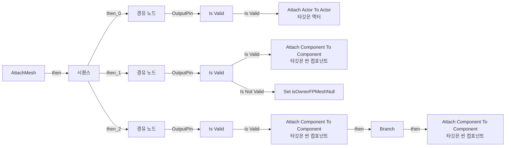

전체 노드·기본 입력 목록

| 노드 ID | 제목 | 미연결 기본 입력 / 에셋 입력 |
|---|---|---|
| `K2Node_FunctionEntry_0` | AttachMesh |  |
| `K2Node_CallFunction_12` | Attach Actor To Actor 타깃은 액터 | SocketName=None; LocationRule=SnapToTarget; RotationRule=SnapToTarget; ScaleRule=SnapToTarget; bWeldSimulatedBodies=TRUE; ReturnValue=false |
| `K2Node_CallFunction_13` | Attach Component To Component 타깃은 씬 컴포넌트 | SocketName=HandGrip_R; LocationRule=SnapToTarget; RotationRule=SnapToTarget; ScaleRule=KeepRelative; bWeldSimulatedBodies=TRUE; ReturnValue=false |
| `K2Node_VariableGet_1` | Get FP_Mesh |  |
| `K2Node_CallFunction_0` | Attach Component To Component 타깃은 씬 컴포넌트 | SocketName=HandGrip_R; LocationRule=SnapToTarget; RotationRule=SnapToTarget; ScaleRule=KeepRelative; bWeldSimulatedBodies=TRUE; ReturnValue=false |
| `K2Node_VariableGet_0` | Get TP_Mesh |  |
| `K2Node_ExecutionSequence_0` | 시퀀스 |  |
| `K2Node_Knot_7` | 경유 노드 |  |
| `K2Node_Knot_8` | 경유 노드 |  |
| `K2Node_Knot_9` | 경유 노드 |  |
| `K2Node_Knot_10` | 경유 노드 |  |
| `K2Node_MacroInstance_1` | Is Valid |  |
| `K2Node_MacroInstance_0` | Is Valid |  |
| `K2Node_MacroInstance_2` | Is Valid |  |
| `K2Node_Knot_11` | 경유 노드 |  |
| `K2Node_Knot_12` | 경유 노드 |  |
| `K2Node_Knot_13` | 경유 노드 |  |
| `K2Node_Knot_0` | 경유 노드 |  |
| `K2Node_Knot_1` | 경유 노드 |  |
| `K2Node_CallFunction_14` | Attach Component To Component 타깃은 씬 컴포넌트 | SocketName=HandGrip_R; LocationRule=SnapToTarget; RotationRule=SnapToTarget; ScaleRule=KeepRelative; bWeldSimulatedBodies=TRUE; ReturnValue=false |
| `K2Node_VariableGet_2` | Get FP_Mesh |  |
| `K2Node_VariableGet_5` | Get isOwnerFPMeshNull |  |
| `K2Node_IfThenElse_0` | Branch |  |
| `K2Node_VariableSet_0` | Set isOwnerFPMeshNull | isOwnerFPMeshNull=true; Output_Get=false |
| `K2Node_Knot_4` | 경유 노드 |  |

### CanUse

실행 핀 플로우차트

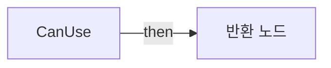

전체 노드·기본 입력 목록

| 노드 ID | 제목 | 미연결 기본 입력 / 에셋 입력 |
|---|---|---|
| `K2Node_FunctionEntry_0` | CanUse |  |
| `K2Node_FunctionResult_0` | 반환 노드 |  |
| `K2Node_VariableGet_10` | Get |  |
| `K2Node_PromotableOperator_1` | integer &gt; integer |  |

### ChangeAnim

실행 핀 플로우차트

```mermaid
flowchart LR
  n0["ChangeAnim"]
  n1["Branch"]
  n2["Set Actor Hidden In Game<br/>타깃은 액터"]
  n3["Set Actor Hidden In Game<br/>타깃은 액터"]
  n4["Stop Using<br/>타깃은 BP Held Item"]
  n5["Set Anim Instance Class<br/>타깃은 스켈레탈 메시 컴포넌트"]
  n6["Is Valid"]
  n7["시퀀스"]
  n8["Is Valid"]
  n9["Set Anim Instance Class<br/>타깃은 스켈레탈 메시 컴포넌트"]
  n10["Get Meshes<br/>Target is BPI Body Info"]
  n11["Branch"]
  n12["Set Actor Hidden In Game<br/>타깃은 액터"]
  n13["Stop Using<br/>타깃은 BP Held Item"]
  n14["Montage Play<br/>타깃은 애님 인스턴스"]
  n15["Is Valid"]
  n16["Set equipPlayTIme"]
  n17["시퀀스"]
  n18["Is Valid"]
  n19["Branch"]
  n20["Cast To Pawn"]
  n21["Cast To BP_QuakePlayerController"]
  n22["Client Play Pickup Sound<br/>타깃은 BP Quake Player Controller<br/>RELIABLE 소유 클라이언트에 리플리케이트됨 (서버인 경우)"]
  n23["Branch"]
  n0 -->|"then"| n1
  n1 -->|"then"| n2
  n1 -->|"else"| n3
  n2 -->|"then"| n11
  n3 -->|"then"| n4
  n5 -->|"then"| n17
  n6 -->|"Is Valid"| n5
  n7 -->|"then_0"| n6
  n7 -->|"then_1"| n8
  n8 -->|"Is Valid"| n9
  n10 -->|"then"| n7
  n11 -->|"then"| n10
  n11 -->|"else"| n12
  n12 -->|"then"| n13
  n14 -->|"then"| n16
  n15 -->|"Is Valid"| n14
  n17 -->|"then_0"| n15
  n17 -->|"then_1"| n18
  n18 -->|"Is Valid"| n19
  n19 -->|"then"| n23
  n20 -->|"then"| n21
  n21 -->|"then"| n22
  n23 -->|"else"| n20
```

전체 노드·기본 입력 목록

| 노드 ID | 제목 | 미연결 기본 입력 / 에셋 입력 |
|---|---|---|
| `K2Node_FunctionEntry_0` | ChangeAnim |  |
| `K2Node_VariableGet_2` | Get |  |
| `K2Node_IfThenElse_2` | Branch |  |
| `K2Node_CallFunction_10` | Set Actor Hidden In Game 타깃은 액터 | bNewHidden=false |
| `K2Node_CallFunction_4` | Set Actor Hidden In Game 타깃은 액터 | bNewHidden=true |
| `K2Node_CallFunction_5` | Stop Using 타깃은 BP Held Item |  |
| `K2Node_CallFunction_26` | Set Anim Instance Class 타깃은 스켈레탈 메시 컴포넌트 |  |
| `K2Node_MacroInstance_0` | Is Valid |  |
| `K2Node_ExecutionSequence_0` | 시퀀스 |  |
| `K2Node_MacroInstance_2` | Is Valid |  |
| `K2Node_CallFunction_2` | Set Anim Instance Class 타깃은 스켈레탈 메시 컴포넌트 |  |
| `K2Node_Knot_0` | 경유 노드 |  |
| `K2Node_VariableGet_7` | Get fpAnim |  |
| `K2Node_VariableGet_8` | Get tpAnim |  |
| `K2Node_Message_0` | Get Meshes Target is BPI Body Info |  |
| `K2Node_Knot_19` | 경유 노드 |  |
| `K2Node_Knot_20` | 경유 노드 |  |
| `K2Node_Knot_21` | 경유 노드 |  |
| `K2Node_Knot_22` | 경유 노드 |  |
| `K2Node_Knot_23` | 경유 노드 |  |
| `K2Node_CallFunction_1` | Is Valid |  |
| `K2Node_CallFunction_3` | Is Valid |  |
| `K2Node_CommutativeAssociativeBinaryOperator_0` | AND Boolean |  |
| `K2Node_IfThenElse_3` | Branch |  |
| `K2Node_Knot_24` | 경유 노드 |  |
| `K2Node_CallFunction_9` | Set Actor Hidden In Game 타깃은 액터 | bNewHidden=true |
| `K2Node_CallFunction_11` | Stop Using 타깃은 BP Held Item |  |
| `K2Node_Knot_2` | 경유 노드 |  |
| `K2Node_CallFunction_24` | Montage Play 타깃은 애님 인스턴스 | InPlayRate=1.000000; ReturnValueType=MontageLength; InTimeToStartMontageAt=0.000000; bStopAllMontages=true |
| `K2Node_CallFunction_25` | Get Anim Instance 타깃은 스켈레탈 메시 컴포넌트 |  |
| `K2Node_VariableGet_4` | Get equipMontage |  |
| `K2Node_PromotableOperator_2` | float + float |  |
| `K2Node_CallFunction_7` | Get Game Time in Seconds |  |
| `K2Node_MacroInstance_3` | Is Valid |  |
| `K2Node_Knot_5` | 경유 노드 |  |
| `K2Node_VariableSet_1` | Set equipPlayTIme | Output_Get=0.0 |
| `K2Node_ExecutionSequence_1` | 시퀀스 |  |
| `K2Node_Knot_1` | 경유 노드 |  |
| `K2Node_VariableGet_0` | Get equipSound |  |
| `K2Node_MacroInstance_1` | Is Valid |  |
| `K2Node_Knot_3` | 경유 노드 |  |
| `K2Node_Knot_4` | 경유 노드 |  |
| `K2Node_Knot_6` | 경유 노드 |  |
| `K2Node_Knot_7` | 경유 노드 |  |
| `K2Node_Knot_8` | 경유 노드 |  |
| `K2Node_Knot_9` | 경유 노드 |  |
| `K2Node_VariableGet_1` | Get equipVolumeMultiplier |  |
| `K2Node_Knot_12` | 경유 노드 |  |
| `K2Node_Knot_13` | 경유 노드 |  |
| `K2Node_CallFunction_6` | Has Authority 타깃은 액터 |  |
| `K2Node_IfThenElse_0` | Branch |  |
| `K2Node_DynamicCast_0` | Cast To Pawn |  |
| `K2Node_CallFunction_8` | Get Controller 타깃은 폰 |  |
| `K2Node_DynamicCast_1` | Cast To BP_QuakePlayerController |  |
| `K2Node_CallFunction_12` | Client Play Pickup Sound 타깃은 BP Quake Player Controller RELIABLE 소유 클라이언트에 리플리케이트됨 (서버인 경우) |  |
| `K2Node_VariableGet_3` | Get bSuppressEquipSoundForPickup |  |
| `K2Node_IfThenElse_1` | Branch |  |

### EventGraph

실행 핀 플로우차트

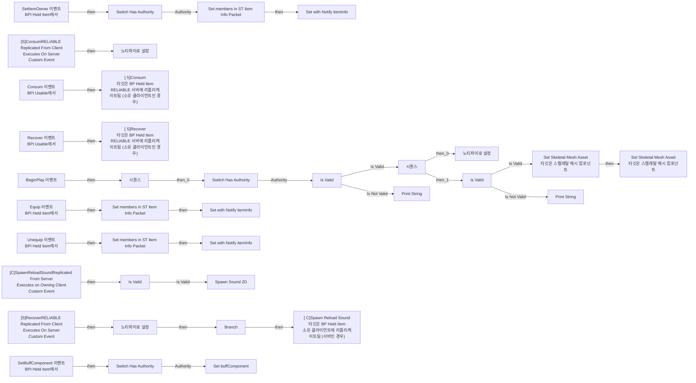

전체 노드·기본 입력 목록

| 노드 ID | 제목 | 미연결 기본 입력 / 에셋 입력 |
|---|---|---|
| `K2Node_Event_3` | SetItemOwner 이벤트 BPI Held Item에서 |  |
| `K2Node_Event_6` | Equip 이벤트 BPI Held Item에서 |  |
| `K2Node_Event_2` | Recover 이벤트 BPI Usable에서 |  |
| `K2Node_VariableSet_1` | 노티파이로 설정 | currentUsageCount_bIsConsum_3_A77822824DB40D2BA4F39B82BC4AF499=False |
| `K2Node_PromotableOperator_0` | int + int |  |
| `K2Node_VariableGet_11` | Get |  |
| `K2Node_VariableGet_10` | Get maxUsageCount |  |
| `K2Node_Event_5` | Consum 이벤트 BPI Usable에서 |  |
| `K2Node_VariableSet_2` | 노티파이로 설정 | currentUsageCount_bIsConsum_3_A77822824DB40D2BA4F39B82BC4AF499=true |
| `K2Node_CommutativeAssociativeBinaryOperator_1` | Min (Integer) |  |
| `K2Node_CommutativeAssociativeBinaryOperator_2` | Max (Integer) | B=0 |
| `K2Node_PromotableOperator_1` | int - int |  |
| `K2Node_VariableGet_4` | Get |  |
| `EdGraphNode_Comment_0` | SetItemOwner |  |
| `EdGraphNode_Comment_2` | Equip |  |
| `EdGraphNode_Comment_3` | Consum |  |
| `EdGraphNode_Comment_4` | Recover |  |
| `K2Node_CustomEvent_2` | [S]ConsumRELIABLE Replicated From Client Executes On Server Custom Event |  |
| `K2Node_CallFunction_3` | [ S]Consum 타깃은 BP Held Item RELIABLE 서버에 리플리케이트됨 (소유 클라이언트인 경우) |  |
| `K2Node_CustomEvent_4` | [S]RecoverRELIABLE Replicated From Client Executes On Server Custom Event |  |
| `K2Node_CallFunction_4` | [ S]Recover 타깃은 BP Held Item RELIABLE 서버에 리플리케이트됨 (소유 클라이언트인 경우) |  |
| `K2Node_Event_0` | Unequip 이벤트 BPI Held Item에서 |  |
| `K2Node_Event_8` | BeginPlay 이벤트 |  |
| `K2Node_VariableSet_3` | 노티파이로 설정 | currentUsageCount_bIsConsum_3_A77822824DB40D2BA4F39B82BC4AF499=False |
| `K2Node_VariableGet_17` | Get startUsageCount |  |
| `K2Node_VariableGet_20` | Get itemInfo |  |
| `K2Node_SetFieldsInStruct_1` | Set members in ST Item Info Packet | IsEquip_8_458BE63E4B8C61048CC8FE928CB6D8E3=true |
| `K2Node_VariableGet_19` | Get itemInfo |  |
| `K2Node_SetFieldsInStruct_0` | Set members in ST Item Info Packet | IsEquip_8_458BE63E4B8C61048CC8FE928CB6D8E3=False |
| `K2Node_VariableGet_5` | Get itemInfo |  |
| `K2Node_SetFieldsInStruct_2` | Set members in ST Item Info Packet |  |
| `K2Node_Knot_13` | 경유 노드 |  |
| `K2Node_VariableSet_5` | Set with Notify itemInfo |  |
| `K2Node_VariableGet_6` | Get |  |
| `K2Node_VariableGet_23` | Get |  |
| `K2Node_ExecutionSequence_3` | 시퀀스 |  |
| `K2Node_MacroInstance_4` | Is Valid |  |
| `K2Node_MacroInstance_7` | Switch Has Authority |  |
| `K2Node_Knot_4` | 경유 노드 |  |
| `K2Node_Knot_8` | 경유 노드 |  |
| `K2Node_VariableGet_14` | Get FP_Mesh |  |
| `K2Node_CallFunction_6` | Set Skeletal Mesh Asset 타깃은 스켈레탈 메시 컴포넌트 |  |
| `K2Node_VariableGet_15` | Get TP_Mesh |  |
| `K2Node_CallFunction_8` | Set Skeletal Mesh Asset 타깃은 스켈레탈 메시 컴포넌트 |  |
| `K2Node_Knot_1` | 경유 노드 |  |
| `K2Node_Knot_3` | 경유 노드 |  |
| `K2Node_ExecutionSequence_2` | 시퀀스 |  |
| `K2Node_VariableGet_22` | Get skeletalMesh |  |
| `K2Node_MacroInstance_8` | Switch Has Authority |  |
| `K2Node_VariableSet_8` | Set with Notify itemInfo |  |
| `K2Node_VariableSet_7` | Set with Notify itemInfo |  |
| `K2Node_MacroInstance_0` | Is Valid |  |
| `K2Node_Knot_0` | 경유 노드 |  |
| `K2Node_CallFunction_1` | Print String | InString=null item data skeletal mesh; bPrintToScreen=true; bPrintToLog=true; TextColor=(R=0.000000,G=0.660000,B=1.000000,A=1.000000); Duration=2.000000; Key=None |
| `K2Node_CallFunction_2` | Print String | InString=null item data; bPrintToScreen=true; bPrintToLog=true; TextColor=(R=0.000000,G=0.660000,B=1.000000,A=1.000000); Duration=2.000000; Key=None |
| `K2Node_CustomEvent_0` | [C]SpawnReloadSoundReplicated From Server Executes on Owning Client Custom Event |  |
| `K2Node_CallFunction_0` | Spawn Sound 2D | PitchMultiplier=1.000000; StartTime=0.000000; bPersistAcrossLevelTransition=false; bAutoDestroy=true |
| `K2Node_VariableGet_1` | Get reloadSound |  |
| `K2Node_MacroInstance_1` | Is Valid |  |
| `K2Node_Knot_2` | 경유 노드 |  |
| `K2Node_Knot_5` | 경유 노드 |  |
| `K2Node_IfThenElse_0` | Branch |  |
| `K2Node_Knot_6` | 경유 노드 |  |
| `K2Node_CallFunction_5` | [ C]Spawn Reload Sound 타깃은 BP Held Item 소유 클라이언트에 리플리케이트됨 (서버인 경우) |  |
| `K2Node_Knot_7` | 경유 노드 |  |
| `K2Node_Knot_9` | 경유 노드 |  |
| `K2Node_Knot_10` | 경유 노드 |  |
| `K2Node_VariableGet_3` | Get |  |
| `K2Node_VariableGet_0` | Get reloadVolumeMultiplier |  |
| `K2Node_Event_1` | SetBuffComponent 이벤트 BPI Held Item에서 |  |
| `K2Node_MacroInstance_2` | Switch Has Authority |  |
| `K2Node_VariableSet_0` | Set buffComponent |  |

### GetFovOffset

실행 핀 플로우차트

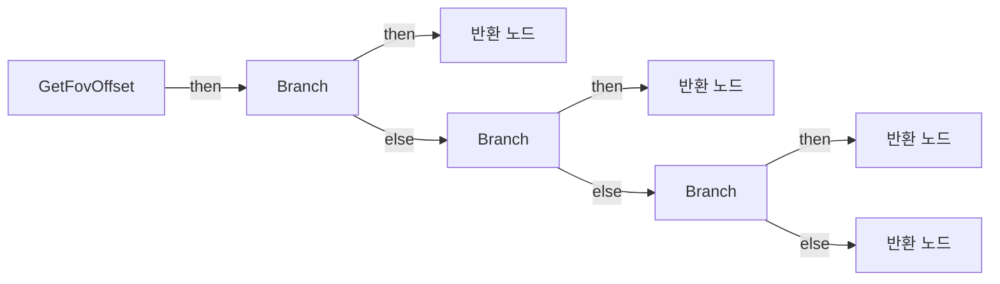

전체 노드·기본 입력 목록

| 노드 ID | 제목 | 미연결 기본 입력 / 에셋 입력 |
|---|---|---|
| `K2Node_FunctionEntry_0` | GetFovOffset |  |
| `K2Node_VariableGet_0` | Get |  |
| `K2Node_PromotableOperator_1` | Equal (Float) | B=90.000000 |
| `K2Node_PromotableOperator_2` | Equal (Float) | B=110.000000 |
| `K2Node_PromotableOperator_0` | Equal (Float) | B=120.000000 |
| `K2Node_FunctionResult_0` | 반환 노드 |  |
| `K2Node_Knot_0` | 경유 노드 |  |
| `K2Node_VariableGet_1` | Get FOV90GripOffset |  |
| `K2Node_Knot_1` | 경유 노드 |  |
| `K2Node_VariableGet_2` | Get FOV110GripOffset |  |
| `K2Node_VariableGet_3` | Get FOV120GripOffset |  |
| `K2Node_IfThenElse_0` | Branch |  |
| `K2Node_IfThenElse_1` | Branch |  |
| `K2Node_Knot_2` | 경유 노드 |  |
| `K2Node_Knot_3` | 경유 노드 |  |
| `K2Node_FunctionResult_1` | 반환 노드 |  |
| `K2Node_IfThenElse_2` | Branch |  |
| `K2Node_Knot_4` | 경유 노드 |  |
| `K2Node_FunctionResult_2` | 반환 노드 |  |
| `K2Node_FunctionResult_3` | 반환 노드 | FOVOffset=0, 0, 0 |
| `K2Node_Knot_5` | 경유 노드 |  |
| `K2Node_Knot_6` | 경유 노드 |  |

### InitOwner

실행 핀 플로우차트

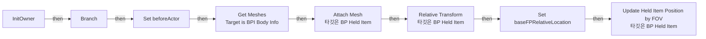

전체 노드·기본 입력 목록

| 노드 ID | 제목 | 미연결 기본 입력 / 에셋 입력 |
|---|---|---|
| `K2Node_FunctionEntry_0` | InitOwner |  |
| `K2Node_Message_1` | Get Meshes Target is BPI Body Info |  |
| `K2Node_CallFunction_0` | Attach Mesh 타깃은 BP Held Item |  |
| `K2Node_CallFunction_22` | Relative Transform 타깃은 BP Held Item |  |
| `K2Node_VariableGet_5` | Get |  |
| `K2Node_VariableGet_4` | Get beforeActor |  |
| `K2Node_PromotableOperator_0` | Not Equal (Object) |  |
| `K2Node_Knot_12` | 경유 노드 |  |
| `K2Node_IfThenElse_1` | Branch |  |
| `K2Node_VariableSet_1` | Set beforeActor |  |
| `K2Node_Knot_13` | 경유 노드 |  |
| `K2Node_Knot_14` | 경유 노드 |  |
| `K2Node_Knot_15` | 경유 노드 |  |
| `K2Node_CallFunction_1` | Update Held Item Position by FOV 타깃은 BP Held Item |  |
| `K2Node_VariableGet_0` | Get FP_Mesh |  |
| `K2Node_VariableGet_1` | Get RelativeLocation |  |
| `K2Node_VariableSet_0` | Set baseFPRelativeLocation | Output_Get=0, 0, 0 |

### OnRep_currentUsageCount

실행 핀 플로우차트

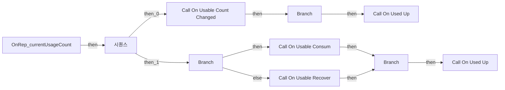

전체 노드·기본 입력 목록

| 노드 ID | 제목 | 미연결 기본 입력 / 에셋 입력 |
|---|---|---|
| `K2Node_FunctionEntry_0` | OnRep_currentUsageCount |  |
| `K2Node_CallDelegate_0` | Call On Usable Count Changed  |  |
| `K2Node_VariableGet_0` | Get |  |
| `K2Node_VariableGet_2` | Get maxUsageCount |  |
| `K2Node_VariableGet_3` | Get |  |
| `K2Node_CallDelegate_1` | Call On Used Up |  |
| `K2Node_Knot_0` | 경유 노드 |  |
| `K2Node_IfThenElse_0` | Branch |  |
| `K2Node_ExecutionSequence_0` | 시퀀스 |  |
| `K2Node_IfThenElse_1` | Branch |  |
| `K2Node_CallDelegate_2` | Call On Usable Consum |  |
| `K2Node_CallDelegate_3` | Call On Usable Recover |  |
| `K2Node_VariableGet_4` | Get |  |
| `K2Node_Knot_1` | 경유 노드 |  |
| `K2Node_VariableGet_5` | Get |  |
| `K2Node_VariableGet_6` | Get maxUsageCount |  |
| `K2Node_Knot_2` | 경유 노드 |  |
| `K2Node_Knot_3` | 경유 노드 |  |
| `K2Node_VariableGet_7` | Get attributes |  |
| `K2Node_Knot_4` | 경유 노드 |  |
| `K2Node_IfThenElse_2` | Branch |  |
| `K2Node_CallDelegate_4` | Call On Used Up |  |
| `K2Node_PromotableOperator_2` | integer &lt;= integer |  |
| `K2Node_PromotableOperator_3` | integer &lt;= integer |  |

### OnRep_itemInfo

실행 핀 플로우차트

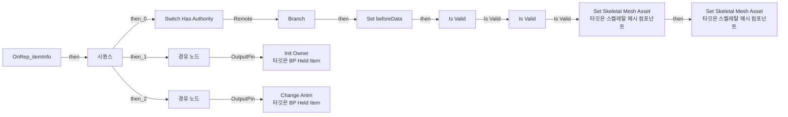

전체 노드·기본 입력 목록

| 노드 ID | 제목 | 미연결 기본 입력 / 에셋 입력 |
|---|---|---|
| `K2Node_FunctionEntry_0` | OnRep_itemInfo |  |
| `K2Node_ExecutionSequence_1` | 시퀀스 |  |
| `K2Node_Knot_16` | 경유 노드 |  |
| `K2Node_MacroInstance_1` | Is Valid |  |
| `K2Node_VariableGet_13` | Get skeletalMesh |  |
| `K2Node_VariableGet_14` | Get FP_Mesh |  |
| `K2Node_CallFunction_6` | Set Skeletal Mesh Asset 타깃은 스켈레탈 메시 컴포넌트 |  |
| `K2Node_VariableGet_15` | Get TP_Mesh |  |
| `K2Node_CallFunction_8` | Set Skeletal Mesh Asset 타깃은 스켈레탈 메시 컴포넌트 |  |
| `K2Node_Knot_1` | 경유 노드 |  |
| `K2Node_Knot_2` | 경유 노드 |  |
| `K2Node_Knot_3` | 경유 노드 |  |
| `K2Node_MacroInstance_3` | Is Valid |  |
| `K2Node_VariableGet_3` | Get |  |
| `K2Node_Knot_9` | 경유 노드 |  |
| `K2Node_PromotableOperator_1` | Not Equal (Object) |  |
| `K2Node_VariableGet_1` | Get beforeData |  |
| `K2Node_IfThenElse_0` | Branch |  |
| `K2Node_VariableSet_0` | Set beforeData |  |
| `K2Node_Knot_10` | 경유 노드 |  |
| `K2Node_Knot_6` | 경유 노드 |  |
| `K2Node_Knot_7` | 경유 노드 |  |
| `K2Node_MacroInstance_7` | Switch Has Authority |  |
| `K2Node_Knot_27` | 경유 노드 |  |
| `K2Node_CallFunction_18` | Init Owner 타깃은 BP Held Item |  |
| `K2Node_CallFunction_19` | Change Anim 타깃은 BP Held Item |  |

### RelativeTransform

실행 핀 플로우차트

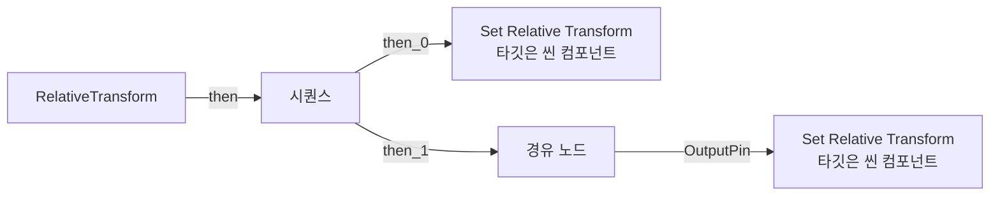

전체 노드·기본 입력 목록

| 노드 ID | 제목 | 미연결 기본 입력 / 에셋 입력 |
|---|---|---|
| `K2Node_FunctionEntry_0` | RelativeTransform |  |
| `K2Node_VariableGet_6` | Get TP_Mesh |  |
| `K2Node_VariableGet_7` | Get FP_Mesh |  |
| `K2Node_CallFunction_17` | Get Socket Transform 타깃은 씬 컴포넌트 | InSocketName=GripPoint; TransformSpace=RTS_Component |
| `K2Node_CallFunction_16` | Get Socket Transform 타깃은 씬 컴포넌트 | InSocketName=GripPointTP; TransformSpace=RTS_Component |
| `K2Node_CallFunction_19` | Invert Transform |  |
| `K2Node_CallFunction_18` | Invert Transform |  |
| `K2Node_CallFunction_20` | Set Relative Transform 타깃은 씬 컴포넌트 | bSweep=false; bTeleport=false |
| `K2Node_VariableGet_8` | Get FP_Mesh |  |
| `K2Node_CallFunction_21` | Set Relative Transform 타깃은 씬 컴포넌트 | bSweep=false; bTeleport=false |
| `K2Node_VariableGet_9` | Get TP_Mesh |  |
| `K2Node_ExecutionSequence_0` | 시퀀스 |  |
| `K2Node_Knot_0` | 경유 노드 |  |

### UpdateHeldItemPositionByFOV

실행 핀 플로우차트

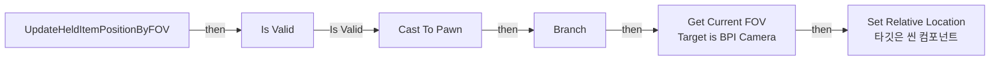

전체 노드·기본 입력 목록

| 노드 ID | 제목 | 미연결 기본 입력 / 에셋 입력 |
|---|---|---|
| `K2Node_FunctionEntry_0` | UpdateHeldItemPositionByFOV |  |
| `K2Node_CallFunction_0` | Is Locally Controlled 타깃은 폰 |  |
| `K2Node_IfThenElse_0` | Branch |  |
| `K2Node_CallFunction_2` | Set Relative Location 타깃은 씬 컴포넌트 | bSweep=false; bTeleport=false |
| `K2Node_PromotableOperator_2` | vector + vector |  |
| `K2Node_VariableGet_8` | Get |  |
| `K2Node_VariableGet_12` | Get baseFPRelativeLocation |  |
| `K2Node_VariableGet_13` | Get FP_Mesh |  |
| `K2Node_DynamicCast_1` | Cast To Pawn |  |
| `K2Node_Knot_6` | 경유 노드 |  |
| `K2Node_Message_0` | Get Current FOV Target is BPI Camera |  |
| `K2Node_Knot_7` | 경유 노드 |  |
| `K2Node_Knot_9` | 경유 노드 |  |
| `K2Node_MacroInstance_1` | Is Valid |  |
| `K2Node_CallFunction_5` | Get Fov Offset |  |

### UserConstructionScript

실행 핀 플로우차트

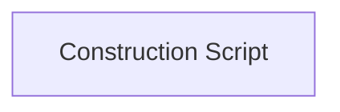

전체 노드·기본 입력 목록

| 노드 ID | 제목 | 미연결 기본 입력 / 에셋 입력 |
|---|---|---|
| `K2Node_FunctionEntry_0` | Construction Script |  |

## 조회 범위의 한계

ObjectIterator로 발견했으나 MCP helper가 반환하지 않은 그래프입니다. delegate signature·컴파일된 중간 그래프·macro·애니메이션 내부 그래프가 섞일 수 있습니다.

- `CheckItemID`: Graph 'CheckItemID' not found in Blueprint.
- `Consum`: Graph 'Consum' not found in Blueprint.
- `Equip`: Graph 'Equip' not found in Blueprint.
- `GetItemID`: Graph 'GetItemID' not found in Blueprint.
- `GetSlotNumber`: Graph 'GetSlotNumber' not found in Blueprint.
- `GetUsageCount`: Graph 'GetUsageCount' not found in Blueprint.
- `GetZoomData`: Graph 'GetZoomData' not found in Blueprint.
- `OnUsableConsum`: Graph 'OnUsableConsum' not found in Blueprint.
- `OnUsableCountChanged `: Graph 'OnUsableCountChanged ' not found in Blueprint.
- `OnUsableRecover`: Graph 'OnUsableRecover' not found in Blueprint.
- `OnUsedUp`: Graph 'OnUsedUp' not found in Blueprint.
- `ReceiveBeginPlay`: Graph 'ReceiveBeginPlay' not found in Blueprint.
- `Recover`: Graph 'Recover' not found in Blueprint.
- `SetBuffComponent`: Graph 'SetBuffComponent' not found in Blueprint.
- `SetItemOwner`: Graph 'SetItemOwner' not found in Blueprint.
- `StartAbility`: Graph 'StartAbility' not found in Blueprint.
- `StopAbility`: Graph 'StopAbility' not found in Blueprint.
- `StopUsing`: Graph 'StopUsing' not found in Blueprint.
- `TryUse`: Graph 'TryUse' not found in Blueprint.
- `Unequip`: Graph 'Unequip' not found in Blueprint.
- `[C]SpawnReloadSound`: Graph '[C]SpawnReloadSound' not found in Blueprint.
- `[S]Consum`: Graph '[S]Consum' not found in Blueprint.
- `[S]Recover`: Graph '[S]Recover' not found in Blueprint.

[원본 MCP 스냅샷](../../../Evidence/blueprints-070.json)
